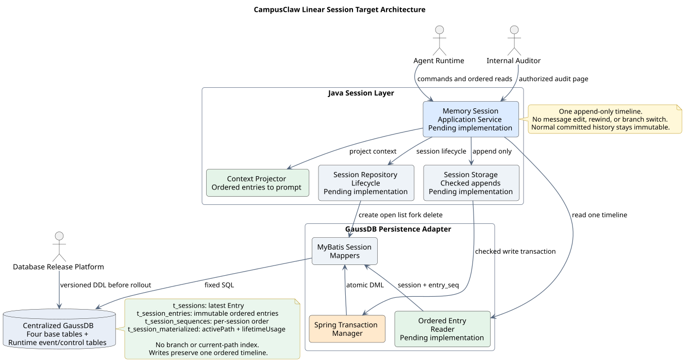
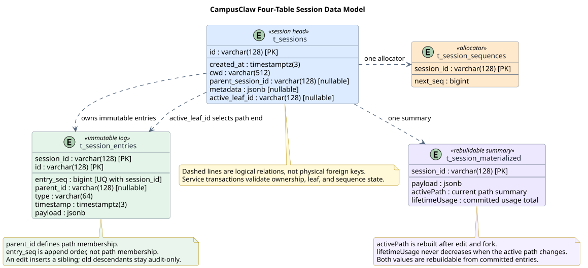
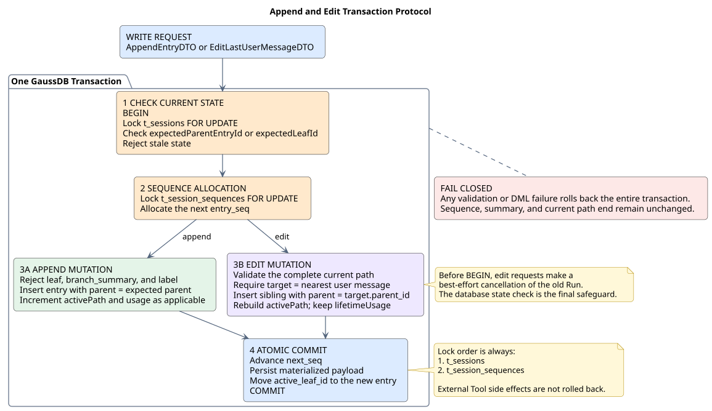
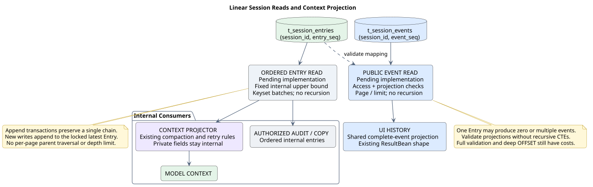

# CampusClaw Java GaussDB Session 线性事件存储 SR 设计

> 文档编号：SR-MEM-001<br>
> 版本：v0.22.0<br>
> 日期：2026-10-10<br>
> 状态：单条追加时间线已确认；主线顺序 Mapper 已核验，统一历史增量待实现<br>
> Java 核验基线：`fb842b1ac6cb4818f6b146f79dd184a5cd88bf12`；本地源码快照，不代表最新远端<br>
> pi 专项基线：默认分支 `main`，2026-09-22 隔离 fetch，`1a584a7a56eb5e7b4ff8ccbd46430f1533282eed`；默认分支快照不等于稳定发布<br>
> 目标数据库：集中式 GaussDB；JDBC 约束：openGauss JDBC `6.0.0-htrunks.csi.gaussdb_kernel.opengaussjdbc.r1`

[Claw 数据库设计](../Claw数据库设计.md)唯一维护全库结构；本文维护 Session 语义、追加/恢复流程和相关验收。用户与会话的归属及当前权限由 Mate 独立维护，Claw 不增加用户范围或 owner 列；跨服务创建与删除按[身份边界](../Claw数据库设计.md#mate-ownership)执行，PR #332 的相应扩展待撤销。

## 1. 职责与设计结论

本模块维护 Session 的追加历史、模型上下文恢复、会话汇总和累计用量。每个 Session 只有一条按提交顺序增长的时间线；不提供最近一条对话编辑、历史消息替换、回退、同 Session 分支创建、切换或恢复。已提交记录不可由对话操作覆盖或截断；Session 删除与部署既有的数据保留策略另行生效，不新增自动清理。

正常历史全部保留。停止执行、工具确认、计划修订、问答续跑和压缩都在原时间线继续追加，不把末端移回旧 Entry。计划修订产生新计划事件，不等于修改已保存的用户对话。新的独立 Session 可以记录来源身份；`parent_session_id` 不表示本 Session 内有多条可选择路径。

内部读取以 `session_id + entry_seq` 为边界，公共 ListEvents 以 `session_id + event_seq` 为边界；均不按父链递归、不新增当前路径成员表或分支缓存。`parent_id`、`active_leaf_id` 沿用原字段名，分别表示前一条 Entry 与最新 Entry，供完整性和并发检查使用，不决定查询可见集合。

本专题的四张基础表是 `t_sessions`、`t_session_entries`、`t_session_sequences`、`t_session_materialized`。它们不是当前 Runtime 数据库的完整表清单：已实现的 `t_session_events`、`t_session_event_projection`、内部 Record、统计和执行控制等表继续存在，不因本设计删除。公共事件字段、投影和数字分页由 [ListEvents](../../01-总体架构/01-CampusClaw多Agent运行时/chat-events-history-design.md)维护；压缩算法由[压缩与恢复](./compaction.md)维护。



[原尺寸 SVG](./设计图/memory-architecture.svg) · [查看 PlantUML 源码](./设计图/diagram.puml#L6)

应用服务分别调用事务追加、顺序读取和上下文投影。存储层固定 Session 边界与顺序，上下文层解释压缩及失败重试记录；UI 只读取安全公共事件。读取历史不需要创建或保留 Session 执行对象，已有 Spring 单例与请求范围读取事务沿用。图中通用 Memory 接口是目标抽象，不能据此宣称已实现；Runtime 的实际类与差距见 §2.3。

### 1.1 术语约定

| 术语 | 本设计语义 |
|---|---|
| 线性时间线 | 同一 Session 的全部有效 Entry，按严格递增的 `entry_seq` 排列 |
| `parent_id` | 前一条 Entry 的 ID；第一条为空；不作为日常读取路径 |
| `active_leaf_id` | 沿用字段名，语义为最新 Entry ID；空 Session 时为空 |
| `activePath` | 保留既有汇总键名，表示单条时间线的会话摘要，不表示分支功能 |
| `expectedParentEntryId` | 内部追加的预期末端，用于锁内复核；不新增公共 HTTP 字段 |
| 公共事件 | `t_session_events` 中已经保存的完整安全投影；一条 Entry 可以对应零条或多条事件 |

## 2. 来源证据与设计边界

### 2.1 观察到的 pi 行为

pi SQLite 保留分支能力，并在写入时维护分支索引。正常追加只写入成员并推进片段末端；从旧节点分叉时，无 compaction 则复制前缀索引，有 compaction 则共享此前片段、复制其后的索引。读取先用 TypeScript 循环解析片段，再按分支和序号范围执行普通 SQL。它避免逐 Entry 的递归 CTE，但片段嵌套仍有元数据读取成本，分叉也会产生索引复制成本。

以下路径相对 `badlogic/pi-mono`，均核验于上述 `1a584a7a56eb5e7b4ff8ccbd46430f1533282eed`：

| 路径 / 符号 | 已观察行为 |
|---|---|
| [`packages/session-backends/sqlite-node/src/sqlite/session/branch-entries.ts`](https://github.com/badlogic/pi-mono/blob/1a584a7a56eb5e7b4ff8ccbd46430f1533282eed/packages/session-backends/sqlite-node/src/sqlite/session/branch-entries.ts) · `appendEntryToBranchIndex`、`createDivergentBranchForEntry`、`readBranchSegmentsNewestFirst`、`scanBranchSegments` | 写侧维护 `branch_entries/branch_meta`，读侧解析片段并按序号及 limit 扫描 |
| [`packages/session-backends/sqlite-node/src/sqlite/storage.ts`](https://github.com/badlogic/pi-mono/blob/1a584a7a56eb5e7b4ff8ccbd46430f1533282eed/packages/session-backends/sqlite-node/src/sqlite/storage.ts) · `applyCommit` | Entry、分支索引、序号等在同一个 SQLite 事务提交 |
| [`packages/session-backends/sqlite-node/src/sqlite/migrations/001_initial.sql`](https://github.com/badlogic/pi-mono/blob/1a584a7a56eb5e7b4ff8ccbd46430f1533282eed/packages/session-backends/sqlite-node/src/sqlite/migrations/001_initial.sql) · `entries/branch_entries/branch_meta`、`ix_be_seq` | 原始父子关系与有序分支索引分离，索引以 Session、分支、序号开头 |
| `packages/session-backends/sqlite-node/README.md` · writable owner | Host 保证一个 Session 的单写所有者；不提供跨进程 lease/fence，不能替代集中式数据库锁 |
| `packages/session-backends/sqlite-node/test/storage.test.ts` · divergent segment / newest compaction 测试 | 测试源码覆盖前缀索引复制与 compaction 片段共享；本次未运行上游测试 |

专项从旧基线 `f0deb8dd8e9611e89b5bc4145ca92c03ae6ed4ee` 升级：旧路径 `packages/storage/sqlite-node/src/sqlite/storage/branch-cache.ts` 已变为上述 `session-backends/.../session/branch-entries.ts`；旧七表和 `branch_tips` 描述不用于推断新实现。只升级分支索引与读写事务证据，其他专题的压缩、消息和 Provider 历史基线保持。

### 2.2 CampusClaw 目标决策

| 决策 | 分类 | 理由与代价 |
|---|---|---|
| Session 只允许尾部追加，不提供最近对话编辑或分支操作 | 产品约束 | 产品当前没有这些入口；避免为未开放能力维护多路径语义，代价是不支持原地改写后重新生成 |
| 直接按 Session 与序号查询，不建立分支索引 | 架构变更 | 写侧保证全部 Entry 属于同一时间线，数据库递归限制不再约束历史长度；深页 OFFSET 和完整恢复仍有自身成本 |
| 保留 `parent_id/active_leaf_id` | 架构选择 | 复用追加事务的末端检查和内部关联；单链读取不依赖父关系遍历 |
| 按 Session 锁、序号锁顺序追加并复核所属执行 | 并发加固 | 集中式多实例不能依赖本地队列；不因取消分支而放宽运行准入或迟到写入检查 |
| 会话摘要与累计用量分开 | 架构边界 | 公共列表、模型上下文和实际计费用量口径不同，压缩不回退已发生费用 |

本设计不引入 Maven 依赖。MyBatis Spring Boot Starter 默认 `3.0.4`，沿用已有 JDK、Spring 和 JDBC；不为读取新增缓存服务、索引表或数据库插件。

### 2.3 Java 已实现行为与差距

2026-09-22 核验 `pi-mono-java@fb842b1ac6cb4818f6b146f79dd184a5cd88bf12`。以下为仓库相对路径；源码检查不等于数据库验收。

| 路径 / 符号 | 已观察行为 | 差距 |
|---|---|---|
| `modules/coding-agent-cli/src/main/java/com/campusclaw/codingagent/runtimeapi/web/RuntimeSessionController.java`、`RuntimeEventController.java`；同模块 `service/command/` | 未发现最近消息编辑、回退及分支切换入口 | 产品范围按本设计固定，不新增这些入口 |
| 同模块 `persistence/MyBatisRuntimeSessionRepository.java` · `lockSession/appendLocked/appendEventsLocked` | 已在 Session 锁内设置 parent 为当前末端，分配序号、保存 Entry 和公共事件并推进末端 | 已实现尾部追加骨架；预期父记录与执行有效性须按具体调用链验收，不宣称所有并发校验均完成 |
| `modules/coding-agent-cli/src/main/resources/mapper/session/RuntimeSessionMapper.xml` · `listCurrentBranchEntries/listCommittedEvents/countUnmappedCurrentBranchEntries` | 三处递归 CTE 均从末端追父链，分页不能限制前置递归深度 | 三处非递归改造待实现；保留投影完整性和未知类型失败语义 |
| 同 Java 目录 `event/CommittedEventQueryService.java` · `list/pageOf`；上述 Repository · `findEventPage` | 已有普通数字页码、多取一条及 REPEATABLE_READ 单请求边界 | 沿用；只替换存储范围，不增加跨页快照 |
| 同目录 `event/RuntimeContextHistoryService.java` · `restoreHistory`；`RuntimeCompactionEventProjector.java` · `persistCompaction` | 已有分批恢复，压缩结果走 `appendEntryWithUsage` 追加 | 恢复读取需改为单链范围查询；上下文过滤算法保持 |
| `modules/coding-agent-cli/src/main/resources/db/gaussdb/install/session_schema.sql` | Runtime 还有事件、投影、内部 Record、统计和执行控制等表 | 四表 DDL 只是基础模型；不替代运行数据库安装清单 |

2026-10-10 已隔离 fetch 主线 `769e86592285f4a25b0febaf551eddea6bc7212c`，重核 `RuntimeSessionMapper.xml` 的 `listTimelineEntries/listCommittedEvents/countUnmappedTimelineEntries`：三处查询已按 Session 与序号非递归读取，字段、索引及证据集中于[数据库设计](../Claw数据库设计.md#current-schema)。上表保留历史观察，不作为这些查询当前仍待实现的依据；未运行数据库验收，也不升级其他历史能力结论。

### 2.4 范围与非目标

范围包含创建、打开、列表、删除、追加、内部 Entry 分页、授权审计、模型恢复，以及目标中的独立 Session 复制。复制能力的实现状态未核验，不因其列入目标而开放新公共接口。

不提供最近或任意历史对话编辑、消息替换、同 Session 回退、分支列表/创建/切换/恢复、`moveTo`、标签 API，以及新写入 `leaf/branch_summary/label`。不新增 Runtime Checkpoint、跨会话长期记忆、全文/向量索引、Run 幂等协议或工具副作用补偿。公司认证、租户和审计规则仍由所属模块维护，本专题不增加 RLS。

## 3. 四张基础表的数据模型



[原尺寸 SVG](./设计图/memory-data-model.svg) · [查看 PlantUML 源码](./设计图/diagram.puml#L155)

表结构统一由 [Claw 数据库设计](../Claw数据库设计.md#current-schema)维护，本图仍说明 Session 基础关系，不代表全库只有四张表。以下保留原章节入口，避免旧链接失效。

### 3.1 `t_sessions`

见[会话主表](../Claw数据库设计.md#t_sessions)：当前配置、末端与来源；用户归属不进入 Claw 会话表。

### 3.2 `t_session_entries`

见[内部完整历史](../Claw数据库设计.md#t_session_entries)：字段、提交序号、索引及工具结果目标增量。

### 3.3 `t_session_sequences`

见[共享序号分配器](../Claw数据库设计.md#t_session_sequences)：Entry、Record 和公共事件的有序分配，不承诺连续。

<a id="second-precision-storage"></a>

### 3.4 秒级时间存储

列范围、主线与 PR 精度差异见[数据库全局规则](../Claw数据库设计.md#global-rules)；公共表示由[时间契约](../../01-总体架构/01-CampusClaw多Agent运行时/time-contract.md)维护，不把内部租约统一改成秒。

### 3.5 `t_session_materialized`

见[可重建汇总](../Claw数据库设计.md#t_session_materialized)及[Usage 累计](../Claw数据库设计.md#t_session_stats)，不维护第二份用量权威。

## 4. GaussDB 设计与 SQL 入口

[Claw 数据库设计](../Claw数据库设计.md)集中维护完整表模型。[schema.sql](schema.sql)保留为历史四表基础示意，[统一历史 SQL](unified-event-persistence.sql)为待实现增量；其适用范围及完整安装脚本见[SQL 材料](../Claw数据库设计.md#sql-files)。数据库发布平台负责 DDL，应用仅使用相应 DML，不能用基础示意覆盖 Runtime 全库。

## 5. Java 接口与错误语义

### 5.1 应用服务

通用 Memory 应用接口是目标抽象，待实现；已有 Runtime Repository 按 §2.3 渐进调整。

```java
interface MemorySessionApplicationService {
    SessionDTO createSession(CreateSessionDTO dto);
    SessionDTO openSession(String sessionId);
    List<SessionSummaryDTO> listSessions(SessionListQueryDTO queryDTO);
    void deleteSession(String sessionId);
    SessionDTO forkSession(ForkSessionDTO dto);
    AppendResultDTO appendEntry(AppendEntryDTO dto);
    ContextSnapshotDTO loadContext(LoadContextDTO dto);
    EntryPageDTO pageEntries(EntryPageQueryDTO queryDTO);
    EntryPageDTO pageAllEntriesForAudit(AuditEntryPageQueryDTO queryDTO);
}
```

这些接口只接收/返回内部 DTO。HTTP 边界仍为请求/响应分离的 VO，标准 Jakarta 校验放在请求，Service 负责规则和转换，Mapper 只使用 DTO 与标量。不提供编辑 DTO、编辑错误码、分支选择或路径深度配置。审计和模型读取同一时间线，但内容投影、权限与用途不同；审计 payload 不直接返回 UI 或回灌模型。

### 5.2 写入 DTO

`AppendEntryDTO` 包含 `sessionId/expectedParentEntryId/entry`。空 Session 首次追加才允许预期父节点为空。执行侧持有的预期末端和具体执行身份必须在事务内复核，不能把读取快照当作最终写入许可。保留现有 Runtime 准入与控制契约；该内部目标不增加公共字段。

### 5.3 错误语义

| 内部错误 | 条件 |
|---|---|
| `SESSION_NOT_FOUND` | Session 不存在 |
| `SESSION_INVALID_ENTRY` | 类型、payload 或字段非法 |
| `SESSION_STALE_PARENT` | 预期末端与锁内最新 Entry 不一致 |
| `SESSION_CORRUPTED_PATH` | 末端或父节点所属 Session 非法，追加状态损坏 |
| `SESSION_STORAGE_ERROR` | 事务、JDBC 或汇总写入失败 |

上述内部目标不新增 HTTP 错误；ListEvents 存储或投影失败仍映射现有 `EVENT_LIST_FAILED`。单链损坏不能通过选择最大序号、截断或跳过记录“修复”。正常历史长度不映射为递归深度错误。

## 6. 事务与并发协议



[原尺寸 SVG](./设计图/memory-write-transaction.svg) · [查看 PlantUML 源码](./设计图/diagram.puml#L95)

### 6.1 创建 Session

一个事务创建空 Session（末端为空）、序号分配器及基础汇总；Runtime 现有统计等初始化沿用。同一 Session 禁止创建第二个根。

### 6.2 追加 Entry

```text
BEGIN
  锁定 t_sessions，复核 Session、所属执行及预期末端
  拒绝 leaf、branch_summary、label 等不接受的新类型
  锁定 t_session_sequences，分配序号
  写入 Entry，parent_id = 锁内最新 Entry ID
  写入对应公共事件、投影完成记录及必要内部 Record
  更新 next_seq、末端与适用汇总/Usage
COMMIT
```

同批 Entry 逐个推进本事务内末端，公共事件按既有有序提交规则分配独立序号。失败全部回滚。Session 行锁与序号锁顺序固定；M1 准入、确认/中断竞争、旧执行迟到写入拒绝由 Runtime 控制规则继续约束，线性模型不替代这些检查。`expectedParentEntryId` 目标与现有实现差距见 §2.3。

### 6.3 压缩与上下文

压缩完成记录继续追加，历史 Entry 不删除，末端不回退。摘要、`retainedTail/firstKeptEntryId` 和失败重试过滤只影响模型上下文投影；具体算法与固定基线见[压缩专题](./compaction.md)。本次不改变在线与重载一致性，也不将压缩改成数据库历史清理。

### 6.4 复制 Session（fork）

目标为独立 Session 的完整线性历史复制，不是同 Session 分支操作，待实现范围另行核验。一次内部读取快照固定来源上界，再按顺序复制；新 Session 记录 `parent_session_id`，保留内部 Entry ID/父关系并重新分配自身序号。副本的公共事件身份与关联须按独立复制契约定义，不修改来源会话的 eventId。来源后续追加不自动进入副本；复制不产生新的 Skill 使用信号。

<a id="delete-session"></a>

### 6.5 删除 Session

按现有依赖顺序在删除事务中清理事件/执行关联与基础表，不只删四张表；外部资源清理由其既有机制处理。不用本次设计增加 `ON DELETE CASCADE` 或跳过约束。具体 Runtime 删除/保留策略继续有效；父子执行关联按统一历史的双端保留与实际收尾条件清理，不随单侧 Session 级联删除。

[M05 使用统计](../../01-总体架构/04-CampusClaw命令系统/03-Skill加载统计/README.md)从新 LIVE 成功工具结果同事务维护累计，不建立独立事实或采集链。删除与追加争用相同生命周期锁，清理前登记统计历史缺口，不扣累计；活跃/未知执行须先停止或对账，不能通过删除解除占用。恢复、复制不计数，from/to 与日表仍待核实。三入口及父子关联由[统一历史](../../01-总体架构/01-CampusClaw多Agent运行时/unified-event-persistence.md)维护；[补充 DDL](unified-event-persistence.sql)增加工具结果关联与独立执行关系，不复用表示复制来源的 parent_session_id。四表基础模型仍非完整安装 DDL。

## 7. 顺序读取、分页和模型上下文



[原尺寸 SVG](./设计图/memory-context-rebuild.svg) · [查看 PlantUML 源码](./设计图/diagram.puml#L250)

### 7.1 单链不变量

从空 Session 建立单链：第一次追加的 `parent_id` 为空；后续追加在 Session 锁内把 `parent_id` 设为原最新 Entry ID，提交时同步推进 `active_leaf_id`。同一追加事务分配严格递增序号并保存投影，失败整体回滚。所有写入口复用此协议，不能指定历史分叉点或把末端回退。由空状态和每次合法追加维持单链，不增加读前全链核验。

已配置历史保留若会移除 Entry，必须由独立保留流程验证恢复边界和引用完整性，不把任意断链当成合法单链；本次不新增截断或自动清理方案。

### 7.2 普通分页与审计分页

内部 Entry 使用 `(session_id, entry_seq)` 范围查询，`entry_seq > afterSeq ORDER BY entry_seq LIMIT batchSize`。同一次模型恢复/复制先固定内部读取上界，后续批次限制在该上界内，防止尾部持续追加改变本次恢复范围；上界不作为公共游标暴露，保留/删除竞争需在读取一致性边界中处理。

公共 [ListEvents](../../01-总体架构/01-CampusClaw多Agent运行时/chat-events-history-design.md#3-普通数字页码)直接从 `t_session_events` 按 Session 和 `event_seq` 读取完整事件，再使用既有 `page/nextPage`、多取一条和单请求一致性。不得先分页 Entry 再拆成事件。审计仍按授权读取内部记录，与公共事件保持投影隔离。

当前主线已完成 Entry 读取、公共事件读取、未映射 Entry 检查的非递归 Mapper，核验范围见 §2.3。完整性检查改为同 Session 的普通连接/聚合，保留类型、投影存在性及实际事件数量核对；不因移除递归而跳过未知类型或缺少投影。全量检查可能仍为线性成本，暂不引入投影水位替代它，后续优化须单独证明同等完整性。

### 7.3 重建模型上下文

```text
upperBound = captureCommittedEntryUpperBound(sessionId)
entries = readOrderedEntryBatches(sessionId, upperBound)
messages = projectWithExistingCompactionAndRetryRules(entries)
```

Entry 时间线完整不代表每条都进入模型。配置、控制、独立 Usage 和私有恢复信息继续按既有转换规则处理；压缩摘要与失败候选排除保持。取消递归不等于查询为常数时间：公开深页 OFFSET、全量完整性检查及完整模型恢复分别评估执行计划、内存和延迟，不用数据库默认参数宣称容量。

## 8. 初始化与交付范围

面向新建环境交付完整安装 DDL 和统一的只追加读写实现，不考虑存量数据，不设计迁移脚本、兼容分支、上线前存量扫描或旧路径处理。SQLite/JSONL 数据导入不属于本次范围。

初始化使用[数据库设计关联的完整安装脚本](../Claw数据库设计.md#sql-files)，包含公共事件、投影、执行控制和统计等表；本专题四表 SQL 是历史基础示意。创建空 Session 后，所有写入口按 §6.2 追加；内部恢复、公共历史和映射检查同时使用 §7 的非递归查询。

## 9. 实施切片与验收

| 切片 | 实施与验收 |
|---|---|
| S1 · 只追加约束 | 从空 Session 开始验证首条与连续追加；拒绝过期预期父节点和跨 Session 引用；并发追加保持单根、无分叉、末端一致，所有业务入口均无回退操作 |
| S2 · 三处顺序查询 | 同步 Entry、公共事件与投影完整性查询及消费者命名；确认均无递归 CTE，未知类型/数量不匹配仍失败；不存在 Session 不得伪装为空成功 |
| S3 · 写入与恢复 | 并发追加、配置组合更新、确认续跑、计划修订及压缩始终只追加；旧执行不越权写入；同次恢复使用固定内部上界，在线与重载消息一致 |
| S4 · 公共分页 | 覆盖 200、201、1000、10000 条以上 Entry，保留数据库默认递归设置；第一页、末页、空页、一 Entry 多事件、尾部追加及序号空洞均正确；数字页码和 GET/SSE 同形保持 |
| S5 · 数据库与运维 | 指定 JDBC 与真实 GaussDB 验证事务回滚、锁顺序、类型绑定、SQLState、索引与执行计划；运行身份 DDL 被拒绝，凭据与正文不入普通日志 |

上述均为实施验收要求，尚未执行。模型压缩和长历史恢复不得因超过数据库递归次数而失败；应用可按既有产品容量策略限制数据量，但不以链表深度替代容量测量。不新增编辑、回退、分支操作的实现或正向功能测试；原分支可见性测试退出目标验收，改为只追加约束及长历史顺序读取测试。

## 10. 安全与运维

公司认证、Session 访问边界、审计、保留和凭据策略保持。JDBC 使用 TLS 与部署 Secret，应用身份仅授予实际所需 DML；日志不输出 payload、metadata、凭据或私有上下文。监控追加状态冲突、投影缺失、锁等待、事务失败、读取行数/耗时和恢复内存。不监控或配置业务路径递归深度。工具副作用不会因停止、删除会话或压缩而自动撤销。

## 11. 设计决策

规则唯一维护于 §2.2，其他模块引用本专题。需要重新支持编辑或分支时，必须重新评估历史保留、读取索引和执行取消，不能只增加修改末端的入口。当前不预建分支索引或保存隐藏的替代时间线。

## 12. 图表生成与验证

在 `设计图/` 执行 `plantuml -tsvg diagram.puml`，四个稳定命名块继续保留。检查 ASCII、SVG XML、Markdown 图片与源码锚、生成同步、原尺寸与文档宽度可读性及 `git diff --check`。基础 DDL 的 17 个字段均有中文注释；这不表示 Runtime 全库仅有四表。源代码、数据库验收和设计静态校验分别报告。

## 13. 版本记录

| 版本 | 日期 | 变更 |
|---|---|---|
| v0.21.0 | 2026-10-10 | 表字段集中到 Claw 数据库设计，关联全库 SQL 并更新主线非递归查询核验。 |
| v0.20.0 | 2026-10-10 | 补充唯一工具结果和父子执行关联，清理保留 Skill 累计并登记历史缺口。 |
| v0.19.0 | 2026-10-02 | Session 与事件目标时间列统一到秒，保持提交序号排序和新建环境交付范围。 |
| v0.18.0 | 2026-09-22 | Session 采用单条追加时间线，移除最近消息编辑与递归读取，按新建环境实施。 |
| v0.17.0 | 2026-09-16 | Skill 使用去重键保留覆盖活跃根，删除阻止迟到入账。 |
| v0.16.0 | 2026-09-15 | Session 删除与恢复引用 Skill 调用事实的清理和不重计边界。 |
| v0.15.0 | 2026-09-14 | 集中维护 Session 存储与压缩职责，独立 DDL 并收敛重复说明。 |
| v0.14.2 | 2026-08-11 | 统一中文术语和行文风格。 |
| v0.14.1 | 2026-08-11 | 优化四张图的可视化表达。 |
| v0.14 | 2026-08-11 | Session Schema 从七表收敛为四表。 |
| v0.13 | 2026-08-06 | 采用 `t_` 表名与数据库发布平台统一升级。 |
| v0.12 | 2026-08-03 | 调整数据库中文列注释表述，不改变 DDL 结构 |
| v0.11 | 2026-08-03 | 为目标字段增加中文 `COMMENT ON COLUMN` |
| v0.10 | 2026-08-03 | 标识字段、`type` 和 `cwd` 采用显式长度，增加长度预检和边界测试 |
| v0.9 | 2026-08-03 | 补充各表职责，明确原始历史、缓存和派生汇总的边界 |
| v0.8 | 2026-08-03 | 使用 `BIGINT`、`TIMESTAMPTZ(3)` 和 `JSONB` 原生类型 |
| v0.7 | 2026-08-03 | 采用与 SQLite 物理表结构对应的初始方案 |
| v0.6 | 2026-08-03 | 更新 pi 基线，并对齐写入序号、会话汇总、分支路径缓存和模型上下文处理 |
| v0.5 | 2026-07-30 | 更新 pi 基线，并采用新 harness 的当前路径末端与 `retainedTail` 语义 |
| v0.4 | 2026-07-20 | 将范围收敛为 Session 事件存储 |
| v0.3 | 2026-07-17 | 更新 pi 源码基线并核对记忆实现 |
| v0.2 | 2026-07-16 | 为 DDL 表和字段补充数据库说明 |
| v0.1 | 2026-07-15 | 建立 Java ToB GaussDB 持久化、事务和迁移设计 |
