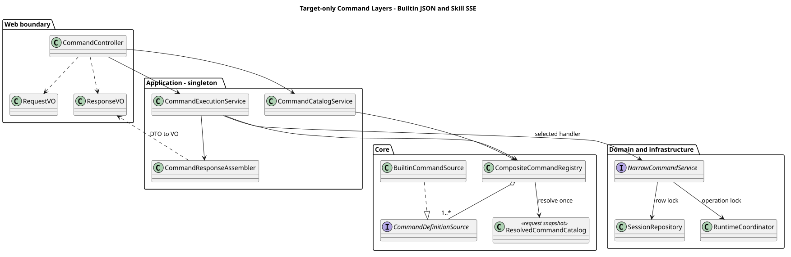
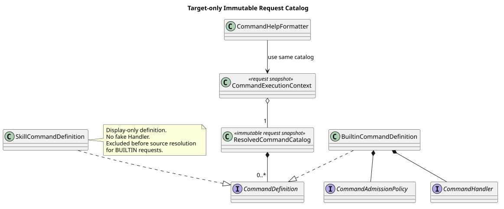
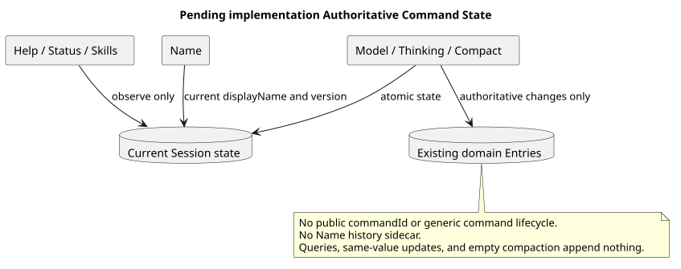

# CampusClaw Slash Command 通用模块设计

[返回命令与技能导航](../README.md)

| 属性 | 值 |
|---|---|
| 文档版本 | 1.6.0 |
| 更新日期 | 2026-09-07 |
| 设计仓基线 | `0eaa70ff365bf4d4e328b3473809341ca4cfc58d` |
| CampusClaw 分析基线 | `d84dd3d6a306b7587c70b29e0100e741dacef989` |
| Help 专项源码基线 | `d8e22562e22ac41ef4bb5cc6b36b576139417bd9`；字段/缓存/SPI 证据见 Help 专项，不替换其他行为的历史证据点 |
| 初始 Command 发现候选 | `0bb794f222273e12fc24fe98d6ab4e9013ac8599`（PR #210） |
| 最新前置 PR #210 | `9d0d76f4a571b559dc77ae52736caebbcc8fad88`；已通过 a8192e047f4061bd385297d3dc6c4358362d0d49 合并；828 模块行 / 1656 总代码行 |
| Command GET 候选 | `7759481a1722422395d46564129827c6ee6df204`（未发布） |
| 状态 | 用户确认的目标设计；公开实现为 target-only |

## 1. 当前目标

Builtin 实现切片覆盖 `help`、`status`、`name`、`model`、`thinking`、
`compact`、`skills` 七个 Builtin。共享 GET 按固定 Builtin 顺序与 Skill 名称顺序返回轻量清单，
POST Command 使用普通 ResultBean JSON。

Builtin 与 Skill Command 由用户统一负责设计、实现和集成。共享 GET 的轻量描述符、两类命令合并、固定排序与状态过滤已确认；Builtin 来源过滤只适用于内部 Builtin 专属解析，不是共享 GET 的全局限制。POST 保留已确认 Builtin JSON 契约；Skill 请求联合类型、执行结果和 HTTP 发布集成仍需评审。

本责任安排由用户于 2026-09-05 确认，取代旧版人员分工；旧记录仅用于历史追溯。
变更前设计基线为 `7bf966edc313b092f05f2f28256e32ed673e8c9a`；这是实施责任调整，既有源码证据点和命令行为决定继续有效。

`/` 只在交互层使用。Builtin POST 只接收 `name + arguments`，不接收附件或整段 Slash 文本。
普通 POST Events 不解析 Slash，既有请求级 SSE 行为不变。
本期不生成公开 commandId，也不持久化通用命令生命周期或 Name 边车历史。

### 1.1 全局目标类图

`/` 展示命令清单；已确认的 `/help` 无参展示当前 Agent 的用途和场景。
主图以设计仓 `06bea56c7a725bb749cffb6682bcf98a8f51884a` 的完整版为结构与排版基线，
保留 Web、Application、Command Core、Builtin 委派和 Runtime/持久化的完整关系。
本次只将旧 Help Formatter 路径替换为 Agent 元数据查询，并保留用户统一实施责任；不回滚其他设计决定。
所有装配关系均为 target-only；分组仅归并重复实现，不把 Handler、业务服务、Coordinator 和 Repository 合成一个对象。

[PlantUML 源码](设计图/diagram.puml#L92) · [展开原尺寸 SVG](设计图/target_slash_command_global_classes.svg)

文档内缩略图用于定位整体分层；阅读类名、箭头和多重性时展开原尺寸 SVG，不通过缩小图中文字适配窄页面。

Builtin 直接引用这份主图；Help 专题只补充元数据、缓存与结果投影，不再替代全局视图。
分组框表达协作关系而非 Java 包：AgentHelpQueryService 和其他窄业务服务仍属于应用 Service 层。
七个 Contributor/Handler 的精确命令映射见[内置命令服务表](../01-内置命令/README.md#2-全局目标与核心扩展)。

| 主图保留的职责关系 | 不能合并的原因 |
|---|---|
| CommandDefinition → BuiltinCommandDefinition；Catalog → Definition | 通用发现抽象和可执行 Builtin 不是同一职责；请求内固定 Definition 身份 |
| Contributor → Handler → 窄业务服务 | 分别负责装配、命令适配和业务约束；新增命令不修改中央名称 switch |
| 窄业务服务 → Coordinator → Holder/Session/Projector → Repository | 区分执行协调、执行范围对象与持久化；最终准入仍在所属锁内完成 |
| Help Handler → AgentHelpQueryService → AgentRuntimeManager | Help 消费同一完整 Agent 元数据快照，不反向依赖命令清单 |

补充源码复核仍使用 pi-mono-java `d8e22562`：`definition/CommandDefinition.java`、
`builtin/BuiltinCommandDefinition.java`、`catalog/ResolvedCommandCatalog.java` 和
`execution/CommandExecutionContext.java` 均位于 `modules/coding-agent-cli/src/main/java/com/campusclaw/codingagent/runtimeapi/command/` 下，
分别证明发现抽象、Handler/Admission 组合、请求定义索引和共享 Session 快照已经存在；公开完整装配仍是目标设计。
这是视图恢复及设计规则修正，不是新的 HTTP 或 Runtime 行为变更。

Help 的结果精确为 displayName/description/userCases，字段和缓存规则见
[Help 专项设计](../01-内置命令/Help-Agent使用指南/README.md)。其他命令不变。

[PlantUML 源码](设计图/diagram.puml#L1)

## 2. 源码证据与差距

下表路径均相对 pi-mono-java 仓库；只把候选 PR 中已存在的符号标成候选行为，不当作 main 已实现。

| 基线与路径 | 观察行为 | 目标差距 |
|---|---|---|
| d84dd3d6：`modules/coding-agent-cli/src/main/java/com/campusclaw/codingagent/command/SlashCommandRegistry.java` | 旧原型用可变 Map 并解析整段 Slash；未接入生产 HTTP | 最终 HTTP PR 删除旧原型 |
| 0bb794f2：`modules/coding-agent-cli/src/main/java/com/campusclaw/codingagent/runtimeapi/command/CompositeCommandRegistry.java`，`resolve` | 合并所有 Source 为一次请求的 Catalog | 调用 Source 前按 CommandKind 过滤 |
| 0bb794f2：`modules/coding-agent-cli/src/main/java/com/campusclaw/codingagent/runtimeapi/command/CommandDefinition.java` | 只有发现元数据，没有 Handler | Skill 仅展示；Builtin 携带准入与 Handler |
| 0bb794f2：`modules/coding-agent-cli/src/main/java/com/campusclaw/codingagent/runtimeapi/command/ResolvedCommandCatalog.java` | 固定请求内 list/find 视图 | 清单、准入、执行共用 Definition 身份；Help 内容不来自清单 |
| 7759481a：`modules/coding-agent-cli/src/main/java/com/campusclaw/codingagent/runtimeapi/web/RuntimeCommandController.java` | 未发布 GET 候选依赖 Catalog Service | GET/POST 在最终 PR 同时发布 |
| d84dd3d6：`modules/coding-agent-cli/src/main/java/com/campusclaw/codingagent/runtimeapi/session/RuntimeSessionConfigurationService.java` | Model/Thinking 与 HTTP If-Match 绑定 | 提取可选 expectedVersion 的窄服务 |
| d84dd3d6：`modules/coding-agent-cli/src/main/java/com/campusclaw/codingagent/runtimeapi/event/RuntimeExecutionCoordinator.java`；`modules/coding-agent-cli/src/main/java/com/campusclaw/codingagent/runtimeapi/runtime/RuntimeSessionHolder.java` | 活动执行、控制队列与清理已存在 | Compact 复用生命周期，单独完成 JSON Future |

已合并的前置实现 `9d0d76f4`（main 合并点 `a8192e04`）已将发现数据改为
`modules/coding-agent-cli/src/main/java/com/campusclaw/codingagent/runtimeapi/command/ResolvedCommandDTO.java`
与同包 `SkillCommandSnapshotDTO.java`，并由 InputDTO 复制 suggestions、Catalog 复制外层列表。
`modules/coding-agent-cli/src/main/java/com/campusclaw/codingagent/skill/SkillNamePatterns.java`
已集中兼容/严格正则字符串、编译模式和长度上限；SkillNameValidator 与旧展示 DTO 已删除。
其中加载宽松、发现严格的策略分裂是必须整改的差距，不是已确认的存量兼容要求。
来源过滤、可执行 Builtin 定义和七个 Contributor 仍属于后续核心 PR，不因前置发现层存在而视为已实现。

上述结论限于旧证据点。Help 专项在 `d8e22562` 复核到 `command.builtin` 的
BuiltinCommandContributor/BuiltinCommandDefinition 和 `command.execution` 的 CommandHandler/CommandExecutionContext 已存在；
Help Handler、AgentHelpQueryService 及 userCases 缓存往返仍未实现。具体路径、符号和差距见
[Help 源码证据](../01-内置命令/Help-Agent使用指南/README.md#5-源码证据与设计理由)。

### 外部基线

| 基线 | 源码观察 | Java 决策与理由 |
|---|---|---|
| pi `4af9d21d3b4d664e4a29fcabfec85171077248e3` | `packages/coding-agent/src/modes/interactive/interactive-mode.ts` 本地分派；`packages/coding-agent/src/core/agent-session.ts` 的 `_tryExecuteExtensionCommand` 直接调用 Handler；`packages/coding-agent/src/core/session-manager.ts` 保存领域 Entry | 保留 Session 领域语义，不照搬 CLI 入口（产品约束） |
| OpenCode `849c2598abc7d2b40261e74b5826bc74ffc78308` | `packages/opencode/src/server/routes/session.ts` 的 command POST 返回 JSON，事件流独立 | 普通 JSON 与命令调用结果相匹配，不需要通用生命周期存储（架构变更） |
| Codex `be33f80bc65159c094ecd06bf155afa3061ce23d` | `codex-rs/app-server-protocol/src/protocol/common.rs` 定义结构化 Thread/Skill 操作 | 学习结构化边界，不复制 JSON-RPC 通知（架构选择） |
| DeepSeek Harness `141eb6fef83422698aef7a981029e843e8161534` | `packages/interaction/commands/src/index.ts` 的 CommandExecution 与命令日志 | 当前产品不需要通用命令日志（产品约束） |

设计仓固定 pi 基线是 `5cd93f688aaab89dbb6dfa4aca535f21796ae185`，本次同时记录
`4af9d21d` 对照；Command/Session 核心语义未改变。Codex 原固定
`d58d0e5841e0de08e251673db2d5af8cf3a1ad51` 和 DeepSeek 原固定
`0a53fb55bea101816fa226bb964ae2bed71c343b` 保留为历史参考点，本次只使用表中明确标注的新快照；
DeepSeek 仍是 alpha 对照，不视为行业稳定契约。

## 3. 分层与生命周期

| 层 | 职责 |
|---|---|
| Web | 请求/响应 VO、Jakarta 校验、Locale/Header 捕获和 ResultBean |
| Application | Session 授权、输入归一、一次 Catalog 解析、准入、执行和 DTO→VO |
| Core | Definition、来源过滤、Contributor、Admission Policy、Handler 和不可变 Catalog |
| Domain Service | Name、Model、Thinking、Compact 等窄职责业务 |
| Infrastructure | Repository、操作锁、容量、Active Holder、Projector 和控制队列 |

Controller 不依赖 Repository、Registry、Holder 或内部 DTO。Spring 单例无请求状态。
每个 GET/POST 只解析一个不可变 ResolvedCommandCatalog，Help 不反向注入 Registry。
Catalog 用于找到 Help Definition 与执行上下文；Help 内容由 AgentHelpQueryService 从一份完整 PreparedAgentRuntime 投影，
不再依赖 CommandHelpFormatter。缓存读取与发布共用 Agent 级锁，不占 Session 执行容量。
共享快照只固定 Definition 身份和元数据；状态变更必须在数据库行锁或 Runtime 操作锁内重新准入。

[PlantUML 源码](设计图/diagram.puml#L43)

- `resolve(context, BUILTIN)` 仅用于内部 Builtin 专属解析，在调用 Source 前过滤类型；共享 GET 使用完整来源解析，不套用此快路径。
- 七个 Contributor 各自贡献元数据、准入策略和 Handler；启动期重名直接失败。
- 当前发现层的 Skill Definition 只供展示，不安装抛错的伪 Handler；真实执行定义纳入统一实施计划，不强制复用 Builtin 类型。
- 新增命令不修改中央名称 switch；结果类型分派只能出现在 DTO→VO 组装器。
- 内部结果使用 DTO，响应使用只读 `@Getter` 与 final 字段的独立 VO。
- 参数缺省只在 Service 归一；标准输入约束放在请求 VO/API 参数并实际触发 Jakarta 校验。

### 3.1 Skill 名称统一规则

Skill 名称必须匹配 `^[a-z0-9]+(?:-[a-z0-9]+)*$`，同时单独校验 1～64 字符长度。
`SkillNamePatterns` 只保留一份严格正则字符串、编译后的 Pattern 和长度上限；加载、
命令发现和执行全部引用，不保留 LEGACY 分支，也不在 HTTP/Command 包中另设名称 Validator。
非法名称在加载时就拒绝，不能进入已加载集合、模型发现提示词或命令清单；执行不得绕过。
`SKILL.md` 的 `name` 必须是非空字符串且与文件夹同名，不能通过回退、裁剪或自动改名接受。

这是已确认产品约束与安全加固，同时适用于 Skill 执行；Builtin 的来源过滤不改变该规则。
名称专项源码证据和完整验收见 [Skill 设计](../02-技能命令/README.md#3-名称统一严格校验)。

### 3.1 GET 轻量清单（已确认）

2026-09-03 用户在任务「对齐 slash command 内置命令设计」确认 GET 字段减法，
产物为设计提交 `ec5492aedb254d39f5b284eb36d80ad528236d80`；它此前未进入主线。
2026-09-07 按用户要求语义整合到当前主线，不整文件恢复旧分支。
后续 Help 无参、普通 POST JSON、统一实施责任与新版 Events 决定优先保留。

Runtime GET 的精确模型见[当前接口](../../01-总体架构/01-CampusClaw多Agent运行时/chat-api-review.html#listSessionCommands)；
Mate GET 同步相同 Descriptor，但公共认证、bridge、错误映射与 POST 发布仍需独立评审。

| 字段 | 必填 | 契约 |
|---|---|---|
| name | 是 | 不带前导 /；Builtin 裸名或 `skill:<name>` |
| kind | 是 | builtin 或 skill |
| description | 是 | 命令用途的非空说明 |
| input | 否 | 缺失表示当前仅允许无参数、无附件调用；不返回 null 或空对象 |
| input.hint | input 存在时必填 | 非空展示文本；`[x]` 为可选输入、`<x>` 为必填输入，不参与参数校验 |
| input.acceptsFiles | 否 | 只在 true 时输出，缺失为 false；Builtin 一律省略 |

删除的七项为 available、unavailableCode、input.mode、input.available、input.unavailableCode、
input.placeholder、input.suggestions；不以 allowedValues、catalogVersion 或其他候选值字段替代。

| 命令 | idle 的 input | running 的 input / 可见性 |
|---|---|---|
| help | 无 | 无，保留；不恢复 [command] |
| status | 无 | 无，保留 |
| name | hint=[displayName] | 不变 |
| model | hint=[modelId] | 省略 input，仅查询 |
| thinking | hint=[on\|off] | 省略 input，仅查询 |
| compact | 无 | 整项省略 |
| skills | 无 | 无，保留 |
| `skill:<name>` | hint=[request]，acceptsFiles=true | 整项省略 |

Builtin 固定按 help、status、name、model、thinking、compact、skills 排列，再追加按 name
升序排列的 Skill。过滤后保留相对顺序；服务端控制显示顺序，客户端不重新排序。
同一次 GET 必须先取得完整 Agent 缓存并解析完整来源，即使 running 会隐藏 Skill 也不返回
残缺的 Builtin 列表；无完整缓存返回 503 AGENT_NOT_AVAILABLE，保留 Retry-After: 3。
不得自动刷新、远程补拉或调用模型。完整缓存中的空 Skill 绑定是成功，不等于缓存缺失。

这是展示投影，不是执行授权凭据或预约。保留内部 Admission Policy/DTO 的状态字段供服务端使用，
DTO→VO 时执行过滤与省略规则；不能把内部 DTO 直接序列化。
每个 POST 重新解析独立 Catalog，在所属事务或锁内复核可变状态、绑定与参数。
Builtin POST 的 400/404/409/422/500/503 和普通 JSON 保持后续已确认契约，特别是 Help 无缓存仍为 422；
GET 需按 operation 映射 503，不能全局修改同名错误的 422 映射。Skill POST 的未决项不能由 GET 示例自动确认。

交互层遇到 Slash 时，先按清单精确匹配。清单失败、命令未命中或形态不支持时保留草稿并提示，
绝不把未匹配 Slash 自动当成普通消息；直接普通消息 API 仍不解析 Slash。
清单读取后 Session 状态可能变化，POST 拒绝时刷新清单，不自动重放副作用请求。

### 3.2 本次源码核对与实施验收

本次固定 `pi-mono-java@6f52fddc87a03c20916fc7b6ef1de87f6a7a8cf5` 核对发现层，
不把旧 d84dd3d6/d8e22562 的差距表当作当前全部实现状态。
以下均为实现仓相对路径：

| 源码 / 符号 | 本次观察 | 目标差距 |
|---|---|---|
| modules/coding-agent-cli/src/main/java/com/campusclaw/codingagent/runtimeapi/service/command/CompositeCommandRegistry.java · resolve | 全来源解析与 CommandKind 过滤均存在，TreeMap 按名称排序 | 共享 GET 用全来源；VO 投影改为固定 Builtin 顺序，不改变内部快路径 |
| modules/coding-agent-cli/src/main/java/com/campusclaw/codingagent/runtimeapi/command/catalog/ResolvedCommandCatalog.java · list/findDefinition | 请求快照保存发现 DTO 与 Definition 身份 | 保留请求级身份，不把 GET 快照跨请求当作授权 |
| modules/coding-agent-cli/src/main/java/com/campusclaw/codingagent/runtimeapi/dto/command/ResolvedCommandDTO.java · InputDTO | 内部仍有 mode、双层 available、placeholder、suggestions | 允许内部保留，禁止泄漏进轻量响应 VO |
| modules/coding-agent-cli/src/main/java/com/campusclaw/codingagent/runtimeapi/service/command/SkillCommandSource.java · list/resolved | prepareCached 缺失返回空清单；running 生成不可用标记 | 共享 GET 在组装前区分缓存缺失与完整空绑定，缺失整体 503；running 整项过滤 |
| modules/coding-agent-cli/src/main/java/com/campusclaw/codingagent/runtimeapi/service/command/BuiltinCommandSource.java · definitions/list | Contributor 来源已装配，内部按名称排序 | 在 Application 投影固定显示顺序；不集中按名称执行 |
| modules/coding-agent-cli/src/main/java/com/campusclaw/codingagent/runtimeapi/web/ | 该固定 commit 无 RuntimeCommandController | GET 轻量 HTTP 尚为 target-only，不宣称设计合入即已上线 |

pi 固定基线仍用 `5cd93f688aaab89dbb6dfa4aca535f21796ae185`：
`packages/coding-agent/src/core/slash-commands.ts` 的 BuiltinSlashCommand 为 name/description/可选
argumentHint，支持轻量提示的结构参考；它不定义 CampusClaw 的 HTTP、状态过滤或缓存 503。
本次未更新其他 Harness 基线，也不据公开文档推断服务端实现。

差异分类：字段减法、固定顺序和 Help 无参属于产品约束；共享 GET 完整性前置与 DTO→VO
投影属于架构变更；不返回内部路径、正文和凭据属于安全边界。
原因是让前端只解释当前调用形态，同时让执行的权威校验留在后端。

实施先后及验收：

1. 保留全局主图骨架与 Definition 身份；实现共享完整缓存解析和独立 Builtin 专属解析。
2. 增加只读轻量 Response VO 与投影，覆盖 idle/running、完整空 Skill、无完整缓存 503，
   禁止内部字段与建议值输出，保证固定 Builtin 顺序及 Skill 顺序。
3. 两跳 GET 的 Descriptor 必须逐项等值；公共协议未确认部分保持待评审标记。
4. POST 重新准入、Help 无参三个业务字段、Name 无历史、JSON 返回和 Events v2 不回退；
   交互层验证 Slash 未命中保留草稿、无普通消息 fallback。
5. 文档门禁同时检查两套 JSON、HTML 和负向变异，防止后续 Help/POST 改动重新带回旧 GET。

## 4. 执行顺序与恢复

Application 依次完成 Session 访问检查、arguments 归一、单次 Catalog 解析、名称精确查找、
参数与预览准入、锁内重新检查、Handler 和结果组装。合法但未注册名称为 COMMAND_NOT_FOUND；
Builtin 名称格式不覆盖 skill:*；公共入口不能据此拒绝 Skill 名称。

[PlantUML 源码](设计图/diagram.puml#L71)

Help/Status/Skills 不写 Entry；Name 只保存当前名称与版本；Model/Thinking/Compact
复用现有领域 Entry。同值、查询和空历史压缩不写 Entry。
成功响应复用既有 Session/Models 资源及对应 ETag，不建立独立 Slash 回执。
Help/Compact/Skills 无对应独立 API，只保留最小业务结果；所有成功 result 删除 command、changed、sourceEventSeq。
精确映射、6f52fddc 源码证据与同源快照要求统一见 [Builtin §8](../01-内置命令/README.md#8-json-与错误)。
全局主图的响应投影边界不变，不增加七个命令 VO 或重排主图。
Compact 断线不取消，调用方通过 GET Session/Events 对账，不自动重放不确定的 POST。
Mate Header 不记录、不持久化、不进入 Prompt；Compact 仅在本次 Active Holder 中保留到本次执行结束。
独立控制接口退役后本期不接受排队续跑；停止与 Events 的绑定见[内置命令 §7](../01-内置命令/README.md#7-compact-生命周期)，
[FollowUp 未来专题](../../01-总体架构/01-CampusClaw多Agent运行时/chat-follow-up-future-design.md) 仅记录方向，不启用。

## 5. 实施与验收

精确 HTTP 契约见操作
[12](../../01-总体架构/01-CampusClaw多Agent运行时/接口契约/操作/12-list-session-commands.json)、
[13](../../01-总体架构/01-CampusClaw多Agent运行时/接口契约/操作/13-execute-session-command.json)。
实施顺序和命令矩阵见[内置命令](../01-内置命令/README.md)。

统一实施计划由用户负责，按依赖拆分提交：

| 实施项 | 完成条件 |
|---|---|
| 共享核心 | 两类命令复用来源过滤、不可变解析快照和分层边界；分别定义发现与执行职责 |
| Builtin | 按 Builtin 分批计划完成七个命令，包括已确认的 Help 元数据指南 |
| Skill Command | 补齐执行契约、真实执行定义、快照与绑定重检、失败恢复及专项验收 |
| 共享 HTTP 集成 | 统一对齐两类命令的命名、清单、请求类型、结果与错误，完成发现到执行的集成验收后发布 |

Skill 的未确认细节按[Skill 实施要求](../02-技能命令/README.md#4-统一实施与集成要求)继续评审；
操作 12/13 当前保留的七个 Builtin 示例是已确认部分，不能代替两类命令的最终整体验收。

每个实现 PR 非文档新增代码最多 2000 行，模块侧最多 850 行；
同步 campusclaw 后总量超过 1800 行不发布。前一 PR 合并后再创建下一分支，不堆叠。
测试覆盖来源过滤、稳定排序、重名启动失败、单次解析、无 DTO 泄漏、并发准入和无通用命令历史。
Help 额外覆盖无参描述符、三个业务字段、空数组、显示名回退、userCases 缓存往返与显式刷新旧缓存；
GET 只表达空参入口可用，不能据此绕过 POST 的 Agent 完整快照检查。

图的提交验收额外运行 `python3 validate-global-class-view.py`，检查全局主图入口和不可折叠的职责关系；
该脚本不证明视觉可读性，仍须查看实际 SVG，核对原尺寸与文档缩放下的文字、连线和标签。

## 版本历史

| 版本 | 日期 | 变更 |
|---|---|---|
| 1.6.0 | 2026-09-07 | Command 成功响应复用业务资源，删除 command/changed/sourceEventSeq；Help 三业务字段；全局主图、GET、准入、领域历史与统一实施责任不变。 |
| 1.5.0 | 2026-09-07 | 合入 ec5492a 的轻量 GET、排序、状态过滤、完整性和交互路由；保留后续 Help 无参、POST JSON 与完整版全局类图。 |
| 1.4.3 | 2026-09-07 | 以 06bea56 完整版恢复全局主图和职责链，局部更新 Help 元数据委派与统一实施责任；Help 专题改为补充图，增加结构与视觉验收，不修改接口契约。 |
| 1.4.2 | 2026-09-07 | 同步独立控制接口退役，Compact 凭据保留到本次执行结束，不再承诺排队续跑；其余命令字段与分工不变。 |
| 1.4.1 | 2026-09-05 | 用户统一负责 Builtin、Skill 与共享 HTTP 集成；替代同事并行分工，补齐统一实施验收；现有协议细节与源码证据不变。 |
| 1.4.0 | 2026-09-04 | 确认 Help 元数据指南并移除内容对 Catalog 的依赖；Slash/Builtin 共用全局主图，局部图只作补充；同步 Runtime 契约与 Help 验收，不改变其他命令。 |
| 1.3.2 | 2026-09-04 | Skill 加载、命令发现和执行统一使用 Skill 域严格名称规则，取消宽松加载兼容；保留并行开发分工。 |
| 1.3.1 | 2026-09-04 | 用户澄清 Skill 由同事并行开发；撤销产品延期/禁用解释，将 Builtin-only 规则限定为本会话切片；更新 PR #210 已合并状态。 |
| 1.3.0 | 2026-09-04 | Builtin-only 普通 JSON；Skill 执行延期；单次 Catalog、窄服务、无通用命令历史和串行 PR 预算。 |
| 1.2.0 | 2026-09-03 | 重做 Slash Command 目标类图：分别表达分层与对象生命周期、注册解析与扩展关系；明确 Controller/Application/Command Core/Runtime Adapter 边界、请求级清单快照、凭据生命周期、DTO/VO 隔离和无中央分派约束 |
| 1.1.0 | 2026-09-03 | 复核 `3004419a` 发现层与 `fb49e86d` GET 清单；引入单次请求 `ResolvedCommandCatalog` 快照和只读执行上下文，移除 Source 级别 find 职责，并明确 Definition 不直接封装可变 Descriptor DTO |
| 1.0.4 | 2026-09-01 | 命令相关表述只使用“命令清单”；Skill 文件位置统一表述为“文件夹”，避免再次引入文件系统含义 |
| 1.0.3 | 2026-09-01 | Skill 名称对齐 Agent Skills 的完整规则；参数上限明确为复用普通消息的 UTF-16 输入限制，不再表述为 Harness 通用规范 |
| 1.0.2 | 2026-08-31 | 全文改为短句、动作式表格和先结论后细节的结构；不改变已确认行为 |
| 1.0.1 | 2026-08-31 | 澄清 Command Catalog 是按 Session 上下文解析的逻辑注册表；面向用户和 HTTP 文案统一使用“命令清单”，避免被理解为文件路径 |
| 1.0.0 | 2026-08-31 | 建立 Builtin/Skill 两类命令、可组合注册、结构化 HTTP、双层可用性、命令事件和 sidecar 持久化的唯一公共定义 |
