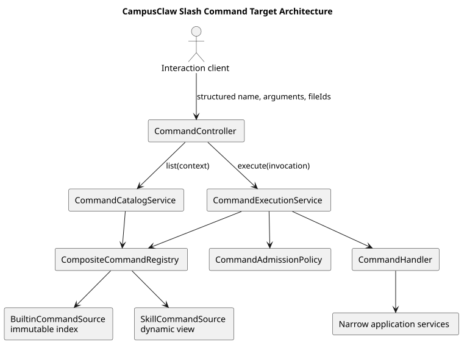
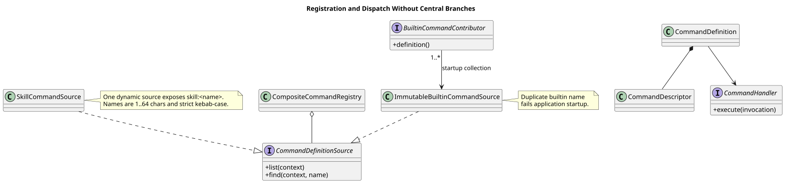
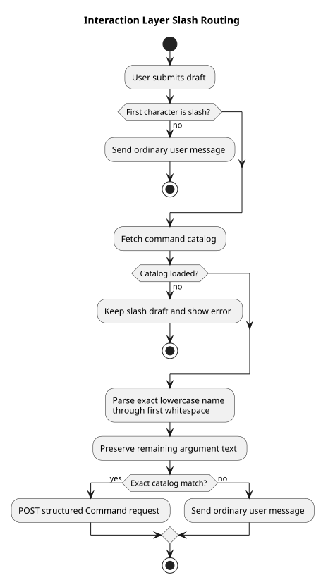
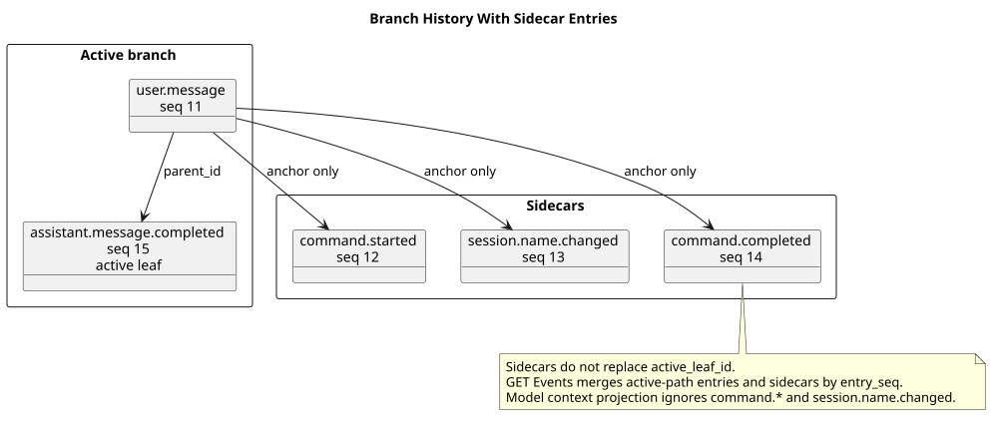

# CampusClaw Slash Command 通用模块设计

[返回命令与技能导航](../README.md)

| 属性 | 值 |
|---|---|
| 文档版本 | 1.0.3 |
| 设计日期 | 2026-09-01 |
| 设计仓基线 | `27484974eb106a7e43910d8e542de52a72c58102` |
| CampusClaw 指定源码基线 | `c1311f69f504e7e799fa2467fd6a9d95b3f91b99` |
| CampusClaw 复核 HEAD | `94abd2abcb03943daef5118115e4b4a21f1c4d5f` |
| 交付范围 | 目标设计与 HTTP 契约；不修改产品代码 |

## 1. 设计结论

| 设计项 | v1 结论 |
|---|---|
| 命令类型 | 开放 Builtin 和 Skill；不开放 Extension 和 Prompt |
| 执行入口 | 仅 HTTP |
| HTTP 请求 | 提交 `name + arguments + fileIds`，不提交整段 Slash 文本 |
| Skill 名称 | 使用独立的 `skill:<name>` 命名空间 |
| Session 名称 | `/name` 由 CampusClaw 持久化；mate-service 不保存副本 |

`/` 只用于交互层展示和解析。HTTP `name` 不含 `/`。
`POST /sessions/{sessionId}/events` 不解析 Slash 文本；以 `/` 开头的内容在该接口中仍是普通用户消息。

CampusClaw 负责 `displayName`、`resourceVersion`、复制继承和
`session.name.changed`。现有 `NameCommand` 把名称交给 mate-service，目标设计将其改为
CampusClaw Session 能力。这是架构变更，不是现有行为。



[PlantUML 源码：`slash_command_architecture`](设计图/diagram.puml#L1)

## 2. 源码判断

### 2.1 CampusClaw 现状

| 源码证据 | 当前判断 |
|---|---|
| `SlashCommandRegistry.java:21-67` 使用可变 `LinkedHashMap` 并解析整段 Slash 文本 | 仅是原型；未被 Spring 管理，也未接入 Runtime Controller |
| `SlashCommandSession.java:19-32` 同时暴露 Model、Thinking、Compact 和 Name 修改 | 门面过宽，不适合作为扩展边界 |
| `NameCommand.java:10-39` 把名称交给未来 mate-service 适配 | 目标设计将名称改归 CampusClaw Session |
| Runtime 只有 Spring `@RestController` 路由；Registry 无生产调用点 | 当前对外执行入口只有 HTTP |
| `RuntimeSessionMapper.xml:132-190` 只查询 `active_leaf_id` 的祖先 | 当前没有 sidecar 查询语义 |
| `AgentRuntimeManager.java:81-112,275-293,425-433` 在 Agent 锁内发布和读取 complete 快照 | Skill 调用应复用该快照边界 |

指定基线 `c1311f69` 与复核 HEAD `94abd2ab` 都包含上述关键符号。后发的
`RuntimeEventProjector` 变更只归入复核 HEAD，不归入早期 commit。

### 2.2 Harness 对比

| 基线 | 可采用 | 不采用 |
|---|---|---|
| pi `4af9d21d` | `skill:` 命名空间；名称归 Session；结构化 RPC 操作 | 同时开放 Builtin、Prompt、Extension、Skill 四类 |
| OpenCode `849c2598` | Session 持久化 title 和 fork title | Skill 使用裸名称并依赖冲突优先级 |
| DeepSeek Harness `141eb6fe` | Definition、Descriptor、Registry、Handler 和生命周期分层 | Registry 接收整段 Slash 文本；名称超限截断 |
| Codex Harness `be33f80b` | App Server 的结构化 `thread/name/set`、`thread/compact/start`、`skills/list` | TUI 中央分派 |
| Claude Managed Agents（2026-08-31） | 持久 Session、Event 和 Skill 所有权 | 没有可直接复用的 Slash 或 Session rename 协议 |

参考文档：[Codex App Server](https://learn.chatgpt.com/docs/app-server)、
[Claude Sessions](https://platform.claude.com/docs/en/managed-agents/sessions)、
[Events](https://platform.claude.com/docs/en/managed-agents/events-and-streaming)、
[Skills](https://platform.claude.com/docs/en/managed-agents/skills) 和
[Session operations](https://platform.claude.com/docs/en/managed-agents/session-operations)。

## 3. 模块设计

核心接口：

```text
CommandDefinitionSource.list(context)
CommandDefinitionSource.find(context, name)
CommandHandler.execute(invocation) -> CompletionStage<CommandResultDTO>
```

| 组件 | 职责 |
|---|---|
| `BuiltinCommandContributor` | 声明一个 Builtin；启动时参与重名检查 |
| `SkillCommandSource` | 按当前 Agent 快照动态生成 Skill 命令 |
| `CompositeCommandRegistry` | 合并来源并按名称精确查找；不写命令分支 |
| `CommandDefinition` | 组合描述符、准入规则和 Handler |
| `CommandAdmissionPolicy` | 统一检查参数、附件和 Session 状态 |
| `CommandHandler` | 调用窄职责 Application Service |
| `CommandExecutionService` | 维护命令生命周期和 SSE |

Builtin 在 Spring 启动时生成不可变索引。名称必须匹配 `[a-z0-9-]+`；重名直接启动失败。
Skill 使用 `skill:<name>`，由一个动态 Source 和一个共享 Handler 处理。`<name>` 必须：

- 长度为 1～64 个字符；
- 只包含小写字母、数字和连字符；
- 连字符不能位于首尾或连续出现；
- 与 Skill 父目录名一致。

精确格式为 `^[a-z0-9]+(?:-[a-z0-9]+)*$`。HTTP 层先移除 `skill:`，再复用同一个
Skill 名称校验器，不维护第二套规则。该规则对齐
[Agent Skills specification](https://agentskills.io/specification)；当前 CampusClaw
`SkillLoader` 只校验 64 字符和字符集合，尚未拒绝首尾或连续连字符，也未要求名称与
父目录一致，因此这里属于目标安全加固。

Handler 只接收不可变 `CommandInvocation`。它不能依赖 Controller、调用自身 HTTP 接口，
也不能获得宽泛可变 Session 门面。新增命令只新增 Contributor、Definition、Handler 和
窄职责服务，不修改中央 `switch`。



[PlantUML 源码：`command_registration`](设计图/diagram.puml#L35)

## 4. 命令清单与可用性

“命令清单”是按 Session、Agent 快照和执行状态生成的逻辑 Command Catalog，
不是文件系统目录。用户文案统一使用“命令清单”；代码类名可以保留 Catalog。

描述符字段：

| 字段 | 含义 |
|---|---|
| `name` | HTTP 命令名，不含 `/` |
| `kind` | `builtin` 或 `skill` |
| `description` | 简短用途 |
| `available` | 不填参数时能否执行 |
| `unavailableCode` | 不填参数时不能执行的原因 |
| `input.mode` | 参数为 `none`、`optional` 或 `required` |
| `input.available` | 填写参数时能否执行 |
| `input.unavailableCode` | 填写参数时不能执行的原因 |
| `input.acceptsFiles` | 是否接受附件 |
| `input.placeholder` | 参数提示 |
| `input.suggestions` | 参数建议 |

无参和带参数必须分别判断。例如 Session 运行中：

- `/model` 无参仍可查看，所以 `available=true`；
- `/model modelId` 不能切换，所以 `input.available=false`；
- 原因是 `SESSION_BUSY`。

已知但暂时不可用的命令仍返回。未知命令不进入清单。

## 5. 执行前检查

`CommandAdmissionPolicy` 在 Handler 前依次检查：

1. 命令存在且名称合法；
2. Service 将省略的 `arguments` 归一为空字符串，将 `fileIds` 归一为空列表；
3. `arguments` 与普通用户消息使用同一上限：最多 262144 个 UTF-16 代码单元；
   `fileIds` 最多 32 个；
4. Builtin 不接受附件；Skill 按普通用户消息规则接受附件；
5. 当前 Session 状态允许本次不填参数或填写参数的执行；
6. 全部通过后生成 `command-<32位小写十六进制UUID>`，再写入 `command.started`。

`262144` 来自 CampusClaw 现有 `RuntimeApiConstants.MAX_MESSAGE_CHARACTERS` 和
`UserEventRequestVO` 的 `@Size` 校验。它是复用普通消息限制的产品约束，不是 Agent Skills
或各 Harness 的统一标准，也不表示模型上下文一定能够容纳同样长度。

## 6. 交互层解析

| 步骤 | 规则 |
|---|---|
| 识别 | 只有第一个字符是 `/` 才尝试解析 |
| 名称 | 截取到第一个空白字符，严格匹配小写命令名 |
| 参数 | 保留原始剩余内容，包括内部换行 |
| 命中 | 调用结构化 Command API |
| 未命中 | 命令清单获取成功时，按普通消息发送 |
| 清单失败 | 保留草稿并显示错误，不降级为普通消息 |

直接调用结构化 API 时，未知名称返回 `COMMAND_NOT_FOUND`，不能按普通消息处理。



[PlantUML 源码：`interaction_routing`](设计图/diagram.puml#L79)

## 7. HTTP 契约

| 边界 | 查看命令清单 | 执行命令 |
|---|---|---|
| mate-service 公共 API | `GET /mate-service/v1/chats/{chatId}/commands` | `POST /mate-service/v1/chats/{chatId}/command` |
| CampusClaw 内部 API | `GET /campusclaw-service/v1/sessions/{sessionId}/commands` | `POST /campusclaw-service/v1/sessions/{sessionId}/command` |

GET 成功和流建立前错误使用 ResultBean 与真实 HTTP status。POST 成功后返回请求范围 SSE。
流建立后失败时，服务端写入 `command.failed`，发送 `stream.error` 并关闭；不发送
`stream.end`。

内部 POST Command 与 POST Events 一样要求 `access-token`。Runtime 只在本次执行中保留
调用 Header，且仅在 Skill 实际调用 Mate Tool 时原名传递。Header 不写日志、不持久化、
不进入 Prompt 或 Event。

精确契约见 [Runtime HTTP 设计](../../01-总体架构/01-CampusClaw多Agent运行时/chat-http-v1-design.md)、
[Runtime API 评审页](../../01-总体架构/01-CampusClaw多Agent运行时/chat-http-v1-review.html) 和
[mate-service 聊天命令 API](../../02-服务与接口/06-mate-service聊天命令API/README.md)。

## 8. 结果与事件

通用成功结果只有：

```text
text
sourceEventSeq (optional)
```

| 事件 | 持久化 | 进入模型上下文 | 作用 |
|---|---|---|---|
| `command.started` | 是 | 否 | 命令开始 |
| `command.completed` | 是 | 否 | 保存结果和可选 `sourceEventSeq` |
| `command.failed` | 是 | 否 | 保存稳定错误码 |
| `session.name.changed` | 是 | 否 | 记录名称变化 |
| Model/Thinking/Compaction/Assistant/Tool 领域事件 | 按既有契约 | 按既有投影 | 保存权威业务结果 |

`sourceEventSeq` 指向权威结果事件：

| 命令 | 指向 |
|---|---|
| `/name` | `session.name.changed` |
| `/model`、`/thinking` | 对应配置变化事件 |
| `/compact` | `session.compaction.completed` |
| `/skill:<name>` | 最终 `assistant.message.completed` |

查询或同值更新没有领域变化时，可以省略 `sourceEventSeq`。

## 9. 历史与恢复

`command.*` 和运行中产生的 `session.name.changed` 使用 sidecar Entry：

- 锚定提交时的 `active_leaf_id`；
- 分配共享 `entrySeq`；
- 不修改 `active_leaf_id`；
- GET Events 只合并当前活动路径上的 sidecar，并按 `entrySeq` 排序；
- 模型上下文忽略 `command.*` 和 `session.name.changed`。

`skill.snapshot` 写入 `t_session_records`，不作为公共 Entry。私有 Record 与 Entry 共享
Session 序列，因此公开 `entrySeq` 可以有缺口，调用方不得重编号或推断缺口内容。



[PlantUML 源码：`sidecar_history`](设计图/diagram.puml#L109)

断线规则：

- 流建立前失败：命令未接受，不写 `command.started`；
- 流建立后失败：写 `command.failed`，发送 `stream.error`；
- Skill 和 Compact 已接受后继续执行；只有现有 Stop/Abort API 可以取消；
- 调用方通过 GET Events 查询最终状态，不重放 POST。

## 10. 验收重点

- Builtin 重名时启动失败；Skill 与 Builtin 不冲突；新增命令不改中央分派；
- Skill 名称拒绝超过 64 个字符、首尾连字符、连续连字符和父目录名称不一致；
- 命令清单精确匹配，保留暂时不可用命令，并分别标明不填参数和填写参数时能否执行；
- 清单失败不降级；未知命令、非法参数和 Builtin 附件在流建立前失败；
- sidecar 不改变 active leaf，分支切换后的可见性和顺序正确；
- 公共与内部 JSON、SSE 和错误投影有聚焦契约测试。

## 11. 版本历史

| 版本 | 日期 | 变更 |
|---|---|---|
| 1.0.3 | 2026-09-01 | Skill 名称对齐 Agent Skills 的完整规则；参数上限明确为复用普通消息的 UTF-16 输入限制，不再表述为 Harness 通用规范 |
| 1.0.2 | 2026-08-31 | 全文改为短句、动作式表格和先结论后细节的结构；不改变已确认行为 |
| 1.0.1 | 2026-08-31 | 澄清 Command Catalog 是按 Session 上下文解析的逻辑注册表；面向用户和 HTTP 文案统一使用“命令清单”，避免与文件系统当前目录混淆 |
| 1.0.0 | 2026-08-31 | 建立 Builtin/Skill 两类命令、可组合注册、结构化 HTTP、双层可用性、命令事件和 sidecar 持久化的唯一公共定义 |
