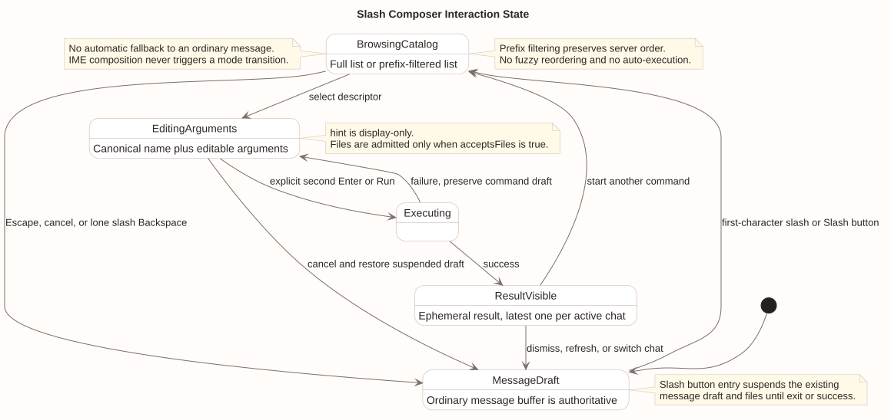
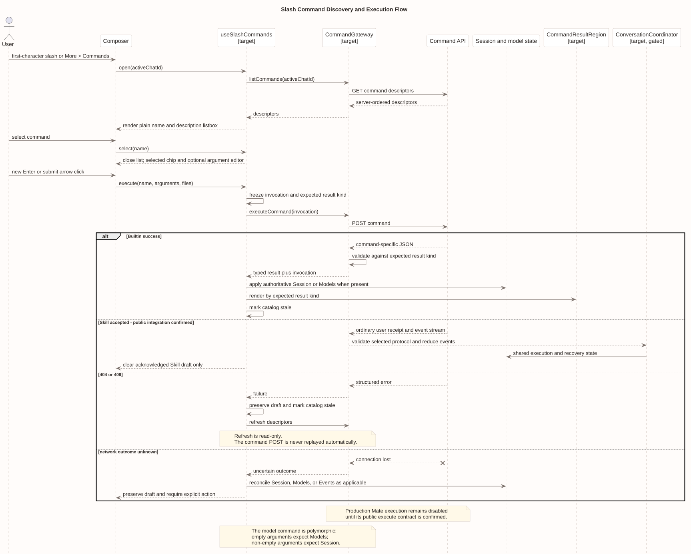
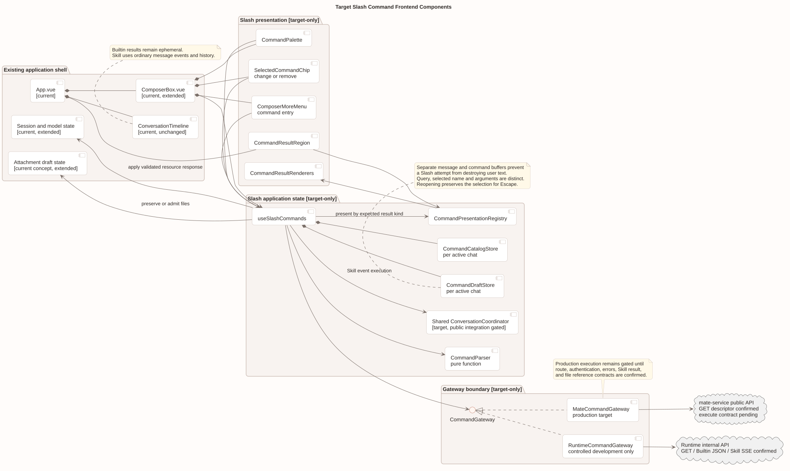

# CampusClaw Slash Command 前端设计

[返回 Slash Command 通用模块](../README.md) · [打开交互评审稿](./slash-command-review.html)

| 属性 | 值 |
|---|---|
| 文档版本 | 1.1.0 |
| 更新日期 | 2026-09-07 |
| 本次前端修订基线 | `91ad40ed854ab554853e718e9a5a8724f24f4e1a` |
| Runtime 命令契约基线 | `88f4df16bc24bbfcd28e1ec374feb2de0db8be3b` |
| pi-mono-java 源码基线 | `6f52fddc87a03c20916fc7b6ef1de87f6a7a8cf5` |
| 适用端 | CampusClaw Web 产品前端；内部 Runtime 调试台只作为源码证据和受控联调入口 |
| 状态 | 前端目标设计；现有 Slash 前端实现不存在，生产执行适配受 Mate 公共协议门禁 |

## 1. 设计结论

Slash Command 采用“同一 Composer、独立模式、独立草稿、显式执行、临时结果”的交互模型。
用户在空消息草稿的第一个字符输入 `/`，或点击 Composer 工具栏中的 `/` 按钮进入命令模式；
前端读取当前 Chat 的服务端命令清单，保持服务端顺序做前缀过滤。选中命令只完成填入，
必须再次按 Enter 或点击“运行”才会执行，避免 `/compact` 等状态变更命令被误触。

命令结果不是 Assistant 消息，不进入 ConversationTimeline、Session Event 或持久化历史。
页面只保留当前 Chat 最近一条临时命令结果，并明确标注“仅当前页面”。失败、清单过期和网络不确定时
保留命令草稿；刷新清单只重放 GET，绝不自动重放命令 POST，也不自动把未匹配的 Slash 转为普通消息。
每次执行在发起 POST 前冻结不可变的调用快照，用“规范命令名 + 空参/带参形态”确定期望结果类型。
这一快照同时驱动 Gateway 解码和结果展示；不通过返回 JSON 形状猜测，也不使用执行期可编辑的草稿再次判定。

产品浏览器继续只访问 mate-service。当前只确认 Mate GET Descriptor 投影，公共执行路径、认证映射、
Skill 联合请求/结果和附件引用仍未确认，因此真实生产执行适配必须保持关闭。可以先实现纯前端状态机、
可访问组件和 Mock Gateway；内部 Runtime Gateway 只允许在受控开发环境联调，不能成为产品回退路径。

## 2. 事实、决策与理由

### 2.1 已观察源码行为

下表路径均相对 `pi-mono-java@6f52fddc87a03c20916fc7b6ef1de87f6a7a8cf5`。

| 源码与符号 | 已观察行为 | 与本设计的差距 |
|---|---|---|
| `frontend/src/App.vue` · `message`、`submit`、`ComposerBox` 装配 | App 只维护一个普通消息草稿，提交走 Events；Timeline 后直接渲染 Composer | 没有命令模式、独立命令草稿、临时命令结果或目录失效策略 |
| `frontend/src/components/ComposerBox.vue` · `handleKeydown`、`emit("submit")` | 单 textarea；Enter 提交、Shift+Enter 换行；没有 Slash 按钮和命令清单 | 需要组合输入法保护、listbox 键盘模型和显式二次执行 |
| `frontend/src/composables/useRuntimeApi.ts` · `sendMessage`、`requestRaw`、返回对象 | 只封装 Session、Model、Events 和控制类 Runtime API | 没有命令清单/执行方法；产品端也不应继续直连 Runtime |
| `frontend/src/types/product.ts`、`frontend/src/types/runtime.ts` | 没有 Descriptor、命令草稿、命令结果或前端投影类型 | 需要前端专用展示模型，不能直接把 Runtime VO 泄漏到组件 |
| `frontend/package.json` | 已有 Vue 3 和现有 CSS/Markdown 能力，无路由或状态库 | 本设计无需新增 npm 直接依赖，可用 Composition API 与纯函数实现 |

现有 `frontend/` 是内部 Runtime 调试工作台，不是产品前端。上表只证明现状和可复用交互骨架，
不证明本文 target-only 组件已经实现。

### 2.2 已确认协议约束

| 约束 | 前端必须如何处理 |
|---|---|
| GET Descriptor 只有 `name`、`kind`、`description` 和可选 `input` | 展示层不推断未返回的可用性、建议值或参数枚举 |
| `input` 缺失代表无参数、无附件；`acceptsFiles` 仅在 true 时返回 | 无 input 时不显示参数区；不允许或静默丢弃附件 |
| `input.hint` 中 `[]`/`<>` 只是展示提示 | 不把 hint 当 Schema、正则或客户端最终校验 |
| 服务端返回固定 Builtin 顺序并追加 Skill | 客户端只做稳定前缀过滤，不重新排序或模糊重排 |
| running 状态会过滤命令或省略部分 input | 前端信任新清单，不复制硬编码状态矩阵 |
| Builtin POST 返回普通 JSON，无 commandId 和通用生命周期 | 不画虚构进度条，不建立轮询或通用命令历史 |
| 成功结果无统一判别字段；`model` 空参返回 Models，带参返回 Session | 提交前从调用形态冻结 `expectedResultKind`，Gateway 按它校验响应，禁止只按命令名或 JSON 形状猜测 |
| Help 返回 `displayName/description/userCases` | 用纯文本临时卡片展示，不渲染 HTML、Markdown 或远程图片 |
| 普通 Events API 不解析 Slash | Slash 不得误发到普通消息接口；显式转消息也必须由用户确认 |
| POST 被拒后刷新清单，不自动重放 | 刷新只执行 GET；副作用请求始终需要新的用户动作 |

Mate 侧当前只确认 Descriptor 字段投影；路径、权限、错误映射和执行 operation 仍是未决公共契约。
本文的 `MateCommandGateway` 是目标边界，不是已发布 API 的声明。

### 2.3 目标决策分类

| 决策 | 分类 | 具体理由 |
|---|---|---|
| 消息与命令采用两个草稿缓冲区 | 产品约束 | 尝试 Slash、关闭清单或执行失败不能破坏用户已写消息 |
| 选中后还需再次明确执行 | 安全加固 | 防止键盘浏览时误触 Compact、Name、Model 等状态变更 |
| 命令结果不进入对话历史 | 架构选择 | 当前命令协议没有持久化生命周期；避免把查询卡片伪装成 Agent 消息 |
| 未匹配 Slash 不自动回退为普通消息 | 安全加固 | 避免命令意图和内容在普通 Events 通道中被意外提交 |
| 浏览器只经 Mate Gateway | 产品约束 | 保持公司认证、租户隔离和凭据边界，不把 Runtime 暴露给产品端 |
| Catalog 仅保存在当前页面内存 | 架构选择 | 清单随 Session 状态变化，持久缓存会制造过期入口 |
| 前缀过滤但不模糊重排 | 产品约束 | 保留服务端产品排序，结果稳定、可预测、便于键盘记忆 |
| 调用快照同时决定解码与展示 | 安全加固 | `model` 同名多形响应不能依赖可变草稿或 JSON 特征；未匹配预期 Schema 时必须拒绝更新状态 |

## 3. 信息架构与主要界面

Slash 复用现有对话页，不新增独立路由。

```text
Chat Workspace
├── Context header
├── ConversationTimeline                 现有权威对话记录
├── CommandResultRegion                  当前 Chat 最近一条临时结果
└── Composer
    ├── SlashCommandButton               显式入口
    ├── CommandPalette                   目录、过滤、空态和读取错误
    ├── Textarea                          消息或命令参数编辑
    ├── CommandArgumentHint              参数/附件提示，不做权威校验
    ├── Attachment controls              仅 acceptsFiles=true 时准入
    └── Send / Run action                随模式切换语义与标签
```

桌面端 `CommandPalette` 从 Composer 上方展开，宽度与 Composer 内容区对齐，最大高度 360px。
窄屏端使用紧贴 Composer 的底部列表区，最大高度 `45dvh`；它不是全屏 Modal，不建立额外焦点陷阱。
两个布局共享同一 DOM 顺序、活动项和键盘状态，避免响应式切换后语义漂移。

[交互评审稿](./slash-command-review.html) 提供命令清单、参数编辑、running 清单、Help 结果和未匹配错误五个状态。
评审稿是视觉与交互验收材料，不是可发布产品代码，也不定义新的 HTTP 字段。

## 4. Composer 状态模型



[PlantUML 源码](./diagram.puml#L103) · [展开原尺寸 SVG](./slash_composer_state.svg)

### 4.1 进入与退出

| 用户动作 | 前置条件 | 结果 |
|---|---|---|
| 在 textarea 输入 `/` | 普通消息草稿为空、光标位于第一个字符、未处于 IME composition | 进入命令模式并读取清单 |
| 点击 `/` 按钮 | 任意未禁用状态 | 暂存普通消息和附件，建立独立命令草稿并打开清单 |
| 在已有消息中输入 `/` | 消息草稿非空 | 作为普通字符，不改变模式 |
| Escape | 清单打开 | 关闭清单；按钮进入时退出命令模式并恢复暂存消息，键入进入时保留 `/` 供用户继续编辑 |
| 对仅有 `/` 的键入草稿按 Backspace | 命令由键入进入 | 退出命令模式并回到空消息草稿 |
| Chat 切换、Session 刷新或登出 | 任意命令状态 | 中止 GET、清除命令草稿和临时结果；绝不迁移到另一个 Chat |

消息草稿与附件沿用产品前端既有恢复策略；新增命令草稿只存在当前页面内存，不写入 localStorage、
Session Event 或服务端。点击入口暂存的消息在取消或成功后恢复；失败时仍保留在后台，命令草稿保持前台可编辑。

### 4.2 解析规则

`CommandParser` 是无副作用纯函数，输出 `nameToken`、`argumentsText` 和光标相关展示状态：

1. 只有索引 0 的 `/` 启动解析；前导空格后的 `/` 不是命令。
2. 名称从 `/` 后读取到第一个 ASCII 空白；比较时不裁剪、不转小写、不做别名替换。
3. 分隔名称与参数的一段 ASCII 空白不属于参数；之后内容原样保留，参数可包含换行。
4. 只有 `nameToken` 与当前 Descriptor 的 `name` 完全一致时才允许执行。
5. 未匹配、目录读取失败或当前形态不支持时保留原命令草稿，不调用普通消息 API。

未匹配状态可提供次级动作“作为普通消息发送”。该动作必须再次弹出轻量确认，清楚展示将要发送的完整文本；
确认后才把文本转移到消息草稿，仍不直接发送。这是显式用户改意图，不是自动 fallback。

### 4.3 选择与执行

- 仅输入 `/` 时显示完整清单；继续输入名称时做大小写敏感的前缀过滤，并保持服务端相对顺序。
- 上下方向键移动活动项，Home/End 跳到首尾；Enter 选择活动项，鼠标或触摸点击语义相同。
- 选中无 input 的命令后进入“可运行”状态，但不立即执行；第二次 Enter 或点击“运行”才提交。
- 选中有 input 的命令后填入规范 `/<name> `，光标进入参数区；hint 显示在输入区下方。
- 参数编辑时 Shift+Enter 插入换行，Enter 执行；IME `isComposing=true` 时 Enter 只交给输入法。
- running 状态下普通消息仍遵循 Events 设计的限制，但服务端清单中保留的查询命令仍可运行。

## 5. 清单读取与缓存

`CommandCatalogStore` 按 active Chat/Session 隔离，只维护：`status`、`items`、`loadedForStateKey`、
`stale`、`error` 和一次在途请求。`stateKey` 由权威 Session 身份和影响清单的运行状态组成，
具体字段由 Gateway 适配，组件不得依赖 Runtime 内部版本结构。

读取规则：

1. 第一次进入 Slash 模式读取 GET；同一 stateKey 的并发打开合并为一个 Promise。
2. HTTP `Cache-Control: no-store` 原样尊重；不使用 Service Worker、浏览器持久缓存或 localStorage 复用清单。
3. Session/Agent/运行状态发生权威变化，或任何命令 POST 完成后，将清单标记为 stale。
4. 目录打开且 stale 时重新读取；Chat 切换用 `AbortController` 取消旧读请求，迟到响应按请求代次丢弃。
5. 404/409 POST 错误会触发一次 GET 刷新，但不重放 POST；刷新失败仍保留原草稿。

读取中的骨架只占命令行高度，不闪动整个 Composer。读取失败显示同位置错误和“重试清单”；重试只调用 GET。
空清单与读取失败是两个状态，前者显示“当前没有可用命令”，后者必须保留错误语义。

## 6. 执行与不确定结果



[PlantUML 源码](./diagram.puml#L170) · [展开原尺寸 SVG](./slash_command_execution_flow.svg)

执行请求由已选择 Descriptor 与当前编辑值组装，不重新解析成另一命令。提交期间只锁定命令编辑和“运行”动作，
保留取消页面读取和浏览历史的能力。当前协议没有 cancel command，离开页面不应声称后端命令已取消。
在请求离开 Composer 前，`useSlashCommands` 生成一份不可变 `CommandInvocation`：保存实际发出的
`name/arguments`、由该请求形态一次计算的 `expectedResultKind` 和当次开始时间。Gateway 只能按这份快照解码，
结果区也只能按同一快照选择 Renderer。用户在等待期间编辑新草稿不会改变在途请求的响应类型。

`expectedResultKind` 由前端纯函数根据已组装的 Builtin 请求确定：Help 是 `agentGuide`，
Status/Name/Thinking 是 `session`，Model 空参是 `models`、带参是 `session`，Compact 是 `compaction`，
Skills 是 `skills`。未知名称、Skill 或无法确定的形态在公共契约确认前 fail closed。响应体与预期 Schema
不匹配时转换为稳定的 `INVALID_RESPONSE` 前端错误，不写入 Session/Model Store，不展示“执行成功”。

附件只有在 `input.acceptsFiles === true` 时才能加入请求；否则附件按钮禁用并提供原因。
从带附件的普通消息草稿通过 `/` 按钮进入命令模式时，附件和消息一起暂存，不得静默丢弃或带入不接收附件的命令。
因为公共 Skill 文件引用契约未确认，生产 Mate Gateway 在该能力确认前必须拒绝真实附件命令并给出明确说明。

网络中断时前端不能判断 POST 是否已到达服务端：

- Help、Status、Model 查询和 Skills 等只读命令可显示“结果未知”与显式“重新查询”，但仍不自动重试。
- Name、Model 修改、Thinking 和 Compact 使用权威 Session/Models/Events 接口对账；UI 不依据本地乐观值宣布成功。
- 没有 commandId、幂等键或通用历史时，禁止伪造“继续等待”轮询和后台自动重放。

## 7. 结果投影

`CommandResultRegion` 位于 Timeline 与 Composer 之间，但不属于 Timeline 数据源。区域具有标题
“命令结果 · 仅当前页面”、关闭按钮、执行命令名与完成时间；每个 active Chat 最多保留最近一条，
页面刷新、Chat 切换或用户关闭后消失。

响应没有统一 `type` 判别字段，因此 Gateway 和 Renderer 必须使用提交前冻结的
`CommandInvocation.expectedResultKind`，不能只按命令名，也不能依赖 JSON 形状猜测。`model` 是必须覆盖的反例：
空参返回 Models 资源，带参修改返回 Session 资源，两者的规范命令名完全相同。

| 已提交调用形态 | 期望结果 | 展示与状态更新 |
|---|---|---|
| `help` 空参 | `agentGuide` | 显示 displayName；description 和 userCases 都按纯文本逐条展示。空数组用明确空态；不解析 Markdown/HTML，不加载远程图片，场景条目不可点击即发送 |
| `status` 空参 | `session` | 应用返回的完整 Session 与版本响应头，再展示权威状态摘要；不能依据请求意图写“修改成功” |
| `name` 空参/带参 | `session` | 查询或修改都应用完整 Session 与版本响应头；展示服务端最终 displayName |
| `model` 空参 | `models` | 更新 ModelStore 并展示 currentModelId 和 models；该响应没有 ETag |
| `model` 带参 | `session` | 应用完整 Session 与版本响应头，包括模型能力导致的 thinking 最终值；不沿用查询 Renderer |
| `thinking` 空参/带参 | `session` | 应用完整 Session 与版本响应头，展示服务端最终开关值 |
| `compact` 空参 | `compaction` | `compacted=true` 显示已完成；false 显示本次无需压缩，不包装成 Assistant 消息 |
| `skills` 空参 | `skills` | 只按纯文本显示 Skill 名称和描述，不读取本地路径、正文或远程资源 |
| `skill:<name>` | 未确认 | 公共结果契约未确认；生产 Renderer 与执行入口保持关闭，不用“通用成功”占位冒充稳定契约 |

Runtime 的 Session 结果带 ETag，Gateway/状态适配器必须与 Session 快照一起原子应用；
产品组件和临时结果卡不显示 ETag。Mate 公共协议如何映射版本信息仍属门禁项，未确认前不假设浏览器可见字段。

Help `userCases` 未来若增加“填入输入框”，也只能把纯文本放入消息草稿，并要求用户再次确认发送；
本期不提供点击场景即执行。

## 8. 错误呈现与恢复

| 情况 | 位置 | 保留内容 | 恢复动作 |
|---|---|---|---|
| 清单 GET 失败 | Palette 内联 | 命令草稿、暂存消息和附件 | 用户点击“重试清单”，只发 GET |
| 参数无效 / 400 | Composer 参数区 | 全部命令草稿 | 聚焦参数；用户修改后再次运行 |
| 命令不存在 / 404 | Composer 内联 | 全部命令草稿 | 自动刷新 GET 一次，不重放 POST |
| 当前忙 / 409 | Composer 内联 | 全部命令草稿 | 刷新 GET，按新 Descriptor 调整可用入口 |
| Agent/能力不可用 / 422 或 503 | Palette 或结果区 | 全部草稿 | 展示可重试时间或产品错误；仅显式重试 |
| POST 网络结果未知 | 结果区警告 | 命令草稿 | 按命令类别对账；禁止自动重试 |
| 401/403 | 页面级认证/权限处理 | 遵循产品安全策略 | 跳转登录或展示无权限；不出现凭据输入表单 |

组件使用 Gateway 的稳定前端错误类别，不直接比较后端中文文案。未知错误保留可复制的 requestId（如公共协议提供），
不向终端用户泄漏 Runtime 地址、栈、内部路径或凭据。

## 9. 目标组件与边界



[PlantUML 源码](./diagram.puml#L1) · [展开原尺寸 SVG](./target_slash_command_frontend_components.svg)

图中的 Slash 组件、Store、Registry 和 Gateway 均为 target-only。现有 App、Composer、Timeline 和状态对象是迁移落点，
不是对当前代码已经支持命令的声明。

| 对象 | 生命周期 | 单一职责 |
|---|---|---|
| `useSlashCommands` | active Chat 视图 | 编排进入、读取、选择、执行、失效和结果投影 |
| `CommandDraftStore` | active Chat 页面内存 | 分离 message/command 草稿、暂存恢复和光标状态 |
| `CommandCatalogStore` | active Chat 页面内存 | GET 去重、代次、stale 与服务端顺序 |
| `CommandParser` | 纯函数 | 解析首字符 Slash、名称 token 和原样参数，不持有 UI 状态 |
| `CommandPresentationRegistry` | 应用单例 | 按调用快照的 `expectedResultKind` 选择 Renderer；没有业务执行逻辑 |
| `CommandGateway` | 应用单例接口 | 将产品前端模型与具体公共/内部 HTTP 隔离 |
| `MateCommandGateway` | 应用单例目标实现 | 产品唯一网络适配；公共执行协议确认前 fail closed |
| `RuntimeCommandGateway` | 仅开发装配 | 对接内部 Runtime 做受控联调；构建门禁禁止进入产品包 |

建议的前端模型只保留展示所需字段：

```ts
type CommandDescriptor = {
  name: string
  kind: "builtin" | "skill"
  description: string
  input?: { hint: string; acceptsFiles?: true }
}

type CommandDraft = {
  rawText: string
  selectedName?: string
  attachments: readonly AttachmentDraft[]
}

type BuiltinResultKind = "agentGuide" | "session" | "models" | "compaction" | "skills"

type CommandInvocation = Readonly<{
  request: Readonly<CommandExecutionRequest>
  expectedResultKind: BuiltinResultKind
  startedAt: string
}>

interface CommandGateway {
  listCommands(chatId: string, signal: AbortSignal): Promise<readonly CommandDescriptor[]>
  executeCommand(invocation: CommandInvocation, signal: AbortSignal): Promise<CommandGatewayResult>
}
```

这些是前端内部类型草图，不是公共 JSON Schema。`CommandGatewayResult` 必须等 Mate 执行协议确认后再冻结；
不得把 Runtime 的多个响应形状强行包装为已经发布的公共联合类型。`expectedResultKind`
是前端调用快照的封闭分支，不是发送给后端的新字段。

## 10. 可访问性、视觉与响应式

- textarea 使用 `role="combobox"`、`aria-autocomplete="list"`、`aria-expanded`、`aria-controls` 和活动项 `aria-activedescendant`；清单使用单选 `listbox/option` 语义。
- 清单项活动变化时滚入可视区，但不抢走 textarea DOM 焦点；读屏通过礼貌级 live region 宣布结果数量、读取错误和执行完成。
- 所有点击目标最小 44×44 CSS px；焦点环使用现有 `--focus` 色并保持 2px 可见外轮廓。
- 文本、边框和交互态沿用 CampusClaw O1 warm tokens；正文与背景满足 WCAG 2.2 AA，不能只靠颜色区分 builtin/skill、选中/禁用或错误。
- `prefers-reduced-motion: reduce` 下关闭清单位移和结果卡片入场动画；其余动效控制在 160ms 内。
- 320px 宽度下命令名、描述和 hint 可换行，运行按钮不覆盖 textarea；200% 缩放仍可完成全部键盘操作。
- 移动端软键盘弹出时使用 `dvh` 约束清单，不固定到被键盘遮挡的 viewport 底部。

## 11. 测试与验收

### 11.1 纯函数和 Store

- Parser 覆盖空值、仅 `/`、前导空格、大小写、ASCII 分隔、多行参数和超长输入。
- 前缀过滤必须保留服务端相对顺序；禁止模糊评分和客户端 Builtin 固定表。
- Catalog 覆盖请求合并、Chat 切换中止、迟到响应丢弃、stateKey 失效和 POST 后 stale。
- Draft 覆盖按钮进入/取消/成功/失败、暂存消息与附件恢复、页面刷新清除。
- 调用快照覆盖每个 Builtin，必须单独覆盖 `model` 空参→Models、带参→Session，草稿继续编辑不改变在途快照。
- Result Registry 覆盖每个 `expectedResultKind`、未知命令 fail closed 和恶意 Help 文本按纯文本展示。

### 11.2 组件与可访问性

- IME composing 时 Enter 不选中、不执行；键盘、触摸和鼠标得到同一规范命令。
- 选择命令不执行，第二个明确动作才执行；重复点击运行只能产生一次在途请求。
- `acceptsFiles` 缺失时附件无法进入请求，已有附件不被静默清除。
- listbox ARIA 关系、焦点保持、live region、44px 触控、缩放和 reduced motion 通过自动检查与人工复核。
- Help 注入 HTML、脚本、Markdown 图片或 URL 时都只显示字面文本，不创建链接和远程请求。

### 11.3 集成与契约

- 用契约 fixture 验证 idle/running 的实际服务端顺序、input 省略和完整空 Skill 清单。
- 400/404/409/422/503 与网络断开都保留草稿；404/409 只刷新 GET，不重放 POST。
- Session/Model 类结果必须应用服务端完整响应和 ETag；断网后通过权威资源对账。
- 使用同一 `model` 命令名的查询与修改 fixture 必须走不同解码分支；Schema/ETag 与预期不符时不更新 Store。
- 产品构建中不存在 Runtime base URL、Runtime 凭据表单或 `RuntimeCommandGateway` 装配。
- Mate 执行协议未确认前，端到端测试必须证明生产执行入口 fail closed，而不是落到普通 Events。

## 12. 实施切片与协议门禁

1. 先实现 Parser、Draft/Catalog Store、Mock Gateway 和键盘/ARIA 组件；不接真实 POST。
2. 接入已确认 Descriptor 的 Mate GET 后，完成 idle/running、失效和错误态契约测试。
3. 实现 Builtin Renderer，并用 Runtime JSON fixture 验证 Session/Models/Help 投影；仍不宣称产品可执行。
4. Mate 公共执行 operation 需先确认路径、认证、请求联合类型、响应判别、错误、超时和不确定结果对账，再实现 `MateCommandGateway.executeCommand`。
5. Skill 执行需额外确认 request/result、附件 fileId 所有权和内容安全后才开放；与 Builtin 分开验收。
6. 最后在真实产品包验证 Runtime 适配不可达、普通消息不解析 Slash、刷新/切 Chat 不泄漏临时结果。

当前没有新增 npm 或 Maven 直接依赖。若后续希望引入 floating-ui、状态库或快捷键库，必须单独说明用途、
替代方案、传递依赖和维护成本；本设计的定位、状态和键盘逻辑不足以证明需要新增依赖。

## 13. 待公共协议确认项

| 待确认项 | 未确认前的前端行为 |
|---|---|
| Mate 命令 GET 最终路径、认证和错误映射 | 只允许 Mock/契约评审；不得猜测 URL |
| Mate Builtin 执行 operation 与响应判别 | 生产运行按钮 fail closed，不回退到 Runtime 或普通 Events |
| 变更命令的并发控制与 ETag 使用方式 | 不做乐观修改；结果未知时只读对账 |
| Skill request/result 联合类型 | 不开放 Skill 执行，不显示虚构通用成功卡 |
| Skill 附件引用、所有权和有效期 | `acceptsFiles=true` 只驱动展示；生产附件提交保持关闭 |
| 公共 requestId/错误码稳定集合 | 未确认前由 Gateway 保留兼容层，组件不绑定服务端文案 |

## 14. 版本历史

| 版本 | 日期 | 变更 |
|---|---|---|
| 1.1.0 | 2026-09-07 | 补充后端精简响应的前端判别规则：提交前冻结调用快照，按命令名与参数形态确定结果类型，区分 model 查询 Models 与修改 Session，未匹配 Schema/ETag 时 fail closed。 |
| 1.0.0 | 2026-09-07 | 新增 Slash Composer 模式、清单、独立草稿、结果投影、错误恢复、无障碍、组件边界和实施门禁；全部前端能力明确为 target-only。 |
