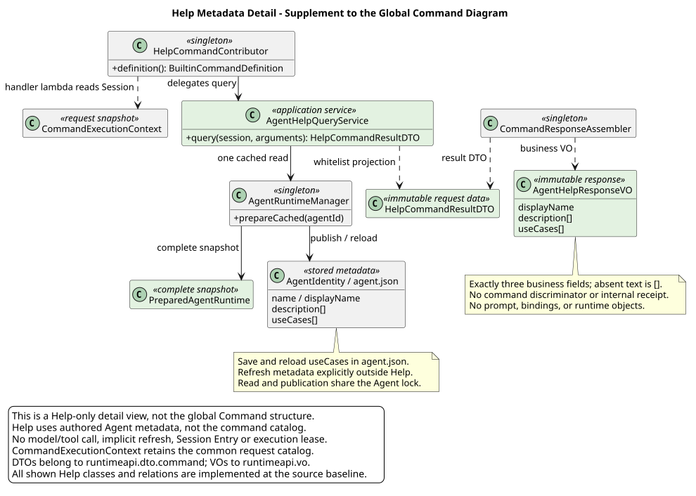

# /help：基于 Agent 元数据的使用指南

[返回 Builtin 设计](../README.md)

| 属性 | 值 |
|---|---|
| 设计版本 | 1.3.0 |
| 日期 | 2026-09-22 |
| 状态 | Help 无参查询、三个业务字段、缓存往返、Agent 级锁、DTO→VO 投影与统一 Command POST 已实现；元数据更新通过显式刷新完成 |
| 设计仓核验基线 | `2c0b0693e57d7949c9b37757b9256f87617b00bf` |
| 当前实现基线 | pi-mono-java `53eff85c7f41de23eb434e027782f5085a8b8e45` |
| 更名前历史证据 | pi-mono-java `d1cdb708e3e124cae009b10b985f5832b6dbde01`；同一链路已实现，场景字段当时误名为 `userCases` |
| 专项评审页 | [Help HTTP 评审](help-review.html)，直接从 Runtime 操作 13 提取生成 |

## 1. 职责：介绍当前 Agent

`/help` 回答“这个 Agent 是干什么的、适合什么场景”，直接展示维护者提供的公开介绍。
`/` 回答“现在有哪些命令可用”。两者不再返回同一份命令清单。

| 入口 | 用户问题 | 数据来源 |
|---|---|---|
| `/` | 有哪些命令、如何填写参数？ | Command 清单与命令描述符 |
| `/help` | 当前 Agent 能帮我做什么、适合什么场景？ | Agent 的 displayName/name、description、useCases |
| `/skills` | 绑定了哪些 Skill？ | 已验证的直接绑定 Skill 名称和描述 |
| `/status` | 当前 Session 是什么状态？ | Session 状态、模型和 Thinking |

已确认 `/help` 只接受空参数，不再支持 `/help model` 等命令详情查询；这些说明留在 `/` 的命令面板。
用途介绍不是实时权限或能力承诺，不能根据 Tool、Skill、Subagent 的名称自动推断业务场景。
本次不调用模型生成或翻译介绍，不新增元数据字段、配置文件或数据库表。

以下是虚构元数据的展示示例，不代表某个真实 Agent 的能力：

> **园区网络分析助手**
>
> **我能帮你做什么**
>
> 帮助理解园区网络状态，整理故障线索与排查建议。
>
> **适用场景**
>
> - 无线网络连接异常时，梳理排查步骤。
> - 分析告警和日志，定位可能原因。
> - 整理排查结论与后续处理建议。

## 2. 全局入口与 Help 补充类图

整体系统先看[Slash 完整全局目标类图](../../00-Slash-Command通用模块/设计图/target_slash_command_global_classes.svg)；
其 [PlantUML 源码](../../00-Slash-Command通用模块/设计图/diagram.puml#L95) 为 Slash 与 Builtin 共用的唯一全局主图。
本专题只下钻 Help 的元数据、缓存和结果投影，不再以 Help 为中心重排全局关系或合并其他命令的职责边界。
以下类图是局部补充，不代表完整 Command 系统；图中 Help 链路均已在当前实现基线存在。

[PlantUML 源码](diagram.puml#L1) · [展开原尺寸 SVG](target_help_metadata_classes.svg)

当前实现链是 `HelpCommandContributor` 在 `BuiltinCommandDefinition` 内装配 Handler lambda，再委派
`AgentHelpQueryService → AgentRuntimeManager`；实现中没有独立的 `HelpCommandHandler` 类。
Help 不再依赖 `CommandHelpFormatter` 或消费 Catalog 中的命令列表。
公共执行入口仍用一次 Catalog 找到 Help Definition 并准入；这不等于 Help 的内容来自 Catalog。
`CommandExecutionContext` 保留其他执行职责，不能因为 Help 不再列命令就删除通用解析快照。

| 目标对象 | 包/生命周期 | 职责 |
|---|---|---|
| HelpCommandContributor / Definition 内 Handler lambda | `runtimeapi.service.command.contributor` / 无请求状态的单例 | 已声明无参 Help，从 Context 取 Session 快照并委派公开介绍查询 |
| AgentHelpQueryService | `runtimeapi.service.command.readonly` / 无请求状态的单例 | 已按 Session agentId 取一个完整缓存快照，按白名单投影并归一显示内容 |
| HelpCommandResultDTO | `runtimeapi.dto.command` / 请求内只读数据 | 已仅携带 Agent 显示名、介绍和场景，不携带完整运行时对象 |
| AgentHelpResponseVO | `runtimeapi.vo` / 请求内只读响应 | 三个业务字段，final 字段与只读访问器；不嵌套内部 DTO，不回显命令 |
| CommandResponseAssembler | `runtimeapi.service.command` / 单例 | 已将 HelpCommandResultDTO 转换为响应 VO，Controller 不承担投影 |
| PreparedAgentRuntime | 既有 Runtime 边界 / 单次查询快照 | Help 的三个业务字段取自同一实例，避免多次读取拼接不同版本 |

上述包名为当前实现落点；没有创建占位 Controller，VO、DTO、Spring Service 也未混进 core/SPI 包。

## 3. 元数据映射与精确结果

直接复用 AgentRuntime 的 `useCases` 字段。Agent 与 Skill 的线缆字段均使用 `useCases`；Agent Runtime 是字符串数组，Skill 查询结果仍是单个字符串。

| 响应字段 | 元数据来源 | 已确认规则 |
|---|---|---|
| displayName | displayName；空白时回退 name | 必填、非空；它是 Agent 名称，不是 `/name` 设置的 Session 名称 |
| description | description[] | 必填数组；保留作者顺序和内部换行，去除条目两端空白及空白条目 |
| useCases | useCases[] | 必填数组；同上，不排序、不扩写，不当作自动执行的提示词 |

`description` 和 `useCases` 缺失或 null 时按现有元数据语义归一为 `[]`。
列表中的 null/非字符串属于无效元数据，不作为可展示条目宽松接收；不绕过缓存完整性校验。
两组文案都为空仍返回 200，前端显示“维护者尚未填写 Agent 介绍和使用场景”。
只缺一组时只对该区域显示空状态，不生成看似真实的占位能力描述。

请求与完整报文统一由 [Runtime 操作 13](../../../01-总体架构/01-CampusClaw多Agent运行时/接口契约/操作/13-execute-session-command.json)
维护，[Help 专项页](help-review.html) 只选择其中的 Help 请求、两种成功结果及相关错误。
不新增 /help HTTP 资源，也不在本文另存可调用报文副本。
统一响应设计不再回显 command，精确结果为上述三个业务字段；调用方已经知道提交的是 Help。
这项架构变更只移除入口信息，不改变 Agent 使用指南、缓存与无副作用规则。
跨命令复用依据见 [Builtin 响应源码证据](../README.md#82-源码证据差距与理由)。

输出直接展示为纯文本段落和列表，不执行 HTML、脚本或元数据中声明的操作；不自动加载远程图片。
Accept-Language 只决定界面空状态和错误消息，不承诺翻译维护者填写的内容。
这里的 `description` 是返回的 Agent 用途介绍；GET 描述符自身的 description 改为“介绍当前 Agent 的用途和使用场景”，二者含义不同。

Runtime 操作 12 的 Help 描述符使用 name/type/description 与可选 hints（无提示可省略或 []）；
Help 是否无参由命令契约定义，不由 hints 决定。idle/running 均保留 Help；共享 GET 无完整缓存整体 503，但 POST Help 仍独立检查缓存并保持既有 422。
两跳清单的字段、排序与过滤见[共享 GET 契约](../../00-Slash-Command通用模块/README.md#31-get-轻量清单已确认)。

## 4. 缓存与缺失行为

已实现复用 `prepareCached(session.agentId)`：只取已发布、通过既有完整性校验的缓存，不访问远端、不 refresh、不调用 prepare。
idle/running 都允许查询；结果描述最近一次成功发布到本地的元数据，不承诺与远端实时同步，也不承诺等于正在执行的 Holder 已固定的旧版本。
一次查询只使用一个 PreparedAgentRuntime，刷新期间不会混读两版字段。
`prepareCached`、`prepare` 和 `refresh` 均通过 `withAgentLock(agentId, ...)` 复用同一 Agent 级锁；该锁覆盖完整快照读取或重建发布，不覆盖页面展示，也不是 Session 执行锁。
因此 running 仍可查询，遇到 Agent 刷新时只需等待这次发布/读取互斥，不占模型容量。

当前已实现链路如下：

| 环节 | 当前实现 | 设计结论 |
|---|---|---|
| MateServiceClient.AgentRuntime | 已接收 useCases[] | 不改远端字段，不新增接口 |
| AgentRuntimeManager.toIdentity / AgentIdentity | 已将 useCases[] 写入现有 `agent.json` | 不新建独立 Help 缓存 |
| AgentRuntimeManager.toRuntime | 已从同一身份记录恢复 useCases；字段缺失时归一为 [] | 缓存往返不静默丢失当前字段 |
| PreparedAgentRuntime.metadata | 完整快照持有恢复后的 AgentRuntime | 查询 Service 仅复制三个公开介绍字段，不返回完整 metadata |

当前实现保留现有 schemaVersion，当 `agent.json` 缺少当前 `useCases` 字段时读为 []，不把“缺场景说明”解释成运行时损坏。
场景字段缺失时，Help 返回空数组；需要从远端补齐或更新元数据时，通过现有显式刷新流程重建完整缓存。
刷新失败时原子发布流程保留上一份完整目录；`/help` 不会自动联网或触发刷新。

这里的“不使用 systemPrompt”指不拿它生成介绍、不返回它。现有 `prepareCached` 内部的完整快照加载器会读取 system.md；
本方案不声称 Help 请求完全没有底层文件读取，也不为展示介绍另建一套绕过完整性检查的文件解析器。

| 条件 | 已确认结果 |
|---|---|
| arguments 缺省/null/空白 | Service 归一为空字符串，执行 Help |
| 非空 arguments（如 model）或附件 | 400 INVALID_COMMAND_REQUEST；不回到旧的命令详情分支 |
| Session 不存在/已删除 | 沿用 404 SESSION_NOT_FOUND；先校验 Session 访问范围 |
| 无完整 Agent 缓存或元数据不可用 | 沿用当前 Runtime 操作 13 的 422 AGENT_NOT_AVAILABLE，不返回伪造介绍 |
| 完整缓存但 description/useCases 未填写 | 200，缺失数组为 []；与运行时不可用区分 |
| 仅 Session 正在运行 | 不返回 SESSION_BUSY，不获取执行容量或写状态 |

Help 使用 Runtime Command 的 Builtin 请求头示例：JSON Content-Type 必填，JSON Accept 与 Accept-Language 可选，不要求执行凭据。既有上游授权与 ResultBean 规则不变；Help 没有模型、Tool 调用，也不将凭据发送到远端。
不写 Session Entry、通用命令历史或模型上下文；前端展示临时说明卡片，不伪装成持久化 Assistant 消息。
失败时保留草稿。使用场景不会点击即发送；如后续增加“填入输入框”，必须保留用户确认发送步骤。

## 5. 源码证据与设计理由

以下路径相对 pi-mono-java，当前实现核验固定在
`53eff85c7f41de23eb434e027782f5085a8b8e45`。`d1cdb708e3e124cae009b10b985f5832b6dbde01`
仅用于证明更名前同一实现链已存在，不再把它当作当前差距。

| 路径与符号 | 源码观察 | 对本设计的影响 |
|---|---|---|
| `modules/coding-agent-cli/src/main/java/com/campusclaw/codingagent/runtime/MateServiceClient.java` · AgentRuntime | 已接收 displayName/name、description、useCases；也含 systemPrompt 和绑定信息 | 只选公开介绍白名单，不直接序列化 AgentRuntime |
| `modules/coding-agent-cli/src/main/java/com/campusclaw/codingagent/runtime/AgentRuntimeManager.java` · prepareCached / loadSnapshot / withAgentLock | `prepareCached`、`prepare`、`refresh` 已共用 Agent 级锁；缓存读取不访问 Mate；完整加载包含 system.md 和 Skill 校验 | 已具备读取/发布互斥，不作“完全不读 prompt 文件”的虚假保证 |
| 同上 · toIdentity / toRuntime / AgentIdentity | `useCases` 已写入 `agent.json` 并在进程重启后恢复；当前字段缺失时为 [] | 缓存往返已实现；字段缺失保持空数组语义 |
| `modules/coding-agent-cli/src/main/java/com/campusclaw/codingagent/runtime/PreparedAgentRuntime.java`，metadata | 既有不可变快照持有 AgentRuntime | 单次读取后复制白名单字段，避免请求内重复取数 |
| `modules/coding-agent-cli/src/main/java/com/campusclaw/codingagent/runtimeapi/service/command/contributor/HelpCommandContributor.java` · definition | 已装配无参元数据、准入与 Handler lambda，委派 AgentHelpQueryService | Help 不依赖命令清单，不需要独立 HelpCommandHandler 类 |
| `modules/coding-agent-cli/src/main/java/com/campusclaw/codingagent/runtimeapi/service/command/readonly/AgentHelpQueryService.java` · query / visibleText | 已校验空参、取单一缓存快照、回退显示名并归一两个文本列表 | 查询服务和白名单投影已实现 |
| `modules/coding-agent-cli/src/main/java/com/campusclaw/codingagent/runtimeapi/dto/command/HelpCommandResultDTO.java`、`modules/coding-agent-cli/src/main/java/com/campusclaw/codingagent/runtimeapi/vo/AgentHelpResponseVO.java`、`modules/coding-agent-cli/src/main/java/com/campusclaw/codingagent/runtimeapi/service/command/CommandResponseAssembler.java` · help | 内部 DTO、三字段只读 VO 及类型投影已实现 | 响应不回显 command/changed/sourceEventSeq，不泄漏完整 metadata |
| `modules/coding-agent-cli/src/main/java/com/campusclaw/codingagent/runtimeapi/web/RuntimeCommandController.java` · execute | 已通过统一 Command POST 执行 Builtin 并返回 ResultBean JSON | Help 不是只停留在目标设计的公开响应 |

- **产品决策**：用户明确将 Help 从命令目录改为当前 Agent 的介绍；不需要引用其他 Harness 的 Help 来证明这一产品选择。
- **架构变更**：Help 已从 Catalog Formatter 收敛为元数据查询，复用 useCases 缓存往返和读取/发布互斥，没有新增独立存储。
- **安全加固**：只显示白名单文案，不泄露 Prompt/凭据/绑定细节；元数据按不可信文本渲染，不执行其中指令。
- **设计理由**：复用作者维护的资料，输出确定、可测试，也不会将未验证的 Tool/Skill 组合宣传成 Agent 已具备的能力。

## 6. 实现与验收状态

Runtime 元数据、Builtin 只读查询、DTO→VO 组装和 Runtime HTTP 切片已实现。
实现基线 `53eff85c7f41de23eb434e027782f5085a8b8e45` 对应的定向 Java 测试已通过：
`MateServiceClientTest`、`AgentRuntimeManagerTest`、`ReadonlyBuiltinCommandTest`、
`CommandResponseAssemblerTest`、`RuntimeCommandControllerTest` 和 `RuntimeHttpProcessFixtureTest`。
前端类型检查及 36 个文件、291 项测试通过。上述结果不包含 `RuntimeBuiltinCommandOpenGaussIT` 执行或真实 Mate 联调；源码核验、测试代码存在与实际测试通过分别记录。

已观察的专项测试代码包括 `AgentRuntimeManagerTest`、`ReadonlyBuiltinCommandTest`、
`CommandResponseAssemblerTest`、`RuntimeCommandControllerTest` 和 `RuntimeBuiltinCommandOpenGaussIT`，覆盖：

- Agent 显示名与 Session 名称不同；displayName 空白回退 name。
- description/useCases 顺序不变，空白项移除；缺失数组始终 []。
- 缓存已有非空 useCases 时，重启后 Help 不能变成 []。
- 一次 Help 查询只取一个完整缓存快照，`prepareCached` 不调用远端 Mate；与并发发布共用 Agent 级锁的实现由三个入口共用 `withAgentLock` 直接证明。
- 无完整缓存返回现有 422；只有介绍未填写返回 200。
- 返回不包含 commands、systemPrompt、Agent/Skill ID、版本、路径、绑定信息或凭据。
- 不写领域 Entry、不改变 running、不占执行容量；元数据内容不能触发脚本或网络加载。

## 7. 评审与同步范围

Help 的精确请求、字段与错误由 Runtime [操作 12](../../../01-总体架构/01-CampusClaw多Agent运行时/接口契约/操作/12-list-session-commands.json)与[操作 13](../../../01-总体架构/01-CampusClaw多Agent运行时/接口契约/操作/13-execute-session-command.json)维护。专项 HTML 只筛选 Help 场景，直接继承 Runtime 的 Builtin Header 示例、参数、约束、结果与错误，不保留第二份 JSON。Slash 与 Builtin 引用同一张全局主图，本专题只维护元数据下钻图。

mate-service 的旧 Command POST SSE 已废止并删除，专题只保留轻量 GET 投影及公共边界待决。
不能将本稿直接当作新公共接口；公共认证、bridge 和执行协议仍待重审，不新增公共路径或跨仓实现。

展示生成：运行本专题 `python3 render_help_review.py`，复用 Runtime 共享渲染器；不再使用强制凭据占位符的技能默认模板。
投影由 Runtime 的 help_review_projection.py 生成；不手工复制 Header、版本或响应。门禁检查派生内容与源等值、可见 HTML 及旧 JSON 不存在。
设计校验：运行 Runtime `validate-chat-http-v1.py --full` 和 `test_help_contract.py`。
前者校验精确描述符、两组 Help 报文、专项页同步和图；后者用反例验证旧字段、错误类型、参数入口和候选状态不能重新进入契约。
文档与契约校验只证明设计投影一致；缓存往返、并发发布与无副作用的实现结论分别来自上述源码和既有测试证据。

## 版本历史

| 版本 | 日期 | 变更 |
|---|---|---|
| 1.3.0 | 2026-09-22 | Help 描述符使用 type/hints，无参行为仍由命令契约定义。 |
| 1.2.4 | 2026-09-22 | Help 请求头仅投影 Builtin 场景，不展示 Skill 工具执行凭据。 |
| 1.2.3 | 2026-09-22 | 按 53eff85c 更正 Help 缓存、Agent 级锁、查询与响应链的已实现状态。 |
| 1.2.2 | 2026-09-22 | 将 Agent 使用场景字段统一为 `useCases`，同步缓存、响应和契约投影。 |
| 1.2.1 | 2026-09-14 | 集中说明 Help 元数据、缓存和契约投影职责。 |
| 1.2.0 | 2026-09-07 | Help 返回 AgentHelpResponseVO 的三个业务字段。 |
| 1.1.3 | 2026-09-07 | 页面直接投影 Runtime 契约，正文保留映射与验收。 |
| 1.1.2 | 2026-09-07 | Help 描述符不带 input，专项页面与 Runtime 契约同步。 |
| 1.1.1 | 2026-09-07 | Help 类图只补充元数据与结果投影，整体结构复用 Slash 主图。 |
| 1.1.0 | 2026-09-04 | Help 支持无参查询、空数组和完整元数据缓存。 |
| 1.0.0 | 2026-09-04 | 基于 description 与 useCases 定义 Agent 使用指南。 |
