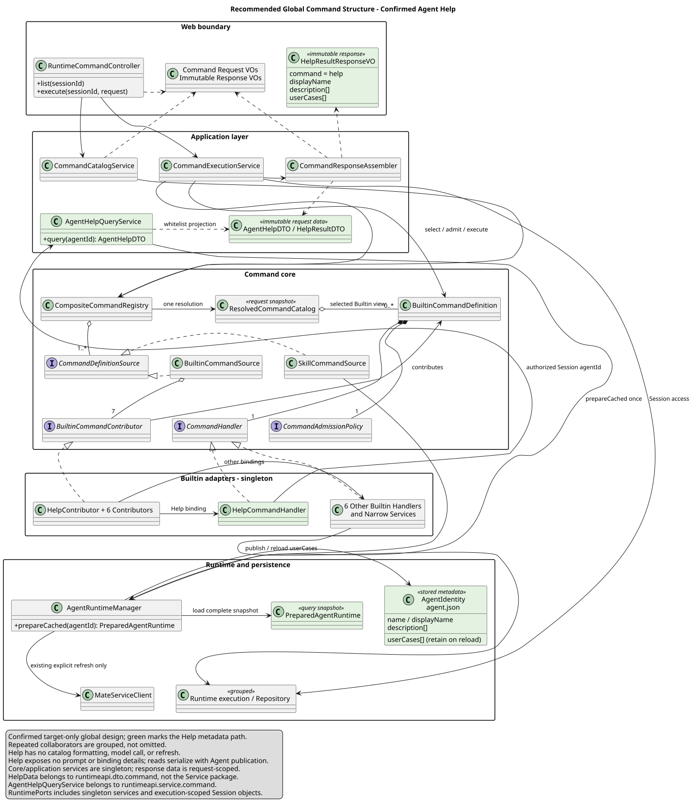

# /help：基于 Agent 元数据的使用指南

[返回 Builtin 设计](../README.md)

| 属性 | 值 |
|---|---|
| 设计版本 | 1.0.0 |
| 日期 | 2026-09-04 |
| 状态 | 用户已明确变更方向；字段、参数和缓存迁移为待评审目标方案，尚未实现 |
| 设计仓基线 | `372fb2cbec6e8a525d30d2310ef68e3da18e33f7` |
| 本次源码基线 | pi-mono-java `d8e22562e22ac41ef4bb5cc6b36b576139417bd9` |
| 专项评审页 | [Help HTTP 评审](help-review.html)，由 [JSON](help-review.json) 生成 |

## 1. 语义：介绍 Agent，不再介绍命令

`/help` 回答“这个 Agent 是干什么的、适合什么场景”，直接展示维护者提供的公开介绍。
`/` 回答“现在有哪些命令可用”。两者不再返回同一份命令清单。

| 入口 | 用户问题 | 数据来源 |
|---|---|---|
| `/` | 有哪些命令、如何填写参数？ | Command 清单与命令描述符 |
| `/help` | 当前 Agent 能帮我做什么、适合什么场景？ | Agent 的 displayName/name、description、userCases |
| `/skills` | 绑定了哪些 Skill？ | 已验证的直接绑定 Skill 名称和描述 |
| `/status` | 当前 Session 是什么状态？ | Session 状态、模型和 Thinking |

推荐 `/help` 只接受空参数，不再支持 `/help model` 等命令详情查询；这些说明留在 `/` 的命令面板。
用途介绍不是实时权限或能力承诺，不能根据 Tool、Skill、子 Agent 的名称自动推断业务场景。
本次不调用模型生成或翻译介绍，不新增元数据字段、配置文件或数据库表。

以下是虚构元数据的展示示例，不代表某个真实 Agent 的能力：

> **园区网络分析助手**
>
> **我能帮你做什么**
>
> 帮助理解园区网络状态，整理故障线索与排查建议。
>
> **适用场景**
>
> - 无线网络连接异常时，梳理排查步骤。
> - 分析告警和日志，定位可能原因。
> - 整理排查结论与后续处理建议。

## 2. 全局目标类图

保留 Web、Application、Command Core、Builtin 和 Runtime/持久化的完整关系。
图中展开 Help 路径，合并另外六个命令；不是让读者只看孤立的 HelpHandler。
所有新增类和连接都是 target-only。分组框代表多个协作者，不要求实现同名大类。



[PlantUML 源码](diagram.puml#L1)

关键变化是 `HelpCommandHandler → AgentHelpQueryService → AgentRuntimeManager`。
Help 不再依赖 `CommandHelpFormatter` 或消费 Catalog 中的命令列表。
公共执行入口仍用一次 Catalog 找到 Help Definition 并准入；这不等于 Help 的内容来自 Catalog。
`CommandExecutionContext` 保留其他执行职责，不能因为 Help 不再列命令就删除通用解析快照。

| 目标对象 | 包/生命周期 | 职责 |
|---|---|---|
| HelpCommandContributor / HelpCommandHandler | `runtimeapi.command.builtin` / 无请求状态的单例 | 声明无参 Help，委派公开介绍查询；实现既有 Contributor/Handler SPI |
| AgentHelpQueryService | `runtimeapi.service.command` / 无请求状态的单例 | 读取已授权 Session 的 agentId，取一个完整缓存快照，按白名单投影并归一显示内容 |
| AgentHelpDTO / HelpResultDTO | `runtimeapi.dto.command` / 请求内只读数据 | 仅携带 Agent 显示名、介绍和场景，不携带完整运行时对象 |
| HelpResultResponseVO | `runtimeapi.vo.command` / 请求内只读响应 | final 字段与只读访问器；不嵌套内部 DTO |
| CommandResponseAssembler | Application Service 包 / 单例 | 将 HelpResultDTO 转换为响应 VO，Controller 不承担投影 |
| PreparedAgentRuntime | 既有 Runtime 边界 / 单次查询快照 | Help 的三个业务字段取自同一实例，避免多次读取拼接不同版本 |

包名是目标落点，须与实际模块分层对齐；不创建占位 Controller，不把 VO、DTO、Spring Service 混进 core/SPI 包。

## 3. 元数据映射与精确结果

直接复用 AgentRuntime 已有字段。Agent 字段实际拼写是 `userCases`，不是 Skill 的 `useCases`；本次不顺带重命名。

| 响应字段 | 元数据来源 | 推荐规则 |
|---|---|---|
| command | 固定值 | 必填，恒为 `help` |
| displayName | displayName；空白时回退 name | 必填、非空；它是 Agent 名称，不是 `/name` 设置的 Session 名称 |
| description | description[] | 必填数组；保留作者顺序和内部换行，去除条目两端空白及空白条目 |
| userCases | userCases[] | 必填数组；同上，不排序、不扩写，不当作自动执行的提示词 |

`description` 和 `userCases` 缺失或 null 时按现有元数据语义归一为 `[]`。
列表中的 null/非字符串属于无效元数据，不作为可展示条目宽松接收；不绕过缓存完整性校验。
两组文案都为空仍返回 200，前端显示“维护者尚未填写 Agent 介绍和使用场景”。
只缺一组时只对该区域显示空状态，不生成看似真实的占位能力描述。

候选请求沿用 Runtime 普通命令入口，不新增 `/help` HTTP 资源：

```json
{"name": "help"}
```

候选成功响应如下。响应恰好四个 result 字段，不增加 `commands`、metadata 原对象、Agent ID/版本/路径或 Skill/Tool 明细。

```json
{
  "resCode": "0",
  "resMsg": "success",
  "result": {
    "command": "help",
    "displayName": "园区网络分析助手",
    "description": ["帮助理解园区网络状态，整理故障线索与排查建议。"],
    "userCases": [
      "无线网络连接异常时，梳理排查步骤。",
      "分析告警和日志，定位可能原因。",
      "整理排查结论与后续处理建议。"
    ]
  }
}
```

输出直接展示为纯文本段落和列表，不执行 HTML、脚本或元数据中声明的操作；不自动加载远程图片。
Accept-Language 只决定界面空状态和错误消息，不承诺翻译维护者填写的内容。
这里的 `description` 是返回的 Agent 用途介绍；GET 描述符自身的 description 改为“介绍当前 Agent 的用途和使用场景”，二者含义不同。

## 4. 缓存与缺失行为

推荐复用 `prepareCached(session.agentId)`：只取已发布、通过既有完整性校验的缓存，不访问远端、不 refresh、不调用 prepare。
idle/running 都允许查询；结果描述最近一次成功发布到本地的元数据，不承诺与远端实时同步，也不承诺等于正在执行的 Holder 已固定的旧版本。
一次查询只使用一个 PreparedAgentRuntime，刷新期间不能混读两版字段。
源码中的 prepareCached 目前直接逐文件加载，没有取得 refresh 使用的 Agent 级锁；“只调用一次”并不自动证明刷新并发时的版本一致。
目标要求缓存读取与发布复用同一 Agent 级锁，锁只覆盖完整快照读取，不覆盖页面展示，也不是 Session 的执行锁。
因此 running 仍可查询，遇到 Agent 刷新时只需等待这次发布/读取互斥，不占模型容量。

必须先补齐如下链路：

| 环节 | 已观察行为 | 目标调整 |
|---|---|---|
| MateServiceClient.AgentRuntime | 已接收 userCases[] | 不改远端字段，不新增接口 |
| AgentRuntimeManager.toIdentity / AgentIdentity | 保存 name/displayName/description，不保存 userCases | 在现有 `agent.json` 身份记录中加 userCases[]；列表归一在拥有转换职责的 Service 完成 |
| AgentRuntimeManager.toRuntime | userCases 固定填 List.of() | 从同一身份记录恢复 userCases，不能静默丢失 |
| PreparedAgentRuntime.metadata | 完整快照的运行时元数据 | 查询 Service 仅复制三个公开介绍字段，不返回完整 metadata |

推荐采用新增可选字段的缓存演进方式：保留现有 schemaVersion，旧缓存缺 userCases 时读为 []，不把“缺场景说明”解释成运行时损坏。
部署新实现后，通过现有显式刷新流程为需要展示场景的 Agent 重建缓存；刷新失败保留旧缓存，不由 `/help` 偷偷联网补齐。
因此旧缓存刷新前可能只展示名称/介绍，这一限制必须在发布检查中说明并覆盖测试。

这里的“不使用 systemPrompt”指不拿它生成介绍、不返回它。现有 `prepareCached` 内部的完整快照加载器会读取 system.md；
本方案不声称 Help 请求完全没有底层文件读取，也不为展示介绍另建一套绕过完整性检查的文件解析器。

| 条件 | 推荐结果 |
|---|---|
| arguments 缺省/null/空白 | Service 归一为空字符串，执行 Help |
| 非空 arguments（如 model）或附件 | 400 INVALID_COMMAND_REQUEST；不回到旧的命令详情分支 |
| Session 不存在/已删除 | 沿用 404 SESSION_NOT_FOUND；先校验 Session 访问范围 |
| 无完整 Agent 缓存或元数据不可用 | 沿用当前 Runtime 操作 13 的 422 AGENT_NOT_AVAILABLE，不返回伪造介绍 |
| 完整缓存但 description/userCases 未填写 | 200，缺失数组为 []；与运行时不可用区分 |
| 仅 Session 正在运行 | 不返回 SESSION_BUSY，不获取执行容量或写状态 |

不改变既有授权、请求 Header 或 ResultBean 规则。Help 没有模型、Tool 调用，也不将凭据发送到远端。
不写 Session Entry、通用命令历史或模型上下文；前端展示临时说明卡片，不伪装成持久化 Assistant 消息。
失败时保留草稿。使用场景不会点击即发送；如后续增加“填入输入框”，必须保留用户确认发送步骤。

## 5. 源码证据与设计理由

以下路径相对 pi-mono-java，全部使用本次固定 commit `d8e22562e22ac41ef4bb5cc6b36b576139417bd9`。
上一份 Builtin 设计的 `d84dd3d6` / `9d0d76f4` 是旧证据点；本次不据它们宣称新核心 SPI 尚未实现。

| 路径与符号 | 源码观察 | 对本设计的影响 |
|---|---|---|
| `modules/coding-agent-cli/src/main/java/com/campusclaw/codingagent/runtime/MateServiceClient.java`，AgentRuntime | 已有 displayName/name、description、userCases；也含 systemPrompt 和绑定信息 | 只选公开介绍白名单，不新增远端元数据字段，不直接序列化 AgentRuntime |
| `modules/coding-agent-cli/src/main/java/com/campusclaw/codingagent/runtime/AgentRuntimeManager.java`，prepareCached / loadSnapshot / withAgentLock | 缓存读取不访问 Mate；完整加载包含 system.md 和 Skill 校验；prepareCached 未与 refresh 共用锁 | 不调用模型或刷新；补齐读取/发布互斥，不作“完全不读 prompt 文件”的虚假保证 |
| 同上，toIdentity:630、toRuntime:646、AgentIdentity:717 | userCases 未落盘，恢复时固定空列表 | 缓存字段往返是 Help 开发的前置验收，而不是只写一个展示 Handler |
| `modules/coding-agent-cli/src/main/java/com/campusclaw/codingagent/runtime/PreparedAgentRuntime.java`，metadata | 既有不可变快照持有 AgentRuntime | 单次读取后复制白名单字段，避免请求内重复取数 |
| `modules/coding-agent-cli/src/main/java/com/campusclaw/codingagent/runtimeapi/command/execution/CommandExecutionContext.java`，session / catalog | Session 来自同一次 Catalog；注释仍描述 Help 清单 | 保留共享执行上下文，移除 Help 内容对清单的依赖并修订过时注释 |
| `modules/coding-agent-cli/src/main/java/com/campusclaw/codingagent/runtimeapi/command/builtin/BuiltinCommandContributor.java`、`BuiltinCommandDefinition.java`；`command/execution/CommandHandler.java` | 核心 SPI 已存在；该基线未出现 Help Handler/Query Service | 复用 SPI，Help 实现和新响应仍是 target-only |

- **产品决策**：用户明确将 Help 从命令目录改为当前 Agent 的介绍；不需要引用其他 Harness 的 Help 来证明这一产品选择。
- **架构变更**：Help 从 Catalog Formatter 改为元数据查询；补齐已有 userCases 的缓存往返和读取/发布互斥，不新增独立存储。
- **安全加固**：只显示白名单文案，不泄露 Prompt/凭据/绑定细节；元数据按不可信文本渲染，不执行其中指令。
- **设计理由**：复用作者维护的资料，输出确定、可测试，也不会将未验证的 Tool/Skill 组合宣传成 Agent 已具备的能力。

## 6. 落地与验收

1. Runtime 元数据切片：保存并恢复 userCases，测试远端元数据 → 发布 → 缓存读取 → 进程重启的完整往返；覆盖旧缓存、空数组、刷新失败。
2. Builtin 只读切片：实现 HelpContributor、HelpHandler、AgentHelpQueryService 和 DTO；不依赖 CatalogFormatter，不增加中央名称 switch。
3. 应用/HTTP 切片：组装独立响应 VO，精确断言四个字段；Help 非空参数拒绝；idle/running 内容一致且无副作用。
4. 展示切片：用途/场景分区，纯文本安全渲染、空状态、错误保留草稿；不创建可恢复消息或自动提交示例。

专项测试至少证明：

- Agent 显示名与 Session 名称不同；displayName 空白回退 name。
- description/userCases 顺序不变，空白项移除；缺失数组始终 []。
- 缓存已有非空 userCases 时，重启后 Help 不能变成 []。
- 一次 Help 查询只取一个完整缓存快照；与并发发布共用 Agent 级锁，不能拼接新旧版本；不调用 refresh、prepare、远端 Mate、模型或工具。
- 无完整缓存返回现有 422；只有介绍未填写返回 200。
- 返回不包含 commands、systemPrompt、Agent/Skill ID、版本、路径、绑定信息或凭据。
- 不写领域 Entry、不改变 running、不占执行容量；元数据内容不能触发脚本或网络加载。

## 7. 评审与同步范围

已确定的是语义方向；本稿推荐的四字段结果、无参规则、空内容处理和旧缓存迁移仍待评审。
本稿的 HTML/JSON 是 Help 专项候选，不是替代全部 Command API 的第二份权威契约。
确认后再同步 Runtime 操作 12 的 Help 描述符、操作 13 的 Help 结果/参数/错误说明、全局主图中的 Help 依赖、相关 Markdown 和校验脚本，并提升版本。
GET 字段整体形状和排序不在本次评审范围；不将先前分支的 GET 减法与主线其他变更偷偷合并。

mate-service 的旧 Command 专题已被明确标记为废止历史，不能将本稿直接当作其新公共接口。
本次不修改该历史快照，也不新增公共路径、跨仓实现提交或通知。

## 版本历史

| 版本 | 日期 | 变更 |
|---|---|---|
| 1.0.0 | 2026-09-04 | 基于已有 description/userCases 设计 Agent 使用指南；记录缓存场景字段丢失的实现缺口、全局目标结构和专项候选契约。 |
