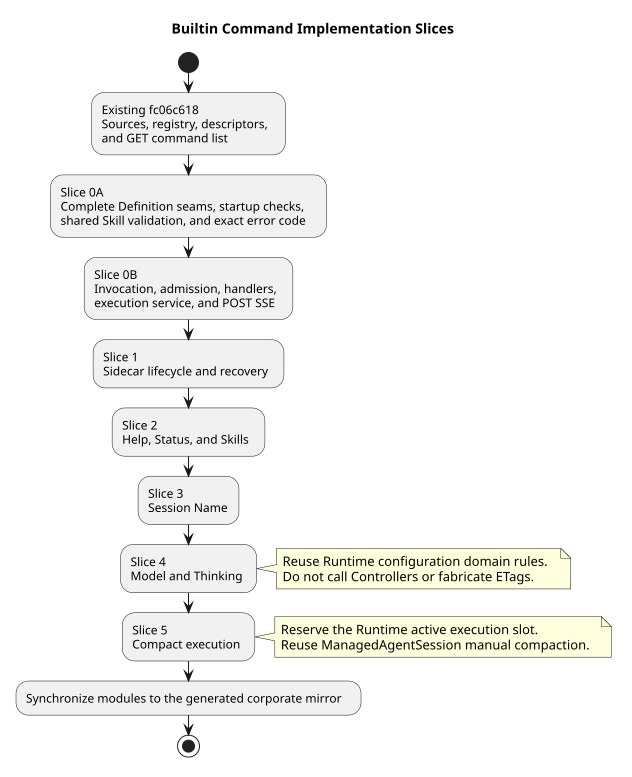
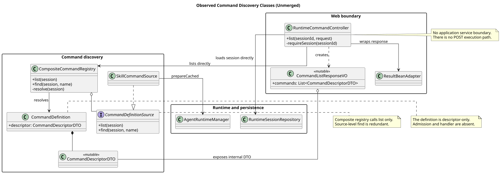
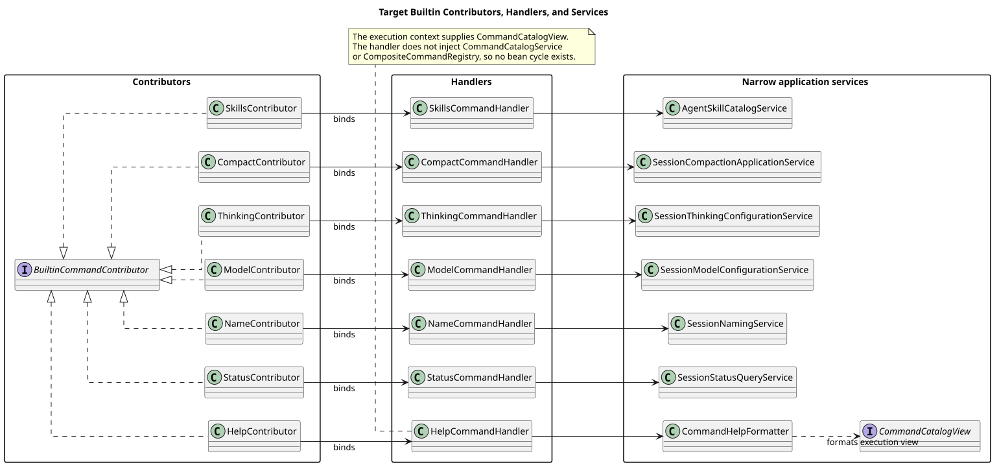

# CampusClaw Builtin Command 设计

[返回命令与技能导航](../README.md) ·
[通用模块](../00-Slash-Command通用模块/README.md)

| 属性 | 值 |
|---|---|
| 文档版本 | 2.2.0 |
| 设计日期 | 2026-09-03 |
| 设计仓基线 | `6baa9df1c7a5a0e3196e720168b0214b6d4b70c1` |
| CampusClaw 指定源码基线 | `c1311f69f504e7e799fa2467fd6a9d95b3f91b99` |
| CampusClaw `main` 复核基线 | `c9d858bc8261bf07f5585f545b53495bf2226a56`（`origin/main`） |
| Slash Command 发现层复核提交 | `3004419a467b77bac08d0f2b3dad21f8815568c5`（`origin/feat/skill-command-registry`） |
| Slash Command 清单 HTTP 复核提交 | `fb49e86dc1bc9761d191ad9b9890afe7909deace`（`origin/feat/skill-command-list-endpoint`） |
| 设计状态 | target-only；命令清单骨架已部分实现，七个 Builtin 行为已确认，实施细节仍有三个决策门 |

## 1. 范围

v1 提供七个 Builtin：`help`、`status`、`name`、`model`、`thinking`、
`compact`、`skills`。

- 不增加 `/models`：模型列表由 `/model` 返回；
- 不增加 `/abort`：继续使用现有 Stop/Abort API；
- Builtin 直接调用应用服务，不转换为模型提示词；
- Builtin 不接受附件。

## 2. 实现前对齐

### 2.1 权威顺序

Builtin 实现按以下顺序对齐，后项不能覆盖前项：

1. Runtime 的 [`12-list-session-commands.json`](../../01-总体架构/01-CampusClaw多Agent运行时/接口契约/操作/12-list-session-commands.json)
   和 [`13-execute-session-command.json`](../../01-总体架构/01-CampusClaw多Agent运行时/接口契约/操作/13-execute-session-command.json)
   定义精确 HTTP、JSON、SSE 和流前错误；
2. [Slash Command 通用模块](../00-Slash-Command通用模块/README.md) 定义注册、准入、生命周期、
   sidecar 与恢复规则；
3. 本文定义七个 Builtin 的参数、状态和领域行为；
4. `3004419a` 与 `fb49e86d` 已实现的发现/GET 清单骨架是 Builtin 的直接实施起点，但它们不能改写前三项契约；
5. 旧 `command/builtin` 中四个保留 Command 只提供迁移证据，不是目标接口。

`3004419a` 的父提交为 `d9694394`，它只修正公司镜像中的 Skill 兼容回退，主模块的 Command 发现类没有变化。
`fb49e86d` 直接基于 `3004419a` 并增加 GET 清单。两个分支与 `main` 的 merge base 均为 `c9d858bc`。
`modules/coding-agent-cli` 是主维护源码，
`campusclaw/` 是生成的公司镜像。Builtin 实现必须继续先修改 `modules/*`，再运行
`scripts/sync-campusclaw.sh` 同步镜像；不能只修改镜像。

### 2.2 当前实现差距

| 证据 | 实施判断 |
|---|---|
| `command/SlashCommandRegistry.java:21-67` 仍使用可变 Map、解析整段 Slash 文本且不是 Spring Bean | 替换为结构化 Invocation、不可变 Builtin Source 和 Composite Registry；不把旧 Registry 接入 Controller |
| `command/builtin/` 只有 Model、Thinking、Compact、Name 四个保留实现 | Help、Status、Skills 不存在；已有四个实现也不能直接承担 HTTP、持久化和 SSE 语义 |
| `3004419a` 已新增 Descriptor、Definition Source、Composite Registry 和 Skill Source；`fb49e86d` 新增 GET Command Controller | 直接扩展现有 `runtimeapi.command` 包和 `RuntimeCommandController`；不再建第二套 Registry 或 Command 清单入口 |
| `3004419a` 的 `CommandDefinition.java:15` 只包装可变 Descriptor DTO，还没有 Admission 和 Handler；两个分支也没有 POST Command | 将 Definition 改为稳定元数据、准入和 Handler 的行为组合，按 Session 投影 Descriptor；再增加 Invocation、Result、Execution Service 和请求范围 SSE |
| `3004419a` 的 `CompositeCommandRegistry.find:54-58` 已与 list 共用 `resolve`，但 `CommandDefinitionSource.find` 和 `SkillCommandSource.find` 已不再被 Composite 调用 | Source 只保留 list；Registry 为单次请求产生 `ResolvedCommandCatalog`，由同一快照支持清单、准入和执行查找 |
| `fb49e86d` 的 `RuntimeCommandController.list:62-75` 直接访问 Repository/Registry，`CommandListResponseVO` 直接暴露 `CommandDescriptorDTO` | 增加 `CommandCatalogService`；Controller 只接收/返回 VO，Service 把内部 DTO 转换为不可变的响应 VO |
| `fb49e86d` 的 `RuntimeErrorCode.java:50-51` 新增 `COMMAND_NOT_FOUND` 和 `INVALID_COMMAND_ARGUMENTS` | 保留前者；后者与内外两份精确契约中的 `INVALID_COMMAND_REQUEST` 冲突，必须在实现 POST 前统一，这不是待决策项 |
| `3004419a` 保留 `Skill.NAME_PATTERN` 宽松加载规则，另用 `SkillNameValidator` 对命令清单严格过滤 | 这是对存量 Skill 的迁移兼容；Builtin 不扩大该差异，Skill 执行必须与清单复用同一严格校验器 |
| `RuntimeSessionDTO` 与 `t_sessions` 没有 `displayName/display_name` | `/name` 必须先补齐 Session 资源、DTO、SQL、Mapper 和响应组装 |
| `RuntimeSessionRepository.appendEntry*` 会推进 `active_leaf_id`；当前查询只读取活动祖先链 | 不能复用普通 Entry 追加方法写 `command.*`；必须增加 sidecar 专用事务和查询合并 |
| `RuntimeSessionConfigurationService:78-163` 把领域更新与 Request VO、`If-Match` 绑定 | `/model`、`/thinking` 提取共用领域服务；Command 入口不伪造 ETag，也不调用 Controller |
| `ManagedAgentSession.compact:105-107` 已提供手工压缩，但当前 HTTP 执行槽位只由 User Event 占用 | `/compact` 必须先原子占用 Session 执行槽位，再调用现有压缩能力 |

指定基线 `c1311f69` 到 `main` 复核基线 `c9d858bc` 之间，四个保留 Command 主源码没有
行为变化。当前未合入分支尖端为 `3004419a` 和 `fb49e86d`。Builtin 开发应基于这两个
已有骨架，并先处理上表契约和类边界差距。

### 2.3 实施切片

Builtin 不能从“先写七个 Handler”开始。建议按以下依赖顺序形成可测试竖切片：

| 顺序 | 状态 | 切片 | 完成标志 |
|---:|---|---|---|
| 0A | 未合入分支已有 | 发现与 GET 清单 | 复用 `3004419a` 的 Source/Registry 和 `fb49e86d` 的 GET Controller，不重建平行架构 |
| 0B | 待整改 | 类边界与解析快照 | 引入 `CommandCatalogService`、不可变响应 VO、`ResolvedCommandCatalog`；补齐 Definition 扩展点、启动查重和精确错误码 |
| 0C | 待实现 | Command 执行核心与 POST HTTP | Contributor、不可变 Builtin Source、Invocation、Admission、Handler、Execution Service、VO 和请求范围 SSE 骨架可测 |
| 1 | 待实现 | sidecar 与生命周期 | `command.started/completed/failed` 可写、可流式投影、可从当前分支历史恢复且不改变 active leaf |
| 2 | 待实现 | 只读 Builtin | Help、Status、Skills 完成；运行中可并发查询，仍写通用命令生命周期 |
| 3 | 待实现 | Session Name | 查询、修改、同值更新、运行中更新、`displayName` 与 `session.name.changed` 完成 |
| 4 | 待实现 | Model 与 Thinking | 查询复用当前配置查询；修改复用领域校验和原子更新，但不要求调用方 ETag |
| 5 | 待实现 | Compact | idle 准入、执行槽位占用、手工压缩、Abort、断线继续和 terminal event 恢复完成 |

[PlantUML 源码：`builtin_implementation_alignment`](设计图/diagram.puml#L26)

### 2.4 类图视角的当前实现

`3004419a` 和 `fb49e86d` 形成了“发现 + GET 清单”骨架，但还不是可直接继续叠加
七个 Handler 的最终类边界。下图只表达两个未合入分支中已观察到的类，不把目标类混入现状。

[PlantUML 源码：`observed_command_discovery_classes`](设计图/diagram.puml#L154)

| 类图观察 | 影响 |
|---|---|
| `RuntimeCommandController` 同时依赖 Repository、Registry 和响应包装器 | Web 层承担了 Session 查询和命令编排，POST 加入后会继续膨胀 |
| `CommandListResponseVO` 直接持有可变 `CommandDescriptorDTO` | 内部 DTO 穿透 Controller 边界，公共响应会被内部重构牵动 |
| `CommandDefinition` 只包含 Descriptor | Definition 尚不能表达准入和执行，Builtin 行为没有稳定扩展点 |
| Composite 已用同一 `resolve` 服务 list/find，但 Source 仍各自实现 `find` | 组合层的唯一性已改正，Source 的二次查找逻辑反而成为冗余与漂移点 |

### 2.5 推荐目标类图

目标结构先固定 Web、Application、Command Core 和 Runtime Adapter 四层。Spring 单例只保留无请求
可变状态的协作对象；每次 GET 或 POST 都生成一个不可变 `ResolvedCommandCatalog`，并让
清单、Help、准入和分发共享其 Definition 身份、元数据和 Skill 快照。可变 Session 状态
和执行容量仍在接受操作的事务或锁内重新检查。

[PlantUML 源码：`target_command_core_classes`](设计图/diagram.puml#L229)

这个边界下：

- Controller 只完成 HTTP 参数、Locale、Header 和响应投影，不直接访问 Repository 或 Registry；
- `CommandCatalogService` 和 `CommandExecutionService` 分别编排只读清单与有生命周期的执行；
- `CommandDefinitionSource` 只生成 Definition，`ResolvedCommandCatalog` 按名称建立唯一、已验证的请求快照；
- `CommandDefinition` 是不可变行为组合，Descriptor 只是按 Session 状态生成的内部投影；
- Service 把内部 DTO 转换为响应专用的不可变 VO，不让领域对象穿过 Web 边界。

七个 Builtin 按“Contributor 声明—Handler 适配—窄职责服务”一一映射：

[PlantUML 源码：`target_builtin_extension_classes`](设计图/diagram.puml#L339)

`HelpCommandHandler` 不能注入 `CommandCatalogService` 或 Registry。否则会形成
`CatalogService -> Registry -> BuiltinSource -> Contributor -> HelpHandler -> CatalogService`
的 Spring Bean 依赖环。执行服务将本次已解析的只读 `CommandCatalogView` 放入
`CommandExecutionContext`，Help 只通过无状态 `CommandHelpFormatter` 格式化该视图。

### 2.6 Handler 与事务边界

- Handler 只接收不可变 Invocation 和只读 Execution Context，并只调用一个窄职责应用服务；不接收 Controller、
  Request VO、ResultBean、Repository 或宽泛 Session 门面。
- `arguments` 和 `fileIds` 由 Service 统一归一。Builtin 的 `fileIds` 必须在 Handler 前为空。
- Help、Status、Name 查询、Model 查询和 Skills 查询不改变 `state` 或 `resourceVersion`；
  它们只追加通用命令 sidecar。
- Name 真实变更在一个数据库事务内完成名称、`resourceVersion` 和
  `session.name.changed`；同值更新不增加版本或领域事件。
- Model/Thinking 的 Command 修改不使用 HTTP `If-Match`。领域服务在事务内锁定 Session、
  再次检查 idle，并完成配置、版本和领域事件原子更新。
- Compact 在 Session operation lock 内准备模型与历史、注册 Runtime holder，并用一个接受事务
  写 `command.started`、把 Session 置为 running。失败时释放 holder 且不留下部分接受状态。
  压缩结束后写 `command.completed/failed`、把 Session 置为 idle，再释放执行资源。

[PlantUML 源码：`compact_command_execution`](设计图/diagram.puml#L58)

### 2.7 参数语法

| 命令 | Handler 前的确定性语法 |
|---|---|
| `help` | 空白表示清单；非空时裁剪首尾空白，并精确匹配一个命令清单名称，不接受开头的 `/` |
| `status` | 只接受空白参数 |
| `name` | 空白表示查询；修改时只裁剪首尾空白，中间空白保持原样，并执行第 5.2 节名称校验 |
| `model` | 空白表示查询；修改时裁剪首尾空白，整个值必须是一个合法 `modelId` |
| `thinking` | 空白表示查询；修改时只接受小写 `on` 或 `off`，不兼容 `true/false` |
| `compact` | 只接受空白参数，不开放自定义压缩指令 |
| `skills` | 只接受空白参数 |

`COMMAND_ARGUMENTS_NOT_SUPPORTED` 是命令清单中的不可用原因。调用方绕过清单并提交非法
参数时，精确 HTTP 契约当前统一返回 `INVALID_COMMAND_REQUEST`；实现不得把清单原因当作
尚未声明的 HTTP 错误码。`fb49e86d` 中的 `INVALID_COMMAND_ARGUMENTS` 必须按该权威顺序更正，
不能作为 Builtin 调用的兼容别名。

### 2.8 三个实施决策门

以下问题会改变已确认的 Command HTTP 或历史语义，代码不能自行选择：

| 决策门 | 当前缺口 | 推荐方案 |
|---|---|---|
| 业务拒绝错误 | Command 精确契约尚未列出 `/model` 的 `MODEL_NOT_AVAILABLE`、`/thinking on` 的 `THINKING_NOT_SUPPORTED` 和 Model Manager 的 `MANAGER_UNAVAILABLE` | 在流建立前复用现有配置错误码，并同步内部、公共 Command 契约及错误映射 |
| 空历史 Compact | 当前 `ManagedAgentSession` 对无可压缩历史返回异常；Builtin 设计未定义对外结果 | 作为无变化成功：写 `command.completed`，返回“当前上下文无需压缩”，省略 `sourceEventSeq` |
| 空 Session sidecar | sidecar 锚定提交时 `active_leaf_id`，但空 Session 的锚点为 `null` | 将 `parent_id IS NULL` 的 Command/Name sidecar 定义为根级 sidecar；任何后续当前分支都可见，且永不成为 active leaf |

在这三个决策门确认前，可以实现切片 0B/0C 的纯结构和单元测试，但不应合入 Model/Thinking
修改、Compact terminal 语义或 sidecar 查询 SQL。

## 3. 命令矩阵

| 命令 | 无参行为 | 有参行为 | 运行中 |
|---|---|---|---|
| `/help [command]` | 列出命令清单 | 查看指定命令详情 | 始终可用 |
| `/status` | 查看状态、模型和深度思考 | 不支持 | 始终可用 |
| `/name [displayName]` | 查看名称 | 修改名称 | 始终可用 |
| `/model [modelId]` | 查看当前和可选模型 | 切换模型 | 仅查看 |
| `/thinking [on\|off]` | 查看开关 | 开启或关闭 | 仅查看 |
| `/compact` | 压缩上下文 | 不支持 | 不可用 |
| `/skills` | 列出绑定的 Skill | 不支持 | 始终可用 |

运行中修改 Model/Thinking、执行 Compact 或调用 Skill，统一返回 `SESSION_BUSY`。
`/help` 遇到未知命令时返回 `COMMAND_NOT_FOUND`。

`status` 不宣称当前上下文已使用量。CampusClaw 现有 `lifetimeUsage` 是会话
生命期累计量，不等于下一次模型请求的有效上下文占用；两者混用会产生
虚假精度。

[PlantUML 源码：`builtin_availability`](设计图/diagram.puml#L99)

## 4. 每个 Builtin 的独立组件

每个命令都有独立的 Contributor、Definition 和 Handler：

| 命令 | Handler 调用的应用服务 |
|---|---|
| Help | `CommandHelpFormatter`（读取 Execution Context 中的 `CommandCatalogView`） |
| Status | `SessionStatusQueryService` |
| Name | `SessionNamingService` |
| Model | `SessionModelConfigurationService` |
| Thinking | `SessionThinkingConfigurationService` |
| Compact | `SessionCompactionApplicationService` |
| Skills | `AgentSkillCatalogService` |

`CommandExecutionService` 负责通用执行前检查、`command.*` 生命周期和 SSE；
Handler 不复制通用逻辑。

Model 和 Thinking 继续复用现有配置规则。目标实现把
`RuntimeSessionConfigurationService` 的修改逻辑抽到窄职责服务：

- 现有 PUT API 继续使用 `If-Match`；
- Command Handler 由服务端读取版本并原子更新；
- 两个入口共用模型可用性、能力归一、idle 检查和领域事件。

[PlantUML 源码：`builtin_dispatch`](设计图/diagram.puml#L1)

## 5. `/name` 领域规则

### 5.1 所有权

`displayName` 是 Session 的持久化属性，所以归 CampusClaw：

- Session 被复制/Fork 时，新 Session 继承源 Session 在创建事务中读到的
  已规范化名称。当前 CampusClaw 还没有 Copy/Fork HTTP 实现，这是未来该操作的目标规则。
- Session 资源本身返回 `displayName`；名称变化更新 `resourceVersion`。
- `session.name.changed` 是 CampusClaw Session Event，可在断线后恢复。
- mate-service 只完成 Chat 权限检查和 Session 映射；不保存名称副本。

pi `AgentSession.setSessionName`、OpenCode `Session.setTitle`、DeepSeek
`SessionTitleService.rename` 和 Codex `thread/name/set` 都指向 Session/Thread 所有者。
Claude Managed Agents 没有可直接复用的 rename 协议，因此不把它当作支持或反对证据。

### 5.2 存储和校验

- `t_sessions` 增加可空 `display_name`；新 Session 默认 SQL `NULL`。
- 更新前只裁剪首尾空白；不将中间空白折叠为单空格。
- 禁止 CR/LF、C0/C1 控制字符和会产生欺骗显示的 Unicode 双向覆盖/隔离控制字符。
- 裁剪后为空或 UTF-8 编码超过 80 字节时返回 `INVALID_COMMAND_REQUEST`；
  不静默截断。
- v1 不提供清空名称操作。无参是查询，不是清空。

这里相对 DeepSeek “清理控制符+超限截断”采用严格拒绝，是安全加固与产品约束；
相对当前 `NameCommand` 的 mate-service 所有权是架构变更。

### 5.3 事务与并发

`/name` 不要求 `If-Match`，允许在 Session 运行中更新，按数据库实际提交顺序
last-commit-wins：

1. 锁定 Session 主记录，读取当前 `display_name`、`resource_version` 和 `active_leaf_id`。
2. 同值更新直接返回无变化成功，不增加版本，不产生领域事件。
3. 有效变更原子更新名称、`resource_version + 1`、`updated_at`，同事务写入
   `session.name.changed` sidecar。
4. Handler 结果的 `sourceEventSeq` 指向该名称事件；同值更新省略。
5. 名称和名称事件不进入模型上下文。

[PlantUML 源码：`session_name_update`](设计图/diagram.puml#L127)

## 6. 输出边界

| 命令 | `text` 的必要信息 | `sourceEventSeq` |
|---|---|---|
| `help` | 命令名、描述、输入提示和当前可用性 | 无 |
| `status` | state、modelId、thinking | 无 |
| `name` | 当前或更新后 displayName | 只有真实变更时存在 |
| `model` | 当前模型/可选列表，或切换后模型 | 变更时指向 `session.model.changed` |
| `thinking` | 当前或切换后 `on/off` | 变更时指向 `session.thinking.changed` |
| `compact` | 压缩完成的稳定摘要，不回显私有摘要正文 | 真实压缩时指向 `session.compaction.completed`；无变化行为待 2.8 节确认 |
| `skills` | 当前绑定 Skill 名与描述 | 无 |

`text` 只用于按请求 Locale 展示，客户端不得解析它来更新状态。客户端以
`sourceEventSeq` 指向的领域事件或后续 Session/命令清单查询为权威。

## 7. 源码证据与目标差异

| 分类 | 证据或决策 |
|---|---|
| 观察到的行为 | `CompactCommand.java:16-32` 当前允许自定义压缩指令；v1 改为无参，是产品约束 |
| 观察到的行为 | `ThinkingCommand.java:30-45` 当前还兼容 `true/false`；v1 只对用户开放 `on/off` |
| 观察到的行为 | `c9d858bc` 的 `RuntimeSessionConfigurationService.java:78-163` 已有可选模型查询、模型/思考变更和 idle/ETag 校验 |
| 观察到的行为 | `ManagedAgentSession.java:105` 已有压缩入口；命令不应自建另一套压缩实现 |
| 观察到的未合入实现 | `3004419a` 的 `runtimeapi.command` 已落地动态 Skill 清单和组合 Registry；`fb49e86d` 的 `RuntimeCommandController.list:62-75` 已落地 GET 入口；尚无 Builtin Source、Handler、准入、POST/SSE 和命令生命周期 |
| 当前实现差异 | `3004419a` 的 Definition 只包含可变 Descriptor DTO，Source 仍有未被 Composite 使用的 `find`；`fb49e86d` 的 Controller 越过应用层且响应 VO 暴露内部 DTO，错误码也与精确契约不一致 |
| 目标设计 | 新增 Help/Status/Skills 与全部 Runtime Command 适配器；七个 Builtin 均为 target-only |
| 目标设计 | 新增 `CommandCatalogService`、`CommandExecutionService`、`ResolvedCommandCatalog`、可执行 Definition 与响应专用不可变 VO；这些类尚未实现 |
| 架构变更 | Name 所有权转入 CampusClaw Session，替换 `NameCommand.java:13-14` 的旧注释 |
| 实施边界 | `modules/coding-agent-cli` 是主维护源码；`campusclaw/` 由同步脚本生成，不作为独立实现源 |

## 8. 验收清单

- 七个 Contributor 名称不可变，任两重名时 Spring 启动失败。
- Controller 只依赖 Catalog/Execution Service；不直接依赖 Repository、Registry 或返回内部 DTO。
- `CommandDefinitionSource` 只保留 list；同一请求的清单、Help、准入和执行命中同一 `ResolvedCommandCatalog`，状态变更仍在权威边界重新准入。
- `HelpCommandHandler` 不注入 Catalog Service 或 Registry，Spring Bean 依赖图无环。
- 对每个命令覆盖无参、有参、多余参数、附件和 idle/running 矩阵。
- Model/Thinking 在 running 中的查询成功，输入调用于流建立前返回 `SESSION_BUSY`。
- Name 覆盖初始空值、查询、运行中更新、同值更新、控制符、UTF-8 字节边界、
  并发 last-commit-wins、复制继承和模型上下文隔离。
- Compact 不接受参数，断线后继续并可从持久化 terminal event 恢复。
- Query Builtin 不改变 Session state/resourceVersion，但 lifecycle sidecar 可恢复。
- 执行查找不使用 first-wins；Builtin 重名在 Spring 启动时失败，且清单与执行命中同一 Definition。
- 内部与公共 POST 的非法请求均只使用 `INVALID_COMMAND_REQUEST`，不保留 `INVALID_COMMAND_ARGUMENTS` 别名。
- Compact 接受与 User Event 使用同一 Session operation lock、容量和 active-execution 槽位。
- 根级 sidecar、Model/Thinking 业务错误和空历史 Compact 按已确认决策补齐契约测试。
- 主模块变更经 `scripts/sync-campusclaw.sh` 同步并验证公司镜像。

## 9. 版本历史

| 版本 | 日期 | 变更 |
|---|---|---|
| 2.2.0 | 2026-09-03 | 复核 `3004419a` 发现层和 `fb49e86d` GET 清单；新增当前实现类图、目标核心类图和七个 Builtin 扩展类图，明确应用层、请求快照、DTO/VO 边界与 Help 无环依赖 |
| 2.1.0 | 2026-09-02 | 复核 `c9d858bc` 主线与未合入的 `fc06c618` 命令清单骨架，增加实施权威顺序、差距、竖切片、事务边界、参数语法、公司镜像规则和三个实施决策门；不改变已确认的七个 Builtin 清单 |
| 2.0.4 | 2026-09-01 | 命令相关表述统一使用“命令清单”，移除可能被理解为文件路径的用词 |
| 2.0.3 | 2026-08-31 | 统一七个 Builtin 的动作式短句，简化运行状态和组件职责说明；不改变命令行为 |
| 2.0.2 | 2026-08-31 | 简化 `/help` 命令矩阵文案，改为“列出命令清单”“查看指定命令详情”“始终可用” |
| 2.0.1 | 2026-08-31 | 将 `/help` 无参行为改述为列出当前 Session 可发现的命令，避免被理解为文件路径 |
| 2.0.0 | 2026-08-31 | 废弃旧 GUI/Extension 执行面设计，收敛为 HTTP v1 七个 Builtin、窄职责服务和 CampusClaw Session Name 所有权 |
