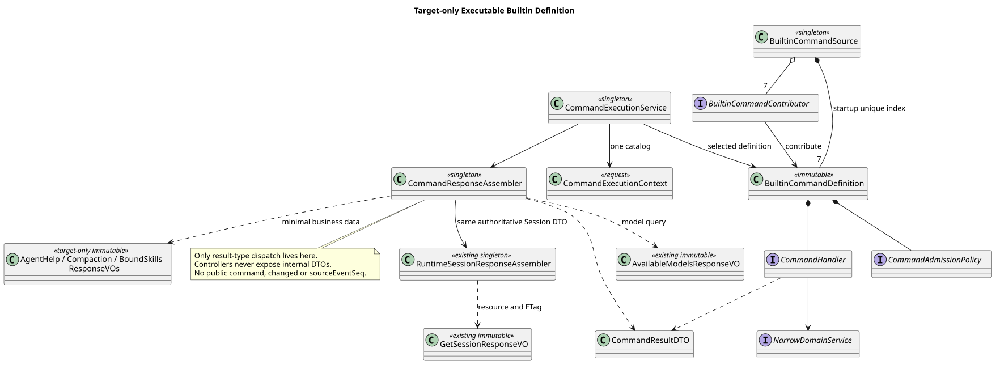
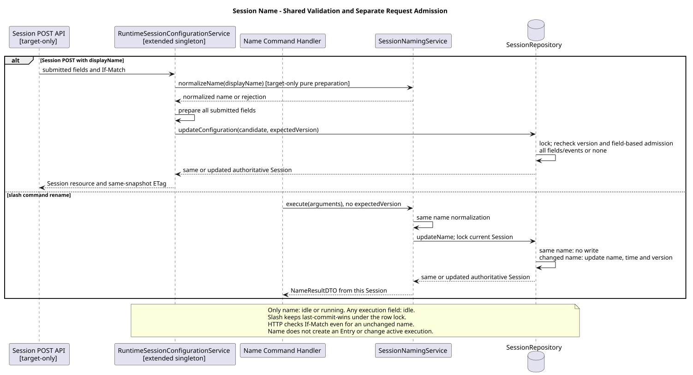
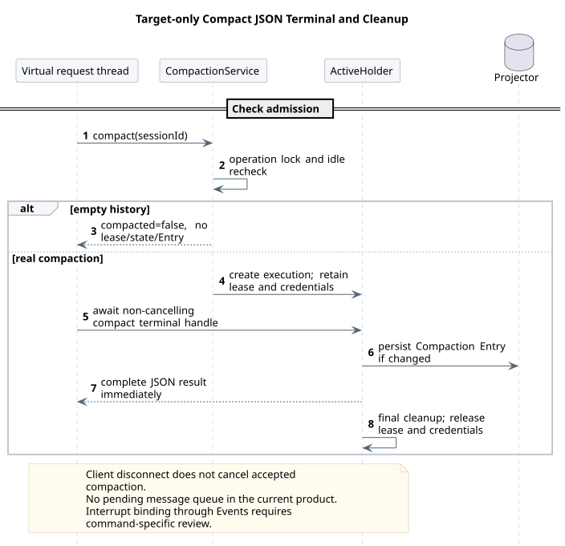

# CampusClaw Builtin Command 设计

[返回导航](../README.md) · [通用模块](../00-Slash-Command通用模块/README.md)

| 属性 | 值 |
|---|---|
| 文档版本 | 2.4.1 |
| 更新日期 | 2026-09-04 |
| 设计仓基线 | `0eaa70ff365bf4d4e328b3473809341ca4cfc58d` |
| CampusClaw 分析基线 | `d84dd3d6a306b7587c70b29e0100e741dacef989` |
| 初始 Command 发现候选 | `0bb794f222273e12fc24fe98d6ab4e9013ac8599`（PR #210） |
| 最新前置 PR #210 | `9d0d76f4a571b559dc77ae52736caebbcc8fad88`，已通过 a8192e047f4061bd385297d3dc6c4358362d0d49 合并 |
| 状态 | 七个 Builtin 目标已由用户确认；公开执行为 target-only |

## 1. 范围与证据

本会话只负责七个 Builtin；Skill Command 由其他同事并行开发，不是延期或禁用。Builtin 来源视图、参数规则和验收不得提升为整个产品的 Skill 限制。共享 GET/POST 的最终命名、请求联合类型和清单合并需在 HTTP 发布前与 Skill 开发线对齐；本次不代替同事设计 Skill 执行细节。

仅实现 help、status、name、model、thinking、compact、skills，不转换成模型提示词，不接受附件。
精确请求和结果以 Runtime
[操作 12](../../01-总体架构/01-CampusClaw多Agent运行时/接口契约/操作/12-list-session-commands.json)、
[操作 13](../../01-总体架构/01-CampusClaw多Agent运行时/接口契约/操作/13-execute-session-command.json) 为准。
[通用模块源码证据表](../00-Slash-Command通用模块/README.md#2-源码证据与差距)记录完整路径与基线。

d84dd3d6 的 `modules/coding-agent-cli/src/main/resources/db/gaussdb/install/session_schema.sql`
中 t_sessions 没有 display_name；配置服务已存在 Model/Thinking 的领域更新。
`modules/coding-agent-cli/src/main/java/com/campusclaw/codingagent/session/ManagedAgentSession.java`
的 compact 已提供共享压缩能力，但没有独立于请求 SSE 的 Runtime 压缩通道。
这些差距是本次 Java 架构变更，不是 pi 已有 HTTP 行为。

## 2. 目标核心

[PlantUML 源码](设计图/diagram.puml#L1)

BuiltinCommandSource 聚合七个 Contributor 并在 Spring 启动期查重。
可执行 Builtin Definition 持有 Handler/Admission；现有 Skill 发现定义不安装伪 Handler，真实 Skill 执行由同事实现。
CommandExecutionContext 固定只读 Session、Locale 和同一 Catalog View。
Help 使用 Context 中的视图，避免 Registry/Application Bean 依赖环。
响应组装器才允许按结果类型分派，不允许中央按命令名称 switch。

| 命令 | 窄服务 |
|---|---|
| help | CommandHelpFormatter |
| status | RuntimeSessionStatusService |
| skills | BoundSkillQueryService |
| name | SessionNamingService |
| model | SessionModelConfigurationService |
| thinking | SessionThinkingConfigurationService |
| compact | SessionCompactionApplicationService |

## 3. 串行 PR 与预算

设计先修 PR #4 和前置实现 PR #210 已合并；每个后续 Builtin PR 必须等前一 Builtin PR 合并，
再从最新 origin/main 建立独立 worktree 和 codex/* 分支，不使用堆叠分支。

| 顺序 | 分支 | 职责与发布边界 |
|---:|---|---|
| 1 | codex/builtin-command-core | 来源过滤、可执行定义、准入/Handler/Context、Contributor、快照与查重；实现设计、PlantUML/SVG、未占用序号 ADR；无 HTTP |
| 2 | codex/builtin-command-readonly | Help/Status/Skills 服务、Contributor、Handler、DTO；无 HTTP |
| 3 | codex/builtin-command-name | display_name、Mapper/Repository/DTO 与 GET Session；无 Command 路由 |
| 4 | codex/builtin-command-model | Model 窄服务与可选 expectedVersion；既有 PUT 条件更新不变 |
| 5 | codex/builtin-command-thinking | Thinking 窄服务与同一事务入口 |
| 6 | codex/compact-runtime-lifecycle | 操作锁、容量、Holder、持久化 Projector、30 分钟超时与独立终态 Future |
| 7 | codex/builtin-command-compact | Compact Contributor/Handler/Application Service、排队续跑与 Abort |
| 8 | codex/builtin-command-application | Catalog/Execution 应用边界与七类 DTO→VO |
| 9 | codex/builtin-command-http | 同时发布 GET/POST、VO/Header/ResultBean、契约和跨进程测试；删除旧 command 原型；更新实施状态 |

单 PR 模块侧新增不超过 850 行，sync-campusclaw 后总量超过 1800 行不发布，硬上限 2000。
删除行不抵扣新增。触及预算时在相邻职责边界拆分，不提前公开未完成路由。
门禁以 `bash scripts/check-commit-additions.sh origin/main HEAD` 为准；ADR 在同步最新 main 后分配。

## 4. 命令行为

| 命令 | 空参数 | 非空参数 | running |
|---|---|---|---|
| help | 全部七项描述符 | 去除两端空白后精确找一项；不接受前导 / | 可用 |
| status | 持久化 state/modelId/thinking | 拒绝 | 可用 |
| skills | 最新完整绑定快照的名称/描述 | 拒绝 | 可用 |
| name | 查询当前名称 | 更新当前名称 | 可查询和修改 |
| model | 当前与可选模型 | 修改模型 | 仅查询 |
| thinking | 当前开关 | 仅小写 on/off | 仅查询 |
| compact | 压缩 | 拒绝 | 不可用 |

空参数是 Service 归一后的空字符串。全空白 Name 修改在去除两端空白后为空时拒绝，不视为清空。
Help 未命中为 COMMAND_NOT_FOUND；非法参数为 INVALID_COMMAND_REQUEST。
描述符的 COMMAND_ARGUMENTS_NOT_SUPPORTED 只是可用性原因，不是额外 HTTP 错误。
Skills 不触发刷新：无完整快照返回 AGENT_NOT_AVAILABLE；完整空快照返回 []，只展示名称/描述并稳定排序。

## 5. Name 当前状态

[PlantUML 源码](设计图/diagram.puml#L35)

t_sessions 增加可空 display_name；GET Session 始终保留 displayName，即使 null。
修改去除两端空白、保留内部空白，拒绝空值、CR/LF、C0/C1、Unicode 双向覆盖/隔离字符及超过 80 UTF-8 字节。
数据库行锁内 last-commit-wins；同一归一值不升版本，running 允许修改。
不写 session.name.changed 或通用命令事件，不修改 active leaf；重启只恢复当前名称。

## 6. Model / Thinking

Repository 在行锁内支持可选 expectedVersion。既有 PUT 继续要求 If-Match 并返回 ETag；
Command 不接收 If-Match，使用锁内当前版本。同值操作不写领域 Entry。
查询在 running 可用，修改在锁内重新检查并返回 SESSION_BUSY。
Model 不可用为 MODEL_NOT_AVAILABLE；开启不受支持的 Thinking 为 THINKING_NOT_SUPPORTED；
Manager 不可用为 MANAGER_UNAVAILABLE。Model 切换到不支持 Thinking 的模型时沿用自动关闭规则。

## 7. Compact 生命周期

[PlantUML 源码](设计图/diagram.puml#L60)

只接受 idle Session 和空参数。空历史观察无副作用：不占容量、不改状态、不写 Entry，返回 compacted=false。
真实压缩与 POST Events 共用操作锁、全局容量、Active Holder、Event Projector 和 30 分钟超时。
Projector 不依赖请求 SSE 仍持久化权威领域 Entry。

虚拟请求线程等待独立“压缩终态 Future”，使用不会传播客户端断线取消的完成句柄。
成功或无变化即返回 JSON，不等待排队的 Steer/FollowUp；队列随后在同一 Holder 继续，
因此响应后 Session 仍可能 running。Abort 取消压缩并清空队列。失败/超时清理容量、Holder 和 Session 状态。
请求 Mate Header 只存在于该 Holder 至续跑结束，不写日志、Prompt 或持久化。
客户端不自动重放结果不确定的 Compact；通过 GET Session/Events 对账。

## 8. JSON 与错误

POST 请求只有 name 和 arguments；name 必填，1～64，匹配 `^[a-z0-9]+(?:-[a-z0-9]+)*$`。
arguments 缺省/null 在 Service 归一为 ""，最大 262144 UTF-16 代码单元。
Builtin 请求拒绝 fileIds、未知字段、If-Match 和 Idempotency-Key。该规则不是 Skill 请求的全局限制；最终共享入口需整合 Skill 命名与请求类型。

| 命令 | 成功 result 字段 |
|---|---|
| help | command, commands |
| status | command, state, modelId, thinking |
| name | command, displayName, changed |
| model | command, currentModelId, models, changed, sourceEventSeq? |
| thinking | command, thinking, changed, sourceEventSeq? |
| compact | command, compacted, sourceEventSeq? |
| skills | command, skills[{name, description}] |

sourceEventSeq 是本次追加的最后一条权威领域 Entry 序号；查询、幂等未变、空历史压缩时省略。
只有这个字段允许字段级非空序列化策略；列表始终非 null，displayName 即使 null 也保留。
成功 HTTP 200、application/json、Cache-Control: no-store、Content-Language；Controller 只收发 VO。
错误使用真实 HTTP 状态与仅 resCode/resMsg 的 ResultBean，不使用流内错误。
完整 400/404/409/422/500/503 映射由操作 13 唯一维护。

## 9. 测试与交付

每个 PR 执行针对性单元测试、新增测试质量检查、Spotless/Checkstyle、模块测试、
sync-campusclaw、diff --check 和新增行数门禁；最终 HTTP PR 执行完整 mvnw verify。
测试覆盖：

- 七项稳定排序、重名启动失败、单次快照、Builtin 不调用 Skill Source。
- 缺失/类型错误/未知字段/Slash/非法或未知名称/超长参数。
- 七类精确 JSON、列表非 null、sourceEventSeq 省略、无内部 DTO 泄漏。
- Name Unicode/UTF-8 字节边界、并发、幂等、重启和 GET Session。
- Model/Thinking 忙状态、能力、自动关闭、事件序号和 PUT ETag/If-Match 回归。
- Compact 空历史、真实压缩、容量、锁竞争、超时、断线、队列续跑、Abort 和清理。
- 无通用命令或 Name 历史；POST Events SSE 完全不变。
- openGauss 跨进程：创建 → Name/Model/Thinking → Help/Status/Skills → Compact → GET Session/Events。

## 版本历史

| 版本 | 日期 | 变更 |
|---|---|---|
| 2.4.1 | 2026-09-04 | 将七个 Builtin 限定为本会话责任；Skill 由同事并行开发，共享 HTTP 发布前对齐；确认设计和发现层前置 PR 已合并。 |
| 2.4.0 | 2026-09-04 | 冻结七个 Builtin JSON 行为、当前名称、领域 Entry、Compact 独立终态与串行九 PR 预算。 |
| 2.3.0 | 2026-09-03 | 设计正文只保留推荐目标类图；移除当前实现类图，继续用源码证据与差距表表达现状，并保持目标核心类图和 Builtin 扩展类图作为实施结构基线 |
| 2.2.0 | 2026-09-03 | 复核 `3004419a` 发现层和 `fb49e86d` GET 清单；新增当前实现类图、目标核心类图和七个 Builtin 扩展类图，明确应用层、请求快照、DTO/VO 边界与 Help 无环依赖 |
| 2.1.0 | 2026-09-02 | 复核 `c9d858bc` 主线与未合入的 `fc06c618` 命令清单骨架，增加实施权威顺序、差距、竖切片、事务边界、参数语法、公司镜像规则和三个实施决策门；不改变已确认的七个 Builtin 清单 |
| 2.0.4 | 2026-09-01 | 命令相关表述统一使用“命令清单”，移除可能被理解为文件路径的用词 |
| 2.0.3 | 2026-08-31 | 统一七个 Builtin 的动作式短句，简化运行状态和组件职责说明；不改变命令行为 |
| 2.0.2 | 2026-08-31 | 简化 `/help` 命令矩阵文案，改为“列出命令清单”“查看指定命令详情”“始终可用” |
| 2.0.1 | 2026-08-31 | 将 `/help` 无参行为改述为列出当前 Session 可发现的命令，避免被理解为文件路径 |
| 2.0.0 | 2026-08-31 | 废弃旧 GUI/Extension 执行面设计，收敛为 HTTP v1 七个 Builtin、窄职责服务和 CampusClaw Session Name 所有权 |
