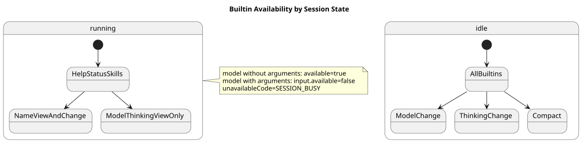
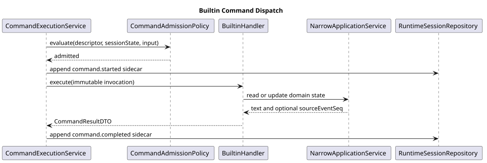

# CampusClaw Builtin Command 设计

[返回命令与技能导航](../README.md) ·
[通用模块](../00-Slash-Command通用模块/README.md)

| 属性 | 值 |
|---|---|
| 文档版本 | 2.0.3 |
| 设计日期 | 2026-08-31 |
| CampusClaw 指定源码基线 | `c1311f69f504e7e799fa2467fd6a9d95b3f91b99` |
| CampusClaw 复核 HEAD | `94abd2abcb03943daef5118115e4b4a21f1c4d5f` |
| 设计状态 | target-only；现有保留 Command 尚未接入 Runtime HTTP |

## 1. 范围

v1 提供七个 Builtin：`help`、`status`、`name`、`model`、`thinking`、
`compact`、`skills`。

- 不增加 `/models`：模型列表由 `/model` 返回；
- 不增加 `/abort`：继续使用现有 Stop/Abort API；
- Builtin 直接调用应用服务，不转换为模型提示词；
- Builtin 不接受附件。

## 2. 命令矩阵

| 命令 | 无参行为 | 有参行为 | 运行中 |
|---|---|---|---|
| `/help [command]` | 列出命令清单 | 查看指定命令详情 | 始终可用 |
| `/status` | 查看状态、模型和深度思考 | 不支持 | 始终可用 |
| `/name [displayName]` | 查看名称 | 修改名称 | 始终可用 |
| `/model [modelId]` | 查看当前和可选模型 | 切换模型 | 仅查看 |
| `/thinking [on\|off]` | 查看开关 | 开启或关闭 | 仅查看 |
| `/compact` | 压缩上下文 | 不支持 | 不可用 |
| `/skills` | 列出绑定的 Skill | 不支持 | 始终可用 |

运行中修改 Model/Thinking、执行 Compact 或调用 Skill，统一返回 `SESSION_BUSY`。
`/help` 遇到未知命令时返回 `COMMAND_NOT_FOUND`。

`status` 不宣称当前上下文已使用量。CampusClaw 现有 `lifetimeUsage` 是会话
生命期累计量，不等于下一次模型请求的有效上下文占用；两者混用会产生
虚假精度。

[PlantUML 源码：`builtin_availability`](设计图/diagram.puml#L26)

## 3. 每个 Builtin 的独立组件

每个命令都有独立的 Contributor、Definition 和 Handler：

| 命令 | Handler 调用的应用服务 |
|---|---|
| Help | `CommandCatalogService` |
| Status | `SessionStatusQueryService` |
| Name | `SessionNamingService` |
| Model | `SessionModelConfigurationService` |
| Thinking | `SessionThinkingConfigurationService` |
| Compact | `SessionCompactionApplicationService` |
| Skills | `AgentSkillCatalogService` |

`CommandExecutionService` 负责通用执行前检查、`command.*` 生命周期和 SSE；
Handler 不复制通用逻辑。

Model 和 Thinking 继续复用现有配置规则。目标实现把
`RuntimeSessionConfigurationService` 的修改逻辑抽到窄职责服务：

- 现有 PUT API 继续使用 `If-Match`；
- Command Handler 由服务端读取版本并原子更新；
- 两个入口共用模型可用性、能力归一、idle 检查和领域事件。

[PlantUML 源码：`builtin_dispatch`](设计图/diagram.puml#L1)

## 4. `/name` 领域规则

### 4.1 所有权

`displayName` 是 Session 的持久化属性，所以归 CampusClaw：

- Session 被复制/Fork 时，新 Session 继承源 Session 在创建事务中读到的
  已规范化名称。当前 CampusClaw 还没有 Copy/Fork HTTP 实现，这是未来该操作的目标规则。
- Session 资源本身返回 `displayName`；名称变化更新 `resourceVersion`。
- `session.name.changed` 是 CampusClaw Session Event，可在断线后恢复。
- mate-service 只完成 Chat 权限检查和 Session 映射；不保存名称副本。

pi `AgentSession.setSessionName`、OpenCode `Session.setTitle`、DeepSeek
`SessionTitleService.rename` 和 Codex `thread/name/set` 都指向 Session/Thread 所有者。
Claude Managed Agents 没有可直接复用的 rename 协议，因此不把它当作支持或反对证据。

### 4.2 存储和校验

- `t_sessions` 增加可空 `display_name`；新 Session 默认 SQL `NULL`。
- 更新前只裁剪首尾空白；不将中间空白折叠为单空格。
- 禁止 CR/LF、C0/C1 控制字符和会产生欺骗显示的 Unicode 双向覆盖/隔离控制字符。
- 裁剪后为空或 UTF-8 编码超过 80 字节时返回 `INVALID_COMMAND_ARGUMENTS`；
  不静默截断。
- v1 不提供清空名称操作。无参是查询，不是清空。

这里相对 DeepSeek “清理控制符+超限截断”采用严格拒绝，是安全加固与产品约束；
相对当前 `NameCommand` 的 mate-service 所有权是架构变更。

### 4.3 事务与并发

`/name` 不要求 `If-Match`，允许在 Session 运行中更新，按数据库实际提交顺序
last-commit-wins：

1. 锁定 Session 主记录，读取当前 `display_name`、`resource_version` 和 `active_leaf_id`。
2. 同值更新直接返回无变化成功，不增加版本，不产生领域事件。
3. 有效变更原子更新名称、`resource_version + 1`、`updated_at`，同事务写入
   `session.name.changed` sidecar。
4. Handler 结果的 `sourceEventSeq` 指向该名称事件；同值更新省略。
5. 名称和名称事件不进入模型上下文。

[PlantUML 源码：`session_name_update`](设计图/diagram.puml#L54)

## 5. 输出边界

| 命令 | `text` 的必要信息 | `sourceEventSeq` |
|---|---|---|
| `help` | 命令名、描述、输入提示和当前可用性 | 无 |
| `status` | state、modelId、thinking | 无 |
| `name` | 当前或更新后 displayName | 只有真实变更时存在 |
| `model` | 当前模型/可选列表，或切换后模型 | 变更时指向 `session.model.changed` |
| `thinking` | 当前或切换后 `on/off` | 变更时指向 `session.thinking.changed` |
| `compact` | 压缩完成的稳定摘要，不回显私有摘要正文 | 指向 `session.compaction.completed` |
| `skills` | 当前绑定 Skill 名与描述 | 无 |

## 6. 源码证据与目标差异

| 分类 | 证据或决策 |
|---|---|
| 观察到的行为 | `CompactCommand.java:16-32` 当前允许自定义压缩指令；v1 改为无参，是产品约束 |
| 观察到的行为 | `ThinkingCommand.java:30-45` 当前还兼容 `true/false`；v1 只对用户开放 `on/off` |
| 观察到的行为 | `RuntimeSessionConfigurationService.java:78-163` 已有模型目录、模型/思考变更和 idle/ETag 校验 |
| 观察到的行为 | `ManagedAgentSession.java:105` 已有压缩入口；命令不应自建另一套压缩实现 |
| 目标设计 | 新增 Help/Status/Skills 与全部 Runtime Command 适配器；七个 Builtin 均为 target-only |
| 架构变更 | Name 所有权转入 CampusClaw Session，替换 `NameCommand.java:13-14` 的旧注释 |

## 7. 验收清单

- 七个 Contributor 名称不可变，任两重名时 Spring 启动失败。
- 对每个命令覆盖无参、有参、多余参数、附件和 idle/running 矩阵。
- Model/Thinking 在 running 中的查询成功，输入调用于流建立前返回 `SESSION_BUSY`。
- Name 覆盖初始空值、查询、运行中更新、同值更新、控制符、UTF-8 字节边界、
  并发 last-commit-wins、复制继承和模型上下文隔离。
- Compact 不接受参数，断线后继续并可从持久化 terminal event 恢复。

## 8. 版本历史

| 版本 | 日期 | 变更 |
|---|---|---|
| 2.0.3 | 2026-08-31 | 统一七个 Builtin 的动作式短句，简化运行状态和组件职责说明；不改变命令行为 |
| 2.0.2 | 2026-08-31 | 简化 `/help` 命令矩阵文案，改为“列出命令清单”“查看指定命令详情”“始终可用” |
| 2.0.1 | 2026-08-31 | 将 `/help` 无参行为改述为列出当前 Session 可发现的命令，消除“当前目录”与文件系统目录的歧义 |
| 2.0.0 | 2026-08-31 | 废弃旧 GUI/Extension 执行面设计，收敛为 HTTP v1 七个 Builtin、窄职责服务和 CampusClaw Session Name 所有权 |
