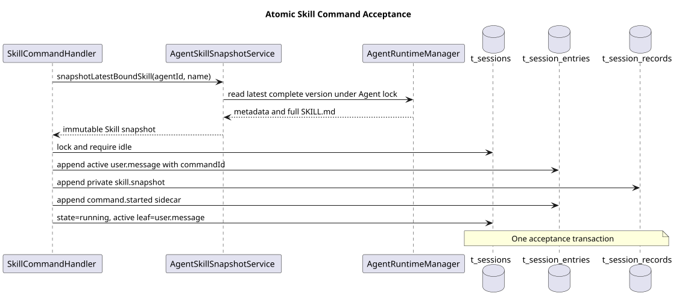
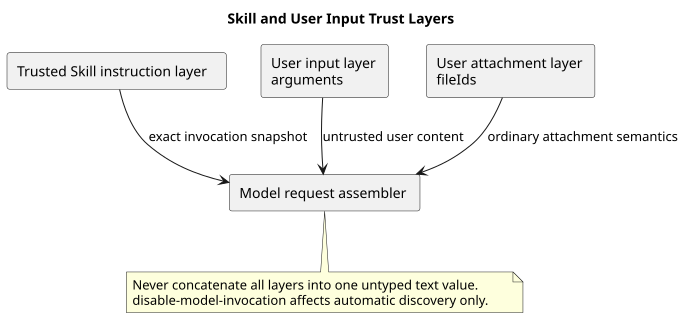
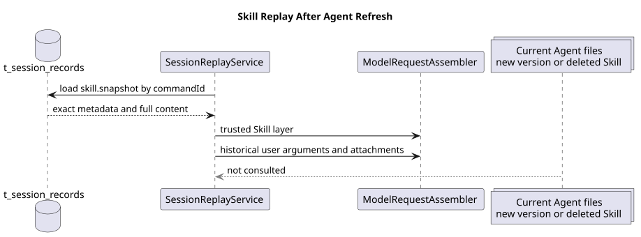

# CampusClaw Skill Command 设计

[返回命令与技能导航](../README.md) ·
[通用模块](../00-Slash-Command通用模块/README.md)

| 属性 | 值 |
|---|---|
| 文档版本 | 3.0.2 |
| 设计日期 | 2026-08-31 |
| CampusClaw 指定源码基线 | `c1311f69f504e7e799fa2467fd6a9d95b3f91b99` |
| CampusClaw 复核 HEAD | `94abd2abcb03943daef5118115e4b4a21f1c4d5f` |
| pi 基线 | `4af9d21d3b4d664e4a29fcabfec85171077248e3` |
| 设计状态 | target-only；当前 Skill 仅有受管目录与模型自动发现，没有 HTTP Skill Command |

## 1. 结论

Skill 命令格式：

```text
/skill:<name> [request]
```

| 规则 | 结论 |
|---|---|
| HTTP `name` | `skill:<name>`，不含 `/` |
| Skill 名称 | `<name>` 匹配 `[a-z0-9-]+` |
| 命名冲突 | 与 Builtin 分属不同命名空间，不设置优先级 |
| Session 状态 | 仅 `idle` 时可执行；`running` 时仍显示但标记不可用 |
| 参数 | 最多 262144 字符 |
| 附件 | 最多 32 个，复用普通用户消息规则 |

## 2. 命令清单如何生成

每次查询命令清单时，`SkillCommandSource`：

1. 从 Session 取不变 `agentId`。
2. 通过 `AgentRuntimeManager.prepareCached(agentId)` 读取最新 complete 版本，不触发远程刷新。
3. 对直接绑定的 Skill 按名称稳定排序，生成 `skill:<name>` Descriptor。
4. 只返回名称、描述、可用性和输入提示；不返回正文、路径、Skill ID 或版本。

`PreparedAgentRuntime.skills()` 和 `findSkill()` 已支持精确名称查找。目标设计在其上建立
动态 Source，不把每个 Skill 注册成 Spring Bean。


[PlantUML 源码：`skill_catalog`](设计图/diagram.puml#L1)

## 3. 调用时快照

### 3.1 为什么不能只保存 Skill ID

Agent 刷新会替换 Skill 版本、正文和资源，也可能删除绑定。历史若只记录 Skill ID 或
文件路径，重放时就可能读取到不同内容。

因此每次调用都把完整快照写入 `t_session_records(type='skill.snapshot')`，不跨调用去重。
快照至少包含：

```text
commandId
agentId
agentVersion
skillId
skillVersion
name
description
skillMarkdown
references[]: name, fileType, content
templates[]: name, fileType, content
capturedAt
```

快照使用 `lane='main'`、`run_id=commandId`。`record_seq` 与 Entry 共享 Session 序列，
但快照不进入 GET Events 或公共 SSE。因此公开 `entrySeq` 可以有缺口；调用方只能排序，
不能补号或推断缺口内容。

### 3.2 原子接受顺序

Skill 调用按以下顺序接受；全部成功后才建立 SSE：

1. 在 Agent 锁内读取最新 complete 版本的元数据、`SKILL.md` 和资源；随后释放 Agent 锁。
2. 锁定 Session，校验 idle、命令参数、附件与快照完整性。
3. 写入包含 `commandId`、`commandName`、原始 `arguments` 和 `fileIds` 的活动 `user.message`。
4. 写入私有 `skill.snapshot` Record。
5. 写入锚定在新 User Entry 的 `command.started` sidecar。
6. 将 Session 置为 running，`active_leaf_id` 指向新 User Entry。

任一步失败都回滚，并在流建立前返回 ResultBean。不能先写用户消息，再检查 Skill 正文。



[PlantUML 源码：`skill_acceptance`](设计图/diagram.puml#L21)

## 4. 模型请求分层

`ModelRequestAssembler` 不得把 `SKILL.md + arguments + fileIds` 拼成一段文本，必须保留三层：

| 层 | 来源 | 信任语义 | 恢复来源 |
|---|---|---|---|
| Skill instruction | 调用时 `skill.snapshot` | 受管、已验证的 Skill 指令层 | 私有 Record |
| User text | 结构化 `arguments` | 不可信 User 输入层 | `user.message` |
| User files | `fileIds` | 普通用户附件层 | `user.message` |

这是相对 pi `agent-session.ts:1331-1334` 的安全加固，避免把用户参数当成受信任指令。

命令关联的 `user.message` 只把 `arguments + fileIds` 放入 User 层。UI 使用的
`/skill:<name>` 不进入模型内容；Skill 指令由快照投影器单独注入。



[PlantUML 源码：`skill_trust_layers`](设计图/diagram.puml#L49)

## 5. `disable-model-invocation`

CampusClaw `SkillLoader.java:134-137` 已解析 `disable-model-invocation`，
`RuntimeAgentPromptLoader.java:67-72` 已将该 Skill 排除在模型自动发现提示词外。

该字段只禁止模型自动发现和调用，不禁止用户显式调用。当前 Agent 直接绑定且快照完整的
Skill 都出现在命令清单中。这与 pi `skills.ts:347-356` 的语义一致。

## 6. 执行、断线和恢复

- Skill Handler 完成接受事务后，用新的 `user.message` 作为活动分支叶子，
  并发起一次标准 Agent 执行。
- Assistant、Thinking、Tool 和 Compaction 事件复用现有 Runtime 领域投影；
  Skill 不建立专属消息模型。
- `command.completed.sourceEventSeq` 指向最终 `assistant.message.completed`。
- HTTP 断线不取消已接受执行；调用方不重放 POST，通过 GET Events 恢复。
- Agent 刷新、Skill 修改或删除后，恢复只读取 `skill.snapshot`，不读当前文件。
- 历史恢复时找不到调用快照属于数据完整性错误，不允许回退到当前 Skill。



[PlantUML 源码：`skill_replay`](设计图/diagram.puml#L73)

## 7. 源码证据和差异分类

| 分类 | 证据或决策 |
|---|---|
| 观察到的行为 | `AgentRuntimeManager.java:194-253,323-363` 已校验并重建 Skill 元数据和完整 Markdown |
| 观察到的行为 | `PreparedAgentRuntime.java:57-95` 已提供绑定 Skill 索引和精确名称查找 |
| 观察到的行为 | `t_session_records` 已有私有 Record lane，但当前 `type` 只说明支持 usage；`skill.snapshot` 是目标扩展 |
| 目标设计 | 动态 SkillCommandSource、共享 Handler、调用快照、附件与断线恢复均未在当前 CampusClaw 实现 |
| 安全加固 | 受信任 Skill 指令、User 参数和附件分层；快照缺失时禁止回退到当前文件 |
| 产品约束 | 只有 `skill:` 命名空间，不开放 pi 的 Prompt/Extension 或 OpenCode 的裸 Skill 名称 |

## 8. 验收清单

- Skill 与 Builtin 即使底层名称相同也不冲突。
- 运行中命令清单仍返回 Skill，但执行在流建立前返回 `SESSION_BUSY`。
- 快照不存在、不完整或与绑定名称不符时，用户 Entry、Record、command.started
  和 running 状态均不提交。
- `arguments` 与 `fileIds` 保持 User 输入层，Skill 正文保持受信任指令层。
- 快照不跨调用去重；修改或删除 Skill 后仍按原快照恢复。
- `disable-model-invocation=true` 的绑定 Skill 仍可由用户显式调用。
- SSE 断线后执行继续，最终 Assistant 事件与 `command.completed/failed` 可恢复。

## 9. 版本历史

| 版本 | 日期 | 变更 |
|---|---|---|
| 3.0.2 | 2026-08-31 | 使用规则表和动作式短句简化命名、发现、快照与信任分层说明；不改变 Skill 行为 |
| 3.0.1 | 2026-08-31 | 将面向读者的“目录”统一为“命令清单”，明确 Skill 发现不是文件系统目录扫描 |
| 3.0.0 | 2026-08-31 | 废弃旧的本地资源扩展和 Reload 交互设计，收敛为 HTTP `/skill:name`、最新 Agent 解析、调用快照、信任分层和可恢复执行 |
