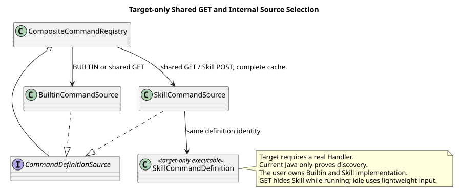
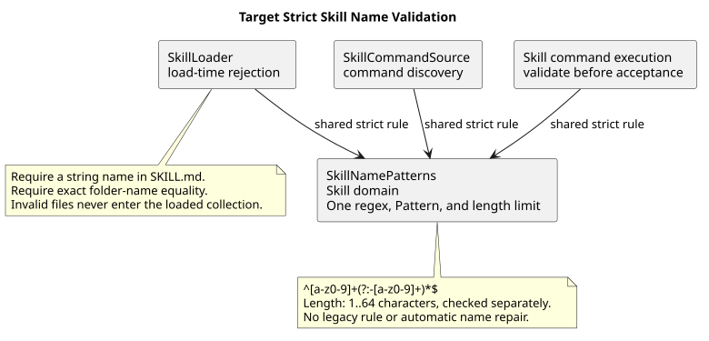

# CampusClaw Skill Command 设计

[返回导航](../README.md) · [通用模块](../00-Slash-Command通用模块/README.md)

| 属性 | 值 |
|---|---|
| 文档版本 | 3.2.0 |
| 更新日期 | 2026-09-07 |
| 设计仓基线 | `0eaa70ff365bf4d4e328b3473809341ca4cfc58d` |
| Skill 发现候选 | `9d0d76f4a571b559dc77ae52736caebbcc8fad88`（PR #210，已通过 a8192e047f4061bd385297d3dc6c4358362d0d49 合并） |
| Skill 名称专项复核 | `0300541fbbe3db8b05ffa1ac953f15f01df74b3e`（2026-09-04，本地源码提交；只复核名称规则与消费者） |
| 状态 | Builtin 与 Skill Command 由用户统一负责设计、实现和集成；执行契约细节待统一评审 |

## 1. 当前实施责任

Builtin 与 Skill Command 由用户统一负责设计、实现和集成。共享 GET 的轻量描述符、两类命令合并、固定排序与状态过滤已确认；Builtin 来源过滤只适用于内部 Builtin 专属解析，不是共享 GET 的全局限制。POST 保留已确认 Builtin JSON 契约；Skill 请求联合类型、执行结果和 HTTP 发布集成仍需评审。
PR #210 的动态 SkillCommandSource 可保留，但 Registry 必须在调用 Source 前按来源过滤。
内部 Builtin 专属解析不读取 Skill 来源；共享 GET 必须取得完整 Agent 快照，不触发刷新，无完整快照整体返回 503。
现有 Skill 发现定义只展示，不安装伪 Handler；用户统一补齐真实执行定义。



[PlantUML 源码](设计图/diagram.puml#L1) · [原尺寸 SVG](设计图/skill_catalog.svg)

## 2. 源码证据

PR #210 的 `modules/coding-agent-cli/src/main/java/com/campusclaw/codingagent/runtimeapi/command/SkillCommandSource.java`
读取 Prepared Agent 元数据并生成描述符，没有执行 Handler。
同基线 `modules/coding-agent-cli/src/main/java/com/campusclaw/codingagent/skill/SkillNamePatterns.java`
已集中兼容/严格策略的正则字符串、编译模式与长度上限，Loader 仍使用兼容策略。
这是已观察到的实现差距，不是允许保留的产品兼容要求；必须按第 3 节统一严格校验。
旧候选 `0bb794f2` 的 SkillNameValidator 已删除；发现结果使用只读 DTO，并复制建议列表。
这些是前置 PR 已合并的发现行为，不是已发布 HTTP 执行能力。

pi `4af9d21d3b4d664e4a29fcabfec85171077248e3` 的
`packages/coding-agent/src/core/skills.ts` 提供 Skill 发现，而
`packages/coding-agent/src/core/agent-session.ts` 有本地展开/执行语义；
这不是 CampusClaw 的企业 HTTP 契约。完整外部基线和差异分类见[通用模块](../00-Slash-Command通用模块/README.md)。

### 2.1 名称专项复核

本节保留旧分支 `3004419a467b77bac08d0f2b3dad21f8815568c5` 的证据，并追加本地源码提交
`0300541fbbe3db8b05ffa1ac953f15f01df74b3e` 的名称专项复核。后者没有替代其余章节的历史
基线，也不表示本文已复核所有 Command 实现。以下 Java 路径均相对 `pi-mono-java` 仓库。

| 分类 / 基线 | 源码路径与符号 | 结论 |
|---|---|---|
| 旧实现 / `3004419a` | `modules/coding-agent-cli/src/main/java/com/campusclaw/codingagent/skill/Skill.java`：`NAME_PATTERN`；同包 `SkillLoader.java`：`validateName` | 加载使用宽松 `^[a-z0-9-]+$` |
| 旧实现 / `3004419a` | `modules/coding-agent-cli/src/main/java/com/campusclaw/codingagent/runtimeapi/command/SkillNameValidator.java`：`isValid`；同包 `SkillCommandSource.java`：`descriptor`、`skillNameOf` | 命令路径使用独立严格规则，和加载路径不一致 |
| 复核实现 / `0300541f` | `modules/coding-agent-cli/src/main/java/com/campusclaw/codingagent/skill/SkillNamePatterns.java:15-49` | 规则已迁到 Skill 域，但仍有 LEGACY/STRICT 两套正则、Pattern 和判定方法；集中位置没有消除策略分裂 |
| 复核实现 / `0300541f` | `modules/coding-agent-cli/src/main/java/com/campusclaw/codingagent/skill/SkillLoader.java`：`parseSkillFile:110-118`、`validateName:138-150` | 缺少名称仍回退文件夹名；加载仍使用 `SkillNamePatterns.LEGACY` |
| 复核实现 / `0300541f` | `modules/coding-agent-cli/src/main/java/com/campusclaw/codingagent/runtimeapi/service/command/SkillCommandSource.java`：`resolved` | 命令发现使用 `SkillNamePatterns.isStrictValid`；`-pdf`、`pdf-`、`pdf--tools` 仍形成加载与发现差异 |
| pi 对照 / `4af9d21d` | `packages/coding-agent/src/core/skills.ts`：`validateName`、`loadSkillFromFile:320-344` | 检查首尾及连续连字符，但名称错误仅记录 warning，描述有效时仍加载；CampusClaw 不采用此容忍行为 |
| 已确认目标 / 产品约束与安全加固 | Skill 域唯一严格规则；所有消费者一致拒绝 | 删除兼容分支，让加载、模型发现、命令发现与执行共享相同名称边界；执行仍属 target-only |

## 3. 名称统一严格校验

```regex
^[a-z0-9]+(?:-[a-z0-9]+)*$
```

`name` 指 Skill 包名称，不含命令命名空间前缀。入口解析命令前缀后，
必须复用 Skill 域的同一套严格规则；共享 HTTP 联合类型由用户统一对齐。规则对齐
[Agent Skills specification](https://agentskills.io/specification)。正则本身没有 64 字符上限，
必须同时校验长度为 1～64 个字符。以下规则是 2026-09-04 已确认目标，名称专项复核源码仍有第 2 节所列差距：

- `SkillNamePatterns` 只保留一份严格正则字符串、编译后的 Pattern 和长度上限，加载、
  命令发现和执行全部引用；移除 LEGACY 常量和方法，不在 HTTP/Command 包中另建名称 Validator。
- 非法名称在加载时就拒绝，不进入已加载 Skill 集合或模型发现提示词；命令发现和执行同样
  拒绝。禁止保留“加载可用、命令隐藏”的兼容分支。
- `SKILL.md` 的 `name` 必须是非空字符串，与所在文件夹及绑定元数据逐字符一致；缺少名称
  不回退到文件夹名，也不通过字符串强制转换、裁剪、替换连字符或自动改名修正非法值。
- 单文件加载失败沿用 `SkillLoadException`；批量扫描可以沿用跳过无效文件的行为，但不能
  把无效 Skill 加入返回集合。存量非法名称必须修正后重新加载。

取消宽松加载是已确认产品约束与安全加固。旧代码或兼容测试只能证明曾经接受过非法名称，
不能建立产品迁移要求。统一规则避免同一 Skill 能进入模型发现、却不能通过命令发现或执行。



[PlantUML 源码：`skill_name_validation`](设计图/diagram.puml#L24)

## 4. 统一实施与集成要求

共享 GET 的 Skill 名称为 `skill:<name>`，idle 时排在固定 Builtin 顺序之后并按 name 排序；
running 时整项省略。仅返回 name/kind/description 与
`input: {"hint":"[request]","acceptsFiles":true}`，不输出 Skill ID、版本、正文、路径或建议值。
完整规则与最新源码差距见[共享 GET 契约](../00-Slash-Command通用模块/README.md#31-get-轻量清单已确认)。
这些是已确认的发现投影，不等于 Skill POST 已实现或已发布。

Skill 执行由用户统一设计与实现，按共享核心依赖安排实施；已有发现骨架仍只证明发现能力。
统一对齐时需明确命令结果、完整快照、绑定重检、容量、信任分层、失败与恢复。
不得重新引入本期已移除的通用 commandId、command.started/completed/failed 或 Name 边车。
若需要私有 Skill 调用快照，必须单独评审其保留期、隐私与恢复用途，不作为当前实现要求。

## 5. 当前验收

统一验收同时覆盖 Builtin 与 Skill Command。Builtin 专项验证来源视图只含七项、Builtin Registry 不调用 SkillCommandSource；
Skill 专项验证发现、真实执行与失败恢复；最终共享清单和请求联合类型覆盖两类命令，不能以 POST skill:* 必须失败作为整体验收。
skills Builtin 只展示最新完整绑定快照中的名称/描述，不等于发布 Skill Command。

名称规则的共享验收覆盖加载与命令消费者，执行入口校验也由用户统一补齐：

- 加载、命令发现和执行使用同一组名称样例，统一接受 `a`、`0`、`pdf-tools` 和长度恰为 64 的合法名称；统一拒绝空值、空字符串、65 字符、`-pdf`、`pdf-`、`pdf--tools`、`PDF`、`pdf_tools`、空白及换行。
- 单文件加载拒绝缺少、非字符串的 frontmatter 名称及文件夹名称不一致；批量扫描返回集合、模型发现提示词和命令清单均不包含非法 Skill，直接执行也不能绕过校验。
- Skill 域只保留一份严格正则字符串、编译后的 Pattern 和长度上限；不存在 LEGACY 加载分支、Command 专用第二套正则或“非法名称加载成功”的兼容测试。

## 版本历史

| 版本 | 日期 | 变更 |
|---|---|---|
| 3.2.0 | 2026-09-07 | 合入共享 GET 的 Skill 轻量投影与 running 过滤，明确完整缓存前置；保留严格名称、统一实施责任及待评审的执行细节。 |
| 3.1.3 | 2026-09-05 | 用户统一负责 Skill 与 Builtin 的设计、实现和集成；更新实施、发布与验收责任；取代 3.1.1/3.1.2 的同事并行分工。 |
| 3.1.2 | 2026-09-04 | 加载、命令发现和执行统一严格名称校验，取消存量兼容；追加 `0300541f` 名称专项证据、pi warning 差异、目标校验图与一致性验收，保留并行开发分工。 |
| 3.1.1 | 2026-09-04 | 用户明确 Skill 由其他同事同步开发；撤销 3.1.0 的执行延期与全局拒绝解释，保留发现/执行职责分离。 |
| 3.1.0 | 2026-09-04 | Skill 执行延期；保留发现骨架但从 Builtin HTTP 来源过滤，禁止伪 Handler 与通用命令历史。 |
| 3.0.4 | 2026-09-01 | 命令相关表述只使用“命令清单”；Skill 文件位置统一表述为“文件夹” |
| 3.0.3 | 2026-09-01 | Skill 名称对齐 Agent Skills 完整规则；参数和附件改为引用普通消息限制，并补齐五类 Harness 的依据边界 |
| 3.0.2 | 2026-08-31 | 使用规则表和动作式短句简化命名、发现、快照与信任分层说明；不改变 Skill 行为 |
| 3.0.1 | 2026-08-31 | 面向读者统一使用“命令清单”，明确 Skill 命令发现不依赖磁盘扫描 |
| 3.0.0 | 2026-08-31 | 废弃旧的本地资源扩展和 Reload 交互设计，收敛为 HTTP `/skill:name`、最新 Agent 解析、调用快照、信任分层和可恢复执行 |
