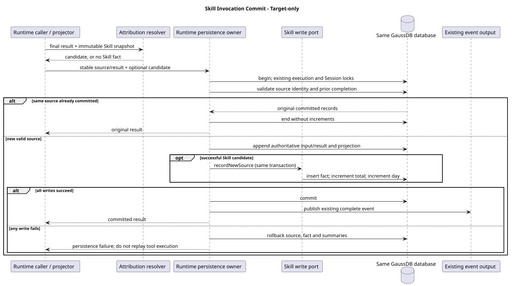

# Skill 调用统计设计

[命令与技能](../README.md) · [M05 主设计](../00-Slash-Command通用模块/README.md) · [Codex 机制详解](codex-skill-counting.md) · [统一接口页](../../01-总体架构/01-CampusClaw多Agent运行时/chat-api-review.html#listSkillInvocationStatistics)

| 属性 | 值 |
|---|---|
| 文档版本 | 2.0.0 |
| 更新日期 | 2026-09-15 |
| 所属模块 | M05 · Command 与 Skill；M06 维护来源事件及追加事务，M04 维护 Session 生命周期 |
| 状态 | 推荐目标，target-only；累计＋按日、近 7/30 天为已确认需求，其余为本版完整设计提案，尚未实施 |
| 设计依据 | 本仓 Skill 不可变快照、普通 Read、根消息关联、完整记录提交边界；不以 PR #295/#298 的表或覆盖算法推导需求 |
| 源码基线 | Codex d58d0e5841e0de08e251673db2d5af8cf3a1ad51；Java f61906b9136246ca60f333704b6fc92b5420d0ec；pi 5cd93f688aaab89dbb6dfa4aca535f21796ae185 |
| 精确模型 | Runtime catalog 指定的两项统计 operation JSON；本文解释职责、口径、一致性与取舍 |

## 1. 目标、推荐范围与非职责

管理端查询哪些 Skill 被调用较多，支持累计、近 7/30 天排名和单 Skill 日趋势。统计列表直接从统计集合查询，无需客户端先给 skillIds；只有进入单项趋势时使用一个路径 skillId。

**主指标为成功调用次数 invocationCount。** 一次成功的显式指令注入，或一次成功向执行上下文交付受管 Skill 主文档内容的 Read，形成一条调用事实。事实进入数据库后计 1。成功指这次指令交付，不保证模型使用了指令、后续业务执行成功或整份文档被读取。分段 Read 是多次调用；全文覆盖与任务采用率均不属于本指标。

**首版推荐统计已持久化的 Runtime 会话执行。** 跨 Agent、Skill 版本及 Runtime 的 plan/build 汇总；接口明确返回 scope=runtime。Child/Cron 不混进这个数，也不能把它们的缺席解释为零调用。该范围是本版提案的实施切片，不是对产品永久范围的限制：所查 Java 的 Child/Cron 没有与 Runtime 等价的权威工具历史和根消息关联，先补各自持久化接入，再扩展统计范围；具体前提见 §9。

本专题负责调用事实、统计投影、存储一致性和只读查询。它不承担 Skill 主数据、名称目录、任务成功评价、模型选用率、全量 Trace 平台或浏览器公共 Chat API。不新增 Skill 执行工具，不从提示词或 Shell 字符串推测业务采用，不保存 SKILL.md 正文副本。

## 2. Codex 依据与目标差异

[Codex 机制详解](codex-skill-counting.md)逐入口说明源码：显式 Host 指标含失败；Shell 在执行前计数；skills.read 首屏即可计数；metric 与 analytics 去重不同；分析队列可丢事件。Codex 提供“运行时结构化观测”的参考，未提供本产品后台表和报表的一致性证明。

| 决策 | 分类 | 具体理由和代价 |
|---|---|---|
| 以成功指令交付计调用 | 产品口径提案 | 触发可验证，适合观察使用频度；不能直接代表任务采用数，分页行为会影响次数 |
| 用来源事件去技术重，不按根任务合并真实调用 | 架构变更 | 同一事实重放仍为 1，真实三次 Read 保留为 3；保留根消息关联便于另行分析任务覆盖 |
| 事实、累计、按日与来源同事务提交 | 架构变更 | 避免“历史已保存、异步通知丢失”的缺口；增加追加路径的写放大和热门 Skill 锁竞争 |
| 先接 Runtime，Child/Cron 明确列为后续接入 | 实施范围提案 | 不为统计临时制造无业务归属的执行 UUID；扩展范围要建设真实执行身份和持久化边界 |
| 部署管理端读取，复用 Skill ID | 产品约束与安全加固 | 不通过 X-HW-ID 猜租户，不把远端目录复制进统计库；真实授权集成仍须验收 |

## 3. 调用事实的认定

### 3.1 触发矩阵

| 场景 | 是否新增事实 | 来源身份 |
|---|---|---|
| Skill Command 绑定与权限检查通过，展开输入和根消息原子受理 | 是，EXPLICIT | 本次 user.message.eventId |
| Command 解析、快照、受理失败 | 否 | 不产生成功交付事实 |
| Read 最终成功结果含受管 SKILL.md 的实际正文片段 | 是，READ | 已持久化 agent.tool_call.eventId；关联其成功结果事件 |
| 同根任务分三次 Read 获取文档 | 3 条 READ | 三个不同的工具调用事件 |
| 同一 Read 的进度回调、重复终结通知、SQL 提交结果不明后的对账 | 至多 1 条 | 原工具调用事件身份保持 |
| 显式注入后另发一次 Read | 2 条 | 一次显式交付加一次真实读取 |
| Read 越界/拒绝/取消/失败，或仅返回空内容、截断提示 | 否 | 不能把“工具未抛异常”当成正文交付 |
| After hook 改写正文，无法验证实际交付 | 否；记录受控诊断 | 不通过旧 details 假定原文已交付 |
| 扫描、prepare、refresh、目录查询、绑定、读取辅助文件 | 否 | 未调用本指标定义的主指令入口 |
| 历史查询、SSE 重连、确认/提问/计划审核续跑、压缩恢复、fork 复制历史 | 不因复用而计数 | 新 Read 才产生新事实；恢复不重新识别旧文件 |
| 已计数后模型失败、取消或更换分支 | 保留 | 事实描述已经发生的交付，不随任务结果回退 |

### 3.2 身份与来源

事实唯一键为 (session_id, source_event_id, skill_id)。所有组成值来自服务端，调用方没有计数上报 API。

- skill_id：实际执行快照中已验证的元数据 ID；精确匹配，大小写不归一化，版本和 Agent 不改变它。任意磁盘同名文件不能生成 Skill 身份。
- source_event_id：EXPLICIT 使用原 user.message 的事件 ID；READ 使用本次规范工具调用事件 ID。它不是 Provider 的 toolCallId，也不是每次入库新生成的 UUID。
- root_event_id：原 user.message 的事件 ID。确认、问答与计划审核续跑不换根；同一 Session 后续普通消息产生新根。
- result_event_id：READ 的已成功提交工具结果事件 ID；EXPLICIT 为 null。结果 ID 用于追溯，去重仍锚定调用事件，避免重复结果新分配 ID 导致多计。
- occurred_at：EXPLICIT 使用根消息受理的服务端 createdAt，READ 使用完整成功结果的服务端 createdAt；来源对象一旦生成就固定为 UTC 毫秒。禁止用 Provider 时间、SQL 重试时间或 JVM 默认日期替换。

同来源键却出现不同 Skill 类型、根消息、结果事件或时间是内部一致性冲突，整笔失败并诊断，不能覆盖事实后继续加数。重复通知必须先复用原结果对象/已保存结果；不得先新建一条工具结果再把统计唯一键冲突吞掉。已有 M06 追加层须增加这一来源关联检查，属于 target-only 集成要求。

### 3.3 Read 保持通用

Read 只增加通用内部读取证据：实际规范路径、实际读取文件内容的 SHA-256、实际交付正文字符数、返回内容指纹。在已读取字节上计算摘要，不额外读取一次文件；指纹用于区分后置改写，不参与数据库身份或计数去重。

SkillInvocationResolver 在 Host 应用边界，用同一执行的不可变 Skill 快照匹配路径、文件版本证据和实际结果。它在全部 hook 结束后、权威结果追加前认定；最终 isError=false、确有正文、证据与最终内容一致才生成 SkillInvocationCandidateDTO。首版保守拒绝无法归因的改写结果。通用工具没有 Skill Service、Mapper 或统计事务依赖。

本方案没有跨 Read 的行位图、区间合并、全文轮次状态或重新读取磁盘推断旧结果。文件改动后与快照不符不计；执行关闭即释放归因快照。任何将来支持的合法变换都应由所属结果转换层重新产生可验证证据，不能仅保留过期 details。

## 4. 三张数据库表

[完整目标 DDL](schema.sql)维护类型、约束、索引和中文注释。三表属于统计专题，不是 Session 四张基础表的替代；没有跨服务 Skill 外键。

### 4.1 t_skill_invocation：成功调用事实

| 字段 | 类型 | 含义 |
|---|---|---|
| session_id | VARCHAR(128) | Runtime Session；主键组成 |
| source_event_id | VARCHAR(128) | 根输入或工具调用事件；主键组成 |
| skill_id | VARCHAR(64) | 受管 Skill；主键组成 |
| root_event_id | VARCHAR(128) | 关联原根消息 |
| result_event_id | VARCHAR(128)，可空 | READ 成功结果事件；EXPLICIT 为空 |
| agent_id | VARCHAR(64) | 本次实际执行 Agent，取可信 Session/快照 |
| invocation_type | VARCHAR(16) | EXPLICIT 或 READ |
| occurred_at | TIMESTAMPTZ(3) | 来源固定的服务端交付记录时间 |

每条事实权重恒为 1。只保存成功事实，无需 success_count/failure_count/status，也不保存独立随机 invocation_id、重复 execution_id、正文、路径、摘要或文件版本。任务成功/失败不属于本事实的生命周期。

主键用于幂等核对；(skill_id, occurred_at) 用于有限范围追溯/对账；(session_id, root_event_id, skill_id) 支持按任务定位调用。根任务采用数可从仍保留的事实中去重推导，但当前未定义跨 Child/Cron 采用、累计采用数或采用率，不能在事实清理后宣称仍能完整重建。

### 4.2 t_skill_invocation_stats：累计汇总

| 字段 | 类型 | 含义 |
|---|---|---|
| skill_id | VARCHAR(64)，主键 | 有过成功调用的统计资源 |
| invocation_count | BIGINT，大于 0 | 自功能启用以来已提交调用事实的累计数 |
| last_invoked_at | TIMESTAMPTZ(3) | 所有已计事实 occurred_at 的最大值 |

为 (invocation_count DESC, skill_id ASC) 和 (last_invoked_at DESC, skill_id ASC) 建索引。首次合格调用自动创建累计行；不预建零行、不查询远端目录来补存在性。

### 4.3 t_skill_invocation_daily_stats：日汇总

| 字段 | 类型 | 含义 |
|---|---|---|
| stat_date | DATE，与 skill_id 组成主键 | occurred_at 转为 Asia/Shanghai 的自然日 |
| skill_id | VARCHAR(64) | 同一 Skill 身份 |
| invocation_count | BIGINT，大于 0 | 当日已计事实数 |
| last_invoked_at | TIMESTAMPTZ(3) | 该日最近 occurred_at |

主键 (stat_date, skill_id) 服务日期窗口聚合；补充 (skill_id, stat_date) 服务单项趋势。没有调用的日子不存零行，由趋势查询补齐。

三表的职责各有必要：事实用于唯一性与来源追溯，累计用于长期排名，日表用于近 7/30 天聚合。仅事实表会让累计扫描随调用量增长；仅两张汇总表无法识别重复事实与复核来源。现在不增加用户、租户、版本、耗时等尚未成为统计分组的维度。

## 5. 事务、幂等与可靠性

[record-invocation.sql](record-invocation.sql)给出 Mapper 语句及事务前提。采用现有数据源、Spring 事务和 MyBatis；不新增 MQ、OTel SDK、后台投影线程或独立数据库。

### 5.1 权威提交过程

1. Command/最终工具结果提供不可变候选；RuntimePersistence 在原有 Session/执行控制锁内重新检查事件依赖、执行状态及 Skill 快照有效性，不在锁内进行文件 I/O 或模型调用。
2. 用服务端来源身份查已完成提交。已提交且内容一致时返回原记录，不重新生成事件、不加数；已提交但字段冲突时失败。
3. 新事件沿用原有执行控制 → Session/序号锁顺序，追加根消息或工具结果和公共投影。统计端口只参加此现有事务，使用 MANDATORY 或等价断言，禁止 REQUIRES_NEW/self-invocation。
4. 插入调用事实，再以数据库原子增量更新累计表、日表。计数不能在 Java SELECT 后计算覆盖写回。所有事务固定按事实 → 累计 → 日表顺序；未来一事件多 Skill 时按 skill_id 排序。
5. 来源、事实及两表全部提交后，才发布原有完整事件、继续后续模型执行。统计本身不增加公共 agent.skill_* 事件，不改变分页或 SSE 白名单。已存在的完成记录先走原身份对账返回；只有新追加才执行当前段可写检查，不能因执行已终态而重新执行调用。

所有采集写入持有对应 Session 的既有锁，来源相同的竞争被串行化；事实唯一键是最后防线。它不是“先查任意无锁计数再更新”。不同 Session 调用同一 Skill，通过累计行上的原子增量解决并发。

### 5.2 失败与恢复

| 失败位置 | 行为 |
|---|---|
| 来源、事实或任一汇总写入失败 | 整个短事务回滚；不发布成功完整记录，不把异常吞成统计零值 |
| 数据库已经提交但应用没收到确认 | 根据同一来源事件查询原提交；来源对象不变，不重做工具副作用或 Command 受理 |
| 进程在成功 Read 后、结果提交前崩溃 | 无已提交交付事实，统计不包含它；遵循原有执行恢复规则，不承诺恢复内存动作 |
| 已提交后 SSE 断开或模型失败 | 保持计数；历史读取和观察重连不产生新事实 |
| 统计库或 Schema 不可用 | 对外统计查询报错；写侧按权威追加失败处理，不能切换成 best-effort 单表加数 |

这保证的是“本方案范围内已提交成功交付记录与统计一致”，不保证模型真实采用、不承诺所有内存操作无损，也不提供 HTTP 写请求自动重试。重放技术提交仅限能验证原事件身份和内容的持久化边界；如果无法判定结果，就沿用提交不确定状态，不能盲目再执行。

同步三表会增加主执行保存延迟，热门 Skill 的累计行会成为热点。必须设置并验证连接、锁、语句及事务等待预算；仅声明一个 Mapper timeout 不能证明端到端有界。若压测不满足预算，再迁为“事实与来源同事务、持久化异步投影”，同时增加投影进度、补偿和查询滞后语义；首版不提前引入这套额外机制。

### 5.3 清理、删除与重建

沿用 M06 B15 的部署统一保留策略，不另定 90 天；没有配置不新增自动删除。日汇总需覆盖最近 30 个自然日，以支撑已确认查询能力；若实际策略无法覆盖请求窗口，返回 503 SKILL_INVOCATION_STATISTICS_UNAVAILABLE，不将过期数据补成零。功能启用前没有历史回填；零表示本功能在该窗口没有已计事实，不能声称过去从未使用。

- 调用事实随部署的关联数据策略清理；删除 Session 时删除其可追溯事实，保留无 Session 关联的累计/日汇总。普通删除不抹去已发生次数。需要清除某 Skill 的统计时由已有数据治理流程统一处理三表，不提供公共 DELETE。
- Session tombstone、来源事件身份和已有追加准入共同禁止向已删除 Session 重新入账。对于已经存在的旧来源事件，即使事实因保留期清理，也不经正常调用路径重新生成事实。
- 不允许直接删除事实后开放无界 replay。维护回放只针对仍保留、经核验的缺失来源，须暂停相应写入并按完整事实集合重新核对汇总，不能复用在线加一接口批量灌入。
- 清理日表不扣减累计。只保留部分事实后不能用 COUNT(剩余事实) 重建生命周期累计；备份按来源与三表的同库一致快照恢复，禁止单独回滚某张表。范围内日数据对账必须先证明事实保留完整。
- 更新 Skill 版本、解除绑定或删除远端目录不重置统计；远端 Skill ID 不得复用于另一资源。统计接口不返回旧路径、正文或历史凭据。

## 6. 查询接口

统一前缀 /campusclaw-service/v1；两项为 GET，无请求体；普通成功 ResultBean，错误保留真实 HTTP 状态且不带 result。完整字段、Header、错误、示例以[统一接口页](../../01-总体架构/01-CampusClaw多Agent运行时/chat-api-review.html#listSkillInvocationStatistics)为准。

| 操作 | 路径 | 参数 |
|---|---|---|
| listSkillInvocationStatistics | /skills/invocation-statistics | period=all/7d/30d，sort=invocationCount/lastInvokedAt，page、limit；均可省略 |
| getSkillInvocationDailyStatistics | /skills/{skillId}/invocation-statistics/daily | 路径 skillId；period=7d/30d |

### 6.1 排名

默认累计、次数倒序、page=1、limit=50（最大 200）；并列按 Skill ID 升序。先按范围过滤/聚合，再排序分页，取 limit+1 判定 nextPage；不返回 total，不要求 skillIds。累计直接读取累计表；近 7/30 天按日表 SUM/MAX。只返回窗口内正计数；空库、空窗口和合法超范围页返回空 items。

返回 scope=runtime，明确首版覆盖；时间相关字段包括 period、timeZone、fromDate/toDate、queriedAt；每项是 skillId、invocationCount、lastInvokedAt。all 的日期边界为空，含义为功能启用以来累计。queriedAt 表示数据库查询时间，不是“所有正在执行调用均已完成”的水位。

### 6.2 单项日趋势与不存在

近 7/30 天均含今天、Asia/Shanghai 自然日，日期边界左闭右开。例如 2026-09-15 的近 7 天为 [2026-09-09, 2026-09-16)。同一数据库语句快照检查累计资源，再左连接日期序列补齐 7/30 日；返回合计等于各日之和、窗口内最近时间。

- 有累计统计、窗口内无调用：200，连续零值日期，lastInvokedAt=null。
- 没有累计统计：404 SKILL_INVOCATION_STATISTICS_NOT_FOUND，仅说明没有该 Skill 的统计资源；不推断 Skill 主数据不存在。
- 非法 ID/参数：400；数据库失败或保留窗口不可用：对应 500/503，不能伪装为零。
- 写入时统计记录不存在：在合格来源事务内首次创建三表对应行，与读取时 404 语义不冲突。

列表与日趋势各自使用同语句快照；跨请求分页为实时排名，新调用会导致重复/遗漏，不能当作稳定导出。客户端切换窗口或排序后从第一页重查。时间以明确时区转换，不用 JVM 默认时区或固定毫秒数拼自然日。

### 6.3 权限、目录与 Java 分层

首版推荐仅供有部署级统计权限的管理调用方，经 CampusMate/部署入口访问内部 Runtime。Claw 沿用现有上游授权边界，不新增 JWT/APPKEY 解析；X-HW-ID 是凭据 ID，不能当 tenantId。部署中无法证明调用者有权查看整个数据集时，不开放该接口；认证样例不证明权限实现。多租户统计须先补可信归属、表键和聚合前过滤，不能查询全库后再筛当前页。

名称和目录状态由元数据所有者补充。先确定全局统计页，再批量补名称；不能先取当前目录页、查各项次数后假装全局排名。名称不可用时保留 ID 和统计结果，不伪造存在状态。

Controller 使用独立的 SkillInvocationStatisticsListRequestVO / SkillInvocationDailyStatisticsRequestVO 和各自 ResponseVO；请求格式与必填用 Jakarta 校验，默认值及窗口由 Service 统一归一。Service 转换 VO/DTO，Mapper 只接 DTO/标量，排序枚举映射固定 SQL。Controller 包装 ResultBean。遵守中文 Javadoc、Lombok、50 行方法和公司镜像规范；不新增 PO/DO/Entity。

## 7. 推荐全局目标类图

[PlantUML 源码](diagram.puml#L1) · [原尺寸 SVG](skill_load_statistics_classes.svg)

图名和专题目录保留稳定链接，图中有效目标为调用事实方案。所有新增类型与改造关系均为 target-only。Read 证据属于通用文件工具；SkillInvocationResolver 属于 Host；Runtime 持久化应用服务拥有事务，统计写端口参加它，不反向控制模型或工具。查询入口只依赖查询服务与 Mapper。

[PlantUML 源码](diagram.puml#L83) · [原尺寸 SVG](skill_invocation_commit.svg)

这张时序强调成功事实的原子边界和重复提交的处理；它不表示 Codex 的实际队列流程，也不把目标类图当作现有 Java 实现。

## 8. 实施切片与验收

| 切片 | 实施内容 | 关键验收 |
|---|---|---|
| S1 · 事实与事务 | 三表、Mapper、同事务记录端口、原有受理/追加服务接入 | 并发同来源只计一次；不同 Session 同 Skill 无丢失更新；任一写失败全回滚；提交不明原身份对账；冲突内容拒绝 |
| S2 · 归因接入 | 显式输入携带 Skill 候选；Read 通用证据；最终结果 Resolver；稳定调用/结果关联 | 部分正文、重复 Read、空结果、被改写正文、摘要不符、取消、版本切换；不以 toolCallId 全局去重 |
| S3 · 查询 | 两项 GET、scope、日期/分页、VO/DTO、权限和名称补充 | 无 skillIds；先聚合再排序；并列；跨午夜；零日/404/500/503；7/30 项与合计同源；权限不足不开放 |
| S4 · 生命周期与部署 | 同步元数据/事件模块导航；事实清理与 Session 删除；三表一致备份；首次发布脚本与镜像 | 恢复/fork/确认续跑不重计；清理后禁止重放旧来源；部分事实不能重建累计；日窗口不足拒绝；热点与锁等待实测 |

所有采集点上线并通过对账前，不开放成功统计承诺。首版没有存量回填或历史报表兼容要求；实现分支应按当前目标改安装脚本及调用者，不自动执行任何实际数据库变更。PR #295/#298 的全文表和 POST 只作为所查提交的差距，不作为迁移输入或当前主线声明。

## 9. Child、Cron 与后续扩展

| 入口 | 已观察实现 | 接入本模型的前提 |
|---|---|---|
| Runtime | 根消息、固定执行控制、规范工具调用和结果事件、数据库追加事务 | 本版 S1～S4；复用来源身份，不增加统计执行 UUID |
| Child | SubagentExecutionContext 保存深度/祖先/模型/凭据；工具进度回调，没有等价持久化根/工具历史 | 先由多 Agent 模块定义真实子执行身份及父工具调用关联、权威结果保存和保留策略；不可把 fork 的 parent_session_id 当委派父子关系 |
| Cron | CronJobExecutor 生成运行记录，但 runner 只接 agentId/prompt，没有传递 job/run；所查 runId 为短随机值 | 由调度模块确定可唯一定位的 job/run 身份并传递，建立成功结果持久化及重放边界；不能为每次统计另造 UUID 冒充 job run |

扩展后应在同一事实定义上增加清晰的执行范围/根关联并更新 API scope，必要时版本化；不能在 scope=runtime 数值中悄悄混入新入口。任务采用数需要定义跨父子、Cron、计划续跑及时间归属，并独立去重，不能直接将调用次数改名。Trace 接入可把 source/root 与实际 span 关联，但报表不依赖采样或可关闭的遥测出口，也不为此新增公开 traceparent Header。

## 10. 验证、依赖与容量边界

不新增 Maven 直接依赖；复用 JDK 摘要/时间、已有 Spring 事务、MyBatis Starter 3.0.4、Jackson、Jakarta Validation 和日志。无需新增传递依赖；实际实现仍须验证公司镜像及现有版本，不能把“无新依赖”当作已经验证部署。

openGauss 5.0 官方 INSERT 为原子 UPSERT 的语法参考，实际公司 GaussDB 版本、锁竞争及执行计划尚未验证。容量随调用事实数线性增长，累计/日表随 Skill/活跃日增长；每次成功来源追加三表写入及索引维护。真实同 Skill 并发、日活、保留量、写入等待、30 日排名与管理查询延迟需要实测，不宣称已有性能收益。

本次交付设计、精确契约、SQL 片段、目标图与校验；实现状态及未完成运行验证见[验证记录](validation.md)。

## 版本历史

| 版本 | 日期 | 变更 |
|---|---|---|
| 2.0.0 | 2026-09-15 | 基于 Codex 观测机制定义成功调用事实、来源幂等、三表同事务和 Runtime 统计查询。 |
| 1.1.0 | 2026-09-15 | 按设计仓职责补充 Skill 调用观测基线，明确全文加载方案的候选边界。 |
| 1.0.0 | 2026-09-15 | 定义累计与日汇总、直接排名查询、单 Skill 趋势及事务和保留边界。 |
