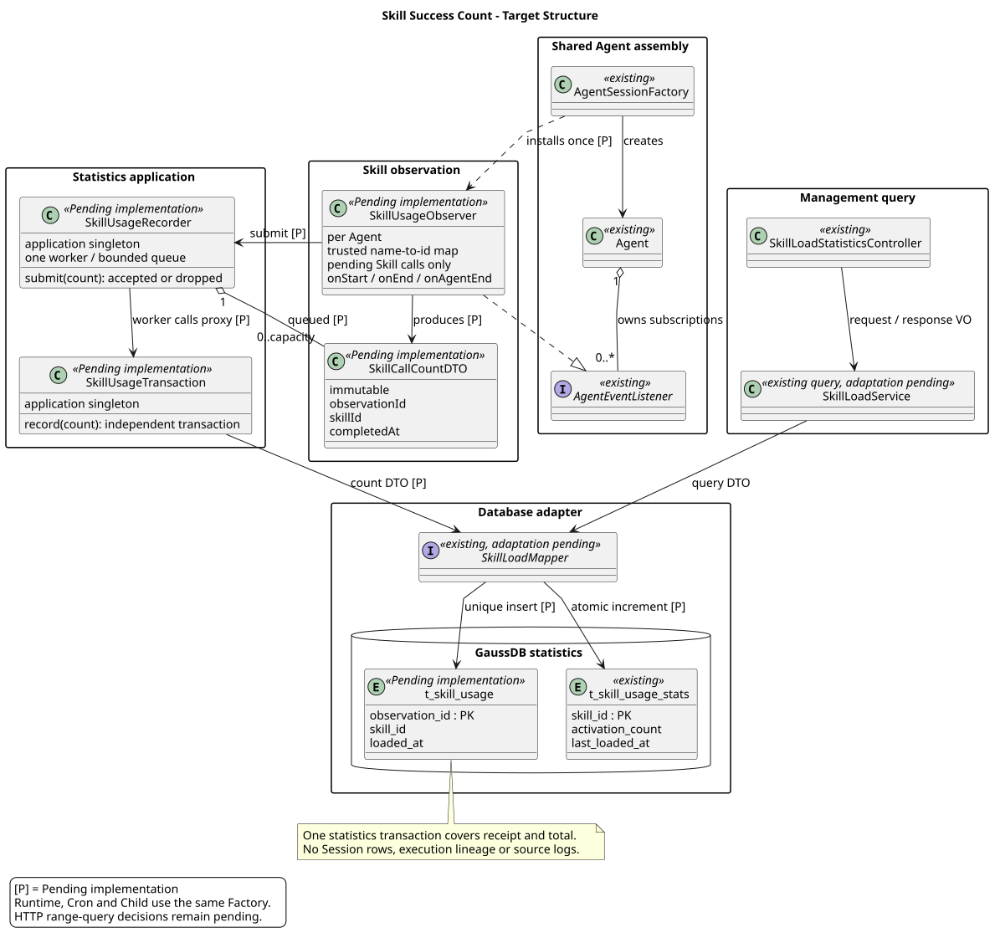
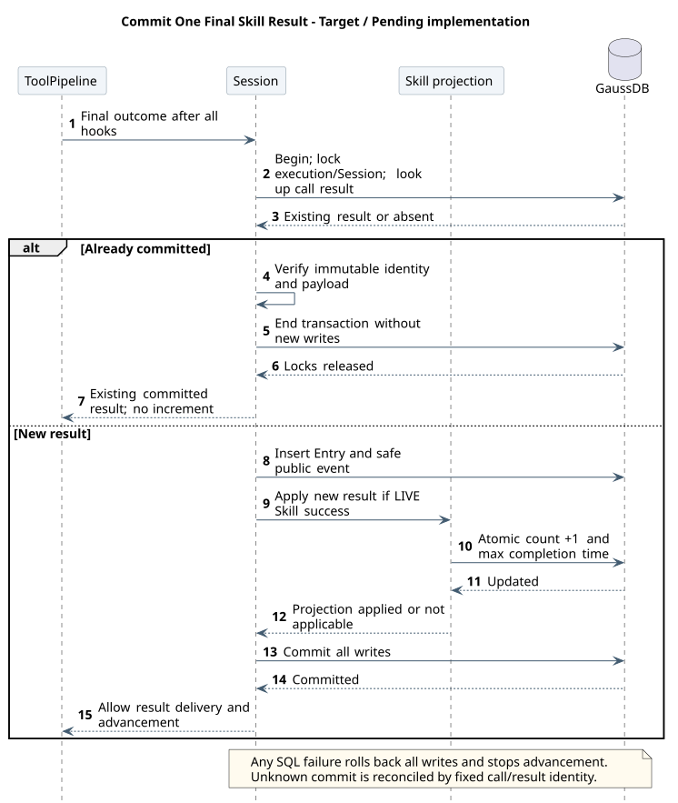

# Skill 成功调用次数统计设计

[命令与技能](../README.md) · [M05 主设计](../00-Slash-Command通用模块/README.md) · [统一历史](../../01-总体架构/01-CampusClaw多Agent运行时/unified-event-persistence.md) · [源码与差距](source-evidence.md) · [验证](validation.md)

| 属性 | 值 |
|---|---|
| 文档版本 | 5.0.0 |
| 更新日期 | 2026-10-10 |
| 业务目标 | 每次真实 Skill 工具最终成功，对应 skillId 加一；同任务三次成功计三次 |
| 职责 | M05 定义计数及查询；M06 统一结果提交事务调用 M05 投影；M04 保存结果与处理清理；M03 决定真实工具结果 |
| 状态 | 已有 Skill 统计实现；统一结果记录、去掉独立采集链及同事务累计增量待实现 |
| 源码 | Java main 769e8659、PR #335 dad4433d，完整 SHA 与基线范围见源码证据；设计制品校验不等于实现验收 |

## 1. 业务问题、正常处理与失败

园区巡检中，主 Agent 成功调用告警处置 Skill 两次，子 Agent 又成功调用一次，总数增加三次。Cron、Child、交互会话都已经需要保存工具结果，统计直接消费同一记录，不再为统计另造一套调用历史。

可信目标解析、参数校验、权限或必要确认、业务执行、后置处理依次完成后，Runtime 提交完整 tool.result。首次插入真实成功 Skill 结果的同一事务，更新一行累计；Entry、公共投影和累计一起提交，再允许模型继续。准备/权限错误、后置 hook 改为失败、未知结果都不计数；内容被改写但最终成功仍计，统计不再验证正文/hash 来另定成功。

数据库失败会令本次历史及累计一起回滚，停止后续推进并对账；不将真实工具成功改成 isError=true，也不重跑工具。外部副作用与数据库仍不是分布式原子事务，崩溃后无可靠最终记录的调用不计，不能宣称所有现实成功都无损入账。

## 2. 唯一计数来源

| 条件 | 规则 |
|---|---|
| 唯一事实 | 内部 t_session_entries 的 tool.result；公共 t_session_events 只是安全投影，不重复计数 |
| 成功判定 | 工具最终 is_error=false、tool_name=Skill、origin=LIVE；所有后置处理已经结束 |
| Skill 身份 | 同次可信绑定的 skillId，固定到不可变结果 DTO；不是模型自报 ID、正文解析、hash 或当前目录二次解析 |
| 调用身份 | session_id + tool_call_entry_id；由 Runtime 服务端调用身份产生，与 Provider callId 分开 |
| 重复 | 同结果重试读取并核对原记录，不再次累加；同任务下一次真实调用另计 |
| 非调用 | Read、SearchTools、CallTool、显式 /skill 正文注入、恢复、复制、分页和 SSE 重连不计 |
| 后续失败 | 已提交成功之后的取消、模型失败或 Session 删除不撤销累计 |

同一个 Provider callId 在不同消息、不同 Agent 中复用不影响计数。校验失败可以没有 Start/End，因此不使用 Start/End 私有 Map 决定是否入账。成功 Skill 缺可信 ID 时拒绝该不完整提交并诊断，不静默漏计，不猜参。

## 3. 一条事务，不再另建采集链

M06 的 SessionEventAppender 复用既有 Repository 事务：重检固定 execution 与 Session → 查同调用已有结果 → 插入新结果/公共事件 → 若满足成功条件调用 M05 `SkillUsageProjection.applyNewResult` → 提交。M05 投影只接收可信结果 DTO 并调用 Mapper，不创建新事务，不启动线程，不依赖 HTTP Controller，不回调 Runtime。一个工具结果至多更新一个 skillId。

去除统计专用 Observer、observationId、Start/End Map、有界队列、独立 t_skill_usage 事实、REQUIRES_NEW 和统计需要的来源 JSONL。保留真实 Runtime execution、Cron Run、父子关系、授权、深度与工具安全校验。`ExecutionIdentity`、`ManagedExecutionLog`、SkillToolDetails 等只能在重新检索独立消费者后删除专用部分，不能因名称相似删除真正的审计或执行记录。

这是一项有意的架构变更：统计更新与结果提交共享失败边界，会增加历史事务锁等待；不再承诺“统计库故障不影响执行推进”。数据库无法记录历史本身也必须停止后续动作。换来的收益是没有第二套投递、防重、丢弃和对账。热点 Skill 更新争用需实测；新方案不提供已验证吞吐量。

## 4. 为什么保留一张累计表

| 方案 | 能回答什么 | 选择 |
|---|---|---|
| 直接 COUNT 成功结果 | 当前保留历史中的次数；可按结果时间筛选 | 用于完整范围内核对/候选区间查询，不能替代删除后的 lifetime |
| 同事务 t_skill_usage_stats | 从统一采集切换点开始已提交的累计次数，Session 删除不减 | 当前目标；唯一一张统计表，没有独立统计流水 |
| 异步消费/日表/独立分析库 | 大数据量、趋势或统计故障隔离 | 没有已确认必要性，首版不额外建设；已有接口/日表去留仍待核实 |

[schema.sql](schema.sql)定义 skill_id、activation_count、last_loaded_at，以及 pruned_from/pruned_to。后两项只标记已删除成功历史的最小/最大事件时间，不是日统计；COUNT 范围与这个保守缺口相交时，不能声称结果完整。多个不连续删除区间可以合并成一个外包范围，宁可拒绝部分仍完整的查询，不返回错误低值。

累计更新与结果首次插入同事务，采用原子加一和 MAX 时间；普通 INSERT/唯一约束及重复核对由统一追加负责，不能“无条件忽略冲突后继续加一”。Mapper 片段见[record-usage.sql](record-usage.sql)。真实 GaussDB 的 UPSERT、唯一冲突、JSONB 与事务行为必须集成验证。

## 5. 删除、恢复与重建

Session 清理与追加争用相同 Session/执行锁。先禁止活跃或未知执行被清除，再对即将删除的 LIVE 成功 Skill 结果按 skillId 排序更新 pruned_from/to，最后删除历史；全部同事务，不扣 activation_count。结果先提交则入账保留；删除先提交则迟到结果拒绝，不复活任何记录。累计表不设 Session 级联外键。

恢复上下文、复制历史、补读事件不调用累计投影。数据库提交回执丢失时按固定结果 ID/调用关联读取，不重新执行模型或工具。全量历史尚在且口径一致时，可以离线核对 COUNT；发生清理后不能用剩余事件覆盖累计。事件、累计及缺口标记必须同一备份恢复一致点；累计丢失且来源已删除时无法精确重建，应明确指标不可恢复，不能造数。

新建环境使用新模型。若已有部署，必须先核实旧累计口径、数据是否保留和切换时点；不把旧根/Skill 去重次数冒充逐次调用数，也不在缺少全部来源时声称可以准确回填。新旧采集只能有一个向同一指标写入。统一历史链完成前，不提前删除现有统计路径造成三个入口漏覆盖。

## 6. 查询接口

保留已有管理鉴权、批量 skillIds 查询及 activationCount 语义，不引入公共统计事件或内部调用 ID。精确 HTTP 字段由既有事件契约 F19 维护，本设计不修改 operation JSON，也不自动批准删除 from/to 或日表。

用户对 from/to、日汇总及保留策略的答复仍是“暂时不确定，先标为待核实”。技术上可以直接查询保留的 LIVE 成功结果：以最终结果固定时间过滤，不能按入库/查询时间重算。只有区间完全位于统一采集覆盖期内、且与清理缺口不相交时，COUNT 才可声明完整。否则需要明确不完整/不可提供；具体错误或完整性响应模型留待该接口决策，不擅自加字段或返回误导性的 0。

因此当前可直接落地的查询是累计；若必须支持任意历史精确区间或长期趋势，需要再确定来源保留或日投影。当前一张累计表不是对这些未决需求的完整交付。

## 7. 推荐目标类图与提交时序

全局执行、Host、Factory 和持久化结构见[统一历史全局图](../../01-总体架构/01-CampusClaw多Agent运行时/unified-event-persistence.md#全局目标类图)。下图只展开 M05 投影与查询，跨模块主链通过引用复用。

[原尺寸](skill_load_statistics_classes.svg) · [PlantUML 源码](diagram.puml#L1)

场景：Skill 已完成可信解析、校验、Host 放行、执行及全部后置处理；从固定最终结果到提交回执，不另画业务调用总览。Session 代表统一事务，Stats 是同库投影，图中没有异步消息边界；新增链路待实现。

[原尺寸](skill_usage_record.svg) · [PlantUML 源码](diagram.puml#L52)

## 8. 实施与验收

1. 先完成统一受理、三入口持久化及逐工具提交端口；验证校验错误、拒绝、后置处理、取消及并行结果覆盖。
2. 增加内部可信 skillId 与结果唯一关联；接入同事务投影及累计查询，更新完整安装 DDL 与公司镜像。
3. 覆盖同任务三次成功加三、主/Cron/Child 均计、不同真实调用复用 Provider ID、同结果并发重试只加一、冲突载荷拒绝、后置失败不计和后续任务失败不减。
4. 注入 Entry/公共事件/累计/提交失败，检查全部回滚、无自动业务重放；慢库和热点锁测试历史推进延迟，不能以单元测试宣称容量。
5. 验证删除与追加竞争、缺口登记、复制/压缩/恢复不计、同备份点恢复；未决精确范围在实现前收敛。
6. 切换后删除无独立消费者的专用采集链，防止双重累计；源码读取和新实现验收分开报告。

无新增 Maven 依赖；复用现有 Spring 事务、MyBatis Starter 3.0.4、Jackson、JDK 时间和驱动，无新增传递依赖。当前交付为设计，SQL 未在公司数据库执行。

## 版本历史

| 版本 | 日期 | 变更 |
|---|---|---|
| 5.0.0 | 2026-10-10 | Skill 计数复用统一工具结果，同事务维护累计并移除独立采集、队列和统计流水。 |
| 4.0.0 | 2026-10-10 | 按 Skill 最终成功调用计数，统一事件观察与有界异步入账，移除执行追溯前提并对比 #335。 |
| 3.2.1 | 2026-09-22 | 明确 SearchTools 只发现定义，不增加 Skill 使用统计信号。 |
| 3.2.0 | 2026-09-20 | 模型 Skill 成功正文读取纳入既有 READ 信号及根去重，不增加表或查询协议。 |
| 3.1.0 | 2026-09-18 | F19 对齐现有批量 POST 与 activationCount 响应，排名和趋势延后按需设计。 |
| 3.0.0 | 2026-09-16 | 按根执行统一去重 Skill 使用信号，统计独立短事务且失败不阻断主执行。 |
| 2.0.0 | 2026-09-15 | 基于 Codex 观测机制定义成功调用事实、来源幂等、三表同事务和 Runtime 统计查询。 |
| 1.1.0 | 2026-09-15 | 按设计仓职责补充 Skill 调用观测基线，明确全文加载方案的候选边界。 |
| 1.0.0 | 2026-09-15 | 定义累计与日汇总、直接排名查询、单 Skill 趋势及事务和保留边界。 |
