# Tool 定义与执行边界图集

> 资料核验日期：2026-07-18；固定源码提交逐项登记。文档整理日期：2026-09-14。
> 各产品事实限于原核验范围；本专题的候选规范不属于 CampusClaw 已确认设计。

[返回研究入口](./README.md)

## 10. 各 Agent Tool 的核心定义类图

每张图描述一个产品或一种公开契约。统一排版规则是：配置或描述对象在上，注册器、客户端或 Driver 居中，最终执行端在下；只绘制源码或官方合约能够证明的关系；不使用跨产品隐藏连线控制位置。MCP 客户端图会局部重复 Server/Tool 边界，使每张图可以独立阅读。

### 10.1 ToolDefinition 内含执行代码

#### 10.1.1 Pi

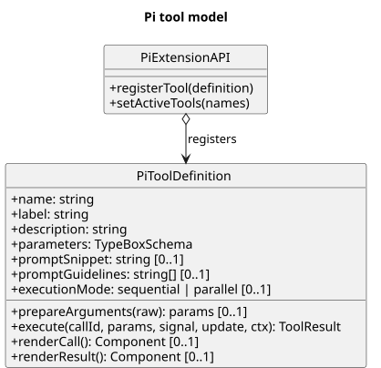

[原尺寸 SVG](./pi_tool_model.svg) · [PlantUML 源码](./diagram.puml#L162)

`ExtensionAPI` 注册同时包含模型描述和 `execute` 的 `ToolDefinition`。[源码](https://github.com/earendil-works/pi/blob/216e672e7c9fc65682553394b74e483c0c9e47f7/packages/coding-agent/src/core/extensions/types.ts#L435-L485)

#### 10.1.2 OpenCode

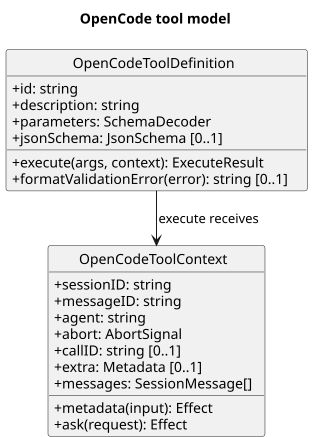

[原尺寸 SVG](./opencode_tool_model.svg) · [PlantUML 源码](./diagram.puml#L196)

Tool 对象包含 Schema、`execute`，并接收会话和工作区上下文。[源码](https://github.com/anomalyco/opencode/blob/3a1c6df9e24672f0761a6ced18e1315d89334baf/packages/opencode/src/tool/tool.ts#L55-L64)

#### 10.1.3 Amp

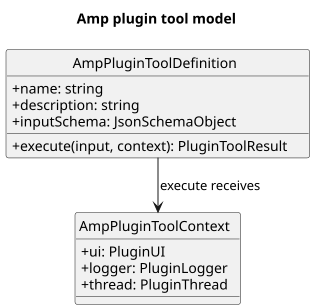

[原尺寸 SVG](./amp_tool_model.svg) · [PlantUML 源码](./diagram.puml#L232)

Plugin Tool 将名称、描述、输入 Schema 与 `execute` 放在同一个定义中。[Plugin API](https://ampcode.com/manual/plugin-api)

#### 10.1.4 OpenClaw

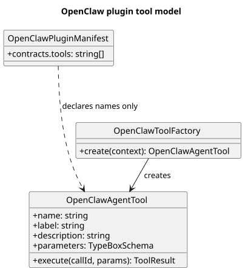

[原尺寸 SVG](./openclaw_tool_model.svg) · [PlantUML 源码](./diagram.puml#L260)

Manifest 只声明 Tool 名称所有权；factory 才创建带执行行为的运行对象。[注册源码](https://github.com/openclaw/openclaw/blob/55bb6cfa2ec4863b5ece006aee70b5de6d967709/src/plugins/registry-registrars-tools-hooks.ts#L243-L293)、[Tool 类型](https://github.com/openclaw/openclaw/blob/55bb6cfa2ec4863b5ece006aee70b5de6d967709/src/agents/tools/common.ts#L28-L69)

### 10.2 描述与执行分离，或交由宿主回调

#### 10.2.1 Cline

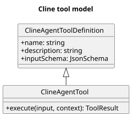

[原尺寸 SVG](./cline_tool_model.svg) · [PlantUML 源码](./diagram.puml#L291)

`AgentTool` 在纯描述的 `AgentToolDefinition` 基础上增加 `execute`。[源码](https://github.com/cline/cline/blob/c564045d8135c0c1c330b21d47b68b74917ce614/sdk/packages/shared/src/agent.ts#L146-L186)

#### 10.2.2 Grok Build

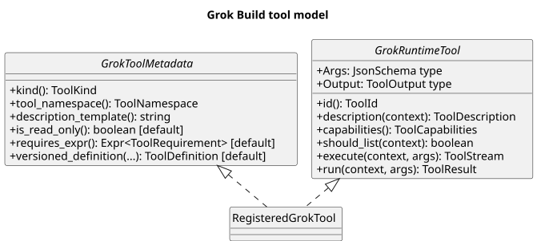

[原尺寸 SVG](./grok_build_tool_model.svg) · [PlantUML 源码](./diagram.puml#L316)

一个注册 Tool 同时实现 metadata trait 和 runtime trait；前者提供种类、命名空间和描述模板，并与 runtime Args Schema 合成版本化定义，后者通过 `Args`/`Output` 及 `execute/run` 提供实际契约和行为。[metadata 源码](https://github.com/xai-org/grok-build/blob/8adf9013a0929e5c7f1d4e849492d2387837a28d/crates/codegen/xai-grok-tools/src/types/tool_metadata.rs#L1-L102)、[runtime 源码](https://github.com/xai-org/grok-build/blob/8adf9013a0929e5c7f1d4e849492d2387837a28d/crates/common/xai-tool-runtime/src/tool.rs#L32-L110)

#### 10.2.3 Anthropic API / Managed Agents

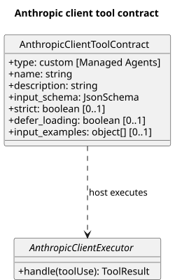

[原尺寸 SVG](./anthropic_client_tool_contract.svg) · [PlantUML 源码](./diagram.puml#L353)

`AnthropicClientToolContract` 是公开字段的归一化概念类；客户端应用负责执行 `tool_use`，它不是 Claude Code 源码类型。[Managed Agents tools](https://platform.claude.com/docs/en/managed-agents/tools)、[Tool reference](https://platform.claude.com/docs/en/agents-and-tools/tool-use/tool-reference)

#### 10.2.4 Codex

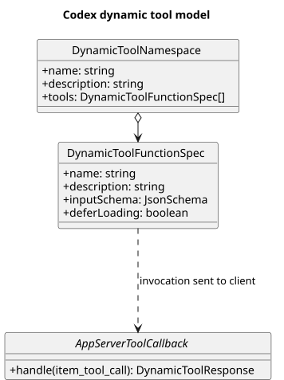

[原尺寸 SVG](./codex_dynamic_tool_model.svg) · [PlantUML 源码](./diagram.puml#L382)

Namespace 聚合动态 Tool 描述，调用发生后由 App Server 客户端回调执行。[描述源码](https://github.com/openai/codex/blob/315195492c80fdade38e917c18f9584efd599304/codex-rs/protocol/src/dynamic_tools.rs#L10-L27)、[回调源码](https://github.com/openai/codex/blob/315195492c80fdade38e917c18f9584efd599304/codex-rs/core/src/tools/handlers/dynamic.rs#L113-L177)

### 10.3 协议与通用 Driver

#### 10.3.1 MCP

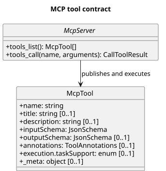

[原尺寸 SVG](./mcp_tool_contract.svg) · [PlantUML 源码](./diagram.puml#L414)

Server 通过 `tools/list` 发布 Tool 描述，并通过 `tools/call` 拥有执行行为。[固定 Schema](https://github.com/modelcontextprotocol/modelcontextprotocol/blob/26897cc322f356487da89113451bd16b520b9288/schema/2025-11-25/schema.ts#L1244-L1297)

#### 10.3.2 Qwen Code

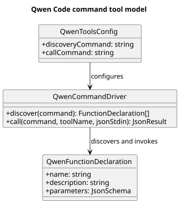

[原尺寸 SVG](./qwen_command_tool_model.svg) · [PlantUML 源码](./diagram.puml#L445)

配置选择 discovery/call command，通用 Driver 发现描述并转发调用。[源码](https://github.com/QwenLM/qwen-code/blob/0ecba4b3c709d271a17faa5ac9537bf1b102eaf1/packages/core/src/tools/tool-registry.ts#L42-L181)

#### 10.3.3 Coze Studio

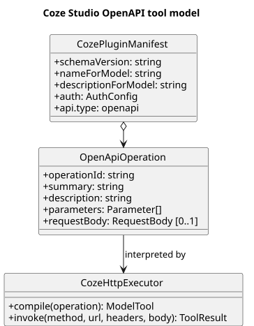

[原尺寸 SVG](./coze_openapi_tool_model.svg) · [PlantUML 源码](./diagram.puml#L476)

Plugin Manifest 引用 OpenAPI operation，通用 HTTP executor 解释并执行。[Loader](https://github.com/coze-dev/coze-studio/blob/22275b1c2661d35344a7493cffe401e8cc61cf8e/backend/domain/plugin/conf/load_plugin.go#L151-L249)、[Executor](https://github.com/coze-dev/coze-studio/blob/22275b1c2661d35344a7493cffe401e8cc61cf8e/backend/domain/plugin/service/tool/invocation_http.go#L59-L155)

#### 10.3.4 Continue

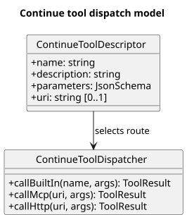

[原尺寸 SVG](./continue_tool_dispatch_model.svg) · [PlantUML 源码](./diagram.puml#L512)

Tool descriptor 的名称或 URI 选择 built-in、MCP 或 HTTP 分派路径。[源码](https://github.com/continuedev/continue/blob/d0a3c0b626b5bebc3bef4742eec05a0242be0bab/core/tools/callTool.ts#L28-L109)

### 10.4 以 MCP 或托管服务为执行边界

#### 10.4.1 Claude Code

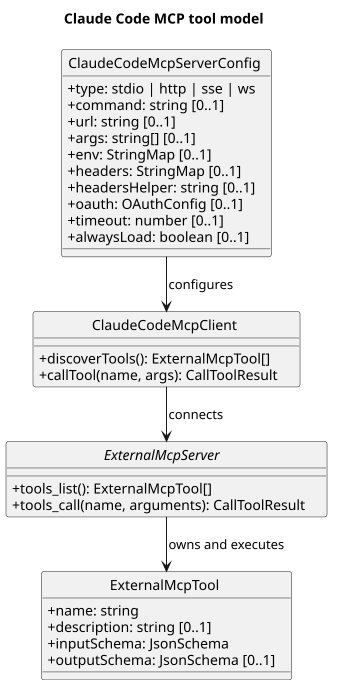

[原尺寸 SVG](./claude_code_mcp_tool_model.svg) · [PlantUML 源码](./diagram.puml#L540)

Claude Code 的 Server 配置包含 transport、command/url、args、env/headers、headers helper、OAuth、timeout 和 always-load 等连接字段；local/project/user 是配置放置范围，不是单个 Server 对象的执行字段。MCP Server 拥有 Tool 描述和业务执行。[官方 MCP 文档](https://code.claude.com/docs/en/mcp)

#### 10.4.2 Kiro CLI

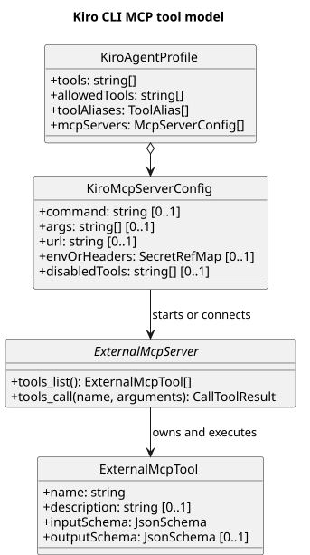

[原尺寸 SVG](./kiro_mcp_tool_model.svg) · [PlantUML 源码](./diagram.puml#L586)

Agent Profile 负责选择和权限，MCP Server 配置负责绑定执行端。[Agent configuration](https://kiro.dev/docs/cli/custom-agents/configuration-reference/)、[MCP configuration](https://kiro.dev/docs/cli/mcp/configuration/)

#### 10.4.3 Goose

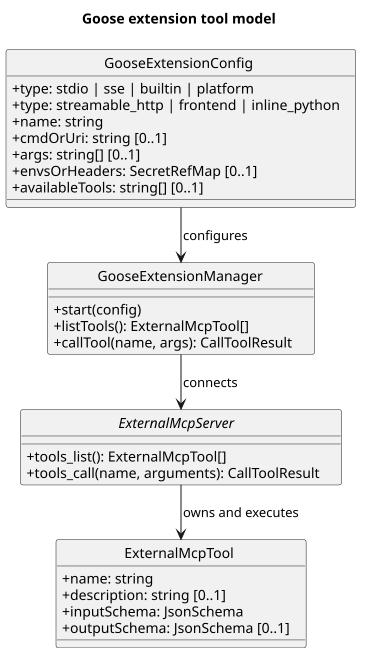

[原尺寸 SVG](./goose_extension_tool_model.svg) · [PlantUML 源码](./diagram.puml#L629)

`ExtensionConfig` 配置 Extension Manager，后者发现并调用 Server 所有的 Tool。[Config 源码](https://github.com/aaif-goose/goose/blob/d6345f75dba4f43afe705e045414edf173e40af4/crates/goose/src/agents/extension.rs#L159-L295)、[Manager 源码](https://github.com/aaif-goose/goose/blob/d6345f75dba4f43afe705e045414edf173e40af4/crates/goose/src/agents/extension_manager.rs#L1391-L1485)

#### 10.4.4 Devin

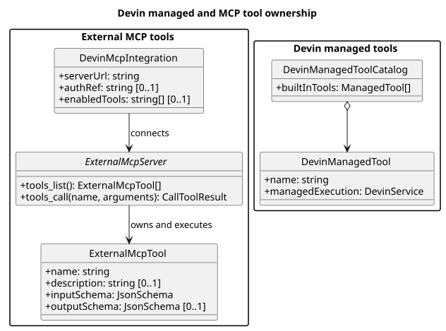

[原尺寸 SVG](./devin_tool_ownership_model.svg) · [PlantUML 源码](./diagram.puml#L673)

托管 Tool 由 Devin 服务执行；外部 MCP Tool 由 Server 执行，两种所有权保持分区。[Devin MCP](https://docs.devin.ai/work-with-devin/devin-mcp)、[MCP Schema](https://github.com/modelcontextprotocol/modelcontextprotocol/blob/26897cc322f356487da89113451bd16b520b9288/schema/2025-11-25/schema.ts#L1244-L1297)
