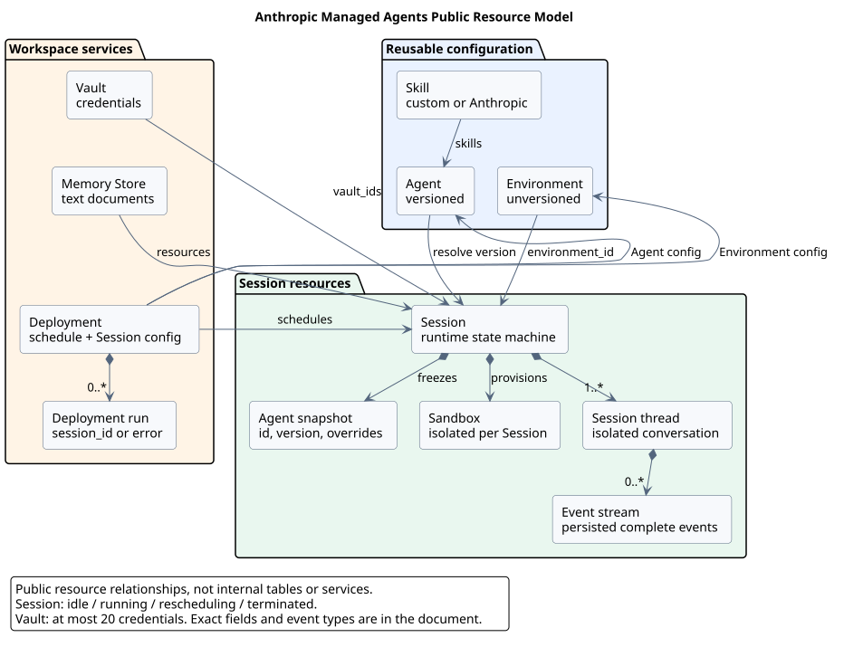
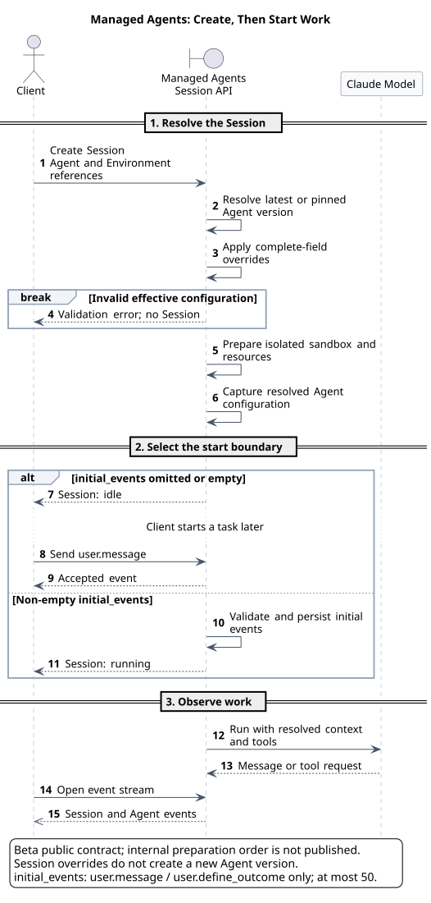
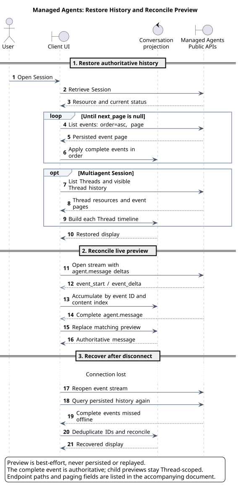
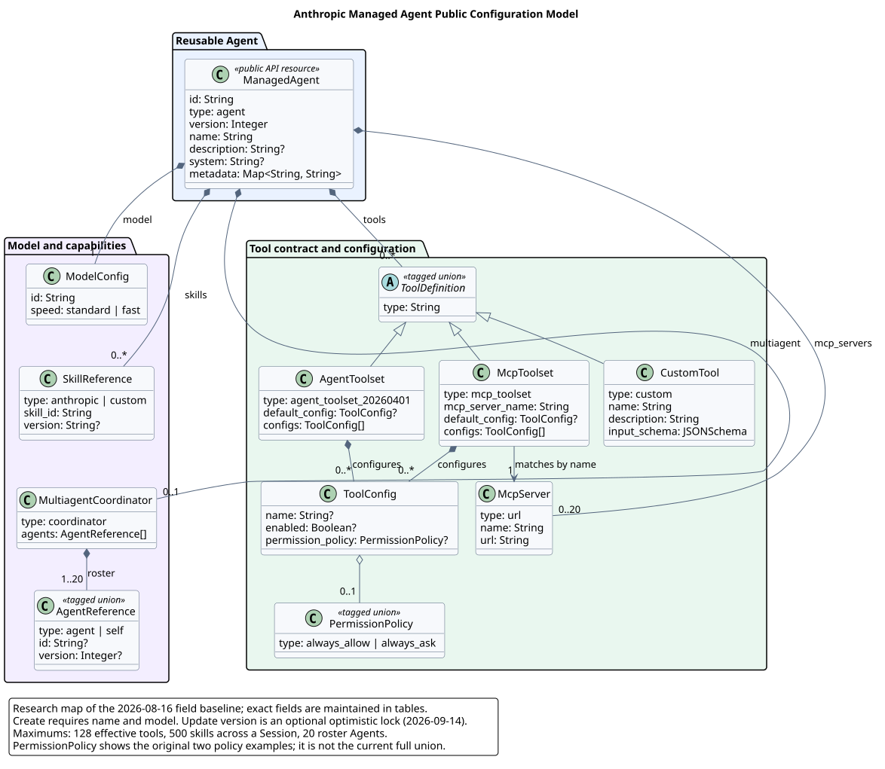
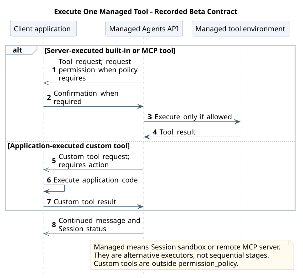

# Anthropic Managed Agents 公开模型（官方契约基线）

> 文档版本：`v0.5.0`<br>
> 状态：Beta 公开契约研究；无服务端源码<br>
> 字段原核验：`2026-08-16`；Session 创建、事件恢复与 Agent 更新专项复核：`2026-09-14`<br>
> 范围：仅提取 Anthropic 公开的 Managed Agents 模型，不掺入我们的 Tool/Agent 元数据设计。

## 1. 核心结论

Anthropic 公开的 Managed Agents 不是一个单独的 `Agent JSON`，而是一组分层资源和运行时契约：

1. `Agent` 是可复用、可版本化的能力配置。
2. `Environment` 定义沙箱配置，但它本身不版本化。
3. `Session` 把 Agent 的某个已解析版本、Environment、Vault、Memory Store 等组合成一次运行。
4. `tools[]` 是三种公开类型的联合：Anthropic 托管工具集、MCP 工具集、应用侧自定义工具。
5. 工具定义只解决“模型看到什么、可以调用什么”；真正的执行者取决于工具类型，并不共享一种通用可执行实现。

这个结论是对公开契约的结构化归纳，不是我们的目标设计。

## 2. 证据边界

### 2.1 本文记录什么

- 官方文档和 API Reference 公开的资源、字段、枚举、数量约束和运行流程。
- 为了便于讨论而做的类型分组，但不增加 Anthropic 未公开的字段。
- 官方公开的运行时责任边界，例如自定义工具由客户应用执行。

### 2.2 本文暂不记录什么

- 我们将来的通用 `ToolMetadata` 或 `AgentMetadata` Schema。
- 与 pi、Codex、Claude Code、OpenCode 等项目的字段映射。
- 从配置自动生成 Tool/Agent 的工厂、注册表、执行器或数据库设计。
- Anthropic 未公开的内部类、存储表、调度器或沙箱实现。

### 2.3 源码基线

Managed Agents 是 Anthropic 托管服务，没有可对齐的官方开源仓库，因此：

- 源码提交：`N/A`。
- 实现路径和类符号：`N/A`。
- 事实基线：Anthropic 官方文档和 API Reference，原完整字段核验日期为 `2026-08-16`；2026-09-14 只复核本文标出的创建、更新与事件恢复范围。

Anthropic 官方 TypeScript SDK 可作为公开请求/响应类型的补充契约证据；本文固定
SDK commit `3b45cd3b69c956ac63384fdb09ce1d8109f3fa80`，但该客户端源码不是
Managed Agents 服务端实现，不能据此推断内部 ID 生成算法、存储或路由逻辑。

官方当前将 Managed Agents 标为 Beta。常规 Managed Agents 请求使用 `managed-agents-2026-04-01` beta header；Memory Store 端点的官方页面当前显示 `agent-memory-2026-07-22`，Session 挂载 Memory Store 仍属于常规 Managed Agents Session 请求。

## 3. 官方来源

| 主题 | 官方来源 | 本文用途 |
|---|---|---|
| Agent | [Define your agent](https://platform.claude.com/docs/en/managed-agents/agent-setup) | Agent 字段、版本和更新语义 |
| Agent API | [Agents API](https://platform.claude.com/docs/en/api/beta/agents) | 请求/响应类型和字段约束 |
| Create Agent API | [Create an Agent](https://platform.claude.com/docs/en/api/beta/agents/create) | 创建请求、服务端响应和公开 Agent ID 示例 |
| Update Agent API | [Update an Agent](https://platform.claude.com/docs/en/api/beta/agents/update) | 可选 `version` 乐观并发控制及无条件更新语义 |
| Agent SDK 契约 | [`Agents.create/retrieve` 与 `Agent.id`](https://github.com/anthropics/anthropic-sdk-typescript/blob/3b45cd3b69c956ac63384fdb09ce1d8109f3fa80/src/resources/beta/agents/agents.ts#L14-L155)、[`AgentCreateParams`](https://github.com/anthropics/anthropic-sdk-typescript/blob/3b45cd3b69c956ac63384fdb09ce1d8109f3fa80/src/resources/beta/agents/agents.ts#L888-L952)、[Anthropic model ID 类型](https://github.com/anthropics/anthropic-sdk-typescript/blob/3b45cd3b69c956ac63384fdb09ce1d8109f3fa80/src/resources/beta/agents/agents.ts#L701-L721) | 固定 commit 下的公开类型与示例；不是服务端实现证据 |
| Tools | [Tools](https://platform.claude.com/docs/en/managed-agents/tools) | 托管工具集与自定义工具 |
| 权限 | [Permission policies](https://platform.claude.com/docs/en/managed-agents/permission-policies) | `always_allow` / `always_ask` 和确认流程 |
| MCP | [MCP connector](https://platform.claude.com/docs/en/managed-agents/mcp-connector) | MCP Server 声明、Toolset 引用和鉴权拆分 |
| Skills | [Skills](https://platform.claude.com/docs/en/managed-agents/skills) | Skill 引用类型、版本和 Session 上限 |
| Environment | [Cloud environment setup](https://platform.claude.com/docs/en/managed-agents/environments) | Environment 生命周期和 Session 沙箱隔离 |
| Environment API | [Environments API](https://platform.claude.com/docs/en/api/beta/environments) | `cloud` / `self_hosted` 配置联合 |
| Session | [Start a session](https://platform.claude.com/docs/en/managed-agents/sessions) | Agent 引用、版本锁定、单次覆盖 |
| Session API | [Create Session API Reference](https://platform.claude.com/docs/en/api/beta/sessions/create) | `POST /v1/sessions` 请求联合类型和解析快照响应 |
| Session 操作 | [Session operations](https://platform.claude.com/docs/en/managed-agents/session-operations) | Retrieve、Archive、Delete 及历史保留语义 |
| Events | [Session event stream](https://platform.claude.com/docs/en/managed-agents/events-and-streaming) | 任务启动、Tool 调用、确认与回传 |
| Event History API | [List Events API Reference](https://platform.claude.com/docs/en/api/beta/sessions/events/list) | Session 持久化事件历史、顺序、过滤和分页 |
| Thread History API | [List Session Thread Events](https://platform.claude.com/docs/en/api/typescript/beta/sessions/threads/events/list) | Multiagent Thread 级历史查询 |
| Vault | [Authenticate with vaults](https://platform.claude.com/docs/en/managed-agents/vaults) | Session 级凭据、MCP 和环境变量凭据 |
| Memory | [Using agent memory](https://platform.claude.com/docs/en/managed-agents/memory) | Memory Store 资源和 Session 挂载 |
| Multiagent | [Multiagent orchestration](https://platform.claude.com/docs/en/managed-agents/multiagent-orchestration) | Coordinator、Roster、Thread 和共享边界 |
| 定时运行 | [Scheduled deployments](https://platform.claude.com/docs/en/managed-agents/scheduled-deployments) | Deployment 和 Deployment Run |

## 4. 公开资源模型



[原尺寸 SVG](./managed_agents_resource_model.svg) · PlantUML：[查看源码](./diagram.puml#L5)

### 4.1 可复用配置资源

| 资源 | 官方公开含义 | 版本特征 |
|---|---|---|
| `Agent` | 封装 model、system、tools、MCP servers、skills 和 multiagent roster | 版本化；配置变化产生新版本 |
| `Environment` | 定义云沙箱或自托管沙箱配置 | 不版本化 |
| `Skill` | Anthropic 预置 Skill 或 Workspace 内自定义 Skill | 自定义 Skill 可版本化；Agent 引用可锁定版本或 `latest` |

### 4.2 运行时资源

| 资源 | 官方公开含义 |
|---|---|
| `Session` | 运行时状态机；创建时解析 Agent 版本并准备沙箱 |
| `Agent snapshot` | Session 响应中的已解析 Agent 配置；可包含仅对本 Session 生效的覆盖 |
| `Sandbox` | 每个 Session 独立的运行环境和文件系统 |
| `SessionThread` | Multiagent 中一个 Agent 的隔离上下文和事件流 |
| `Event` | 客户端向 Session 发送的 `user.*` / `system.message` 事件，以及服务返回的 `agent.*` / `session.*` / `span.*` 事件 |

Session 通常先创建为 `idle`，再由 `user.message` 启动工作。2026-09-14 官方文档还支持创建时提交非空 `initial_events`，直接得到 `running` Session；空数组与省略等效。该增量是公开契约事实，不改变 CampusClaw 已确认入口。[官方创建文档](https://platform.claude.com/docs/en/managed-agents/sessions#seed-the-session-with-initial-events)

`initial_events` 最多 50 项，只接受 `user.message` 和 `user.define_outcome`，按顺序校验、持久化；任一事件无效则不创建 Session。其他资源和字段表仍是原核验范围的摘录，不声称覆盖官方最新字段全集。

#### 4.2.1 Session 基于 Agent 配置的创建顺序

本图保留原研究核对日期的 Beta 公开契约，仅展示客户端可观察的创建与启动边界；不再将 sandbox 准备或模型内部调用画成已公开的服务端顺序。有效配置无效时创建失败，initial_events 为空先返回 idle，非空的类型与数量限制仍见正文；研究结论不自动成为 CampusClaw 目标。



[原尺寸 SVG](./session_agent_creation_sequence.svg) · PlantUML：[查看源码](./diagram.puml#L74)

顺序图按解析配置、确定启动边界、观察运行三个阶段阅读。Agent ID 解析为最新或指定版本；Session 覆盖替换完整字段，不创建 Agent 新版本；服务准备独立沙箱，并返回已解析的 Agent 配置。

未提交初始事件时，创建仅准备 Session；任务由后续事件请求启动。提交合法的非空 `initial_events` 时，创建与启动合并为一个请求。观察仍通过读取事件流完成，不把创建响应误认为实时流。

图中 API 自调用只概括公开效果，不表示 Anthropic 内部类、存储表或精确准备顺序。资源挂载、凭据绑定和工具可用性的字段约束仍见所属官方页面。

#### 4.2.2 Session 对话历史查询与恢复展示

核心结论：Anthropic Managed Agents 不是通过 `GET /v1/sessions/{session_id}`
返回一份 transcript 快照。Session retrieve 读取 Session 资源与当前状态；
对话和运行历史的权威入口是持久化 Event History。

| 目的 | 官方接口 | 语义 |
|---|---|---|
| 读取 Session | `GET /v1/sessions/{session_id}` | Session 资源、配置和当前状态，不是对话历史列表 |
| 读取 Session 历史 | `GET /v1/sessions/{session_id}/events` | 按 `processed_at` 排序的持久化事件历史 |
| 读取 Thread 列表 | `GET /v1/sessions/{session_id}/threads` | Multiagent 中发现主 Thread 和子 Thread |
| 读取 Thread 历史 | `GET /v1/sessions/{session_id}/threads/{thread_id}/events` | 单个 Agent Thread 的持久化事件 |
| Session 实时事件 | `GET /v1/sessions/{session_id}/events/stream` | Session 级 SSE；可选订阅 message/thinking preview |
| Thread 实时事件 | `GET /v1/sessions/{session_id}/threads/{thread_id}/stream` | 单个 Thread 的 SSE，子 Agent preview 不跨 Thread 投递 |

`GET .../events` 支持 `limit`、`page`、`order=asc|desc`、事件类型过滤以及
`created_at[gt|gte|lt|lte]` 时间过滤。`page` 是不透明游标，响应使用
`data/next_page/prev_page`；默认按 `processed_at` 升序，即时间正序。

恢复对话展示的客户端流程是：

1. retrieve Session，获取当前 `idle/running/rescheduling/terminated` 状态；
2. 用 `GET .../events?order=asc` 遍历分页，将 `user.message`、`agent.message`、
   Tool、Session 状态和其他需要展示的持久化事件投影为时间线；
3. 打开 `/events/stream` 接收新事件；如果需要逐字预览，使用
   `event_deltas[]=agent.message`；
4. `event_start/event_delta` 只是临时 preview，按 `(event_id, content index)` 累积；
   收到同 ID 的完整 `agent.message` 后，必须用它替换 preview；
5. 断线后重新打开 stream，并重新查询 Event History，按 event ID 去重和对账。

Anthropic 明确规定：`event_start/event_delta` 不持久化、不支持断线重放，
丢失的 delta 不能再请求；断线期间产生的完整 buffered `agent.message`
会出现在 Event History 中，它才是权威记录。因此界面恢复本质上是
“持久化事件重放 + 临时 preview 对账”，而不是获取一个带 transcript 的
SessionSnapshot。

本图保留原 Beta 研究快照，只表达完整历史恢复与临时预览对账。Client view 包含 UI 和本地投影，不改变 API 权威边界；多 Agent 时另读可见 Thread 及其历史，分页直到结束。完整事件为权威，增量不持久化或回放，不能据公开契约推断内部存储实现。



[原尺寸 SVG](./managed_agents_session_history_recovery.svg) · PlantUML：[查看源码](./diagram.puml#L311)

该图的“Conversation reducer”是根据官方 Event History 和 preview 对账要求得出的
客户端责任推断；Anthropic 没有公开其 Console 内部前端类名或 reducer 实现。
官方只明确公开了 API、事件顺序、preview 对账规则和断线恢复要求。

Archive 会阻止新事件但保留历史；Delete 会永久删除 Session record、events 和
关联 sandbox。Session history 保留到删除为止，但 sandbox 状态只保留创建后 30 天；
会话历史可恢复不等于原 sandbox 文件状态永久可恢复。

### 4.3 Session 级数据与凭据

| 资源 | 挂载方式 | 主要边界 |
|---|---|---|
| `Vault` | Session 创建时通过 `vault_ids` 引用 | 凭据不写入可复用 Agent；凭据秘密值写入后不返回 |
| `Credential` | 作为 Vault 的子资源 | 公开类型包括 `mcp_oauth`、`static_bearer`、`environment_variable` |
| `MemoryStore` | Session 创建时放入 `resources[]` | 挂载到沙箱 `/mnt/memory/` 下；运行中不支持增删挂载 |
| `Memory` | Memory Store 内的文本文档 | 通过普通文件工具读写；需启用 Agent Toolset |

### 4.4 自动化资源

`Deployment` 保存可创建 Session 的配置、初始 `user.message` 和 cron `schedule`。每次触发产生 `DeploymentRun`；成功的 Run 关联新 Session，失败的 Run 记录错误。这是 Session 的调度层，不是 Agent 定义的一个字段。

## 5. Agent 公开配置

### 5.1 创建字段

| 字段 | 必填 | 官方公开语义 |
|---|---:|---|
| `name` | 是 | 人类可读名称 |
| `model` | 是 | 模型 ID 字符串，或至少含 `id` 的对象；对象形式可表达 `speed` |
| `system` | 否 | Agent 的系统提示 |
| `tools` | 否 | 工具配置数组；所有 Toolset 展开后的有效 Tool 合计最多 128 个 |
| `mcp_servers` | 否 | MCP Server 连接声明，最多 20 个 |
| `skills` | 否 | Anthropic 或自定义 Skill 引用 |
| `multiagent` | 否 | Coordinator 声明和可委派 Agent roster |
| `description` | 否 | Agent 功能描述 |
| `metadata` | 否 | 客户自行跟踪的字符串键值对 |

### 5.2 响应增加的服务端字段

`Agent` 响应还包含 `id`、固定值 `type: "agent"`、`version`、`created_at`、`updated_at` 和 `archived_at`。官方示例中，服务端会将简写的 model 规范化为包含 `id` 和 `speed` 的对象。

#### 5.2.1 Agent ID 的公开观察形状

Create Agent 的请求参数不包含调用方指定的 `id`，成功响应才返回服务端 Agent
ID。官方 Create Agent 顶层响应和固定 SDK 的 retrieve 示例使用
`agent_011CZkYpogX7uDKUyvBTophP`；官方生成型 API 示例还把
`agent_011CZkYqphY8vELVzwCUpqiQ` 用作其他 Agent 引用。两个当前公开样本都
呈现为 `agent_` 加 24 位大小写字母数字，但它们在示例中的资源角色不能混同。

这一点只能记录为 **观察到的示例形状**，不能提升为 Anthropic 保证的正则契约。
固定 SDK 的公开类型仍只是 `id: string`，没有声明长度、字符集、大小写归一化、
生成算法或时间排序保证；`AgentCreateParams` 也没有调用方可填写的 `id`。因此消费
Anthropic API 时应把该值视为服务端签发的 opaque string。Anthropic 当前列举的
模型名和示例采用 `claude-*`，但公开 SDK 类型还保留开放 string，不能据此冻结
完整 Provider model ID 正则。CampusAgent 另行设计的 `model_...` 资源 ID 不是
Anthropic 的模型 ID 约定。

### 5.3 版本与更新

- 更新 Agent 的 `version` 是可选乐观锁：提供时必须匹配当前版本，否则返回
  `409`；省略时更新无条件应用，最后到达的并发更新可能静默覆盖先前结果。
- 配置发生变化时生成新版本；无实际变化时返回现有版本。
- `tools`、`mcp_servers`、`skills` 是数组整体替换，不是按元素合并。
- `multiagent` 整体替换；`metadata` 按键合并。
- 用 Agent ID 字符串创建 Session 时解析最新版本；也可显式指定 Agent ID 和版本。
- Session 可用 `agent_with_overrides` 仅覆盖本次运行的 `model`、`system`、`tools`、`mcp_servers` 和 `skills`，不创建 Agent 新版本。

## 6. Tool 公开配置



[原尺寸 SVG](./managed_agent_configuration_model.svg) · PlantUML：[查看源码](./diagram.puml#L126)

### 6.1 `agent_toolset_20260401`

这是 Anthropic 管理的内置工具集。公开工具名为：

- `bash`
- `read`
- `write`
- `edit`
- `glob`
- `grep`
- `web_fetch`
- `web_search`

Toolset 的公开配置结构为：

| 字段 | 语义 |
|---|---|
| `type` | 固定为 `agent_toolset_20260401` |
| `default_config` | 所有内置工具的默认值 |
| `configs[]` | 按 `name` 覆盖单个工具 |
| `enabled` | 是否向该 Agent 开放工具 |
| `permission_policy` | `always_allow` 或 `always_ask` |

该 Toolset 的默认权限策略是 `always_allow`。

### 6.2 `mcp_toolset`

MCP 配置被拆成两个互相校验的部分：

1. Agent `mcp_servers[]` 声明 `{ "type": "url", "name": "...", "url": "..." }`。
2. Agent `tools[]` 中的 `mcp_toolset.mcp_server_name` 必须匹配一个 Server 的 `name`。

`mcp_toolset` 和内置 Toolset 使用相同的 `default_config` / `configs[]` 形状，但其默认权限策略是 `always_ask`。MCP 凭据不放入 Agent，而是在创建 Session 时通过 `vault_ids` 提供。

### 6.3 `custom`

应用侧自定义工具公开字段为：

| 字段 | 语义 |
|---|---|
| `type` | 固定为 `custom` |
| `name` | 模型调用的工具名 |
| `description` | 给模型的工具说明 |
| `input_schema` | 输入参数 JSON Schema |

这些字段定义的是“调用契约”，不包含执行代码、HTTP URL 或函数绑定。模型发出 `agent.custom_tool_use`，客户应用执行对应代码，再通过 `user.custom_tool_result` 回传结果。Custom Tool 不受 `permission_policy` 管理，因为客户应用本身就掌握是否执行。

### 6.4 三类 Tool 的执行所有权

本图比较一次工具调用的执行责任，三个工具种类不是同一调用必须经历的步骤。Managed tool environment 按工具类型指 Session sandbox 或远程 MCP server；拒绝则不执行，MCP 使用 Session Vault 绑定凭据。custom tool 由客户端执行并回填结果，不适用同一 permission_policy；保持原 Beta 文档核对范围。



[原尺寸 SVG](./managed_agents_tool_execution_model.svg) · PlantUML：[查看源码](./diagram.puml#L260)

| Tool 类型 | 定义在哪里 | 真正执行者 | 结果如何回到 Agent |
|---|---|---|---|
| Agent Toolset | Agent `tools[]` | Anthropic 管理的 Session 沙箱/服务 | 平台内部将 Tool Result 续接给运行时 |
| MCP Toolset | Agent `tools[]` + `mcp_servers[]` | 远程 MCP Server | Managed Agents 通过 MCP 调用并续接结果 |
| Custom Tool | Agent `tools[]` | 客户应用，或自托管沙箱的 Worker | 客户端发送 `user.custom_tool_result` |

`always_ask` 仅适用于服务端执行的 Agent Toolset 和 MCP Toolset。命中该策略时，Session 发出 Tool Use 事件后进入 `idle/requires_action`；客户端发送 `user.tool_confirmation` 的 `allow` 或 `deny` 后才继续。

## 7. Skills、Memory 和 Multiagent

### 7.1 Skills

Agent `skills[]` 的单个引用包含：

- `type`: `anthropic` 或 `custom`。
- `skill_id`: Anthropic Skill 短名或自定义 `skill_*` ID。
- `version`: 仅对 Custom Skill 有意义，可指定版本或 `latest`，省略时默认为 `latest`。

官方当前公开的限制是：一个 Session 内所有 Agent 合计最多挂载 500 个 Skill。

### 7.2 Memory Store

Memory Store 不是 Agent 字段。它是 Workspace 级文本文档集合，在创建 Session 时使用以下公开形状挂载：

```json
{
  "resources": [
    {
      "type": "memory_store",
      "memory_store_id": "memstore_example",
      "access": "read_write",
      "instructions": "Check project context before starting work."
    }
  ]
}
```

`access` 默认为 `read_write`，也可设为 `read_only`。

### 7.3 Multiagent

Agent 可通过以下形状成为 Coordinator：

```json
{
  "multiagent": {
    "type": "coordinator",
    "agents": [
      { "type": "agent", "id": "agent_example", "version": 3 },
      { "type": "self" }
    ]
  }
}
```

公开运行语义是：

- Roster 在 Coordinator 创建或更新时解析并锁定；被引用 Agent 后续升级不会自动进入旧 Coordinator 版本。
- 一层委派，Roster 最多 20 个唯一 Agent，Session 最多 25 个并发 Thread。
- 同一 Session 内的 Agent 共享沙箱、文件系统和 Vault 凭据，但每个 Agent 拥有独立 Thread、上下文和对话历史。
- 每个 Agent 使用自己的 model、system、tools、MCP servers 和 skills；它们不因共享沙箱而共享工具配置。

## 8. 完整公开形状示例

下面是将官方公开字段组合在一起的 Agent Create 示例。示例中的 URL、ID 和业务名称是占位值；结构是 Anthropic 公开契约，不是我们的目标 Schema。

```json
{
  "name": "Engineering Lead",
  "description": "Coordinates engineering analysis and delivery.",
  "model": {
    "id": "claude-opus-4-8",
    "speed": "standard"
  },
  "system": "Coordinate engineering work and return evidence-backed results.",
  "tools": [
    {
      "type": "agent_toolset_20260401",
      "default_config": {
        "enabled": true,
        "permission_policy": {
          "type": "always_allow"
        }
      },
      "configs": [
        {
          "name": "bash",
          "permission_policy": {
            "type": "always_ask"
          }
        },
        {
          "name": "web_fetch",
          "enabled": false
        }
      ]
    },
    {
      "type": "mcp_toolset",
      "mcp_server_name": "engineering",
      "default_config": {
        "enabled": false,
        "permission_policy": {
          "type": "always_ask"
        }
      },
      "configs": [
        {
          "name": "get_issue",
          "enabled": true
        }
      ]
    },
    {
      "type": "custom",
      "name": "lookup_service_owner",
      "description": "Return the owner of an internal service.",
      "input_schema": {
        "type": "object",
        "properties": {
          "service": {
            "type": "string"
          }
        },
        "required": [
          "service"
        ]
      }
    }
  ],
  "mcp_servers": [
    {
      "type": "url",
      "name": "engineering",
      "url": "https://mcp.example.com/engineering"
    }
  ],
  "skills": [
    {
      "type": "custom",
      "skill_id": "skill_example",
      "version": "latest"
    }
  ],
  "multiagent": {
    "type": "coordinator",
    "agents": [
      {
        "type": "self"
      }
    ]
  },
  "metadata": {
    "team": "platform"
  }
}
```

这个 JSON 创建的是版本化 Agent 配置，不会单独完成以下运行时工作：

- 不会创建 Environment 或 Session。
- 不会向 `mcp_servers` 写入用户凭据。
- 不会实现 `lookup_service_owner` 的执行代码。
- 不会自动启动任务；任务由 Session 的 `user.message` 事件启动。

## 9. 与 CampusClaw 设计的边界

本文只为比较提供公开契约证据。CampusClaw 是否采用工具联合类型、Manifest/Binding 分层、Agent 版本、Session 快照或独立执行器，均由[Agent 架构对比](../../01-总体架构/07-Agent架构对比/README.md)及所属模块主设计决定，不在本研究中重复制定。

2026-09-14 专项复核确认：`initial_events` 支持创建即启动；Agent 更新的 `version` 为可选乐观锁；preview 仍不持久化、不重放，断线需要重开读流并查询完整历史。其余原字段、数量上限和资源模型未作本次全量重核。新的权限策略（例如官方新增的 `auto`）超出原 `always_allow/always_ask` 样例范围；图中的确认分支只示范 `always_ask`，不声称列全所有策略。[Agent 更新](https://platform.claude.com/docs/en/managed-agents/agent-setup#update-an-agent)、[事件恢复](https://platform.claude.com/docs/en/managed-agents/events-and-streaming#limitations)

## 10. 图表维护与校验

本主题的五个图统一维护在 [diagram.puml](./diagram.puml) 中。图源只使用英文和 ASCII；SVG 是 PlantUML 生成物，不得手工编辑。

标准生成命令：

```bash
plantuml -tsvg diagram.puml
```

## 11. 版本历史

| 版本 | 日期 | 变化 |
|---|---|---|
| `v0.5.0` | 2026-09-14 | 按阶段简化顺序图，核对创建初始事件、可选版本锁和断线恢复边界。 |
| `v0.4.0` | 2026-08-16 | 核对官方 Session operations、Event List、Thread Event 和 streaming 契约。 |
| `v0.3.0` | 2026-08-03 | 固定官方 TypeScript SDK 契约证据。 |
| `v0.2.0` | 2026-07-21 | 增加 Session 基于版本化 Agent 配置创建的顺序图，区分官方观察行为与服务端逻辑推断。 |
| `v0.1.0` | 2026-07-18 | 建立 Anthropic Managed Agents 官方公开契约基线。 |
