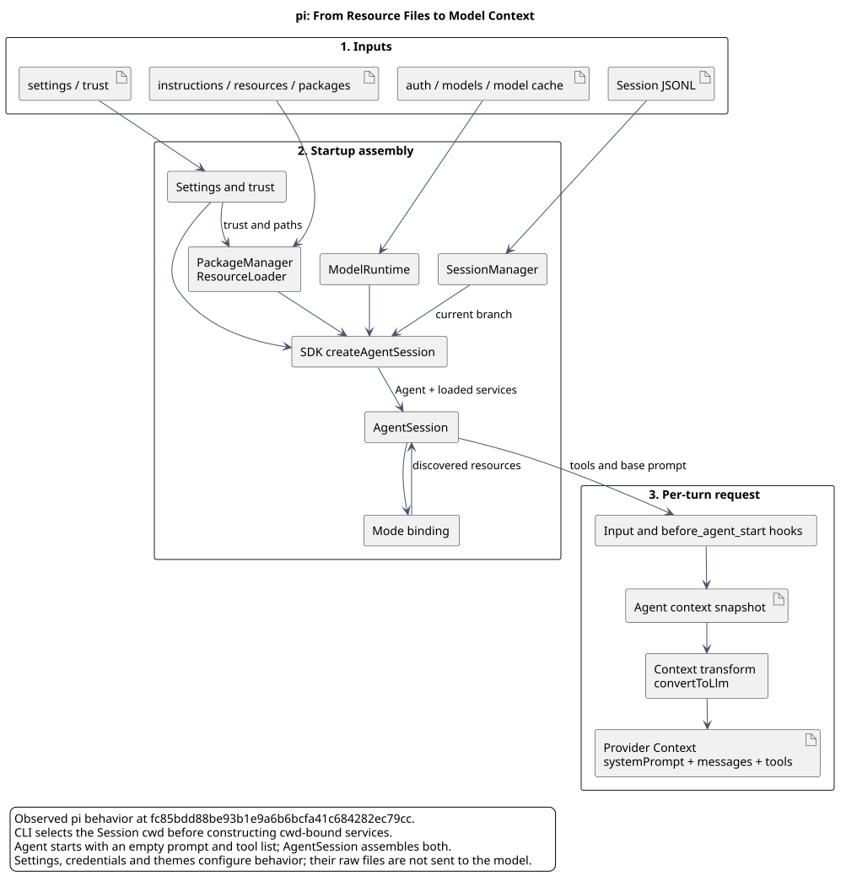

# pi AgentSession 与模型上下文研究

版本：1.3；整理日期：2026-09-14。

> 源码基线：`badlogic/pi-mono@fc85bdd88be93b1e9a6b6bcfa41c684282ec79cc`；原核验日期：2026-07-24；文档整理：2026-09-14。
> 本文记录该固定提交的源码行为，不代表最新 pi 或 CampusClaw 目标设计。

## 1. 核心结论

pi-mono 创建 `AgentSession` 时，**不是由 `AgentSession` 构造函数直接扫描所有文件**。文件读取分散在五组服务中：

1. `SettingsManager` 读取全局和项目配置；
2. `ProjectTrustStore` 读取项目可信状态；
3. `ModelRuntime` 读取认证、模型定义和模型目录缓存；
4. `DefaultResourceLoader` 联合 `DefaultPackageManager` 读取扩展、技能、提示模板、主题和指令文件；
5. `SessionManager` 读取或新建 JSONL 会话，并恢复当前分支的历史消息。

这些结果最终汇合为三类运行时上下文：

| 上下文 | 核心内容 | 是否原文发送给模型 |
|---|---|---|
| 启动配置上下文 | 模型、认证、信任、工具开关、重试、资源路径 | 否；它们控制如何构建请求 |
| 持久会话上下文 | JSONL 当前分支上的消息、模型、思考等级、压缩摘要 | 消息会发送，元数据不一定发送 |
| 模型请求上下文 | `systemPrompt + messages + tools` | 是 |

最终发给 provider 的结构在 `packages/agent/src/agent-loop.ts:288-312` 被明确组装为：

```ts
const llmContext: Context = {
  systemPrompt: context.systemPrompt,
  messages: llmMessages,
  tools: context.tools,
};
```

因此，判断一个文件是否“进入上下文”时要区分：

- **读取了**：启动时确实打开并解析该文件；
- **影响上下文**：文件内容改变模型、工具、system prompt 或消息；
- **原文注入**：文件正文被拼接进 system prompt 或 user message。

## 2. 构建总图



[原尺寸 SVG](agent_session_context.svg) · [PlantUML 源码](diagram.puml#L1)

图按文件输入、服务装配、每轮请求三个阶段组织。主题、认证和设置虽然会读取，但不会把 JSON 原文复制进模型请求。

## 阅读入口

| 阅读目的 | 文档 |
|---|---|
| 查文件来源、覆盖顺序与解析后的含义 | [资源目录与解析规则](./resource-reference.md) |
| 跟踪 CLI 创建、会话恢复和每轮请求 | [启动与请求构建](./startup-lifecycle.md) |
| 参考可落盘的配置和资源文件 | [完整示例](./file-examples.md) |

完整文件示例只在示例集中维护；解析规则保留转换结果，避免同一配置同时维护两份。

## 12. 源码证据索引

| 主题 | 源码路径和符号 |
|---|---|
| CLI 总入口 | `packages/coding-agent/src/main.ts`：`main()` |
| session 选择 | `packages/coding-agent/src/main.ts`：`createSessionManager()` |
| 服务创建 | `packages/coding-agent/src/core/agent-session-services.ts`：`createAgentSessionServices()` |
| runtime wrapper | `packages/coding-agent/src/core/agent-session-runtime.ts`：`createAgentSessionRuntime()` |
| SDK 核心创建 | `packages/coding-agent/src/core/sdk.ts`：`createAgentSession()` |
| AgentSession runtime | `packages/coding-agent/src/core/agent-session.ts`：constructor、`_buildRuntime()`、`_refreshToolRegistry()`、`_rebuildSystemPrompt()` |
| 资源统一加载 | `packages/coding-agent/src/core/resource-loader.ts`：`reload()`、`loadProjectContextFiles()` |
| package 和自动发现 | `packages/coding-agent/src/core/package-manager.ts`：`resolve()`、`addAutoDiscoveredResources()` |
| settings | `packages/coding-agent/src/core/settings-manager.ts`：`SettingsManager.create()`、`loadFromStorage()` |
| trust | `packages/coding-agent/src/core/trust-manager.ts`、`project-trust.ts` |
| credential | `packages/coding-agent/src/core/auth-storage.ts`：`AuthStorage` |
| model config | `packages/coding-agent/src/core/model-config.ts`：`ModelConfig.load()` |
| model runtime | `packages/coding-agent/src/core/model-runtime.ts`：`ModelRuntime.create()` |
| session tree | `packages/coding-agent/src/core/session-manager.ts`：`buildSessionContext()` |
| skill | `packages/coding-agent/src/core/skills.ts`：`loadSkillFromFile()`、`formatSkillsForPrompt()` |
| prompt template | `packages/coding-agent/src/core/prompt-templates.ts`：`loadTemplateFromFile()`、`expandPromptTemplate()` |
| extension | `packages/coding-agent/src/core/extensions/loader.ts`：`loadExtensionModule()`、`loadExtension()` |
| system prompt | `packages/coding-agent/src/core/system-prompt.ts`：`buildSystemPrompt()` |
| Agent 快照 | `packages/agent/src/agent.ts`：`createContextSnapshot()` |
| provider Context | `packages/agent/src/agent-loop.ts`：`streamAssistantResponse()` |

## 13. 观察结论与设计边界

### 已观察源码行为

- 上述目录、优先级、信任门禁、解析结构和 prompt 拼接顺序均来自指定 pi-mono commit；
- AgentSession 构造依赖已加载的 ResourceLoader 和 SessionManager；
- provider 最终接收 `systemPrompt + messages + tools`；
- resource discovery、per-turn hook 和 context transform 使上下文在构造后仍可动态变化。

### 本文未做的目标设计

- 没有把这些行为声明为 pi-mono-java 当前已实现能力；
- 没有提出 Java 侧接口或兼容方案；
- 没有把 pi 的宽松行为自动定义为 Java 侧安全要求。

若后续用于 pi-mono-java 设计，应逐项标记为：

- 与 pi 一致的 baseline；
- 产品约束导致的差异；
- 安全加固导致的差异；
- Java 架构变化；
- 仅目标设计、尚无实现。

## 14. 版本历史

| 版本 | 日期 | 变更 |
|---|---|---|
| 1.3 | 2026-09-14 | 按资源规则、启动链路和完整示例拆分研究，统一图示并移除重复示例。 |
| 1.2 | 2026-07-24 | 重构第 4 节目录展示，按用户级、跨 Agent 技能、项目级、祖先指令和会话持久化分区，并折叠完整 demo 目录。 |
| 1.1 | 2026-07-24 | 在第 4 节补充完整目录实例，以及 settings、trust、auth、models、模型缓存、指令文件、extension、skill、prompt、theme、package、ignore 和 session JSONL 的可参考 demo。 |
| 1.0 | 2026-07-24 | 基于 pi-mono `fc85bdd88be93b1e9a6b6bcfa41c684282ec79cc` 首次整理 AgentSession 创建、目录读取、文件格式、system prompt、会话恢复和最终 LLM Context 链路。 |

<details>
<summary>原章节链接定位</summary>

<a id="3-两个关键根目录"></a>[3. 两个关键根目录](./resource-reference.md#3-两个关键根目录)

<a id="31-cwd"></a>[3.1 `cwd`](./resource-reference.md#31-cwd)

<a id="32-agentdir"></a>[3.2 `agentDir`](./resource-reference.md#32-agentdir)

<a id="4-完整目录与文件清单"></a>[4. 完整目录与文件清单](./resource-reference.md#4-完整目录与文件清单)

<a id="41-目录约定"></a>[4.1 目录约定](./resource-reference.md#41-目录约定)

<a id="42-用户级目录"></a>[4.2 用户级目录](./resource-reference.md#42-用户级目录)

<a id="43-跨-agent-技能目录"></a>[4.3 跨 Agent 技能目录](./resource-reference.md#43-跨-agent-技能目录)

<a id="44-项目级目录"></a>[4.4 项目级目录](./resource-reference.md#44-项目级目录)

<a id="45-祖先目录指令"></a>[4.5 祖先目录指令](./resource-reference.md#45-祖先目录指令)

<a id="46-会话持久化目录"></a>[4.6 会话持久化目录](./resource-reference.md#46-会话持久化目录)

<a id="47-文件读取总表"></a>[4.7 文件读取总表](./resource-reference.md#47-文件读取总表)

<a id="48-可直接参考的完整目录-demo"></a>[4.8 可直接参考的完整目录 demo](./file-examples.md#48-可直接参考的完整目录-demo)

<a id="481-agent_dirsettingsjson"></a>[4.8.1 `$AGENT_DIR/settings.json`](./file-examples.md#481-agent_dirsettingsjson)

<a id="482-cwdpisettingsjson"></a>[4.8.2 `$CWD/.pi/settings.json`](./file-examples.md#482-cwdpisettingsjson)

<a id="483-agent_dirtrustjson"></a>[4.8.3 `$AGENT_DIR/trust.json`](./file-examples.md#483-agent_dirtrustjson)

<a id="484-agent_dirauthjson"></a>[4.8.4 `$AGENT_DIR/auth.json`](./file-examples.md#484-agent_dirauthjson)

<a id="485-agent_dirmodelsjson"></a>[4.8.5 `$AGENT_DIR/models.json`](./file-examples.md#485-agent_dirmodelsjson)

<a id="486-agent_dirmodels-storejson"></a>[4.8.6 `$AGENT_DIR/models-store.json`](./file-examples.md#486-agent_dirmodels-storejson)

<a id="487-agentsmdagentsmdclaudemdclaudemd"></a>[4.8.7 `AGENTS.md`、`AGENTS.MD`、`CLAUDE.md`、`CLAUDE.MD`](./file-examples.md#487-agentsmdagentsmdclaudemdclaudemd)

<a id="488-systemmd"></a>[4.8.8 `SYSTEM.md`](./file-examples.md#488-systemmd)

<a id="489-append_systemmd"></a>[4.8.9 `APPEND_SYSTEM.md`](./file-examples.md#489-append_systemmd)

<a id="4810-extensionshellots"></a>[4.8.10 `extensions/hello.ts`](./file-examples.md#4810-extensionshellots)

<a id="4811-skillsskillskillmd"></a>[4.8.11 `skills/<skill>/SKILL.md`](./file-examples.md#4811-skillsskillskillmd)

<a id="4812-promptsreviewmd"></a>[4.8.12 `prompts/review.md`](./file-examples.md#4812-promptsreviewmd)

<a id="4813-themesacme-darkjson"></a>[4.8.13 `themes/acme-dark.json`](./file-examples.md#4813-themesacme-darkjson)

<a id="4814-package-根目录的-packagejson"></a>[4.8.14 package 根目录的 `package.json`](./file-examples.md#4814-package-根目录的-packagejson)

<a id="4815-gitignoreignorefdignore"></a>[4.8.15 `.gitignore`、`.ignore`、`.fdignore`](./file-examples.md#4815-gitignoreignorefdignore)

<a id="4816-session-jsonl"></a>[4.8.16 session `*.jsonl`](./file-examples.md#4816-session-jsonl)

<a id="4817-哪些-demo-应该手写"></a>[4.8.17 哪些 demo 应该手写](./file-examples.md#4817-哪些-demo-应该手写)

<a id="5-cli-到-agentsession-的逐代码链路"></a>[5. CLI 到 AgentSession 的逐代码链路](./startup-lifecycle.md#5-cli-到-agentsession-的逐代码链路)

<a id="步骤-1确定启动目录和全局资源目录"></a>[步骤 1：确定启动目录和全局资源目录](./startup-lifecycle.md#步骤-1确定启动目录和全局资源目录)

<a id="步骤-2先选择或创建-sessionmanager"></a>[步骤 2：先选择或创建 SessionManager](./startup-lifecycle.md#步骤-2先选择或创建-sessionmanager)

<a id="步骤-3根据项目资源决定信任状态"></a>[步骤 3：根据项目资源决定信任状态](./startup-lifecycle.md#步骤-3根据项目资源决定信任状态)

<a id="步骤-4创建-cwd-bound-服务"></a>[步骤 4：创建 cwd-bound 服务](./startup-lifecycle.md#步骤-4创建-cwd-bound-服务)

<a id="步骤-5创建-modelruntime"></a>[步骤 5：创建 ModelRuntime](./startup-lifecycle.md#步骤-5创建-modelruntime)

<a id="步骤-6resourceloader-执行统一-reload"></a>[步骤 6：ResourceLoader 执行统一 reload](./startup-lifecycle.md#步骤-6resourceloader-执行统一-reload)

<a id="步骤-7packagemanager-先得到候选路径"></a>[步骤 7：PackageManager 先得到“候选路径”](./startup-lifecycle.md#步骤-7packagemanager-先得到候选路径)

<a id="步骤-8把候选路径变成内存对象"></a>[步骤 8：把候选路径变成内存对象](./startup-lifecycle.md#步骤-8把候选路径变成内存对象)

<a id="步骤-9从会话树恢复-messagesmodel-和-thinking-level"></a>[步骤 9：从会话树恢复 messages、model 和 thinking level](./startup-lifecycle.md#步骤-9从会话树恢复-messagesmodel-和-thinking-level)

<a id="步骤-10sdk-解析模型思考等级和初始工具"></a>[步骤 10：SDK 解析模型、思考等级和初始工具](./startup-lifecycle.md#步骤-10sdk-解析模型思考等级和初始工具)

<a id="步骤-11先创建一个空壳-agent"></a>[步骤 11：先创建一个“空壳” Agent](./startup-lifecycle.md#步骤-11先创建一个空壳-agent)

<a id="步骤-12agentsession-构造函数建立-runtime"></a>[步骤 12：AgentSession 构造函数建立 runtime](./startup-lifecycle.md#步骤-12agentsession-构造函数建立-runtime)

<a id="步骤-13构建工具注册表"></a>[步骤 13：构建工具注册表](./startup-lifecycle.md#步骤-13构建工具注册表)

<a id="步骤-14构建-base-system-prompt"></a>[步骤 14：构建 base system prompt](./startup-lifecycle.md#步骤-14构建-base-system-prompt)

<a id="步骤-15绑定运行模式后扩展还可以补资源"></a>[步骤 15：绑定运行模式后，扩展还可以补资源](./startup-lifecycle.md#步骤-15绑定运行模式后扩展还可以补资源)

<a id="步骤-16每一轮发送前允许扩展再改一次"></a>[步骤 16：每一轮发送前允许扩展再改一次](./startup-lifecycle.md#步骤-16每一轮发送前允许扩展再改一次)

<a id="6-每类文件内容解析结果和例子"></a>[6. 每类文件内容、解析结果和例子](./resource-reference.md#6-每类文件内容解析结果和例子)

<a id="61-settingsjson"></a>[6.1 settings.json](./resource-reference.md#61-settingsjson)

<a id="62-trustjson"></a>[6.2 trust.json](./resource-reference.md#62-trustjson)

<a id="63-authjson"></a>[6.3 auth.json](./resource-reference.md#63-authjson)

<a id="64-modelsjson"></a>[6.4 models.json](./resource-reference.md#64-modelsjson)

<a id="65-models-storejson"></a>[6.5 models-store.json](./resource-reference.md#65-models-storejson)

<a id="66-agentsmd--claudemd"></a>[6.6 AGENTS.md / CLAUDE.md](./resource-reference.md#66-agentsmd--claudemd)

<a id="67-systemmd"></a>[6.7 SYSTEM.md](./resource-reference.md#67-systemmd)

<a id="68-append_systemmd"></a>[6.8 APPEND_SYSTEM.md](./resource-reference.md#68-append_systemmd)

<a id="69-skill-文件"></a>[6.9 skill 文件](./resource-reference.md#69-skill-文件)

<a id="610-prompt-template-文件"></a>[6.10 prompt template 文件](./resource-reference.md#610-prompt-template-文件)

<a id="611-extension-文件"></a>[6.11 extension 文件](./resource-reference.md#611-extension-文件)

<a id="612-theme-文件"></a>[6.12 theme 文件](./resource-reference.md#612-theme-文件)

<a id="613-packagejson"></a>[6.13 package.json](./resource-reference.md#613-packagejson)

<a id="614-session-jsonl"></a>[6.14 session JSONL](./resource-reference.md#614-session-jsonl)

<a id="7-system-prompt-的精确拼接顺序"></a>[7. system prompt 的精确拼接顺序](./startup-lifecycle.md#7-system-prompt-的精确拼接顺序)

<a id="71-没有-systemmd"></a>[7.1 没有 SYSTEM.md](./startup-lifecycle.md#71-没有-systemmd)

<a id="72-存在-systemmd-或-cli-custom-prompt"></a>[7.2 存在 SYSTEM.md 或 CLI custom prompt](./startup-lifecycle.md#72-存在-systemmd-或-cli-custom-prompt)

<a id="73-每轮-override"></a>[7.3 每轮 override](./startup-lifecycle.md#73-每轮-override)

<a id="8-端到端例子"></a>[8. 端到端例子](./startup-lifecycle.md#8-端到端例子)

<a id="9-容易误判但实际不会直接进入上下文的内容"></a>[9. 容易误判但实际不会直接进入上下文的内容](./resource-reference.md#9-容易误判但实际不会直接进入上下文的内容)

<a id="10-开关与信任矩阵"></a>[10. 开关与信任矩阵](./startup-lifecycle.md#10-开关与信任矩阵)

<a id="11-直接-sdk-调用与-cli-调用的区别"></a>[11. 直接 SDK 调用与 CLI 调用的区别](./startup-lifecycle.md#11-直接-sdk-调用与-cli-调用的区别)

</details>
