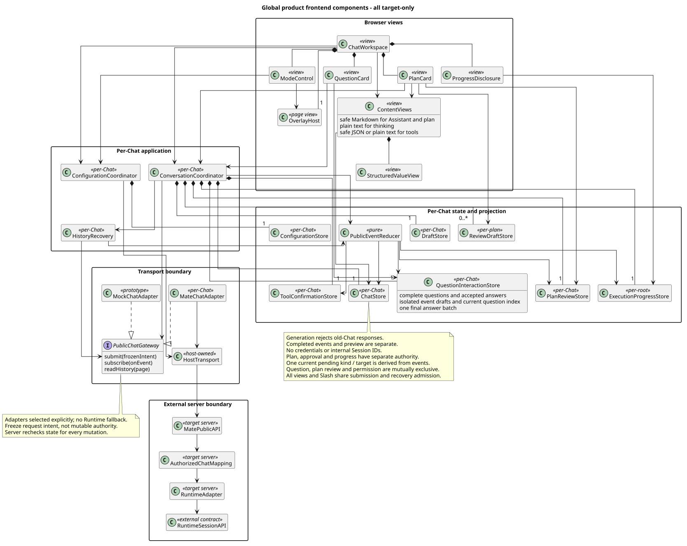
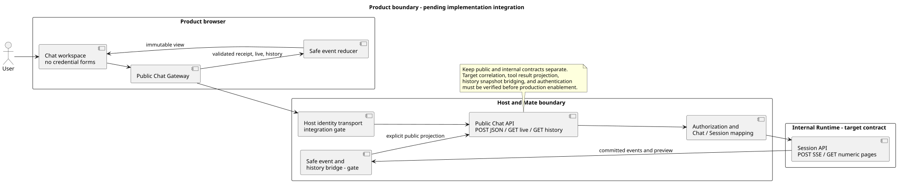
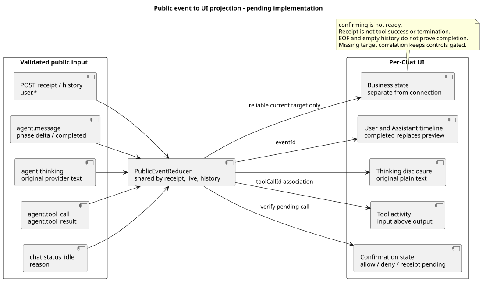

# 前端技术设计

版本：1.0.0 · 2026-09-18

[前端设计](../README.md) · [公共规范](../公共规范.md) · [源码证据](../source-evidence.md)

前端将事件和服务端状态投影为会话、消息、工具活动、问答、计划与执行进度。共享 Store 维护事件身份、当前执行和配置快照；组件负责展示与用户动作，Gateway 适配不同服务契约。

## 全局目标组件

[PlantUML 源码](diagram.puml#L210) · [原尺寸](target_frontend_components.svg)

这张主图保留入口、状态、投影、服务适配与渲染职责链。具体方法和实现差距见[公共对话技术设计](public-chat-alignment.md)；已观察实现分别绑定[源码证据](../source-evidence.md)中的提交。

## 按问题下钻

| 要解决的问题 | 唯一维护位置 |
|---|---|
| 公共 Chat、内部 Session、提交/观察/历史恢复 | [公共对话与状态](public-chat-alignment.md) |
| 本地会话索引、环境配置、Header 与认证助手 | [工作台与开发设置](runtime-workbench-alignment.md) · [Header 编辑](开发调试.md) |
| 方案、问题、任务的事件关联与组件分工 | [计划与问答](plan-interaction.md) |
| Slash 解析、草稿、缓存与执行结果 | [命令技术设计](命令/README.md) |
| 安全 Markdown、Thinking、工具结构与 displayName | [内容渲染](内容渲染.md) |
| 跨场景实现检查 | [验收](验收.md) |

## 服务边界

[PlantUML 源码](diagram.puml#L1) · [原尺寸](frontend_product_boundary.svg)

产品接入由 mate-service 建立身份、映射 Chat/Session 并投影事件。内部 Runtime 工作台使用独立适配器；开发者设置归属本地开发环境。公共接入的缺口和依赖由[公共对话技术设计](public-chat-alignment.md)维护。

## 事件投影

[PlantUML 源码](diagram.puml#L168) · [原尺寸](runtime_event_ui_projection.svg)

提交回执、实时流与历史读取进入同一个 Reducer，按事件身份更新已确认记录与临时预览；具体状态、错误与恢复路径见[公共对话技术设计](public-chat-alignment.md)。

## 实施顺序

1. 按场景确认状态、用户动作与反馈，用同一套 HTML 检查两种保真度。
2. 实现共享状态、事件投影和组件骨架，再接入对应 Gateway。
3. 分别核验内部 Runtime 与公共 Chat 的回执、历史恢复、并发配置及身份边界。
4. 依据[验收](验收.md)完成真实浏览器和服务联调，更新对应源码证据。

## 设计理由

### 3.4 目标设计与分类

| 目标差异 | 分类 | 理由 |
|---|---|---|
| 产品主界面不再直接调用内部 Runtime V1 | 架构变化 | 当前直接适配器没有生产认证能力；浏览器还需要稳定的公共 Chat/Agent 资源，而不是内部 Session 标识。 |
| 保持产品路由凭据无持有 | 产品约束 + 安全加固 | 统一登录和公共 bridge 仍承担生产身份；产品 Chat 页不新增 JWT/APPKEY/`access-token` 表单、构建配置、存储或 Header 注入。 |
| 统一开发者设置与环境持久化 | 产品约束 + 架构变更，待实现 | 减少刷新重填与切换配置文件；浏览器配置和本地服务秘密分别保存，凭据不进入会话索引，生产身份仍由宿主负责。持久保存增加本机数据暴露面，因此提供遮蔽、清除和环境隔离，不宣称浏览器存储是加密凭据库。 |
| 调试 Header 使用通用 Key/Value 表格与可删除预置 | 产品约束（内部工作台已实现） | 预置三个常用名称减少重复输入，保留任意 Key/Value；每行独立启停、删除，仅点击“增加请求头”才追加空行，避免输入过程中不断产生多余行。 |
| 开发者设置包含 Headers 分组 | 产品约束，待实现 | 单一入口内按连接、认证、请求头和 Session 诊断分组；复用原诊断视觉，业务实现仍按存储及请求职责拆分。 |
| 浏览器受限名称与格式使用行内校验 | 安全加固 | UI 不预设可选 Header，但 `Host`、`Content-Length`、`Cookie`、`Origin`、`Sec-*`、`Proxy-*` 等 Fetch 禁止名称不能发送；无效 token、换行值和大小写不敏感的重复名称在对应行阻止提交。 |
| 自动 Header 不展示 | 产品约束 | 不渲染自动值或覆盖状态；合并优先级统一见[Header 编辑](开发调试.md)。 |
| 六类动作独立 Header 快照 | 安全加固 + 架构变化 | 新操作读取最新值但不修改原执行；生产不暴露编辑器。 |
| 生产认证由 mate-service / 网关边界完成 | 待实现 architecture | 浏览器身份、登录态、授权与审计不由 Chat 页面收集原始凭据；具体会话承载和刷新机制必须在公共 API 评审时确认，不能从当前直接适配器推断。 |
| 隐藏 ETag、原始 SSE 与内部错误 | 安全加固 | 降低内部实现泄漏和错误信息越界风险；凭据不是产品“隐藏字段”，只有内部诊断构建存在明确例外。 |
| 停止与后续新消息 | 产品约束 | 停止走 user.interrupt；实际停止后新提交，不承诺原生 Steer 或 FollowUp。 |
| 运行中保留草稿 | 产品约束 | 不发送第二条用户消息，不展示队列或跟进模式切换。 |
| 将工具事件合并为紧凑 activity disclosure | 产品约束 | 保留执行透明度，同时避免 started/completed/result 三段协议噪音；执行中默认展开，完成后折叠。 |
| 工具详情按“输入参数 → 输出结果”纵向排列 | 产品约束 | Codex 的详情区是缩进的纵向流；左右分栏会把两个不同阅读阶段误导为并列比较，并压缩长参数和长结果。 |
| 思考 disclosure 与工具 activity 按事件顺序组成 Agent 活动流 | 产品约束 | 让用户在一个连续区域内理解当前做什么和调用了什么，又不把思考原文混入工具 payload。 |
| 产品思考区展示模型返回的原始推理 | 产品约束 | 直接查看模型本次返回的思考内容。 |
| 公共 bridge 保留 `agent.thinking.content` 原文 | 架构变更 | 保留协议和身份投影，内容按原文传递；前端标题使用状态文案。 |
| 工具 activity 展示经安全投影的调用入参 | 产品约束 + 安全加固 | 入参能解释 Agent 的实际动作；浏览器只接收经 bridge 脱敏、截断和用户资源映射后的结构，不暴露密钥、内部 ID 或绝对路径。 |
| 从独立 `agent.tool_call` 读取参数，按 `toolCallId` 合并确认和结果 | 架构变化 | 新公共事件已显式提供调用；产品不再依赖 Assistant 内嵌 ToolCallSpec 或旧工具进度事件。 |
| Assistant 正文使用安全 Markdown 富文本 | 产品约束 | 模型天然会输出表格、代码、列表和强调；纯文本会把结构标记直接暴露给用户。 |
| 禁止原始 HTML、Markdown 图片和任意协议链接 | 安全加固 | 模型输出和外部内容均不可信；避免 XSS、跟踪像素、应用内路由欺骗与危险协议跳转。 |
| 流式与历史消息共用同一 Markdown 源和渲染器 | 架构变化 | 保证 delta 预览、completed 替换与刷新恢复后的视觉结果一致。 |
| 保留独立开发者诊断入口 | 架构变化 | 保留接口联调效率，但与面向用户的路由、权限和构建产物隔离。 |
| 采用 Codex-inspired 而非复制 Codex 品牌 | 产品约束 | 复用工具型工作台的层级和密度，不使用 OpenAI/Codex 商标，也不声称存在官方公开 Token。 |
| 使用原始 O1 透明 PNG 和浅暖灰表面 | 产品约束 | 当前调试实现已有同一品牌资产；保留形状、比例和颜色，新增确认与恢复区域不改变品牌或导航风格。 |
