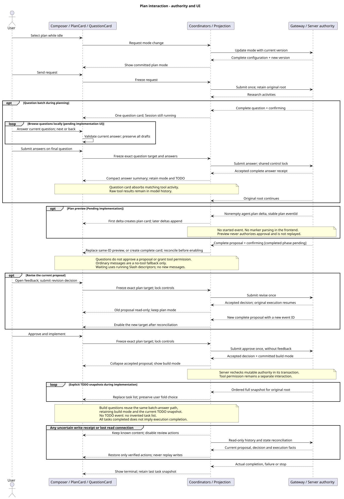

# 计划模式与 Codex 交互对齐

[前端主设计](../README.md) · [可操作工作台](../原型/plan-workbench.html) · [计划模式主设计](../../01-总体架构/06-CampusClaw计划模式/README.md)

版本：1.6.0；日期：2026-09-19。性质：既有计划、问答、审核、任务投影及日志合并已实现；正文流式绑定与来源消息合并增量待实现，见[最新局部核验](../../01-总体架构/06-CampusClaw计划模式/source-evidence.md#plan-streaming-evidence)。其他体验保留原范围；Mate 公共接入待实现，原型不代表部署验证。

本页维护 M07 的模式入口、方案阅读、审核和进度展示。模式、审核事务与恢复权威归 M01 的计划模式专题；精确字段归 Runtime 共享契约和审核增量，企业接入归 Mate 公共契约。本页不增加 HTTP API、Slash Command 或后端状态。

## 1. 源码与交互依据

当前设计起点为 `pi-mono-java-design@e179513`，本次源码核验为 `pi-mono-java@1d08f98eb04f8ea6e01bcfbfd4008c1b638391c4`，沿用计划模式与 AskUserQuestion 的已确认契约。内部前端实现起点为 `pi-mono-java@9f785bea3ffff8f6566cd1b2727285af46a2aead`，前次交互验证提交为 `fcae53829c2884ea1d3cc522c183f5a125a67f45`；完整提交、增量实现和验证范围统一见[当前实现证据](../source-evidence.md#current-implementation)。此前 `699f929f` 和未提交问答工作树的记录保留在[历史证据](../source-evidence.md#question-slash-evidence)，不用于判断当前是否已有问答能力。

| 证据 | 已观察事实与适用边界 |
|---|---|
| Java `frontend/src/types/runtime.ts` · RuntimeSession/UserEvent/RuntimeEvent | 已有 mode、计划审核、TODO 及问题/答案类型。 |
| `frontend/src/App.vue`；`components/PlanCard.vue`、`ProgressDisclosure.vue`、`QuestionCard.vue` | 已装配完整方案、反馈、批准、显式进度与结构化问题；UI 增量状态见源码证据。 |
| `frontend/src/runtime/eventStore.ts` · executionState/executionTodos/canReviewPlan/canAnswerQuestion | 已关联原根、待审方案、待答问题和任务，历史就绪及共享控制锁参与准入。 |
| `frontend/src/composables/useRuntimeApi.ts` · changeSetting/confirmPlan/answerQuestion/recover | 已使用统一 Session POST、完整配置/ETag 以及原根审核与问答恢复；仍为内部 Runtime 适配。 |
| `frontend/src/composables/useCommandComposer.ts`、`runtime/commands.ts` · choose/selectedError/freezeInvocation | 已有标签式 Slash、独立参数草稿、清单失效、类型化结果和运行中独立执行。 |
| `frontend/src/runtime/questionInteraction.ts` · QuestionDraftStore/validateQuestionDrafts/questionAnswerEvent | 已实现按会话/问题事件隔离的三类输入与全部作答校验；接受事实来自权威答案事件。 |
| Codex `d58d0e5841e0de08e251673db2d5af8cf3a1ad51` · `codex-rs/tui/src/chatwidget/plan_implementation.rs` · selection_view_params | 完整方案后提供实施、清上下文实施、继续规划；实施动作提交带 Default mode 的用户消息。这是 TUI 行为证据，不是桌面像素规范。 |
| 同一 Codex · `codex-rs/core/src/tools/handlers/plan.rs` · PlanHandler::handle_call；`codex-rs/protocol/src/plan_tool.rs` | update_plan 是 TODO 工具，Plan mode 调用被拒绝；进度显式发出 PlanUpdate，不从方案正文解析。CampusClaw 只借鉴阶段与展示分离，继续采用自己的提示词约束。 |
| 同一 Codex · `codex-rs/app-server/README.md:1771,1789,1830,1924` | turn/plan/updated、plan Item、实验性 plan delta 与用户提问请求分离；不将四种对象合并为一种“计划”。 |
| Codex 同一固定提交 · `codex-rs/protocol/src/request_user_input.rs`、`codex-rs/core/src/tools/handlers/request_user_input.rs` · RequestUserInputArgs/handle_call | 问题与回答独立关联，非根调用拒绝，is_blocking 随 Plan mode 决定；CampusClaw plan/build 均阻塞原执行，不复制 isSecret 或自动回答字段。 |
| [官方 Features](https://learn.chatgpt.com/docs/features)，2026-09-15 核对 | 展示侧栏、输入区 Add 与 Plan mode 入口。这里只证明公开布局例子，不推断安装包中的精确菜单或色值。 |
| [官方 App Server](https://learn.chatgpt.com/docs/app-server)，2026-09-15 核对 | 最终 plan Item 为权威，delta 可能与最终内容不同；提问与批准有独立协议。公开文档与固定源码分别记录，不静默升级源码基线。 |

[官方 Slash commands](https://learn.chatgpt.com/docs/reference/slash-commands) 于 2026-09-15 核对：Composer 输入 `/` 后选择或继续过滤，集合随环境变化。CampusClaw 保留服务端 Descriptor、规范名称和前缀过滤，不复制 Codex 的 `/plan`、`/approve` 或 `$` 技能入口。[官方 App Server](https://learn.chatgpt.com/docs/app-server) 的提问仍为 experimental；`serverRequest/resolved` 也可能来自中断/清理，不能据此显示“已回答”。

其余 Codex 暖灰、轻边界、活动折叠取样仍沿用[历史安装包证据](../source-evidence.md)，本次不声称重新测量桌面 CSS。没有修改 Runtime Loop，不新增 pi 行为结论；pi 语义证据继续由计划模式主设计维护。

## 2. 对齐范围与设计理由

| 交互问题 | CampusClaw 当前目标 | 差异分类、收益与代价 |
|---|---|---|
| 工作区密度 | 左侧会话列表、中央开放式回答、底部同宽 Composer；顶部只保留任务标题、Agent 与状态，模型/思考/模式放在 Composer 工具栏 | 产品约束：输入相关选择聚合，减少上下找控件；与原顶部配置位置不同，配置状态仍共享。 |
| 模式入口 | Composer 常驻“Build / Plan”轻量按钮，选择菜单只含这两项；计划激活后保留文字标识 | 产品约束：参考 Codex 的输入邻近入口，额外保持常驻可见以降低企业用户发现成本；不复制 Add 菜单。 |
| 方案阅读 | 对话内一张轻边界方案卡，默认展开完整正文，紧邻审核动作；原始 O1 不变 | 产品约束：阅读与决定同处，不用全屏审核向导；长文依靠页面滚动，正文不困在矮小滚动框。 |
| 批准执行 | “执行计划”提交当前方案的审核决定，原执行续跑；“修改计划”展开独立反馈区 | 架构变更：沿用 CampusClaw 审核事务，与 Codex TUI 的新用户消息方式不同；需要可靠的目标身份与回执。 |
| 上下文选择 | 首版无“清空上下文并执行”选项 | 产品约束：当前设计保留原执行、凭据和模型上下文；不引入第二条启动路径。 |
| 澄清问题 | AskUserQuestion 的显式 agent.question 显示问题卡；回答走 user.question_answer，在原根继续 | 架构变更：问题与答案精确关联，前端无需解析工具参数；完整设计见 [提问专题](../../01-总体架构/06-CampusClaw计划模式/ask-user-question.md)。未装配工具时才普通消息降级。 |
| 实施清单 | build 才显示后端显式任务快照，位置在 Composer 上方；轻量行展示进行中项和完成数量，展开查看全表 | 架构变更：展示脱离工具日志；产品约束：不从计划 Markdown 生成进度、不手工勾选、不将进度全完成等同执行终态。 |
| 执行透明度 | Thinking 与工具沿原时序排列；当前项展开、完成项折叠，工具输入在上、输出在下 | 产品约束：借鉴 Codex disclosure；保留 CampusClaw 原始推理展示，不生成推理摘要冒充原文。 |
| 运行中输入 | 可写草稿，停止位于原发送位置；审核等待仍 running | 产品约束：不开放队列、Steer 或随意运行中模式切换；牺牲部分交互灵活性以保持既定准入。 |

计划模式说明为“先调研并形成方案，审核后实施”。不能标为“只读沙箱”或“绝不会修改”：现有计划设计靠提示词约束，原工具权限仍独立生效。

## 3. 模式、方案与清单的状态

配置、执行、审核、问答和任务分别维护：Session mode 为 plan/build；执行按当前根消息判定；PlanReviewState 只投影完整方案及审核事实。模式控件不能根据当前卡片颜色反推 Session mode。

| screenKey / 场景 | 主要显示 | 允许的交互 |
|---|---|---|
| `planIdle` | 计划模式标识、普通 Composer | 发消息；仅无问答工具的普通澄清才使用消息输入，手动退出计划只更新模式。 |
| `planResearch` | “规划中”，连续活动流 | 停止、编辑草稿；无审核按钮、无调研进度百分比。 |
| 正文生成中（沿用 planResearch） | 普通 Markdown 流式正文，完整消息覆盖 preview | 停止与阅读，不得审核；收到有效 plan 后原位置转为卡片，不闪现双份正文。 |
| `planClarifying` | 结构化问题卡、计划模式仍激活 | 保持 running；提交全部答案后原根继续，不自动批准。缺工具降级才按普通消息规则结束。 |
| `planReview` | 完整方案、“待审核”、“执行计划 / 修改计划” | 绑定已恢复且当前有效的方案 eventId；没有隐式肯定词识别。 |
| `planDecisionPending` | “提交中” | 两个审核动作与停止共享提交锁，暂时禁用；不标记已批准、不清草稿。 |
| `planRevising` | 旧方案标为“已退回修改”，活动流继续 | 仍 plan/running；新方案新身份，旧方案只读；反馈不会变成第二条普通 user.message。 |
| `planExecuting` | 已批准方案折叠、Build、实施活动与任务摘要 | 等待首个任务事件前不显示虚构清单；工具授权单独出现；停止仍指向原根。 |
| `planRecovering` | 保留已知方案/清单与“正在核对” | 只读恢复；缺页、冲突、旧响应或失联不能开放审核。 |
| `planTerminal` | 实际完成/失败/停止与最后任务快照 | 根据可靠终态恢复普通发送；未完成的任务保持原状态。 |

[PlantUML 源码](diagram.puml#L534) · [原尺寸 SVG](target_plan_interaction.svg)

手动切换只在 idle、历史与状态已对齐、无写入和恢复请求时开放。内部每次只提交 mode，携带最新 If-Match；收到完整 Session 与 ETag 后原子替换配置，不先更新指示器。412 显示实际模式和原选择，显式重选才重试；网络不确定只读取资源。缺少计划能力时显示不可用原因，不默认为 build 覆盖未知模式。新建会话以创建结果为准，不把前一会话的模式带入；Agent 默认 mode 仅初始化新 Session。

## 4. 方案卡与审核反馈

1. 生成期通过既有 agent.message delta/completed 显示 Markdown 正文；没有审核权限。完整 agent.plan 和对应 confirming 到齐并核对根、分支与状态后才开放审核。仍无 plan delta，不解析工具参数或标题猜测计划。此增量待实现，来源与恢复规则见[流式设计](../../01-总体架构/06-CampusClaw计划模式/plan-streaming.md#4-公共事件与页面恢复)。
2. 卡片使用方案 content 的受限 Markdown，沿用前端安全 AST、代码复制、表格自身滚动和外链策略。方案是新增的受限富文本内容面，User、Thinking、Tool 和错误仍按原边界显示。复制得到原始 Markdown；纯显示预算不截断权威正文。
3. 按 sourceMessageEventId 将已显示正文在原位置转换为方案卡，只保留一份正文并吸收精确关联的 ExitPlanMode 调用/结果；事件和 usage 记录不删除、不重复计数。保持滚动、复制内容和焦点，完整计划到达前保留普通流式回答。旧历史无来源字段沿用完整卡；新格式缺页、跨根或正文不一致时只读对账，不按相邻位置合并。
4. “修改计划”就地展开反馈 textarea；“提交修改意见”提交 revise，“取消”只收起编辑区。反馈草稿按会话与方案身份隔离，普通消息草稿保持不变。内部按既有 4096 UTF-16 单元校验，可不填；空白但非空或超长时行内报错。公共限制必须由 Mate 精确模型确认，不自动继承内部长度。
5. approve 不带 feedback，revise 不提交修改后的方案正文。点击冻结会话、generation、当前方案身份和决定；双击只创建一次请求。回执到达才标记决定已接受，批准的 mode 以关联 mode_changed/资源对账更新；后续失败或停止不撤销已保存的批准事实。
6. 409 表示该目标不再待审核：禁用旧卡片并补读，不自动批准新方案。关闭/折叠、Esc、超时、模型肯定文本、EOF 均不表示批准。等待审核时要结束任务使用原停止动作，真实终态后才能切模式。

焦点规则：打开反馈聚焦 textarea，取消回到“修改计划”；提交后焦点移到可聚焦状态摘要，防止 disabled 按钮吞掉焦点。新方案到达只通知“方案已就绪”，不抢走正在编辑草稿的焦点。审核按钮不绑定全局 Enter；IME 和长按按原 Composer 规则处理。

## 5. 实施进度与恢复

进度权威、整表替换与排序规则唯一维护在 [TodoUpdate §4](../../01-总体架构/06-CampusClaw计划模式/todo-update.md#4-客户端投影与恢复)。前端追加以下展示约束：

- 只读任务清单显示“已完成 1 / 3 · 正在验证结果”，展开项用 pending/in_progress/completed 对应图标与中文状态；无任务百分比、ETA 或可勾选控件。
- 活动期间默认展开清单，用户主动折叠后不随新事件反复展开；终态收起为摘要，仍可查看原任务。长清单最多占视口约 30%，内部纵向滚动；方案全文仍用页面滚动。
- 尚无任务事件不显示面板；明确 todos=[] 显示“任务清单已清空”，不呈现“0/0 已完成”。失败工具结果不改变上一快照。列表全部 completed 时显示“清单已完成，任务仍在执行”，实际终态独立显示。
- root 变化后旧清单只留在旧轮历史；修订与批准续跑保持原 root。无稳定 taskId，不把同名/改名条目当成独立持久资源，不用内容哈希制造后端任务身份。
- 恢复期间以已合并的事件顺序重算最新快照，迟到旧页不能覆盖 live 尾部；重复帧不增计数，createdAt 回退不重排。不完整历史只允许只读展示，不恢复审核权限。
- 断网和审核回执丢失保留“结果待核对”，只重读；批准、revise、消息和停止均不自动重放。内部恢复是 GET 历史/Session，公共恢复是公共读流及历史，不混用两种连接模型。

结构化问答的权威规则由 [AskUserQuestion §7](../../01-总体架构/06-CampusClaw计划模式/ask-user-question.md#7-前端交互与企业服务边界) 维护。以下限定其产品呈现，不另定义字段或后端状态。

### 5.1 问题卡与回答

完整 `agent.question` 在活动流当前位置生成一张交互卡，一次只显示当前题，标题为该题 header（缺省“等待回答”），右侧显示“1 / 3”。按后端顺序推进，单题无需进度分母或下一步；同一工具请求仍保留全部问题和最终一次提交。界面先使用 `Build / Plan`，协议值不变。

| 内容 / 动作 | 呈现与反馈 |
|---|---|
| 当前题 | fieldset/legend、纵向选项和自由文本；单选 radio 默认不选，多选 checkbox 支持补充，无选项则 textarea。单选自填与选择互斥，保留原契约。 |
| 上一步 / 下一步 | 上一步只切视图，下一步只校验当前题并保存内存草稿；进入新题聚焦题目。不发送任何 HTTP 或工具结果，不让 Agent 在第一题后提前续跑。 |
| 末题提交 | “提交回答”全批校验，失败回到首个错误题；按既有问题与选项顺序冻结全部答案，针对同一问题 eventId 只提交一次。可上一步修改，不能跳过或默认肯定。 |
| 提交中 | “提交中”，控件禁用，与审核/权限/停止共享控制锁；保留草稿，完整权威回执前不标记已回答。 |
| 已回答 | 当前位置收为“已回答”及简短答案摘要，可展开全部题答；不显示答案 JSON。回答接受和后续执行开始分别判断，不自动批准、切 mode 或更改 TODO。 |
| 折叠 / 停止 | 折叠或 Esc 只影响视图；无已接受答案而真正停止后显示“已关闭”。已回答后停止仍保留回答事实。 |
| 同步中 / 跨端已答 | 保留当前题、全部草稿与已知内容，只读对账后恢复动作；对方已答展示权威答案，旧本地草稿不覆盖，不重答新问题。 |

提问工具由同一 Reducer 按 Session/根事件/`toolCallId` 关联完整 question 与 answer；问题卡吸收对应 AskUserQuestion 的通用 activity、参数和结果展示。原 ToolCall/ToolResult、持久化事件及模型上下文继续保留，前端只改变投影。开发者设置的原始事件诊断可按需查看，默认不在主对话显示重复工具行。等待已确认但完整问题尚未读到时显示“正在加载问题”，缺页禁答；没有合法问题事件而调用失败时显示简短工具错误，不能按名称静默吞掉失败。

完整批次来自后端，前端不重新解析工具 JSON 建题、不拆成三次问题事件或三次答案请求、不在切题时触发模型。问题卡位于可滚动时间线，Composer 占独立布局行；当前题底部与操作按钮可滚到可见区域。暂不把问答迁入 Composer，避免覆盖消息与 Slash 草稿。

题目、header、选项说明和答案全部转义为纯文本；DOM id 由客户端编号生成，协议 id 只作关联。新问题到达轻量通知“等待回答”，不抢当前输入焦点；textarea Enter 换行，明确按钮才翻题/提交，IME 与长按不得重复触发。已知等待不显示后台执行占位、虚假进度或催促用户的倒计时。

全部草稿与当前题索引按 Chat + question eventId 隔离，仅当前页面内存保存；刷新只恢复权威问题和答案，不假称已恢复未提交草稿。切换会话后先核对等待身份，过期草稿只读，权限撤销清理；普通消息、命令、修订草稿互不覆盖。

**设计理由。** 逐题降低同屏阅读量，整批提交保留已实现的原执行等待和答案原子性；代价是额外的当前题索引、前后导航、错误跳题和摘要投影。Codex 固定源码的 TUI 也区分 `current_question`、`go_next_or_submit` 与 `submit_answers`，具体路径见[计划证据](../../01-总体架构/06-CampusClaw计划模式/source-evidence.md)；它不证明 Codex 桌面的精确布局。CampusClaw 全部作答、无跳过、答案不批准方案是自身产品约束。

### 5.2 与 Slash 的协同

等待问题、方案审核和工具授权仍是 running；清单按[Slash 专项 §3.1](命令/README.md#slash-pending-interaction)显示当前可用命令。输入区 Slash 不替换题目或充当回答；命令结果不进入问题卡。模式、清单和待交互由同一会话协调器消费，命令返回一个 Session 不能清除待回答状态。

## 6. 组件与接入切片

复用[公共接入的全局目标组件图](public-chat-alignment.md#3-全局目标结构)，不再维护一套局部现状类图。图中的公共 Chat 分层是目标结构，内部 Runtime 行为的实现状态由源码证据判断，不因目标组件命名不同而标成未实现。

| 切片 | 组件责任与先后依赖 | 验收重点 |
|---|---|---|
| PF1 配置入口 | ModeControl 与模型/思考共享 ConfigurationCoordinator/Store；先接统一 Session 部分更新，再移动配置控件 | idle 允许、running/审核/恢复禁用；单字段提交；完整资源/ETag 同步；412、未知模式、默认 mode 与新会话隔离。 |
| PF2 方案投影 | PublicEventReducer → PlanReviewStore → PlanCard；计划正文复用 ContentViews 安全渲染 | 只有完整有效方案可审；ExitPlanMode 不重复正文；历史旧卡只读；原始 Markdown 复制、安全降级和长文。 |
| PF3 审核编排 | PlanCard → ConversationCoordinator → Gateway，复用控制锁；ReviewDraftStore 与消息草稿独立 | 精确 target；approve 无反馈；revise 可选反馈；双击/IME/取消/停止竞争；回执与实际实施分开。 |
| PF4 进度 | PublicEventReducer → ExecutionProgressStore → ProgressDisclosure；全部输入为显式完整事件 | 无事件/空列表/失败区分；新根隔离；全完成不当终态；旧页与 live 交错、重复事件、长列表可读。 |
| PF6 问答卡片 | QuestionCard / QuestionInteractionStore → 原控制提交入口；实时/历史共用投影 | 一次显示一题、前后导航保存草稿、末题全批校验与一次提交、关联工具不重复展示、原根续跑、缺页禁答、回执丢失与重复提交；见 Q1～Q5。 |
| PF5 恢复和两跳 | HistoryRecovery 共用 Reducer；Gateway 显式选择内部、Mock 或 Mate | 缺页禁审、迟到响应丢弃、跨端已处理不重发；公共模式/审核/问答/任务关联确认后才接真实 Gateway。 |

Store 生命周期按 Chat 隔离，审核草稿与问题草稿再按各自 eventId 隔离；视图只读不可变投影，不直调 Runtime Controller、Mapper 或持有凭据。审核与停止共享当前执行控制锁，进度独立于配置版本。服务端仍在事务中检查目标，前端快照不是接受凭证。

不新增 Maven/npm 直接依赖；复用 Vue Composition API、现有 Markdown renderer 与 Gateway，原型使用原生 HTML/CSS/JS。

## 7. 视觉、原型与交付边界

[plan-workbench.html](../原型/plan-workbench.html) 是本专题当前交互原型；[旧综合评审页](../原型/frontend-review.html)继续保留 Headers、基础对话与历史视觉样例。原型上方的场景/回执/事件按钮属于演示控制，不进入产品工作区。没有真实工具执行、网络请求或后端认证；问题与 Slash 的合成场景共用本页，命令详细边界还可在 Slash 专项原型检查。修订场景的模拟服务端固定返回“22:00 后实施”的示例，不分析反馈文本；模型与思考沿用主设计，原型只演示模式更新。

桌面侧栏 232 px、顶部 64 px、正文与 Composer 最大 840 px；14 px 正文，方案行高 1.8，弱边界与小面积深色主动作；O1 继续引用原 PNG。已完成活动收为一行，避免每个事件形成一张大卡。窄屏侧栏抽屉化；模型/思考收进设置入口，模式文字和审核动作保留；390 px 下方案、按钮和工具条自然换行，只有表格/代码自身横向滚动。

1440/1024/768/390 px 检查常规、审核、修订、实施和恢复；键盘检查模式菜单、反馈取消、折叠与焦点恢复。主交互目标区至少 44 px，aria-live 只播报状态变化，reduced-motion 下取消旋转。对比度沿用主设计已核对色值。

验收必须分别记录：设计原型状态测试、真实浏览器布局、PlantUML 生成与视觉、实现集成。原型通过不能证明 Java 计划实现或 Mate 公共桥接通过。Claw 当前实现及验证范围见[当前实现证据](../source-evidence.md#current-implementation)；Draft PR 中的代码不等于已合入或部署。

## 8. 版本历史

| 版本 | 日期 | 变更 |
|---|---|---|
| 1.6.0 | 2026-09-19 | 计划正文先流式显示，再按来源消息身份合并为完整审核卡。 |
| 1.4.0 | 2026-09-16 | 使用 Build/Plan 与逐题问答，合并提问工具展示并保留整批回答和原执行续跑。 |
