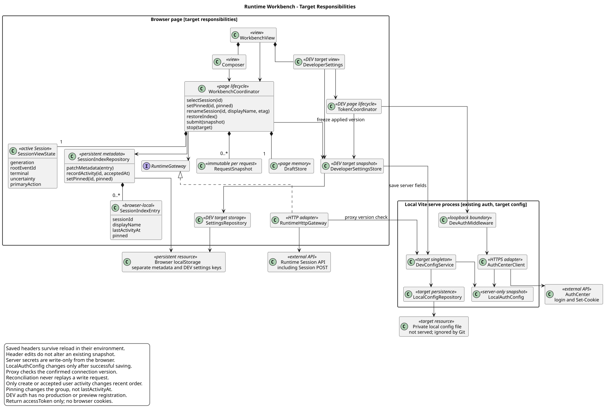

# Runtime 工作台交互对齐

[返回前端体验](../README.md) · [交互原型](../原型/frontend-review.html#conversation-workbench)

| 属性 | 值 |
|---|---|
| 版本 | 1.9.0 |
| 日期 | 2026-09-19 |
| 设计起点 | `pi-mono-java-design@599edb072cf75e3d8f85c775c53c0e83befd285d` |
| 实现基线 | 认证与发送链路：`pi-mono-java@840d04405d2bcc80a41b9d3b3f16606cc4845338`，2026-09-19 fetch 上游默认分支 `main`；其他能力保留原分项基线，见[源码证据](../source-evidence.md#token-refresh-evidence) |
| 范围 | 内部 Runtime Web 工作台；已实现能力与企业接入缺口分别记录 |

## 1. 源码依据与差距

认证与发送链路核验上游默认分支 `main@840d04405d2bcc80a41b9d3b3f16606cc4845338`，完整路径与旧新提交影响见[源码证据 §8](../source-evidence.md#token-refresh-evidence)。配置基础能力已实现，自动刷新待实现，真实认证行为未验收。

| 路径与符号（相对实现仓） | 已观察行为 | 当前目标与差距 |
|---|---|---|
| `frontend/src/App.vue`：`submit/executeCommand/stop/decideTool/decidePlan/answerQuestion` | 六类动作同步读取 `snapshotHeaders`，没有等待 `getToken` | 统一接入异步刷新门禁，再生成快照并提交；待实现 |
| `frontend/src/composables/useDeveloperSettings.ts`：`getToken/snapshotHeaders/tokenExpectationMatches` | 手动获取、Token 保存、环境/认证代次与 Token 草稿冲突检查已实现 | 复用基础路径，补齐动作目标二次校验、准备阶段锁及取消；待实现 |
| `frontend/src/developerSettingsStorage.ts`：`DeveloperSettingsRepository`；`frontend/dev/localConfig.ts`：`DevConfigService/LocalConfigRepository` | 浏览器按环境保存 IP/Headers，本地服务保存配置并提供版本 | 保持存储边界；基础能力不再列为待实现；跨页签竞争及真实热更新需单独验收 |
| `frontend/dev/authMiddleware.ts`：`createAuthMiddleware/authSnapshot`；`frontend/dev/authCenter.ts`：`loginAuthCenter/extractAccessToken` | 本地 DEV 登录、配置版本核对、Cookie 提取、10 秒超时已实现 | 使用现有私有接口；不新增刷新协议、Java API 或依赖 |
| `RuntimeEventService.submit`、`RuntimeSessionEngineRegistry.createSession`、`MateCredentials`、`HttpMateToolClient.invokeTool` | 新执行固定凭据；控制动作不替换原执行凭据，工具读取原快照 | 发送前获取解决旧 Token 启动问题；不承诺运行中续期，见 §6.7 |

独立实现差异：该提交的 `LocalConfigRepository.toSnapshot` 返回账号密码，`makeRow` 默认明文显示，`loginAuthCenter` 设置 `rejectUnauthorized: false`；与本文保留的秘密只写不回显、默认遮蔽及 TLS 校验目标不一致。本次只记录证据，不从差异推断设计意图，也不将这些安全目标标为已验收。历史证据保留于源码证据各节，其他模块结论不升级。

## 2. 目标职责与生命周期

[PlantUML 源码](diagram.puml#L399) · [原尺寸 SVG](target_runtime_workbench.svg)

此图表达推荐职责分层，组件的精确命名与拆分属于目标结构；不能据此把已经由组合函数实现的行为标成未实现。页面协调器统一拥有选中会话与请求代次；Composer、恢复和停止读取同一执行状态，不各自推导可发送。索引只提供恢复入口，消息与执行状态仍以后端为权威。开发者设置 Store 与会话索引分开；它拥有生效的配置快照，Header Store 从对应环境读取已保存值，Session 索引仍不保存凭据。

本地认证助手属于 Vite 开发进程，不进入 Vue 包或 Java 服务。它负责本机开发配置的读取/保存及一次认证和 Token 提取，不负责 Session、工具执行或生产身份建立。此划分复用现有开发环境；目标使用现有 Vite/Vue 与 Node 内置 `fs`、`http`、`https`、`net`，不增加 Java API、数据库表、Maven 或 npm 直接依赖，也不新增传递依赖。

## 3. 会话保存与恢复

这是产品交互约束及客户端状态架构调整。前端静态配置文件提供环境地址等启动配置，不承担用户会话的持续写入。当前工作台使用浏览器 `localStorage` 保存索引；刷新和关闭后重新打开都恢复最近列表与上次选中的会话。恢复只影响同一浏览器、同一站点，不等于跨设备同步。

| 数据 | 保存位置与语义 |
|---|---|
| `schemaVersion`、环境作用域、`activeSessionId` | 浏览器本地会话索引；目标作用域包含实际后端身份、Agent 与工作台 caller；同源代理模式必须包含代理目标，不能只使用空 API base；作用域不是授权证明 |
| `sessionId`、`agentId`、显示名称、`lastActivityAt`、`pinned` | 索引项；名称是后端权威值的本地投影，`lastActivityAt` 只在新建或新用户消息已接受时改变，`pinned` 是当前浏览器的显式用户偏好 |
| 未完成提交的最小标记 | 只保存操作种类、是否已得回执及可用的原目标/回执 ID，不保存请求正文；发送前写入，匹配权威结果后清除，用于刷新后的不确定结果提示 |
| 消息历史、执行结果与配置版本 | 后端权威资源；通过 GET 重新读取，不把缓存状态当作已完成 |
| 普通消息、命令及附件草稿、临时命令结果 | 页面内存；会话切换按既有草稿规则处理，本项不承诺刷新恢复未发送内容 |
| 认证 IP、自定义 Header 行 | 独立的浏览器开发设置中按环境保存，包含 `X-HW-ID`、`Authorization`、`access-token` 的值及启用态；刷新与关闭重开可恢复，不进入会话索引或聊天历史 |
| 认证账号、登录密码、Cookie | 账号密码由本地开发服务持久化；读取只返回配置状态，不将保存的秘密回传页面；Cookie 不保存到浏览器。详细生命周期见 §6.3～§6.5 |

启动恢复顺序：

1. 校验版本、结构与作用域，显示最近列表和“正在恢复会话”；没有索引时显示新会话入口，不自动创建会话。
2. 用保存的 ID 调用现有 `GET /sessions/{sessionId}`，随后读取历史、模型并更新配置；完整读取分页后按现有事件规则重建本轮状态。
3. 恢复期间允许编辑草稿，发送保持禁用。已有根事件时，只有其匹配的终态与当前资源一致才恢复发送；尚未加载到根事件时不猜测停止目标。
4. 若后端仍在执行，恢复运行态和已加载的确认/停止目标。内部接口没有独立恢复读流，使用有界 GET 历史/Session 补读；不重新发送原 POST。前台可采用 1、2、5 秒退避，最多连续 6 次，仍未结束且没有已确认的用户等待时显示“处理中”和“刷新状态”；已确认问题/方案/权限等待分别显示“等待回答 / 等待审核 / 等待确认”，暂停无意义轮询；返回页签或用户点击再启动补读。
5. 切换会话递增 generation 并中止旧读请求；旧响应不得覆盖新会话。中止浏览器观察不等于终止后台执行。
6. 网络错误保留索引并显示重试；404/明确无权限显示该会话不可恢复且清除其消息视图，由用户移除列表项。只有明确新建动作才创建新会话。

列表排序使用稳定分区：置顶项在前、未置顶最近项在后，两组内均按已保存的 `lastActivityAt` 降序。选择、GET 恢复、名称/模型/Thinking 变更、执行状态更新只原位补丁元数据，不更新 `lastActivityAt`。置顶/取消置顶只改变分区，不伪造活动时间；取消后回到其原本的最近位置。

schemaVersion=1 迁移到 2 时，保持现有数组顺序，将旧 `updatedAt` 映射为初始 `lastActivityAt`，并以 `pinned=false` 补齐。不用 Runtime `updatedAt` 继续排序，因为它还会因改名、配置和状态变化，不等于用户会话活动。置顶当前仅属内部 Runtime 工作台的浏览器本地状态；产品需要跨端同步时，应设计 mate-service Chat 元数据而不向 Runtime Session 表加 pin 字段。

名称、模型、思考和模式控件共用 updateSession 客户端方法，每次操作只提交对应的一个字段；禁止 GET 资源全量回传。接口允许组合提交是资源更新能力，当前页面不增加批量编辑或保存流程。成功后按返回的完整 Session 和 ETag 原位更新；仅提交 modelId 时，模型能力导致的 thinking 自动归一也以返回值为准。字段准入与组合提交规则由 [HTTP 主设计 §2.4](../../01-总体架构/01-CampusClaw多Agent运行时/chat-http-v1-design.md#session-update)维护。

模式按钮常驻 Composer，与模型/思考共享配置快照；界面位置、反馈编辑和实施进度见[计划交互专项](plan-interaction.md)。计划审核已在 PR #301 实现，沿用事件恢复方式；Session 类型只接入工作模式，不增加待审核指针。卡片展示、分页未完成时禁用审核和服务器最终校验统一引用[计划模式 §6.2](../../01-总体架构/06-CampusClaw计划模式/README.md#62-恢复与结果不确定)。

会话菜单的“重命名”使用统一 Session 更新 API，成功后在原位更新列表文案，不调整排序。412 时重读 Session，显示实际名称并保留用户草稿，由用户再次确认；不用新 ETag 自动重放 POST。网络结果不确定时 GET Session 对账，不盲重试。

索引写入、损坏或版本不兼容不应使页面崩溃：仅处理本功能的命名空间，写入失败告知本次无法保存恢复入口，现有会话仍可使用。读取原目标/回执标记只能辅助对账；未知结果不能按文本相同自动认领，也不能自动重放。不同页签各自保持当前选择，索引变化不强迫另一页签导航。

## 4. Composer 的发送与停止

这是产品交互约束，沿用现有 `user.interrupt` 语义，不增加 abort 接口，也不改变 Runtime Loop。

| 当前状态 | 右下角主按钮 | 行为 |
|---|---|---|
| 空闲、可提交 | 上箭头，“发送消息”或“运行命令” | 校验后冻结草稿、目标和配置版本，进入 §6.1 自动刷新；清单浏览或空内容时禁用 |
| DEV 自动刷新中 | 主按钮禁用，“正在发送…” | 尚未发送业务请求，不显示 Agent 已运行或停止；失败保留输入并恢复可操作状态 |
| 消息/Skill 提交中，尚无完整回执 | 停止方块，禁用，提示“正在提交，确认接收后可停止” | 立即切换外观；尚无可信目标时不发送伪造中断 |
| 执行中 / 等待工具确认 | 停止方块，“停止生成” | 不受输入框是否有草稿影响；点击绑定当前根目标提交一次中断 |
| 确认决定正在提交 | 停止方块，暂时禁用 | 共用控制操作锁，避免重复或竞争控制请求 |
| 停止请求发送中 / 已接受但未终止 | 停止方块，禁用，“停止中” | 回执只说明接受；草稿保留，不提前恢复发送 |
| 结果未知 / 恢复中 | 根据已确认执行保留停止语义；目标未确认时禁用 | 显示恢复动作，不把“未知”降级为可发送 |
| 当前目标可信终态 | 上箭头 | `done/terminated/failed` 按实际结果显示；保留运行中写入的草稿，不自动发送 |

顶部不再重复提供停止按钮。鼠标点击停止或键盘焦点明确位于停止按钮时 Enter 才停止；在普通消息 textarea 内按 Enter 不得因按钮改形而停止任务。IME、长按 Enter、重复点击仍须防重。

“已就绪”仅曾表示客户端判断没有活动执行，不能证明凭据有效。目标顶部空闲文案为“空闲”，执行时按[主设计文案](../公共规范.md#106-简洁文案)使用“处理中”“等待确认”“停止中”；输入框上方不重复显示健康状态和常驻“重新核对”。只有恢复中、连接异常或提交结果未知时显示状态条及“刷新状态”；该动作只读历史/Session，不校验 Token，也不重发消息。

运行中命令的入口、执行按钮与焦点规则统一见 [Slash 专项 §4.3](命令/README.md#43-选择与执行)。普通消息仍无 Follow-up 队列和 Steer，不把运行中草稿自动续发。

## 5. 添加入口与 Header

`+` 的产品语义为添加附件或上下文，不再包含“命令”；命令仍由空消息首字符 `/` 触发，或点击已选标签更换。附件与上下文实际能力必须与已接入资源一致，当前无上传实现时“添加附件”禁用并提示“暂未接入附件上传”，不虚构上传或新增一个未定义的上下文 API。移除工具栏重复的独立附件按钮。

Header 行编辑与计数以 [主设计 §6.1](开发调试.md#61-开发者调试-header) 为唯一规则；统一设置、持久化与配置生效由本专题 §6.3～§6.6 维护。三条空预置显示 `Headers (0)` 正确；仅空格或 Tab 的值按 HTTP 首尾空白规范化后视为空。CR/LF 一律拒绝，不用 trim 掩盖非法换行。每次新消息、命令、中断、工具确认、计划审核和问题回答先按 §6.1 重新获取 Token，再生成有效 Header 快照；修改不追溯影响已发请求或正在执行的凭据快照。

## 6. 发送前自动获取 Token

此能力是 DEV-only 产品约束与凭据边界加固。Vite middleware、Node HTTPS 客户端和手动 Token 回填已实现，发送前自动获取待实现，源码见[认证链路证据](../source-evidence.md#token-refresh-evidence)。用户提供的 Postman 界面证明了以下调用形态；尚未对真实认证中心发起验证，不能把它当作完整上游契约：

- `POST https://{ip}/service/AuthCenter/0.1.0/auth/login`，JSON 字段 `loginAccount`、`password`。
- 成功响应 Cookies 中出现 `access-token` 与 `JSESSIONID`；截图中的 `access-token` 标记 HttpOnly、Secure。
- 不记录截图里的真实密码、Token 或 Cookie；测试使用明确的合成值。

浏览器 Fetch 不向页面脚本公开 `Set-Cookie` 响应头；HttpOnly Cookie 也不能通过页面脚本读取，因此不能直接照搬 Postman 提取方式。[WHATWG Fetch](https://fetch.spec.whatwg.org/#forbidden-response-header-name)、[RFC 6265 §4.1.2.6](https://www.rfc-editor.org/rfc/rfc6265#section-4.1.2.6)。

### 6.1 页面流程

内部 DEV 工作台每次提交新消息前，若本地认证配置可用，可以调用现有 `POST /__debug/auth/token` 重新获取 `access-token`；自动获取不是业务 POST 的必需前置条件。相同的可选刷新覆盖命令执行、中断、工具确认、计划审核和问题回答六类既有携带开发 Header 的动作；历史/状态读取、命令清单、Session 创建与配置、SSE 接收不触发刷新。生产 Chat 仍使用宿主身份，不接入本地认证助手。自动刷新为待实现的产品约束与前端编排变更。

这里的“刷新”指复用已实现的登录接口重新获取 Token，不引入未经确认的 refresh-token 接口，不推断 JWT 格式或有效期，不设置定时刷新。账号、密码和认证 IP 配置并保存一次后，正常发送无需先打开设置或点击“获取 Token”。手动按钮保留为诊断入口；键入、页面刷新、切换环境和保存配置本身不登录。

用户可见反馈只表达发送或控制动作的进度与必要失败，不展示登录、Token 刷新或 Header 保存阶段，也不弹出自动刷新成功提示。认证与消息提交沿用同一“正在发送…”反馈；控制操作按动作显示“正在提交…”。详细状态保留在主动打开的开发者设置，原型模拟开关与请求计数默认折叠。此调整属于产品展示约束，内部状态、发送顺序与结果对账规则保持不变。

统一流程由页面级 `TokenCoordinator` 职责承接，复用 `useDeveloperSettings.getToken` 的认证、保存与冲突检查，并新增异步 `prepareWrite` 门禁；精确类名不要求照搬目标图：

1. 先校验输入与操作准入，取得该动作的提交锁，冻结正文/答案/决定、Session 与根/确认目标、视图代次、连接环境、已应用 Header 与认证配置版本。认证草稿未保存、Token 行有未保存冲突或其他已应用 Header 非法时，显示具体错误并停止；认证未配置本身不阻止业务 POST，也不代替用户保存其他草稿。
2. 消息页面统一显示“正在发送…”，有可用认证配置时尝试调用本地认证助手；成功之前不派发业务 POST，但认证未配置或获取失败不把业务 POST 判为未提交。所有六类入口共用准备状态，重复点击、Enter 和手动按钮不能再发起登录或排队重复业务动作。同页已有手动获取时提示等待，其完成不自动执行另一次点击；下一次独立动作仍可重新获取。
3. 获取成功并验证版本仍匹配后，按 §6.4 仅合并、保存并启用当前环境唯一的 `access-token` 行。行缺失则创建，关闭的行重新启用，旧手填值由新值替换；这是一项明确的自动刷新例外，删除/停用 Token 行不是关闭自动刷新的开关。其他 Header 使用冻结的已应用值，不隐式应用草稿；不自动刷新 `Authorization` 或 `X-HW-APPKEY`。未获取到新 Token 时，继续使用冻结快照中已有的 Header，允许快照为空。
4. 再核对环境、连接版本、Header/认证版本、Session、根事件及待确认目标、最新操作准入；自身保存 Token 导致的版本推进需精确识别，不能屏蔽其他配置变更。生成独立请求快照并立即发送一次业务 POST，再进入既有回执/SSE 流程。准备期间不写入“业务结果未知”标记，不清空输入、不更新会话最近顺序；该标记从实际准备派发业务 POST 时才开始。
5. 登录拒绝、超时或响应无有效 Token 不阻止业务 POST；保存失败、配置冲突和 Header 格式错误仍阻止发送。认证助手失败时保留输入并提示“认证暂不可用，本次仍按当前 Header 提交”；没有 Header 时请求照常提交，后续实际 Mate tool execute 以工具失败反馈。旧 Token 可以保留为设置值，但不得作为此次失败的隐式回退；不自动重试登录或业务 POST。
6. 切换环境/Session、替换认证配置、保存 Header、清空或编辑 Token 行、页面卸载时取消准备，迟到结果不得触发原动作或污染新环境。关闭设置面板仅取消面板发起的手动获取，不取消由发送动作持有的自动获取；取消后先让旧尝试退出再释放锁。业务 POST 已派发后的断线/失败继续走原目标只读对账，不能因获取到新 Token 自动重发。

每次启用自动刷新会增加一次认证往返；认证中心故障不阻止该动作，包括中断，实际工具调用可能随后失败。中断准备期间仍显示“正在提交停止请求…”，业务 POST 的接受与目标实际停止继续按原回执规则判断，不伪装为已停止。同页防重不保证跨页签或跨 Session 的登录互斥，相关上游约束见 §6.7。

账号与密码在同一入口输入，由仅本机可访问的开发服务保存；`.env.local` 的 `CAMPUSCLAW_DEV_AUTH_ACCOUNT`、`CAMPUSCLAW_DEV_AUTH_PASSWORD` 只作为尚无本地覆盖时的启动默认值。页面重新打开只显示“已配置”，提供替换或清除，不读取已保存的账号密码。秘密不得使用 `VITE_` 前缀、传给 `define` 或进入客户端产物；IP 与 Header 的浏览器持久化遵守 §6.4。

获取过程冻结环境、IP、本地认证配置版本及请求代次。切换 IP、清空 Header、关闭页面、替换认证配置或切换环境后旧结果不得回填或重新落盘；请求过程中手动编辑 Token 行时也不得用迟到结果覆盖手工值。编辑 IP 不改变 Header 草稿的原环境归属；应用新 IP 后才装载该认证环境自己的 Header，不把旧 IP 的自动 Token 复制过去；原环境已保存值保持，未保存 Header 草稿在页面内按原作用域保留，不能随 IP 修改写入新环境；失败不覆盖原环境的已有值，不产生虚构的有效期或“认证成功”标记。

### 6.2 本地开发服务接口（已实现的私有开发接口）

| 项目 | 目标定义 |
|---|---|
| 路径 | `POST /__debug/auth/token`，仅 Vite `serve` middleware；非 CampusClaw 公共 API，生产构建和 preview 不注册 |
| 页面请求 | `Content-Type: application/json`，body 为 `{ "ip": "192.0.2.10" }`，沿用 `X-CampusClaw-Auth-Version` / `X-CampusClaw-Auth-Key` 核对本地认证配置；不接收账号密码、上游 URL、路径或 Cookie |
| 校验 | 服务端用 Node `net.isIP` 校验 IPv4/IPv6 字面值；协议 HTTPS、端口 443、登录路径固定；不跟随重定向；沿用 TLS 校验，本地 CA 由开发服务配置 |
| 访问边界 | 本地 loopback 服务、受校验的 Host 与同源 Origin；JSON POST，跨源与不符方法拒绝。开发服务配置缺失返回明确错误，不向其他来源开放登录代理 |
| 上游请求 | Node HTTPS 使用本地账号密码构造 JSON；不附带调试 Headers 或截图 Cookie；10 秒超时、64 KiB 响应读取上限；失败后无自动重试 |
| 提取 | 仅在上游 HTTP 2xx 后遍历 Node 的独立 `set-cookie` 数组，按 Cookie 名精确匹配 `access-token`，不以逗号拆分；空、删除或相互冲突的 Token 视为失败；不返回 `JSESSIONID` 或原始响应 |
| 成功 | HTTP 200，`{ "resCode": "0", "resMsg": "Token 已获取", "result": { "accessToken": "synthetic-token" } }`；示例是合成值 |
| 失败 | 使用非 2xx 与 `resCode/resMsg`，不带 result；`INVALID_AUTH_IP`(400)、`DEV_AUTH_NOT_CONFIGURED`(503)、`AUTH_UPSTREAM_REJECTED`(502)、`AUTH_TOKEN_MISSING`(502)、`AUTH_UPSTREAM_UNAVAILABLE`(502)、`AUTH_UPSTREAM_TIMEOUT`(504) 及配置已变更 `DEV_AUTH_CONFIG_CHANGED`(409) 为本地码，不声称是上游错误码 |
| 存储与错误 | 响应 `Cache-Control: no-store`；不设置浏览器 Cookie，不记录请求正文、密码、Token、Set-Cookie 或原始上游错误；当前页面已按环境保存 Token，目标存储边界见 §6.4 |

Token 获取是独立请求，不重放失败的对话 POST。六类动作在自动获取并保存成功时生成携带新 Token 的快照；未配置或获取失败时仍生成当前 Header 快照（可以为空），不自动拼接 `Bearer`。新 Token 的有效时长与运行期间续期边界见 §6.7。

### 6.3 统一开发者设置与既有配置映射

统一设置、配置保存和热应用已有实现；以下为有效目标，秘密只写不回显等实际差异见[源码证据 §8](../source-evidence.md#token-refresh-evidence)，不将基础能力整体标为待实现。

开发者设置只有一个入口，使用原诊断面板的暖灰表面、虚线分组和紧凑输入。面板按“连接”（含默认项）、“认证”“Headers”“Session 诊断”分组；创建/恢复操作不再要求用户切换页面。每个可保存分组提供“保存并应用”和保存结果，关闭面板不提交未保存草稿。会话模式、模型和 Thinking 继续属于当前 Session，不与本地开发默认配置混为一份资源。

| 现有键或输入 | 页面字段 | 保存权威与生效范围 |
|---|---|---|
| `VITE_CAMPUSCLAW_API_BASE` | API 地址，留空使用同源代理 | 浏览器开发设置；应用时切换连接环境，下一次请求使用新地址 |
| `VITE_BACKEND_URL` | 本地代理后端地址 | 本地开发服务配置；仅同源代理模式使用，应用后新代理请求使用新目标 |
| `VITE_CAMPUSCLAW_CALLER_ID` | 默认调用方 | 浏览器开发设置；缺省仍为 `campusclaw-web`，用于请求适配器与索引作用域；显式 Header 的同名覆盖保持既有规则 |
| `VITE_CAMPUSCLAW_AGENT_ID` | 默认 Agent ID | 浏览器开发设置；影响新建与默认环境，不修改已有 Session 的 agentId |
| `VITE_CAMPUSCLAW_AGENT_NAME` | Agent 名称 | 浏览器开发设置；更新默认 Agent 展示，不重命名已有会话 |
| `VITE_CAMPUSCLAW_AGENT_DESCRIPTION` | Agent 描述 | 浏览器开发设置；更新默认入口描述 |
| `VITE_CAMPUSCLAW_AGENT_CATEGORY` | Agent 分类 | 浏览器开发设置；更新默认展示分类 |
| `CAMPUSCLAW_DEV_AUTH_ACCOUNT` | 认证账号 | 本地开发服务秘密配置；写入后不回显原值，下一次获取 Token 使用新值 |
| `CAMPUSCLAW_DEV_AUTH_PASSWORD` | 认证密码 | 本地开发服务秘密配置；写入后不回显原值，下一次获取 Token 使用新值 |
| 认证中心 IP | 认证中心 IP | 浏览器开发设置；恢复上次选择，不自动登录 |
| 自定义 Header 行 | Headers | 浏览器按环境保存完整行、顺序与启用态，至少覆盖 `X-HW-ID`、`Authorization` 与 `access-token`；具体编辑规则引用主设计 |

本表完整覆盖 `.env.example` 的八个键，并补齐 `vite.config.ts` 已读取但示例缺少的 `VITE_BACKEND_URL`。实现时补充示例键，不能把缺项误写成新增运行能力。浏览器设置的优先级为已保存覆盖值 → 现有非秘密环境默认值 → 代码默认值；本地服务字段为已保存覆盖值 → 启动配置 → 默认值。清除秘密必须保存显式空值，不得因删除覆盖后回退到旧 `.env.local` 密码；“恢复默认”与“清除”使用不同动作。

连接区同时涉及浏览器与本地代理配置时，先完成本地服务校验和持久化，再应用浏览器快照。若任一存储失败，分别显示实际保存状态并保留草稿，暂停使用不一致的连接配置并重新读取服务状态；不能显示整个分组保存成功。不提供任意环境变量、文件路径或原始 `.env` 编辑器。

### 6.4 浏览器持久化与本地秘密边界

IP 和 Header 持久化是内部开发工作台的产品约束；环境隔离、秘密不进入构建产物和本机接口限制属于安全加固。

- 使用独立且带 schemaVersion 的开发设置命名空间，不写入 Session 索引、消息历史、URL、日志或遥测。同一浏览器、同一前端站点刷新和关闭重开后恢复；清除站点数据后恢复入口与浏览器设置会丢失，不承诺跨设备同步。
- 保存的 Header 环境由实际 API 后端身份与认证 IP 区分；代理模式的后端身份必须包含代理目标。切换环境读取各自设置，缺少已保存配置时显示三个空预置，不复制上一个环境的 Authorization 或 Token。“全部清空”立即将当前作用域的草稿和已应用行置零、取消旧 Token 回填并清除持久值，成功后刷新不会补回预置；清除落盘失败仍停用当前值并提示刷新可能恢复，不回滚恢复旧凭据；“恢复预置”必须是显式动作。
- 普通 Header 编辑只在该区点击“保存并应用”后替换生效快照；“全部清空”和成功获取 Token 是显式例外。Token 仅更新匹配环境的 access-token 行，在已保存快照上合并这一行并同步未冲突草稿，不提交其他 Header 草稿；持久化成功后才应用；自动获取不在对话区弹出成功提示，“Token 已更新”仅在开发者设置中展示。普通保存或 Token 写入因存储不可用、格式不兼容而失败，保留原生效配置并显示“未保存”，不静默宣称持久化成功，也不全站清空其他数据。
- `Authorization` 和 `access-token` 默认遮蔽，开发者可主动查看、替换或清除；遮蔽不是加密。已保存值仍可被同源页面脚本与浏览器开发工具读取，因此该能力仅装配到本机开发工作台，生产包不包含入口、配置读取或持久化 store。
- 本地账号密码由开发服务写入固定位置、Git 忽略且不由 Vite 静态服务暴露的配置文件，限制为当前 OS 用户读写；使用原子替换，拒绝浏览器指定存储路径。保存输入在请求期间短暂经过页面，成功后立即清空；读取配置只返回已配置标志与非秘密字段。
- 本地配置 API 已实现为私有开发职责，目标复用 loopback、Host、同源来源检查和有限 JSON 请求体；不注册于 build/preview，不允许跨源访问，不在失败信息中回显提交值。读取配置、保存配置与获取 Token 分开，保存本身不执行上游登录。无须新建 Java 接口、数据库、密钥库或额外 npm 依赖。

### 6.5 保存、生效与在途请求

设置 Store 已维护编辑草稿、已应用快照与配置版本。每个动作按 §6.1 完成自动刷新后，校验并复制所需的 API 地址、caller、Header、Session/根事件目标及配置代次；本地代理和认证助手分别捕获本次使用的后端目标与认证配置。修改表单不能改变这个对象。自动刷新前后的双重准入和取消仍待实现。

1. 仅修改 Header 或默认展示信息：保存成功后新动作读取新值；已发消息、工具执行及在途 SSE 保留原凭据/连接，不自动重放请求。
2. 修改 API 地址、代理目标、默认 Agent 或 caller：按环境切换处理，先保留旧环境的活动索引与待对账标记，再递增视图代次、中止旧读取并清除当前 Session、ETag 和临时投影；从新作用域只读恢复。旧请求的迟到结果不得进入新环境，已接受的后台执行不因页面离开而被自动停止。
3. 同源代理在转发前核对页面已确认的连接版本；配置已变化的旧请求须在转发前拒绝并要求刷新配置，不能携带旧环境凭据被路由到新目标。已转发请求保持原上游连接。跨页签更新只提示配置已变化，不静默把另一页签切换到新后端。
4. 配置版本冲突时重新读取已保存配置，保留编辑草稿；不自动覆盖他人更新。浏览器设置、本地服务配置及 Session ETag 各管自身资源，不能互换或伪造版本。
5. 既有索引按原来源保留；无法确定原代理后端的旧索引不能自动归属于新目标。任何结果未知的写请求仍需回到原环境只读对账；保存配置不解除原请求的不确定状态，不以新环境同名 Session 认领原执行。

默认值变化不会改写已有 Session 的 mode、modelId、thinking、agentId 或 displayName；这些状态继续使用各自的显式 Session 操作。新本地设置不得把自动 Header 扩大到历史、配置等原来不携带自定义值的请求。

### 6.6 代码与配置热更新边界

| 修改类型 | 当前事实与目标行为 |
|---|---|
| Vue 模板、样式和前端模块 | 当前已接入 Vite/Vue HMR；常规修改自动更新。模板/样式可局部更新，脚本变更可能重建组件或触发整页刷新，不承诺所有组件内存状态保留 |
| 面板管理的 IP、Headers、连接和默认项 | 已有运行时设置；保存并应用后更新 store 或本地服务快照，不改写 `.env.local`，不要求重启 Vite；浏览器真实验收范围单列 |
| 面板管理的认证账号密码 | 已有本地配置热应用与版本核对；下一次获取 Token 使用新快照，不影响已发认证请求；自动刷新接入另按 §6.1 验收 |
| 手工修改 `.env*`、`vite.config.ts` 或其插件依赖 | 属于 Vite 启动配置更新；可能自动重启开发服务器，不是本方案承诺的运行时无重启配置路径 |
| 安装/升级 npm 依赖、修改监听端口、Node 启动参数或 `NODE_EXTRA_CA_CERTS` | 按对应开发进程的启动边界重启；生产构建产物更新仍需重新构建和部署 |

Vite 官方文档说明环境文件在启动时加载，HMR API 也允许模块失效后扩大更新范围；核对日期为 2026-09-15。[环境变量与模式](https://vite.dev/guide/env-and-mode)、[HMR API](https://vite.dev/guide/api-hmr)。本地安装 Vite 6.4.3 的 `handleHMRUpdate` 还会将 `.env*`/配置依赖变更转入服务器重启，Vue 插件则区分 rerender 与 reload；这属于开发工具行为，不是 CampusClaw 已实现的设置热应用。

代码更新导致组件重建或页面刷新时，从已保存设置和 Session 索引恢复，再只读核对权威历史；不能为恢复体验重放原消息、回答或批准。未发送草稿的跨 HMR 保留不是本设计已有承诺；无需手动重启服务与所有内存状态无损是不同验收项。

### 6.7 能解决的问题与长任务边界

发送前重新获取可以消除“很早手动获取，开始任务时已接近到期”的使用方式，但它不是请求准入条件。`RuntimeRequestContext.mateCredentials` 捕获请求 Header；`RuntimeSessionEngineRegistry.createSession` 将同一不可变 `MateCredentials` 绑定到工具与子 Agent；`HttpMateToolClient.invokeTool` 使用该快照。前端后来更新 Token 不会替换正在运行的快照。没有可用凭据时仍可发送请求，Claw 透传已提供 Header，由 Mate execute 返回结果。

`RuntimeEventService.submit` 仅向新消息分支传递凭据；当前实现中断、工具确认、计划审核和问题回答仍检查本次凭据完整性，目标实现应移除这项入口前置检查。四类控制分支不把新 Token 注入原根执行，因此回答问题或批准计划前自动刷新，也不代表后续工具已获得新凭据。单次执行（含等待确认时间）超过新 Token 的有效期，仍可能失败；后端运行中续期属于需要另行设计的能力，当前未提供，不能将本变更验收为“长任务不会过期”。

真实联调需核对登录签发的有效期、同账号再次登录是否使旧 Token 失效、登录限流，以及两个页签/Session 并行时旧执行能否继续调用工具。这些上游行为目前未核验，不能从登录返回 Token 推断支持并存；若重新登录会撤销旧 Token，频繁刷新本身可能影响已有执行，必须先解决认证策略或运行期凭据更新后才能宣称适用多执行调试。拒绝以工具失败后盲目重放、前端后台定时登录或延长浏览器缓存时间代替运行中续期。

## 7. 实施与验收

| 切片 | 目标依赖与验收 |
|---|---|
| W1 会话索引与恢复协调器 | 新建/切换后刷新、关闭重开均恢复同一 ID；点选/恢复/改名/改配置不重排；置顶分区稳定且取消后回归原最近位置；v1→v2 保留顺序；网络失败不创建新 Session |
| W2 统一 Composer 操作状态 | 自动刷新阶段保持准备态，业务 POST 开始后立即变方块；无回执禁用、可停止时启用、控制回执不释放发送、实际终态恢复；草稿 Enter 不停止；顶部无重复按钮 |
| W3 Header 与本地错误 | 三空预置 0，纯空白 0，CR/LF 拒绝；六类动作使用最新已应用值，旧快照不变；本地校验失败不归类为网络未知结果 |
| W4 本地认证助手 | 固定 IP/HTTPS/path、账号配置不进入 bundle、独立 Cookie 数组、超时/上限/无 Token/重定向/TLS/异常脱敏、代次与编辑冲突；生产与 preview 路径不存在 |
| W11 发送前自动刷新（待实现） | 六类动作接入同一异步门禁；每次独立动作都有一次登录，成功后才有一次业务 POST；锁覆盖刷新与提交；失败、取消、存储/版本冲突均为零业务 POST，输入保留；认证/Token 草稿冲突不被覆盖；刷新后复核目标，迟到结果不跨环境；关闭设置不取消发送持有的刷新 |
| W12 认证有效期与运行期边界（未验收） | 合成响应验证旧快照不被后续刷新替换、确认/回答不更新原执行凭据；真实联调记录有效期、再次登录撤销行为、限流、并行 Session 和长等待；新 Token 过期后的工具失败不自动重放，不宣称长任务已续期 |
| W8 统一开发者设置 | 面板覆盖九个既有配置键与认证 IP/Headers；清除秘密不回退旧环境值；读取仅返回配置状态；生产构建及 preview 不暴露配置能力 |
| W9 持久化与切环境 | IP、X-HW-ID、Authorization 刷新/关闭重开可恢复；清空立即停用、落盘成功后刷新仍为零行；存储失败不显示成功；代理后端与认证 IP 隔离；跨页签不静默切换连接 |
| W10 配置与代码更新 | 面板保存后下一次请求使用新快照，无须重启 Vite；在途请求保持原目标与 Header；旧连接版本不转发到新后端；代码 HMR/组件重建后只读恢复，无重复 POST |
| W5 入口与状态提示 | `+` 只含真实附件/上下文能力；`/` 发现命令；空闲不常驻恢复栏；故障动作只读取，不自动续发、重登或重放 |
| W7 计划交互 | 按[PF1～PF5](plan-interaction.md#6-组件与接入切片)接入模式、方案、审核和任务面板；不将工具 confirming 固定解释为计划待审 |
| W6a 四类属性控件 | 每次操作只提交对应字段并携带 If-Match；仅切换模型时不主动补发 thinking，按完整 Session 同步归一结果；各控件共用 updateSession 与冲突对账流程 |
| W6 直接重命名 | 请求仅 `displayName`且携带最新 If-Match；与 `/name` 共用空白/Unicode/80 UTF-8 字节反例；running 可改；同值不更新时间/版本；412 和未知结果不自动重放 |

[自动刷新原型](../原型/index.html#scene=message&fidelity=high&state=token-ready)使用本地 fixture 演示消息发送前刷新、失败保留草稿、取消与 Token 回填，不调用真实认证中心；代码实现另外记录于源码证据。真实认证中心的失败响应、CA 配置、Cookie 刷新/删除语义需在联调中补证；不阻塞本地组件验证，也不宣称真实登录已通过。

## 8. 版本历史

| 版本 | 日期 | 变更 |
|---|---|---|
| 1.9.0 | 2026-09-19 | 凭据 Header 缺失或自动刷新失败不再阻止业务 POST，缺失凭据延迟到实际 Mate 工具调用失败。 |
| 1.8.0 | 2026-09-19 | 自动刷新对用户无感，界面仅展示发送进度与必要失败反馈。 |
| 1.7.1 | 2026-09-19 | 补充发送前自动刷新交互原型及其验证边界。 |
| 1.7.0 | 2026-09-19 | 六类开发写动作提交前自动获取 Token，失败阻止提交并保留输入，明确运行中凭据不续期。 |
| 1.6.0 | 2026-09-16 | 统一开发者设置，按环境保存 IP 与 Headers，并明确本地秘密配置和热更新边界。 |
| 1.5.0 | 2026-09-15 | 校正恢复、停止、计划审核和认证助手状态，补齐会话交互实现证据。 |
| 1.4.0 | 2026-09-15 | 模式与配置集中到 Composer，并引用计划审核、反馈和进度专项。 |
| 1.3.0 | 2026-09-14 | 计划审核卡从事件恢复，Session 类型不增加待审核指针。 |
| 1.2.1 | 2026-09-14 | 四个会话属性控件每次只提交对应字段，复用允许组合的 Session 更新契约。 |
| 1.2.0 | 2026-09-14 | 四类会话设置使用统一 POST，按需提交并复用条件更新及对账。 |
| 1.1.0 | 2026-09-10 | 选中会话不再改变最近顺序，增加本地置顶和直接重命名交互。 |
| 1.0.0 | 2026-09-09 | 定义会话索引恢复、Composer 停止、添加入口和本地认证 Token 回填。 |
