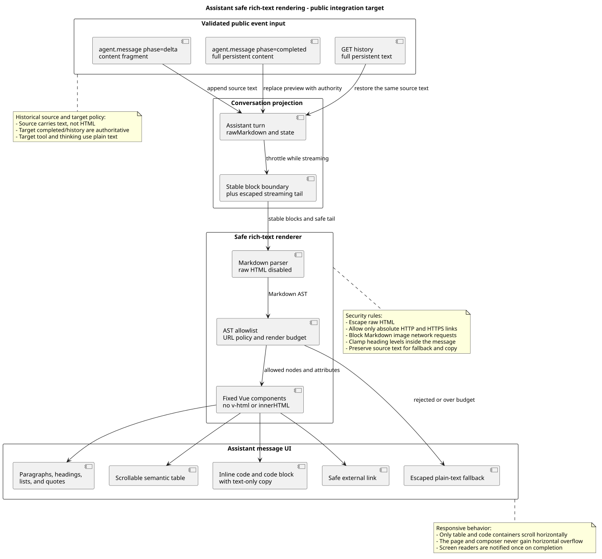

# 内容渲染与工具展示

版本：1.3.0 · 2026-09-22

[前端设计](../README.md) · [场景原型](../原型/index.html)

承接原前端主设计 1.20.0 的渲染规则；工具名称、消息与事件结构继续引用所属模块。源码核验范围见[证据](../source-evidence.md)。
## 9. Assistant 富文本设计

### 9.1 内容与信任边界

富文本只是一种前端显示投影，不改变公共 Chat 消息格式。公共 bridge
必须保留已确认的 `agent.message.content` 正文，不得预先转换为 HTML；前端始终保留
`rawMarkdown`，渲染失败时可安全回退并支持复制原文。

| 内容面 | 首版显示方式 | 设计理由 |
|---|---|---|
| Assistant 正文 | 受限 Markdown → 语义 AST → 固定 Vue 组件 | 解决表格、列表、代码和强调的可读性，同时不信任模型生成 HTML。 |
| 完整计划方案 | 沿用受限 Markdown 与复制原文 | 正文来自完整 agent.plan；卡片按钮由可信 UI 生成，方案内容不能生成动作。 |
| 问题、选项与答案 | 纯文本与前端生成的表单控件 | 问题事件决定字段；内容不能生成链接、HTML、按钮或授权。 |
| User 正文 | 纯文本 `pre-wrap` | 忠实显示用户实际提交内容，避免把用户输入伪装成系统 UI 或可点击动作。 |
| Thinking | Agent 活动流内的原始推理 disclosure | 原样展示公共 content，标明“原始推理”，保留换行；标题使用前端状态文案，完成后折叠为“分析过程”。 |
| Tool arguments | 安全 JSON/key-value viewer | 解释工具实际输入；只渲染 bridge 脱敏和预算后的结构，不激活链接、HTML 或应用动作。 |
| Tool result | 完整 JSON 对象/数组用安全 JSON viewer，其余为纯文本 | 仅改变只读展示；保留原始文本，不激活 HTML、链接或 Assistant Markdown 权限，见 §9.6。 |
| Error / recovery | 纯文本产品文案 | 错误面不接受模型或下游返回的富文本，避免错误注入。 |

### 9.2 支持语法与降级

| Markdown 输入 | 首版渲染 | 交互与降级规则 |
|---|---|---|
| 段落、软/硬换行 | `
` 与受控换行 | 连续段落保持 12 px 节奏，不复用源文本中的任意 HTML。 |
| 标题 | 消息内 `h2`–`h4` 视觉层级 | `h1` 下调为消息内 `h2`；超出层级统一钳制，不能覆盖页面主标题语义。 |
| 有序/无序/任务列表 | `ol`、`ul`、只读 task item | checkbox 不可交互，避免让模型输出伪操作状态。 |
| 强调、粗体、删除线 | `em`、`strong`、`del` | 保持正文颜色，不用大面积状态色。 |
| 引用、分隔线 | `blockquote`、`hr` | 引用用左边线和次要文字，不伪装为系统警告。 |
| 行内代码 | `code` chip | 等宽字体；可随正文选择复制。 |
| fenced code block | 代码容器 | 显示语言标签和“复制代码”；复制内容不含 fence，长行容器横向滚动。 |
| GFM table | 语义 `table` 外包横向滚动容器 | 保留表头；数字默认不自动推断含义，仅按 Markdown 对齐标记对齐。 |
| 安全链接 | 外部链接 | 只允许绝对 `https:` / `http:`；新窗口打开并设置 `noopener noreferrer`，显示外链图标。 |
| raw HTML | 转义后的可见文本 | 永不进入 DOM；不提供“允许 HTML”开关。 |
| Markdown image / embed | 隐藏媒体并显示替代文字 | 首版不发起远程图片请求；图片必须来自受控附件内容块和附件服务。 |
| 相对链接、`javascript:`、`data:`、`file:`、`blob:` | 不可点击文本 | 模型不能导航应用内部路由、执行协议或读取本地资源。 |

数学公式、脚注、图表 DSL、iframe、音视频和可交互 HTML 不在首版范围。未知节点降级为其
可见纯文本，不得因为单个节点失败而丢失整条 Assistant 消息。

### 9.3 渲染架构与安全

[PlantUML 源码：`assistant_rich_text_rendering`](diagram.puml#L93)

1. 公共 `EventReducer` 只维护 `rawMarkdown`、streaming 状态和持久化消息身份，不保存 HTML。
2. `RichTextRenderer` 复用现有 markdown-it 解析骨架，关闭 raw HTML，将 token 映射到受控 AST；
   本次不新增解析依赖。若后续更换依赖，另行评审许可证、体积与维护成本。
3. AST 经过节点 allowlist、URL policy 和可配置渲染预算，再由固定 Vue 组件递归渲染；禁止
   `v-html`、`innerHTML` 和字符串拼接事件属性。
4. 链接组件统一协议检查、外链标识和 `rel`；代码复制组件只接收文本；表格组件只接收 AST
   cell，不解释 HTML。
5. 超出公共 Chat 契约或前端渲染预算时，显示“内容较长，已使用纯文本模式”，保留可选择文本
   和复制原文。精确字符/节点上限必须在公共 Chat 契约评审时冻结，不能由组件各自硬编码。
6. CSP 继续禁止 inline script；富文本样式限定在 `.assistant-rich-text` 根节点下，不能覆盖应用
   导航、Composer、按钮或错误提示。

### 9.4 流式、完成态与恢复

- 每个 `agent.message` 的 `phase=delta` 只追加 `rawMarkdown`；最多每个 animation frame 触发一次解析，
  不因 token 级更新反复播报或强制滚动。
- 已闭合块复用稳定 key；尚未闭合的表格、链接、强调或 fenced code tail 以转义纯文本显示，
  闭合后再升级为对应组件，避免整条消息在流式过程中跳动。
- `agent.message` 的 `phase=completed` 用权威持久化全文替换 delta buffer，并执行一次完整解析。若 preview
  与 completed 不同，以 completed 为准，不合并两个 HTML 结果。
- GET history、SSE completed 和断线恢复必须调用同一 renderer；以同一 `rawMarkdown` 输入得到
  结构等价 DOM，刷新后不允许退回管道符表格或丢失代码块。
- `aria-live` 在 streaming 时关闭；完成后只播报一次“回答已完成”。用户主动聚焦代码复制、
  表格滚动或链接时使用正常语义，不把每个 delta 发送给读屏。

### 9.5 视觉、复制与响应式

- Assistant 富文本继续使用开放式正文，不加整块气泡；正文 14 px / 1.8，标题与段落间距按
  内容层级收敛，连续列表和表格不制造双倍空白。
- 表格宽度优先适应正文；最小列宽保证可读，超出时只在 `.table-scroll` 内横向滚动，不让
  页面或 Composer 产生横向滚动。窄屏保留表头，不把表格改写为含义不稳定的卡片。
- 代码块使用中性表面、1 px 边界、语言标签和 44 × 44 px 复制按钮；默认不折行，长行横向
  滚动。复制成功以非颜色 Toast/状态文字反馈。
- 选择正文后使用浏览器原生复制可得到可读纯文本；消息菜单提供“复制原文”，复制
  `rawMarkdown`；代码块“复制代码”只复制代码内容。
- 外链获得可见焦点和外链标识；链接文案为空、只有标点或与目标域名明显不一致时，组件仍
  显示目标主机作为辅助信息，降低钓鱼风险。

### 9.6 工具参数与结果

普通工具保持一条活动行，输入在上、结果在下；默认仅展开当前执行项，成功后收为动作摘要。无参数时省略整个参数区；未返回结果不伪造“完成”。提问和方案审核按其专用交互卡投影，不重复普通工具详情，见[计划交互 §5.1](plan-interaction.md#51-问题卡与回答)。

- 输入对象与结果共用 `StructuredValueView`，根值全宽显示；不把长对象放进狭窄键值双列。结果先保留原文本，只有完整可解析的 JSON 对象或数组才启用结构视图，提供“结构 / 原文”和“复制”。字符串、标量、非法或不完整 JSON 保持纯文本；不递归解析字符串中的 JSON。
- JSON 展示用只读折叠树、缩进与类型颜色；空数组清晰显示 `[]`，无业务 Schema 时不臆造表格列、业务含义或成功数。内部多 text block 按原顺序逐块处理，不拼接成另一个 JSON 文档。`isError` 决定该次调用成败，不由内容猜测；本地参数校验失败的展示方式按 §9.8 区分，不改写失败结果。
- JSON、参数、代码统一 `--font-mono: ui-monospace, SFMono-Regular, Menlo, Consolas, monospace`，桌面 12 px、行高 1.6；正文、标签和普通文本用统一 UI 字体 14 px。字体差异用于区分代码与自然语言，同类型内容不继承不同字号。
- 数字按原词法显示，特别是超出 JS 安全整数范围的 ID；实现若无法无损显示，则退回原文。键、值、ANSI、HTML、URL 全部作为文本，禁止 `v-html`、eval、任意对象合并或自动链接。
- 默认展开 2 层；单次结构展示预算 200 个节点、深度 20、原文 64 KiB。超预算先显示可复制原文与“内容较长”，按需展开；不递归建无限 DOM，不覆盖权威数据。单块最高 320 px 并内部滚动，窄屏不超出时间线可用高度；复制“原文”永远复制该内容面允许公开的完整原文，截断预览须显式标注。
- 实时结果和历史恢复使用同一判断与组件；显示优化不能改变公共 content 字符串或 Runtime text block 契约。只在已授权数据范围格式化，公共 bridge 的脱敏继续生效。

此项为产品约束与前端架构变更：复用同一展示组件降低字体、折叠和安全策略漂移，代价是维护解析预算及无损回退。先用现有 Vue 与 JSON 能力，无需新增 Maven/npm 依赖。

### 9.7 工具统一 displayName 展示

所有工具活动和确认卡优先显示调用事件的 `displayName`。后端将普通框架 `AgentTool.label()` 映射到该字段；CallMateTool 使用具体业务工具的元数据展示名，例如“查询教室”。来源映射由 [M03](../../01-总体架构/02-CampusClaw工具系统/README.md#tool-display-name)维护，快照和事件字段由 [M06](../../01-总体架构/01-CampusClaw多Agent运行时/chat-events-design.md#tool-display-snapshot)维护。`toolName` 保留执行身份，状态在标题旁独立显示。工具名称只放在活动行或确认标题中；展开后直接显示调用参数与输出结果，不再增加“工具名称”“展示名称 / 技术名称”卡片。

| 调用数据或状态 | 展示示例（合成工具） |
|---|---|
| 普通框架工具 `toolName=Read`，`displayName=Read` | **Read**，状态按实际事件显示 |
| 普通框架工具没有有效 displayName | **原始 toolName**，不另做固定中文标签映射 |
| 工具名 `query_classroom`，元数据 `displayName=查询教室`，执行中 | **查询教室** · 执行中 |
| 同一调用成功 / 失败 / 待核对 | **查询教室** · 已完成 / 执行失败 / 结果待核对 |
| 同一调用需要授权 | 活动行 **查询教室** · 等待确认；确认卡 **需要你确认 · 查询教室** |
| `displayName` 缺失、非字符串或仅含空白，工具名有效 | **query_classroom**，状态按实际事件显示 |
| 展示名称和技术名称都不可用 | **业务工具（名称缺失）**；详情保留收到的原参数与失败结果 |
| 仅收到结果、对应调用尚未加载 | “工具调用（调用记录尚未读到）”；关联调用补齐后使用该调用的名称快照 |

**名称来源与一致性。** UI 只消费事件中的 displayName，不读取模型 arguments 的同名字段，不解析工具结果猜名，也不额外拉取目录。后端保存本次调用名称快照，确认、实时和历史共用；后续改名不改变已保存的调用快照。展示名可重复，不能作为调用身份或授权依据。

**前端投影。** 展示模型保留独立的 `displayName` 与调用身份，活动行和确认卡共用“有效 displayName → 有效技术名 → 缺失提示”的纯函数。普通工具的技术名取 toolName，内部 CallMateTool 取 arguments.tool，公共 Chat 取公开 toolName。展示名去除首尾空白；技术名保持原大小写、下划线与连字符，不再套内置工具中文映射。有有效展示名时，标题不再重复标注技术名称；技术字段保留在事件数据与原始调用参数中，不另造名称详情区。普通工具与 CallMateTool 共用显示函数，后者只在技术名回退处适配内部包装；计划、提问等专用卡片继续按原投影规则吸收对应工具活动。

所有名称作为纯文本，不激活 HTML、Markdown 或 URL。活动项折叠时标题允许单行省略，展开后标题自然换行显示完整名称；确认标题直接换行，不要求用户展开另一块名称信息。状态与展开按钮保留独立位置，可访问名称只包含完整标题和实际状态，不额外播报技术名。显示省略不截断事件或复制内容。名称缺失不导致整条事件解码失败；结果仍按 `isError` 判断，Session 内沿用 `sourceEventId + toolCallId` 关联，不按名称去重或决定授权目标。

**实施范围与接入缺口。** 后端从本次已准备的 Agent/Skill `BoundTool.displayName` 或实际工具 `label()` 取得名称，取名不增加远程查询、执行 ID 绑定或失败缓存。Runtime 调用事件、历史投影和两个标题消费方已随 PR #313 合入 main `6a331d3477df23f8404582c3922b55c265530605`；名称来源见[M03 证据](../../01-总体架构/02-CampusClaw工具系统/source-evidence.md#tool-display-binding-evidence)，本节标题布局与分支验证见[前端专项证据](../source-evidence.md#tool-title-layout-evidence)。前端只依赖可选事件字段，不直接读取受管配置文件。

工具元数据传递归 M03，调用快照、精确字段及两跳投影归 M06；可选 displayName 已同步内部共享事件源及 Mate 公共流/历史契约，公共 Mate bridge 待实现。前端解码器支持该字段，缺失/null/错误类型/空白按无名称降级；其他事件字段校验保持。公共 Chat 同样优先展示经授权投影的展示名，不能直接套用内部 arguments 包装。保留模型输入 `{tool,args}`、外层 `toolName=CallMateTool` 与确认身份；展示元数据不进入模型参数，也不新增 Maven/npm 依赖。

这是产品可读性约束及展示数据传递扩展：让用户看到“查询教室”这样的名称，同时保留机器名用于执行和诊断。代价是保存调用时名称并同步实时与历史消费。前端复用现有投影器、活动行和确认卡，全局目标组件图不增加组件或改变职责关系；后端传递结构随 M03/M06 精确设计维护。工具停用只改变调用可执行性，不改写已保存的名称，也不能由界面显示名称推断当前仍可调用。

**实施切片与验收。** 按 M03/M06 落实元数据与调用快照，同步更新服务端字段、bridge、事件类型和解码器白名单；两个 UI 消费方共用显示函数。验证普通 label 与 name 不同、label 为空，以及 CallMateTool 的业务名覆盖外层 label。覆盖 displayName 有效/缺失/null/错误类型/空白、技术名缺失、同展示名不同工具、长名称和 HTML 文本；模型参数中的伪造 displayName 不生效。确认前、执行中、完成、失败、待核对与历史刷新显示同一调用快照；后续元数据变化不改写已保存的调用名称，缺失时回退技术名。1440 px 与 390 px 下活动详情和确认详情均无独立名称卡片；展开活动与确认标题中的长名称完整换行，折叠后保持摘要，状态和操作不被挤掉；键盘与读屏可读完整名；模型入参、执行目标、确认请求与结果配对保持。名称传递验证见 M03，本次布局验证见前端专项证据；本地组件与浏览器检查不代表公共 bridge 或真实 Mate 联调已验收。

### 9.8 本地参数修正与真实执行失败

**目标行为，待实现。** `CallTool` 首次本地参数校验失败即向模型返回字段错误和本次校验使用的工具定义，规则归 [M03 参数恢复](../../01-总体架构/02-CampusClaw工具系统/README.md#tool-argument-recovery)。前端复用内部 Runtime 事件已有的 `agent.tool_result.errorCode=TOOL_ARGUMENTS_INVALID`，只对后端确认尚未向业务执行端发送请求的参数错误使用本节展示；`isError` 保持 `true`。精确事件字段与错误码语义归 [M06 事件契约](../../01-总体架构/01-CampusClaw多Agent运行时/chat-events-design.md)，本节只定义消费方式，不从错误文本、工具名或模型正文推断分类。Mate 公共 bridge 的对应投影待实现，内部事件已有错误码不代表 Mate 公共链路已接通。

| 权威结果与根执行状态 | 默认展示 | 记录与后续处理 |
|---|---|---|
| `isError=true` 且 `errorCode=TOOL_ARGUMENTS_INVALID`，同一根执行实际运行且正在观察，未等待用户交互 | 中性状态“正在调整调用参数”，详情默认折叠，不逐次突出红色失败 | 可展开查看该次调用可公开的输入和错误结果；由模型决定修正后的调用 |
| 同一参数错误，根执行处于 `confirming` 或其他等待用户处理的状态 | 中性状态“参数校验未通过”，详情默认折叠 | 保持当前授权、审核或回答提示，不声称等待期间仍在调整参数 |
| 同一参数错误，根执行已进入 `done`、`failed` 或 `terminated` 终态 | 中性历史状态“参数校验未通过”，详情默认折叠 | 保留失败记录，不继续显示“正在”，不把此调用改成成功 |
| 同一参数错误，断线或根执行状态尚未核对 | 中性状态“参数校验未通过”，详情默认折叠 | 沿用既有同步/对账提示，不声称模型正在修正或已经恢复 |
| 其他工具执行错误、未知错误码或旧结果缺少错误码 | 沿用“执行失败”及既有详情策略 | 不降级为参数修正，不隐藏真实失败 |
| 未收到完整工具结果，或结果可能已生效但尚未确认 | 沿用“结果待核对”等现有状态 | 不标成本地参数错误，不据此重放调用 |

**状态与身份。** 投影器按 Session 内的 `sourceEventId + toolCallId` 关联本次调用和结果，用同一 `sourceEventId` 的执行状态决定是否仍可显示进行中文案。`isError` 保留调用事实，展示状态与它分开；前端不把单次工具错误直接投影成整次任务失败，也不能据此保证模型一定会修好参数。后续调用即使同名或参数相似，也属于自己的 `toolCallId`，不能覆盖、删除或改写旧结果，不能推断“该次重试修复了前一次”。前端不自动重试，也不合并未知关联的调用。

**整体结果与可见范围。** 根执行失败、停止或需要用户处理时，沿用既有整体状态和明确提示；不得因为历史错误采用中性样式而隐藏最终未完成的事实。根执行 `done` 也不改写先前参数错误的状态。展开内容只显示公共事件已授权公开的输入与错误文案，模型获得的完整定义和内部诊断不自动进入公共展示；既有脱敏、预算和 §9.6 的只读策略继续生效。中性样式仍提供文本状态、键盘展开和可访问名称，不能只靠颜色区别状态。

**源码核验与差距。** 本节于 2026-09-22 读取 `pi-mono-java` 提交 `c9a2340f87bda6dff6bbd352f6995f8551206bb5`，以下是当前实现证据；本节展示增量尚未实施或验收。

| 仓库相对路径与关键符号 | 已观察行为 | 本节待实现增量 |
|---|---|---|
| `modules/agent-core/src/main/java/com/campusclaw/agent/tool/ToolExecutionPipeline.java`：`validateArguments`、`failureResult` | 外层参数校验异常已携带稳定 `TOOL_ARGUMENTS_INVALID`；结果保持 `isError=true` | 按 M03 补齐模型修正所需的信息，不把现有错误码当作新增协议 |
| `modules/coding-agent-cli/src/main/java/com/campusclaw/codingagent/tool/mate/MateToolExecutor.java`：`validateArguments`、`execute` | 业务参数校验位于 `client.callTool` 前，内层校验失败抛通用 `MateToolExecutionException` | 按 M03 保留可恢复的参数分类；业务执行或 Schema 无效错误不能误归此类 |
| `modules/coding-agent-cli/src/main/java/com/campusclaw/codingagent/runtimeapi/event/RuntimeCommittedEventFactory.java`：`agentToolResult`、`appendToolContent`、`toolErrorCode` | 公共结果读取允许的稳定错误码；错误正文使用本地化文案，不直接公开内部结果全文 | 维持模型恢复信息与公共错误展示的边界 |
| `frontend/src/projectors/runtimeEventProjector.ts`：`projectRuntimeEvents`、`matchingToolResult` | 保留 `errorCode`，但全部 `isError` 结果均投影成 `error`；调用按 `sourceEventId + toolCallId` 配对 | 增加参数错误展示分支，并共同处理实时结果、历史结果及暂缺调用记录的结果 |
| `frontend/src/components/ToolActivity.vue`：`statusLabel`、`details` | `error` 显示“执行失败”；除 `completed` 外详情默认展开 | 为已分类的参数错误提供中性状态和默认折叠，保留展开能力 |

这是产品展示约束：用户关注整次任务的结果，同时可以追查尚未执行的参数错误；代价是投影器需要同时读取调用结果分类与所属根执行状态。沿用现有活动行、投影器和错误码，不新增组件职责、全局类图或 Maven/npm 依赖。

**实施切片与验收。** 先按 M03 补齐内层分类和模型可见恢复信息，再让前端投影器与活动组件消费已有错误码。至少验证：首次参数错误默认折叠且可展开；连续错误不逐次弹出红色失败；根执行终态或等待用户交互后所有旧参数错误不再显示“正在”；断线、历史刷新及先到结果后到调用的投影一致；其他根执行的终态不影响本根；后续同名工具成功不改写旧 `toolCallId`；业务异常、Schema 无效、未知码和结果待核对保持既有语义；最终失败提示仍可见；模型定义不从公共错误正文泄露。实时与历史使用同一投影规则，键盘和读屏可查看状态及记录。

## 版本记录

| 版本 | 日期 | 变更 |
|---|---|---|
| 1.3.0 | 2026-09-22 | 明确本地参数错误采用中性折叠展示，保留失败记录并按根执行状态更新文案。 |
