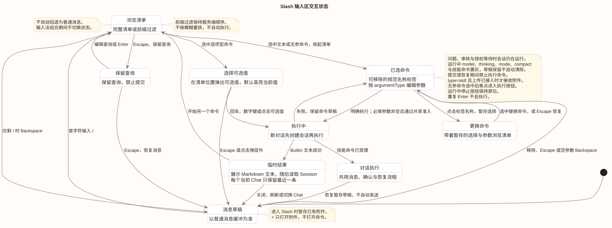
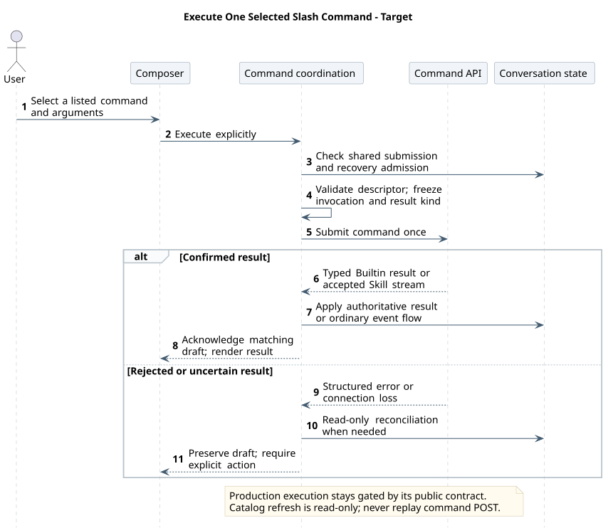
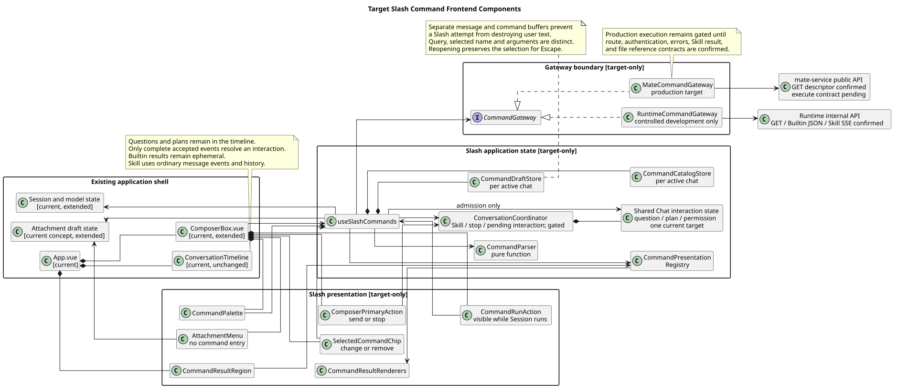

# CampusClaw Slash Command 前端设计

[返回 Slash Command 通用模块](../../../01-总体架构/04-CampusClaw命令系统/README.md) · [打开交互评审稿](../../原型/slash-command-review.html)

| 属性 | 值 |
|---|---|
| 文档版本 | 1.14.0 |
| 更新日期 | 2026-10-16 |
| 本次前端修订基线 | 设计仓 `761b7640f76b74162423c0372496cdef0b88d708` |
| Runtime 命令契约基线 | `879746e59189a07335e32c7df807c7f5048fdc28`；B13 已确认 Skill SSE，Builtin JSON 不变 |
| pi-mono-java 交互源码基线 | 当前 PR #301 提交见[实现状态](../../source-evidence.md#current-implementation)；早期结构证据保留在 §2.1 |
| 适用端 | CampusClaw Web 产品前端；内部 Runtime 调试台只作为源码证据和受控联调入口 |
| 状态 | 用户已确认的目标交互；问答/审核协同原型已同步，Vue 源码范围见 §2.1；公共执行边界沿用原契约门禁 |

## 1. 设计结论

Slash Command 使用同一 Composer，内部独立保存消息与命令草稿。空草稿首字符输入 `/` 打开紧贴输入框上方的清单；清单只显示不带前导 `/` 的规范名称和一句说明，
保持服务端顺序做前缀过滤。选中后关闭清单，在输入框内显示可删除的命令标签；按命令规则与已对账的会话状态选择文本或选项控件，
仅允许无参调用时隐藏可修改的参数区。空闲时圆形上箭头提交，清单浏览时禁用；运行时右下角保留停止方块，命令区显示独立“执行命令”。
选择后必须再次明确执行，不由选中动作自动提交。`+` 只负责添加附件/上下文。界面不再显示独立 `/` 按钮、“命令模式”栏或常驻操作说明。

Builtin 命令结果不是 Assistant 消息，不进入 ConversationTimeline、Session Event 或持久化历史。
页面只保留当前 Chat 最近一条临时命令结果，并明确标注“仅当前页面”。失败、清单过期和网络不确定时
保留命令草稿；刷新清单只重放 GET，绝不自动重放命令 POST，也不自动把未匹配的 Slash 转为普通消息。
每次执行在发起 POST 前冻结不可变的调用快照，用“规范命令名 + 空参/带参形态”确定期望结果类型。
这一快照同时驱动 Gateway 解码和结果展示；不通过返回 JSON 形状猜测，也不使用执行期可编辑的草稿再次判定。

产品浏览器继续只访问 mate-service。当前只确认 Mate GET Descriptor 投影，公共执行路径、认证映射、
公共 Skill 联合请求/结果和附件引用仍未确认，因此真实生产执行适配必须保持关闭。可以先实现纯前端状态机、
可访问组件和 Mock Gateway；内部 Runtime Gateway 只允许在受控开发环境联调，不能成为产品回退路径。

## 2. 事实、决策与理由

### 2.1 已观察源码行为

**当前 Slash 行为专项（2026-09-22）**：按用户指定 `pi-mono-java@53eff85c7f41de23eb434e027782f5085a8b8e45`
复核 `frontend/src/components/ComposerBox.vue`、`frontend/src/composables/useCommandComposer.ts`、
`frontend/src/composables/useRuntimeApi.ts` 的 listCommands/executeCommand，以及 `frontend/src/runtime/commands.ts` 的
parseCommand/freezeCommandArguments/decodeCommandResult。命令标签、独立参数、运行中命令与停止并存、
清单读取、冻结调用和 Builtin JSON/Skill SSE 分路均已有实现；09b2e0b1 为已包含的早期交互提交。
独立 Store/Registry/Gateway 仍是推荐结构拆分，不能将类名尚未完全对应解释为 Slash 行为未实现。
本项未重跑前端测试，不升级旧交互测试的验收范围；Mate 公共入口和附件集成继续独立跟踪。
模式命令专项核对同一 `53eff85c`：`frontend/src/runtime/commands.ts#freezeCommandArguments` 的 Builtin 结果映射没有 mode；`ComposerBox.vue` 已有独立 ModeControl，但未接入 Slash 模式选择。`/mode` 及选择控件、Session 结果映射待实现，业务与后端差距见[Builtin 模式切换](../../../01-总体架构/04-CampusClaw命令系统/01-内置命令/README.md#mode-command)。

公开描述符 type/argumentHint 迁移待实现：上述源码仍消费 kind/input，不能把本设计原型的更新当作产品已迁移。

**早期迁移证据（历史基线，不代表当前实现）**：下表路径均相对 `pi-mono-java@6f52fddc87a03c20916fc7b6ef1de87f6a7a8cf5`。

| 源码与符号 | 已观察行为 | 与本设计的差距 |
|---|---|---|
| `frontend/src/App.vue` · `message`、`submit`、`ComposerBox` 装配 | App 只维护一个普通消息草稿，提交走 Events；Timeline 后直接渲染 Composer | 没有命令模式、独立命令草稿、临时命令结果或目录失效策略 |
| `frontend/src/components/ComposerBox.vue` · `handleKeydown`、`emit("submit")` | 单 textarea；Enter 提交、Shift+Enter 换行；没有 Slash 按钮和命令清单 | 需要组合输入法保护、listbox 键盘模型和显式二次执行 |
| `frontend/src/composables/useRuntimeApi.ts` · `sendMessage`、`requestRaw`、返回对象 | 只封装 Session、Model、Events 和控制类 Runtime API | 没有命令清单/执行方法；产品端也不应继续直连 Runtime |
| `frontend/src/types/product.ts`、`frontend/src/types/runtime.ts` | 没有 Descriptor、命令草稿、命令结果或前端投影类型 | 需要前端专用展示模型，不能直接把 Runtime VO 泄漏到组件 |
| `frontend/package.json` | 已有 Vue 3 和现有 CSS/Markdown 能力，无路由或状态库 | 本设计无需新增 npm 直接依赖，可用 Composition API 与纯函数实现 |

早期 `frontend/` 是内部 Runtime 调试工作台。上表记录初版设计的迁移起点，不能用来断言当前仍无命令实现。

**历史交互证据**：以下路径相对 `pi-mono-java@7f1126262b16458e430c1a70aba9936e26391385`，更新此前 `4cc8dd86f601417c22cf9306e52152acbb59bb60` 的组件证据。

| 源码与符号 | 已观察行为 | 目标差距与理由 |
|---|---|---|
| `frontend/src/components/ComposerBox.vue`：template、onKeydown；`frontend/src/composables/useCommandComposer.ts` | 已有 + 命令入口、精简清单、标签和独立参数；Composer 没有停止动作 | + 改为附件/上下文，保留首字符 /；运行时命令独立执行，避免覆盖停止按钮 |
| `frontend/src/runtime/commands.ts`：parseCommand、filterCommands、freezeInvocation | 已有规范名称、原样参数与不可变提交快照 | 保留协议形态；不因按钮位置变化新增接口字段 |
| `frontend/src/App.vue`：executeCommand；`frontend/src/composables/useRuntimeApi.ts`：executeCommand | 本地 Header 校验失败返回 uncertain；已有 Builtin JSON/Skill SSE 分路 | 校验失败显示本地错误并聚焦 Header；只有发出写请求且结果不可确定才进入恢复 |

**计划交互历史观察（2026-09-15）**：开发分支 `699f929f6826b595ed1d0162f6def66e2f84760b` 已更新上述路径。`ComposerBox.vue` 的 + 为附件、输入首字符 / 打开清单，标签/参数分离，运行中 command-run 与停止同屏；`useCommandComposer.ts` 的 selectedError 保留过期参数并阻止执行；`useRuntimeApi.ts` 已有 listCommands、executeCommand、统一 Session POST、方案审核与任务投影。此范围不再存在表中旧的入口/停止缺口；产品组件分层、Mate 接入和问答协同仍须按目标验收。

当前计划、问答、任务与 Slash 已在 `pi-mono-java@9f785bea3ffff8f6566cd1b2727285af46a2aead` 集成，完整前端交互补齐与验证见[实现证据 §5](../../source-evidence.md#current-implementation)。不能继续按早期工作树把问题卡或 Slash 标成未实现。公共 Mate 执行不在本次 Claw 开发范围。

图中独立组件与 Store 的精确拆分仍是推荐目标结构；实际实现使用 Composer、组合函数和事件投影分工，不因类名不同认定行为缺失。本专项不重新定义 Runtime、Mate 或 Skill 协议。

**Codex 参考边界**：2026-09-15 重新核对 [OpenAI 官方 Slash commands 文档](https://learn.chatgpt.com/docs/reference/slash-commands)，
公开文档支持“在 Composer 输入 `/`、选择命令或继续输入过滤”的入口模型。紧凑行、隐藏展示前缀、可删除标签、
附件“+”与命令分离、运行中独立执行和二次执行是 CampusClaw 目标决策，不声称是 Codex 桌面源码或像素级行为。

### 2.2 已确认协议约束

| 约束 | 前端必须如何处理 |
|---|---|
| GET Descriptor 有 `name`、`type`、`description`、可选 `argumentHint`，以及 Mate 补充的可选 `argumentType` | type 表示命令类别；argumentType 决定输入方式（text 文本框、options 调用命令选项接口、省略即无参）；argumentHint 作为参数输入框的占位提示；不按命令名选控件 |
| 所有 type=skill 允许附件，Builtin 不接收附件 | 附件入口根据 type 与上传接入状态控制，不静默丢弃草稿 |
| 选项型命令的当前值与候选来自 [Mate 命令选项](../../../02-服务与接口/06-mate-service聊天命令API/README.md#command-options)，每个候选带 value 与 label | 展示 label、勾选 currentValue、原样提交 value；不自行查询模型信息、不维护显示名；argumentHint 只作占位提示，不驱动控件 |
| 服务端返回固定 Builtin 顺序并追加 Skill | 客户端只做稳定前缀过滤，不重新排序或模糊重排 |
| 清单按 Agent 查询，已有 Chat 带 sessionId 取完整命令，新对话不带 sessionId 只取 help、skills 与技能命令；不按 Session 状态过滤（待实现） | running 时按共享状态规则表置灰 Compact/Skill 并限制修改；状态未知或恢复中暂停提交，POST 终判 |
| Builtin POST 返回普通 JSON，无 commandId 和通用生命周期 | 不画虚构进度条，不建立轮询或通用命令历史 |
| 成功结果无统一判别字段；`model` 空参返回 Models，带参返回 Session | 提交前从调用形态冻结 `expectedResultKind`，Gateway 按它校验响应，禁止只按命令名或 JSON 形状猜测 |
| Help 返回 `displayName/description/useCases` | 用纯文本临时卡片展示，不渲染 HTML、Markdown 或远程图片 |
| 普通 Events API 不解析 Slash | Slash 不得误发到普通消息接口；显式转消息也必须由用户确认 |
| POST 被拒后刷新清单，不自动重放 | 刷新只执行 GET；副作用请求始终需要新的用户动作 |

Mate 侧当前只确认 Descriptor 字段投影；路径、权限、错误映射和执行 operation 仍是未决公共契约。
本文的 `MateCommandGateway` 是目标边界，不是已发布 API 的声明。

### 2.3 目标决策分类

| 决策 | 分类 | 具体理由 |
|---|---|---|
| 首字符 /、精简清单、命令标签、运行中独立执行 | 产品约束 | 减少重复信息，保持同一编辑器操作习惯；参数与命令身份分开编辑 |
| 消息与命令采用两个草稿缓冲区 | 产品约束 | 尝试 Slash、关闭清单或执行失败不能破坏用户已写消息 |
| 选中后还需再次明确执行 | 安全加固 | 防止键盘浏览时误触 Compact、Name、Model 等状态变更 |
| Builtin 结果不进入对话历史 | 架构选择 | Builtin 没有通用持久化生命周期；Skill 已按 B13 复用普通消息事件，二者不能混为一个结果分支 |
| 未匹配 Slash 不自动回退为普通消息 | 安全加固 | 避免命令意图和内容在普通 Events 通道中被意外提交 |
| 浏览器只经 Mate Gateway | 产品约束 | 保持公司认证、租户隔离和凭据边界，不把 Runtime 暴露给产品端 |
| Catalog 仅保存在当前页面内存 | 架构选择 | 清单随 Agent 发布与 Skill 绑定变化，持久缓存会制造过期入口 |
| 模型/思考/模式使用选择控件，hint 仅作提示 | 产品约束 | 用户无需记忆模型 ID 或 on/off；候选数据复用现有接口，避免把提示字符串变成协议 |
| 前缀过滤但不模糊重排 | 产品约束 | 保留服务端产品排序，结果稳定、可预测、便于键盘记忆 |
| 调用快照同时决定解码与展示 | 安全加固 | `model` 同名多形响应不能依赖可变草稿或 JSON 特征；未匹配预期 Schema 时必须拒绝更新状态 |

## 3. 信息架构与主要界面

Slash 复用现有对话页，不新增独立路由。

```text
Chat Workspace
├── Context header
├── ConversationTimeline                 现有权威对话记录
├── CommandResultRegion                  当前 Chat 最近一条临时结果
└── Composer
    ├── AttachmentMenu                  + → 附件/上下文，不打开命令
    ├── CommandPalette                   规范名称、一句说明、过滤与空态
    ├── SelectedCommandChip              点击名称换命令，× 退出并恢复消息
    ├── Textarea                          消息、查询词或所选命令参数
    ├── Attachment controls              仅 type=skill 且上传已接入时准入
    ├── Command execution               运行中已选命令的独立执行按钮
    └── Primary action                  空闲时上箭头，运行时停止方块
```

桌面端 `CommandPalette` 从 Composer 上方展开，宽度与 Composer 内容区对齐，最大高度 360px。
窄屏端使用紧贴 Composer 的底部列表区，最大高度 `45dvh`；它不是全屏 Modal，不建立额外焦点陷阱。
实际高度同时受工作区剩余空间约束，短窗口中滚动清单，不覆盖会话顶部栏。
两个布局共享同一 DOM 顺序、活动项和键盘状态，避免响应式切换后语义漂移。

[交互评审稿](../../原型/slash-command-review.html) 提供命令清单、参数编辑、running 清单、Help 结果和未匹配错误五个状态。
评审稿是视觉与交互验收材料，不是可发布产品代码，也不定义新的 HTTP 字段。

<a id="slash-pending-interaction"></a>

### 3.1 计划、问答与运行中命令

[统一工作台](../../原型/plan-workbench.html?scene=question)在相同界面检查问题卡、方案、TODO 和 Slash；[命令专项原型](../../原型/slash-command-review.html)聚焦选择、参数、临时结果与未匹配。两者遵循同一交互规则，均为合成数据，不证明生产接通。

| 当前执行 | Composer 与命令行为 |
|---|---|
| idle，mode 为 plan 或 build | 模式不决定命令目录；按最新完整 Descriptor 展示 Builtin 和 Skill，选择后再执行。公共 Skill 未接入时保留明确禁用理由。 |
| 等待回答、方案审核、工具授权 | Session 仍 running，同一份 Agent 清单按 running 规则置灰；原问题/方案留在时间线，右下角仍为停止。可编辑消息草稿，也可单独执行清单允许的 Builtin；命令不会回答问题或批准方案。 |
| 提交回答/审核/授权/停止，或状态未对账 | 浏览与草稿保留，命令执行暂时禁用。前端协调器用同一提交/恢复准入检查，避免操作期间使用旧状态；不能仅因清单可见就允许执行。 |
| 命令返回 Session/Models | 按既有完整快照规则更新配置，不推断该任务已结束或问题已回答；待交互仍由原根的完整事件与历史核对。 |
| 权威会话状态更新后参数权限收窄 | 保留命令与参数，并提示“当前只可查询，请先清除参数”；用户明确清空后才允许运行，不能自动删参数并悄悄执行查询。命令消失则保留禁用标签。 |

命令身份以服务端清单为准；输入交互集中遵循[共享状态规则](../../../01-总体架构/04-CampusClaw命令系统/README.md#command-state-rules)，不在组件重复维护。running 下 model/thinking/mode 的 argumentHint 保持不变但只允许无参查询；状态未知或恢复中暂停提交，POST 最终准入。计划模式不新增 `/plan`、`/approve`、`/answer` 或 `/todo`；也不因新增 Skill 统计而增加热度排序或次数徽标。

命令区、消息草稿、问题答案、方案反馈分别持有自己的缓冲；取消 Slash 只恢复消息草稿。问题卡的选项键盘动作和自由文本 Enter 不触发 Composer 命令。清单打开时焦点留在输入，Arrow/Home/End 只选择候选；Enter 收成标签，下一次明确 Enter 才执行，长按和 IME 不触发。退出更换列表恢复原标签与参数。

Builtin 结果放在 Composer 上方的轻量可折叠区域，标题保留“命令结果 · 仅当前页面”；正文纯文本、限高滚动，不做大面积绿色成功卡。已有 TODO 时两个区域合计最多约 30% 视口；清单打开时临时收起结果和进度详情，关闭后恢复用户原折叠选择。问题卡放在时间线中随页面滚动，避免多个表单挤占输入区。

此协同是产品约束：参考 Codex 的输入就地发现与紧凑 disclosure，同时保留 CampusClaw 原根等待和服务端清单；代价是共享控制状态、草稿隔离和跨来源对账。不是新增命令 API 或对 Codex 协议的复制。

## 4. Composer 状态模型



[PlantUML 源码](diagram.puml#L140) · [展开原尺寸 SVG](slash_composer_state.svg)

### 4.1 进入与退出

| 用户动作 | 前置条件 | 结果 |
|---|---|---|
| 在 textarea 输入 `/` | 普通消息草稿为空、光标位于第一个字符、未处于 IME composition | 进入命令模式并读取清单 |
| 点击 + | 未禁用状态 | 打开附件/上下文菜单，不改变命令或消息草稿；未接入上传时对应项禁用 |
| 在已有消息中输入 `/` | 消息草稿非空 | 作为普通字符，不改变模式 |
| Escape | 首次浏览清单 | 只关闭清单并保留查询草稿；再次 Escape 退出并恢复暂存消息 |
| 点击已选标签名称 | 已选命令 | 暂存当前选择和参数，重新打开清单；Escape 恢复原标签与参数 |
| 点击标签 ×，或空参数区按 Backspace | 已选命令、未提交 | 退出选择并恢复普通消息和附件；无参数命令的提交按钮支持同一 Backspace 退出 |
| 对仅有 `/` 的键入草稿按 Backspace | 命令由键入进入 | 退出命令模式并回到空消息草稿 |
| Chat 切换、Session 刷新或登出 | 任意命令状态 | 中止 GET、清除命令草稿和临时结果；绝不迁移到另一个 Chat |

消息草稿与附件沿用产品前端既有恢复策略；新增命令草稿只存在当前页面内存，不写入 localStorage、
Session Event 或服务端。进入命令时暂存的消息及附件在取消或成功后恢复；失败时仍保留在后台，命令草稿保持前台可编辑。

### 4.2 解析规则

`CommandParser` 是无副作用纯函数，输出 `nameToken`、`argumentsText` 和光标相关展示状态：

1. 只有索引 0 的 `/` 启动解析；前导空格后的 `/` 不是命令。
2. 名称从 `/` 后读取到第一个 ASCII 空白；比较时不裁剪、不转小写、不做别名替换。
3. 分隔名称与参数的一段 ASCII 空白不属于参数；之后内容原样保留，参数可包含换行。
4. 只有 `nameToken` 与当前 Descriptor 的 `name` 完全一致时才允许执行。
5. 未匹配、目录读取失败或当前形态不支持时保留原命令草稿，不调用普通消息 API。

未匹配时只显示“没有匹配命令”，保留原文并禁用提交；用户可继续修改或 Escape 退出。
选中后标签保存 Descriptor 的规范 `name`，textarea 只保存 `argumentsText`；不把参数里的 `/` 当作重新选择的触发器。
若输入完整 `/name 参数` 后选择该名称，保留原样参数；当前规则不允许参数的命令遇到非空参数时保留查询并报错，不能静默丢弃。

### 4.3 选择与执行

- 仅输入 `/` 时显示完整清单；继续输入名称时做大小写敏感的前缀过滤，并保持服务端相对顺序；名称完整匹配时将键盘活动项定位到该命令，避免 `/mode` 被前缀匹配的 `/model` 抢占。
- 上下方向键移动活动项，Home/End 跳到首尾；Enter 选择活动项，鼠标或触摸点击语义相同。
- 点击或 Enter 只选择并关闭清单；上箭头在浏览中禁用，不承担“填入”动作。
- 选中当前仅允许无参调用的命令显示标签、隐藏参数 textarea，焦点进入当前命令执行按钮（空闲为上箭头，运行中为独立按钮）；再次明确 Enter 或点击才提交。
- 允许带参调用时标签与输入控件同处 Composer；argumentType=text 使用文本框，以 argumentHint 为占位提示；argumentType=options 打开下述选项列表。选中选项只更新参数草稿，后续明确执行才提交。
- 空闲上箭头可访问名称为“运行 <name>”或“发送消息”。运行时右下角固定为“停止生成”，命令区独立显示“执行命令”，可访问名称为“运行 <name>”；无参数控件时焦点进入该命令按钮，有文本控件时 Enter 执行命令，Shift+Enter 换行。普通消息 textarea 的 Enter 不停止也不发送。
- 点击停止只走共享对话协调器，命令查询不能遮挡或禁用可用的停止动作；停止请求到真实终态的状态见[工作台专项](../runtime-workbench-alignment.md#4-composer-的发送与停止)。
- IME composition、`isComposing`、keyCode 229 及按键长按 repeat 不触发选择或执行；选择那次 Enter 不得再次触发提交。
- running 状态下普通消息仍遵循 Events 设计的限制，但服务端清单中保留的查询命令仍可运行。

<a id="command-input-controls"></a>

### 4.4 参数控件与后端能力

用户应从可用选项完成配置，不必手工记住模型 ID。选中 argumentType=options 的命令后，前端调用
`GET /chats/{chatId}/commands/{commandName}/options`，Composer 上方切换到候选列表，显示 label、currentValue 打勾，选中的 value 进入命令草稿；执行按钮提交选择，取消恢复原草稿。Model/Thinking 专用控件待实现；原型的 Mode 原生选择框只演示选值、查询和回执更新，不作为生产选择列表或视觉验收完成的证据。

| 命令 | 控件与数据来源 | 正常调用 | 失败与状态变化 |
|---|---|---|---|
| model | 单选列表；候选与模型名称由 Mate 命令选项返回，前端不再读取 ListSessionModels 或模型信息 | 用户选择真实候选，冻结 arguments=modelId 后显式执行；带参响应按 Session 处理 | 加载失败可重试 GET，空列表禁用修改；迟到响应不得跨 Chat 应用；POST 拒绝或不确定时保留草稿，不自动重放 |
| thinking | 单选列表；currentValue 与 label（开启/关闭）由 Mate 命令选项返回；当前模型不支持深度思考时候选只有关闭 | 选择后提交选中值，显式执行；以响应中的最终 thinking 为准 | running 时仅查看；不支持时展示服务端错误并刷新权威状态，不能用 argumentHint 推测模型能力 |
| mode | 单选列表；currentValue 与 label（计划/实施）由 Mate 命令选项返回；提供清空选择以查询当前模式 | 选择只更新草稿，显式执行提交 arguments=plan/build；空参和带参均冻结 expectedResultKind=session，成功用完整 Session 更新模式指示器 | running（含所有交互等待）仅无参查询；非法值保留并报错，不能降为查询；422 显示计划能力不足；409 或网络不确定只读对账、不重放、不批准计划 |
| name | 文本框，占位提示取 argumentHint | 输入名称或空参查询 | 保留服务端校验错误与原草稿 |
| skill:<name> | 请求文本与可选附件；按 type=skill 准入附件 | 上传成功取得 fileIds，与 arguments 一起冻结，执行共享 SSE | 上传未完成不提交；失败保留文本/附件；文件拒绝不能静默去掉附件后重发 |

选项列表复用清单的 listbox/option、键盘和触摸规则；勾选表示当前值，键盘活动项单独显示。
Escape 先关闭选项列表，恢复选择前的参数；选中那次 Enter 不再次提交。三个命令共用同一个选项列表组件和同一个 Gateway 方法，表中差异只在执行后的结果类型。新增选项型命令时 Mate 新增提供者并标 argumentType=options，前端不改。
选项读取失败显示同位置错误和重试，保留草稿；COMMAND_OPTIONS_NOT_FOUND 视为清单过期并重读清单。Mate 接口实现前，Runtime 直连的开发适配层在 Gateway 内补同一 argumentType 映射、按同一 value/label 结构返回选项，组件不感知来源；该适配不是产品契约。命令规则集中消费已对账的 Session 状态，候选是否仍可用和 POST 最终准入由后端决定。
状态变为 running 时关闭修改列表并保留已选草稿，用户可清空参数后显式查询；未知状态、清单过期或恢复中暂停提交。

图片中的轻度/中/高/极高属于思考强度，当前 CampusClaw 只有 boolean thinking。
本设计只采用选择交互，不把四档映射为同一个 true；支持多档须另行定义强度枚举、模型支持范围和 Provider 映射。
选项控件复用既有 Composer、草稿和 Gateway 职责，不增加远端调用边界或新的 Descriptor 字段，目标类图结构不变。

源码核对固定为 `pi-mono-java@53eff85c7f41de23eb434e027782f5085a8b8e45`（2026-09-22）：
`frontend/src/composables/useCommandComposer.ts` 的 choose/placeholder 对所有 input 进入参数框；
`frontend/src/components/ComposerBox.vue` 的 template 已有底部模型 select 和思考按钮，但 Slash 选择未接入它们。
同文件附件菜单仍为 disabled；`frontend/src/runtime/commands.ts` 的 freezeCommandArguments 仅组装 name/arguments，
尚未把 fileIds 纳入调用快照。后端 `CommandDiscoveryResponseAssembler.input` 已统一返回 Skill 附件标记，
`SkillCommandRequestVO` 与 `SkillCommandExecutionService.execute` 已接收并传递 fileIds，路径见[共享能力证据](../../../01-总体架构/04-CampusClaw命令系统/source-evidence.md#agent-catalog-evidence)。
因此选项交互和当前内部附件接线的主要缺口在前端；真实文件授权及 Mate 公共映射仍按所属接口验收。
本次只核验源码，未运行 Java/前端产品测试。

## 5. 清单读取与缓存

`CommandCatalogStore` 按 Agent 与会话隔离（目标接口 `GET /agents/{agentId}/commands?sessionId=`，sessionId 可选，待实现），只维护：`status`、`items`、
`loadedForStateKey`、`stale`、`error` 和一次在途请求。`stateKey` 由 agentId 与 sessionId 组成：已有 Chat 传当前 sessionId，取完整命令；
新对话尚无会话时 sessionId 为空，只取 help、skills 与技能命令。首条消息创建会话后 stateKey 变化，重新读取完整清单。
Session 运行状态不进入 stateKey，只决定前端按共享状态规则置灰哪些项。组件不得依赖 Runtime 内部版本结构。

读取规则：

1. 第一次进入 Slash 模式读取 GET；同一 stateKey 的并发打开合并为一个 Promise。
2. HTTP `Cache-Control: no-store` 原样尊重；不使用 Service Worker、浏览器持久缓存或 localStorage 复用清单。
3. 切换到另一个 Agent 或 Chat、新对话创建出会话、Agent 刷新或 Skill 绑定变化，或任何命令 POST 完成后，将清单标记为 stale；Session 运行状态变化只重算置灰，不重新读取。
4. 清单打开且 stale 时重新读取；Agent 切换用 `AbortController` 取消旧读请求，迟到响应按请求代次丢弃。
5. 404/409 POST 错误会触发一次清单 GET 刷新；409 同时刷新权威 Session 状态，但不重放 POST；刷新失败仍保留原草稿。

读取中的骨架只占命令行高度，不闪动整个 Composer。读取失败显示同位置错误和“重试清单”；重试只调用 GET。
空清单与读取失败是两个状态，前者显示“当前没有可用命令”，后者必须保留错误语义。

## 6. 执行与不确定结果

本图从用户已在清单中选择命令开始，重点是冻结调用、按预期结果类型消费以及失败恢复。Composer、命令协调、Command API 与会话状态保留独立职责；Gateway 校验和结果区域由协调层调用，具体组件见目标类图。首次输入斜杠触发 GET 清单，404/409 标记清单过期并只读刷新；model 命令的多态结果及公共执行门禁规则仍见正文。



[PlantUML 源码](diagram.puml#L228) · [展开原尺寸 SVG](slash_command_execution_flow.svg)

执行请求由已选择 Descriptor 与当前编辑值组装，不重新解析成另一命令。提交期间只锁定命令编辑和“运行”动作，
保留取消页面读取和浏览历史的能力。当前协议没有 cancel command，离开页面不应声称后端命令已取消。
在请求离开 Composer 前，`useSlashCommands` 生成一份不可变 `CommandInvocation`：保存实际发出的
`name/arguments`、由该请求形态一次计算的 `expectedResultKind` 和当次开始时间。Gateway 只能按这份快照解码，
结果区也只能按同一快照选择 Renderer。用户在等待期间编辑新草稿不会改变在途请求的响应类型。

`expectedResultKind` 由前端纯函数根据已组装的 Builtin 请求确定：Help 是 `agentGuide`，
Status/Name/Thinking/Mode 是 `session`，Model 空参是 `models`、带参是 `session`，Compact 是 `compaction`，
Skills 是 `skills`。未知名称或无法确定的形态 fail closed；Skill 的公共执行未确认时同样关闭。响应体与预期 Schema
不匹配时转换为稳定的 `INVALID_RESPONSE` 前端错误，不写入 Session/Model Store，不展示“执行成功”。

所有返回的 Skill 都允许附件，前端以 `type === "skill"` 和上传能力已接入为共同条件；否则附件按钮禁用并说明原因。附件能力不等于任意类型可处理，不按 Skill 名称硬编码白名单。
从文本为空但带附件的草稿通过首字符 `/` 进入命令状态时，附件单独暂存，不得静默丢弃或带入不接收附件的命令。
因为公共 Skill 文件引用契约未确认，生产 Mate Gateway 在该能力确认前必须拒绝真实附件命令并给出明确说明。

网络中断时前端不能判断 POST 是否已到达服务端：

- Help、Status、Model 查询和 Skills 等只读命令可显示“结果未知”与显式“重新查询”，但仍不自动重试。
- Name、Model 修改、Thinking 和 Compact 使用权威 Session/Models/Events 接口对账；UI 不依据本地乐观值宣布成功。
- 没有 commandId、幂等键或通用历史时，禁止伪造“继续等待”轮询和后台自动重放。

### 6.1 Skill 与普通对话共享执行

设计仓 `2ee2a32` 的 B13 已确认内部 `skill:<name>` 返回 SSE；首帧是展开前的 user.message，
其后复用 Agent、Tool、确认、中断、终态与历史。该首帧不是 Builtin 临时结果。
提交前从 Descriptor.type 冻结 `executionMode=builtinJson|skillEvents`；Builtin 再计算
expectedResultKind。必须校验所选协议的 Content-Type 与完整 Schema，不因收到其他形状就切换模式。

生产公共 Skill 映射确认后，交由共享 ConversationCoordinator 接收回执和结果，清单变更后重新读取；
草稿只在可归属的完整回执后清除，恢复暂存的普通消息不得自动发送。停止复用 Events 控制，
不新增 cancel-command 或 commandId。内部 Skill 私有展开正文不显示、不缓存为公共历史。
公共接口当前仍关闭，不能把内部 Skill 请求直接发给 Mate 或偷偷转换为普通消息。

1.3.0 的历史源码补充核对为 `pi-mono-java@dfb90cac4e233e09a0b8f047f7e9f4682f5ad238`，
当时 App.submit、ComposerBox 与 useRuntimeApi 尚无命令适配；交互实现以 §2.1 中各次明确记录的源码范围为准。
共享组件与生命周期以[公共对话对齐](../public-chat-alignment.md)维护。
此差异是已确认内部契约驱动的 待实现 前端架构调整，不表示公共 Skill 已发布。

## 7. 结果投影

`CommandResultRegion` 位于 Timeline 与 Composer 之间，但不属于 Timeline 数据源。区域具有标题
“命令结果 · 仅当前页面”、关闭按钮、执行命令名与完成时间；每个 active Chat 最多保留最近一条，
页面刷新、Chat 切换或用户关闭后消失。

响应没有统一 `type` 判别字段，因此 Gateway 和 Renderer 必须使用提交前冻结的
`CommandInvocation.expectedResultKind`，不能只按命令名，也不能依赖 JSON 形状猜测。`model` 是必须覆盖的反例：
空参返回 Models 资源，带参修改返回 Session 资源，两者的规范命令名完全相同。

| 已提交调用形态 | 期望结果 | 展示与状态更新 |
|---|---|---|
| `help` 空参 | `agentGuide` | 显示 displayName；description 和 useCases 都按纯文本逐条展示。空数组用明确空态；不解析 Markdown/HTML，不加载远程图片，场景条目不可点击即发送 |
| `status` 空参 | `session` | 应用返回的完整 Session，再展示权威状态摘要；不能依据请求意图写“修改成功” |
| `name` 空参/带参 | `session` | 查询或修改都应用完整 Session；展示服务端最终 displayName |
| `model` 空参 | `models` | 更新 ModelStore 并展示 currentModelId 和 models |
| `model` 带参 | `session` | 应用完整 Session，包括模型能力导致的 thinking 最终值；不沿用查询 Renderer |
| `thinking` 空参/带参 | `session` | 应用完整 Session，展示服务端最终开关值 |
| `compact` 空参 | `compaction` | `compacted=true` 显示已完成；false 显示本次无需压缩，不包装成 Assistant 消息 |
| `skills` 空参 | `skills` | 只按纯文本显示 Skill 名称和描述，不读取本地路径、正文或远程资源 |
| `skill:<name>` | 内部 skillEvents 已确认，公共映射待确认 | 不进入 CommandResultRegion；公共接入后复用消息时间线、工具确认和恢复，当前生产执行仍关闭 |

Gateway/状态适配器原子应用完整 Session 快照，不发送 If-Match/Idempotency-Key，不要求 ETag，也不改用同用途的 body/query 令牌。Mate 公共配置仍需确认自身路径、字段与准入，不增加版本映射门禁。旧 Runtime 条件更新实现的迁移仍待完成。

Help `useCases` 未来若增加“填入输入框”，也只能把纯文本放入消息草稿，并要求用户再次确认发送；
本期不提供点击场景即执行。

## 8. 错误呈现与恢复

| 情况 | 位置 | 保留内容 | 恢复动作 |
|---|---|---|---|
| 清单 GET 失败 | Palette 内联 | 命令草稿、暂存消息和附件 | 用户点击“重试清单”，只发 GET |
| 参数无效 / 400 | Composer 参数区 | 全部命令草稿 | 聚焦参数；用户修改后再次运行 |
| 命令不存在 / 404 | Composer 内联 | 全部命令草稿 | 自动刷新 GET 一次，不重放 POST |
| 当前忙 / 409 | Composer 内联 | 全部命令草稿 | 刷新权威 Session 与清单，重新计算可用操作 |
| Agent 不存在或不可用 / 404 或 422 | Palette 或结果区 | 全部草稿 | 展示产品错误；仅显式重试 |
| POST 网络结果未知 | 结果区警告 | 命令草稿 | 按命令类别对账；禁止自动重试 |
| 401/403 | 页面级认证/权限处理 | 遵循产品安全策略 | 跳转登录或展示无权限；不出现凭据输入表单 |

组件使用 Gateway 的稳定前端错误类别，不直接比较后端中文文案。未知错误保留可复制的 requestId（如公共协议提供），
不向终端用户泄漏 Runtime 地址、栈、内部路径或凭据。

## 9. 目标组件与边界



[PlantUML 源码](diagram.puml#L1) · [展开原尺寸 SVG](target_slash_command_frontend_components.svg)

图中的独立 Slash 组件、Store、Registry 和 Gateway 拆分均为 待实现。现有 App、Composer、Timeline 和状态对象是迁移落点；
当前 Composer 已具备标签式命令功能，图不代表所有独立组件均按所示类名落地。

| 对象 | 生命周期 | 单一职责 |
|---|---|---|
| `AttachmentMenu` / `SelectedCommandChip` / `CommandRunAction` | Composer 视图 | 添加与命令分开；标签更换及删除、运行中独立执行由 Composer 编排，不直接调用 Gateway |
| `useSlashCommands` | active Chat 视图 | 编排进入、读取、选择、执行、失效和结果投影 |
| `CommandDraftStore` | active Chat 页面内存 | 分离 message/command 草稿、暂存恢复和光标状态 |
| `CommandCatalogStore` | active Chat 页面内存 | GET 去重、代次、stale 与服务端顺序 |
| `CommandParser` | 纯函数 | 解析首字符 Slash、名称 token 和原样参数，不持有 UI 状态 |
| `CommandPresentationRegistry` | 应用单例 | 按调用快照的 `expectedResultKind` 选择 Renderer；没有业务执行逻辑 |
| `CommandGateway` | 应用单例接口 | 将产品前端模型与具体公共/内部 HTTP 隔离 |
| `MateCommandGateway` | 应用单例目标实现 | 产品唯一网络适配；公共执行协议确认前 fail closed |
| `RuntimeCommandGateway` | 仅开发装配 | 对接内部 Runtime 做受控联调；构建门禁禁止进入产品包 |

建议的前端模型只保留展示所需字段：

```ts
type CommandDescriptor = {
  name: string
  type: "builtin" | "skill"
  description: string
  argumentHint?: string
  argumentType?: "text" | "options"
}

type CommandOptions = {
  currentValue: string
  options: readonly { value: string; label: string }[]
}

type CommandDraft = {
  queryText: string
  selectedName?: string
  argumentsText: string
  attachments: readonly AttachmentDraft[]
}

type BuiltinResultKind = "agentGuide" | "session" | "models" | "compaction" | "skills"

type CommandInvocation = Readonly<{
  request: Readonly<CommandExecutionRequest>
  startedAt: string
} & (
  { executionMode: "builtinJson"; expectedResultKind: BuiltinResultKind }
  | { executionMode: "skillEvents" }
)>

interface CommandGateway {
  listCommands(agentId: string, sessionId: string | undefined, signal: AbortSignal): Promise<readonly CommandDescriptor[]>
  listCommandOptions(chatId: string, commandName: string, signal: AbortSignal): Promise<CommandOptions>
  executeCommand(invocation: CommandInvocation, signal: AbortSignal): Promise<CommandGatewayResult>
}
```

更换命令时另存当前选择与参数快照，Escape 恢复；关闭整个命令状态时恢复暂存的消息和附件。
这些是前端内部类型草图，不是公共 JSON Schema。`CommandGatewayResult` 必须等 Mate 执行协议确认后再冻结；
不得把 Runtime 的多个响应形状强行包装为已经发布的公共联合类型。`expectedResultKind`
是前端调用快照的封闭分支，不是发送给后端的新字段。

## 10. 可访问性、视觉与响应式

本专项沿用[前端视觉基线](../../公共规范.md#10-视觉与组件基线)，命令交互保持同一编辑器和浅暖灰视觉。具体规则如下：

- 桌面侧栏和窄屏顶部导航统一使用 `--surface-secondary`（`#F8F3F0`）、深色正文与细边框；
  选中项沿用 `--surface-selected`，说明与提示使用次要文本色。
- 命令列表只保留不带前导 `/` 的规范名称和一句说明；不显示 type 标签、逐行 argumentHint、装饰图标、清单标题或操作教学。
- 宽屏每行名称与说明横向对齐，最小行高 44px；700px 以下改为名称、说明上下排列，允许长文本换行。
- Composer 沿用普通消息外框，不额外标红或显示“命令模式”；所选命令使用浅灰标签，名称可点击更换，× 可删除。
- + 菜单仅包含已接入的附件/上下文能力；参数提示只在当前命令允许文本输入时显示；右下角由共享执行状态切换发送与停止。

- 查询 textarea 使用 `role="combobox"`、`aria-autocomplete="list"`、`aria-expanded`、`aria-controls` 和活动项 `aria-activedescendant`；清单使用单选 `listbox/option` 语义。普通消息和参数编辑恢复 textarea 语义；标签名称和删除动作各有独立可访问名称。
- 清单项活动变化时滚入可视区，但不抢走 textarea DOM 焦点；读屏通过礼貌级 live region 宣布结果数量、读取错误和执行完成。
- 所有点击目标最小 44×44 CSS px；焦点环使用现有 `--focus` 色并保持 2px 可见外轮廓。
- 文本、边框和交互态沿用 CampusClaw O1 warm tokens；正文与背景满足 WCAG 2.2 AA，不能只靠颜色区分选中/禁用或错误；规范 `skill:` 名称仍保留，不改写协议名。
- `prefers-reduced-motion: reduce` 下关闭清单位移和结果卡片入场动画；其余动效控制在 160ms 内。
- 320px 宽度下命令名、描述和 hint 可换行，运行按钮不覆盖 textarea；200% 缩放仍可完成全部键盘操作。
- 移动端软键盘弹出时使用 `dvh` 约束清单，不固定到被键盘遮挡的 viewport 底部。

## 11. 测试与验收

### 11.1 纯函数和 Store

- Parser 覆盖空值、仅 `/`、前导空格、大小写、ASCII 分隔、多行参数和超长输入。
- 前缀过滤必须保留服务端相对顺序；禁止模糊评分和客户端 Builtin 固定表。
- Catalog 覆盖请求合并、Agent 切换中止、迟到响应丢弃、新对话不带 sessionId、会话创建后重读完整清单、stateKey 失效和 POST 后 stale。
- Draft 覆盖首字符进入/取消/成功/失败、暂存消息与附件恢复、页面刷新清除。
- 调用快照覆盖每个 Builtin，必须单独覆盖 `model` 空参→Models、带参→Session，草稿继续编辑不改变在途快照。
- Result Registry 覆盖每个 `expectedResultKind`、未知命令 fail closed 和恶意 Help 文本按纯文本展示。

### 11.2 组件与可访问性

- IME composing 时 Enter 不选中、不执行；键盘、触摸和鼠标得到同一规范命令。
- 选择后显示可删除标签；仅无参调用时隐藏修改控件，model/thinking 展示选项，name/Skill 编辑文本；菜单行没有前导 Slash、type 或 argumentHint。
- model 列表覆盖加载、空值、当前值不在候选、迟到响应和状态变为 running；不得要求用户猜 ID。Thinking 只展示真实开关，不伪造强度档位。
- 所有 Skill fixture 均按 type 支持附件，附件准入与 argumentHint 无关；fileIds 与文本同次冻结，上传失败、服务端文件拒绝与断流不丢草稿、不自动重放。
- + 菜单不含命令，打开和关闭不破坏草稿；首字符 / 发现、取消/成功恢复附件；运行中选择无参数命令后焦点不得误落停止按钮，更换后 Escape 恢复原选择及参数。
- 第一次 Escape 关闭清单，第二次退出；空参数 Backspace 与 × 退出；未匹配不发送。
- 选择命令不执行，第二个明确动作才执行；长按 Enter 不提交，重复点击运行只能产生一次在途请求。
- Builtin 的附件无法进入请求，已有附件不被静默清除。
- listbox ARIA 关系、焦点保持、live region、44px 触控、缩放和 reduced motion 通过自动检查与人工复核。
- Help 注入 HTML、脚本、Markdown 图片或 URL 时都只显示字面文本，不创建链接和远程请求。

### 11.3 集成与契约

- 用契约 fixture 验证服务端顺序、type/argumentHint 字段和完整空 Skill 清单；清单与 Session 状态无关，额外验证 running 时前端置灰 Compact/Skill 并禁止模型/思考修改。
- 400/404/409/422 与网络断开都保留草稿；404/409 只刷新 GET，不重放 POST。
- Session/Model 类结果必须应用服务端完整响应，不依赖 ETag；断网后通过权威资源对账。
- 使用同一 `model` 命令名的查询与修改 fixture 必须走不同解码分支；Schema 与预期不符时不更新 Store。
- 产品构建中不存在 Runtime base URL、Runtime 凭据表单或 `RuntimeCommandGateway` 装配。
- Mate 执行协议未确认前，端到端测试必须证明生产执行入口 fail closed，而不是落到普通 Events。
- Builtin JSON 与 Skill SSE fixture 不能互相解码；Skill 完整回执进入共享事件 Store，结果不进入 Builtin 临时区；断流不重发、私有 Skill 正文不公开。

### 11.4 当前原型验证记录（2026-09-09）

- [DOM 交互检查](../../原型/test_slash_command_review.cjs) 的 13 个场景通过：过滤、标签/参数、二次执行、重复 Enter、IME、Escape、草稿恢复、running input、省略参数保护、Skill 门禁、纯文本结果及运行中独立执行与停止。脚本阻断网络 API，未发起真实命令。
- 主体验原型 17 个场景通过；未新增 npm 或 Maven 依赖，测试复用已有外部 jsdom 环境。
- Chrome 实际操作验证运行中独立“执行命令”、同位置停止按钮及无参数命令焦点；390、768、1024、1440px 宽度无页面横向溢出，已查看桌面与手机布局。
- 三个 PlantUML 块生成成功、ASCII 与 SVG XML 校验通过，重新生成与提交产物一致；已查看原尺寸及缩放图，并与原主组件图对照保留完整职责链。
- 专项及总览的本地链接和 PlantUML 行锚点已核对，仓库 Markdown 无 Mermaid 围栏，`git diff --check` 通过。

上述验证只覆盖设计原型；真实上传、后端集成、屏幕阅读器和移动端软键盘验收仍属于实现阶段。
执行 DOM 检查时设置 `JSDOM_MODULE` 指向已有 jsdom，再运行 `node --test test_slash_command_review.cjs`。

### 11.5 问答与命令联合验收

2026-09-15 验证：专项原型 14 组检查通过，统一工作台 33 组通过；四档浏览器布局及两专题图文校验结果统一记录在[前端验收](../验收.md#15-测试与验收)。

- 三类等待均保持 running 清单与原位置停止；未知等待不能按 idle 放开 Skill 或模式修改。
- 问答草稿、命令参数与消息草稿互不覆盖，切换会话丢弃迟到请求；命令查询不清除问题身份。
- 双击回答/命令只创建一次请求；提交锁与恢复禁用生效；断线或回执丢失不重放写入。
- model/thinking 参数随权威状态变为 running 时保留并禁用，删除参数后显式执行；未知 Slash 不成为普通消息。
- 1440/1024/768/390 px 检查长选项、问题 textarea、命令列表和任务摘要；清单不遮住命令执行与停止，用户可滚动访问全部问题。

## 12. 实施切片与协议门禁

1. 在已有 Composer 和解析器上先落地附件菜单、Palette、Chip 与共享发送/停止操作：独立保存查询、所选名称、参数和恢复快照，用 Mock 验证 §11.2；按目标边界拆分 Store，不引入新的真实 POST。
2. 接入已确认 Descriptor 的 Mate GET 后，完成 idle/running、失效和错误态契约测试。
3. 实现 Builtin Renderer，并用 Runtime JSON fixture 验证 Session/Models/Help 投影；仍不宣称产品可执行。
4. Mate 公共执行 operation 需先确认路径、认证、请求联合类型、响应判别、错误、超时和不确定结果对账，再实现 `MateCommandGateway.executeCommand`。
5. Skill 内部 request/SSE 已确认；公共映射、附件 fileId 所有权与内容安全确认后才开放生产适配，与 Builtin 分开验收。
6. 最后在真实产品包验证 Runtime 适配不可达、普通消息不解析 Slash、刷新/切 Chat 不泄漏临时结果。

当前没有新增 npm 或 Maven 直接依赖。若后续希望引入 floating-ui、状态库或快捷键库，必须单独说明用途、
替代方案、传递依赖和维护成本；本设计的定位、状态和键盘逻辑不足以证明需要新增依赖。

## 13. 待公共协议确认项

| 待确认项 | 未确认前的前端行为 |
|---|---|
| Mate 命令 GET 最终路径、认证和错误映射 | 只允许 Mock/契约评审；不得猜测 URL |
| Mate Builtin 执行 operation 与响应判别 | 生产运行按钮 fail closed，不回退到 Runtime 或普通 Events |
| 变更命令的公共状态准入与事务边界 | 不使用客户端条件或幂等令牌、不要求 ETag；不做乐观修改，结果未知时只读对账 |
| Mate 公共 Skill request/result 映射 | 内部 B13 不自动升级公共状态；不开放生产 Skill，不显示虚构通用成功卡 |
| Skill 附件引用、所有权和有效期 | type=skill 允许展示附件入口；公共接入前生产附件提交保持关闭 |
| 公共 requestId/错误码稳定集合 | 未确认前由 Gateway 保留兼容层，组件不绑定服务端文案 |

## 14. 版本历史

| 版本 | 日期 | 变更 |
|---|---|---|
| 1.14.0 | 2026-10-16 | 控件按 Mate 清单的 argumentType 统一选择，argumentHint 作占位提示（替代 hints 值列表，与 pi 对齐）；model/thinking/mode 的当前值、候选与显示名改由 Mate 命令选项接口提供，前端不再按命令名查询模型信息或维护显示名。 |
| 1.13.0 | 2026-10-16 | hints 改为固定参数值列表，thinking/mode 的选项值取自 hints；占位提示与选项显示名由前端维护。清单 stateKey 加入可选 sessionId：新对话只取智能体级命令，已有 Chat 取完整命令。 |
| 1.12.0 | 2026-10-16 | 命令清单改为按 Agent 读取与缓存，stateKey 只含 agentId；运行状态只决定置灰，不触发重读；错误态改为 404/422。 |
| 1.11.0 | 2026-10-04 | 命令结果消费取消版本响应头与 ETag 依赖，保留完整资源和不确定结果对账。 |
| 1.10.0 | 2026-09-22 | 增加 mode 选择控件、Session 结果映射与审核等待下的只读查询边界。 |
| 1.9.0 | 2026-09-22 | 使用 type/hints 描述符，依据会话状态控制参数并按 Skill 类别处理附件。 |
| 1.8.0 | 2026-09-22 | 模型和思考使用选项控件，明确 hint 仅作提示及所有 Skill 的附件接入边界。 |
| 1.7.2 | 2026-09-22 | 按 53eff85c 复核 Slash 现有交互与 API 分路，区分目标组件拆分和公共接入。 |
| 1.7.1 | 2026-09-22 | Help 结果与 Runtime 契约统一使用 `useCases`，前端解码与展示保持纯文本。 |
| 1.7.0 | 2026-09-15 | 同步 Claw 命令与计划问答的实现状态及 Dock 协同验收。 |
| 1.6.0 | 2026-09-15 | 对齐 Codex 就地命令交互，补齐计划问答等待、共享准入与轻量结果展示。 |
| 1.5.1 | 2026-09-14 | 精简视觉决策叙述并重排命令组件与提交结果流程。 |
| 1.5.0 | 2026-09-09 | 将 + 归为添加入口，命令由 / 触发，运行中独立执行并保留停止按钮。 |
| 1.4.0 | 2026-09-09 | 定义精简命令清单、可删除标签、独立参数编辑、统一执行按钮及 Escape、草稿恢复与重复 Enter 保护。 |
| 1.3.0 | 2026-09-08 | Builtin 显示临时 JSON，Skill 复用对话、确认与恢复流程。 |
| 1.2.0 | 2026-09-07 | 采用浅暖灰导航、精简清单与支持换行的参数提示。 |
| 1.1.0 | 2026-09-07 | 提交前冻结调用快照，以命令与参数形态判别响应类型。 |
| 1.0.0 | 2026-09-07 | 定义 Slash Composer、独立草稿、结果投影及错误恢复。 |
