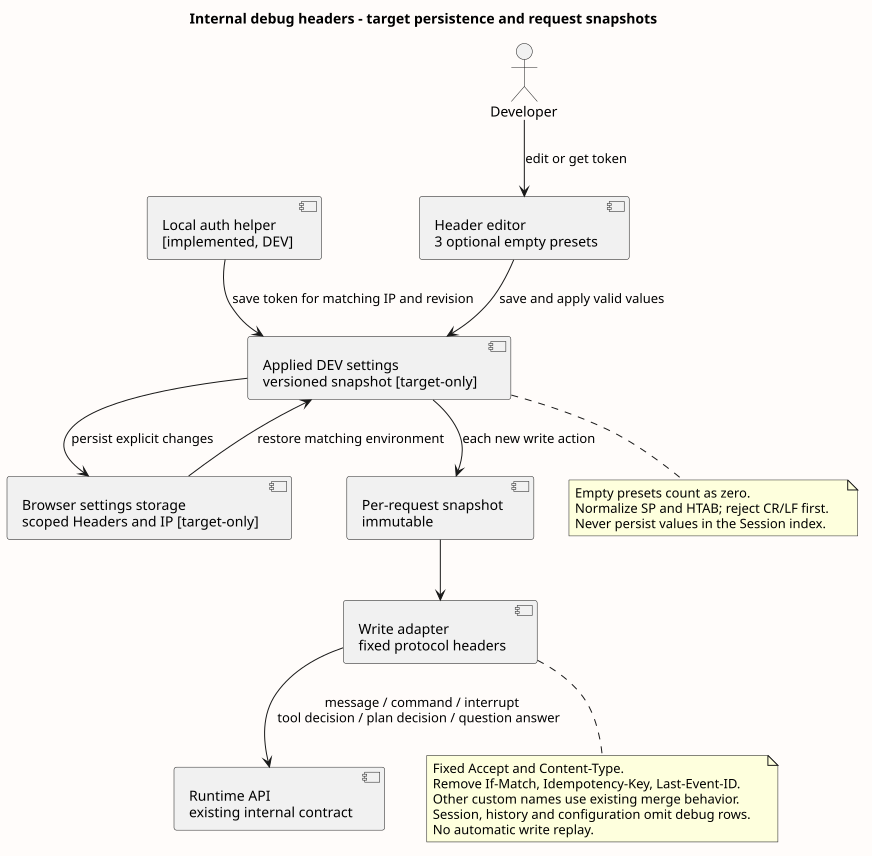

# 开发调试 Header 编辑规则

版本：1.1.0 · 2026-09-19

[前端设计](../README.md) · [场景原型](../原型/index.html)

环境设置、凭据存储和请求快照的完整职责见[工作台技术设计](runtime-workbench-alignment.md)。本页维护表格编辑细节。六类开发写动作按[发送前自动刷新规则](runtime-workbench-alignment.md#61-页面流程)重新获取并启用 `access-token`；手填旧值、关闭或删除该行不跳过刷新，该增量待实现。

[PlantUML 源码](diagram.puml#L44) · [原尺寸](frontend_debug_header_flow.svg)

### 6.1 开发者调试 Header

三个空值预置、显式增行、删除至零、独立请求快照、纯空白值校验和 DEV 按 IP 获取 Token 均已有实现。真实认证中心登录仍未验证，不标记为已验收。源码与请求范围见 [Runtime 工作台交互对齐](runtime-workbench-alignment.md)及[当前实现证据](../source-evidence.md#current-implementation)。

“开发者设置”作为统一入口打开独立侧栏；390 px 使用可滚动的模态面板。内部依次显示“连接”“认证”“Headers”“Session 诊断”，保留原 `.dev-diagnostics` 暖灰、虚线和紧凑分组样式。顶部旧 Headers 按钮如保留快捷入口，只打开同一面板的 Headers 分组，不维护第二份表单或 store。面板保存栏始终可达，错误在对应字段呈现；关闭只保留未应用草稿，不提交、不重新登录。

生产构建不装配本地 Runtime 配置、Header 存储或开发服务入口。认证 IP、持久化作用域、env 键映射、密码只写不回显与配置生效规则由[工作台专项](runtime-workbench-alignment.md)统一维护。下表只定义通用 Header 行编辑行为。

| 表格元素 | 行为 |
|---|---|
| 默认行 | 按顺序预置 `access-token`、`X-HW-ID`、`Authorization`，Value 均为空；三行默认勾选，均可编辑、关闭和删除，仅在该环境首次无配置时初始化，不填充示例秘密；已有已保存配置则恢复。 |
| 启用 | 每行独立开关；关闭后保留 Key/Value，保存并应用后不进入下一次请求快照；表单计数显示当前草稿的有效项。 |
| Key | 普通文本输入，不提供固定下拉选项或认证模式；比较、重复校验和请求合并均大小写不敏感。 |
| Value | 默认遮蔽，可显式显示或替换；不自动拼接 `Bearer`、替换变量或根据 Key 推断秘密类型。 |
| 增加请求头 | 每点击一次，在末尾追加一行空 Key/Value，默认勾选并聚焦新行 Key；即使已有空行，也只按本次点击增加一行。 |
| 删除 | 只删除当前草稿行，保存并应用后生效；不补行、不恢复预置，可以删至零行。焦点移到相邻行 Key，无剩余行时移到“增加请求头”。 |
| 全部清空 | 删除当前环境所有行及持久值，保持零行并聚焦“增加请求头”；不自动恢复三项预置，不清其他环境。 |
| `Headers (n)` | `n` 只统计启用、完整且通过校验的自定义 Header。 |

- 首屏只显示三个预置行，不附加空白尾行。填写、切换启用和删除都不增加行；关闭再打开面板保留当前行，刷新和关闭重开恢复已保存内容；只有明确重置当前环境才恢复三个空值预置。
- 面板移除“仅当前页面内存；分别附加到消息、命令、停止或确认 POST。读取请求不携带这些临时凭据。协议头由客户端固定。”等常驻说明；只保留标题/计数、操作、表格和必要的行内错误。请求范围和保存生命周期在设计说明维护；界面只保留“保存在此浏览器”和保存状态。
- 请求适配器自动生成的 Header 不渲染、不枚举，也不显示覆盖状态；普通同名 Header 采用手工值，`access-token` 在自动刷新成功后采用新值；已实现的写适配器固定 Accept 与 Content-Type，并移除 If-Match、Idempotency-Key、Last-Event-ID。此处同步实际合并规则，不新增编辑器黑名单。
- 先拒绝 Value 中的 CR/LF，再按 HTTP 规则去除首尾空格/Tab；规范化后未使用的预置行（仍为原始 Key 且 Value 为空）与全空行忽略：不报错、不计数、不发送空值 Header。预置 Key 被改写后按普通行处理；其余启用行的 Key 和 Value 必须同时填写，名称必须是合法 HTTP token，Value 不得含 CR/LF，同名自定义 Key 不得重复。
- UI 允许自由输入，但 Fetch 禁止的请求头名称在对应行显示“浏览器禁止设置这个 Header”并阻止提交；不通过常驻说明或固定可选列表限制用户。
- Header 编辑写入设置草稿，“保存并应用”校验后持久化并替换当前配置快照；普通保存失败保留旧配置和草稿并显示“未保存”。“全部清空”立即清除当前环境持久值及已应用值，取消旧 Token 回填，不改变在途快照；清除落盘失败仍停止使用当前值并提示“本地数据未清除，刷新可能恢复”，不恢复旧凭据或宣称清除成功。关闭面板不隐式应用；不提供 URL 导入或复制完整 curl。
- 持久值仅用于恢复当前环境配置，默认遮蔽；日志、遥测、错误和复制摘要只记录 Header Key 与是否已配置。浏览器存储、DOM 和 DevTools 不构成秘密隔离边界，因此该能力只存在于受控开发构建，不能替代生产身份方案。
- 保存时任一启用草稿行校验失败，聚焦第一条错误且不更新已应用配置；发送按工作台 §6.1 校验已应用配置和 Token 草稿冲突，自动获取成功后生成快照；本地 Header 格式、草稿冲突等准备错误保留 Composer 草稿并阻止该次业务请求，凭据未配置或刷新失败不阻止提交。Claw 不检查凭据组合或最低完整性，只透传已提供 Header；Mate tool execute 返回对应成功或失败结果，认证和授权仍由对应服务决定。
