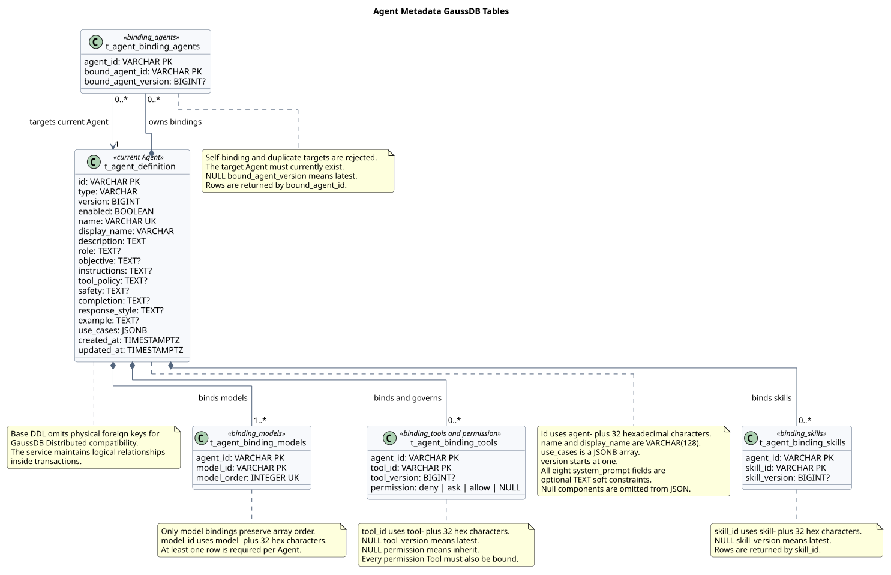
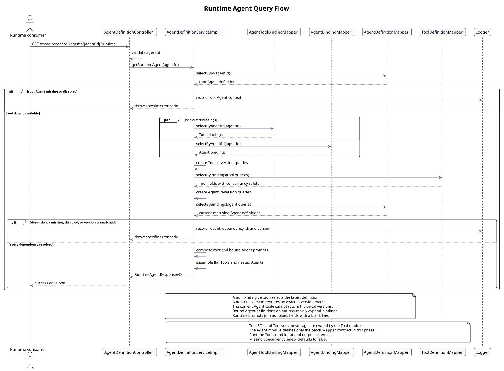

# Agent 元数据 GaussDB 表设计

> 文档编号：`SR-AGENT-DB-001`<br>
> 版本：`v0.18.8`<br>
> 日期：`2026-08-12`<br>
> 状态：Java 接口已实现 / Tool Mapper SQL 待集成<br>
> 设计仓库分析基线：`a8491805f3d2abeb61df0a1c13d90d4388058d81`<br>
> Java 实现分析基线：`mate-service@f0c634a27da9807ae1e416460469db39407a20e2`<br>
> Agent JSON 工作区 SHA-256：`b9aa4376e1b0859e698a69a487a2aca9c4bc73911d0f9fa5da89532229f6adf9`<br>
> Tool JSON 工作区 SHA-256：`3f4d88b30f4f22ef28e5356df0e5927adf43e34551384cec0883a895fcaa0746`

## 1. 结论

基于当前 [`AGENT元数据设计.json`](../AGENT元数据设计.json)，Agent 当前元数据使用 5 张表：

1. `t_agent_definition`：标量字段、System Prompt 展开字段和 `use_cases`。
2. `t_agent_binding_models`：`binding_models[]`，保留数组顺序。
3. `t_agent_binding_tools`：合并 `binding_tools[]` 与 `permission`。
4. `t_agent_binding_skills`：`binding_skills[]`，按 Skill ID 稳定输出。
5. `t_agent_binding_agents`：`binding_agents[]`，按目标 Agent ID 稳定输出。

模型绑定全链路统一使用：元数据 `binding_models`、Java `bindingModels`、数据库 `t_agent_binding_models`、数据层 `AgentModelBindingDTO` / `AgentModelBindingMapper`。不保留 `model` 或 `models` 兼容别名。

System Prompt 的八个细分字段均为可空软约束。数据库不强制非空或非空白；普通详情响应只返回具有值的细分字段，管理前端按实际返回字段动态展示。Runtime 响应将这些字段拼接为单一字符串。

已实现 `GET /mate-service/v1/agents/{agentId}/runtime`。它以 `getAgent` 的完整元数据为基础，根据绑定中的资源 ID 和可空版本批量解析 Tool 与被绑定 Agent：`bindingTools` 和 `bindingAgents` 均直接平铺解析后的精简 Runtime 定义；Tool 返回 `id`、`version`、`enabled`、名称、描述、`permission`、`source` 和 `isConcurrencySafe` 九个字段；被绑定 Agent 只返回 `id`、`version`、名称、描述、`systemPrompt` 和 `useCases` 七个字段。任何运行依赖缺失、禁用或指定版本不匹配时，Service 记录包含根 Agent、依赖 ID 和版本的错误日志并以具体错误码终止请求，不返回部分 Runtime 配置。

完整初始化 DDL 维护在 [`schema.sql`](./schema.sql)，本文不重复嵌入完整 SQL。

## 2. 来源证据与设计边界

### 2.1 输入元数据

- 基本字段、状态和名称：[`AGENT元数据设计.json` 第 2–10 行](../AGENT元数据设计.json#L2)。
- 模型绑定和 System Prompt：[`第 11–21 行`](../AGENT元数据设计.json#L11)。
- Use Cases、Tool、Skill、Agent 绑定及权限：[`第 22–53 行`](../AGENT元数据设计.json#L22)。
- Tool 并行安全标志：[`TOOL元数据设计.json` 第 8 行](../TOOL元数据设计.json#L8)。
- Tool 输入输出 Schema：[`TOOL元数据设计.json` 第 14–23 行](../TOOL元数据设计.json#L14)；该字段属于 Tool 元数据，但不进入 Runtime Agent 响应。

### 2.2 Java 基线

本次分析的 Java 提交为 `mate-service@f0c634a27da9807ae1e416460469db39407a20e2`，相关路径：

- `src/main/java/com/huawei/hicampus/mate/agentdefinition/service/AgentDefinitionService.java`
- `src/main/java/com/huawei/hicampus/mate/agentdefinition/service/impl/AgentDefinitionServiceImpl.java`
- `src/main/java/com/huawei/hicampus/mate/agentdefinition/controller/AgentDefinitionController.java`
- `src/main/java/com/huawei/hicampus/mate/agentdefinition/controller/ApiExceptionHandler.java`
- `src/main/java/com/huawei/hicampus/mate/agentdefinition/exception/AgentErrorCode.java`
- `src/main/java/com/huawei/hicampus/mate/agentdefinition/exception/AgentServiceException.java`
- `src/main/java/com/huawei/hicampus/mate/agentdefinition/validation/ResourceIdRules.java`
- `src/main/java/com/huawei/hicampus/mate/agentdefinition/vo/AgentInfoResponseVO.java`
- `src/main/java/com/huawei/hicampus/mate/agentdefinition/vo/RuntimeAgentResponseVO.java`
- `src/main/java/com/huawei/hicampus/mate/agentdefinition/vo/ToolDefinitionResponseVO.java`
- `src/main/java/com/huawei/hicampus/mate/agentdefinition/vo/RuntimeAgentDefinitionResponseVO.java`
- `src/main/java/com/huawei/hicampus/mate/agentdefinition/vo/ApiSuccessResponseVO.java`
- `src/main/java/com/huawei/hicampus/mate/agentdefinition/vo/ListAgentResponseVO.java`
- `src/main/java/com/huawei/hicampus/mate/agentdefinition/vo/UpdateAgentRequestVO.java`
- `src/main/java/com/huawei/hicampus/mate/agentdefinition/vo/SystemPromptResponseVO.java`
- `src/main/java/com/huawei/hicampus/mate/agentdefinition/mapper/AgentDefinitionMapper.java`
- `src/main/java/com/huawei/hicampus/mate/agentdefinition/mapper/AgentToolBindingMapper.java`
- `src/main/java/com/huawei/hicampus/mate/agentdefinition/mapper/AgentBindingMapper.java`
- `src/main/java/com/huawei/hicampus/mate/agentdefinition/mapper/ToolDefinitionMapper.java`
- `src/main/java/com/huawei/hicampus/mate/agentdefinition/dto/ToolDefinitionDTO.java`
- `src/main/java/com/huawei/hicampus/mate/agentdefinition/dto/ToolVersionQueryDTO.java`
- `src/main/java/com/huawei/hicampus/mate/agentdefinition/dto/AgentVersionQueryDTO.java`
- `src/main/resources/mapper/AgentDefinitionMapper.xml`
- `src/main/resources/application.yml`
- `src/main/resources/messages.properties`
- `src/main/resources/messages_en_US.properties`
- `src/main/resources/messages_zh_CN.properties`
- `src/main/resources/db/schema.sql`
- `src/test/java/com/huawei/hicampus/mate/agentdefinition/controller/ApiExceptionHandlerTest.java`
- `src/test/java/com/huawei/hicampus/mate/agentdefinition/controller/AgentDefinitionControllerTest.java`
- `src/test/java/com/huawei/hicampus/mate/agentdefinition/exception/AgentErrorMessageTest.java`
- `src/test/java/com/huawei/hicampus/mate/agentdefinition/vo/AgentInfoJsonTest.java`

该基线提供 `listAgents`、`getAgent`、`getRuntimeAgent`、`updateAgent` 四项 Service 能力，并通过 `AgentDefinitionController` 暴露四个 HTTP 接口。Controller 使用 Request/Response VO，路径 Agent ID 在边界完成格式校验，成功响应由 `ApiSuccessResponseVO` 包装；读取结果放入 `result`，更新成功时省略空 `result`。Service 实现五表聚合、Runtime 依赖批量解析、批量列表查询以及最后写入生效的模型替换。模型绑定顺序列和 DTO 属性使用 `model_order` / `modelOrder`；可变 Request VO 和 DTO 使用 Lombok `@Data`；Java 注释和 Javadoc 使用中文。异常使用具体的大写 snake_case 错误码，错误码同时作为国际化 key 和 `resCode`。

`AgentDefinitionMapper.selectByBindings` 及其 MyBatis XML 已按 Agent ID/可空版本实现；`ToolDefinitionMapper.selectByBindings`、Tool DTO 和 Runtime VO 已实现。Tool 定义的数据库表、版本保存方式和 Mapper SQL 仍由 Tool 模块负责人提供，这是当前唯一未完成的 Runtime 数据源集成项；在该 SQL 到位前，有 Tool 绑定的 Runtime 查询不具备完整数据库运行条件。

本文只保存当前 JSON 字段，不增加多租户、历史版本、审计、Outbox、Session 或 Memory 表。Agent 固定版本只存储和展示，不查询不存在的历史表。

## 3. 表关系



PlantUML：[查看源码](./diagram.puml#L6)

所有绑定表通过 `agent_id` 逻辑关联 `t_agent_definition.id`。表名统一使用小写 snake_case 和 `t_` 前缀。

## 4. 主表 `t_agent_definition`

| JSON 字段 | 数据库字段 | 类型 | 可空 | 规则 |
|---|---|---|---:|---|
| `id` | `id` | `VARCHAR(64)` | 否 | 主键；应用层格式为 `agent-` 加 32 位十六进制 UUID |
| `type` | `type` | `VARCHAR(16)` | 否 | 固定为 `agent` |
| `version` | `version` | `BIGINT` | 否 | 从 1 开始 |
| `enabled` | `enabled` | `BOOLEAN` | 否 | 默认启用 |
| `name` | `name` | `VARCHAR(128)` | 否 | 唯一；管理前端只读 |
| `display_name` | `display_name` | `VARCHAR(128)` | 否 | 管理前端只读 |
| `description` | `description` | `TEXT` | 否 | 管理前端只读 |
| `system_prompt.role` | `role` | `TEXT` | 是 | 可选；软约束 |
| `system_prompt.objective` | `objective` | `TEXT` | 是 | 可选；软约束 |
| `system_prompt.instructions` | `instructions` | `TEXT` | 是 | 可选；软约束 |
| `system_prompt.tool_policy` | `tool_policy` | `TEXT` | 是 | 可选；软约束 |
| `system_prompt.safety` | `safety` | `TEXT` | 是 | 可选；软约束 |
| `system_prompt.completion` | `completion` | `TEXT` | 是 | 可选；软约束 |
| `system_prompt.response_style` | `response_style` | `TEXT` | 是 | 可选；软约束 |
| `system_prompt.example` | `example` | `TEXT` | 是 | 可选；软约束 |
| `use_cases` | `use_cases` | `JSONB` | 否 | JSON 数组 |
| `created_at` | `created_at` | `TIMESTAMPTZ` | 否 | 创建时间 |
| `updated_at` | `updated_at` | `TIMESTAMPTZ` | 否 | 更新时间 |

### 4.1 Agent ID

资源 ID 统一采用类型前缀加 `SecureRandomUtils.generateUUID()` 返回的 32 位 UUID 字符串：Agent 使用 `agent-`，Model 使用 `model-`，Tool 使用 `tool-`，Skill 使用 `skill-`。例如：`agent-550e8400e29b41d4a716446655440000`。当前仓库没有 Create Agent 接口和 `SecureRandomUtils` 实现；未来落地创建接口时由各资源所属 Service 生成 ID，请求方不传入 ID。

Agent 路径参数、更新请求体和模型更新数组元素直接使用 Jakarta `@NotBlank` 与 `@Pattern`，正则引用 `ResourceIdRules` 中的公共常量，不定义只包装标准约束的自定义注解。Tool 和 Skill 没有写接口，Service 在列表及详情聚合时校验数据库中的 `toolId`、`skillId`，同时校验持久化的 Agent、Model 和绑定 Agent 标识；格式错误按数据损坏处理。只有资源主表在创建资源时产生 ID，各绑定表均引用既有 ID，不重新生成。数据库继续使用 `VARCHAR(64)`，不把当前长度固化为列长度，以保留生成算法演进空间。

### 4.2 System Prompt

八个 System Prompt 字段是可选的提示词组成部分：数据库使用可空 `TEXT`，不设置 `NOT NULL` 或非空白 `CHECK`。当前四个接口不写 System Prompt，因此不保留对应 Request VO；未来增加写入口时，不对这些字段增加 `@NotBlank`，管理界面可以提示建议填写，但不得阻止保存。本版仍不设置数据库或 Java 最大长度。

普通 `getAgent` 和列表接口使用 Jackson `NON_NULL` 输出策略，值为 `NULL` 的细分字段不出现在结构化 `systemPrompt` 中，管理前端按实际返回字段动态展示。Runtime Agent 的根 Agent 和 `bindingAgents[]` 则把八个字段拼接为单一字符串，供模型直接作为 System Prompt 使用。

Runtime 拼接顺序固定为 `role`、`objective`、`instructions`、`tool_policy`、`safety`、`completion`、`response_style`、`example`。每段去除首尾空白，跳过 `NULL`、空字符串和纯空白字符串，段间使用两个换行符 `\n\n`；全部字段为空时返回空字符串。未来写入时仍建议把空白字符串规范化为 `NULL`，该规范化属于数据清理，不构成必填校验。

### 4.3 Use Cases

`use_cases` 使用 `JSONB NOT NULL DEFAULT '[]'::jsonb`，并约束 `jsonb_typeof(use_cases) = 'array'`。相较保留原始 JSON 文本，本场景更关注解析后的字符串数组，JSONB 更适合读取、校验以及后续操作符或索引扩展。

Service 聚合读取时校验每项为非空字符串且不可重复；当前没有确定数组数量和单项长度上限。

GaussDB JSON/JSONB 类型参考：[Huawei Cloud GaussDB JSON/JSONB Types](https://support.huaweicloud.com/intl/en-us/distributed-devg-v8-gaussdb/gaussdb-12-0327.html)。

## 5. 绑定表

### 5.1 模型绑定 `t_agent_binding_models`

| 字段 | 类型 | 规则 |
|---|---|---|
| `agent_id` | `VARCHAR(64)` | 逻辑关联主表 |
| `model_id` | `VARCHAR(64)` | 模型网关 ID；非空白 |
| `model_order` | `INTEGER` | 从 0 开始 |

主键为 `(agent_id, model_id)`，并对 `(agent_id, model_order)` 建唯一约束。模型绑定是唯一保存输入数组顺序的绑定；一个 Agent 至少需要一个模型，由 Service 在同一事务中保证。

模型 ID 必须符合 `^model-[0-9a-fA-F]{32}$` 且不可重复。当前没有模型网关目录查询接口，因此不校验模型是否存在。

### 5.2 Tool 绑定 `t_agent_binding_tools`

`binding_tools[]` 与 `permission.deny/ask/allow` 合并保存。主键为 `(agent_id, tool_id)`；`tool_version = NULL` 表示最新版本，`permission = NULL` 表示继承 Tool 权限。

同一 Tool 只能出现在一个权限数组，权限引用必须对应已绑定 Tool。输出按 `tool_id` 排序。

Tool ID 必须符合 `^tool-[0-9a-fA-F]{32}$`；当前四个接口没有 Tool 写入请求，Service 在读取完整聚合时执行数据完整性校验。

Runtime Agent 查询不把绑定版本仅作为展示字段。Service 将每个 `tool_id + tool_version` 转换为批量查询条件：`tool_version = NULL` 表示解析最新版本，非空表示必须精确匹配指定版本。Tool 定义 Mapper 至少返回响应组装和启用状态校验所需字段；Service 校验 `enabled` 后，Runtime `bindingTools` 保留 `id`、`version`、`enabled`、`name`、`displayName`、`description`、`permission`、`source` 和 `isConcurrencySafe`。Tool 元数据自身继续保留 `type`、时间、`input_schema` 和 `output_schema`，但这些字段不进入 Runtime 响应。Tool 表及版本历史不属于本 Agent Schema；对应 Mapper SQL 由 Tool 模块负责人提供。

`is_concurrency_safe` 是布尔字段，表示运行时是否允许并行调用该 Tool；Java DTO 和响应 VO 使用 `isConcurrencySafe`。Tool 数据源未提供该字段时，Service 按安全默认值 `false` 返回，只有显式为 `true` 时才表示支持并行。

如果任一 Tool 条件无匹配记录或匹配记录未启用，Service 必须记录根 Agent ID、Tool ID 和请求版本并终止整个 Runtime 查询。不得静默跳过该 Tool，也不得返回部分 `bindingTools`。

### 5.3 Skill 绑定 `t_agent_binding_skills`

主键为 `(agent_id, skill_id)`。`skill_version = NULL` 表示最新版本；不保存顺序，输出按 `skill_id` 排序。

Skill ID 必须符合 `^skill-[0-9a-fA-F]{32}$`；当前四个接口没有 Skill 写入请求，Service 在读取完整聚合时执行数据完整性校验。

### 5.4 Agent 绑定 `t_agent_binding_agents`

| 字段 | 类型 | 可空 | 规则 |
|---|---|---:|---|
| `agent_id` | `VARCHAR(64)` | 否 | 当前 Agent |
| `bound_agent_id` | `VARCHAR(64)` | 否 | 被绑定 Agent |
| `bound_agent_version` | `BIGINT` | 是 | 空表示最新；非空时大于等于 1 |

主键为 `(agent_id, bound_agent_id)`，禁止自绑定，并建立 `(bound_agent_id, agent_id)` 反向索引；固定版本不校验历史版本可用性。输出按 `bound_agent_id` 排序。

当前四个接口不写入 Agent 绑定；读取时校验 `agent_id` 和 `bound_agent_id` 均符合 Agent ID 格式。未来增加写接口时，应在 Service 中继续校验目标 Agent 存在且不可重复绑定。

Runtime Agent 查询按照 `bound_agent_id + bound_agent_version` 批量读取主表。`bound_agent_version = NULL` 表示当前版本；非空时查询条件必须同时匹配 ID 和版本。由于 `t_agent_definition` 只保存当前版本，该查询只能验证固定版本是否与当前版本一致，不能恢复已经被新版本替换的历史定义。固定版本无匹配记录或目标 Agent 未启用时，Service 记录根 Agent ID、目标 Agent ID 和请求版本并终止整个查询。

成功匹配后只返回目标 Agent 的 `id`、`version`、`name`、`displayName`、`description`、拼接后的字符串 `systemPrompt` 和 `useCases`。`type`、`createdAt`、`updatedAt` 和 `enabled` 属于校验或管理信息，不进入被绑定 Agent 的 Runtime 响应；其模型、Tool、Skill 和 Agent 绑定也不递归查询，避免循环依赖和无界展开。未来若要读取历史版本，必须先引入独立的 Agent 历史版本模型；本版不以当前主表伪装历史查询能力。

## 6. Service 与 Controller 接口

Java Service 已提供：

```text
listAgents(ListAgentRequestVO) -> ListAgentResponseVO
getAgent(String agentId) -> AgentInfoResponseVO
getRuntimeAgent(String agentId) -> RuntimeAgentResponseVO
updateAgent(String agentId, UpdateAgentRequestVO) -> void
```

`AgentDefinitionController` 已实现：

```text
GET  /mate-service/v1/agents
GET  /mate-service/v1/agents/{agentId}
GET  /mate-service/v1/agents/{agentId}/runtime
POST /mate-service/v1/agents/{agentId}
```

成功响应使用 `ApiSuccessResponseVO<T>`，示例成功码为 `0`，消息为 `success`。该类是独立仓库中的最小可运行包装；接入 mate-service 主工程时，如已有公共响应类和成功码常量，应替换该示例类，不改变 Service 签名。`ApiExceptionHandler` 继续负责将异常适配为 `resCode` / `resMsg`。

### 6.1 List Agents

请求参数：`pageIndex`、`pageSize`、`name`、`displayName`、`enabled`、`version`。

- `pageIndex` 从 1 开始，默认 1。
- `pageSize` 默认 20，最大 100。
- `name`、`displayName` 为大小写不敏感的字面包含查询。
- `enabled`、`version` 精确匹配。
- 主表按 `updated_at DESC, id ASC` 稳定分页。

Service 先查询总数和当前页主表，再按页内 Agent ID 分别批量读取四种绑定，避免逐 Agent 查询造成 N+1。

Controller 响应：

```json
{
  "resCode": "0",
  "resMsg": "success",
  "result": {
    "data": [],
    "total": 0,
    "pageIndex": 1
  }
}
```

### 6.2 Get Agent

`AgentInfo` 展示完整 Agent 元数据，顶层主键与元数据保持为 `id`，其余字段包括 `bindingModels`、`systemPrompt`、`useCases`、`bindingTools`、`bindingSkills`、`bindingAgents`、`permission` 和时间字段。`bindingAgents` 元素中的 `agent_id` 按 camelCase 转换为 `agentId`；路径参数和更新请求中的 `agentId` 也保持不变。

### 6.3 Update Agent

```json
{
  "agentId": "agent-550e8400e29b41d4a716446655440000",
  "bindingModels": [
    "model-550e8400e29b41d4a716446655440000",
    "model-550e8400e29b41d4a716446655440001"
  ]
}
```

路径与请求体 `agentId` 必须一致，并符合 `agent-` 加 32 位十六进制 UUID 的格式。`bindingModels` 必填、非空、元素不可重复，每个元素必须符合 `model-` 加 32 位十六进制 UUID 的格式。

更新采用最后写入生效：事务中锁定 Agent 当前行，删除旧模型绑定，按请求顺序插入新绑定，然后基于锁定行的当前版本将 `version` 递增一次。客户端不提交期望版本；即使模型列表未变化，成功请求仍递增一次版本。

更新成功响应不包含 `result`：

```json
{
  "resCode": "0",
  "resMsg": "success"
}
```

### 6.4 Get Runtime Agent

`GET /mate-service/v1/agents/{agentId}/runtime` 返回运行时所需的 Agent 定义视图，不表示正在运行的 Session 或进程状态。路径参数复用 `getAgent` 的 Agent ID 校验；成功结果继续使用 `ApiSuccessResponseVO<RuntimeAgentResponseVO>` 包装。



PlantUML：[查看源码](./diagram.puml#L174)

`RuntimeAgentResponseVO` 的根字段与 `AgentInfoResponseVO` 一致。`bindingTools` 和 `bindingAgents` 的元素都直接平铺为解析后的 Runtime 定义，不保留资源 ID、绑定版本和定义对象组成的中间包装层：

```json
{
  "resCode": "0",
  "resMsg": "success",
  "result": {
    "id": "agent-550e8400e29b41d4a716446655440000",
    "type": "agent",
    "version": 3,
    "createdAt": "2026-08-12T08:00:00+08:00",
    "updatedAt": "2026-08-12T09:00:00+08:00",
    "enabled": true,
    "name": "campus-assistant",
    "displayName": "Campus Assistant",
    "description": "Campus service Agent",
    "bindingModels": [
      "model-550e8400e29b41d4a716446655440001"
    ],
    "systemPrompt": "Campus assistant\n\nHelp users complete campus service tasks",
    "useCases": [
      "Campus service"
    ],
    "bindingTools": [
      {
        "id": "tool-550e8400e29b41d4a716446655440002",
        "version": 2,
        "enabled": true,
        "name": "query-campus-map",
        "displayName": "Query Campus Map",
        "description": "Query a campus location",
        "permission": "allow",
        "source": "builtin-toolset",
        "isConcurrencySafe": true
      }
    ],
    "bindingSkills": [],
    "bindingAgents": [
      {
        "id": "agent-550e8400e29b41d4a716446655440003",
        "version": 1,
        "name": "map-specialist",
        "displayName": "Map Specialist",
        "description": "Campus map specialist",
        "systemPrompt": "Campus map specialist\n\nProvide accurate campus navigation",
        "useCases": [
          "Campus navigation"
        ]
      }
    ],
    "permission": {
      "deny": [],
      "ask": [],
      "allow": [
        "tool-550e8400e29b41d4a716446655440002"
      ]
    }
  }
}
```

`bindingTools[].version` 和 `bindingAgents[].version` 分别是本次实际解析出的 Tool 与 Agent 版本，必须有值。绑定表中的可空版本只用于选择最新版本或精确匹配固定版本，不在响应中重复展示。

`bindingTools` 包含 `id`、`version`、`enabled`、`name`、`displayName`、`description`、`permission`、`source` 和 `isConcurrencySafe`；不返回 `type`、时间、`inputSchema` 或 `outputSchema`。根 Agent 和 `bindingAgents[]` 中被绑定 Agent 的 `systemPrompt` 都是相同规则拼接出的字符串，不返回八字段对象。平铺后的被绑定 Agent 只包含 `id`、`version`、`name`、`displayName`、`description`、`systemPrompt` 和 `useCases`；不返回 `type`、时间、`enabled`、各类绑定或聚合后的 `permission`。

Runtime 聚合采用 `REPEATABLE_READ` 只读事务，并执行以下流程：

1. 查询根 Agent；不存在使用现有 `AGENT_NOT_FOUND`，未启用使用 `AGENT_DISABLED`。
2. 按现有规则读取并校验根 Agent 的四类绑定，保留模型顺序，其余按 ID 稳定排序。
3. 将 Tool 绑定转换为 `ToolVersionQueryDTO(toolId, version)`，调用 `ToolDefinitionMapper.selectByBindings` 一次完成批量解析。
4. 将 Agent 绑定转换为 `AgentVersionQueryDTO(agentId, version)`，调用 `AgentDefinitionMapper.selectByBindings` 一次完成批量解析。
5. 以每个绑定 ID 和版本核对返回集合。无匹配、未启用、重复返回或定义版本缺失都立即记录错误日志并抛出具体错误码。
6. 所有依赖均解析成功后才组装响应；禁止逐绑定 Mapper 查询，禁止返回部分结果。

两个批量 Mapper 契约为：

```java
List<ToolDefinitionDTO> selectByBindings(
        @Param("bindings") List<ToolVersionQueryDTO> bindings);

List<AgentDefinitionDTO> selectByBindings(
        @Param("bindings") List<AgentVersionQueryDTO> bindings);
```

查询项 DTO 只包含资源 ID 和可空版本。版本为空时，Mapper 返回该 ID 的最新定义，Service 再校验 `enabled`；版本非空时，Mapper 必须同时匹配 ID 和版本。`AgentDefinitionMapper` 面向当前主表实现，因此所谓最新就是当前行，固定版本不等于当前行版本时不返回记录。`ToolDefinitionMapper` 的 Java 接口、Tool DTO 和查询项 DTO 由 Agent 模块定义；Tool 表名、版本历史以及 Mapper SQL 由 Tool 模块负责人提供，本设计和 Agent `schema.sql` 不创建 Tool 表。

依赖解析失败日志必须包含 `rootAgentId`、依赖类型、依赖 ID 和绑定版本，但不得记录 System Prompt 或 Tool Schema。未找到包括资源 ID 不存在以及指定 ID/version 组合不存在；日志记录后仍须抛出错误，不能用跳过依赖作为健壮性策略。

### 6.5 错误码与国际化

本版将按类别归并的 `AGENT_INVALID_PARAMETER` 和 `AGENT_DATA_CORRUPTION` 替换为具体场景错误码。这是与 mate-service 错误模型对齐的架构调整，不改变 Agent 业务数据结构。

- 请求解析与校验：`AGENT_REQUEST_BODY_INVALID`、`AGENT_REQUEST_VALIDATION_FAILED`、`AGENT_PAGE_INDEX_INVALID`、`AGENT_PAGE_SIZE_INVALID`、`AGENT_NAME_TOO_LONG`、`AGENT_DISPLAY_NAME_TOO_LONG`、`AGENT_VERSION_INVALID`、`AGENT_ID_REQUIRED`、`AGENT_ID_INVALID`、`AGENT_BINDING_MODELS_EMPTY`、`AGENT_MODEL_ID_REQUIRED`、`AGENT_MODEL_ID_INVALID`。
- 业务规则：`AGENT_ID_MISMATCH`、`AGENT_MODEL_DUPLICATED`、`AGENT_NOT_FOUND`、`AGENT_DISABLED`、`AGENT_BOUND_TOOL_DISABLED`、`AGENT_BOUND_AGENT_DISABLED`。
- 存储数据完整性：`AGENT_VERSION_MISSING`、`AGENT_VERSION_UPDATE_FAILED`、`AGENT_MODEL_BINDING_MISSING`、`AGENT_PERMISSION_INVALID`、`AGENT_STORED_AGENT_ID_INVALID`、`AGENT_STORED_MODEL_ID_INVALID`、`AGENT_STORED_TOOL_ID_INVALID`、`AGENT_STORED_SKILL_ID_INVALID`、`AGENT_STORED_BOUND_AGENT_ID_INVALID`、`AGENT_USE_CASES_NOT_ARRAY`、`AGENT_USE_CASE_INVALID`、`AGENT_USE_CASES_PARSE_FAILED`、`AGENT_BOUND_TOOL_NOT_FOUND`、`AGENT_BOUND_TOOL_VERSION_MISSING`、`AGENT_BOUND_TOOL_DEFINITION_DUPLICATED`、`AGENT_BOUND_AGENT_NOT_FOUND`、`AGENT_BOUND_AGENT_VERSION_MISSING`、`AGENT_BOUND_AGENT_DEFINITION_DUPLICATED`。

Runtime 新增错误码参数固定如下；绑定版本为空时，Service 向消息参数传递本地化前的固定字面量 `latest`：

| 错误码 | 消息参数 | 分类 |
|---|---|---|
| `AGENT_DISABLED` | Agent ID | 业务规则 |
| `AGENT_BOUND_TOOL_NOT_FOUND` | 根 Agent ID、Tool ID、绑定版本或 `latest` | 存储完整性 |
| `AGENT_BOUND_TOOL_DISABLED` | 根 Agent ID、Tool ID、实际版本 | 业务规则 |
| `AGENT_BOUND_TOOL_VERSION_MISSING` | 根 Agent ID、Tool ID | 存储完整性 |
| `AGENT_BOUND_TOOL_DEFINITION_DUPLICATED` | 根 Agent ID、Tool ID、绑定版本或 `latest` | 存储完整性 |
| `AGENT_BOUND_AGENT_NOT_FOUND` | 根 Agent ID、目标 Agent ID、绑定版本或 `latest` | 存储完整性 |
| `AGENT_BOUND_AGENT_DISABLED` | 根 Agent ID、目标 Agent ID、实际版本 | 业务规则 |
| `AGENT_BOUND_AGENT_VERSION_MISSING` | 根 Agent ID、目标 Agent ID | 存储完整性 |
| `AGENT_BOUND_AGENT_DEFINITION_DUPLICATED` | 根 Agent ID、目标 Agent ID、绑定版本或 `latest` | 存储完整性 |

错误码枚举名、国际化资源 key 和响应 `resCode` 必须使用同一个大写 snake_case 值，例如 `AGENT_MODEL_DUPLICATED`。Service 异常只携带错误码和消息参数；`ApiExceptionHandler` 根据当前 Locale 解析 `resMsg`。默认与 `en_US` 资源使用英文，`zh_CN` 资源使用中文，且关闭系统 Locale 回退。

Request VO 的 Jakarta Validation `message` 直接引用 `{AGENT_...}` 资源 key。参数和业务规则错误返回 HTTP 400，根 Agent 的 `AGENT_NOT_FOUND` 返回 HTTP 404，存储数据完整性错误返回 HTTP 500 并记录完整异常日志。Runtime 依赖错误的主要对外契约是具体 `resCode` 和国际化 `resMsg`，不增加新的 HTTP 状态分类。

## 7. GaussDB 与事务

初始化 DDL 使用 `"{dbUser}"."t_xx"` Schema 限定名、行存兼容类型、主键、唯一约束、`CHECK` 和普通索引；COMMENT 使用简洁中文。每张表的 `DROP TABLE IF EXISTS` 必须紧邻并位于对应 `CREATE TABLE` 之前。脚本适用于初始化或重建，不作为生产增量迁移脚本。

GaussDB Distributed 不支持物理外键，因此基础 DDL 使用逻辑关系。当前 Service 在事务内锁定主表、替换模型绑定并递增版本；集中式部署确认支持外键后，可启用 DDL 末尾的可选外键块。

读取完整聚合、列表和 Runtime Agent 使用 `REPEATABLE_READ` 只读事务。不要用一个 Join 同时连接多个一对多绑定表，否则会产生笛卡尔行数放大。Runtime Agent 先读取根定义和直接绑定，再按 Tool 与 Agent 的 ID/version 条件分别批量读取依赖定义。

## 8. 对象分层

- Request/Response VO：Service 或 Controller 边界对象，字段校验位于 Request VO。
- DTO：Mapper 与数据库交互对象。
- Service：负责 VO/DTO 转换、跨字段和跨表校验、事务与聚合。
- Controller：负责 HTTP 参数绑定、边界校验、Service 调用和成功响应包装。
- Mapper：只使用 DTO、标量条件和受影响行数。
- 不引入 PO、DO 或 Entity。
- 可变 Request VO 和 DTO 使用 Lombok `@Data`；只读 Response VO 使用 `@Getter` 和不可变字段。
- 必填资源标识使用公共正则常量配合 Jakarta `@NotBlank` 与 `@Pattern`，不增加只包装标准约束的组合注解。
- Java 注释和 Javadoc 使用中文；标识符、注解名、固定字面量和产品名按需保留英文。

现有 Mapper 操作继续保持：主表查询、分页、行锁和版本递增；Model 绑定查询、删除和批量插入；Tool、Skill、Agent 绑定只提供单个 Agent 和 Agent ID 集合查询。`AgentBindingMapper`、`AgentToolBindingMapper`、`AgentSkillBindingMapper` 不增加 `insertBatch`。

Runtime Agent 已新增两个批量定义查询契约：`AgentDefinitionMapper.selectByBindings` 和 `ToolDefinitionMapper.selectByBindings`。查询条件分别使用 `AgentVersionQueryDTO` 和 `ToolVersionQueryDTO`，不使用 Map 或临时 VO 作为 Mapper 参数。Agent Mapper XML 已实现并使用 `resultType`；Tool 定义 Mapper 暂不在 Agent 模块编写 SQL，同事提供实现后必须保持同一方法契约和 `resultType` 映射规则。

模型绑定类命名为 `AgentModelBindingDTO` 和 `AgentModelBindingMapper`，与 `AgentToolBindingDTO`、`AgentSkillBindingDTO` 风格一致。

## 9. 图表生成与验证

表关系图和 Runtime Agent 查询流程图的图源统一维护在 [`diagram.puml`](./diagram.puml#L6)，内容只使用英文和 ASCII：

```bash
cd agent-metadata-gaussdb-design
plantuml -tsvg diagram.puml
```

SVG 是生成物，不手工修改。

## 10. 版本历史

| 版本 | 日期 | 变更 |
|---|---|---|
| `v0.18.8` | 2026-08-12 | Runtime `bindingTools` 在八个精简字段基础上恢复 `enabled`，形成九字段响应；被绑定 Agent 契约不变 |
| `v0.18.7` | 2026-08-12 | Runtime `bindingTools` 精简为 `id`、`version`、名称、描述、`permission`、`source` 和 `isConcurrencySafe` 八个字段，移除 `type`、时间和 `enabled` |
| `v0.18.6` | 2026-08-12 | Runtime `bindingAgents` 精简为 `id`、`version`、名称、描述、`systemPrompt` 和 `useCases` 七个字段，移除 `type`、时间和 `enabled` |
| `v0.18.5` | 2026-08-12 | 将 Runtime `bindingAgents` 改为解析后 Agent 定义的平铺列表，删除 `agentId`、绑定版本和 `agent` 中间包装层 |
| `v0.18.4` | 2026-08-12 | Runtime 根 Agent 与绑定 Agent 的 `systemPrompt` 改为八个可选字段按固定顺序拼接的字符串；普通详情继续返回结构化对象 |
| `v0.18.3` | 2026-08-12 | Tool 元数据增加布尔字段 `is_concurrency_safe`；Runtime Tool 增加 `isConcurrencySafe` 并移除 `inputSchema`、`outputSchema`、Schema 校验及专用错误码 |
| `v0.18.2` | 2026-08-12 | 将 Runtime `bindingTools` 元素改为完整 Tool 元数据平铺结构，删除 `toolId`、绑定版本和 `tool` 中间包装层；同步 Java 实现、测试和源码基线 |
| `v0.18.1` | 2026-08-12 | 同步 `getRuntimeAgent` Java 实现、最终源码基线、Agent 批量版本查询 XML、Runtime VO、错误码和测试；保留 Tool Mapper SQL 集成边界 |
| `v0.18.0` | 2026-08-12 | 设计 `getRuntimeAgent` 接口；Tool 与绑定 Agent 按 ID/可空版本批量解析并返回嵌套完整定义；依赖缺失、禁用或版本不匹配时记录日志并整体失败 |
| `v0.17.0` | 2026-08-11 | 增加三个 HTTP 接口的 `AgentDefinitionController` 可运行示例；增加统一成功响应包装，路径参数校验和 MVC 测试 |
| `v0.16.1` | 2026-08-10 | `AgentInfoResponseVO` 顶层主键由 `agentId` 改为与元数据一致的 `id`；嵌套 Agent 绑定仍使用 `agentId` |
| `v0.16.0` | 2026-08-10 | 错误码拆分为具体场景；枚举名、国际化 key 和 `resCode` 统一为大写 snake_case；增加中英文消息和 Locale 适配 |
| `v0.15.1` | 2026-08-10 | 列表 Service 返回类型由 `ListAgentResultResponseVO` 简化为 `ListAgentResponseVO`，避免 `ResultResponse` 语义重复 |
| `v0.15.0` | 2026-08-07 | System Prompt 八个细分字段改为可空软约束；删除数据库非空和非空白硬约束；响应省略空字段并由管理前端动态展示 |
| `v0.14.0` | 2026-08-06 | Service 严格收敛为列表、详情、更新三个方法；删除旧 Controller、VO、异常和不可达 Mapper 语句；Model、Tool、Skill ID 增加前缀加 32 位 UUID 校验；Java 与 SQL 代码注释改为中文 |
| `v0.13.0` | 2026-08-06 | Agent ID 统一约束为 `agent-` 加 32 位十六进制 UUID；请求 VO、Controller 和 Service 使用 `@AgentId`；可变 Request VO 和 DTO 统一使用 `@Data` |
| `v0.12.2` | 2026-08-06 | 恢复逐表 `DROP TABLE IF EXISTS` 后立即 `CREATE TABLE` 的 DDL 结构，并增加自动化顺序检查 |
| `v0.12.1` | 2026-08-06 | 将模型绑定顺序列由 `sort_order` 更名为 `model_order`，DTO 属性同步更名为 `modelOrder`；排序语义和外部 JSON 保持不变 |
| `v0.12.0` | 2026-08-06 | 模型全链路统一为 `binding_models` / `bindingModels` / `t_agent_binding_models`；新增 Agent 绑定表；增加列表、详情和模型更新 Service 设计；System Prompt 增加非空白检查且不限制长度；DDL、Java 实现和图表同步 |
| `v0.11.0` | 2026-08-06 | 初始化 DDL 改为 `"{dbUser}"` Schema 限定和先删后建；COMMENT 统一为简洁中文；记录管理前端只允许修改模型配置 |
| `v0.10.0` | 2026-08-05 | 以输入元数据的 `system_prompt` 对象为准，恢复 8 个数据库展开列并全部设为 `TEXT NOT NULL`；前端固定展示全部字段；同步源 JSON、README、DDL 和图表 |
| `v0.9.0` | 2026-08-05 | 删除 README 中重复的 SQL 语句章节，`schema.sql` 作为唯一完整 DDL 来源 |
| `v0.8.0` | 2026-08-04 | 将八个 System Prompt 子列收敛为单一必填 `system TEXT`，后续版本已撤销 |
| `v0.7.0` | 2026-08-04 | 定义 System Prompt 必填、可空和前端展示规则；将 `resource_type` 更名为 `type` |
| `v0.6.0` | 2026-08-04 | 增加 SQL 语句章节，后续改由独立 `schema.sql` 维护 |
| `v0.5.0` | 2026-08-04 | 表名统一采用 `t_` 前缀和小写 snake_case |
| `v0.4.0` | 2026-07-29 | 增加 `enabled BOOLEAN NOT NULL DEFAULT TRUE` 及管理面、运行时语义 |
| `v0.3.0` | 2026-07-29 | 主表 ID 对齐元数据；统一 ID 长度；`use_cases` 改为 JSONB；合并 Tool 绑定与权限 |
| `v0.2.0` | 2026-07-29 | 按 Agent JSON 收敛关系表并增加 GaussDB DDL |
| `v0.1.0` | 2026-07-28 | 初版扩展设计 |
