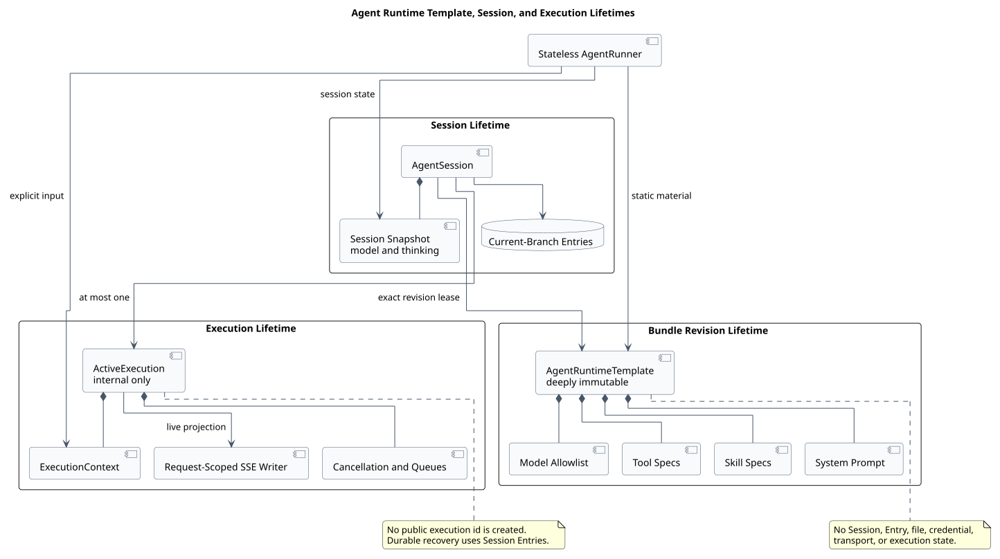
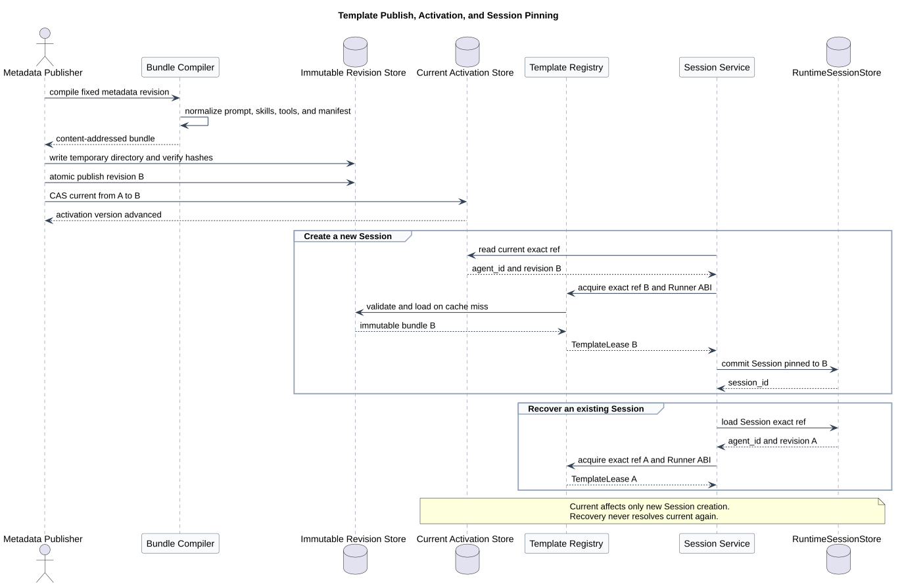
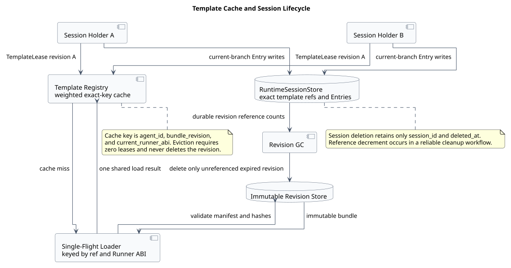
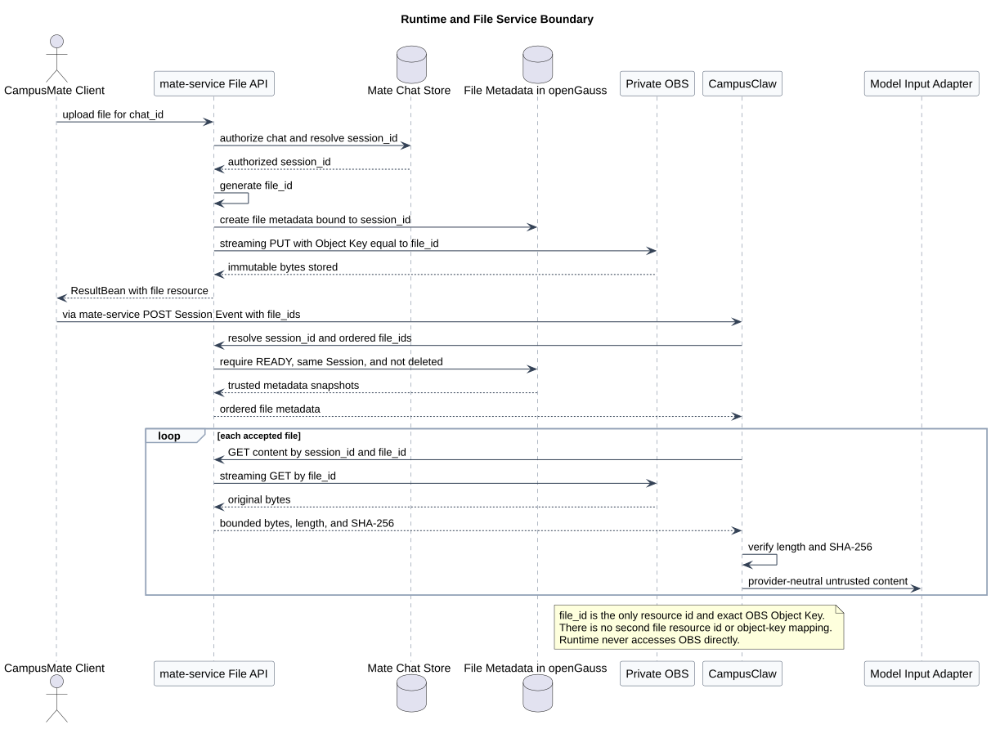

# AgentRuntimeTemplate 不可变运行模板设计

| 属性 | 值 |
|---|---|
| 文档版本 | 2.0.0 |
| 状态 | 目标设计，尚未实施 |
| pi-mono 源码基线 | `086c32e74530564922d011ade23ff582c9d63116` |
| pi-mono-java 源码基线 | `195746614096312d4e93afb029d387837db78e0b` |
| Runtime HTTP 契约 | [CampusClaw Runtime HTTP API 1.29.0](../pi-mono-java-manager-driven-multi-agent-runtime/chat-http-v1-design.md) |
| 更新日期 | 2026-08-18 |

## 1. 结论

`AgentRuntimeTemplate` 是一个 Agent 固定 revision 的、深度不可变的进程内运行模板。
它提前物化 System Prompt、Skill 摘要、通用 Tool 规范、模型 allowlist 和兼容信息，
使多个 Session 可以共享静态结构，同时保持消息、模型选择、thinking、文件引用和
当前执行完全隔离。

Session 创建时，CampusClaw 根据 `agent_id` 解析当前已激活 revision，加载精确模板，
由 Agent 配置选择默认模型，持久化 `(agent_id, bundle_revision)` 后返回 Session。
恢复时永远按 Session 保存的精确 revision 加载，不追随后来切换的 `current`。

Template 与 HTTP/SSE 传输正交。浏览器到 mate-service、mate-service 到 CampusClaw
均使用 HTTP；执行使用 `POST /sessions/{session_id}/events` 的请求范围 SSE。
Template 不保存连接、响应 writer、公共 Run 或执行 ID。



[PlantUML 源码：`agent_runtime_template_lifetimes`](diagram.puml#L8)

## 2. 源码证据与差异

### 2.1 已观察到的行为

| 证据 | 观察 |
|---|---|
| pi [`agent-session.ts` `AgentSession`](https://github.com/badlogic/pi-mono/blob/086c32e74530564922d011ade23ff582c9d63116/packages/coding-agent/src/core/agent-session.ts#L305) | Session 组合 Agent、模型、SessionManager、设置、技能和扩展服务 |
| pi [`session-manager.ts` `SessionManager`](https://github.com/badlogic/pi-mono/blob/086c32e74530564922d011ade23ff582c9d63116/packages/coding-agent/src/core/session-manager.ts#L855) | 消息和扩展 Entry 使用 `id/parentId` 形成会话树 |
| pi-mono-java [`AgentSession.java` `initialize`](https://github.com/superheromeZzh/pi-mono-java/blob/195746614096312d4e93afb029d387837db78e0b/modules/coding-agent-cli/src/main/java/com/campusclaw/codingagent/session/AgentSession.java#L90) | 每个 Session 初始化时加载模型、Skill、Tool、SYSTEM.md 并构建 Prompt |
| pi-mono-java [`SkillLoader.java`](https://github.com/superheromeZzh/pi-mono-java/blob/195746614096312d4e93afb029d387837db78e0b/modules/coding-agent-cli/src/main/java/com/campusclaw/codingagent/skill/SkillLoader.java#L78) | 当前会递归扫描 Skill 目录并解析 `SKILL.md` |
| pi-mono-java [`SystemPromptBuilder.java`](https://github.com/superheromeZzh/pi-mono-java/blob/195746614096312d4e93afb029d387837db78e0b/modules/coding-agent-cli/src/main/java/com/campusclaw/codingagent/prompt/SystemPromptBuilder.java#L53) | System Prompt 在 Session 初始化期组合 Tool、Skill 与上下文 |
| pi-mono-java [`Agent.java`](https://github.com/superheromeZzh/pi-mono-java/blob/195746614096312d4e93afb029d387837db78e0b/modules/agent-core/src/main/java/com/campusclaw/agent/Agent.java#L56) | `Agent` 持有 mutable state 和当前执行控制，不适合跨 Session 共享 |

当前两套源码都没有 `AgentRuntimeTemplate`、不可变 bundle revision、精确 revision
Registry 或本文的发布协议。现有 `.campusclaw` 用户/项目目录是 CLI 行为；Managed
Runtime 的 `.campusagent` 目录和模板缓存均是 target-only 架构改造。

### 2.2 差异分类

| 分类 | 内容 |
|---|---|
| 观察到的源码行为 | Session 初始化重复加载静态设置、Skill 和 Prompt；Agent 本身带 mutable state |
| 产品约束 | Session 固定 Agent revision，但可以切换 `model_id`；Session 名称和 `chat_id` 属于 mate-service |
| 架构改造 | 增加不可变 bundle、Template Loader/Registry、exact-key single-flight、revision pinning 与 GC |
| 安全加固 | 只加载受控根目录、校验 manifest/hash/符号链接边界，不把凭据或用户数据写入 Template |

## 3. 三种生命周期

| 对象 | 生命周期 | 共享范围 | 可变内容 |
|---|---|---|---|
| `AgentRuntimeTemplate` | bundle revision | 同 JVM、多 Session | 无；深度不可变 |
| `AgentSession` / Session record | Session | 单 `session_id` | model、thinking、Entry tree、revision、state |
| `ActiveExecution` | 一次被接受的用户事件 | 单 Session、进程内 | 取消、队列、临时 delta、工具状态 |

`AgentRunner` 可以是无状态共享组件，也可以在第一阶段由每个 Session 持有兼容
Adapter；无论采用哪种方式，都不能把 mutable `Agent` 或 `AgentState` 放进 Template。

## 4. Template 合约

### 4.1 建议 Java 结构

```java
public record AgentRuntimeTemplateRef(
        String agentId,
        String bundleRevision) {}

public record AgentRuntimeTemplate(
        AgentRuntimeTemplateRef ref,
        int templateAbi,
        int materializedForRunnerAbi,
        String agentVersion,
        String defaultModelId,
        Set<String> enabledModelIds,
        String systemPrompt,
        List<RuntimeSkillSpec> skills,
        List<RuntimeToolSpec> tools,
        TemplateCompatibility compatibility) {}

public record TemplateCompatibility(
        int minimumRunnerAbi,
        int maximumRunnerAbi,
        String promptProfile,
        String toolProtocolVersion) {}
```

Java 实现需要把集合复制为不可变值，并对嵌套对象做深度不可变校验；不得只依赖
record 的浅层不可变外观。

### 4.2 必须包含

| 分类 | 内容 | 原因 |
|---|---|---|
| 身份 | `agent_id + bundle_revision` | Session pinning 和精确恢复 |
| 兼容 | Template ABI、Runner ABI 区间、Prompt profile、Tool protocol | 阻止不兼容加载 |
| Agent 配置 | agent version、默认模型、模型 allowlist | 创建 Session 和模型切换校验 |
| Prompt | 已规范化 System Prompt | 避免每 Session 重复读取与拼接 |
| Skill | 名称、描述、正文索引和内容 hash | 渐进加载与审计 |
| Tool | `read/get_tool_info/call_tool` 的逻辑规范与协议版本 | Runtime 统一绑定实际执行器 |
| 来源 | manifest hash、编译器版本和必要 provenance | 可重复验证和问题定位 |

### 4.3 绝不能包含

| 内容 | 所属对象 |
|---|---|
| `session_id`、Entry、branch、model override、thinking | Session |
| `file_ids`、文件元数据快照 | User Entry / Session |
| 取消令牌、deadline、临时 delta、Tool execution | ActiveExecution |
| SSE writer、HTTP request、WebSocket 或订阅状态 | Transport adapter |
| API key、JWT、APPKEY、Manager credential、base URL | 认证或 Manager client |
| Chat 名称、`chat_id`、最终用户身份 | mate-service |

## 5. Bundle revision

### 5.1 目录布局

```text
<agent-runtime-root>/
└── <agent-id>/
    ├── current.json
    └── revisions/
        └── <bundle-revision>/
            ├── manifest.json
            └── .campusagent/
                ├── settings.json
                ├── SYSTEM.md
                └── skills/
                    └── <skill-name>/
                        ├── SKILL.md
                        └── references/
                            └── tools.json
```

revision 目录发布后不可修改。`current.json` 只负责新 Session 选择，不进入 revision
hash。发布者先写临时目录、校验、fsync，再原子重命名为最终 revision；最后用独立
CAS 更新 current activation。

### 5.2 Manifest

manifest 至少包含：

- `agentId`、`agentVersion`、`bundleRevision`；
- `bundleSchemaVersion`、`templateAbi`；
- `minimumRunnerAbi`、`maximumRunnerAbi`；
- `promptProfile`、`toolProtocolVersion`；
- 所有受管文件的规范相对路径、长度与 SHA-256；
- 发布器版本、创建时间和来源 revision。

Loader 拒绝绝对路径、`..`、路径分隔混淆、目录外符号链接、重复规范路径、大小写
碰撞、hash/长度不符和未知必填协议。Runner ABI 必须位于 manifest 声明的闭区间。



[PlantUML 源码：`agent_runtime_template_publish_and_pin`](diagram.puml#L79)

## 6. Compile、Publish、Load

```java
public interface AgentBundleCompiler {
    CompiledAgentBundle compile(AgentMetadataSnapshot metadata);
}

public interface AgentBundlePublisher {
    AgentRuntimeTemplateRef publish(CompiledAgentBundle bundle);
    void activate(AgentRuntimeTemplateRef ref, long expectedActivationVersion);
}

public interface AgentRuntimeTemplateLoader {
    AgentRuntimeTemplate load(
            AgentRuntimeTemplateRef ref,
            int currentRunnerAbi);
}

public interface AgentRuntimeTemplateRegistry {
    TemplateLease acquire(AgentRuntimeTemplateRef ref);
}
```

`compile()` 与 `publish()` 只在发布链路执行。HTTP 请求只执行 resolve、load 和
acquire；不得临时编译、回退扫描旧目录或从 Manager 现场拼装静态 Prompt。

`TemplateLease` 明确一个 Session/执行正在使用模板。缓存淘汰只移除可重新加载的
进程内对象，不删除 revision 目录；revision GC 由独立控制面根据持久化引用计数和
保留窗口执行。

## 7. Registry 与高并发



[PlantUML 源码：`template_cache_and_session_lifecycle`](diagram.puml#L142)

缓存 key 必须是：

```text
(agent_id, bundle_revision, current_runner_abi)
```

不能只按 `agent_id` 缓存，否则 current 切换会污染旧 Session；也不能忽略 Runner
ABI，否则滚动升级时可能复用不兼容的物化结果。

同一 exact key 的并发 miss 使用 single-flight：一个 Loader 执行，其他调用方等待
同一个 Future。不同 key 可以并行加载，但全局加载并发和总权重有界。

候选 Profile：

| 项目 | 初始值 | 约束 |
|---|---:|---|
| 同时加载数 | 4 | 超出进入有界等待或快速失败 |
| 缓存权重 | 256 MiB | 按物化字符串、Skill、Schema 保守估算 |
| 单模板最大权重 | 16 MiB | 超出拒绝发布/加载 |
| single-flight 等待 | 10 秒 | 超时不取消唯一 Loader |
| 负缓存 | 5 秒 | 仅缓存稳定校验失败，不缓存鉴权/瞬态 I/O |

淘汰条件同时满足：引用计数为零、没有加载 Future、不是预热保留项。缓存失效不等于
revision 删除；下一次 exact-key acquire 可以重新加载相同内容。

## 8. Session 创建与恢复

### 8.1 创建

已确认的公开行为是无请求体：

```http
POST /campusclaw-service/v1/agents/{agent_id}/sessions
```

内部顺序：

1. 每个请求独立完成 JWT 或 APPKEY 认证，得到唯一 `CallerAuthContext`；
2. 校验 `agent_id` 并强一致读取 current activation；
3. `Registry.acquire(exactRef)` 加载模板；
4. Model Manager 校验默认模型仍可用且属于模板 allowlist；
5. CampusClaw 生成 `session_id`；
6. 数据库事务保存 Session、精确 template ref、默认模型、`thinking=false`、
   `state=idle` 和初始资源版本；
7. 事务提交后返回 `201` ResultBean。

调用方不能指定 `session_id`、revision 或 `model_id`。Session 名称不进入 CampusClaw，
由 mate-service 的 Chat 元数据保存。

### 8.2 恢复

任意 Session HTTP 请求都可以触发恢复：

1. 强一致读取 Session record；不存在或 tombstone 统一返回 `SESSION_NOT_FOUND`；
2. 使用 record 保存的 exact template ref，而不是 current activation；
3. 取得 Template Lease，校验 Runner ABI；
4. 从当前分支持久化 Entry 重建 Session state；
5. 重新校验动态 Model/Tool 权威；
6. 原子安装本 Pod 的 Session holder。

Pod 重启后遗留的内部 `running` 栅栏不代表可恢复的公共执行。恢复 owner 清理该栅栏，
使 Session 收敛为 `idle`，只重建已经完整提交的 Entry；不创建 RunRecord 或公共
`interrupted` 资源。

### 8.3 删除

Delete Session 先使 Session 对 API 不可见，取消 active execution，再异步清理 Entry、
内部状态和文件引用。永久 tombstone 只保留 `session_id`、`deleted_at`。不可恢复删除
完成后，revision 引用计数在同一可靠工作流中递减；revision GC 才能据此判断是否可删。

## 9. AgentRunner 与 Tool 绑定

```java
public interface AgentRunner {
    CompletionStage<ExecutionResult> execute(
            AgentRuntimeTemplate template,
            SessionSnapshot session,
            ExecutionContext execution);
}

public interface RuntimeToolExecutor {
    CompletionStage<ToolResult> execute(
            RuntimeToolSpec spec,
            SessionSnapshot session,
            ExecutionContext execution,
            JsonNode arguments);
}
```

Template 保存 Tool spec，不保存捕获某个 Session 的执行闭包。执行器在每次调用时
重新校验 Agent 绑定、Tool 状态、权限和输入 Schema；凭据从受控 Manager client
取得，不进入 Template 或 Entry。

第一阶段可以为每个 Session 从 Template 创建兼容 wrapper，但 wrapper 必须显式
绑定该 Session，不能被缓存到 Template。长期目标是无状态 Runner 与显式上下文。

## 10. 文件服务边界



[PlantUML 源码：`runtime_file_service_boundary`](diagram.puml#L193)

文件不属于 bundle 或 Template。Runtime Event 只接收有序 `file_ids`；CampusClaw
以当前 `session_id` 调用 mate-service 内部 resolve/content 接口，得到可信文件名、
MIME、大小和 SHA-256 快照，再用有界流传给模型。

`file_id` 是文件服务的唯一资源 ID，同时是私有 OBS Object Key；不存在第二套
文件资源 ID 或 object-key 映射。Runtime 不直连 OBS，不保存 URL、Bucket、
凭据或文件正文。已完成 User Entry 只保存本次接受时的文件元数据快照。

完整生命周期见 [CampusMate 文件服务](../campusmate-attachment-service/README.md)。

## 11. 动态权威

| 数据 | 是否进入 Template | 使用时行为 |
|---|---|---|
| System Prompt、Skill 内容、Tool 摘要 | 是 | 固定到 bundle revision |
| 默认模型与模型 allowlist | 是 | 创建/切换时还要与 Model Manager 求交集 |
| Model 可用性、凭据、限流 | 否 | 每次模型调用重新校验 |
| Tool enable、权限、实时 Schema | 否 | `get_tool_info/call_tool` 时重新校验 |
| Session model、thinking、Entry | 否 | 从 Session Store 读取 |
| `file_ids` 与文件快照 | 否 | 接受 User Event 时解析并保存 |
| HTTP/SSE 状态与 ActiveExecution | 否 | 请求和执行范围内维护 |

静态变更发布新 revision 并切换 current，只影响新 Session。动态安全撤销可以立即
阻止后续 Model/Tool/File 调用，无需重写 Template；已开始调用如何取消由各 Manager
和 ActiveExecution 策略决定。

## 12. 安全、可观测性与验收

### 12.1 安全不变量

- 受控根目录使用规范化路径与 no-follow 校验，拒绝越界和符号链接逃逸；
- manifest 文件集、大小、hash 与协议版本全部校验后才构造对象；
- Template 日志不输出完整 Prompt、Skill 正文、Schema、凭据或文件内容；
- `chat_id`、Session 名称和最终用户身份不进入 Runtime Template；
- 模型与工具摘要不是授权，执行前仍由 Manager 做最终校验；
- 加载失败使用稳定脱敏错误，内部路径和 Provider 配置不进入 ResultBean。

### 12.2 指标

- `runtime_template_cache_weight_bytes`
- `runtime_template_cache_entries`
- `runtime_template_load_total{outcome}`
- `runtime_template_load_seconds`
- `runtime_template_singleflight_waiters`
- `runtime_template_revision_reference_count`
- `runtime_template_gc_total{outcome}`

指标不使用 `session_id` 或 revision 作为 label；它们只进入受控日志/trace。

### 12.3 验收

- 相同 exact key 并发加载只执行一次 Loader，失败不会留下半成品缓存；
- current 从 A 切到 B 后，旧 Session 仍精确加载 A，新 Session 使用 B；
- Runner ABI 不兼容、manifest hash 不符、符号链接越界均稳定拒绝；
- 缓存淘汰后相同 revision 可以重新加载，且不会删除磁盘 revision；
- revision 有持久化 Session 引用时 GC 永不删除；
- Template 对象图中不存在 Session、Entry、file、凭据、HTTP/SSE 或 ActiveExecution；
- Session 创建无需请求体，由 CampusClaw 生成 ID 和选择默认模型；
- Pod 重启只恢复完整 Entry，不产生公共 Run 或连接恢复状态；
- 文件服务全链路只使用 `file_id/file_ids`，不存在第二套附件资源 ID。

## 13. 版本历史

| 版本 | 日期 | 变更 |
|---|---|---|
| 2.0.0 | 2026-08-18 | 对齐十一项 Session HTTP+SSE 契约；移除两跳 WebSocket、连接 generation、公开 Run/RunRecord 和 caller-generated session_id；恢复路径统一为 exact revision + 当前分支 Entry；附件统一为 file_id |
| 1.5.0 | 2026-08-04 | 历史版本；包含已废弃的两跳 WebSocket、公开执行记录与 attachment_id 设计，仅可从 Git 历史追溯 |
| 1.0.0 | 2026-08-03 | 首版不可变 Template、bundle revision、single-flight、Session pinning 与 GC 设计 |
