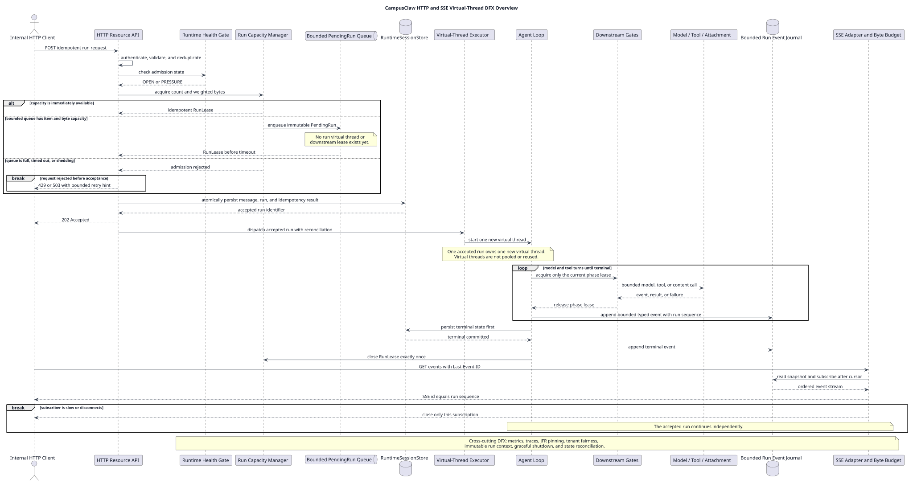

# CampusClaw HTTP+SSE 虚拟线程 DFX 评审设计

| 属性 | 值 |
|---|---|
| 文档版本 | 1.0.0 |
| 状态 | DFX 评审工作底稿；目标设计，尚未实施 |
| 更新日期 | 2026-08-12 |
| 当前评审目标 | HTTP+SSE 传输下支持 100 个并发 Agent Run |
| `pi-mono-java` 源码基线 | `1f7a5423219edfa4519d8719f1cc8a188ed72873` |
| 设计仓库分析基线 | `3fa6eb57c40b1af599dd495db916eaa360e3638d` |
| 关联设计 | [Java 21 虚拟线程评估](../java21-virtual-thread-pool-assessment/README.md)、[HTTP API 设计](../pi-mono-java-manager-driven-multi-agent-runtime/chat-http-v1-design.md)、[高并发治理设计](../campusclaw-high-concurrency-governance/README.md)、[AgentRuntimeTemplate 设计](../agent-runtime-template/README.md) |

> [!IMPORTANT]
> 本文用于逐项评审。除第 2.1 节明确标记的源码观察外，HTTP+SSE、100 并发
> Profile、Lease、容量门禁、Event Journal、过载状态和验收标准均为
> **target-only design**。未经实现和压测，不得表述为当前 CampusClaw 已具备的
> 生产能力。

## 1. 目的与使用方式

本文把虚拟线程方案从“执行技术选择”扩展为可逐项关闭的 DFX 评审清单。它不把
`Semaphore`、有界等待和资源池化当作全部方案，而是同时覆盖：

- 容量与内存安全；
- 超时、取消、异常和资源释放；
- HTTP 接受、Run 执行与 SSE 订阅的生命周期解耦；
- 幂等、终态持久化、Pod 重启和 SSE 恢复；
- 慢消费者背压、多租户公平和安全隔离；
- pinning、CPU、JVM、指标、告警和动态降级；
- 优雅停机、配置治理、故障注入和容量验收。

评审状态只允许使用：

| 状态 | 含义 |
|---|---|
| 待评审 | 当前只是候选决策，尚未形成评审结论 |
| 已接受 | 决策、边界、验收方法和责任人均已明确 |
| 需修改 | 方向可保留，但参数或行为需要修改 |
| 阻塞 | 缺少外部配额、硬件、工作负载或依赖契约，无法关闭 |

每完成一项评审，应同时更新第 6 节登记表、对应详细章节、开放问题和版本历史。

## 2. 基线、范围与差异分类

### 2.1 已观察的 Java 源码行为

以下行为来自固定基线 `pi-mono-java@1f7a5423`，是当前实现事实：

| 观察项 | 仓库相对路径与证据 | 已观察行为 | DFX 影响 |
|---|---|---|---|
| Agent Run | `modules/agent-core/src/main/java/com/campusclaw/agent/Agent.java:60-61,218-268`，`VIRTUAL_THREAD_EXECUTOR`、`startExecution` | 每次 Run 创建新虚拟线程；`executionLock` 拒绝同一 Agent 的第二个并发 Run | 已有一任务一虚拟线程和单 Agent 单 Run，但没有节点级或部署级准入 |
| 模型消费 | `modules/agent-core/src/main/java/com/campusclaw/agent/loop/AgentLoop.java:209-276`，`invokeModel`、`consumeStream` | Agent 虚拟线程用 `toIterable()` 阻塞消费事件，必要时调用 `result().block()` | I/O 等待适合虚拟线程，但取消、超时和流背压必须单独治理 |
| Tool 并行 | `modules/agent-core/src/main/java/com/campusclaw/agent/tool/ToolExecutionPipeline.java:178-207`，`executeSequentially`、`executeInParallel` | 并行模式用 `newVirtualThreadPerTaskExecutor()`，随后等待全部 Future | 线程模型正确，但没有全局和单 Run Tool fan-out 上限 |
| Provider Reader | `modules/ai/src/main/java/com/campusclaw/ai/provider/openai/OpenAIResponsesProvider.java:113-175`，`doStream`、`executeStream`、`buildClient` | 每次模型流再创建一个虚拟线程，并为每个 Run 创建和关闭一个 `OpenAIClient` | 需要 Model Gate、取消闭环和共享客户端；不能把客户端绑定到虚拟线程 |
| 模型事件通道 | `modules/ai/src/main/java/com/campusclaw/ai/stream/EventStream.java:14-27,54-88`，`EventStream` 构造器 | unicast sink 使用无界缓冲 | 100 Run 下慢生产或慢消费可能形成无界堆积 |
| 流事件对象 | `modules/ai/src/main/java/com/campusclaw/ai/stream/AssistantMessageEvent.java:58-164` 及 `OpenAIResponsesProvider.applyTextDelta/applyThinkingDelta` | delta 同时携带增量和累计 partial Message | 长输出会放大对象分配、序列化 CPU 和内存 |
| Session Pool | `modules/coding-agent-cli/src/main/java/com/campusclaw/codingagent/mode/server/SessionPool.java:167-202,388-405`，`getOrCreate`、`evictIdle` | 进程内 map 没有 single-flight 和总容量；Session 初始化同步执行 | HTTP 接入不能直接沿用为生产级多请求 Session 生命周期 |
| Session 持久化 | `modules/coding-agent-cli/src/main/java/com/campusclaw/codingagent/session/SessionManager.java:277-400`，`appendMessage`、`appendRaw` | 本地 JSONL 每次 append 都 flush | Managed HTTP+SSE 目标需要共享权威 Store 和有界写入，不能以本地 JSONL 宣称跨 Pod 恢复 |

### 2.2 当前目标口径

本轮评审采用以下候选口径，最终值必须在 DFX-01 中确认：

```text
100 Agent concurrency = at most 100 active Agent Runs in the agreed capacity scope
```

它不等于 100 个 HTTP 请求、100 个 Session、100 条 SSE 连接或 100 个虚拟线程。
一个 active Run 可能同时存在 Agent Run、Provider Reader 和 Tool Call 等多个虚拟
线程任务。

HTTP+SSE 的候选职责边界为：

- `POST /sessions/{session_id}/runs` 只负责校验、准入、原子接受和返回 `202`；
- Agent Run 获得 Run Lease 后在新的虚拟线程中独立执行；
- `GET /sessions/{session_id}/runs/{run_id}/events` 只建立 SSE 订阅；
- HTTP 请求或 SSE 断开不等于 Abort；
- SSE 使用 `run_seq`、`Last-Event-ID`、有界 Event Journal 和 History 恢复；
- 每个 Session 同时最多一个 active Run。

### 2.3 差异分类

| 分类 | 内容 | 原因 |
|---|---|---|
| 观察到的源码行为 | Agent Run、Provider Reader、并行 Tool 已使用虚拟线程；模型事件和当前 Session/连接缓冲缺少生产级边界 | 固定源码基线事实 |
| 产品约束 | 目标采用 HTTP+SSE；100 并发按 active Agent Run 计量；同一 Session 只允许一个 active Run | 明确容量承诺和业务语义 |
| 架构改造 | 增加 Run/内存/下游 Lease、有界 admission、共享 Store、Run Event Journal、SSE 恢复和共享客户端 | 虚拟线程只降低阻塞线程成本，不能提供容量、背压和恢复 |
| 安全加固 | 租户配额、上下文隔离、错误脱敏、指标低基数、凭据不进入 ThreadLocal/事件/Store | 防止跨 Session 泄漏、资源抢占和可观测性侧信道 |
| 运维约束 | JFR、指标、动态 shedding、优雅停机、故障注入和容量验收 | 100 并发必须由运行证据证明 |

## 3. 目标架构总览



[PlantUML 源码](diagram.puml#L15)

核心边界是：**虚拟线程负责执行，Lease 负责容量，Event Journal 负责恢复，SSE
只负责投影。**

## 4. 设计原则与不变量

### 4.1 虚拟线程原则

- 每个已接受 Agent Run 创建一个新虚拟线程；结束后终止，不借还、不复用；
- 并行 Tool Call 每任务一个虚拟线程，但创建前先获得 Tool Lease；
- JVM 级 `newVirtualThreadPerTaskExecutor()` 只是提交和关闭接口，不是固定线程池；
- 不以虚拟线程数量表达业务容量，不配置“最大虚拟线程数”；
- CPU 密集任务经证据确认后才转入固定平台线程 Executor 和有界队列。

### 4.2 接受与执行不变量

```text
no Run Lease -> no accepted Run -> no Run virtual thread
```

- 无效请求在容量排队前拒绝；
- 等待容量时只保留有界 `PendingRun` 描述符，不创建 Run 虚拟线程；
- 取得 Run 数量和内存 Lease 后，原子持久化用户消息、RunRecord、幂等结果和
  active-run；
- 持久化成功后才返回 `202 Accepted` 并提交 Run；
- terminal 先持久化，再向 Event Journal/SSE 发布；
- 所有 Lease 在正常、异常、取消、超时和停机路径 exactly-once 释放。

### 4.3 传输不变量

```text
HTTP request lifetime != Run lifetime != SSE subscription lifetime
```

- `POST /runs` 断开不能自动 Abort 已接受 Run；
- SSE 断开只取消订阅；
- 显式 Abort 使用独立幂等 HTTP 操作；
- 慢 SSE 消费者只能影响自己的订阅，不能阻塞或终止 Run；
- Event Journal 不是长期 History；游标过期后通过 Run 快照和 History 恢复。

## 5. 100 并发候选容量 Profile

本节是待评审的首轮压测初值，不是生产默认值。硬件规格、单节点或集群范围尚未
确认前，不能据此形成容量承诺。

| 资源 | 候选初值 | 保护目标 |
|---|---:|---|
| active Agent Run | 100 | 核心业务并发上限 |
| Run 等待队列 | 20 项、32 MiB、最多 5 秒 | 防止突发请求形成无界等待 |
| Run retained-memory | 512 MiB；4 MiB/unit | 防止长上下文绕过 Run count |
| resident Session | 150 | 覆盖 active、waiting 和空闲余量 |
| Session 冷初始化 | 2 active、16 waiting | 防止模板、Prompt 和 Store 冷加载风暴 |
| SSE Subscription | 120 | 容纳 100 active 和少量重连重叠 |
| 在途模型流 | `min(100, 上游授权配额)` | Provider/Model Manager 最终优先 |
| 在途 Tool Call | 64 global、4/run | 限制 Tool fan-out |
| 在途 Store 写 | 16 | 保护连接池和提交吞吐 |
| 在途附件正文读取 | 16～32 | 保护带宽、内存和 Attachment Service |
| 单 Run 模型通道 | 256 事件且 256 KiB | 事件数与字节双上限 |
| 单 SSE 待发送缓冲 | 1 MiB | 慢消费者局部隔离 |
| 节点 SSE 缓冲总量 | 64 MiB | 防止连接数乘以单连接上限耗尽内存 |
| Delta 合并 | 50 ms 或 8 KiB | 每 Run 目标不超过约 20 Frame/s |

如果“100”是集群总上限，不能给每个节点各配置 100 后仍宣称集群上限为 100。
必须选择以下一种治理方式并在 DFX-01 中记录：

1. 集群调度器持有全局配额，节点持有本地硬上限；
2. 按节点静态分片，例如两个节点各 50；
3. 每节点都具备 100 能力，但另有全局 admission 保证稳态总量不超过 100。

## 6. DFX 逐项评审登记表

| ID | 评审项 | 候选决策 | 关闭所需证据 | 状态 |
|---|---|---|---|---|
| DFX-01 | 容量口径与部署范围 | 100 表示约定范围内 active Run，不等于线程/连接/Session | 节点数、硬件、单节点故障目标、Provider 配额、工作负载 | 待评审 |
| DFX-02 | HTTP、Run、SSE 生命周期 | 三者解耦；SSE 断开不 Abort | 接口状态机、断线和重连测试 | 待评审 |
| DFX-03 | Lease 与许可所有权 | 不向业务暴露裸 `Semaphore`；Lease 幂等关闭 | acquired/released 对账、double-close 和异常测试 | 待评审 |
| DFX-04 | 多资源准入与死锁 | Run count+memory 原子准入；下游分阶段取 Lease | 固定取锁顺序和无 permit 泄漏测试 | 待评审 |
| DFX-05 | 有界等待与过载 | item+bytes+time 三重上限，accepted 前拒绝 | 120 突发、取消和队列耗尽测试 | 待评审 |
| DFX-06 | 超时与取消传播 | Admission、首 Token、读空闲、Tool、总 Run 分层超时 | 下游 I/O 真实关闭和 terminal 收敛证据 | 待评审 |
| DFX-07 | 幂等、持久化与恢复 | accepted 原子提交；terminal 先落库；重启转 interrupted | 提交失败、dispatch 失败、kill -9 和重放测试 | 待评审 |
| DFX-08 | SSE 背压与续传 | 双上限通道、慢订阅隔离、`Last-Event-ID` 恢复 | 慢消费者、游标过期和重连一致性测试 | 待评审 |
| DFX-09 | 数量和内存双重预算 | Run、queue、stream、SSE 同时按 count+bytes 治理 | retained/allocated 测量和误差校准 | 待评审 |
| DFX-10 | 公平性与租户隔离 | global+tenant+user+session 分层配额 | 饥饿、突发租户和 Tool fan-out 测试 | 待评审 |
| DFX-11 | Pinning 与 CPU 隔离 | JFR 检测；CPU 重任务进入有界平台线程 Executor | pinned 事件和 CPU 压测证据 | 待评审 |
| DFX-12 | 上下文与安全隔离 | 不可变 RunContext；凭据和昂贵资源不进 ThreadLocal | 跨 Session/租户污染和错误脱敏测试 | 待评审 |
| DFX-13 | 业务资源池生命周期 | 只池化可安全复用的客户端、连接和不可变 Template | 创建成本、隔离、健康检查和泄漏证据 | 待评审 |
| DFX-14 | 可观测性与诊断 | 指标、Trace、JFR 和 Lease 对账形成闭环 | 看板、告警、低基数和敏感信息审查 | 待评审 |
| DFX-15 | 动态过载与降级 | `OPEN/PRESSURE/SHEDDING/DRAINING` 状态机 | 阈值、滞回、故障注入和恢复测试 | 待评审 |
| DFX-16 | 优雅停机与发布 | 停止准入、等待有界时间、终态对账、释放资源 | SIGTERM、超时 Run 和重启测试 | 待评审 |
| DFX-17 | 测试与容量验收 | 并发正确性、故障注入、soak、真实依赖分级验收 | 100/120/soak/慢 SSE/下游故障报告 | 待评审 |
| DFX-18 | 配置与可维护性 | 集中 Capacity Profile，启动校验不变量 | 配置错误拒绝启动和变更审计 | 待评审 |

## 7. DFX 详细设计候选

### 7.1 DFX-03：Lease 与资源安全

直接调用裸 `Semaphore.acquire/release` 难以表达许可 owner、重复释放和组合资源
回滚。目标实现使用：

```java
interface RunLease extends AutoCloseable {
    String leaseId();

    @Override
    void close(); // idempotent
}
```

必须满足：

- 只有成功取得许可的 owner 创建 Lease；
- `close()` 重复调用不增加可用许可；
- admission waiter 超时或取消不能释放 owner 的许可；
- 提交失败、异常、Abort、超时和 shutdown 都从唯一 `finally` 路径关闭；
- 运行时持续满足 `acquired - released = active`；不一致时告警并停止扩大准入；
- `RunLease`、`ModelLease`、`ToolLease`、`StoreLease` 分开计量。

### 7.2 DFX-04：多资源准入与死锁

- Run count 和 Run memory 是联合准入；任一不足时不能只占住另一项等待；
- Run Lease 获得后才提交 Run 虚拟线程；
- Model、Tool、Store、附件读取在实际使用前分别取得局部 Lease，使用完立即释放；
- Tool 固定先取 per-run，再取 node-global；所有调用路径顺序一致；
- 不在持有 Model Lease 时等待长时间 Tool 执行；模型流结束先释放 Model Lease；
- 已有数据库连接池构成最终并发限制时，Store Gate 保护写任务/mailbox，不能机械
  叠加同尺寸门禁导致重复排队。

### 7.3 DFX-05：有界等待与过载

等待队列同时限制：

```text
pending_items <= 20
pending_bytes <= 32 MiB
pending_wait <= 5 seconds
```

任一上限先达到即拒绝。等待阶段不能创建 Run 虚拟线程，不能写入 accepted Run，
也不能占用 Model/Tool/Store Lease。候选错误语义：

- 租户或用户配额不足：`429 RATE_LIMITED`；
- Runtime 暂时无容量：`503 RUNTIME_OVERLOADED` 和有界 `Retry-After`；
- 同一 Session 已有 Run：`409 RUN_ACTIVE`；
- 真实 Manager 故障：`503 MANAGER_UNAVAILABLE`。

### 7.4 DFX-06：超时与取消

| 层次 | 计时起点 | 超时动作 |
|---|---|---|
| Admission | 合法请求进入等待队列 | accepted 前拒绝并移除 PendingRun |
| 模型连接 | Model Lease 获得并开始连接 | 关闭请求并释放 Model Lease |
| 首 Token | 请求成功发出 | 关闭模型流，Run 进入 error |
| 读空闲 | 收到最近一次模型事件 | 关闭停滞模型流，Run 进入 error |
| Tool | Tool Call 开始 | 取消工具 I/O，产生有界 Tool 终态 |
| Store | 写任务进入 mailbox | 失败或过载，不能永久占住 Run Lease |
| Run 总时限 | Run 进入 running | 传播取消、持久化终态、释放全部 Lease |

取消必须关闭模型 response body/stream、未完成 Tool、附件 content 流和可取消的
Store 操作。只调用 `Future.cancel(true)` 不构成完成证据，必须验证下游 SDK 是否
响应中断并释放连接。

### 7.5 DFX-07：幂等、持久化和恢复

目标顺序为：

1. 校验身份、Session、请求、附件和幂等键；
2. 占用 Session 的 `ADMITTING` 状态；
3. 获得 Run count+memory Lease；
4. 原子持久化 User Message、RunRecord、幂等结果和 active-run；
5. 返回 `202` 并提交 Run 虚拟线程；
6. terminal 先写权威 Store，再写 Event Journal/发布 SSE；
7. 最后 exactly-once 释放 Lease 并将 Session 转为 ready。

必须定义“数据库已接受但虚拟线程提交失败”的对账终态，不能留下永久 running。
Pod 重启后无法继续的旧 active Run 标记为 `interrupted`；不宣称跨 Pod 透明续跑。

### 7.6 DFX-08：SSE 背压、顺序和恢复

- Provider 只产生 typed delta；不要求每个 delta 携带完整累计 Message；
- Run 内只维护一份 accumulator，terminal 或快照时才物化完整 Message；
- 单 Run 模型通道限制 256 事件且 256 KiB，任一上限先到即背压；
- 生命周期和 terminal 使用保留控制容量，不能被普通 delta 饿死；
- 同类 delta 在 50 ms 或 8 KiB 合并，Tool/Message/terminal 边界不合并；
- 单 SSE 1 MiB、节点聚合 64 MiB，满时关闭最慢订阅但 Run 继续；
- SSE `id` 等于 `run_seq`，重连使用 `Last-Event-ID`；
- Event Journal 过期返回 `410 EVENT_CURSOR_EXPIRED`，客户端回退到 Run 快照和
  History。

### 7.7 DFX-09：数量与内存双重预算

Run 初始权重候选为：

```text
estimated_retained_bytes =
    serialized_context_bytes
  + expected_output_budget_bytes
  + accumulator_budget_bytes
  + fixed_run_overhead_bytes

memory_units = max(1, ceil(estimated_retained_bytes / 4 MiB))
```

100 count permits 与 512 MiB memory permits 同时生效。估算不是精确 JVM 对象大小；
压测必须比较估算值、terminal retained bytes 和 allocation rate。误差长期超过
25% 时应修正估算或降低并发，不能依赖 GC 兜底。

### 7.8 DFX-10：公平性和租户隔离

候选层次为：

```text
deployment or node Run cap
  -> tenant Run cap
    -> user Run cap
      -> one active Run per Session
```

公平 `Semaphore` 只能改变同一门禁中的等待顺序，不能替代租户配额。还需要防止
单个 Run 占满 Tool、附件读取或 SSE 缓冲；长上下文 Run 应通过内存权重自动降低
可接受数量。

### 7.9 DFX-11：Pinning 和 CPU 隔离

- 使用 JFR `jdk.VirtualThreadPinned` 发现高频长时 pinning；
- 不在长时间或高频 `synchronized` 区域内执行网络、文件、数据库或 Tool 阻塞；
- native/FFM 和第三方 SDK 阻塞需要单独验证；
- JSON 序列化、Prompt 构建、压缩、附件解析等 CPU 突发仍受 CPU 核数限制；
- 只有 JFR/压测证明为持续 CPU 重任务时，才放到与 CPU 核数匹配的平台线程
  Executor 和有界队列；
- 不通过调大 `jdk.virtualThreadScheduler.parallelism` 或
  `jdk.virtualThreadScheduler.maxPoolSize` 掩盖 CPU/pinning 问题。

### 7.10 DFX-12：上下文和安全隔离

每个 Run 使用显式、不可变的 `AgentRunContext` 传递 Session、Run、Agent、调用
身份、模型策略、Trace、deadline 和 cancellation token。不得使用进程级可变
变量保存当前 Agent/Session，也不得在虚拟线程 `ThreadLocal` 中缓存模型客户端、
数据库连接、MCP 会话或凭据。

有状态 `Agent`、`AgentSession`、transcript、partial output 和取消状态不能跨
Session 池化。日志、指标、SSE、Store 和错误响应均不得包含凭据、Prompt、原始
thinking、内部 Header 或未脱敏下游正文。

### 7.11 DFX-13：业务资源池生命周期

只有同时满足以下条件才允许池化：

- 真实压测证明创建或初始化成本高；
- 任务结束后能够可靠清理请求状态；
- 跨请求和跨租户复用满足认证与隔离要求；
- 有最大/最小数量、借用超时、健康检查、失败退避、失效驱逐、空闲回收、最大
  生命周期和泄漏检测；
- shutdown 能关闭底层连接和维护任务；
- 池化收益大于生命周期复杂度。

候选对象是共享 Model/Tool HTTP 客户端、HTTP/2/TLS 连接、数据库连接、不可变
Runtime Template，以及经验证安全的 MCP 连接或 Sandbox Worker；虚拟线程本身
永不池化。

### 7.12 DFX-14：可观测性和诊断

| 指标组 | 最低指标集合 |
|---|---|
| Run | active、waiting、accepted、rejected、done、aborted、error、interrupted |
| Admission | queue items/bytes、等待时延、超时、拒绝原因 |
| Lease | acquired、released、active、double-close、suspected-leak |
| 虚拟线程 | 数量趋势、start failure、`jdk.VirtualThreadPinned` |
| Model | inflight、TTFT、总耗时、取消、429/503 |
| Tool | global/per-run inflight、耗时、超时、取消 |
| Store | inflight、mailbox backlog、事务耗时和失败 |
| SSE | subscription、buffer bytes、重连、慢消费者关闭、cursor expired |
| JVM | process CPU、heap after GC、direct memory、allocation、GC pause |

指标标签不能使用 Session、Run、用户、Prompt 或完整 Tool 参数等无界/敏感值。
请求级诊断使用采样 Trace 和日志相关 ID。

### 7.13 DFX-15：动态过载和降级

静态 Permit 之外增加带滞回的节点状态：

| 状态 | 行为 |
|---|---|
| `OPEN` | 正常接受和排队 |
| `PRESSURE` | 缩短等待、限制非关键预热、加强合并 |
| `SHEDDING` | 拒绝新 Run；已接受 Run 继续 |
| `DRAINING` | 发布/停机阶段停止新 Session/Run，等待已有工作有界结束 |

触发依据包括 after-GC heap、direct memory、SSE buffer、CPU+queue、Provider
429/503、Store backlog 和 Lease 对账异常。进入与退出必须使用不同阈值和连续
窗口，避免状态抖动。

### 7.14 DFX-16：优雅停机和发布

收到 SIGTERM 后：

1. 进入 `DRAINING` 并停止新 Session/Run；
2. 取消仍未 accepted 的 PendingRun；
3. 保持 SSE/查询能力直到网关摘流或 deadline；
4. 等待 active Run 到部署 deadline；
5. 对未完成 Run 执行取消和 `interrupted` 对账；
6. 先完成 terminal Store，再关闭 Event Journal、客户端池和 Executor；
7. 核对所有 Lease、buffer 和 mailbox 回零。

停机不能无限等待，也不能只关闭虚拟线程 Executor 而留下 running 记录。

### 7.15 DFX-17：测试与容量验收

最低测试矩阵：

| 场景 | 负载或故障 | 必须证明 |
|---|---|---|
| 稳态 | 100 active Run，30 分钟 | 成功/终态完整，Permit 和缓冲不超限 |
| 突发 | 120+ Run | 100 active、20 waiting，其余有界拒绝 |
| Soak | 100 active 持续补充，2 小时 | 无 Lease、连接、Session、buffer 泄漏 |
| 慢 SSE | 10% 客户端停止读取 | 只关闭慢订阅，Run 和其他订阅继续 |
| 重连 | 反复携带 `Last-Event-ID` | `run_seq` 无重复应用、无静默缺口 |
| Provider | 快流、慢流、429、503、半流断开 | Model Gate、背压、取消和错误终态正确 |
| Tool | fan-out、超时、副作用错误 | global/per-run 上限和取消语义正确 |
| Store | 慢提交、连接耗尽、事务失败 | accepted/terminal 原子性和 Lease 最终释放 |
| 进程 | SIGTERM、kill -9、重启 | draining 或 interrupted 收敛，无悬空 running |
| Pinning | 模型、Tool、Store 全链路 JFR | 无高频长时 `jdk.VirtualThreadPinned` |

真实 Provider 测试前必须确认费用和 100 路并发流授权；Stub 测试只能证明
agent-service 本身，不等于端到端容量。

### 7.16 DFX-18：配置和可维护性

容量值集中为显式 Profile，例如：

```properties
runtime.capacity.profile=http-sse-100-v1
runtime.capacity.runs.concurrent=100
runtime.capacity.runs.max-bytes=536870912
runtime.capacity.runs.queue-items=20
runtime.capacity.runs.queue-bytes=33554432
runtime.capacity.runs.wait-timeout=5s
runtime.capacity.model-streams.concurrent=100
runtime.capacity.tools.concurrent=64
runtime.capacity.tools.per-run=4
runtime.capacity.store-writes.concurrent=16
runtime.stream.run-buffer.max-events=256
runtime.stream.run-buffer.max-bytes=262144
runtime.stream.sse-buffer.max-bytes=1048576
runtime.stream.node-buffer.max-bytes=67108864
```

启动时校验配置不变量；非法配置拒绝启动，不能静默修正为另一种容量承诺。
容量变更必须携带压测报告、Provider 配额和回滚方案，不能把提高 Permit 当成普通
无风险配置调整。

## 8. 推荐评审顺序

为了避免后续参数建立在错误口径上，按以下顺序逐项关闭：

1. **范围和语义**：DFX-01、DFX-02；
2. **准入骨架**：DFX-03、DFX-04、DFX-05；
3. **运行生命周期**：DFX-06、DFX-07、DFX-08；
4. **资源与隔离**：DFX-09、DFX-10、DFX-11、DFX-12、DFX-13；
5. **生产运维**：DFX-14、DFX-15、DFX-16、DFX-17、DFX-18。

下一项应从 **DFX-01：100 并发的容量口径与部署范围** 开始。只有确认单节点还是
集群总量、硬件规格、故障降级目标和实际工作负载，后续 Permit 数值才有意义。

## 9. 全局验收门槛

100 active Run 只有同时满足以下条件才能宣称验收：

- active/waiting/bytes/downstream permits 从不超过配置，测试结束全部回零；
- 每个请求最终为 accepted、明确拒绝或稳定错误；每个 accepted Run 最终有
  done、aborted、error 或 interrupted；
- 无 OOM、无跨 Session/租户数据、无重复副作用、无永久 running；
- 慢 SSE 只影响该订阅，terminal 可通过重连或 History 读取；
- CPU、after-GC heap、direct memory、GC pause 和 allocation 满足目标硬件门槛；
- 无高频长时 pinning；
- Provider、Tool Manager、Store 和 Attachment Service 的授权容量不低于本地
  Profile，或本地 Profile 已按最低下游容量收缩；
- 100 稳态、120 突发、2 小时 soak 和故障注入全部通过。

## 10. 待确认的外部输入

DFX-01 评审前至少需要确认：

1. 100 active Run 是单节点、单 Pod、双节点还是整个部署的总量；
2. 节点数量、每节点 vCPU/内存、JVM heap/direct-memory 和 sidecar 占用；
3. 单节点故障后是容量降级，还是要求另一节点继续承载 100；
4. P50/P95/P99 输入 token、输出 token、Run 时长、Tool fan-out、附件比例；
5. Model Manager/Provider 的并发流、QPS、token 和连接配额；
6. Tool Manager、RuntimeSessionStore 和 Attachment Service 的容量与超时契约；
7. SSE 网关/proxy 的连接、空闲超时、缓冲和 `Last-Event-ID` 透传能力；
8. 可接受的 admission 等待、TTFT、Run deadline、过载率和可用性目标。

## 11. 来源

### 11.1 应用源码

源码基线：`pi-mono-java@1f7a5423219edfa4519d8719f1cc8a188ed72873`。

- `modules/agent-core/src/main/java/com/campusclaw/agent/Agent.java`
- `modules/agent-core/src/main/java/com/campusclaw/agent/loop/AgentLoop.java`
- `modules/agent-core/src/main/java/com/campusclaw/agent/tool/ToolExecutionPipeline.java`
- `modules/ai/src/main/java/com/campusclaw/ai/provider/openai/OpenAIResponsesProvider.java`
- `modules/ai/src/main/java/com/campusclaw/ai/stream/EventStream.java`
- `modules/ai/src/main/java/com/campusclaw/ai/stream/AssistantMessageEvent.java`
- `modules/coding-agent-cli/src/main/java/com/campusclaw/codingagent/mode/server/SessionPool.java`
- `modules/coding-agent-cli/src/main/java/com/campusclaw/codingagent/session/SessionManager.java`

### 11.2 设计和官方资料

- [Java 21 虚拟线程评估](../java21-virtual-thread-pool-assessment/README.md)
- [CampusAgent Runtime HTTP API 设计](../pi-mono-java-manager-driven-multi-agent-runtime/chat-http-v1-design.md)
- [CampusClaw 两节点高并发治理设计](../campusclaw-high-concurrency-governance/README.md)
- [AgentRuntimeTemplate 不可变运行模板设计](../agent-runtime-template/README.md)
- [Oracle Java 21 Virtual Threads](https://docs.oracle.com/en/java/javase/21/core/virtual-threads.html)
- [OpenJDK JEP 444](https://openjdk.org/jeps/444)

## 12. 版本历史

| 版本 | 日期 | 变更 |
|---|---|---|
| 1.0.0 | 2026-08-12 | 首版；建立 HTTP+SSE、100 active Run 的虚拟线程 DFX 评审底稿，记录 18 项评审清单、候选容量 Profile、设计不变量、验收矩阵和开放输入 |
