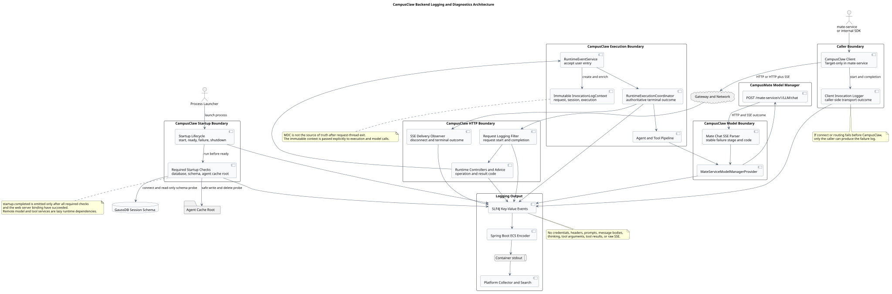
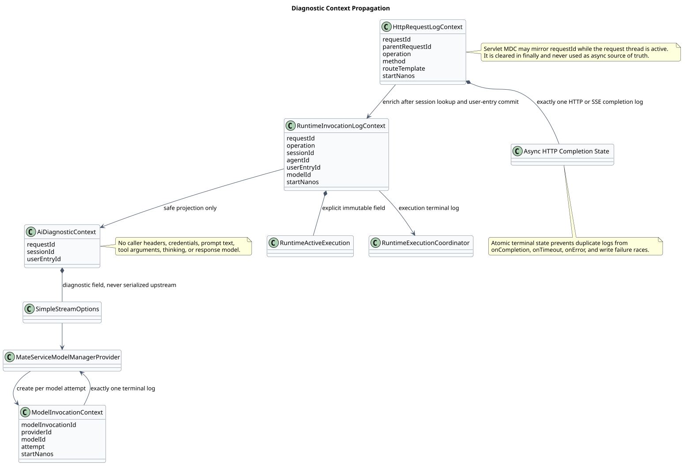
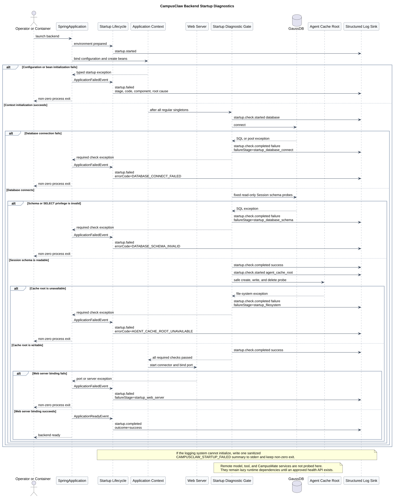
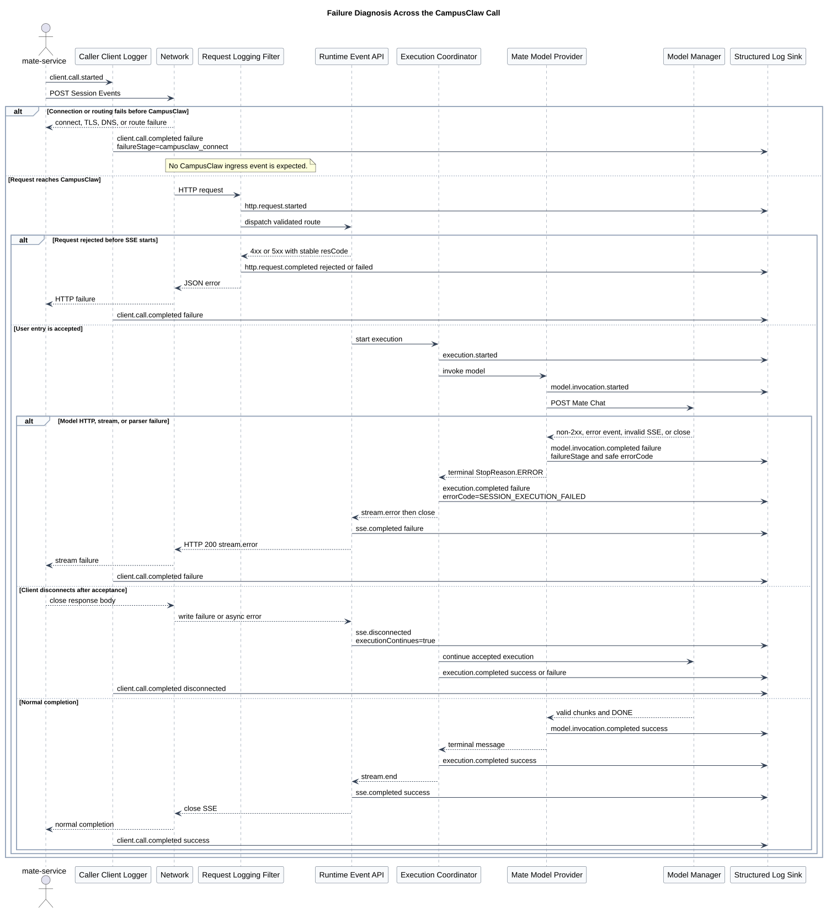

# CampusClaw 后端日志与故障定位模块设计

| 属性 | 值 |
|---|---|
| 文档版本 | 1.1.0 |
| 状态 | 目标设计；待 CampusClaw 实现，后端启动与调用链日志均纳入范围，mate-service 调用端部分为 target-only |
| 设计日期 | 2026-08-25 |
| 设计仓基线 | `5ad704d218c51b83e758bdae9e7b7294793378d3`（v1.1 修改前） |
| CampusClaw 源码基线 | `ecf416115207c4072183c6c8f843f6ee57b7fbc3`（`origin/main`） |
| 初版调用链源码基线 | `42eb8b0ccb98b512d886722f2ad7ce8340d5a77a`；本次引用的运行代码在两基线间无差异 |
| mate-service 源码基线 | `6d5e6f3714e1cf8744d187a4796ca06300ad7e33` |
| 适用范围 | mate-service / 内部 SDK → CampusClaw Runtime → CampusMate Model Manager / Tool Service |
| 关联设计 | [Runtime HTTP API](../pi-mono-java-manager-driven-multi-agent-runtime/chat-http-v1-design.md)、[Model Manager Provider](../model-manager-provider-contract/README.md) |

## 1. 结论

当前“CampusClaw 后端启动或调用失败但没有可定位日志”不是单一日志级别问题，而是启动状态、
失败传播模型与日志边界共同形成的可观测性缺口：

1. Spring Boot 入口只有 `SpringApplication.run(...)`，没有稳定的启动开始、必需依赖检查、就绪
   或失败事件；默认 `WARN` 又隐藏框架启动成功和 ModelRegistry 初始化 INFO；
2. 标准模块的 Hikari `initialization-fail-timeout` 默认是 `1`，而 `mate-campusclaw` 镜像是 `-1`，
   镜像可能在数据库不可用时仍完成 Spring 启动；
3. Runtime 没有统一的入站访问日志，无法先确认请求是否到达 CampusClaw；
4. 请求体和参数错误只记录 `DEBUG`，而默认配置为 `WARN`，因此 400 类错误通常完全不可见；
5. Mate Model Manager 的映射、HTTP、SSE 和解析错误会被转换成
   `AssistantMessage(stopReason=ERROR)`，不一定以 `Throwable` 结束执行；
6. `RuntimeExecutionCoordinator` 只在最终 `Throwable != null` 时记录失败，导致调用方已经收到
   `stream.error`，服务端仍可能没有对应日志；
7. 现有日志只有局部 `sessionId` 或异常堆栈，没有一次启动、请求、执行和模型调用之间的
   稳定关联信息；
8. 如果 DNS、TLS、连接或路由在请求进入 CampusClaw 前失败，CampusClaw 本身不可能产生日志，
   必须由调用端记录。

目标方案在 `coding-agent-cli` 内建立统一的后端可观测性逻辑模块，并覆盖五层结构化生命周期：
后端启动、调用端、CampusClaw HTTP、Runtime 执行、下游模型/工具调用。启动模块在 Spring
容器创建前注册监听器，运行必需数据库与 Agent 缓存目录检查，只有这些检查和 Web Server
绑定全部成功后才记录 `campusclaw.startup.completed`。运行期每层至少记录开始和唯一终态，
使用显式不可变诊断上下文跨 Servlet、虚拟线程和 Reactor 传递。日志只记录白名单元数据，
不记录凭据、Header 值、Prompt、消息正文、thinking、工具参数/结果或原始 SSE。

本设计不新增数据库表，不改变 11 个 Runtime HTTP 路径、请求/响应 VO、ResultBean 或 SSE
公共字段，也不恢复已经删除的 `traceparent` 业务契约。公司网关若已有跨服务请求标识，可在
实施时映射为日志 `parentRequestId`；具体 Header 名称当前没有源码证据，保持为集成校准点，
不在本文中臆造。

本仓库交付的是可实施设计，不会仅凭合入 Markdown 就改变后端运行行为。只有在
`pi-mono-java` 按第 12、13、17 章完成代码、配置和真实进程失败矩阵后，才能宣称上述启动与
调用定位保证已经生效；在此之前，当前后端仍保持第 2 章描述的缺口。

## 2. 已观察问题

### 2.1 模型失败可产生 `stream.error`，但没有服务端失败日志

以当前 Mate Model Manager 调用为例，源码路径如下：

1. `MateServiceModelManagerProvider.streamSimple()` 在本地请求映射失败时直接
   `stream.pushError(...)`；网络、HTTP 和响应协议错误则进入 `parser::fail`。Provider 本身
   没有 Logger。
2. `MateChatSseParser.fail()` 把异常转换为终态 Assistant 错误消息；`event:error`、提前关闭、
   非法 JSON 和非法 Tool 参数都走这一路径，没有记录失败阶段和稳定错误码的日志。
3. `AgentLoop.runInternal()` 看到 `StopReason.ERROR` 后正常退出循环，不抛异常。
4. `RuntimeEventProjector.persistAssistant()` 保存 Assistant 并把 `terminalReason` 设为
   `ERROR`，但 `projector.failure()` 仍可为 `null`。
5. `RuntimeExecutionCoordinator.executionFailure()` 只返回超时、Future 异常或
   `projector.failure()`；此时结果仍为 `null`，`logFailure()` 不输出任何内容。
6. `RuntimeTerminalEventFactory.emit()` 单独根据 `StopReason.ERROR` 发送
   `stream.error/SESSION_EXECUTION_FAILED`。因此调用方可见失败，日志却为空。

这条路径说明不能只补一个 `catch + log.error`：模型失败是一个正常完成的类型化终态，日志
设计必须把 `StopReason.ERROR` 本身当作失败结果。

### 2.2 请求拒绝默认不可见

`RuntimeExceptionHandler` 当前行为是：

- 非法请求体和方法参数只记 `DEBUG`；
- `RuntimeApiException` 仅在 HTTP 5xx 时记 `ERROR`；
- 400、404、409、412、422、428 等业务拒绝没有统一完成日志；
- 没有请求开始日志，因而不能判断调用是未到达、正在挂起，还是已被拒绝。

`application.yml` 同时将 `root` 和 `com.campusclaw` 设为 `WARN`。Kubernetes profile 虽把
`com.campusclaw` 调到 `INFO`，仍不会输出 `DEBUG` 参数错误；手工维护的
`mate-campusclaw/application.properties` 继续使用 `WARN`。

### 2.3 异步边界丢失上下文

Agent 通过虚拟线程异步执行，Model Manager 使用 Reactor Netty/WebClient。Servlet 线程上的
MDC 不能作为这两条异步链路的可靠事实来源。当前 Runtime 创建 `RuntimeActiveExecution` 和
`SimpleStreamOptions` 时也没有携带本次 HTTP 请求标识；`SimpleStreamOptions.sessionId` 虽已
存在，Runtime Agent 装配没有设置它。

### 2.4 后端启动状态缺少稳定事实

`CampusClawApplication.main()` 当前直接调用 `SpringApplication.run(...)`，没有在容器创建前
注册应用级启动监听器。因此只能依赖 Spring Boot、Hikari 和 Tomcat 的框架文本判断启动结果，
没有可按稳定 `eventName/failureStage/errorCode` 查询的事实，也没有一个明确事件证明后端已经
具备处理 Session 请求的基本条件。

当前启动期已经存在若干可能失败的动作：

- `BuiltInToolProperties.afterPropertiesSet()` 校验重复或未知工具；
- `MateServiceModelManagerProvider.validateConfiguration()` 拒绝不支持的 API 配置；
- `ModelRegistry.init()` 读取模型覆盖文件，但成功 INFO 会被默认 WARN 级别隐藏，覆盖文件解析
  失败只降级为 WARN，不阻止启动；
- MyBatis 加载 Mapper，但 Session 表、列和查询权限在第一次数据库访问前没有完整验证；
- Agent 缓存根目录只在第一次重建 Agent 时创建并验证写入能力；
- Web Server 可能因端口占用、地址不可绑定或证书/容器配置而失败。

更关键的是，canonical `application.yml` 将 Hikari `initialization-fail-timeout` 默认为 `1`，
而手工维护的 `mate-campusclaw/application.properties` 使用 `-1`。后者会跳过初始连接失败门禁，
所以“Spring 已启动”不等于“Session 持久化已可用”。

## 3. 目标与非目标

### 3.1 目标

- 每个到达 CampusClaw 的 Runtime HTTP 请求都有可检索的开始和唯一完成日志；
- 每次后端进程启动都有 `startupId`，并且最终只能出现一个 `startup.completed` 或
  `startup.failed`；
- `startup.completed` 只在配置绑定、Bean 初始化、数据库连接与 Session 表只读校验、Agent
  缓存根目录写入探针和 Web Server 端口绑定全部成功后输出；
- 配置错误、数据库连接/Schema、目录权限、Bean 创建和端口占用使用稳定失败阶段与错误码；
- 4xx、5xx、SSE 流内失败和客户端断线均有明确、互不混淆的结果；
- 每个 active execution 和每次 Model Manager 调用都有开始、耗时与唯一终态；
- `StopReason.ERROR` 即使没有 Throwable，也必须产生日志；
- 通过 `requestId + sessionId + userEntryId + modelInvocationId` 关联调用阶段；
- 失败阶段和错误码稳定，可用于查询、统计和告警，不依赖解析异常文案；
- 生产输出为单行结构化 JSON，适合容器 stdout 收集；
- 敏感数据默认不进入日志，且通过自动化测试锁定。

### 3.2 非目标

- 不记录或重放完整请求、响应和 SSE；
- 不把 Model Manager、Mate Tool 或 CampusMate Runtime 的远端可用性作为默认启动硬依赖；这些
  服务没有已确认的无副作用健康接口，运行期失败由对应调用日志定位；
- 不把日志当作 Session 历史、审计账本或业务事件存储；
- 不新增公开 Run 资源或改变“Session 同时只有一个 active execution”的产品模型；
- 不在本次设计中新增公共 `X-Request-ID`、`traceparent` 或其他 HTTP 契约 Header；
- 不规定公司日志平台、索引、归档桶或跨区域保留策略的内部实现；
- 不用日志替代超时、重试、状态机和持久化的一致性处理。

## 4. 总体架构



[PlantUML 源码：`campusclaw_invocation_logging_architecture`](diagram.puml#L6)

日志功能由以下边界共同完成：

| 边界 | 目标职责 | 当前状态 |
|---|---|---|
| CampusClaw startup | 记录进程启动、关键阶段、必需依赖检查、唯一就绪或失败终态 | 无应用级实现；canonical/mirror 数据库启动语义不一致 |
| mate-service / 内部 SDK 调用端 | 记录 CampusClaw 请求开始、HTTP/SSE 完成、DNS/TLS/connect/route 失败 | mate-service 当前基线没有公共 Chat → CampusClaw Client；target-only |
| CampusClaw HTTP | 记录请求到达、规范化 operation、HTTP status、ResultBean `resCode`、SSE 终态和耗时 | 缺少统一实现 |
| Runtime execution | 记录用户 Entry 接受、执行开始/成功/失败/取消/超时，以及 Session 与执行关联 | 仅 Throwable 失败有一条局部 WARN |
| Model Provider | 记录请求映射、连接、HTTP、SSE、解析、取消和耗时 | 无日志 |
| Tool Client/Pipeline | 记录发现和实际执行的终态，复用 execution 上下文 | 有零散错误日志，但字段和关联不统一 |
| 输出与采集 | SLF4J key-value → Spring Boot ECS JSON → stdout → 平台采集 | 当前为普通文本 Logback；目标配置 |

### 4.1 模块边界

保持现有 `ai → agent-core → coding-agent-cli` 依赖方向。日志功能是逻辑模块，不新增一个反向依赖
业务模块的 Maven artifact：

- `modules/coding-agent-cli/.../observability/startup` 定义启动监听器、失败分类器、必需依赖检查
  和 stderr 兜底；在 `CampusClawApplication` 调用 `run()` 前注册；
- `modules/coding-agent-cli/.../observability/http` 与 `.../runtime` 定义访问和执行日志；
- `modules/ai` 定义最小的 `AiDiagnosticContext`、模型调用阶段与 Provider 终态日志；
- `modules/agent-core` 只把安全的诊断上下文传入每次 `SimpleStreamOptions`，不依赖 Web 类型；
- `modules/coding-agent-cli` 定义 HTTP/Runtime 上下文、访问日志、执行日志和 SSE 生命周期；
- `mate-campusclaw` 继续由同步脚本生成 Java 源码；其手工维护的
  `application.properties` 必须单独同步日志配置。

不得让 `modules/ai` 反向依赖 `coding-agent-cli`，也不得把 Servlet Request、原始 Header Map
或 `MateCredentials` 放入通用 AI 上下文。

## 5. 诊断上下文



[PlantUML 源码：`campusclaw_log_context_propagation`](diagram.puml#L333)

### 5.1 标识层次

| 字段 | 生成/获得时机 | 生命周期 | 是否对外 | 用途 |
|---|---|---|---|---|
| `requestId` | CampusClaw 请求 Filter 生成 UUID | 单个入站 HTTP 请求 | 否 | 判断请求是否到达并关联 HTTP/SSE 日志 |
| `parentRequestId` | 公司网关或调用端已有机制提供时映射 | 跨服务调用链 | 否 | 可选跨服务关联；Header 名待集成校准 |
| `sessionId` | 路径参数或创建成功后的资源 ID | Runtime Session | 已在业务契约中存在 | 关联同一 Session；不是凭据 |
| `agentId` | 创建路径或 Session/目录快照 | Agent 生命周期 | 已在业务契约中存在 | 定位 Agent 配置阶段 |
| `userEntryId` | 用户 Entry 原子接受成功后生成 | 单次 active execution | 以持久化 Event 对调用方可见 | 作为内部执行的稳定事实边界 |
| `modelInvocationId` | 每次进入 Provider 时生成 UUID | 单次模型尝试 | 否 | 区分工具循环、压缩和重试产生的多次模型调用 |
| `toolCallId` | 模型 ToolCall 提供 | 单次 ToolCall | SSE 中按既有契约可见 | 关联工具开始/终态；不记录参数 |

`requestId` 不从不可信来路直接接受，避免日志注入和不同调用方伪造关联。若公司网关已有
可信请求标识，应由部署适配层验证后写入独立 `parentRequestId`，不能覆盖本地
`requestId`。

### 5.2 显式上下文而非 MDC-only

目标增加三个不可变对象：

| 对象 | 所属模块 | 白名单字段 |
|---|---|---|
| `HttpRequestLogContext` | `coding-agent-cli` | `requestId/parentRequestId/operation/method/routeTemplate/startNanos` |
| `RuntimeInvocationLogContext` | `coding-agent-cli` | HTTP 字段 + `sessionId/agentId/userEntryId/modelId` |
| `AiDiagnosticContext` | `ai` | `requestId/sessionId/userEntryId` |

Filter 可在同步 Servlet 线程内把 `requestId` 镜像到 MDC，便于框架异常日志自动关联，但必须在
`finally` 清理。`RuntimeActiveExecution` 保存不可变 `RuntimeInvocationLogContext`；
`SimpleStreamOptions` 保存仅含三个安全 ID 的 `AiDiagnosticContext`，Provider 再创建
`modelInvocationId`。虚拟线程、CompletableFuture 和 Reactor 回调均读取显式对象，不依赖
ThreadLocal 继承。

`SimpleStreamOptions` 中的诊断上下文是 Java 内部字段：Provider 不把它序列化到 Mate Chat
请求，不把它混入已有 `metadata`、`headers` 或有状态模型 `sessionId` 语义。

### 5.3 异步完成去重

一次 SSE 请求可能同时触发 `SseEmitter.onCompletion`、`onTimeout`、`onError`、写入
IOException 和 execution terminal 回调。HTTP/SSE 完成状态使用原子 compare-and-set，确保：

- HTTP/SSE 完成日志只记录一次；
- execution 完成日志独立记录一次；
- 客户端断线只终止投影，不把已接受执行误记为取消；
- 断线后 execution 后续成功或失败仍有独立终态日志。

## 6. 日志事件目录

所有 `eventName` 均为稳定英文机器标识；消息模板也使用英文，满足 CampusClaw 当前日志
规范。日志消费者根据字段查询，不解析 message 文案。

### 6.1 后端启动事件

| `eventName` | 级别 | 终态 | 必填字段 | 说明 |
|---|---|---|---|---|
| `campusclaw.startup.started` | INFO | 否 | `startupId/serviceName/processId` | LoggingSystem 初始化后立即记录；不记录命令行参数或环境变量 |
| `campusclaw.startup.check.started` | INFO | 否 | `startupId/checkName/required` | 必需检查开始；用于识别检查阻塞位置 |
| `campusclaw.startup.check.completed` | INFO/ERROR | 是 | started 字段 + `outcome/durationMs` | 每个检查唯一终态；失败时带 stage/code |
| `campusclaw.startup.completed` | INFO | 是 | `startupId/outcome=success/serverPort/durationMs` | 仅在 ApplicationReadyEvent 且全部必需检查成功后记录 |
| `campusclaw.startup.failed` | ERROR | 是 | `startupId/outcome=failure/failureStage/errorCode/durationMs/rootCauseClass` | 进程级失败唯一事实；保留 Spring Boot 非零退出语义 |
| `campusclaw.shutdown.completed` | INFO | 是 | `startupId/outcome/reason/durationMs` | 正常 ContextClosed 或受控终止；崩溃/强杀不保证出现 |

`startupId` 在创建 `SpringApplication` 前本地生成 UUID，并由程序化注册的监听器持有，因此 Bean
创建之前的失败也能关联。`startup.failed` 是应用告警与检索的权威事件；Spring Boot 自带失败
分析文本继续保留作为人工补充，但业务告警不得解析其文案。

### 6.2 调用端事件

| `eventName` | 级别 | 终态 | 必填字段 | 说明 |
|---|---|---|---|---|
| `campusclaw.client.call.started` | INFO | 否 | `clientCallId/operation/httpMethod/targetService` | 调用端准备发送；不得记录完整 URL 和 Header |
| `campusclaw.client.call.completed` | INFO/WARN/ERROR | 是 | started 字段 + `outcome/durationMs` | 记录 HTTP/SSE、connect/TLS/DNS/route 结果 |

调用端失败阶段至少区分 `campusclaw_connect`、`campusclaw_http`、
`campusclaw_stream`、`campusclaw_decode`。这一层是 target-only：当前 mate-service 基线只有
Agent definition API，没有已实现的公共 Chat bridge 或 CampusClaw Client。

### 6.3 HTTP 与 SSE 事件

| `eventName` | 级别 | 终态 | 必填字段 | 说明 |
|---|---|---|---|---|
| `campusclaw.http.request.started` | INFO | 否 | `requestId/operation/httpMethod/routeTemplate` | 证明请求已到达 CampusClaw |
| `campusclaw.http.request.completed` | INFO/WARN/ERROR | 是 | started 字段 + `outcome/httpStatus/durationMs` | 普通 HTTP 或 SSE Header 前失败 |
| `campusclaw.sse.completed` | INFO/WARN/ERROR | 是 | `requestId/sessionId/outcome/streamStarted/durationMs` | `stream.end`、`stream.error` 或超时 |
| `campusclaw.sse.disconnected` | INFO | 是 | `requestId/sessionId/executionContinues=true` | 调用端断线；不等同于 Runtime 失败 |

`operation` 必须使用已确认的 11 个 `operationKey`，例如 `submitUserMessage`，不得使用
含具体 ID 或 page token 的原始 URI。异常处理器把稳定 `resCode` 放入 request-scoped
诊断状态，Filter 在完成日志中读取；不通过解析 JSON 响应体获得错误码。

### 6.4 Runtime 事件

| `eventName` | 级别 | 终态 | 必填字段 | 说明 |
|---|---|---|---|---|
| `campusclaw.execution.started` | INFO | 否 | `requestId/sessionId/agentId/userEntryId/modelId` | 必须在 User Entry 持久化并开始 Agent 后记录 |
| `campusclaw.execution.completed` | INFO/ERROR | 是 | started 字段 + `outcome/terminationReason/durationMs` | 成功、ERROR、ABORTED、超时和内部异常统一收口 |
| `campusclaw.tool.invocation.completed` | INFO/WARN/ERROR | 是 | execution 字段 + `toolCallId/toolName/outcome/durationMs` | 不记录 arguments、delta 或 result |

关键规则：`terminalReason=error` 即使 `Throwable == null`，也必须记录
`outcome=failure/errorCode=SESSION_EXECUTION_FAILED`。`terminalReason=aborted` 记录
`outcome=success/terminationReason=aborted`，除非取消清理本身失败。

### 6.5 Model Manager 事件

| `eventName` | 级别 | 终态 | 必填字段 | 说明 |
|---|---|---|---|---|
| `campusclaw.model.invocation.started` | INFO | 否 | `requestId/sessionId/userEntryId/modelInvocationId/providerId/modelId/attempt` | 发起请求映射前记录 |
| `campusclaw.model.invocation.completed` | INFO/WARN/ERROR | 是 | started 字段 + `outcome/durationMs` | 映射、HTTP、SSE、协议、取消和成功统一收口 |

Model Provider 必须在全部终态分支只写一次 completed：

- 本地请求映射抛异常；
- DNS、TLS、connect、response timeout；
- 非 2xx ResultBean；
- 2xx 但 Content-Type 非 `text/event-stream`；
- `event:error`；
- 非法 JSON、reasoning 字段冲突、非法 Tool 参数；
- 流在 `[DONE]` 前关闭；
- 调用方取消；
- 正常 `[DONE]`。

不得按每个 Chat chunk、thinking delta、文本 delta 或 Tool arguments delta 记录日志。

## 7. 通用字段

### 7.1 核心字段

| 字段 | 类型 | 规则 |
|---|---|---|
| `eventName` | string | 固定目录值，不拼接用户数据 |
| `outcome` | `success \| failure \| unknown` | 与 ECS outcome 语义对齐；取消/断线另用 `terminationReason` |
| `terminationReason` | string | `completed/aborted/disconnected/timeout/error/rejected` |
| `startupId` | UUID string | 单次 JVM 启动生成；启动完成后继续用于关停事件 |
| `serviceName` | string | 固定 `campusclaw-agent` 或 `mate-campusclaw`，不从不可信输入获取 |
| `processId` | long | 当前 JVM PID；仅启动事件使用 |
| `checkName` | string | 固定 `database/session_schema/agent_cache_root` 等检查名 |
| `component` | string | 固定组件标识或脱敏 Bean 名，不记录任意异常消息 |
| `requestId` | UUID string | CampusClaw 本地生成 |
| `parentRequestId` | string | 仅可信网关适配存在时写入 |
| `operation` | string | 11 个 operationKey 或固定内部 operation |
| `httpMethod` | string | 大写标准 Method |
| `routeTemplate` | string | 规范化模板，不含实际 ID、query 或 page |
| `httpStatus` | integer | HTTP 响应 status；SSE 流内失败仍可能为 200 |
| `durationMs` | long | 单调时钟计算，非 wall-clock 时间戳相减 |
| `sessionId/agentId/userEntryId` | string | 已校验的资源 ID；未知时字段缺失，不写空字符串 |
| `providerId/modelId` | string | 请求目标模型；禁止记录上游 response model |
| `modelInvocationId` | UUID string | 单次 Provider 调用生成 |
| `attempt` | integer | 同一 execution 内从 1 开始；工具续轮和压缩重试可递增 |
| `failureStage` | string | 第 7.2 节稳定枚举 |
| `errorCode` | string | 优先复用公开 resCode；内部诊断码不得对外返回 |
| `exceptionClass` | string | Java 类名；只有最深失败事件附完整 Throwable |
| `rootCauseClass` | string | 启动失败 cause chain 最深类型；不把 root cause message 复制为结构化字段 |
| `sqlState` | string | 仅数据库失败记录标准 SQLSTATE；不记录 SQL 文本、URL 或用户名 |
| `retryable` | boolean | 仅当既有错误/策略能证明时写入，不从 status 猜测 |

### 7.2 失败阶段

| `failureStage` | 触发边界 | 典型错误 |
|---|---|---|
| `startup_logging` | LoggingSystem、Appender、Encoder 初始化 | `LOGGING_INITIALIZATION_FAILED` |
| `startup_configuration` | YAML/properties、类型转换、Jakarta Validation、工具或 Provider 配置 | `CONFIG_BIND_FAILED`、`CONFIG_VALIDATION_FAILED` |
| `startup_context` | Spring Bean 创建、依赖注入、MyBatis Mapper 初始化 | `BEAN_INITIALIZATION_FAILED`、`MAPPER_INITIALIZATION_FAILED` |
| `startup_database_connect` | Hikari 建池、DNS/TLS/认证/连接超时 | `DATABASE_CONNECT_FAILED` |
| `startup_database_schema` | Session 表/列不存在或 SELECT 权限不足 | `DATABASE_SCHEMA_INVALID` |
| `startup_filesystem` | Agent 缓存根目录创建、符号链接或写入探针 | `AGENT_CACHE_ROOT_UNAVAILABLE` |
| `startup_web_server` | 地址绑定、端口占用、Servlet 容器初始化 | `PORT_BIND_FAILED`、`WEB_SERVER_START_FAILED` |
| `request_route` | 请求没有匹配 operation | 404 路由错误 |
| `request_validation` | Path、Query、JSON、Bean Validation | `INVALID_*` |
| `session_lookup` | Session/Agent/Model 查找 | `SESSION_NOT_FOUND`、`MANAGER_UNAVAILABLE` |
| `event_acceptance` | 容量、并发、User Entry 事务 | `SESSION_BUSY`、`EVENT_ACCEPTANCE_FAILED` |
| `agent_prepare` | 受管目录、历史恢复、Agent 装配 | 初始化和目录错误 |
| `model_request_mapping` | Context → Mate Chat JSON | 不支持内容、序列化失败 |
| `model_connect` | DNS/TLS/connect | `MATE_TRANSPORT_ERROR`（内部诊断码） |
| `model_http` | 非 2xx 或错误体解析 | Mate `resCode` 或 `MATE_HTTP_ERROR` |
| `model_stream` | `event:error`、提前关闭、response timeout | `UPSTREAM_STREAM_ERROR` |
| `model_parse` | Content-Type、chunk、reasoning、Tool 参数 | `INVALID_MATE_RESPONSE`、`INVALID_CHAT_SSE` |
| `tool_execution` | Tool 解析、调用和终态 | Tool 领域错误码 |
| `runtime_persistence` | Entry、Usage、finishExecution | 持久化异常 |
| `sse_write` | SseEmitter 写失败 | `CLIENT_DISCONNECTED` 或真实服务器写失败 |
| `execution_timeout` | Runtime 最大执行时长 | `RUNTIME_TIMEOUT`（内部诊断码） |
| `unexpected` | 未分类异常 | `INTERNAL_ERROR` |

内部诊断码只用于日志和指标，不增加 Runtime HTTP/SSE 契约错误码。若下游已经返回安全且
稳定的 `resCode`，日志保留该码；不记录本地化 `resMsg` 和完整错误响应体。

## 8. 后端启动诊断



[PlantUML 源码：`campusclaw_startup_logging_sequence`](diagram.puml#L224)

### 8.1 启动模块组成

| 组件 | 注册时机 | 职责 |
|---|---|---|
| `CampusClawStartupLifecycle` | `SpringApplication.run()` 前通过 `addListeners` 注册 | 生成 startupId，跟踪当前阶段，接收 EnvironmentPrepared、WebServerInitialized、Ready、Failed 和 Closed 事件 |
| `StartupFailureClassifier` | 普通 Java 对象，不依赖 Spring Bean | 遍历 cause chain，按异常类型和当前阶段生成稳定 stage/code/component |
| `StartupDiagnosticGate` | `SmartInitializingSingleton` | 全部普通单例创建后、Context finishRefresh 与 Web Server connector 启动前顺序执行 required checks；任一失败使 refresh 失败 |
| `DatabaseStartupCheck` | Gate 内 | 取得真实连接并对固定 Session 表/列执行只读零行查询，验证连接、Schema 和 SELECT 权限 |
| `AgentCacheRootStartupCheck` | Gate 内 | 安全创建缓存根，拒绝符号链接，创建并删除随机临时文件验证写入能力 |
| `StartupStderrFallback` | main 入口可直接使用 | LoggingSystem 无法初始化时写一条固定格式、脱敏的 stderr 失败摘要 |

启动监听器必须程序化注册，不能只声明为 Spring Bean；否则配置绑定或 Bean 创建失败时监听器自身
尚不存在。`StartupFailureClassifier` 不通过本地化 message 正则判断阶段，优先使用
`BindException/BindValidationException/BeanCreationException/SQLException/PortInUseException` 等
类型、失败 Bean 名和当前生命周期阶段。未知异常统一归入 `startup_context/STARTUP_FAILED`。

### 8.2 必需检查与就绪语义

启动顺序固定为：

1. 创建 `startupId` 并注册监听器；
2. 加载 LoggingSystem 和 Environment，写 `startup.started`；
3. 绑定并校验配置，创建 Bean，加载 MyBatis Mapper；
4. `StartupDiagnosticGate` 在 Context 完成 refresh 前执行 `database`、`session_schema`、
   `agent_cache_root`；
5. required checks 通过后，Web Server connector 绑定地址与端口；
6. Spring 发布 `ApplicationReadyEvent` 后写唯一 `startup.completed`。

数据库检查使用编译期固定 SQL，不接受配置或请求拼接表名。它对
`t_sessions/t_session_tombstone/t_session_cleanup_task/t_session_entries/t_session_records/
t_session_stats/t_session_sequences/t_session_materialized` 的必需列执行 `SELECT ... WHERE 1=0`，
既不读业务数据也不修改数据库。数据库 DDL 仍只能由发布平台执行；应用不得自动建表、升级或
修复权限。

canonical 与 `mate-campusclaw` 的 Hikari `initialization-fail-timeout` 默认值必须统一为正值；
即使 Hikari 配置被部署覆盖为延迟连接，显式 `DatabaseStartupCheck` 仍是最终 required gate。
因此看到 `startup.completed` 可以确认数据库连接、Session 基线 Schema 的只读兼容性、Agent
缓存目录和 HTTP 监听端口都可用。

Model Manager、Mate Tool 和 CampusMate Runtime 默认只做 URI、超时和固定 API 值的本地配置
校验，不在启动时发送网络探测。这些依赖没有源码确认的无副作用健康端点，而且把它们设为
硬启动依赖会让暂时抖动扩大为整个 CampusClaw 不可启动。远端连接问题由第 6 章的调用终态
日志定位；若公司平台提供正式健康接口，再以 target-only 集成项增加非阻塞检查。

### 8.3 启动失败定位表

| 最后事件 | `failureStage/errorCode` | 定位结论 |
|---|---|---|
| 只有 stderr `CAMPUSCLAW_STARTUP_FAILED` | `startup_logging/LOGGING_INITIALIZATION_FAILED` | 日志配置、Appender 或 Encoder 在结构化日志可用前失败 |
| `startup.failed` | `startup_configuration/CONFIG_BIND_FAILED` | 环境变量值无法转换、必要 placeholder 缺失或 YAML/properties 错误 |
| `startup.failed` | `startup_configuration/CONFIG_VALIDATION_FAILED` | Runtime duration/size、工具列表或 Provider API 配置非法 |
| `startup.check.completed` failure | `startup_database_connect/DATABASE_CONNECT_FAILED` | 数据库 DNS、TLS、证书、认证、地址或连接超时 |
| `startup.check.completed` failure | `startup_database_schema/DATABASE_SCHEMA_INVALID` | currentSchema、Session 表/列或 SELECT 权限与当前版本不兼容 |
| `startup.check.completed` failure | `startup_filesystem/AGENT_CACHE_ROOT_UNAVAILABLE` | 缓存根目录权限、只读文件系统、符号链接或容量问题 |
| `startup.failed` | `startup_web_server/PORT_BIND_FAILED` | SERVER_ADDRESS/SERVER_PORT 错误或端口已被占用 |
| `startup.failed` | `startup_context/BEAN_INITIALIZATION_FAILED` | 通过 component 与 rootCauseClass 定位具体 Bean；完整堆栈只附在该终态 |
| `startup.completed` 后首次调用失败 | 非 startup stage | 后端基础启动成功；按 request/execution/model/tool 日志继续定位远端或业务问题 |

如果进程退出但 stdout 和 stderr 都不存在启动终态，故障位于 JVM 启动之前或容器采集之外，
例如镜像命令、JRE、文件权限、OOMKill 或日志采集配置。部署平台必须保留进程 stdout/stderr 和
容器 termination reason；应用内日志无法覆盖 JVM 尚未运行或被 `SIGKILL` 强制终止的场景。

## 9. 调用失败诊断流程



[PlantUML 源码：`campusclaw_failure_logging_sequence`](diagram.puml#L130)

### 9.1 通过事件缺口判断故障位置

| 已观察日志 | 结论 |
|---|---|
| 有 `client.call.started`，无 CampusClaw `http.request.started`，调用端终态为 connect/TLS/DNS/route | 请求未到 CampusClaw；排查调用端配置、Service、网关、证书和网络 |
| 有 `http.request.started`，随后 `http.request.completed` 为 4xx/5xx，未出现 execution.started | 请求到达但在执行接受前失败 |
| 有 `execution.started`，无 `model.invocation.started` | Agent prepare、历史恢复、上下文转换或调度阶段失败/挂起 |
| 有 `model.invocation.started`，completed 为 `model_connect/model_http` | CampusClaw → Model Manager 传输或 HTTP 错误 |
| model completed 为 `model_stream/model_parse`，execution completed 为 failure | SSE 建立后上游或协议失败；这是当前“有 stream.error 无日志”的重点修复路径 |
| 有 `sse.disconnected`，随后 execution.completed success | 调用端断线，但已接受执行继续并完成 |
| 有 start，超过配置上限仍无 completed | 日志终态门禁或超时实现失效，应触发缺失终态告警 |

### 9.2 错误日志所有权与去重

同一失败允许有多个“边界终态摘要”，但完整异常堆栈只记录一次：

| 失败来源 | 附 Throwable 的事件 | 上层事件 |
|---|---|---|
| 请求解析/Controller 前异常 | `http.request.completed` 或专用异常详情事件 | 调用端只记录 status/resCode 摘要 |
| Provider 网络/协议异常 | `model.invocation.completed` | execution 和 SSE 只记录安全 code/stage 摘要 |
| Tool 内部异常 | `tool.invocation.completed` | execution 只记录 Tool 阶段摘要 |
| Runtime 投影/持久化/清理异常 | `execution.completed` | HTTP/SSE 只记录 `SESSION_EXECUTION_FAILED` 摘要 |
| 客户端断线 | `sse.disconnected` 不附堆栈 | 不是服务器故障，不生成重复 ERROR |

外层不得再次打印同一个异常堆栈。日志告警只以 `execution.completed outcome=failure` 和
`http.request.completed` 的服务器失败为主，Provider/Tool 终态用于根因下钻，避免一次错误
触发多条同级事故告警。

## 10. 结构化输出

CampusClaw 基线使用 Spring Boot `3.4.1`、SLF4J 和 Logback，具备 Spring Boot 内置 ECS
结构化 console encoder。目标使用 SLF4J 2 key-value API 写稳定字段，并由 Kubernetes profile
输出单行 ECS JSON，不新增 Logstash encoder 依赖。

启动失败示例（字段顺序不构成契约，异常 message 与 SQL 文本不进入结构化字段）：

```json
{
  "@timestamp": "2026-08-25T08:19:02.113Z",
  "log.level": "ERROR",
  "service.name": "campusclaw-agent",
  "message": "backend startup failed",
  "eventName": "campusclaw.startup.failed",
  "startupId": "447b950e-55fc-4df1-b62a-5dd80c353797",
  "outcome": "failure",
  "failureStage": "startup_database_schema",
  "errorCode": "DATABASE_SCHEMA_INVALID",
  "component": "session_schema",
  "checkName": "session_schema",
  "sqlState": "42P01",
  "durationMs": 2148,
  "rootCauseClass": "org.postgresql.util.PSQLException"
}
```

调用失败示例：

```json
{
  "@timestamp": "2026-08-25T08:20:31.415Z",
  "log.level": "ERROR",
  "service.name": "campusclaw-agent",
  "message": "model invocation completed",
  "eventName": "campusclaw.model.invocation.completed",
  "outcome": "failure",
  "requestId": "3eaec4e9-b966-4678-94cf-4572cc3ee2ba",
  "sessionId": "session-550e8400e29b41d4a716446655440003",
  "userEntryId": "entry-550e8400e29b41d4a716446655440004",
  "modelInvocationId": "10361ec1-a567-4259-a6db-2e88132d4029",
  "providerId": "mate-model-manager",
  "modelId": "managed-coding-model",
  "attempt": 1,
  "failureStage": "model_stream",
  "errorCode": "UPSTREAM_STREAM_ERROR",
  "durationMs": 1842,
  "exceptionClass": "com.campusclaw.ai.provider.mate.MateModelInvocationException"
}
```

成功示例：

```json
{
  "@timestamp": "2026-08-25T08:20:35.002Z",
  "log.level": "INFO",
  "service.name": "campusclaw-agent",
  "message": "runtime execution completed",
  "eventName": "campusclaw.execution.completed",
  "outcome": "success",
  "terminationReason": "completed",
  "requestId": "3eaec4e9-b966-4678-94cf-4572cc3ee2ba",
  "sessionId": "session-550e8400e29b41d4a716446655440003",
  "userEntryId": "entry-550e8400e29b41d4a716446655440004",
  "durationMs": 5427
}
```

### 10.1 配置目标

Canonical `application.yml` 保持应用大部分 Logger 为 WARN，仅为诊断事件包开启 INFO：

```yaml
logging:
  level:
    root: WARN
    com.campusclaw: WARN
    com.campusclaw.codingagent.observability.startup: INFO
    com.campusclaw.ai.observability: INFO
    com.campusclaw.codingagent.observability: INFO
```

Kubernetes profile 增加 ECS console 输出：

```yaml
logging:
  structured:
    format:
      console: ecs
    ecs:
      service:
        name: campusclaw-agent
```

`mate-campusclaw/src/main/resources/application.properties` 是同步脚本排除的手工文件，必须显式
增加等价配置及重写后的包名：

```properties
logging.level.com.huawei.hicampus.mate.matecampusclaw.ai.observability=INFO
logging.level.com.huawei.hicampus.mate.matecampusclaw.codingagent.observability=INFO
logging.structured.format.console=ecs
logging.structured.ecs.service.name=mate-campusclaw
spring.datasource.hikari.initialization-fail-timeout=${GAUSSDB_INITIALIZATION_FAIL_TIMEOUT_MS:1}
```

本地默认可以继续使用人类可读 console 格式，但字段和事件名必须相同。应用不在容器内维护
滚动日志文件，避免与 stdout 采集重复和占满临时磁盘。`StartupStderrFallback` 不经过普通
Appender，只在 LoggingSystem 本身失败时输出一行固定前缀摘要；正常启动不得重复写 stderr。

### 10.2 级别

| 场景 | 级别 |
|---|---|
| 启动开始、检查成功、就绪、正常关停 | INFO |
| 启动必需检查失败、配置/Bean/端口初始化失败 | ERROR |
| 开始、成功、正常 Abort、客户端断线 | INFO |
| 400/404/409/412/422/428、下游 429/503/504、可恢复超时 | WARN |
| 应用 5xx、持久化失败、模型协议/解析失败、未预期异常 | ERROR |
| 诊断细节但不影响结果 | DEBUG；生产默认关闭 |

业务并发冲突 `SESSION_BUSY` 仍记录 WARN 便于诊断，但告警规则不按单条 WARN 触发；按窗口
比例判断是否异常。

## 11. 安全与数据最小化

### 11.1 允许字段

- `startupId/serviceName/processId/checkName/component/serverPort`；
- 已验证的 `agentId/sessionId/userEntryId/toolCallId`；
- CampusClaw 请求目标 `providerId/modelId`；
- operation、route template、HTTP status、稳定错误码、失败阶段、耗时、计数；
- Java exception class；受控诊断 sink 中最深根因的堆栈。

### 11.2 禁止字段

- `Authorization`、`X-HW-APPKEY`、`X-HW-ID` 的值及全部原始 Header；
- JVM 命令行参数、完整环境变量、System properties、数据库 URL/用户名/密码、证书路径；
- Agent 缓存绝对路径、容器挂载路径和主机名；启动检查只记录固定目标名；
- JWT、Cookie、API Key、私有 claim、凭据模式；
- 请求/响应 JSON、Prompt、User/Assistant 文本、文件名、文件正文、Base64；
- thinking、reasoning 字段、签名及原始 SSE chunk；
- Tool arguments、Tool result、Tool delta；
- 上游 `responseModel`、Chat Completion ID、内部 endpoint 完整 URL、OBS 地址；
- page token、ETag 值和本地化 `resMsg`；
- 完整 Throwable message 的无条件结构化副本。

日志字段使用白名单 Builder，不接受任意 `Map<String,Object>`。异常信息先映射为稳定
`failureStage/errorCode/exceptionClass`；只有受控 ERROR 事件附 Throwable。单元测试向所有
输入注入哨兵 secret、Prompt、thinking、Tool 参数和响应体，断言采集日志中不存在哨兵值。

当前 Runtime 契约已经明确 Header 值不得记日志，`sessionId` 不是凭据。本设计保持这一边界，
也不在 CampusClaw 日志中引入公共 `chatId` 或最终用户身份。

## 12. 代码改造映射

### 12.1 `modules/coding-agent-cli`

| 目标位置 | 改造 |
|---|---|
| `CampusClawApplication` | 改为显式创建 `SpringApplication`，在 `run()` 前生成 startupId 并注册 `CampusClawStartupLifecycle`；不吞异常，不把失败转换为零退出码 |
| `observability/startup/CampusClawStartupLifecycle` | 记录 startup started/completed/failed/shutdown；维护原子进程终态和当前 phase |
| `observability/startup/StartupFailureClassifier` | 以异常类型、Bean 名和 phase 映射稳定 stage/code；输出经过白名单过滤的诊断结果 |
| `observability/startup/StartupDiagnosticGate` | 实现 `SmartInitializingSingleton`，在 Web Server connector 启动前运行 required checks，任一失败使 Context refresh 失败 |
| `observability/startup/DatabaseStartupCheck` | 获取真实连接并验证八张 Session 表的固定列投影；只读、不执行 DDL/DML |
| `observability/startup/AgentCacheRootStartupCheck` | 创建安全根目录并执行随机临时文件写入/删除探针；日志不包含真实路径 |
| `runtimeapi/observability/RuntimeRequestLoggingFilter` | 生成 requestId、匹配 operation、记录开始和原子完成；注册 AsyncListener |
| `runtimeapi/observability/HttpRequestLogContext` | 保存 HTTP 白名单上下文 |
| `runtimeapi/observability/RuntimeInvocationLogContext` | 保存 Session/execution 白名单上下文 |
| `RuntimeExceptionHandler` | 不再单独依赖 DEBUG；把 status/resCode/stage 写入请求诊断状态，意外异常由最深 HTTP 事件附堆栈 |
| `RuntimeEventService` | User Entry 接受后补齐 userEntryId，记录 execution.started |
| `RuntimeExecutionContextFactory` / `RuntimeSessionEngineRegistry` | 把 context 传入 ActiveExecution 和 ManagedAgentSessionRequest |
| `RuntimeActiveExecution` | 保存不可变上下文和单调开始时间，不保存凭据或请求体 |
| `RuntimeExecutionCoordinator` | 对 `StopReason.ERROR` 无 Throwable 分支也记录 failure；统一成功/失败/取消/超时终态 |
| `RuntimeSseEmitterSubscriber` | 接收诊断上下文，区分 disconnect、服务器写失败和正常终态；原子去重 |
| Tool Pipeline / Mate Tool Client | 逐步迁移到统一 tool terminal 事件；删除同一异常的重复局部堆栈 |

### 12.2 `modules/ai` 与 `agent-core`

| 目标位置 | 改造 |
|---|---|
| `ai/observability/AiDiagnosticContext` | 定义不会序列化给 Provider 的安全上下文 |
| `SimpleStreamOptions` | 增加显式 diagnostic context；Builder、copy 和 factory 同步 |
| `Agent` / `AgentSessionFactory` | Runtime Session 装配时设置 diagnostic context，工具续轮沿用，同一 Provider 调用生成新 modelInvocationId |
| `MateServiceModelManagerProvider` | 统一 start/completed；映射、connect、HTTP、Content-Type、cancel 全覆盖 |
| `MateChatSseParser` | 终态回调携带安全 code/stage；解析 `event:error` 的稳定 resCode，不保留完整 data |
| `MateModelInvocationException` | 保留 diagnostic code/stage/retryable，不把安全诊断字段暴露为公共 SSE 扩展 |

### 12.3 `mate-campusclaw` 镜像

Java 改动只在 `modules/*` 完成，再运行 `scripts/sync-mate-campusclaw.sh`。镜像的
`application.properties` 不由脚本覆盖，实施 PR 必须单独更新并通过镜像编译。启动监听器和
required checks 随 Java 镜像同步；Hikari fail-fast、专用 INFO Logger 和 ECS 配置必须在手工
properties 中显式对齐。

### 12.4 mate-service 调用端

当前 `mate-service@6d5e6f3` 没有 Browser Chat → CampusClaw 的实现，因此下列内容明确为
target-only：

- `CampusClawClient` 生成 `clientCallId`；
- 在连接前写 `client.call.started`；
- 对 connect/TLS/DNS/HTTP/SSE/decode 写唯一 completed；
- 记录公共 `chatId` 时遵循 mate-service 自身隐私规则，不能把内部 `sessionId` 暴露给浏览器；
- 若公司基础设施已经定义可信跨服务请求标识，再把它映射为 `parentRequestId`。

CampusClaw 自身日志功能不依赖该 Client 才能落地；但要定位“请求根本没有进入 CampusClaw”，
调用端日志是必要条件。

## 13. 测试设计

### 13.1 单元测试

| 测试 | 核心断言 |
|---|---|
| `CampusClawStartupLifecycleTest` | started 后只允许 completed/failed 之一；ApplicationFailedEvent 在 Bean 创建前后均可捕获；异常继续向 Spring Boot 传播 |
| `StartupFailureClassifierTest` | bind、validation、SQL connect/schema、filesystem、port、bean 和 unknown 分别映射稳定 stage/code，不依赖本地化 message |
| `StartupDiagnosticGateTest` | required checks 按序执行，started/completed 一一配对，任一失败使 Context refresh 失败且 Web Server 不接受流量 |
| `DatabaseStartupCheckTest` | 真实 PostgreSQL-compatible Testcontainer/测试库下验证连接、缺表、缺列、错误 Schema 和权限不足；所有 SQL 只读 |
| `AgentCacheRootStartupCheckTest` | 可写目录成功；只读、普通文件、符号链接、创建/删除失败均返回稳定错误且不输出绝对路径 |
| `StartupSensitiveLogContractTest` | 启动参数、环境变量、JDBC URL、用户名、密码、证书和真实目录哨兵值不出现在 stdout/stderr |
| `RuntimeRequestLoggingFilterTest` | 每个请求一个 started、一个 completed；route 使用模板；4xx/5xx 含 status/code；无原始 URI/query/body |
| `RuntimeExceptionHandlerLoggingTest` | validation、RuntimeApiException、unexpected 映射正确；无重复堆栈 |
| `RuntimeExecutionCoordinatorLoggingTest` | `StopReason.ERROR + failure=null` 仍产出 execution failure；success/abort/timeout 各唯一终态 |
| `RuntimeSseEmitterSubscriberLoggingTest` | completion/error/timeout/write failure 竞争只记录一次；disconnect 标记 executionContinues |
| `MateServiceModelManagerProviderLoggingTest` | mapping、connect、非 2xx、Content-Type、error event、非法 chunk、提前关闭、cancel、成功均恰好一个 terminal log |
| `SensitiveLogContractTest` | credentials、Prompt、thinking、Tool arguments/results、raw SSE 哨兵值不出现在日志中 |
| `LoggingConfigurationTest` | canonical、k8s 与 mirror 配置均开启专用 INFO logger；k8s/mirror 使用 ECS JSON |

Logger 测试使用 Logback `ListAppender` 捕获实际事件和 key-value，不 mock `Logger`，避免只验证
方法调用而没有验证最终日志内容。

### 13.2 集成测试

1. 启动真实 CampusClaw 进程并同时捕获 stdout/stderr，断言正常场景有唯一
   `startup.started/completed`，且 completed 晚于全部 required check；
2. 分别注入非法 duration/工具/API 配置、数据库 DNS/认证/SSL/缺表/缺列、只读缓存根和占用端口，
   断言进程非零退出并出现对应 `startup.failed`；
3. 让 Logback/ECS 配置初始化失败，断言至少出现固定前缀 stderr 兜底，且不包含 secret；
4. 在 canonical 与生成的 `mate-campusclaw` 两种包名/配置中关闭数据库，断言都不能产生
   `startup.completed`；
5. 发送非法 JSON，断言 `http.request.started/completed`、400 和
   `INVALID_EVENT_REQUEST`；
6. 使用 MockWebServer 返回 503 ResultBean，断言 `model_http` 与安全 resCode；
7. 返回 200 SSE `event:error`，断言 model、execution、SSE 三个终态可关联，且 HTTP status
   仍为 200；
8. 返回非法 chunk 或在 `[DONE]` 前关闭，断言 `model_parse/model_stream`；
9. 客户端在 User Entry 接受后断开，断言 `sse.disconnected` 且 execution 后续仍有终态；
10. 解析每一行 JSON，检查 `service.name/eventName/requestId/outcome` 和敏感字段黑名单；
11. 在生成的 `mate-campusclaw` 包名和手工 properties 下重复关键进程测试。

### 13.3 缺失终态门禁

测试和运行告警都验证以下不变量：

- 每个 `http.request.started` 在请求/流上限内出现一个 HTTP 或 SSE 终态；
- 每个成功写出的 `startup.started` 最终只有一个 `startup.completed` 或 `startup.failed`；
- `startup.completed` 之前每个 required `startup.check.started` 都有 success terminal；
- 每个 `execution.started` 在最大执行时长加清理宽限内出现一个 execution.completed；
- 每个 `model.invocation.started` 在响应总超时加宽限内出现一个 model completed；
- started/terminal 的数量可以按 ID 一一配对，不允许重复或悬空。

## 14. 运行与告警

### 14.1 推荐查询

- 启动失败：`eventName=campusclaw.startup.failed`，按 `failureStage/errorCode/component` 聚合；
- 数据库未就绪：`eventName=campusclaw.startup.check.completed AND checkName IN (database,session_schema) AND outcome=failure`；
- 启动悬空：存在 `startup.started`，超过启动上限仍没有 completed/failed；
- 调用失败：`eventName=campusclaw.execution.completed AND outcome=failure`；
- 模型连接失败：`eventName=campusclaw.model.invocation.completed AND failureStage=model_connect`；
- 上游流错误：`failureStage IN (model_stream, model_parse)`；
- 请求未到达：调用端存在 `client.call.started/completed`，同一平台关联上下文不存在
  `campusclaw.http.request.started`；
- 断线后继续执行：同一 `sessionId/userEntryId` 先出现 `sse.disconnected`，后出现
  `execution.completed`；
- 悬空调用：started 超过对应上限仍没有 terminal。

### 14.2 告警基线

- 单次 `startup.failed`、启动悬空或容器反复重启直接告警，不以请求失败率稀释；
- `startup_database_schema` 和 `startup_configuration` 默认不可重试，提示修正发布配置或数据库
  基线；`startup_database_connect` 可由部署平台按退避策略重启，但必须保留首个根因；
- P1/P2 不按单条异常触发，使用 5 分钟窗口失败率和绝对数量；
- `runtime_persistence`、连续 `model_parse` 和缺失 execution terminal 优先级高；
- `SESSION_BUSY`、用户输入 400 和单次客户端断线默认不告警，只用于趋势；
- `model_http` 按下游 status/resCode 分组，区分限流、不可用和协议错误；
- 日志告警不得依赖英文 exception message 正则。

日志保留由公司日志平台配置，应用不硬编码。建议至少 14 天可检索、90 天受控归档，但该数值
必须在实施时对齐公司数据分级和成本政策；未获得平台依据前不把建议写成产品承诺。ERROR
堆栈索引应限制 RBAC，访问日志与完整堆栈可以使用不同保留期。

## 15. 发布顺序

1. 先引入结构化事件模型、白名单 Builder、敏感字段测试和专用 Logger 配置，不改变 Runtime
   业务响应；
2. 接入程序化 startup lifecycle、stderr 兜底和启动失败分类，验证配置/Bean/端口错误；
3. 接入 database/session_schema/agent_cache_root required checks，并统一 canonical/mirror Hikari
   fail-fast；
4. 接入 HTTP started/completed，验证当前 4xx/5xx 均可见；
5. 接入 execution context 和 `StopReason.ERROR` 终态，直接修复当前无日志路径；
6. 接入 Mate Model Provider 分阶段终态；
7. 接入 SSE disconnect 和 Tool 终态；
8. 同步并验证 `mate-campusclaw` Java 镜像与手工 properties；
9. 在预发布环境执行真实进程失败矩阵，核对启动门禁、日志量、字段、敏感数据和告警；
10. mate-service 公共 Chat Client 实现时补调用端日志和平台跨服务关联适配。

调用链日志可通过关闭专用 observability logger 回滚。启动 required checks 不能仅靠关闭 Logger
回滚，因为它们定义 ready 语义；若新门禁误判，应回滚对应检查实现和 Hikari 配置，同时保留
startup failed 事件。任何回滚都不执行数据库 DDL，也不改变 HTTP/SSE 契约。不得以临时把整个
`com.campusclaw` 调到 DEBUG 的方式替代本设计，因为那会放大日志量并可能暴露非白名单上下文。

## 16. 源码证据与差异分类

| 分类 | 源码证据或目标决策 |
|---|---|
| 已观察行为 | `modules/coding-agent-cli/src/main/java/com/campusclaw/codingagent/CampusClawApplication.java:29-33`：main 直接调用 `SpringApplication.run`，没有程序化启动监听器或应用级启动终态 |
| 已观察行为 | `modules/coding-agent-cli/src/main/resources/application.yml:9-25`：canonical Hikari 默认 `initialization-fail-timeout=1`；`mate-campusclaw/src/main/resources/application.properties:39-51`：镜像默认 `-1`，数据库不可用时启动语义不同 |
| 已观察行为 | `modules/coding-agent-cli/src/main/java/com/campusclaw/codingagent/tool/builtin/BuiltInToolProperties.java:90-107` 和 `modules/ai/src/main/java/com/campusclaw/ai/provider/mate/MateServiceModelManagerProvider.java:68-92`：工具列表和 Provider API 在 Bean 初始化期校验，异常目前没有稳定 startup stage/code |
| 已观察行为 | `modules/ai/src/main/java/com/campusclaw/ai/model/ModelRegistry.java:240-280`：启动加载模型并记录 INFO/WARN；INFO 被默认 WARN 阈值隐藏，用户覆盖解析失败会降级而不阻止启动 |
| 已观察行为 | `modules/coding-agent-cli/src/main/java/com/campusclaw/codingagent/runtime/AgentRuntimeManager.java:127-160`：Agent 缓存根和 staging 目录只在第一次 rebuild 时创建，启动就绪不证明目录可写 |
| 已观察行为 | `modules/coding-agent-cli/src/main/resources/mapper/session/RuntimeSessionMapper.xml:9-300` 使用八张 Session 表；`db/gaussdb/upgrade/README.md:3-18` 明确 DDL 只能由发布平台执行，应用启动不得迁移 Schema |
| 已观察行为 | `scripts/sync-mate-campusclaw.sh:3-16,42-50`：Java 源码会重写包名同步，但 application 配置是手工维护文件，启动 Logger 与 Hikari 配置必须单独对齐 |
| 已观察行为 | `modules/coding-agent-cli/src/main/java/com/campusclaw/codingagent/runtimeapi/web/RuntimeEventController.java:61-77`：提交接口建立 SseEmitter、调用 Service 并注册 detach，没有请求或流生命周期日志 |
| 已观察行为 | `modules/coding-agent-cli/src/main/java/com/campusclaw/codingagent/runtimeapi/web/RuntimeExceptionHandler.java:45-67,117-120`：validation 只记 DEBUG；RuntimeApiException 只在 5xx 记 ERROR |
| 已观察行为 | `modules/coding-agent-cli/src/main/resources/application.yml:110-114`：root 与 `com.campusclaw` 默认 WARN；`application-k8s.yml:9-11` 只提升到 INFO |
| 已观察行为 | `mate-campusclaw/src/main/resources/application.properties:80-83`：镜像运行配置仍为 WARN，且该文件由镜像同步规则明确排除 |
| 已观察行为 | `modules/ai/src/main/java/com/campusclaw/ai/provider/mate/MateServiceModelManagerProvider.java:105-156`：映射和 HTTP 错误转入事件流，类中没有 Logger |
| 已观察行为 | `modules/ai/src/main/java/com/campusclaw/ai/provider/mate/MateChatSseParser.java:80-133`：error event、提前关闭和解析异常统一 `pushError`，不记录 stage/code 日志 |
| 已观察行为 | `modules/agent-core/src/main/java/com/campusclaw/agent/loop/AgentLoop.java:100-107`：ERROR/ABORTED 是正常终态分支，不抛异常 |
| 已观察行为 | `modules/coding-agent-cli/src/main/java/com/campusclaw/codingagent/runtimeapi/event/RuntimeEventProjector.java:223-240`：Assistant ERROR 被持久化并只更新 terminalReason |
| 已观察行为 | `modules/coding-agent-cli/src/main/java/com/campusclaw/codingagent/runtimeapi/event/RuntimeExecutionCoordinator.java:156-179,214-217`：只有非 null Throwable 才写失败 WARN |
| 已观察行为 | `modules/coding-agent-cli/src/main/java/com/campusclaw/codingagent/runtimeapi/event/RuntimeTerminalEventFactory.java:34-57`：即使 Throwable 为 null，StopReason.ERROR 仍发送公共 stream.error；这证明“客户端失败但日志为空”路径成立 |
| 已观察行为 | `modules/agent-core/src/main/java/com/campusclaw/agent/Agent.java:57-58,255-278`：Agent 在虚拟线程运行；请求线程 MDC 不是可靠传播机制 |
| 已观察行为 | `modules/ai/src/main/java/com/campusclaw/ai/types/SimpleStreamOptions.java:32-44` 已有 provider options；`AgentSessionFactory.java:99-113` 使用 `new Agent(aiService)`，没有设置 Runtime 诊断上下文 |
| 已观察行为 | 根 `pom.xml:30-32,130-139` 固定 Spring Boot 3.4.1、SLF4J 与 Logback；本地依赖已包含 Spring Boot ECS structured encoder，可不新增日志 encoder 依赖 |
| Target-only | mate-service 基线没有公共 Chat bridge/CampusClaw Client；进入 CampusClaw 前的网络失败日志需在未来调用端实现 |
| 架构变更 | 在 Spring 容器创建前注册 startup lifecycle，并以 `SmartInitializingSingleton` required gate 定义后端 ready；失败保留非零退出且不启动 Web Server connector |
| 架构变更 | canonical 与 mirror 统一数据库 fail-fast；增加只读 Session Schema 和 Agent 缓存目录检查，不引入应用内 DDL |
| 架构变更 | 新增显式不可变诊断上下文和分层生命周期事件；不以 MDC-only 跨异步边界 |
| 架构变更 | `StopReason.ERROR` 成为 execution failure 日志条件，不再依赖 Throwable 是否存在 |
| 安全加固 | 日志字段改为白名单，禁止启动参数、环境变量、JDBC URL、真实路径、Header、凭据、Prompt、thinking、Tool 参数/结果和原始 SSE |
| 产品约束 | 不改变 11 个 HTTP operation、ResultBean、SSE、Session/Entry 恢复模型或无公共 Run 决策 |
| 产品约束 | Model Manager、Mate Tool 和 CampusMate Runtime 默认不是启动硬依赖；无已确认健康端点时不发送网络预检 |

## 17. 验收标准

- 正常启动只有一个 `startup.completed`，且它晚于 database、session_schema、agent_cache_root
  三个 required check success 和 Web Server 绑定；
- 非法配置、数据库断连/认证/SSL/缺表/缺列、缓存目录不可写和端口占用均非零退出，并有稳定
  `failureStage/errorCode/component/rootCauseClass`；
- canonical 与 `mate-campusclaw` 在数据库不可用时都不得输出 `startup.completed`；
- LoggingSystem 初始化失败时 stderr 至少保留一条 `CAMPUSCLAW_STARTUP_FAILED` 脱敏摘要；
- 启动日志不包含命令行、环境变量、JDBC URL、数据库用户名/密码、证书或真实缓存路径；
- 非法请求、Session 不存在、并发冲突、事件接受失败均有入站开始和完成日志；
- 当前 Mate Provider 的 mapping、connect、HTTP、Content-Type、error event、非法 chunk、提前
  close 和 cancel 全部有唯一模型终态；
- `StopReason.ERROR + Throwable=null` 必须出现 `execution.completed outcome=failure`；
- 调用方收到 `stream.error` 时，可通过 `requestId/sessionId/userEntryId` 找到 execution 和
  Provider 根因；
- 客户端断线记录 `executionContinues=true`，不得误报 execution aborted；
- 日志中不存在凭据、Header 值、正文、Prompt、thinking、Tool 参数/结果和 raw SSE；
- 每条生产日志为合法单行 JSON，字段可由日志平台独立索引；
- 不记录逐 token、逐 delta 或心跳日志；
- `modules/*` 与 `mate-campusclaw` Java 镜像同步，手工 properties 具有等价日志配置；
- 相关 Java 测试、进程集成测试、Spotless、Checkstyle、镜像编译通过；
- 设计 Markdown 无 Mermaid，PlantUML ASCII-only，SVG 与源码同步，链接和行锚有效。

## 18. 待集成校准点

以下内容没有当前源码或公司制品证据，不应在实现中自行猜测：

1. 公司网关可信跨服务 request/correlation ID 的 Header 名称、格式和信任边界；
2. 集中日志平台的索引名、采集注解、RBAC、脱敏插件和最终保留周期；
3. mate-service 公共 Chat API 及其 CampusClaw Client 的具体包、接口和公共 `chatId` 日志规则；
4. 公司告警平台的规则格式、启动悬空时限和 on-call 路由；
5. Model Manager、Mate Tool、CampusMate Runtime 是否提供正式、无副作用且允许启动时调用的健康
   接口；确认前不增加网络预检；
6. GaussDB/openGauss 是否提供可移植的只读权限检查，以便在不执行 DML 的前提下额外验证
   INSERT/UPDATE/DELETE 授权；当前 required check 只证明连接、表列和 SELECT 权限。

这些校准点不阻塞 CampusClaw 本地 startup gate、`requestId`、execution/model 终态和 ECS stdout
日志落地。

## 19. 版本历史

| 版本 | 日期 | 变更 |
|---|---|---|
| 1.1.0 | 2026-08-25 | 扩展为后端日志与故障定位模块；增加启动 lifecycle、必需数据库/Schema/缓存目录门禁、端口与配置失败分类、stderr 兜底、canonical/mirror fail-fast 对齐和真实进程失败矩阵。 |
| 1.0.0 | 2026-08-25 | 基于当前无日志失败路径，新增调用端、HTTP/SSE、Runtime execution、Model/Tool 四层结构化日志设计，固定显式异步上下文、失败阶段、敏感字段白名单、测试与发布顺序。 |
