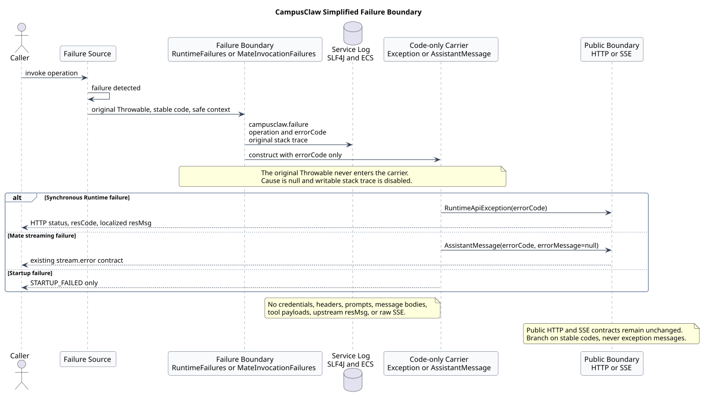

# CampusClaw 简化异常日志设计

| 属性 | 值 |
|---|---|
| 文档版本 | 2.0.0 |
| 状态 | 已按实现提交 `3e693810e75a0995e59aeea6bbb980523ae4f472` 落地 |
| 设计日期 | 2026-08-26 |
| 实现仓库 | `superheromeZzh/pi-mono-java` |
| 关联 PR | [pi-mono-java#174](https://github.com/superheromeZzh/pi-mono-java/pull/174) |
| 主干基线 | `8f9f3c1b51cca5ffbc3501fc4a1cb9ac253124be` |
| 评审前 PR 提交 | `80e9f266e82b20aabfb1e7f8aa1aae142a41dec0` |
| 本版实现提交 | `3e693810e75a0995e59aeea6bbb980523ae4f472` |

## 1. 结论

CampusClaw 采用一个简单且可执行的异常边界：

> 发现失败的代码先记录原始异常和安全上下文，再创建只携带稳定错误码的异常或错误结果。

原始 `Throwable`、上游错误文案和堆栈只进入服务端日志，不进入跨层异常、
`AssistantMessage` 或 HTTP/SSE 返回。调用方只依赖错误码；开发和运维人员通过同一个错误码在
后端日志中查找包含原始堆栈的记录。

本版没有引入独立日志 Maven 模块。Runtime 和 AI 模块各保留一个很薄的失败边界，避免破坏
现有 `ai -> agent-core -> coding-agent-cli` 依赖方向：

- Runtime：`RuntimeFailures`；
- Mate Model Manager：`MateInvocationFailures`；
- 启动入口和后台未捕获异常：在各自最外层边界使用相同字段直接记录。

## 2. 来源证据

### 2.1 基线说明

| 类型 | 提交 | 说明 |
|---|---|---|
| 主干基线 | `8f9f3c1b51cca5ffbc3501fc4a1cb9ac253124be` | 合并 PR 最新主干时的实现基线 |
| 评审前 PR | `80e9f266e82b20aabfb1e7f8aa1aae142a41dec0` | 已有 Runtime 调用点日志，但未完整覆盖 Mate、启动和类型化执行失败 |
| 评审后实现 | `3e693810e75a0995e59aeea6bbb980523ae4f472` | 本设计对应的实现；合并主干后完成失败边界收敛 |

评审前已观察行为与目标设计必须区分：PR 原实现删除了
`RuntimeApiException(RuntimeErrorCode, Throwable)`，并在多个 Runtime 调用点记录日志；但
Mate HTTP/SSE 失败仍可能只转换为 `AssistantMessage(stopReason=ERROR)`，启动入口和无
`Throwable` 的执行失败也没有统一的稳定事件。本版在此基础上补齐边界，并把散落格式收敛。

### 2.2 关键实现路径

| 路径 | 符号或基线行 | 证据 |
|---|---|---|
| `modules/coding-agent-cli/src/main/java/com/campusclaw/codingagent/runtimeapi/error/RuntimeFailures.java` | `raise()`、`record()`，L27-L56 | Runtime 在源头记录后创建错误码异常 |
| `modules/coding-agent-cli/src/main/java/com/campusclaw/codingagent/runtimeapi/error/RuntimeApiException.java` | 构造器，L18-L21 | message 只有错误码，无 cause、无可写堆栈 |
| `modules/ai/src/main/java/com/campusclaw/ai/provider/mate/MateInvocationFailures.java` | `raise()`、`record()`，L27-L56 | Mate 失败统一记录和转换 |
| `modules/ai/src/main/java/com/campusclaw/ai/provider/mate/MateInvocationErrorCode.java` | enum，L13-L48 | Mate 使用稳定内部错误码，不依赖错误文案分支 |
| `modules/ai/src/main/java/com/campusclaw/ai/provider/mate/MateModelInvocationException.java` | 构造器，L16-L19 | 只携带 `MateInvocationErrorCode` |
| `modules/ai/src/main/java/com/campusclaw/ai/provider/mate/MateServiceModelManagerProvider.java` | `decodeResponse()`、`httpError()`，L143-L171 | HTTP 状态、响应类型和上游 `resCode` 分类；丢弃上游 `resMsg` |
| `modules/ai/src/main/java/com/campusclaw/ai/provider/mate/MateChatSseParser.java` | `fail()`、`streamFailure()`，L115-L128、L398-L416 | SSE 协议或传输异常在转换前记录 |
| `modules/coding-agent-cli/src/main/java/com/campusclaw/codingagent/runtimeapi/event/RuntimeExecutionCoordinator.java` | `completeExecution()`、`logFailure()`，L158-L224 | 补齐类型化 `StopReason.ERROR` 和原始执行异常 |
| `modules/coding-agent-cli/src/main/java/com/campusclaw/codingagent/runtimeapi/web/RuntimeExceptionHandler.java` | handlers，L42-L88 | 已记录的业务异常不重复记录；框架异常和意外异常在边界记录 |
| `modules/coding-agent-cli/src/main/java/com/campusclaw/codingagent/CampusClawApplication.java` | `launch()`，L42-L58 | 启动失败记录原始异常，再抛 `STARTUP_FAILED` |
| `modules/agent-core/src/main/java/com/campusclaw/agent/util/LoggingUncaughtExceptionHandler.java` | `uncaughtException()`，L31-L44 | 后台未捕获异常记录 `BACKGROUND_TASK_FAILED` |
| `modules/coding-agent-cli/src/main/resources/application-k8s.yml` | L9-L14 | Kubernetes 控制台默认 ECS 结构化输出 |
| `mate-campusclaw/src/main/resources/application.properties` | L95 | Mate 镜像默认 ECS 结构化输出 |

`mate-campusclaw` 中的 Java 实现由 `scripts/sync-mate-campusclaw.sh` 从 canonical modules 同步，
`application.properties` 继续手工维护。

## 3. 目标与非目标

### 3.1 目标

- 异常发生时，服务端日志包含原始异常及堆栈；
- 跨层异常只携带稳定错误码，不包装原始异常；
- Mate 的 HTTP、SSE、解析和本地映射失败可按错误码定位；
- `StopReason.ERROR` 即使没有 `Throwable`，也产生可检索的失败日志；
- 启动失败和后台未捕获异常使用相同事件结构；
- 不向调用方泄漏上游 `resMsg`、内部异常消息或堆栈；
- 保持现有 HTTP 状态、`{resCode,resMsg}` 以及 Runtime SSE 契约不变。

### 3.2 非目标

- 不记录请求开始、成功、耗时等完整访问日志；
- 不新增 requestId、traceId、MDC 或跨线程诊断上下文；
- 不新增数据库、目录、远端服务等启动健康探针；
- 不建设日志采集、索引、告警或保留策略；
- 不记录 Prompt、消息正文、thinking、工具参数/结果、凭据、Header 或原始 SSE；
- 不改造本次范围外的普通第三方 Provider 和 Mate Tool Client。

这些删减是有意的架构简化，不代表上述能力永远不需要；只有实际定位证据表明当前简单方案
不足时，才按独立需求扩展。

## 4. 核心架构



[PlantUML 源码：`campusclaw_failure_boundary`](diagram.puml#L17)

规则只有三条：

1. **先记录，后转换**：持有原始 `Throwable` 的边界负责记录，不把记录责任推给更上层；
2. **错误码跨层**：转换后的异常、Assistant 终态和公共响应只传稳定错误码；
3. **同一来源只记一次**：`RuntimeExceptionHandler` 不重复记录已经由 `RuntimeFailures.raise()`
   记录的 `RuntimeApiException`；执行层能识别 Mate 已提供的错误码，仅补无错误码的兜底失败。

两个 Helper 的少量重复是有意的模块边界：把它们抽成公共模块会增加依赖和抽象成本，与本次
“简单且漂亮”的目标相悖。两者共享日志协议，而不共享业务错误码类型。

## 5. 统一日志协议

所有新增失败日志使用 SLF4J 2 fluent key-value API，固定事件名：

```text
event=campusclaw.failure
operation=mate.response.stream
errorCode=MODEL_INVOCATION_TIMEOUT
modelId=<safe model id>
<original stack trace>
```

| 字段 | 必选 | 说明 |
|---|---|---|
| `event` | 是 | 固定为 `campusclaw.failure` |
| `operation` | 是 | 稳定、低基数的失败位置，例如 `runtime.http.request` |
| `errorCode` | 是 | 稳定错误码；排查和程序分支的首要依据 |
| 安全上下文 | 否 | `sessionId`、`agentId`、`modelId`、HTTP method/path/status 等白名单值 |
| `Throwable` | 否 | 仅当边界持有真实异常时作为日志 cause，绝不进入转换后的异常 |

日志文本也保留 `operation/errorCode/context`，因此本地普通文本控制台可以直接阅读；
Kubernetes 和 `mate-campusclaw` 默认通过 Spring Boot ECS JSON 输出，环境变量
`CAMPUSCLAW_LOG_FORMAT` 可覆盖格式。

### 5.1 级别

| 场景 | 级别 |
|---|---|
| Runtime 4xx 业务拒绝或参数错误 | WARN |
| Runtime 5xx、启动失败、后台未捕获异常 | ERROR |
| Mate 非法请求、模型不存在、限流 | WARN |
| Mate 不可用、超时、上游/协议/解析错误 | ERROR |

级别只影响检索和告警，不影响公开 HTTP 状态或错误码。

### 5.2 安全约束

- 不记录请求/响应正文；
- 不记录 Authorization、Cookie、Token 或完整 Header；
- 不记录 Prompt、工具参数、工具结果和思考内容；
- 上游 HTTP 错误只记录状态和 `resCode`，不读取或传播 `resMsg`；
- 不使用异常 message 做重试或业务分支；仅为兼容旧 Provider 保留已有文案回退。

## 6. 失败处理

### 6.1 Runtime HTTP

业务代码通过 `throw RuntimeFailures.raise(operation, code, error?, context...)`：

1. Helper 按 HTTP 状态选择 WARN 或 ERROR；
2. 日志写入错误码、安全上下文和可选原始异常；
3. 返回新的 `RuntimeApiException(code)`；
4. 异常构造器使用 `super(code.name(), null, false, false)`，因此没有 cause 和自身堆栈；
5. `RuntimeExceptionHandler` 只把错误码映射为现有 HTTP 状态和本地化 `resMsg`。

框架请求体/参数异常和未预期异常没有经过 Helper，由 `RuntimeExceptionHandler` 先记录，再返回
稳定错误码。这里的公共 `resMsg` 是受控的本地化产品文案，不是原始异常或上游错误文案。

### 6.2 Mate Model Manager

Mate 失败按发生位置分类：

| 阶段 | 典型错误码 |
|---|---|
| 请求映射 | `INVALID_LLM_CHAT_REQUEST`、`MATE_REQUEST_MAPPING_FAILED` |
| HTTP/可用性 | `MODEL_NOT_FOUND`、`MODEL_RATE_LIMITED`、`MODEL_UNAVAILABLE`、`MANAGER_UNAVAILABLE` |
| 超时/流传输 | `MODEL_INVOCATION_TIMEOUT`、`UPSTREAM_STREAM_ERROR` |
| 响应/SSE 协议 | `INVALID_MATE_RESPONSE`、`INVALID_CHAT_SSE`、`INVALID_REASONING_SIGNATURE` |
| 模型终态 | `MODEL_CONTENT_FILTERED`、`CONTEXT_WINDOW_EXCEEDED`、`UPSTREAM_MODEL_ERROR` |

`MateModelInvocationException` 和失败 `AssistantMessage.errorCode` 只保存上述稳定码，
`errorMessage` 设为 `null`。上游未知 `resCode` 映射为 `MATE_MODEL_MANAGER_ERROR`，原值仅作为
安全诊断字段记录；不会把上游 `resMsg` 放入异常或 Assistant 消息。

### 6.3 Runtime 执行终态

模型失败可能以 `AssistantMessage(stopReason=ERROR)` 正常结束 Future，而不是抛异常。
`RuntimeEventProjector` 因此保留内部 `terminalErrorCode`，`RuntimeExecutionCoordinator` 按以下
顺序处理：

1. 有原始执行异常：记录 `SESSION_EXECUTION_FAILED` 和 cause；
2. 只有 `StopReason.ERROR` 且没有 Mate 错误码：记录兜底 `SESSION_EXECUTION_FAILED`；
3. 已有 Mate 错误码：不在执行层重复记录同一失败；
4. 对调用方仍发送既有 Runtime `stream.error`，错误码保持 `SESSION_EXECUTION_FAILED`。

内部 Mate 错误码不新增到 Runtime 公共 SSE 字段，避免未经评审的协议变化。

### 6.4 启动与后台线程

`CampusClawApplication.launch()` 捕获 Spring 启动的 `RuntimeException`，记录原始异常和
`STARTUP_FAILED`，随后抛出无 cause、无堆栈的 code-only `StartupException`。Spring Boot 在
失败过程中可能先输出自身框架日志，但稳定的 `event/operation/errorCode` 由 CampusClaw 保证。

后台线程未捕获异常记录 `BACKGROUND_TASK_FAILED`，包括线程名和原始 cause。该处理器是进程
末端日志边界，不再构造新的跨层异常。

## 7. 运维定位方式

本地文本日志可直接搜索：

```text
CampusClaw failure: operation=
errorCode=MODEL_INVOCATION_TIMEOUT
errorCode=STARTUP_FAILED
```

ECS JSON 环境优先按结构化字段过滤：

```text
event == "campusclaw.failure" AND errorCode == "MODEL_INVOCATION_TIMEOUT"
event == "campusclaw.failure" AND sessionId == "<session-id>"
```

如果调用在 DNS、TLS、连接或路由阶段、尚未到达 CampusClaw 进程，CampusClaw 无法产生日志；
这种情况仍需由调用端或网关日志确认。这个物理边界不通过服务端代码伪造解决。

## 8. 验收标准

- Runtime Helper 的 WARN/ERROR 选择正确；
- Helper 记录原始 `Throwable`，返回异常的 `getCause()` 为 `null` 且堆栈为空；
- Mate HTTP 失败不泄漏响应 `resMsg`；
- Mate SSE 非法内容记录原始解析异常且只记录一次；
- `AssistantMessage.errorCode` 支持稳定上下文溢出和压缩重试判断；
- 启动失败日志包含原始异常，向上仅抛 `STARTUP_FAILED`；
- 执行原始异常和无错误码 ERROR 终态都有兜底日志；
- canonical modules 与 `mate-campusclaw` 镜像同步；
- 主工程和独立镜像工程的 `verify`、Checkstyle、`git diff --check` 全部通过。

## 9. 版本历史

| 版本 | 日期 | 变更 |
|---|---|---|
| 1.0.0 | 2026-08-25 | 初版调用日志设计 |
| 1.1.0 | 2026-08-25 | 扩展为启动、请求、执行、模型、工具完整生命周期设计 |
| 2.0.0 | 2026-08-26 | 按 PR #174 实现收敛为异常源头记录、错误码跨层传播的简单架构 |
