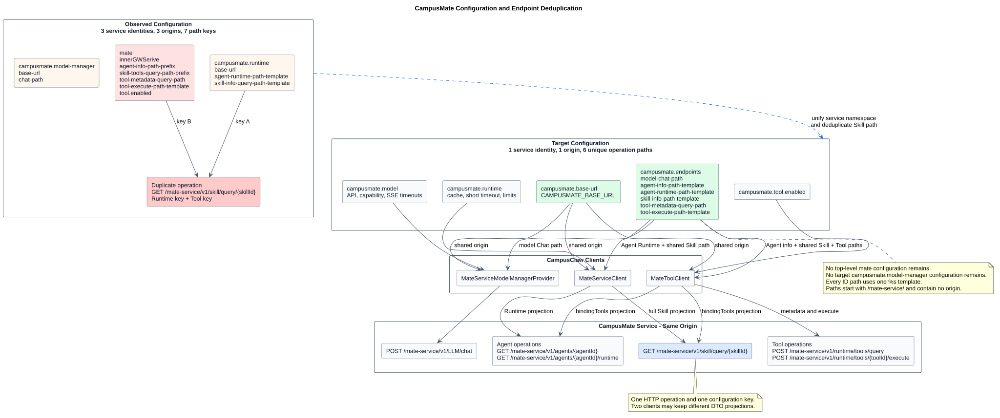

# CampusMate 统一客户端地址配置设计

| 属性 | 值 |
|---|---|
| 文档版本 | 1.0.0 |
| 状态 | 目标设计；待 pi-mono-java 实现 |
| 设计日期 | 2026-08-26 |
| pi-mono-java 源码基线 | `56be8eee59415a5f86658d6635a7b7e8891263d3` (`origin/main`) |
| 相关分支复核 | `80e9f266e82b20aabfb1e7f8aa1aae142a41dec0`；本文引用的配置与客户端代码无差异 |
| mate-service 源码基线 | `6d5e6f3714e1cf8744d187a4796ca06300ad7e33` |
| 设计仓分析基线 | `f1bacba636d7d1f85cf034f22680e184ab4567d4` |
| 适用边界 | CampusClaw → CampusMate Model Manager 与受管 Runtime 接口 |

## 1. 结论

CampusMate Model Manager 和受管 Runtime 是同一个 CampusMate 服务下的不同
HTTP 路径，必须共用唯一的部署级 origin：

```yaml
campusmate:
  base-url: ${CAMPUSMATE_BASE_URL}
  model-manager:
    chat-path: ${CAMPUSMATE_MODEL_MANAGER_CHAT_PATH:/mate-service/v1/LLM/chat}
    api: ${CAMPUSMATE_MODEL_MANAGER_API:openai-completions}
    connect-timeout: ${CAMPUSMATE_MODEL_MANAGER_CONNECT_TIMEOUT:PT10S}
    response-timeout: ${CAMPUSMATE_MODEL_MANAGER_RESPONSE_TIMEOUT:PT10M}
  runtime:
    agents-root: ${CAMPUSCLAW_AGENTS_ROOT:agent}
    connect-timeout: ${CAMPUSMATE_RUNTIME_CONNECT_TIMEOUT:PT10S}
    request-timeout: ${CAMPUSMATE_RUNTIME_REQUEST_TIMEOUT:PT30S}
    agent-runtime-path-template: ${CAMPUSMATE_AGENT_RUNTIME_PATH_TEMPLATE:/mate-service/v1/agents/%s/runtime}
    skill-info-query-path-template: ${CAMPUSMATE_SKILL_INFO_QUERY_PATH_TEMPLATE:/mate-service/v1/skill/query/%s}
```

目标配置只有 `campusmate.base-url` 可以决定 CampusMate 的 scheme、host 和 port。
`campusmate.model-manager` 与 `campusmate.runtime` 只保留各自的路径、超时、限额和
协议参数，不得再提供子模块 `base-url` 覆盖。

本调整是 **架构改造**，不改变任何 HTTP path、请求/响应字段、认证、SSE
或超时语义。

## 2. 观察到的源码行为

### 2.1 pi-mono-java

| 源码证据 | 当前行为 |
|---|---|
| `modules/coding-agent-cli/src/main/resources/application.yml:89-108` | `campusmate.model-manager.base-url` 使用 `CAMPUSMATE_MODEL_MANAGER_BASE_URL`，默认 `https://localhost:8591`；`campusmate.runtime.base-url` 使用 `CAMPUSMATE_RUNTIME_BASE_URL`，默认 `http://campusmate-service:8080`。 |
| `modules/ai/src/main/java/com/campusclaw/ai/provider/mate/MateServiceModelManagerProvider.java:68-76` | Provider 直接注入 `campusmate.model-manager.base-url`，与 Chat path 拼接为终端地址。 |
| `modules/coding-agent-cli/src/main/java/com/campusclaw/codingagent/runtime/AgentRuntimeProperties.java:15-34` | `baseUrl` 属于 `campusmate.runtime` 绑定对象，因此 Runtime 客户端有第二个地址权威。 |
| `modules/coding-agent-cli/src/main/java/com/campusclaw/codingagent/runtime/MateServiceClient.java:43-69,184-197` | `MateServiceClient` 从 `AgentRuntimeProperties.baseUrl` 取值，再拼接 Agent/Skill 路径。 |
| `mate-campusclaw/src/main/resources/application.properties:70-78,99-101` | 镜像配置只明确声明 Model Manager base URL 和 Runtime path，Runtime base URL 可以绑定为 `null`。 |

上述是基线代码的已观察行为。两个地址键、两个环境变量和两组默认值
容许同一进程把 CampusMate 请求发送到两个不同 origin，这与目标部署事实不一致。

### 2.2 mate-service

`src/main/java/com/huawei/hicampus/mate/agentdefinition/controller/AgentDefinitionController.java:38-67`
已观察到受管 Runtime 接口位于 mate-service 的
`GET /mate-service/v1/agents/{agentId}/runtime`。Model Manager 的
`POST /mate-service/v1/LLM/chat` 在 mate-service 基线中尚未实现，是已冻结的
target-only 契约。本设计依据确认的产品部署约束，将两类路径收敛到同一
CampusMate origin；不把未实现的 Chat 契约写成已观察行为。

## 3. 目标架构与责任



[PlantUML 源码：`campusmate_shared_base_url_configuration`](diagram.puml#L1)

| 配置 | 责任 | 是否共享 |
|---|---|---|
| `campusmate.base-url` | CampusMate 服务的 scheme、host、port | 是；Model Manager 与 Runtime 必须读取同一值 |
| `campusmate.model-manager.chat-path` | Mate Chat 路径 | 否 |
| `campusmate.model-manager.*timeout` | 建连与 SSE 响应超时 | 否 |
| `campusmate.runtime.*path-template` | Agent Runtime 与 Skill 查询路径 | 否 |
| `campusmate.runtime.*timeout` | 短请求连接与总超时 | 否 |
| `campusmate.runtime.agents-root` | 本地受管 Agent 缓存根目录 | 否；它不是 HTTP 连接配置 |

共享 base URL 不意味着共享 HTTP Client 实例。Model Manager 保留 WebClient/SSE、
长响应超时和断连取消语义；Runtime 客户端保留 JDK HttpClient、短请求超时、
响应大小上限和 ResultBean 解析。两者只共享连接 origin。

## 4. URL 校验与拼接

`campusmate.base-url` 在 Spring 容器启动时完成本地校验，不发送网络请求。
必须满足：

1. 是绝对 URI，scheme 只能为 `http` 或 `https`；
2. 必须有 host，port 由部署环境决定；
3. 不允许 user-info、query 或 fragment；
4. path 必须为空或 `/`，受管接口路径继续由各子配置维护；
5. 规范化时只移除末尾 `/`，不改写 scheme、host 或 port。

每个 endpoint 按以下规则构造：

```text
endpoint = normalized(campusmate.base-url) + validated absolute service path
```

路径必须以 `/mate-service/` 开头，不得是完整 URL。这是 **安全加固**：请求级或
子模块配置都无法把某一类 CampusMate 请求改道到其他 host。

## 5. 配置迁移

本设计是显式的配置契约变更：

| 当前配置 | 目标配置 | 处理 |
|---|---|---|
| `campusmate.model-manager.base-url` / `CAMPUSMATE_MODEL_MANAGER_BASE_URL` | `campusmate.base-url` / `CAMPUSMATE_BASE_URL` | 删除旧键，不保留独立覆盖 |
| `campusmate.runtime.base-url` / `CAMPUSMATE_RUNTIME_BASE_URL` | `campusmate.base-url` / `CAMPUSMATE_BASE_URL` | 删除旧键，不保留独立覆盖 |

不定义旧键优先级或隐式 fallback。如果同时保留两个旧值，部署仍可以恢复
本设计正在消除的分流状态。`CAMPUSMATE_BASE_URL` 没有产品级默认地址；各部署
环境必须显式提供，避免本地端口或集群 service 名被误当成另一环境的有效默认值。

建议实施顺序：

1. 在部署模板和 Secret/ConfigMap 中增加 `CAMPUSMATE_BASE_URL`；
2. 同一发布中让 Model Manager Provider 和 Runtime Client 改读新键；
3. 删除两个旧环境变量和子模块属性；
4. 同步 canonical `application.yml`、`mate-campusclaw/application.properties`、README 和配置测试；
5. 启动时校验新 URI，但不把 CampusMate 网络可用性变成启动硬依赖。

## 6. 范围边界

本设计不收敛下列配置：

- `mate.innerGWSerive` / `MATE_INNERGWSERIVE`：它是 Mate Tool 发现和调用的已有内部网关集成键；
- CampusClaw 入站 `server.address/server.port`：它是 CampusClaw 自身监听地址；
- 模型上游 Provider endpoint、API Key 和私有模型 ID：它们由 CampusMate 内部管理；
- 文件服务、OBS 或数据库地址：它们不是这两个出站客户端的 origin。

本设计也不将 Model Manager 和 Runtime 的认证、超时、错误处理或重试策略合并为
一个契约。共享 origin 只消除部署地址漂移。

## 7. Java 目标映射

| 当前符号 | 目标调整 |
|---|---|
| `MateServiceModelManagerProvider` | 把构造器地址注入改为 `${campusmate.base-url}`，继续单独读取 Chat path 和 Model Manager 超时 |
| `AgentRuntimeProperties` | 删除 `baseUrl` record component，只保留 Runtime 缓存、超时、成功码和响应限额 |
| `MateServiceClient` | 从 `${campusmate.base-url}` 注入同一 URI，与 Runtime path template 拼接 |
| `application.yml` | 只声明一次 `campusmate.base-url: ${CAMPUSMATE_BASE_URL}` |
| `mate-campusclaw/application.properties` | 使用同一 `campusmate.base-url` 与环境变量，不得继续遗漏 Runtime 地址 |

不为了共享一个字符串在 `modules/ai` 与 `coding-agent-cli` 之间新建反向依赖。
两个客户端可分别注入同一 Spring property；配置键本身是唯一权威。

## 8. 差异分类

| 分类 | 目标差异 | 原因 |
|---|---|---|
| 架构改造 | 两个子模块 base URL 收敛为 `campusmate.base-url`。 | Model Manager 与 Runtime 属于同一 CampusMate 部署 origin。 |
| 架构改造 | 删除两个旧环境变量，不保留独立覆盖。 | 保留别名会让配置再次分流。 |
| 安全加固 | base URL 只允许 HTTP(S) origin，子路径不得携带 host。 | 防止单个客户端被请求级或路径配置改道。 |
| 产品约束 | Model Manager 和 Runtime 保留独立路径、超时、协议和错误语义。 | 共享服务地址不等于合并业务边界。 |

## 9. 验收标准

- 配置源中只存在 `campusmate.base-url` 和 `CAMPUSMATE_BASE_URL`；
- Model Manager Chat、Agent Runtime 和 Skill 查询终端的 scheme/host/port 完全相同；
- 两类客户端仍分别使用自己的 path 与 timeout；
- base URL 缺失、非 HTTP(S)、缺少 host、携带 user-info/query/fragment 或非根 path 时启动失败；
- 子路径不以 `/mate-service/` 开头或携带绝对 URL 时启动失败；
- canonical YAML 与 `mate-campusclaw` properties 对同一环境变量具有等价绑定；
- 启动校验不调用 CampusMate 网络健康接口；
- 聚焦测试覆盖两个客户端使用同一 origin、末尾 `/` 归一化和旧键不再生效；
- `mate.innerGWSerive`、入站 Runtime 和上游 Provider 地址不受本调整影响。

## 10. 文档同步范围

本主题同步修订
[`model-manager-provider-contract`](../model-manager-provider-contract/README.md)中的 Provider 配置、
Java 对齐图、迁移顺序与验收标准。Model Manager 的 operation JSON、HTML 评审页和
HTTP path 契约没有变化，因此不重新生成或改写这些接口制品。

## 11. 版本历史

| 版本 | 日期 | 变更 |
|---|---|---|
| 1.0.0 | 2026-08-26 | 新增 CampusMate 统一 `campusmate.base-url` 设计，删除 Model Manager 与 Runtime 独立地址覆盖的目标配置。 |
