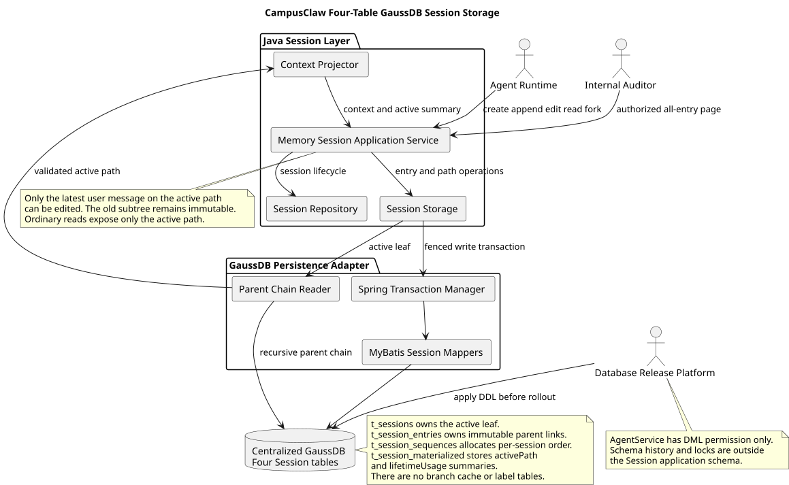
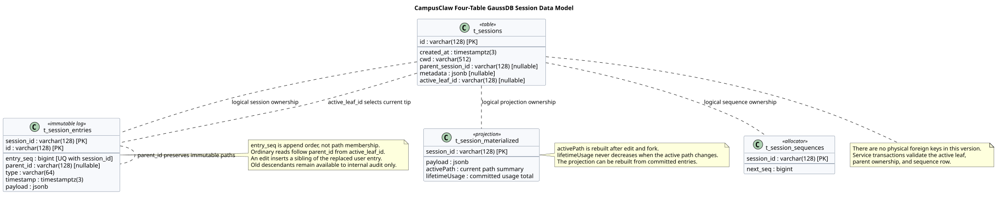
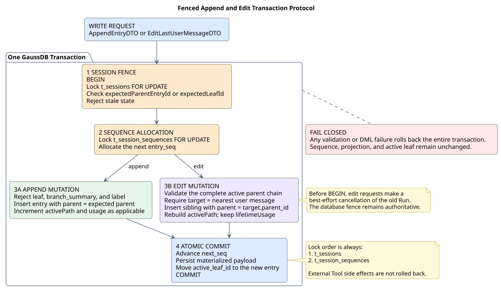
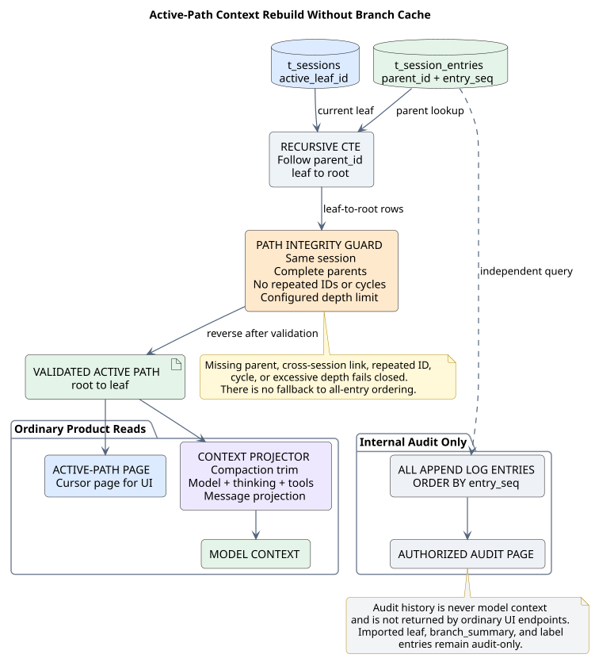

# CampusClaw Java 四表 GaussDB Session 事件存储 SR 设计

> 文档编号：SR-MEM-001<br>
> 版本：v0.14.1<br>
> 日期：2026-08-11<br>
> 状态：设计评审稿<br>
> pi 源码基线：[`f0deb8dd8e9611e89b5bc4145ca92c03ae6ed4ee`](https://github.com/badlogic/pi-mono/tree/f0deb8dd8e9611e89b5bc4145ca92c03ae6ed4ee)<br>
> 设计仓库分析基线：`63c08ce77ab2dc102ecd141df81337857fb07cbb`<br>
> CampusClaw Java 源码基线：无；本文 Java、GaussDB 和数据库发布机制均为 target-only design<br>
> 数据库约束：集中式 GaussDB<br>
> JDBC 约束：openGauss JDBC `6.0.0-htrunks.csi.gaussdb_kernel.opengaussjdbc.r1`

## 1. 结论

CampusClaw Session 采用四表事件存储：

1. `t_sessions`：Session 主记录和唯一当前活动叶子。
2. `t_session_entries`：不可变 Entry 历史及父链事实。
3. `t_session_sequences`：每个 Session 的下一写入序号。
4. `t_session_materialized`：当前活动路径摘要和全部已持久化调用用量。

本设计不创建 `t_branch_entries`、`t_branch_tips` 和 `t_entry_materialized`。前两张表在 pi SQLite 中是可重建的路径缓存；CampusClaw 产品不提供通用 Branch 创建、切换、恢复和查询，因此直接从 `t_sessions.active_leaf_id` 沿 `t_session_entries.parent_id` 读取当前路径。Label 产品能力取消，不再建立独立 Label 投影。

产品只允许编辑当前活动路径中最近一条用户消息。编辑不覆盖或删除旧 Entry，而是在原消息所在位置插入新的用户消息并切换 `active_leaf_id`。旧消息及其后继仍保存在 append log 中，只能通过内部审计查询读取；普通分页、Context、fork 和 UI 均只使用当前活动路径。

`t_session_materialized.payload` 分离两种口径：

- `activePath`：当前路径的名称、消息数、当前模型和当前 Thinking Level；编辑后从新路径重建。
- `lifetimeUsage`：全部已持久化模型调用的 Token 和费用累计；编辑不回退旧路径已经产生的消耗。

集中式 GaussDB 允许多个 AgentService 实例连接同一 Schema。本设计不再依赖 pi SQLite 的单进程 `SerialOperationQueue` 作为唯一并发边界：所有 append 和 edit 先锁 `t_sessions`，再锁 `t_session_sequences`；写入携带 expected leaf/parent，迟到 Run 和过期客户端不能推进当前路径。



[查看 PlantUML 源码](./diagrams/memory/diagram.puml#L6)

## 2. 来源证据与设计边界

### 2.1 观察到的 pi 行为

pi 基线使用七张 Session 数据表：`sessions`、`session_entries`、`session_sequences`、`branch_entries`、`branch_tips`、`session_materialized` 和 `entry_materialized`。应用侧 migration 还维护 `migrations` 基础设施表。

关键源码事实如下：

- `session_entries.parent_id` 保存权威父链，`sessions.active_leaf_id` 保存当前 leaf。
- append 在一个 SQLite transaction 中写 Entry、推进 sequence、更新 materialized state、active leaf 和 branch cache。
- `branch_entries` 与 `branch_tips` 是可从父链恢复的 root-to-tip 路径缓存。
- `entry_materialized` 当前只保存 Label 设置和清除事件的投影。
- `SerialOperationQueue` 只在一个 SQLite backend 实例内串行执行操作。

源码证据：

- [`001_initial.sql`](https://github.com/badlogic/pi-mono/blob/f0deb8dd8e9611e89b5bc4145ca92c03ae6ed4ee/packages/storage/sqlite-node/src/sqlite/migrations/001_initial.sql#L1-L59)
- [`002_branch_tips.sql`](https://github.com/badlogic/pi-mono/blob/f0deb8dd8e9611e89b5bc4145ca92c03ae6ed4ee/packages/storage/sqlite-node/src/sqlite/migrations/002_branch_tips.sql#L1-L12)
- [`SqliteSessionConnection.appendEntry()`](https://github.com/badlogic/pi-mono/blob/f0deb8dd8e9611e89b5bc4145ca92c03ae6ed4ee/packages/storage/sqlite-node/src/sqlite/storage/index.ts#L367-L418)
- [`branch-cache.ts`](https://github.com/badlogic/pi-mono/blob/f0deb8dd8e9611e89b5bc4145ca92c03ae6ed4ee/packages/storage/sqlite-node/src/sqlite/storage/branch-cache.ts#L1-L326)
- [`session-materialized.ts`](https://github.com/badlogic/pi-mono/blob/f0deb8dd8e9611e89b5bc4145ca92c03ae6ed4ee/packages/storage/sqlite-node/src/sqlite/storage/session-materialized.ts#L1-L355)
- [`SerialOperationQueue`](https://github.com/badlogic/pi-mono/blob/f0deb8dd8e9611e89b5bc4145ca92c03ae6ed4ee/packages/storage/sqlite-node/src/sqlite/repo.ts#L50-L67)

### 2.2 CampusClaw 目标决策

| 决策 | 分类 | 设计原因 |
|---|---|---|
| 只保留四张 Session 表 | 产品约束 | 产品只展示一条当前路径，不提供通用 Branch 管理 |
| 保留 `parent_id` 与 `active_leaf_id` | 产品约束 | 最近用户消息编辑仍需保留旧路径并切换当前路径 |
| 删除 Branch Cache | 架构变化 | Context 直接递归权威父链，避免缓存写入和修复协议 |
| 删除 `t_entry_materialized` 和 Label 能力 | 产品约束 | 当前产品没有 Label 查询和展示需求 |
| 最近用户消息编辑使用不可变新 Entry | 安全与审计强化 | 不覆盖旧输入，不伪造已经发生的模型和 Tool 历史 |
| expected leaf/parent 写入栅栏 | 并发强化 | 拒绝多实例迟到 Run 和基于旧页面的编辑 |
| active/lifetime 摘要分离 | 架构变化 | 当前上下文变化不能抹除已经发生的 Token 和费用 |
| 不映射 pi `migrations` | 架构变化 | Schema 只由 CampusClaw 数据库发布平台升级 |

这些目标决策不是 pi 原生行为，不得描述为 SQLite parity。CampusClaw 保留 pi Entry 编码、父链、sequence、compaction trim 和 Context 投影语义，但明确收窄 Branch、Leaf Navigation 和 Label 能力。

### 2.3 范围与非目标

本期包括：

- create、open、list、delete、append 和 Context 重建。
- 当前活动路径分页和内部全历史审计分页。
- 编辑当前活动路径最近一条用户消息。
- 只复制当前活动路径的 Session fork。
- SQLite/JSONL 到四表 Schema 的导入和受控导出。
- 集中式 GaussDB 多实例写入栅栏。

本期不包括：

- 通用 `moveTo`、Branch 列表、Branch 切换、Branch 恢复或任意历史消息编辑。
- 新写入 `leaf`、`branch_summary` 或 `label` Entry。
- Label API和 Label 投影。
- Runtime Checkpoint、跨会话长期记忆、全文检索、向量索引、多租户和 RLS。
- 持久化 Run、Tool 副作用补偿、operation id、request hash 或数据库幂等结果表。
- AgentService 启动时执行 DDL或维护 Schema migration 账本。

已经执行的外部 Tool 副作用不会因为用户编辑消息而自动撤销。编辑后的新 Run 如果再次调用高风险 Tool，必须重新执行产品既有的确认流程。

## 3. 四表数据模型



[查看 PlantUML 源码](./diagrams/memory/diagram.puml#L165)

### 3.1 `t_sessions`

| 字段 | 类型 | 语义 |
|---|---|---|
| `id` | `VARCHAR(128)` | Session 唯一 ID |
| `created_at` | `TIMESTAMPTZ(3)` | 创建时间 |
| `cwd` | `VARCHAR(512)` | 受控规范工作目录 |
| `parent_session_id` | `VARCHAR(128)` | fork 来源 Session；没有来源时为空 |
| `metadata` | `JSONB` | 调用方附加元数据；没有时为 SQL `NULL` |
| `active_leaf_id` | `VARCHAR(128)` | 当前活动路径末端；空 Session 时为空 |

`active_leaf_id` 逻辑引用同 Session 的 `t_session_entries.id`。应用在事务内维护该关系；本版本不增加物理外键。

### 3.2 `t_session_entries`

| 字段 | 类型 | 语义 |
|---|---|---|
| `session_id` | `VARCHAR(128)` | 所属 Session |
| `id` | `VARCHAR(128)` | Session 内唯一 Entry ID |
| `entry_seq` | `BIGINT` | Session 内严格递增的持久化顺序 |
| `parent_id` | `VARCHAR(128)` | 同 Session 直接父 Entry；根 Entry 为空 |
| `type` | `VARCHAR(64)` | Entry discriminator |
| `timestamp` | `TIMESTAMPTZ(3)` | Entry 自带事件时间 |
| `payload` | `JSONB` | 类型相关内容 |

主键为 `(session_id, id)`，唯一索引 `(session_id, entry_seq)` 保证稳定 append 顺序。`parent_id` 是路径事实源；`entry_seq` 只表达持久化先后，不能用于判断当前聊天路径。

编辑后的用户消息不新增 `replaces_entry_id`。Service 通过编辑事务保证目标是当前路径最近用户消息，并令新 Entry 的 `parent_id` 等于旧用户消息的 `parent_id`。数据库可以保留两个同父节点的子树，但产品只暴露 `active_leaf_id` 所在路径。

### 3.3 `t_session_sequences`

每个 Session 一行：

| 字段 | 类型 | 语义 |
|---|---|---|
| `session_id` | `VARCHAR(128)` | 所属 Session |
| `next_seq` | `BIGINT` | 下一条 Entry 使用的 `entry_seq`；从 1 开始 |

所有写事务按 `t_sessions` → `t_session_sequences` 的顺序加锁。分配 sequence 后必须在同一事务中插入 Entry并推进 active leaf，任一步失败全部回滚。

### 3.4 `t_session_materialized`

每个 Session 一行：

| 字段 | 类型 | 语义 |
|---|---|---|
| `session_id` | `VARCHAR(128)` | 所属 Session |
| `payload` | `JSONB` | 当前路径摘要和生命周期累计用量 |

payload 固定为：

```json
{
  "activePath": {
    "name": null,
    "messageCount": 0,
    "currentModel": null,
    "currentThinkingLevel": null
  },
  "lifetimeUsage": {
    "cachedTokens": 0,
    "uncachedTokens": 0,
    "totalTokens": 0,
    "costTotal": 0
  }
}
```

规则：

- `activePath` 从当前父链正序投影；编辑和 fork 后整体重建。
- 普通 active-path append 可以增量更新 `activePath`。
- `lifetimeUsage` 只累计已经成功持久化的 assistant、compaction 等带 usage Entry；切换当前路径时不减少。
- 新模型调用成功持久化后，同时更新 active path 状态和 lifetime usage。
- JSON 字段必须完整，数值必须为有限非负数；Service 和导入器负责校验，JSONB 负责 JSON 语法校验。
- 该投影可由 `t_session_entries` 重建，不是 Entry 事实源。

## 4. 最终态 GaussDB DDL

```sql
CREATE TABLE t_sessions (
    id                 VARCHAR(128)   PRIMARY KEY,
    created_at         TIMESTAMPTZ(3) NOT NULL,
    cwd                VARCHAR(512)   NOT NULL,
    parent_session_id  VARCHAR(128),
    metadata           JSONB,
    active_leaf_id     VARCHAR(128)
);

COMMENT ON COLUMN t_sessions.id IS '会话的唯一 ID，用于关联该会话的历史记录、序号和汇总数据';
COMMENT ON COLUMN t_sessions.created_at IS '创建这个会话的时间';
COMMENT ON COLUMN t_sessions.cwd IS '创建会话时使用的工作目录；可用于按工作目录筛选会话';
COMMENT ON COLUMN t_sessions.parent_session_id IS '当前会话复制自哪个来源会话；没有来源时为空，复制内容只包含来源会话的当前活动路径';
COMMENT ON COLUMN t_sessions.metadata IS '创建会话时由调用方提供的附加信息 JSON；未提供时为 SQL NULL';
COMMENT ON COLUMN t_sessions.active_leaf_id IS '当前活动路径最后一条历史记录的 ID；空会话时为空，普通读取只展示从该记录回溯得到的路径';

CREATE INDEX idx_t_sessions_created_at
    ON t_sessions (created_at DESC);

CREATE INDEX idx_t_sessions_cwd
    ON t_sessions (cwd);

CREATE INDEX idx_t_sessions_parent
    ON t_sessions (parent_session_id);

CREATE TABLE t_session_entries (
    session_id  VARCHAR(128)   NOT NULL,
    id          VARCHAR(128)   NOT NULL,
    entry_seq   BIGINT         NOT NULL,
    parent_id   VARCHAR(128),
    type        VARCHAR(64)    NOT NULL,
    timestamp   TIMESTAMPTZ(3) NOT NULL,
    payload     JSONB          NOT NULL,
    PRIMARY KEY (session_id, id)
);

COMMENT ON COLUMN t_session_entries.session_id IS '这条历史记录属于哪个会话；对应 t_sessions.id';
COMMENT ON COLUMN t_session_entries.id IS '这条历史记录的 ID；在同一个会话内唯一';
COMMENT ON COLUMN t_session_entries.entry_seq IS '这条历史记录在会话中的持久化顺序号；从 1 开始且严格递增，不表示当前聊天路径';
COMMENT ON COLUMN t_session_entries.parent_id IS '这条历史记录的直接父记录 ID；根记录为空，系统据此还原当前活动路径并保留编辑前旧路径';
COMMENT ON COLUMN t_session_entries.type IS '这条历史记录的种类；新写入不接受 leaf、branch_summary 和 label';
COMMENT ON COLUMN t_session_entries.timestamp IS '这条历史记录产生时携带的事件时间；不是数据库保存该行的时间';
COMMENT ON COLUMN t_session_entries.payload IS '这条历史记录的类型相关 JSON 内容；ID、父记录、事件时间和类型分别保存在其他字段中';

CREATE UNIQUE INDEX idx_t_session_entries_session_seq
    ON t_session_entries (session_id, entry_seq);

CREATE INDEX idx_t_session_entries_session_parent
    ON t_session_entries (session_id, parent_id);

CREATE INDEX idx_t_session_entries_session_type
    ON t_session_entries (session_id, type);

CREATE TABLE t_session_sequences (
    session_id  VARCHAR(128) PRIMARY KEY,
    next_seq    BIGINT       NOT NULL
);

COMMENT ON COLUMN t_session_sequences.session_id IS '这行序号记录属于哪个会话；对应 t_sessions.id，每个会话一行';
COMMENT ON COLUMN t_session_sequences.next_seq IS '下一条新历史记录要使用的 entry_seq；新建会话时为 1，每次成功追加后加 1';

CREATE TABLE t_session_materialized (
    session_id  VARCHAR(128) PRIMARY KEY,
    payload     JSONB        NOT NULL
);

COMMENT ON COLUMN t_session_materialized.session_id IS '这份汇总属于哪个会话；对应 t_sessions.id，每个会话一行';
COMMENT ON COLUMN t_session_materialized.payload IS '会话汇总 JSON；activePath 保存当前路径名称、消息数、模型和思考级别，lifetimeUsage 保存全部已持久化模型调用的 Token 和费用累计';
```

最终 Session 应用 Schema 严格只有上述四张表和 17 个字段。数据库发布平台负责新环境初始化和已有环境增量删除三张派生表；AgentService 运行账号只执行 DML，不具备 DDL权限。

## 5. Java 接口与错误语义

### 5.1 Application Service

```java
interface MemorySessionApplicationService {
    SessionDTO createSession(CreateSessionDTO dto);
    SessionDTO openSession(String sessionId);
    List<SessionSummaryDTO> listSessions(SessionListQueryDTO queryDTO);
    void deleteSession(String sessionId);
    SessionDTO forkSession(ForkSessionDTO dto);
    AppendResultDTO appendEntry(AppendEntryDTO dto);
    SessionEntryDTO editLastUserMessage(EditLastUserMessageDTO dto);
    ContextSnapshotDTO loadContext(LoadContextDTO dto);
    EntryPageDTO pageEntries(EntryPageQueryDTO queryDTO);
    EntryPageDTO pageAllEntriesForAudit(AuditEntryPageQueryDTO queryDTO);
}
```

删除 `moveTo`、`findEntriesOnBranch`、Branch Selection 和 Label相关能力。`pageEntries` 只返回当前活动路径；`pageAllEntriesForAudit` 是内部授权接口，按 `entry_seq` 返回全部不可变历史。

上述对象是内部 Application Service DTO，不引入 PO、DO 或 Entity。若通过 Controller或对外 API暴露编辑与分页，请求对象使用独立的 `*RequestVO`，响应对象使用独立的 `*ResponseVO`；请求 VO使用 Jakarta Bean Validation，Controller只收发 VO，Service负责 VO/DTO转换、最近用户消息校验和事务编排，MyBatis Mapper只收发 DTO或标量结果。

### 5.2 写入 DTO

`AppendEntryDTO` 必须包含：

```text
sessionId
expectedParentEntryId
entry
```

`expectedParentEntryId` 可空，只在空 Session 首次 append 时为空。

`EditLastUserMessageDTO` 固定包含：

```text
sessionId
targetEntryId
expectedLeafId
newUserMessage
```

`newUserMessage` 必须是合法 user message；调用方不提交新 Entry ID、sequence、timestamp 或 parent，均由 Service 产生。

### 5.3 稳定错误

| 错误码 | 条件 |
|---|---|
| `SESSION_NOT_FOUND` | Session 不存在 |
| `SESSION_INVALID_ENTRY` | Entry 类型、payload、ID或请求字段非法 |
| `SESSION_EDIT_TARGET_NOT_LATEST_USER_MESSAGE` | 编辑目标不是当前路径最近用户消息 |
| `SESSION_STALE_LEAF` | edit 的 `expectedLeafId` 已过期 |
| `SESSION_STALE_PARENT` | append 的 `expectedParentEntryId` 不是当前 leaf |
| `SESSION_CORRUPTED_PATH` | 父节点缺失、跨 Session、重复节点或形成环 |
| `SESSION_PATH_TOO_DEEP` | 当前路径超过部署配置的最大递归深度 |
| `SESSION_STORAGE_ERROR` | 事务、JDBC 或持久化投影失败 |

校验错误不能通过截断、自动选择最新路径或静默丢弃旧 Entry 恢复。

## 6. 事务与并发协议



[查看 PlantUML 源码](./diagrams/memory/diagram.puml#L95)

### 6.1 Create

一个事务按顺序插入：

1. `t_sessions(active_leaf_id = NULL)`。
2. `t_session_sequences(next_seq = 1)`。
3. `t_session_materialized` 空 payload。

### 6.2 Append

```text
BEGIN
  SELECT t_sessions WHERE id = ? FOR UPDATE
  require active_leaf_id IS NOT DISTINCT FROM expectedParentEntryId
  reject new leaf, branch_summary, or label Entry
  SELECT t_session_sequences WHERE session_id = ? FOR UPDATE
  allocate next_seq
  INSERT t_session_entries(parent_id = expectedParentEntryId)
  UPDATE t_session_sequences
  increment activePath and lifetimeUsage as applicable
  UPDATE t_session_materialized
  UPDATE t_sessions SET active_leaf_id = newEntryId
COMMIT
```

锁顺序固定为 Session 主行、sequence 行。任何实例使用旧 parent append 时返回 `SESSION_STALE_PARENT`，不得把迟到结果写入旧路径或当前路径。

### 6.3 编辑最近用户消息

编辑请求进入数据库事务前，Service 对关联的活动 Run 发出最佳努力取消；数据库 leaf fence 是最终一致性保障。

```text
BEGIN
  SELECT t_sessions WHERE id = ? FOR UPDATE
  require active_leaf_id IS NOT DISTINCT FROM expectedLeafId
  read and validate active path
  find nearest user message from current leaf
  require nearestUser.id = targetEntryId
  SELECT t_session_sequences WHERE session_id = ? FOR UPDATE
  allocate next_seq
  INSERT new user message(parent_id = target.parent_id)
  UPDATE t_session_sequences
  rebuild activePath from the new current path
  keep lifetimeUsage unchanged
  UPDATE t_session_materialized
  UPDATE t_sessions SET active_leaf_id = newUserEntryId
COMMIT
```

编辑完成后，旧目标及旧后继仍存在。普通 API 不提供恢复旧路径的能力。新 Run 以新用户 Entry作为 expected parent；旧 Run携带旧 parent 时被栅栏拒绝。已经完成的外部 Tool调用不自动回滚。

### 6.4 Fork

fork 只读取来源 Session 当前活动路径，按原顺序写入新 Session。新 Session 设置 `parent_session_id=sourceSessionId`，不接受任意起点或 Branch Selection。复制时保持 Entry ID和父链，sequence 从 1 连续分配，并重建 materialized payload。

### 6.5 Delete

一个事务按顺序删除：

1. `t_session_entries`。
2. `t_session_materialized`。
3. `t_session_sequences`。
4. `t_sessions`。

不使用 `ON DELETE CASCADE` 代替事务顺序。

## 7. 当前路径、分页和 Context



[查看 PlantUML 源码](./diagrams/memory/diagram.puml#L258)

### 7.1 当前活动路径

Repository 使用 recursive CTE 从 `active_leaf_id` 回溯 `parent_id`。结果必须验证：

- 每行 `session_id` 等于请求 Session。
- `active_leaf_id` 非空时必须存在对应 Entry。
- 每个非空 parent 必须存在。
- 路径内 Entry ID不得重复，发现环立即失败。
- 递归深度不得超过部署配置；默认上限由实现配置，不写入数据库。

验证成功后按 `entry_seq ASC` 返回。不能把同 Session 全部 Entry 按 sequence 排序后直接作为聊天历史，因为其中包含编辑前旧路径。

### 7.2 普通分页与审计分页

- `pageEntries`：先解析当前路径，再按 active-path `entry_seq` 使用游标分页；只供普通 UI、Session open和运行时读取。
- `pageAllEntriesForAudit`：内部授权后按全局 `entry_seq` 分页，显示旧路径和当前路径；不得作为模型 Context 输入。

### 7.3 Context 重建

```text
leaf = t_sessions.active_leaf_id
path = validatedParentChain(leaf)
trimmedPath = trimPathToRootOrCompaction(path)
state = deriveModelThinkingAndTools(trimmedPath)
messages = project(defaultContextEntryTransform(trimmedPath))
```

删除 Branch Cache 不改变 compaction、`retainedTail`、旧 `firstKeptEntryId` 或自定义 projector 的语义。历史导入的 `leaf`、`branch_summary` 和 `label` Entry 可以存在于审计历史；新写入口拒绝这些类型，Label 不进入产品投影。

## 8. 数据迁移与发布

### 8.1 SQLite 导入

1. `sessions` → `t_sessions`，保留最终 `active_leaf_id`。
2. `session_entries` → `t_session_entries`，保留全部 Entry、`entry_seq` 和父链。
3. `session_sequences` → `t_session_sequences`，并校验 `next_seq > MAX(entry_seq)`。
4. 不导入 `branch_entries`、`branch_tips`、`entry_materialized` 或 `migrations`。
5. 从最终 active path 重建 `activePath`；从全部已持久化 usage Entry 重建 `lifetimeUsage`。
6. 历史 label/leaf/branch_summary Entry只保留为不可变审计数据，不开放对应写 API。

导入必须验证字符串长度、timestamp Instant、JSON结构、主键、sequence 唯一性、父链完整性、active leaf和 Context结果。存在损坏父链的 Session 不得部分导入。

### 8.2 JSONL 导入

JSONL importer 只写四张表。它先保存全部 Entry，再解析目标 active leaf；没有显式 leaf 信息时只能在证明历史为单链后选择最后一条 Entry，否则报告迁移错误，不能猜测当前路径。

### 8.3 已有七表环境

数据库发布平台按以下顺序升级：

1. 部署能够读取旧 payload 并写入新 payload 的兼容应用版本或执行离线转换。
2. 重建并校验每个 Session 的 `activePath` 与 `lifetimeUsage`。
3. 停止旧版本写入并确认没有 Mapper访问三张待删表。
4. 删除 `t_entry_materialized`、`t_branch_tips`、`t_branch_entries`。
5. 执行四表行数、键集合、当前路径、Context和汇总抽样校验。
6. 部署只依赖四表的应用版本。

具体迁移工具、历史表、checksum 和锁协议由 CampusClaw 数据库发布平台管理，元数据位于 Session 应用 Schema 之外。

## 9. 测试与验收

### 9.1 Schema

- Schema 表集合严格等于四张目标表。
- 四表共 17 个字段，均有中文 `COMMENT ON COLUMN`。
- 不存在三张删除表及其索引、Mapper或运行查询。
- 标识/引用列、type、cwd、sequence、time和 JSONB按本文类型声明。

### 9.2 行为

- create、open、list、delete和连续 append。
- 首次 append 的空 expected parent及后续严格 parent fence。
- 编辑最近用户消息后，新路径进入普通分页和 Context，旧路径只进入审计分页。
- 编辑非最近用户消息、过期 leaf、迟到 append和并发编辑稳定失败。
- fork只复制当前路径。
- 新写入 leaf、branch_summary 和 label 被拒绝。

### 9.3 投影与事务

- 编辑后 `activePath` 从新父链重建，旧回答不计入当前消息数和当前模型状态。
- `lifetimeUsage` 编辑前后不回退，新回答成功持久化后继续增加。
- append、edit、fork或 delete 任一步失败时完整回滚。
- 多实例并发 append 只有一个 expected parent 可以成功。

### 9.4 路径与迁移

- 父节点缺失、跨 Session、环和超深路径稳定失败。
- compaction trim、`retainedTail` 和 legacy `firstKeptEntryId` 结果符合 pi基线。
- 导入包含历史 Branch 的 SQLite Session后，当前路径、审计历史和 Context正确，目标库没有缓存表。
- 历史 Label Entry可审计但不产生 Label产品能力。

### 9.5 JDBC 与发布边界

- 使用指定 JDBC JAR验证 TLS、认证、类型绑定、recursive CTE、`FOR UPDATE`、事务回滚和 SQLState映射。
- 使用真实集中式 GaussDB验证锁等待、死锁超时、复合索引和最大路径查询计划。
- AgentService 运行账号执行 DDL必须失败；数据库发布身份执行目标 DDL和17条注释成功。
- 真实服务端和定制 JDBC验证完成前，不得宣称生产兼容性已通过。

## 10. 安全与运维

- JDBC强制 TLS，凭据来自部署 Secret；运行身份只具有四表 DML权限。
- payload、metadata和用户消息正文默认不写普通日志。
- 审计全历史接口只允许内部授权主体，不能暴露给模型或普通用户。
- 监控 stale parent、stale leaf、路径损坏、路径过深、锁等待、事务失败和投影重建耗时。
- 限制单 Entry payload、单 Session Entry数量和最大递归深度。
- 编辑不会撤销外部 Tool副作用；高风险 Tool在新 Run中重新确认。
- 数据库变更先于依赖四表 Schema的应用版本切换，并保留可验证的兼容窗口。

## 11. 设计决策

| ID | 决策 | 分类 |
|---|---|---|
| TD-MEM-01 | Session Schema严格使用四张 `t_` 表 | 产品约束 |
| TD-MEM-02 | `parent_id` 是历史路径事实源，`active_leaf_id` 是唯一当前路径 | 产品约束 |
| TD-MEM-03 | 删除 Branch Cache且不提供通用 Branch API | 架构变化 |
| TD-MEM-04 | 只允许编辑当前路径最近用户消息 | 产品约束 |
| TD-MEM-05 | 编辑使用不可变新 Entry，不记录结构化替换字段 | 产品约束 |
| TD-MEM-06 | 删除 Label能力和 `t_entry_materialized` | 产品约束 |
| TD-MEM-07 | 普通分页读取 active path，全部历史仅供内部审计 | 安全与产品约束 |
| TD-MEM-08 | materialized payload分离 active path与 lifetime usage | 架构变化 |
| TD-MEM-09 | append/edit使用 expected leaf/parent和数据库行锁 | 并发强化 |
| TD-MEM-10 | fork只复制当前活动路径 | 产品约束 |
| TD-MEM-11 | 不映射 pi migrations，发布平台是唯一升级权威 | 架构变化 |
| TD-MEM-12 | Java持久层使用 MyBatis Spring Boot Starter 3.0.4及 DTO/VO边界 | Java实现规范 |

## 12. 图表生成与验证

图源维护在 [`diagrams/memory/diagram.puml`](./diagrams/memory/diagram.puml)：

```bash
cd diagrams/memory
plantuml -tsvg diagram.puml
```

提交前验证：

- Markdown中不存在 Mermaid fenced block。
- `.puml` 只包含 ASCII字符。
- PlantUML生成成功，四个 SVG为有效 XML并与图源同步。
- Markdown SVG路径和 PlantUML源码行锚有效。
- DDL只有四张表、17个字段注释，不包含三张删除表。
- `git diff --check` 通过。

## 13. 版本记录

| 版本 | 日期 | 变更 |
|---|---|---|
| v0.14.1 | 2026-08-11 | 优化四张图的可视化表达：统一颜色语义，将写事务和 Context 长序列图收敛为栅栏流程与分层数据流，将数据模型调整为紧凑的四表布局；不改变 Schema、接口、事务和错误语义 |
| v0.14 | 2026-08-11 | Session Schema从七表收敛为四表；删除 Branch Cache、Entry Label投影和通用 Branch能力；新增最近用户消息编辑、expected leaf/parent写入栅栏、active path分页、内部全历史审计分页，以及 activePath/lifetimeUsage双口径汇总 |
| v0.13 | 2026-08-06 | 目标表采用 `t_` 前缀；不映射 pi migrations；数据库发布平台成为唯一升级权威；目标 DDL合并为最终状态 |
| v0.12 | 2026-08-03 | 调整数据库中文列注释表述，不改变 DDL结构 |
| v0.11 | 2026-08-03 | 为目标字段增加中文 `COMMENT ON COLUMN` |
| v0.10 | 2026-08-03 | 标识、type和 cwd采用显式长度，增加长度预检和边界测试 |
| v0.9 | 2026-08-03 | 补充各表职责及事实、缓存和投影边界 |
| v0.8 | 2026-08-03 | 使用 `BIGINT`、`TIMESTAMPTZ(3)` 和 `JSONB` 原生类型 |
| v0.7 | 2026-08-03 | 收敛为 SQLite物理 Schema对齐并删除早期可靠性扩展 |
| v0.6 | 2026-08-03 | 更新 pi基线并对齐 sequence、materialized projection、branch cache和 Context |
| v0.5 | 2026-07-30 | 更新 pi基线并采用新 harness leaf和 retainedTail |
| v0.4 | 2026-07-20 | 将范围收敛为 Session Event Plane |
| v0.3 | 2026-07-17 | 更新 pi源码基线并核对记忆实现 |
| v0.2 | 2026-07-16 | 为 DDL表和字段补充数据库说明 |
| v0.1 | 2026-07-15 | 建立 Java ToB GaussDB持久化、事务和迁移设计 |
