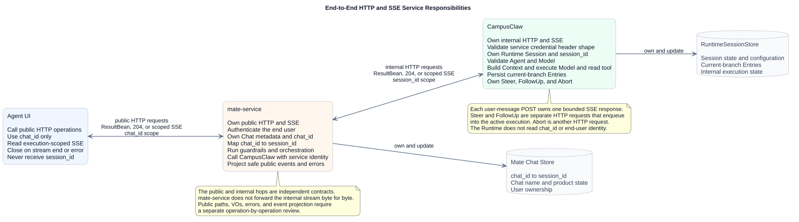
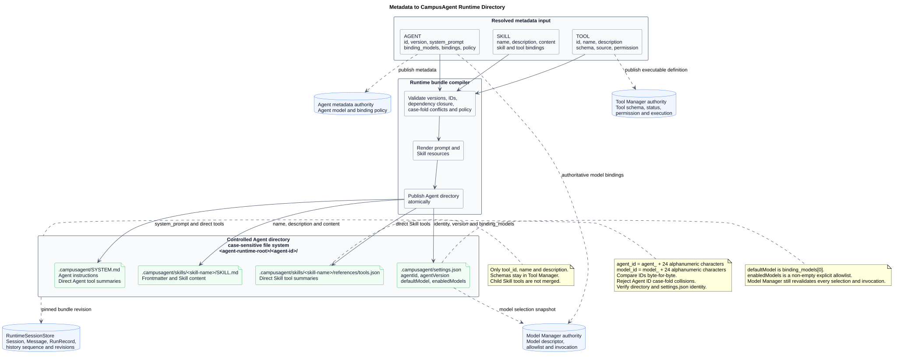
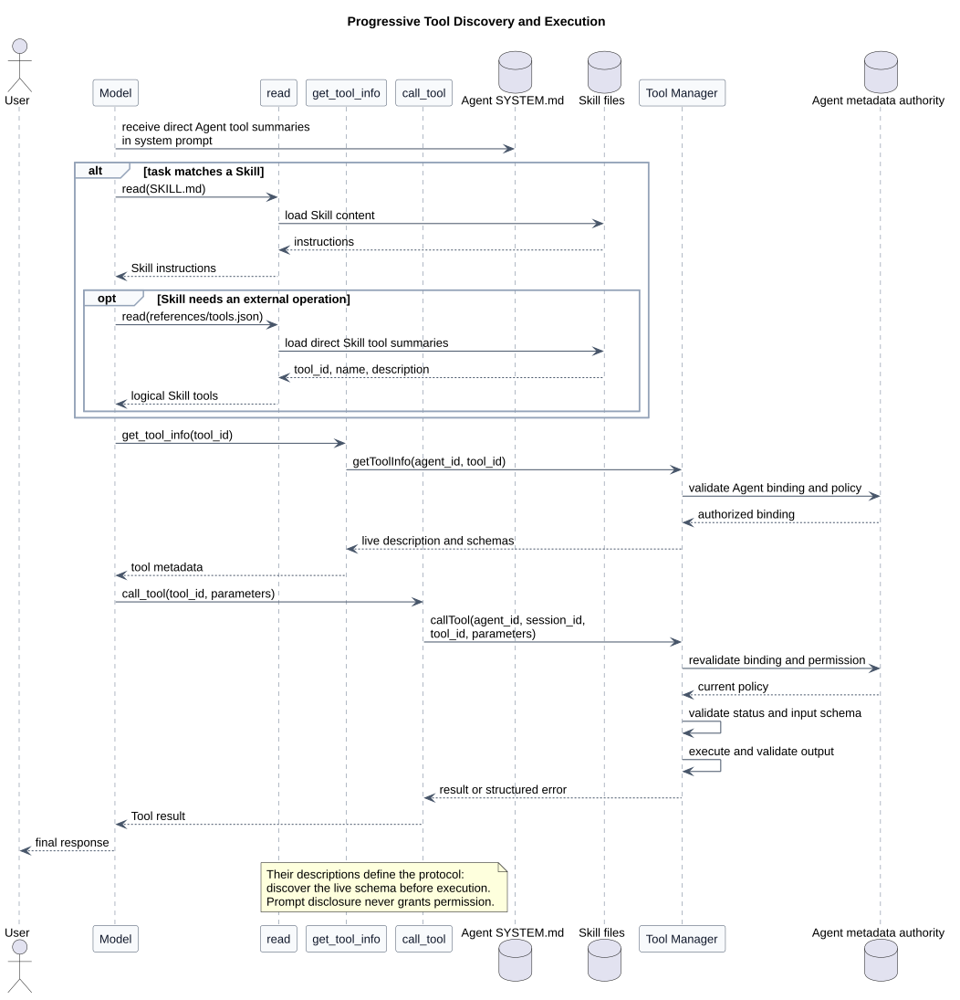
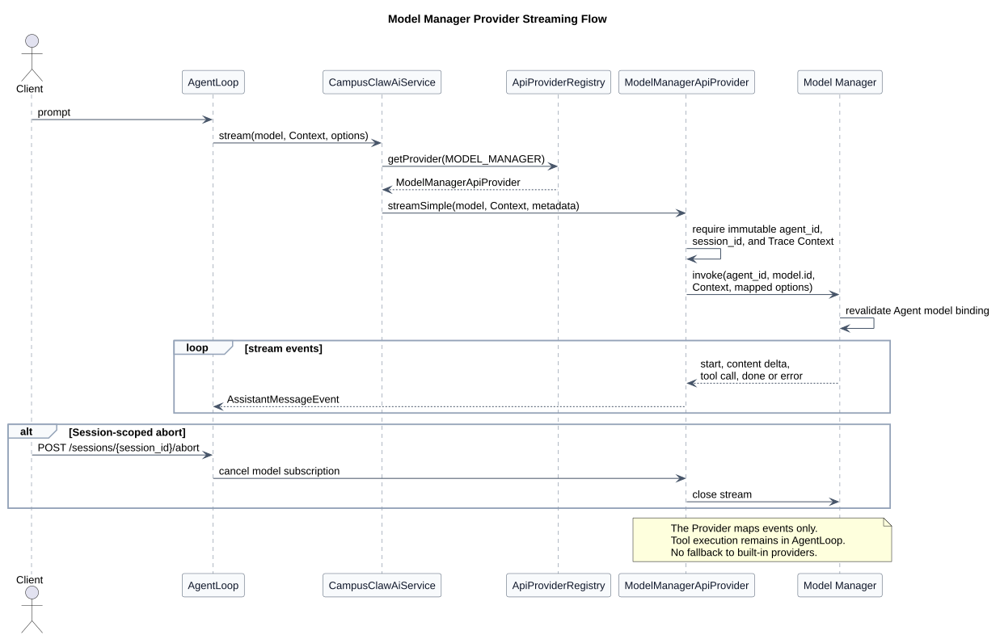

# CampusAgent Manager 驱动的多 Agent Runtime 设计

| 属性 | 值 |
|---|---|
| 文档版本 | 2.3.0 |
| 状态 | CampusClaw 内部 11 个接口已实现；mate-service 公共接口待评审 |
| 当前传输结论 | 浏览器/UI → mate-service、mate-service → CampusClaw 均使用 HTTP；实时执行均使用请求范围内的 SSE |
| 设计仓分析基线 | `2b747808e93609a4fc71d919dbd72bcd56a6e502` |
| pi-mono 源码基线 | `086c32e74530564922d011ade23ff582c9d63116` |
| pi-mono-java 设计分析基线 | `195746614096312d4e93afb029d387837db78e0b` |
| pi-mono-java 实现基线 | `8691e8800f05f28afe22499050c29220ef5b7475` |
| 更新日期 | 2026-08-18 |

## 1. 当前结论

系统采用两跳 HTTP+SSE，而不是 WebSocket：

```text
Browser / Agent UI
  -> mate-service public HTTP API
  -> mate-service public execution-scoped SSE
     -> CampusClaw internal HTTP API
     -> CampusClaw internal execution-scoped SSE
```

每次提交用户消息都会新建一个 HTTP 请求。该请求的响应在本次执行期间持续输出
SSE；正常收到 `stream.end`、流内错误或网络中断后连接结束。下一次用户消息、
Steer、FollowUp 或 Abort 都是新的 HTTP 请求，不复用旧连接。

SSE 在这里不是永久在线的 Session 订阅，也不是单独的第二条事件接口。它是一次
有界执行的流式 HTTP 响应。Steer 和 FollowUp 被接受后进入当前 Session 的内部队列，
其后续 Assistant、Tool 和状态事件继续由当前仍然打开的执行 SSE 输出；Abort 终止
当前执行并使该流收敛。



[PlantUML 源码：`mate_agent_service_responsibility_boundary`](diagram.puml#L210)

## 2. 契约权威顺序

当前逐接口评审的权威顺序为：

1. [`chat-http-v1-review.html`](chat-http-v1-review.html)：面向人的主维护契约，按已确认的 Swagger 风格卡片展示十一项 CampusClaw operation；
2. [`chat-http-v1-design.md`](chat-http-v1-design.md)：字段语义、状态、错误、源码证据和设计原因。

OpenAPI 已经明确废弃并从仓库删除。当前不维护第三份机器契约，也不允许实现根据
历史 OpenAPI 恢复旧 Run、History 或事件字段。若未来重新需要机器可读契约，必须
从已确认 HTML 和设计文档建立新的生成与同步流程，不能恢复已删除文件继续增量修改。

旧 WebSocket/AsyncAPI 文档已从当前仓库删除，历史内容只能从 Git 历史读取，不再是
目标契约或新实现输入。

### 2.1 HTML-first 契约校验

仓库使用 [`validate-chat-http-v1.py`](validate-chat-http-v1.py) 校验 HTML 主契约，
替代已删除 OpenAPI 的 lint 入口：

```bash
python3 validate-chat-http-v1.py
```

校验覆盖十一项静态接口与 review model、HTML/设计文档版本一致性、JavaScript 语法、
无脚本可读内容、响应式规则、PlantUML/SVG 生成、图链接与源码行锚点，以及
`git diff --check`。脚本还会阻止已废弃 OpenAPI 文件或其当前引用重新进入仓库。

## 3. 两跳服务责任

### 3.1 mate-service 公共边界

mate-service 面向浏览器和业务客户端，负责：

- 用户认证、产品权限、配额、护栏、意图和业务编排；
- 用户可见的 Chat 资源和名称；
- 保存 `chat_id -> session_id` 的私有映射；
- 将公共 HTTP 请求映射为 CampusClaw 内部 HTTP 请求；
- 消费内部 SSE，过滤内部字段和错误，再投影为公共 SSE；
- 保证 `session_id`、内部凭据、Provider 配置和工具私有数据不泄露给浏览器。

公共 mate-service HTTP 的具体路径、请求 VO、ResultBean、错误码和 SSE Event 投影
尚未逐项评审。本次只确认传输形态为 HTTP+SSE，不擅自把 CampusClaw 的内部路径
直接当成公共接口，也不继承旧 WebSocket Frame 字段。

### 3.2 CampusClaw 内部 Runtime 边界

CampusClaw 面向 mate-service Runtime client 和明确获授权的内部服务端 SDK，负责：

- Runtime Session 生命周期和 `session_id`；
- Agent、Model、thinking 配置和受控目录解析；
- MessageEntry 当前分支、模型执行、Tool 执行和持久化；
- Session 内单 active execution、Steer/FollowUp 队列和 Abort；
- 内部 HTTP 鉴权、ResultBean、SSE 事件和错误国际化。

CampusClaw 不读取 `chat_id`、最终用户身份或公共 Chat 名称。它只按内部
`session_id` 定位 Session。

## 4. CampusClaw 已确认接口

基础路径统一为 `/campusclaw-service/v1`。

| # | Method | Path | 响应形态 | 作用 |
|---:|---|---|---|---|
| 1 | `POST` | `/agents/{agent_id}/sessions` | `201` ResultBean | 创建并初始化 Session；默认模型由 Agent 配置选择 |
| 2 | `GET` | `/sessions/{session_id}` | `200` ResultBean | 读取当前模型、是否深度思考和 `idle/running` 状态 |
| 3 | `DELETE` | `/sessions/{session_id}` | `204` | 逻辑删除并安排 Runtime 数据清理，只保留最小 tombstone |
| 4 | `POST` | `/sessions/{session_id}/events` | `200 text/event-stream` | 提交 `user.message` 并直接流式执行 |
| 5 | `GET` | `/sessions/{session_id}/events` | `200` ResultBean | 使用不透明 `page/next_page` 分页读取当前分支的持久化对话 Entry |
| 6 | `GET` | `/sessions/{session_id}/models` | `200` ResultBean | 返回可用 `model_id` 字符串数组 |
| 7 | `PUT` | `/sessions/{session_id}/model` | `200` ResultBean | 修改后续用户消息使用的 Session 默认模型 |
| 8 | `PUT` | `/sessions/{session_id}/thinking` | `200` ResultBean | 开关后续用户消息是否启用深度思考 |
| 9 | `POST` | `/sessions/{session_id}/steers` | `202` ResultBean | 向 running Session 的当前执行追加优先指导 |
| 10 | `POST` | `/sessions/{session_id}/follow-ups` | `202` ResultBean | 在 Agent 原本将停止时追加后续消息 |
| 11 | `POST` | `/sessions/{session_id}/abort` | `204` | 中止当前执行并清空尚未投递的控制消息 |

公共资源没有 `Run`。一次用户输入会触发内部 active execution，但调用方使用
Session、Entry 和 SSE 恢复，不获得 `run_id`，也不存在 GetRun 或 Run Events。

## 5. HTTP 与 SSE 行为

### 5.1 普通 HTTP

普通 JSON 成功响应统一使用：

```json
{
  "resCode": "0",
  "resMsg": "success",
  "result": {}
}
```

异常响应只有 `resCode` 和国际化 `resMsg`，没有 `result`。当前 Java 实现统一调用
`ResultBeanAdapter.normal(result)`；独立仓提供默认实现，公司环境以 Bean 替换并在
适配器内部调用真实 `ResultBeanFactory.getFactory().normal(result)`。

鉴权默认展示 `X-HW-ID + Authorization: Bearer <JWT>`，同时兼容
`X-HW-ID + X-HW-APPKEY`。两套凭据只能二选一；混合凭据拒绝，已选模式验证失败后
不得降级尝试另一模式。

### 5.2 执行 SSE

`POST /sessions/{session_id}/events` 直接返回一次执行的 SSE。确认的正常顺序是：

```text
user.message
assistant.message.started
assistant.message.delta
assistant.message.completed      finish_reason=tool_call
tool.execution.started
tool.execution.completed
tool.result
assistant.message.started
assistant.message.delta
assistant.message.completed      finish_reason=stop
session.status.idle
stream.end
```

仅 `user.message`、`assistant.message.completed` 和 `tool.result` 是可通过 GET Events
恢复的持久化 Entry。started、delta、工具执行状态、Session 状态和流控制事件只是
实时事件。

POST 已接受用户 Entry 后，客户端断开不取消执行，也不得自动重放该 POST。客户端
重新分页读取 GET Events，以 `entry_id/entry_seq` 去重；尚未持久化的临时 delta
不补拉。

### 5.3 mate-service 的 SSE 桥接约束

mate-service 不得字节透明转发内部流。它至少要保证：

- 公共和内部两跳分别认证、限流和记录审计；
- 内部 `session_id` 和内部错误细节不进入公共事件；
- 每一跳都正确处理下游取消和上游执行继续之间的关系；
- 仅在公共投影已经完成后发送公共终态；
- 背压、超时和代理缓冲配置适用于 `text/event-stream`。

公共事件名和字段是否与内部事件完全相同，必须在 mate-service 公共 HTTP API
逐项评审时确定。

## 6. Runtime 内部设计不变量

- 一个 Session 绑定一个不可变 `agent_id`，允许切换 `model_id`；模型不是 Session 身份的一部分。
- Session 名称属于 mate-service Chat 元数据，不存入 CampusClaw Runtime Session。
- Session 粗粒度状态只有 `idle/running`；模型、工具或消息阶段通过实时事件表达。
- `thinking` 是“是否启用深度思考”的 boolean，不是原始推理披露等级。
- 持久化 Session Entry 使用 `entry_id + parent_id` 形成树；公共 GET Events 首版只返回当前分支。
- Runtime 只接收有序 `file_ids`，不解析或下载文件正文；ID 按固定 `[File IDs]` 提示块传给模型。
- Model Manager、Tool Manager 和 Agent 目录仍是模型、工具和 Agent 配置的最终权威。

## 7. Manager 与多 Agent Runtime 核心

传输统一为 HTTP+SSE 不改变以下 Runtime 核心设计。

### 7.1 Agent 发布目录

元数据发布程序把 AGENT、SKILL 和 TOOL 的固定 revision 编译为受控 Agent
运行目录。Runtime 不在请求期间临时拼接租户路径，也不接受调用方提供 cwd：

```text
<agent-runtime-root>/
└── <agent-id>/
    └── .campusagent/
        ├── settings.json
        ├── SYSTEM.md
        └── skills/
            └── <skill-name>/
                ├── SKILL.md
                └── references/
                    └── tools.json
```

`settings.json` 提供 `defaultModel` 和 `enabledModels`；Session 创建时校验目录边界、
默认模型与 Model Manager 当前可用性。Runtime 直接读取这个受控目录，不再依赖独立
Agent Runtime Template 仓库，也不在内存中缓存目录快照。



[PlantUML 源码：`metadata_runtime_directory_mapping`](diagram.puml#L1)

### 7.2 Tool Manager 渐进发现

目标 Manager 架构曾规划三个通用工具：

```text
read
get_tool_info
call_tool
```

当前实现为了收窄权限，只注册 `read`。以下 Tool Manager 渐进发现仍是未实现的后续
架构方向：Agent `SYSTEM.md` 和 Skill `references/tools.json` 只披露逻辑工具摘要。模型先用
`get_tool_info(tool_id)` 从 Tool Manager 取得实时 Schema，再用
`call_tool(tool_id, parameters)` 执行；摘要披露不等于授权，执行前必须重新验证
Agent 绑定、工具状态、权限和输入 Schema。



[PlantUML 源码：`progressive_tool_discovery_execution`](diagram.puml#L272)

### 7.3 Model Manager 流式适配

Agent 目录决定默认模型候选，Model Manager 仍是模型 descriptor、可用性、凭据和
调用的最终权威。Session 可以在 idle 时切换 `model_id`；每次用户事件接受时读取
当前 `model_id/thinking` 形成内部执行快照。Provider 的结构化增量由 Runtime
转换为已确认的 Assistant/Tool SSE 事件，不把 Provider model ID、API Key、
base URL 或成本字段公开给 mate-service。



[PlantUML 源码：`model_manager_streaming_flow`](diagram.puml#L350)

### 7.4 数据与附件边界

RuntimeSessionStore 保存 Session 配置、当前分支 Entry 和内部执行状态，不保存
文件正文或文件元数据快照。Session Entry 的 `entry_id/parent_id` 树与当前分支重建详见
[`pi Session Context 分析`](../pi-mono-agent-session-context/README.md)；数据库通用
模式详见 [`Agent 数据库模式`](../agent-database-patterns/README.md)。

文件上传、扫描、正文、元数据和删除生命周期不属于 CampusClaw Runtime。
CampusClaw 只消费有序 `file_ids`，把它们编码为固定文本块；它不调用 resolve/content、
不直连 OBS，也不接受文件名、URL、MIME、Base64 或 Object Key。

## 8. 源码证据与目标差异

| 分类 | 证据或决策 |
|---|---|
| 观察到的 pi 行为 | `packages/coding-agent/src/core/session-manager.ts` 的 Session Entry 以 `id/parentId` 构成 append-only tree；`getBranch()` 重建当前分支 |
| 观察到的 pi 行为 | `packages/coding-agent/src/core/agent-session.ts` 的 `prompt`、`steer`、`followUp` 和 `abort` 驱动一次进程内 active execution，但不要求公共 Run 资源 |
| 观察到的 pi 行为 | `packages/agent/src/types.ts` 与 `packages/agent/src/agent-loop.ts` 区分 Message 与 Tool execution 生命周期 |
| 迁移前 Java 行为 | 旧 `ServerMode`、`ChatHandler` 和 `ChatWebSocketHandler` 曾同时提供 HTTP/SSE 与 WebSocket；已在实现提交中删除 |
| 已实现 Java 行为 | `RuntimeSessionController`、`RuntimeEventController`、`RuntimeSessionConfigurationController` 与 `RuntimeSessionControlController` 实现 11 个 Spring MVC HTTP+SSE 接口 |
| 已实现 Java 行为 | `RuntimeEventStream`、`RuntimeSseDispatcher` 和 `RuntimeSseEmitterSubscriber` 提供有界请求级 SSE；断线不 abort |
| 已实现 Java 行为 | `MyBatisRuntimeSessionRepository` 使用 openGauss 保存 Session、当前分支 Entry、严格序号、tombstone 和清理任务 |
| 架构变更 | 两跳目标传输统一为 HTTP+SSE，删除连接首帧、Frame RPC、连接 generation、WebSocket close code 和 AsyncAPI |
| 产品约束 | 浏览器只识别 `chat_id`，CampusClaw 只识别 `session_id`；公共接口不泄露 Runtime 标识 |
| 安全加固 | 每个 HTTP 请求独立认证；凭据只在认证 Adapter 中存在；SSE 事件经过 mate-service 安全投影 |

源码证据的完整 commit、符号、行号和逐项设计理由见
[`chat-http-v1-design.md`](chat-http-v1-design.md) 的“源码证据与差异分类”。

## 9. 待继续评审

以下内容尚未确认，不应由实现自行猜测：

1. mate-service 公共 Chat HTTP 的资源路径、VO、错误码、分页和 SSE Event Schema；
2. 浏览器断线后公共 Chat 层如何对账内部已持久化 Entry；
3. Pod 重启时 active execution 的中断或恢复策略；
4. 公司 `ResultBeanFactory` 真实制品坐标和 `ResultBeanAdapter` 公司 Bean 的落地方式；
5. 若未来需要机器可读契约，其格式、生成源和同步门禁需要重新评审。

## 10. 版本历史

| 版本 | 日期 | 变更 |
|---|---|---|
| 2.3.0 | 2026-08-18 | 对齐实现提交 `8691e880`：内部 11 个接口标记已实现；删除改为 running 时 409；鉴权明确为上游真实性验证；文件 ID 改为固定提示块；移除 Agent Runtime Template 依赖 |
| 2.2.0 | 2026-08-18 | 全仓清理 WebSocket、公开 Run 和重复历史专题；Runtime HTTP 契约同步到 1.29.0；并发治理统一为内部 ActiveExecution，模板专题统一为 exact revision；文件服务统一使用 file_id、ResultBean、lowerCamelCase 和公司双鉴权边界 |
| 2.1.0 | 2026-08-18 | 用户明确批准废弃并删除过渡期 OpenAPI；契约权威收敛为 HTML 主维护文档与 Markdown 设计依据，禁止从历史 OpenAPI 恢复旧 Run 模型；增加仓库内 HTML-first 契约校验入口 |
| 2.0.0 | 2026-08-18 | 用户确认 mate-service 公共和 CampusClaw 内部两跳均统一为 HTTP+SSE；删除旧 WebSocket/AsyncAPI 规范，重写当前架构入口并明确公共 mate-service HTTP 字段仍待逐项评审 |
| 1.20.0 | 2026-08-17 | 历史版本开始将内部 Runtime 交互从显式 Run 调整为 Session Event 直连 SSE |
| 1.19.0 及更早 | 2026-08-17 及更早 | 历史 WebSocket/Run 方案；仅可从 Git 历史查看，不再是当前设计依据 |
