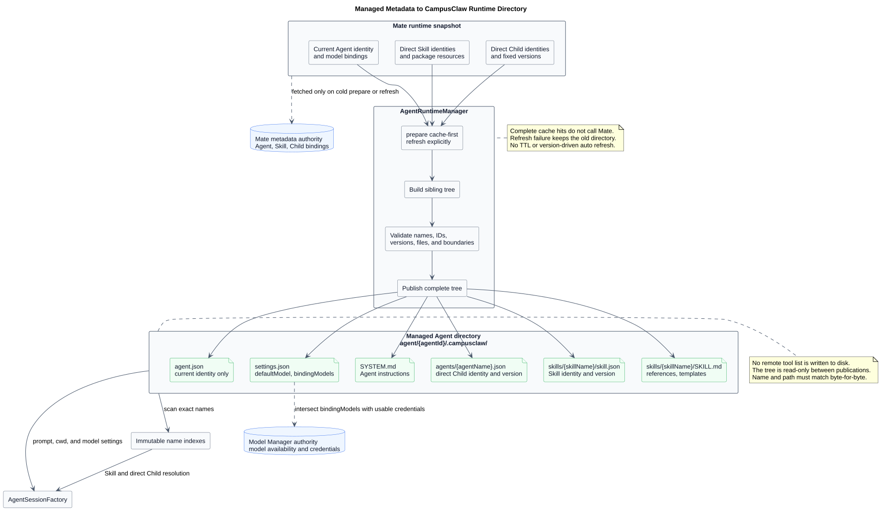
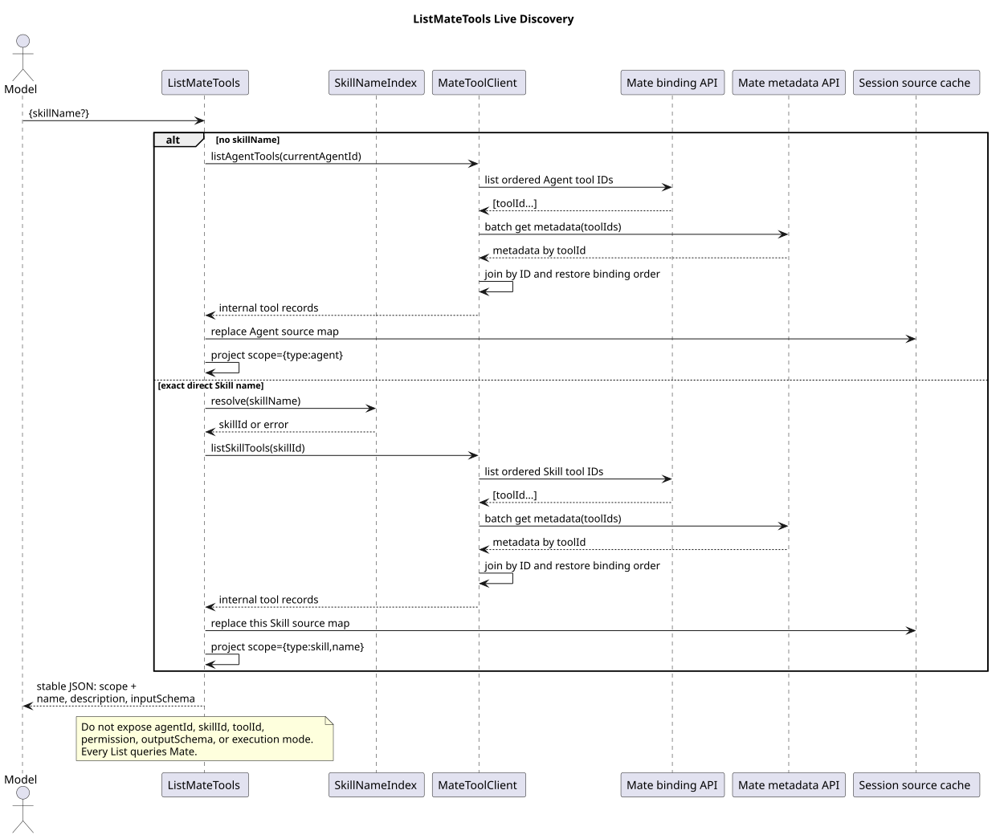
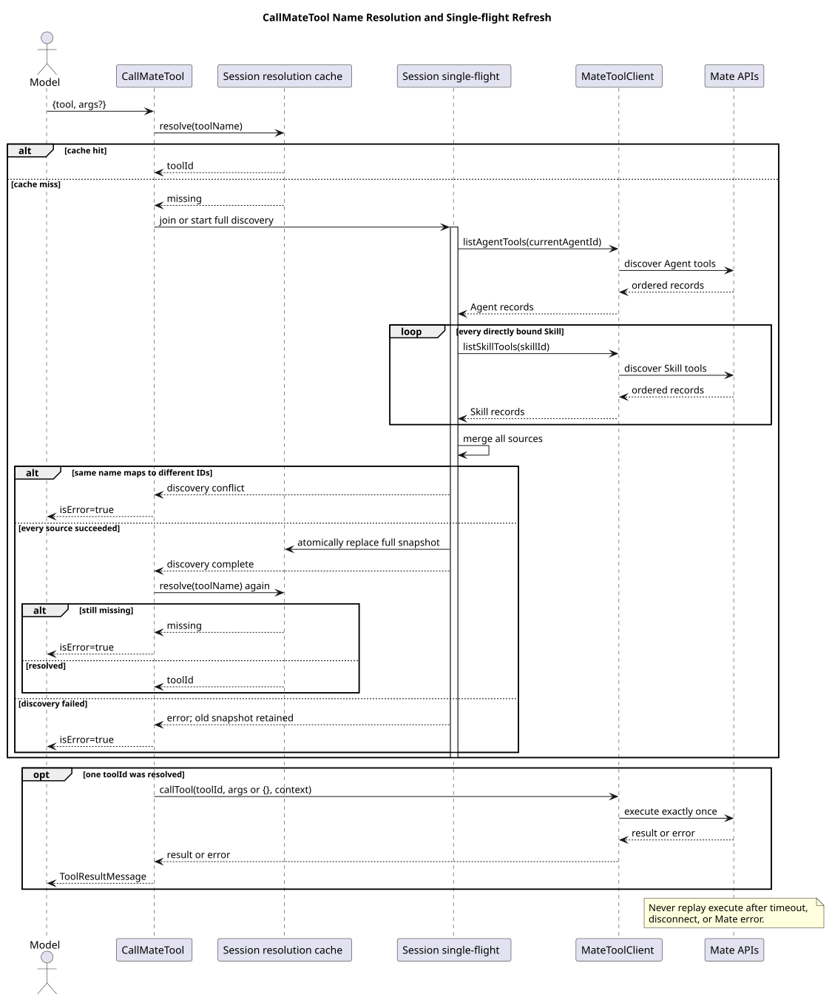
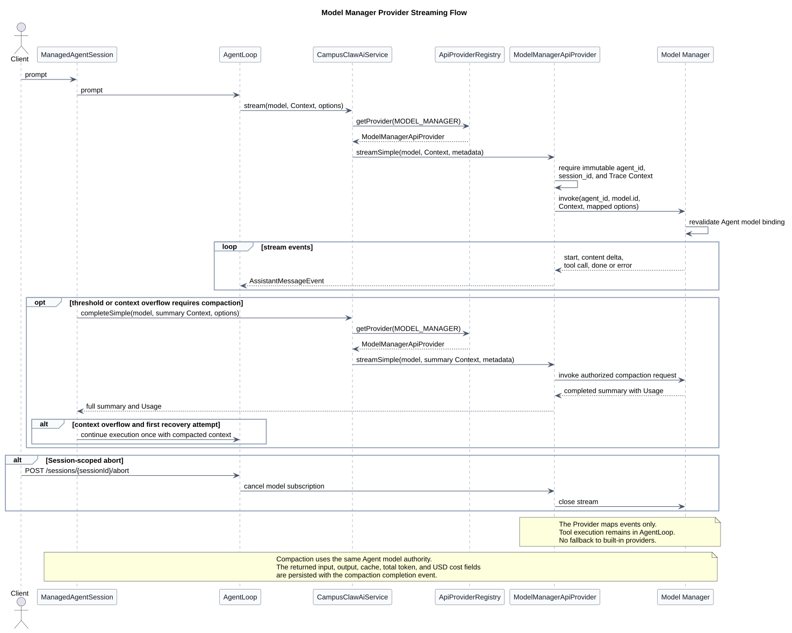

# CampusAgent Manager 驱动的多 Agent Runtime 设计

| 属性 | 值 |
|---|---|
| 文档版本 | 3.2.0 |
| 状态 | CampusClaw 内部 11 个接口保持不变；HTTP 1.40、公共 Session 能力与 PR 167 TUI 删除边界为目标设计；mate-service 公共接口待评审 |
| 当前传输结论 | 浏览器/UI → mate-service、mate-service → CampusClaw 均使用 HTTP；实时执行均使用请求范围内的 SSE |
| 设计仓分析基线 | `e4cf448140de0a4a23a4106d0043f709ad2a56cd` |
| pi-mono 源码基线 | `5cd93f688aaab89dbb6dfa4aca535f21796ae185` |
| CampusClaw PR 167 基线 | `f60cc3e78bb8b700527ac082c7c8e10524ede095` |
| CampusClaw merge base | `d649866a6cae967ace18ceaeb9597edd47e5721e` |
| CampusClaw 压缩修订前基线 | `a7f78fed345a289833970cd7b78399f0e8e51d32` |
| pi-mono-java 字段命名核对基线 | `304eda06ff603fc9b6bbcaad0c296cc151a7defb`（`codex/runtime-http-contract-v137`） |
| OpenCode 对照基线 | `849c2598abc7d2b40261e74b5826bc74ffc78308` |
| 更新日期 | 2026-08-24 |

## 1. 当前结论

系统采用两跳 HTTP+SSE，而不是 WebSocket：

```text
Browser / Agent UI
  -> mate-service public HTTP API
  -> mate-service public execution-scoped SSE
     -> CampusClaw internal HTTP API
     -> CampusClaw internal execution-scoped SSE
```

每次提交用户消息都会新建一个 HTTP 请求。该请求的响应在本次执行期间持续输出
SSE；正常收到 `stream.end`、流内错误或网络中断后连接结束。下一次用户消息、
Steer、FollowUp 或 Abort 都是新的 HTTP 请求，不复用旧连接。

SSE 在这里不是永久在线的 Session 订阅，也不是单独的第二条事件接口。它是一次
有界执行的流式 HTTP 响应。Steer 和 FollowUp 被接受后进入当前 Session 的内部队列，
其后续 Assistant、Tool 和状态事件继续由当前仍然打开的执行 SSE 输出；Abort 终止
当前执行并使该流收敛。


[PlantUML 源码：`mate_agent_service_responsibility_boundary`](diagrams/service-boundary/diagram.puml#L1)

## 2. 契约权威顺序

当前逐接口评审的维护顺序为：

1. [`contract/common.json`](contract/common.json) 与 [`contract/operations/`](contract/operations/)：唯一可编辑的精确契约源；共享 ID、认证和公共响应只定义一次；
2. [`chat-http-v1-review.html`](chat-http-v1-review.html)：由结构化契约生成的主要人类评审界面，不允许手工修改；
3. [`chat-http-v1-design.md`](chat-http-v1-design.md)：只维护源码证据、目标差异和设计原因，不承担逐字段契约复制。

[`render_chat_http_v1.py`](render_chat_http_v1.py) 将共享定义和十一份 operation model
展开为一个 standalone HTML。生成页只包含一份共享 CSS、一份共享 JavaScript 和一份
聚合 JSON model，同时保留十一份无脚本可读的静态 operation；校验会重新生成并做
字节级比较，防止静态内容、交互模型和源文件漂移。

OpenAPI 已经明确废弃并从仓库删除。仓库内 JSON 是 HTML 的规范化生成源，不是对外
发布的 OpenAPI，也不允许实现根据历史 OpenAPI 恢复旧 Run、History 或事件字段。
若未来重新需要标准机器契约，应从这些已确认 JSON model 生成新的投影并建立同步
门禁，不能恢复已删除文件继续增量修改。

旧 WebSocket/AsyncAPI 文档已从当前仓库删除，历史内容只能从 Git 历史读取，不再是
目标契约或新实现输入。

当前 CampusClaw HTTP 契约中的路径参数、查询参数、请求体、普通响应和 SSE `data`
字段统一使用 lowerCamelCase。HTTP Header 保持标准或公司既有原名，例如
`X-HW-ID`、`Authorization`、`X-HW-APPKEY`、`If-Match`、`Accept-Language`；事件类型值、
错误码和类型化 ID 值不因字段命名调整而改变，也不提供 snake_case 字段别名。

### 2.1 源驱动契约校验

修改契约源后先重新生成 HTML，再运行快速校验：

```bash
python3 render_chat_http_v1.py
python3 validate-chat-http-v1.py
```

修改 PlantUML 时只生成发生变化的设计主题；需要强制重建全部主题时增加 `--full`：

```bash
python3 render_diagrams.py
python3 render_diagrams.py --full
```

提交前或 CI 使用完整校验：

```bash
python3 validate-chat-http-v1.py --full
```

快速模式校验契约源、HTML 字节同步、单份 JavaScript、无脚本内容、响应式规则、
Markdown 链接和受影响的 PlantUML 主题。完整模式再校验所有主题 SVG。两种模式都会
阻止已废弃 OpenAPI 文件或其当前引用重新进入仓库，并执行 `git diff --check`。

## 3. 两跳服务责任

### 3.1 mate-service 公共边界

mate-service 面向浏览器和业务客户端，负责：

- 用户认证、产品权限、配额、护栏、意图和业务编排；
- 用户可见的 Chat 资源和名称；
- 保存 `chat_id -> sessionId` 的私有映射；
- 将公共 HTTP 请求映射为 CampusClaw 内部 HTTP 请求；
- 消费内部 SSE，过滤内部字段和错误，再投影为公共 SSE；
- 保证 `sessionId`、内部凭据、Provider 配置和工具私有数据不泄露给浏览器。

公共 mate-service HTTP 的具体路径、请求 VO、ResultBean、错误码和 SSE Event 投影
尚未逐项评审。本次只确认传输形态为 HTTP+SSE，不擅自把 CampusClaw 的内部路径
直接当成公共接口，也不继承旧 WebSocket Frame 字段。

### 3.2 CampusClaw 内部 Runtime 边界

CampusClaw 面向 mate-service Runtime client 和明确获授权的内部服务端 SDK，负责：

- Runtime Session 生命周期和 `sessionId`；
- Agent、Model、thinking 配置和受控目录解析；
- MessageEntry 当前分支、模型执行、Tool 执行和持久化；
- Session 内单 active execution、Steer/FollowUp 队列和 Abort；
- 内部 HTTP 鉴权、ResultBean、SSE 事件和错误国际化。

CampusClaw 不读取 `chat_id`、最终用户身份或公共 Chat 名称。它只按内部
`sessionId` 定位 Session。

## 4. CampusClaw 已确认接口

基础路径统一为 `/campusclaw-service/v1`。

| # | Method | Path | 响应形态 | 作用 |
|---:|---|---|---|---|
| 1 | `POST` | `/agents/{agentId}/sessions` | `201` ResultBean | 创建并初始化 Session；默认模型由 Agent 配置选择，`thinking=true` |
| 2 | `GET` | `/sessions/{sessionId}` | `200` ResultBean | 读取当前模型、是否深度思考和 `idle/running` 状态 |
| 3 | `DELETE` | `/sessions/{sessionId}` | `204` | 逻辑删除并安排 Runtime 数据清理，只保留最小 tombstone |
| 4 | `POST` | `/sessions/{sessionId}/events` | `200 text/event-stream` | 提交 `user.message` 并直接流式执行 |
| 5 | `GET` | `/sessions/{sessionId}/events` | `200` ResultBean | 使用不透明 `page/nextPage` 分页读取当前分支的持久化对话 Entry |
| 6 | `GET` | `/sessions/{sessionId}/models` | `200` ResultBean | 返回可用 `modelId` 字符串数组 |
| 7 | `PUT` | `/sessions/{sessionId}/model` | `200` ResultBean | 修改后续用户消息使用的 Session 默认模型 |
| 8 | `PUT` | `/sessions/{sessionId}/thinking` | `200` ResultBean | 开关后续用户消息是否启用深度思考 |
| 9 | `POST` | `/sessions/{sessionId}/steers` | `202` ResultBean | 向 running Session 的当前执行追加优先指导 |
| 10 | `POST` | `/sessions/{sessionId}/follow-ups` | `202` ResultBean | 在 Agent 原本将停止时追加后续消息 |
| 11 | `POST` | `/sessions/{sessionId}/abort` | `204` | 中止当前执行并清空尚未投递的控制消息 |

公共资源没有 `Run`。一次用户输入会触发内部 active execution，但调用方使用
Session、Entry 和 SSE 恢复，不获得 `runId`，也不存在 GetRun 或 Run Events。

## 5. HTTP 与 SSE 行为

### 5.1 普通 HTTP

普通 JSON 成功响应统一使用：

```json
{
  "resCode": "0",
  "resMsg": "success",
  "result": {}
}
```

异常响应只有 `resCode` 和国际化 `resMsg`，没有 `result`。当前 Java 实现统一调用
`ResultBeanAdapter.normal(result)`；独立仓提供默认实现，公司环境以 Bean 替换并在
适配器内部调用真实 `ResultBeanFactory.getFactory().normal(result)`。

全部十一项操作都携带调用上下文 Header：默认示例为
`X-HW-ID + Authorization: Bearer <JWT>`，同时展示
`X-HW-ID + X-HW-APPKEY` 兼容示例。CampusClaw 不在进入 Controller 前或 Controller
内部校验组合完整性、两类凭据是否同时存在、Bearer 形状或真实性，也不因此返回
`UNAUTHENTICATED/AUTH_CREDENTIAL_CONFLICT`；这些检查由上游负责。

### 5.2 执行 SSE

`POST /sessions/{sessionId}/events` 直接返回一次执行的 SSE。确认的正常顺序是：

```text
user.message
assistant.message.started
assistant.message.delta
assistant.message.completed      finishReason=tool_call
tool.execution.started
tool.execution.completed
tool.result
assistant.message.started
assistant.message.delta
assistant.message.completed      finishReason=stop
session.status.idle
stream.end
```

仅 `user.message`、`assistant.message.completed` 和 `tool.result` 是可通过 GET Events
恢复的持久化 Entry。started、delta、工具执行状态、Session 状态和流控制事件只是
实时事件。

目标 Runtime 根据 Session `thinking` 开关投影 thinking 事件。执行快照为 `true` 时，
POST SSE 返回 `assistant.thinking.started/delta/completed`，其中 completed 持久化；为
`false` 时不发送。GET Events 根据查询时 Session 当前 `thinking` 决定是否返回
`assistant.thinking.completed`；开关改变会使旧 page 失效并要求从第一页重读。

POST 已接受用户 Entry 后，客户端断开不取消执行，也不得自动重放该 POST。客户端
重新分页读取 GET Events，以 `entryId/entrySeq` 去重；尚未持久化的临时 delta
不补拉。

### 5.3 mate-service 的 SSE 桥接约束

mate-service 不得字节透明转发内部流。它至少要保证：

- 公共和内部两跳分别认证、限流和记录审计；
- 内部 `sessionId` 和内部错误细节不进入公共事件；
- 每一跳都正确处理下游取消和上游执行继续之间的关系；
- 仅在公共投影已经完成后发送公共终态；
- 背压、超时和代理缓冲配置适用于 `text/event-stream`。

公共事件名和字段是否与内部事件完全相同，必须在 mate-service 公共 HTTP API
逐项评审时确定。

## 6. Runtime 内部设计不变量

- 一个 Session 绑定一个不可变 `agentId`，允许切换 `modelId`；模型不是 Session 身份的一部分。
- 公共标识字段固定命名为 `agentId`、`toolId`、`skillId` 和 `sessionId`；对应值共用类型化资源 ID 规则，精确正则只在 [`contract/common.json`](contract/common.json) 定义。
- Session 名称属于 mate-service Chat 元数据，不存入 CampusClaw Runtime Session。
- Session 粗粒度状态只有 `idle/running`；模型、工具或消息阶段通过实时事件表达。
- `thinking` 是“是否启用深度思考”的 boolean，不是原始推理披露等级。
- 持久化 Session Entry 使用 `id + parentId` 形成树；公共 GET Events 首版只返回当前分支。
- Runtime 只接收有序 `fileIds`，不解析或下载文件正文；ID 按固定 `[File IDs]` 提示块传给模型。
- Model Manager 是模型 descriptor、可用性和凭据的最终权威；Mate 是远端工具绑定、授权
  与执行的最终权威；`AgentRuntimeManager` 发布的受管目录是 Session 使用的 Agent、Skill
  和直接 Child 身份快照。内存中不再规划独立的动态 `ToolCatalog` 或 Tool Manager 摘要缓存。

## 7. Manager 与多 Agent Runtime 核心

传输统一为 HTTP+SSE 不改变以下 Runtime 核心设计。

### 7.1 Agent 发布目录

目标工具系统统一 Runtime、Cron 和 Child 使用的受管目录。精确资源 ID 格式仍由
[`contract/common.json`](contract/common.json) 与
[`01-create-session.json`](contract/operations/01-create-session.json) 维护；工具专题只定义
目录内容、缓存和刷新语义：

```text
agent/{agentId}/.campusclaw/
├── agent.json
├── settings.json
├── SYSTEM.md
├── agents/{agentName}.json
└── skills/{skillName}/
    ├── skill.json
    ├── SKILL.md
    ├── references/
    └── templates/
```

`agent.json` 只保存当前 Agent 身份；`settings.json` 保存 default model 与
`bindingModels`；`agents/{agentName}.json` 保存一个可直接调用 Child 的身份和固定版本；
`skill.json` 保存 `schemaVersion=1`、ID、名称和版本。名称必须与路径逐字符一致并在所属
索引内唯一。目录不保存远端工具列表，Skill references 只包含真实参考资料。

`AgentRuntimeManager.prepare(agentId)` 是纯缓存优先：完整目录直接使用，缺失或不完整时
访问 Mate，并用同级临时树完成校验后发布。显式 `refresh(agentId)` 只由受管管理流程
调用；失败保留旧目录和活动 Session 的不可变快照。Runtime active execution、Cron
execution 和 Child execution 创建轻量 Session 前都调用 `prepare`；Runtime 不再维护
独立 `FileAgentDirectoryResolver` 文件契约。这些均是 target-only 架构改造；当前 Java
仍使用两套文件名并原地物化。

refresh 成功不修改活动 execution。空闲数据库 Session 在下一次接受用户 Entry 前读取新目录；
当前模型失效时切换到具备凭据的新 default，原子持久化 `session.model.changed` 及必要的
`session.thinking.changed`，并在 `user.message` 前投影。没有有效 default 时拒绝本次执行且
不接受用户 Entry。



[PlantUML 源码：`metadata_runtime_directory_mapping`](diagrams/metadata/diagram.puml#L1)

### 7.2 关闭的内置工具与 Mate 实时发现

工具系统的唯一主设计是
[CampusClaw 工具系统设计](../pi-mono-java-tool-system/README.md)，精确模型契约见
[8 个活动内置工具契约](../pi-mono-java-tool-system/built-in-tool-contracts.md)。首版只支持
`Read`、`Find`、`Grep`、`Ls`、`Cron`、`ListMateTools`、`CallMateTool`、`Agent`，
由 Runtime、Cron、Child Agent 三个启动期严格 profile 装配；不再规划旧三工具抽象、动态
`ToolCatalog`、Java Extension 工具或 Skill 工具激活。

`ListMateTools({skillName?})` 无参数查询当前 Agent，有名称时通过本地 `skill.json` 索引
解析 Skill ID。每次调用实时查询 Mate，输出稳定 JSON，只包含 scope 与每项
name、description、inputSchema，并刷新 Session 缓存中的对应来源。
`CallMateTool({tool,args?})` 先以工具名查询 Session 名称到 ID 缓存；未命中时以
single-flight 自动发现当前 Agent 与全部直接绑定 Skill 的完整工具集合，原子替换缓存后
再次解析。只有发现可以重试；实际 Mate execute 最多发送一次。Mate 负责最终绑定校验、
凭据、授权和执行。



[PlantUML 源码：`list_mate_tools_sequence`](../pi-mono-java-tool-system/diagram.puml#L235)



[PlantUML 源码：`call_mate_tool_sequence`](../pi-mono-java-tool-system/diagram.puml#L289)

### 7.3 TUI 删除边界与公共 Session 能力

CampusClaw 不再提供 CLI、TUI、OneShot、RPC 或 ACP 产品入口，但不能按包名整体删除：

- 保留 Slash core、Registry、`/model`、`/thinking`、`/compact`、`/name` 处理器和单元测试，
  Context 只依赖宿主无关 Session/Output 端口；首版任何 Host 都不注册；
- 不增加 Slash 或 Compact HTTP 接口，不拦截斜杠开头的普通用户消息；`/name` 仍由
  mate-service 管理 Chat 名称；
- 阈值压缩和溢出恢复迁入公共 `ManagedAgentSession`。成功 `STOP` 静默越界只压缩、不重放；
  `ERROR/LENGTH` 才排除失败 Assistant 并最多重试一次，第二次溢出显式失败；
- 压缩使用最后有效 Usage 和尾部估算、压缩边界时间戳、安全 User/Assistant 切点；超大末条
  Assistant 仍保留，split-turn 和重复摘要继承 Read 路径，失败或取消保留旧上下文且不删除
  历史 Entry；默认 `enabled=true`、`reserveTokens=16384`、`keepRecentTokens=20000`；
- `FileOperationTracker` 只跟踪 `Read`；PackageManager、本地 Skill 安装/导入、剪贴板及其他
  终端专属能力删除。

Runtime 持久化 `assistant.message.completed` 和 `session.compaction.completed` 的完整 Usage，
并在 `t_session_materialized` 原子累计 `lifetimeUsage`。模型/思考变更和压缩完成是领域历史；
工具 delta、压缩 started/failed 是瞬态 SSE；failed 额外声明 `aborted` 以区分取消与失败。
公共历史查询与 Agent 模型上下文恢复使用不同
投影，后者不把模型/思考变更事件转换为模型消息。

### 7.4 Model Manager 流式适配

Agent 目录决定默认模型候选，Model Manager 仍是模型 descriptor、可用性、凭据和
调用的最终权威。Session 可以在 idle 时切换 `modelId`；每次用户事件接受时读取
当前 `modelId/thinking` 形成内部执行快照。Provider 的结构化增量由 Runtime
转换为已确认的 Assistant/Tool SSE 事件，不把 Provider model ID、API Key、
base URL 或成本字段公开给 mate-service。



[PlantUML 源码：`model_manager_streaming_flow`](diagrams/model-manager/diagram.puml#L1)

### 7.5 数据与附件边界

RuntimeSessionStore 保存 Session 配置、当前分支 Entry 和内部执行状态，不保存
文件正文或文件元数据快照。Session Entry 的 `id/parentId` 树与当前分支重建详见
[`pi Session Context 分析`](../pi-mono-agent-session-context/README.md)；数据库通用
模式详见 [`Agent 数据库模式`](../agent-database-patterns/README.md)。

文件上传、扫描、正文、元数据和删除生命周期不属于 CampusClaw Runtime。
CampusClaw 只消费有序 `fileIds`，把它们编码为固定文本块；它不调用 resolve/content、
不直连 OBS，也不接受文件名、URL、MIME、Base64 或 Object Key。

## 8. 源码证据与目标差异

| 分类 | 证据或决策 |
|---|---|
| 观察到的 pi 行为 | `packages/coding-agent/src/core/session-manager.ts` 的 Session Entry 以 `id/parentId` 构成 append-only tree；`getBranch()` 重建当前分支 |
| 观察到的 pi 行为 | `packages/coding-agent/src/core/agent-session.ts` 的 `prompt`、`steer`、`followUp` 和 `abort` 驱动一次进程内 active execution，但不要求公共 Run 资源 |
| 观察到的 pi 行为 | `packages/agent/src/types.ts` 与 `packages/agent/src/agent-loop.ts` 区分 Message 与 Tool execution 生命周期 |
| 迁移前 Java 行为 | 旧 `ServerMode`、`ChatHandler` 和 `ChatWebSocketHandler` 曾同时提供 HTTP/SSE 与 WebSocket；已在实现提交中删除 |
| 已实现 Java 行为 | `RuntimeSessionController`、`RuntimeEventController`、`RuntimeSessionConfigurationController` 与 `RuntimeSessionControlController` 实现 11 个 Spring MVC HTTP+SSE 接口 |
| 已实现 Java 行为 | `RuntimeEventStream`、`RuntimeSseDispatcher` 和 `RuntimeSseEmitterSubscriber` 提供有界请求级 SSE；断线不 abort |
| 已实现 Java 行为 | `MyBatisRuntimeSessionRepository` 使用 openGauss 保存 Session、当前分支 Entry、严格序号、tombstone 和清理任务 |
| 当前 Java 差异 | `RuntimeApiConstants.AGENT_ID_PATTERN` 仍为旧下划线格式，`SESSION_ID_PATTERN` 仍为通用字符串；`RandomSessionIdGenerator` 仍生成无前缀的 26 位 Crockford Base32；`RuntimeSessionService.newSession` 仍写入 `thinking=false`，`session_schema.sql` 的 `agent_id` 仍为 `VARCHAR(30)` |
| 当前 Java 差异 | `RuntimeWebMvcConfiguration` 当前把认证拦截器应用到全部 Runtime 路径；`UserEventRequestVO` 当前仍要求 `type=user.message` |
| 当前 Java 差异 | 字段命名核对基线 `304eda06` 的四个 Runtime Controller 仍使用 `{agent_id}` / `{session_id}` 路径变量；请求/响应 VO 的 `@JsonProperty`、`@JsonSetter` 以及 `RuntimeEntryCodec` / `RuntimeEventProjector` 仍输出 snake_case。1.38 lowerCamelCase 是相对该实现的契约变更 |
| 已实现 Java 行为 | AI 层 `AssistantMessageEvent` 存在 thinking start/delta/end；Runtime 对外 `RuntimeEventType` 无 thinking 类型，`RuntimeEventProjector` 与 `RuntimeEntryCodec` 会过滤原始思考内容 |
| 当前 Java 差异 | CLI `AgentSession` 仍聚合 ToolCatalog、Skill 激活、reload 和委派；HTTP 仍以独立 resolver 与硬编码 Read 装配；AgentRuntimeManager 仍写旧文件名和 Skill 工具快照 |
| 架构变更 | 两跳目标传输统一为 HTTP+SSE，删除连接首帧、Frame RPC、连接 generation、WebSocket close code 和 AsyncAPI |
| 架构变更 | CampusClaw 目标契约改为 `agent-` / `tool-` / `skill-` / `session-` 加 32 位十六进制 UUID；Session 创建成功时固定 `thinking=true`，实现需同步放宽 `t_sessions.agent_id` 并替换 Session ID 生成器 |
| 架构变更 | 十一个接口全部保留调用上下文 Header，但移除 Runtime 应用内的凭据组合与格式校验及对应 401；提交用户消息的请求体删除冗余 `type` 字段 |
| 架构变更 | `thinking=true` 时将内部 thinking 生命周期投影为公共 SSE，并持久化 completed 供 GET 恢复；GET 根据 Session 当前 thinking 状态过滤，状态变化使旧 page 失效 |
| 架构变更 | CampusClaw HTTP 的 path/query/JSON/SSE 字段统一为 lowerCamelCase；Header 原名、事件类型值、错误码和 ID 值保持不变，不接受 snake_case 字段别名 |
| 架构变更 | Runtime、Cron、Child 共用轻量 AgentSession 和工厂；8 个活动内置工具由启动期 profile 装配，工具实例按 Session 新建 |
| 架构变更 | 受管目录统一身份文件、缓存优先 prepare 与显式原子 refresh；Skill 和 Child 通过目录名称索引解析，不保存远端工具列表 |
| 架构变更 | Mate 发现改为 `ListMateTools({skillName?})` 稳定 JSON 与实时查询；Call 通过 Session 名称到 ID 缓存解析，miss 时 single-flight 自动刷新完整有效集合，实际执行不重试 |
| 架构变更 | `Agent({agentName,task})` 只解析直接绑定 Child；公共 `AgentSessionFactory` 创建独立 Child Session 实例，父子使用相同类型和执行语义但隔离消息、工作区、工具与上下文 |
| 架构变更 | TUI/CLI 删除按责任完成 keep/move/delete：Slash 核心保留但不注册，压缩和 Read 追踪迁入公共 Session，终端专属能力删除 |
| 架构变更 | Assistant/Compaction Usage 持久化并累计 lifetimeUsage；模型、thinking、compaction 领域事件历史可见，工具 delta 与压缩 started/failed 保持瞬态 |
| 架构变更 | refresh 只影响下一次空闲 Session 执行；模型懒校准事件先于 user.message，无有效 default 时不接受消息 |
| 产品约束 | 浏览器只识别尚待评审的 `chat_id`，CampusClaw 内部契约只识别 `sessionId`；公共接口不泄露 Runtime 标识 |
| 产品约束 | 不提供 CLI、Bash/Edit/Write、Loop、旧工具名、旧 Cron payload、Java Extension SDK、ACP/HTTP/A2A Child 或兼容执行器 |
| 安全边界 | 调用上下文 Header 的检查由上游负责，Runtime 不复制认证策略；thinking 内容仅在开关为 true 时按事件契约返回 |
| 安全加固 | 工具参数先做 JSON Schema 校验；目录完整发布、名称/版本/ancestry 校验和模型 bindingModels 白名单阻止不完整或越界执行 |

源码证据的完整 commit、符号、行号和逐项设计理由见
[`chat-http-v1-design.md`](chat-http-v1-design.md) 的“源码证据与差异分类”。

## 9. 待继续评审

以下内容尚未确认，不应由实现自行猜测：

1. mate-service 公共 Chat HTTP 的资源路径、VO、错误码、分页和 SSE Event Schema；
2. 浏览器断线后公共 Chat 层如何对账内部已持久化 Entry；
3. Pod 重启时 active execution 的中断或恢复策略；
4. 公司 `ResultBeanFactory` 真实制品坐标和 `ResultBeanAdapter` 公司 Bean 的落地方式；
5. 若未来需要机器可读契约，其格式、生成源和同步门禁需要重新评审。

## 10. 版本历史

| 版本 | 日期 | 变更 |
|---|---|---|
| 3.2.0 | 2026-08-24 | 固定 pi 压缩细节及 HTTP 1.40：成功 STOP 不重试、ERROR/LENGTH 单次恢复、Usage/边界/安全切点、split-turn/重复摘要、Read 路径继承和 failed.aborted。 |
| 3.1.0 | 2026-08-24 | 修订 PR 167 TUI 删除边界，保留未注册 Slash 核心并迁移公共压缩；HTTP 升级 1.39 Usage/领域事件/工具 delta，明确 refresh 后下一次执行懒校准。 |
| 3.0.0 | 2026-08-23 | 工具系统升级到 2.0：收敛为 Runtime/Cron/Child 三入口和 8 个活动工具；删除 CLI/Loop 目标语义，硬禁用 Bash/Edit/Write；Mate Call 改为 Session 缓存 miss 自动发现且实际执行不重试；Child 统一经公共 AgentSessionFactory 创建独立 Session |
| 2.9.0 | 2026-08-22 | 旧方案：工具与受管目录引用工具系统 1.0，采用四入口、12 个内置工具、CLI refresh 和旧 Child 执行表述；已由 3.0.0 取代 |
| 2.8.0 | 2026-08-21 | 将 CampusClaw HTTP 的路径参数、查询参数、请求体、普通响应和 SSE data 字段统一为 lowerCamelCase；保留全部 HTTP Header 原名以及事件类型值、错误码和 ID 值；新增源模型命名门禁并记录当前 Java snake_case 实现差异 |
| 2.7.0 | 2026-08-20 | 将 Session ID 统一为 `session-` 加去连字符的 32 位十六进制 UUID；全部十一项接口携带调用上下文 Header，但 Runtime 不做凭据组合、互斥、格式或真实性检查；提交消息请求删除冗余 `type`；thinking=true 时开放并持久化 thinking completed，GET 按当前开关过滤 |
| 2.6.0 | 2026-08-20 | 建立共享契约与十一份 operation JSON 单一编辑源；HTML 改为单份 CSS/JavaScript/聚合 model 的严格生成物；PlantUML 按九个设计主题拆分；校验增加 fast/full 两级并按生成结果做字节同步检查 |
| 2.5.0 | 2026-08-20 | 将 Agent、Tool、Skill ID 统一为类型前缀加去连字符的 32 位十六进制 UUID；Create Runtime Session 初始化 `thinking=true`；记录当前 Java 正则、默认值和列长度差异 |
| 2.4.0 | 2026-08-19 | HTTP V1 受控 Agent 目录调整为 `agent/{agent_id}/.campusclaw/`；本次仅统一目录位置，保留已确认的 HTTP 文件契约 |
| 2.3.0 | 2026-08-18 | 对齐实现提交 `8691e880`：内部 11 个接口标记已实现；删除改为 running 时 409；鉴权明确为上游真实性验证；文件 ID 改为固定提示块；移除 Agent Runtime Template 依赖 |
| 2.2.0 | 2026-08-18 | 全仓清理 WebSocket、公开 Run 和重复历史专题；Runtime HTTP 契约同步到 1.29.0；并发治理统一为内部 ActiveExecution，模板专题统一为 exact revision；文件服务统一使用 file_id、ResultBean、lowerCamelCase 和公司双鉴权边界 |
| 2.1.0 | 2026-08-18 | 用户明确批准废弃并删除过渡期 OpenAPI；契约权威收敛为 HTML 主维护文档与 Markdown 设计依据，禁止从历史 OpenAPI 恢复旧 Run 模型；增加仓库内 HTML-first 契约校验入口 |
| 2.0.0 | 2026-08-18 | 用户确认 mate-service 公共和 CampusClaw 内部两跳均统一为 HTTP+SSE；删除旧 WebSocket/AsyncAPI 规范，重写当前架构入口并明确公共 mate-service HTTP 字段仍待逐项评审 |
| 1.20.0 | 2026-08-17 | 历史版本开始将内部 Runtime 交互从显式 Run 调整为 Session Event 直连 SSE |
| 1.19.0 及更早 | 2026-08-17 及更早 | 历史 WebSocket/Run 方案；仅可从 Git 历史查看，不再是当前设计依据 |
