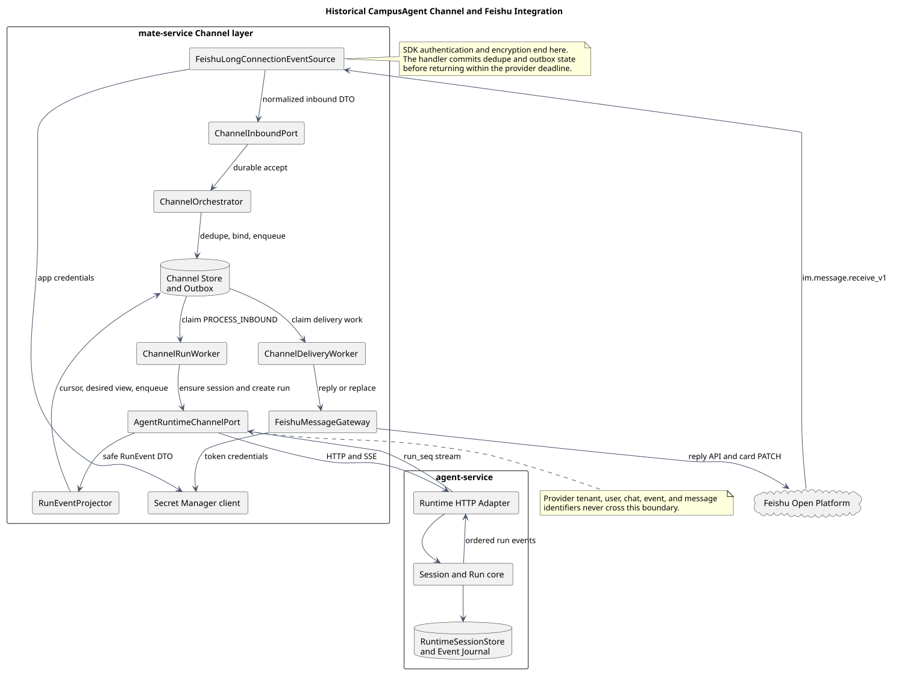
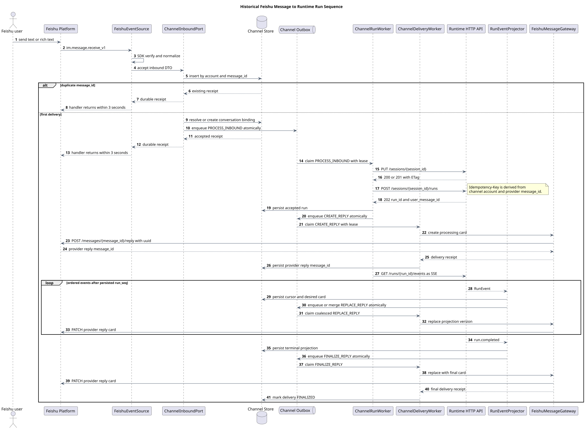

# CampusAgent Channel 接口与飞书接入设计

| 属性 | 值 |
|---|---|
| 文档版本 | 1.0.0 |
| 状态 | 目标设计，尚未实施 |
| 更新日期 | 2026-08-11 |
| 设计仓基线 | `e5a8ab2f428bb046390f558a82bfe7ceea881413` |
| Runtime HTTP 基线 | [`chat-http-v1-design.md`](chat-http-v1-design.md) 1.1.0、[`chat-http-v1.openapi.yaml`](chat-http-v1.openapi.yaml) 1.1.0 |
| Runtime 事件 Schema 基线 | [`chat-ws-v2.asyncapi.yaml`](chat-ws-v2.asyncapi.yaml) 2.12.0 |
| pi-mono-java 源码基线 | `1f7a5423219edfa4519d8719f1cc8a188ed72873` |
| 飞书证据查询日期 | 2026-08-11 |

## 1. 结论

Channel 层应位于 `mate-service`，对外终止飞书协议，对内作为
CampusAgent Runtime HTTP 客户端。飞书 `tenant_key`、`open_id`、`chat_id`、
`message_id` 和应用凭据只存在 Channel 边界，不进入 agent-service、Prompt、
Tool Manager 或 Model Manager。

飞书企业自建应用的首选入站传输是官方 SDK 长连接。事件处理器只完成
验真、规范化、按飞书 `message_id` 去重、Conversation 绑定和 Outbox 入库，
在 3 秒内返回。创建 Runtime Session/Run、消费 SSE、更新飞书卡片都由
异步 Worker 完成。

通用 Channel 契约拆成四类应用端口：

- `ChannelEventSource`：接收平台事件并生成规范化入站 DTO；
- `ChannelInboundPort`：以本地事务持久化接收结果，不同步等待 Agent；
- `ChannelMessageGateway`：回复和替换平台消息的出站端口；
- `AgentRuntimeChannelPort`：把 Channel 编排映射到现有 Session、Run、Event 和
  History HTTP 接口。

本设计不把飞书适配代码放入 agent-service，也不把不同 Channel 包装成一个
接收原始 JSON 的通用 HTTP 端点。

## 2. 范围与责任边界

### 2.1 本版范围

本版定义：

- 通用 Channel 入站、出站与 Runtime 端口；
- 飞书企业自建应用的长连接入站适配；
- 单聊、群聊 @ 机器人和群话题的 Session 绑定；
- 入站去重、Outbox、Runtime 幂等、SSE 恢复与飞书出站去重；
- 流式文本到飞书卡片的合并、限频和终态投影；
- 相关 openGauss 逻辑表和状态边界。

本版不定义：

- 飞书应用的开通、发布或管理后台操作；
- 商店应用的 Webhook 入站实现；
- 卡片按钮回调、显式 Steer 或 Abort 交互；
- 飞书图片、文件、语音和视频的下载与 Attachment Service 导入；
- Channel 账号管理 UI 和密钥托管产品。

### 2.2 服务责任

| 组件 | 责任 | 不承担的责任 |
|---|---|---|
| 飞书开放平台 | 事件投递、机器人消息和卡片展示 | Runtime Session 和 Agent 执行 |
| `FeishuLongConnectionEventSource` | SDK 连接、协议验证、事件解析和规范化 | 调用模型、持有 Runtime 状态 |
| `ChannelOrchestrator` | 去重、授权、Conversation 绑定、Outbox 和错误投影 | 解析飞书 SDK 原始类型 |
| `AgentRuntimeChannelPort` | 调用 Runtime HTTP/SSE、恢复游标和读取权威终态 | 处理飞书凭据、限频和卡片 JSON |
| `RunEventProjector` | 按 `run_seq` 聚合安全的可见回复 | 暴露 thinking、工具参数或凭据 |
| `FeishuMessageGateway` | 获取 token、回复消息、更新卡片、限频和错误分类 | 生成 Runtime 业务 ID |
| agent-service | Session、Run、History、Event Journal、Model 和 Tool 权威 | 感知飞书租户、用户或会话 ID |

### 2.3 设计分类

| 分类 | 本设计中的决策 |
|---|---|
| 产品约束 | 一个 Channel 账号绑定默认 `agent_id + model_id`；飞书 v1 只接受文本和可见富文本 |
| 安全加固 | 平台 ID 不进入 Runtime；thinking 固定为 hidden；原始事件和凭据不进入 Prompt |
| 架构改造 | 新增 Channel ports、Conversation 映射、持久化 Outbox、SSE Projector 和飞书适配器 |
| 飞书平台约束 | 长连接 3 秒处理时限、`message_id` 去重、回复 `uuid` 去重和卡片更新限制 |

## 3. 目标架构



[PlantUML 源码：`channel_feishu_architecture`](channel-feishu-v1/diagram.puml#L1)

飞书适配器和 Runtime HTTP 适配器都是应用核心端口的消费者或实现者。
`ChannelOrchestrator`、Channel Store 和 `RunEventProjector` 不依赖飞书 SDK 类型；
agent-service 也不依赖 Channel DTO。

本专题不新增一份通用 Channel OpenAPI，原因是：

1. 飞书长连接的 wire contract 由飞书 SDK 和开放平台掌握；
2. Channel 层内部跨组件契约是 Java 应用端口和持久化任务；
3. Channel 到 Runtime 继续使用已有 [`chat-http-v1.openapi.yaml`](chat-http-v1.openapi.yaml)。

未来支持飞书商店应用时，新增的 Webhook Controller 只终止飞书回调协议，
仍映射到相同 `ChannelInboundPort`。

## 4. Channel 应用端口

### 4.1 端口定义

以下 Java 仅表达目标类型边界，不表示已有实现：

```java
/**
 * Channel 入站事件源，负责终止供应商协议并提交规范化消息。
 *
 * @version [br_eCampusCore 25.1.0_Next, 2026/08/11]
 * @since [br_eCampusCore 25.1.0_Next]
 */
public interface ChannelEventSource {
    CompletionStage<Void> start(ChannelInboundPort inboundPort);

    CompletionStage<Void> stop();
}

/**
 * Channel 入站应用端口，返回持久化接收结果而非 Agent 执行结果。
 *
 * @version [br_eCampusCore 25.1.0_Next, 2026/08/11]
 * @since [br_eCampusCore 25.1.0_Next]
 */
public interface ChannelInboundPort {
    CompletionStage<ChannelAcceptResultDTO> accept(ChannelInboundMessageDTO message);
}

/**
 * Channel 出站消息端口，负责平台发送幂等、限频与错误分类。
 *
 * @version [br_eCampusCore 25.1.0_Next, 2026/08/11]
 * @since [br_eCampusCore 25.1.0_Next]
 */
public interface ChannelMessageGateway {
    ChannelType channelType();

    CompletionStage<ChannelDeliveryResultDTO> reply(ChannelReplyRequestDTO request);

    CompletionStage<ChannelDeliveryResultDTO> replace(ChannelReplaceRequestDTO request);
}

/**
 * Channel 编排调用 Agent Runtime 的应用端口。
 *
 * @version [br_eCampusCore 25.1.0_Next, 2026/08/11]
 * @since [br_eCampusCore 25.1.0_Next]
 */
public interface AgentRuntimeChannelPort {
    CompletionStage<RuntimeSessionResultDTO> ensureSession(RuntimeSessionRequestDTO request);

    CompletionStage<RuntimeRunAcceptedDTO> createRun(RuntimeRunRequestDTO request);

    Flow.Publisher<RuntimeRunEventDTO> subscribe(RuntimeEventSubscriptionDTO subscription);

    CompletionStage<RuntimeRunDTO> getRun(RuntimeRunQueryDTO query);

    CompletionStage<RuntimeHistoryDTO> getHistory(RuntimeHistoryQueryDTO query);
}
```

Controller 或未来 Webhook 边界使用独立 `*RequestVO`/`*ResponseVO`；上述应用端口
只使用 DTO。飞书 SDK 的 `P2MessageReceiveV1` 只允许出现在
`FeishuLongConnectionEventSource` 适配器内。

### 4.2 核心 DTO 语义

| DTO | 关键字段 | 语义 |
|---|---|---|
| `ChannelInboundMessageDTO` | `channelType`、`channelAccountId`、`providerMessageId`、`providerEventId`、`conversationAddress`、`actor`、`content`、`occurredAt` | 已验证和规范化的入站消息；`providerEventId` 只用于审计 |
| `ChannelConversationAddressDTO` | `providerTenantKey`、`providerChatId`、`providerThreadRootId`、`chatType` | Channel 内部定位平台会话，不传给 Runtime |
| `ChannelActorDTO` | `providerActorId`、`actorType` | 用于 Channel 授权、审计和防止 bot loop |
| `ChannelContentDTO` | `type`、`text`、`attachments` | v1 只产生 `TEXT`；附件类型为后续扩展保留 |
| `ChannelReplyRequestDTO` | `deliveryId`、`replyToProviderMessageId`、`threadMode`、`renderedContent` | 创建一条可更新的平台回复 |
| `ChannelReplaceRequestDTO` | `deliveryId`、`providerReplyMessageId`、`projectionVersion`、`renderedContent` | 以更高投影版本替换已有回复 |
| `RuntimeEventSubscriptionDTO` | `sessionId`、`runId`、`afterRunSeq` | 从已持久化的 `run_seq` 后继续 SSE |

`ChannelInboundMessageDTO` 不保存供应商原始 JSON、token、SDK 请求头、
人员姓名、客户端 `user_agent` 或未经白名单的扩展字段。

## 5. 飞书入站适配

### 5.1 传输选择

飞书官方文档说明，企业自建应用可以通过 SDK 长连接接收事件，无需公网
入站地址；处理器需在 3 秒内完成，超时或抛异常会触发重推；同一应用
最多建立 50 条连接，多个 client 之间是集群随机投递而非广播。详见
[使用长连接接收事件](https://open.feishu.cn/document/server-docs/event-subscription-guide/event-subscription-configure-/request-url-configuration-case)。

因此 v1 采用：

- 每个 `channel_account_id` 在每个 Channel Connector Pod 中最多启动一个 SDK client；
- 应用副本数与 SDK client 总数不得超过飞书连接上限；
- 不依赖 Pod 亲和，所有去重和任务所有权由 openGauss 唯一约束与 lease 保证；
- 只有入站事务成功提交才返回 SDK handler；数据库不可用时抛出可重试异常。

商店应用不支持该长连接模式，将来使用飞书 Webhook 时，必须使用官方 SDK
处理 verification token、encrypt key 和 challenge，然后调用同一入站端口。

### 5.2 事件订阅和最小权限

v1 只订阅 `im.message.receive_v1`。飞书官方文档明确说明，特殊情况可能重复
推送，需使用 `message_id` 而不是 `event_id` 去重。详见
[接收消息](https://open.feishu.cn/document/server-docs/im-v1/message/events/receive)。

建议权限为：

- 单聊：`im:message.p2p_msg:readonly`；
- 群聊：`im:message.group_at_msg:readonly`，只接收用户 @ 机器人的消息；
- 回复：`im:message:send_as_bot`；
- 卡片更新：`im:message:update`。

默认不申请群全量消息和 `im:user_agent:read`。实际权限名称以应用发布时
飞书开放平台显示的当前权限为准。

### 5.3 入站校验顺序

`FeishuLongConnectionEventSource` 固定按以下顺序处理：

1. 由官方 SDK 完成长连接鉴权、解密和事件结构校验；
2. 校验 `event_type == im.message.receive_v1`、`app_id` 匹配当前 Channel 账号；
3. 校验 `tenant_key` 与账号绑定或允许范围一致；
4. 只接受 `sender_type=user`，忽略 bot 和本应用消息，防止机器人循环；
5. 单聊接受用户消息；群聊再确认 mentions 中包含当前机器人；
6. 解析 `message_type` 和 `content` 字符串中的内层 JSON，执行字节、深度和字符数上限；
7. 删除机器人自身的 mention 占位，其他可见文本使用受控格式保留；
8. 建立 `ChannelInboundMessageDTO`，以数据库事务提交后的 receipt 作为成功边界。

入站事件中的 content 是 JSON 字符串，不能将其未解析地嵌套进另一个
JSON、卡片或 Prompt。

### 5.4 消息类型能力

| 飞书 `message_type` | v1 处理 | 设计原因 |
|---|---|---|
| `text` | 支持；解析内层 JSON 的 `text`，删除机器人 mention | 最小可用对话能力 |
| `post` | 支持可见文本、链接文字和 @ 显示名的有界提取 | 不把飞书富文本 JSON 直接交给模型 |
| `image`、`file`、`audio`、`media` | 拒绝并返回可理解提示 | 尚未定义平台资源下载、病毒扫描和 Attachment Service 绑定 |
| `interactive`、`share_chat`、`share_user`、`sticker` | 忽略或返回不支持 | 不映射为自由文本 Prompt |

规范化文本上限为 65,536 个 Unicode code point；空白文本不创建 Run。

### 5.5 Conversation 与 Session 绑定

Channel Conversation 不复用 UI 的公共 `chat_id`，而是使用独立
`channel_conversation_id`。`session_id` 仍由 mate-service 生成，只在 Channel Store 和
agent-service 之间传递。

| 飞书场景 | Conversation 唯一键 | Session 语义 |
|---|---|---|
| 单聊 | `channel_account_id + tenant_key + chat_id` | 同一用户与机器人的持久上下文 |
| 群聊新的顶层 @ | `channel_account_id + tenant_key + chat_id + message_id` | 一次新的群话题上下文 |
| 群聊的已有回复/话题 | `channel_account_id + tenant_key + chat_id + root_id` | 沿用根消息对应的 Session |

群聊首次回复使用 `reply_in_thread=true`。后续事件的 `root_id` 等于原始根
消息 ID，因此可以回到相同绑定。这个决策避免整个群共享一个 Agent
Session 而导致不相关成员间上下文泄露。

Conversation 创建时固定 Channel 账号当时的 `agent_id + model_id`。账号默认值
变更不自动改写已有 Session；需要迁移时由显式管理流程创建新绑定。

## 6. 主流程



[PlantUML 源码：`feishu_message_sequence`](channel-feishu-v1/diagram.puml#L72)

关键接受边界如下：

1. 飞书 handler 接收事件后，以
   `channel_account_id + provider_message_id` 查询幂等结果；
2. 首次事件在同一事务内写入入站记录、解析/创建 Conversation 绑定并写入
   `PROCESS_INBOUND` Outbox；
3. 重复事件直接返回原 receipt，不创建第二个 Outbox 或 Run；
4. 事务提交后 handler 立即返回，不等待 Runtime 或飞书回复 API；
5. Worker 通过 `PUT Session` 确保 Session 存在，再使用稳定幂等键创建 Run；
6. Run 接受结果与 `CREATE_REPLY` Outbox 原子持久化；Delivery Worker
   回复一张“正在处理”卡片，获得飞书回复 `message_id`；
7. SSE Projector 从已持久化 `last_run_seq` 后继续消费，合并文本 delta 并更新卡片；
8. `run.completed` 触发终态卡片和本地终态；若 SSE 游标过期，则用 Run 与
   History 权威数据恢复。

## 7. Channel 到 Runtime HTTP 映射

| Channel 动作 | Runtime HTTP | 说明 |
|---|---|---|
| 确保 Conversation Session | `PUT /sessions/{session_id}` | 请求体来自 Channel 账号固定的 `agent_id + model_id` |
| 提交入站文本 | `POST /sessions/{session_id}/runs` | `message` 是规范化文本；不传飞书 ID |
| 消费流式事件 | `GET /sessions/{session_id}/runs/{run_id}/events` | `Accept: text/event-stream`，用 `Last-Event-ID` 恢复 |
| 读取 Run 终态 | `GET /sessions/{session_id}/runs/{run_id}` | SSE 中断、Pod 故障或对账时使用 |
| 读取权威消息 | `GET /sessions/{session_id}/history?run_id=...` | `410 EVENT_CURSOR_EXPIRED` 或终态对账时使用 |

Runtime `Idempotency-Key` 由 Channel 层确定性生成：

```text
"chmsg_" + base64url(sha256(channel_account_id || 0x00 || provider_message_id))
```

该键不包含可读的租户、用户、群组或消息 ID，长度不超过 Runtime 上限。
相同飞书消息的重复 Outbox 执行必须得到相同 `run_id + user_message_id`。

Channel v1 不把普通的第二条飞书消息隐式映射为 Steer。如果当前 Session 已有
active Run，`RUN_ACTIVE` 被投影为“上一条消息仍在处理”的 Channel 回复。这避免
在用户没有显式意图时改变正在执行的 Run。

## 8. 飞书出站和流式投影

### 8.1 初始回复幂等

飞书回复消息 API 为
`POST /open-apis/im/v1/messages/{message_id}/reply`，支持 `uuid` 去重；相同 `uuid`
在 1 小时内至多成功回复一条消息，最长 50 字符。同一用户和同一群的
消息频率上限为 5 QPS。详见
[回复消息](https://open.feishu.cn/document/server-docs/im-v1/message/reply)。

`FeishuMessageGateway` 使用：

```text
"c_" + base32(sha256(delivery_id))
```

作为初始回复 `uuid`。飞书 API 超时后在一小时内重试时必须使用原值。
获得飞书返回的回复 `message_id` 后立即持久化，它是后续更新卡片的唯一
平台定位信息。

`uuid` 只保证一小时内至多成功发送一条，不能单独证明重试响应一定
返回首次的 `message_id`。上线前必须在飞书 Sandbox 验证重复 `uuid`
请求的实际响应；若无法恢复 `message_id`，该 delivery 进入 `DEAD_LETTER`
并告警，不得更换 `uuid` 自动再发一条。因此本设计保证“不重复发送”，
不宣称外部 API 与本地数据库之间存在分布式原子提交。

### 8.2 卡片更新

流式回复使用 `interactive` 卡片。初始和更新后的卡片都显式设置
`config.update_multi=true`。飞书卡片更新 API 为
`PATCH /open-apis/im/v1/messages/{message_id}`；卡片最大 30 KB，单消息更新限频
5 QPS，且只能更新 14 天内发送的卡片。详见
[更新已发送的消息卡片](https://open.feishu.cn/document/uAjLw4CM/ukTMukTMukTM/reference/im-v1/message/patch)。

Channel 内部采用更严格的策略：

- 按 `run_seq` 顺序处理，`run_seq <= last_run_seq` 的事件只去重不再渲染；
- 文本 delta 只追加到当前文本块，`message.completed` 完整替换本地组装结果；
- thinking 事件全部转换为不含内容的处理状态，飞书 v1 不展示 full thinking；
- Tool 事件最多显示“正在处理”，不投影参数、结果、内部 `tool_id` 或凭据；
- 非终态卡片最多每秒更新一次，只在可见内容 digest 变化时调用飞书；
- 终态更新可越过普通 debounce，但仍经过同一个 per-message 限频器；
- 卡片序列化前以 28 KiB 作为内部安全上限，为转义和固定结构保留空间。

模型文本不允许直接生成卡片 JSON。`FeishuCardRenderer` 使用固定 Schema 和
转义函数构造卡片。终态文本超过卡片上限时，卡片保留有界预览，
其余内容使用受控文本回复分段发送，每段使用独立确定性 `uuid`。

### 8.3 SSE 恢复

`t_channel_delivery.last_run_seq` 是 Channel 消费的权威游标。SSE 重连使用
`Last-Event-ID=last_run_seq`。每个事件先提交本地 Projector 状态和新游标，再创建
或合并飞书出站任务；飞书更新失败不回滚 `last_run_seq`。

收到 `410 EVENT_CURSOR_EXPIRED` 时：

1. 停止继续投影当前 SSE；
2. `GET Run` 判断 running 或终态；
3. `GET History?run_id=...` 读取权威 Message/RunRecord；
4. 重建可见卡片，把本地游标提升到权威快照水位；
5. running 时从新水位继续 SSE，终态时直接完成投影。

## 9. 持久化设计

新表均使用小写 snake_case 和 `t_` 前缀。本专题只定义逻辑字段，实际 DDL
另行设计；若交付 SQL，表和列的 `COMMENT ON ... IS` 必须使用中文。

### 9.1 `t_channel_account`

| 字段 | 语义 |
|---|---|
| `channel_account_id` | Channel 账号内部 ID |
| `channel_type` | 固定枚举，飞书为 `FEISHU` |
| `provider_app_id` | 飞书 App ID，大小写敏感 |
| `provider_tenant_key` | 允许的飞书租户标识 |
| `credential_ref` | Secret Manager 引用，不是 App Secret |
| `default_agent_id` / `default_model_id` | 新 Conversation 的不可变 Runtime 初始绑定 |
| `status` / `config_version` | 启停与乐观并发版本 |

### 9.2 `t_channel_conversation`

| 字段 | 语义 |
|---|---|
| `channel_conversation_id` | Channel 内部 Conversation ID |
| `channel_account_id` | 所属 Channel 账号 |
| `provider_tenant_key` / `provider_chat_id` / `provider_thread_root_id` | 平台会话定位元组 |
| `session_id` | agent-service Runtime Session ID，全局唯一且删除后不复用 |
| `agent_id` / `model_id` | Conversation 创建时冻结的绑定 |
| `state` / `row_version` | `CREATING`、`ACTIVE`、`DELETING`、`DELETED`、`FAILED` 和行版本 |

唯一约束覆盖
`channel_account_id + provider_tenant_key + provider_chat_id + provider_thread_root_id`。单聊使用固定
空 thread 标识，不使用 SQL `NULL` 绕过唯一性。

### 9.3 `t_channel_inbound_message`

| 字段 | 语义 |
|---|---|
| `inbound_message_id` | 内部接收 ID |
| `channel_account_id` / `provider_message_id` | 飞书推送去重唯一键 |
| `provider_event_id` | 审计和排障字段，不用于去重 |
| `channel_conversation_id` | 已解析的 Conversation |
| `provider_actor_ref` | 最小化保存的外部 actor 引用，按数据分类加密或脱敏 |
| `content_type` / `normalized_content_ciphertext` / `content_key_version` | Worker 调用 Runtime 前所需的短期加密规范化内容 |
| `content_digest` | 规范化内容摘要，用于审计但不反向还原 Prompt |
| `state` / `run_id` / `user_message_id` / `error_code` | 处理状态和 Runtime 接受结果 |

唯一约束为 `channel_account_id + provider_message_id`。
`normalized_content_ciphertext` 使用 KMS 管理的应用密钥加密；
`PROCESS_INBOUND` 只引用 `inbound_message_id`。Worker 仅在创建 Run 时解密，
并在成功持久化 `run_id + user_message_id` 的同一事务中清空密文和
密钥版本。拒绝或最终失败的记录由保留期任务清空密文，不无限期保存。

### 9.4 `t_channel_delivery`

| 字段 | 语义 |
|---|---|
| `delivery_id` | 一个 Run 在一个 Channel 上的投影 ID |
| `inbound_message_id` / `run_id` | 因果关联 |
| `provider_reply_message_id` | 飞书初始回复 ID |
| `last_run_seq` | 已持久化的 Runtime 事件游标 |
| `projection_version` / `visible_digest` | 卡片投影版本和可见内容去重 |
| `state` | `PENDING_REPLY`、`STREAMING`、`FINALIZED`、`RETRY_WAIT`、`DEAD_LETTER` |
| `lease_owner` / `lease_until` / `attempt_count` / `next_attempt_at` | 多 Pod claim、崩溃接管和退避 |

### 9.5 `t_channel_outbox`

Outbox 保存 `PROCESS_INBOUND`、`CREATE_REPLY`、`REPLACE_REPLY`、`FINALIZE_REPLY`
等有界任务。任务只保存内部 aggregate ID 和安全 payload 引用，不保存 token、
App Secret 或未脱敏的飞书原始事件。

## 10. 状态、并发和故障恢复

### 10.1 入站接收

```text
NEW -> ACCEPTED -> PROCESSING -> RUNNING -> COMPLETED
                    |             |
                    +-> REJECTED  +-> FAILED
```

- `ACCEPTED` 表示入站记录与 Outbox 已提交，不表示 Runtime 已接受；
- 同一去重键只允许一个记录进入 `PROCESSING`；
- Worker 在调用 Runtime 前先查询已保存 `run_id`，再使用原幂等键重试；
- 可重试故障进入退避，不更换 Runtime 幂等键或飞书 `uuid`。

### 10.2 SSE 消费所有权

每个 `delivery_id` 同时只有一个 Projector lease owner。新 owner 从
`last_run_seq` 继续，不依赖原 Pod 内存。所有卡片更新任务按
`delivery_id + projection_version` 唯一，迟到的低版本任务直接收敛为已被覆盖。

### 10.3 Runtime 故障

- `409 RUN_ACTIVE`：不自动 Steer，返回有界繁忙提示；
- `410 EVENT_CURSOR_EXPIRED`：按 8.3 节使用 Run/History 恢复；
- `503 MANAGER_UNAVAILABLE`：保留原幂等键退避重试；
- `run.completed(outcome=interrupted)`：投影为任务中断，不对原 `run_id` 重试；
- Channel 全部副本重启：从 Outbox、delivery lease 和 `last_run_seq` 恢复。

### 10.4 飞书故障

- 限频和暂时网络错误：按账号、群/用户和消息三级限频器退避；
- 初始回复超时：1 小时内使用原 `uuid` 重试；
- 权限、机器人不在群、消息撤回或群解散：作为不可重试失败并记录稳定内部错误码；
- 卡片超限：改用有界预览和分段文本，不原样重试超限 payload；
- 卡片已过可更新期：创建新的终态回复并结束旧 delivery。

## 11. 安全和隐私

1. App Secret、verification token、encrypt key 和 access token 由 Secret Manager 托管；
   openGauss 只保存 `credential_ref`。
2. 长连接使用飞书官方 SDK；禁止自行简化鉴权、解密或回调校验。
3. `tenant_key`、`open_id`、飞书 `chat_id/message_id`、SDK 请求和 token 不传入 Runtime。
4. Channel 账号配置决定 Agent/Model；用户消息不能指定 `agent_id`、`model_id`、
   `session_id` 或 thinking 级别。
5. 飞书 v1 对 Runtime 请求省略 thinking，使用 Session 已经授权的 hidden 默认值；
   Projector 即使收到 full thinking 事件也不投影到飞书。
6. LLM 文本仅放入卡片的文本字段，经转义、长度限制和固定 Schema 渲染；
   不把其解释为卡片结构、按钮、回调 URL 或人员 ID。
7. 原始飞书事件不默认持久化；规范化 Prompt 只在 Runtime 接受前加密保存，
   接受后立即擦除；排障需要的有界摘要按数据分类设置保留期。
8. Channel 层先完成飞书账号、租户、发送者和会话授权，Runtime 仍在每次 HTTP
   请求上校验 mate-service 服务身份和 Session 权限。

## 12. 实现组件建议

| 目标组件 | 所属层 | 依赖 |
|---|---|---|
| `FeishuLongConnectionEventSource` | provider adapter | 飞书 Java SDK、`ChannelInboundPort`、Secret Manager |
| `FeishuInboundMapper` | provider adapter | 严格 JSON parser、文本/富文本提取器 |
| `FeishuMessageGateway` | provider adapter | 飞书 Java SDK、token provider、限频器 |
| `FeishuCardRenderer` | provider adapter | 固定卡片 Schema、转义和大小计算 |
| `ChannelInboundService` | application | Channel Store、Conversation repository、Outbox repository |
| `ChannelRunWorker` | application | Channel Outbox、`AgentRuntimeChannelPort`、`RunEventProjector` |
| `ChannelDeliveryWorker` | application | Channel Outbox、`ChannelMessageGateway`、delivery repository |
| `RunEventProjector` | application | delivery repository、Channel outbox |
| `RuntimeHttpChannelAdapter` | infrastructure | Runtime OpenAPI client、SSE parser、Gateway service credentials |

Spring Controller 不直接调用 Runtime Client；长连接回调和未来 Webhook Controller
都只调用 `ChannelInboundPort`。Service 负责 VO/DTO 转换、幂等和跨记录业务规则。

## 13. 测试与验收

### 13.1 合约测试

- 使用飞书 SDK 事件类型验证 `im.message.receive_v1` 到 DTO 的映射；
- 使用 Runtime OpenAPI 验证 Session、Run、Event、Run 查询和 History 客户端；
- 使用飞书 Sandbox 验证回复 `uuid`、话题回复、卡片 PATCH 和 token 权限；
- 对所有供应商错误保留未知 code 分支，不依赖错误文案判断可重试性。

### 13.2 幂等与崩溃测试

- 同一 `message_id` 并发投递 100 次，只有一条入站记录、一个 Run 和一条初始回复；
- 在入站事务提交前崩溃，飞书重推后可重新接受；
- 在 Runtime `202` 返回后、本地保存前崩溃，原幂等键返回相同 Run；
- Runtime 接受结果与密文擦除原子提交；接受前重试可解密，接受后
  openGauss 中不再保留规范化 Prompt 密文；
- 在飞书初始回复成功后、保存 provider reply ID 前断网，一小时内原 `uuid`
  不产生第二条回复；
- SSE 每个 `run_seq` 重复投递、乱序与缺口测试；缺口时不公开可疑卡片；
- Projector Pod 崩溃后新 lease owner 从 `last_run_seq` 继续。

### 13.3 安全和容量测试

- bot 发送者、非允许租户、非 @ 群消息和不支持消息类型；
- 嵌套 JSON、超深结构、超长文本、恶意 mention、卡片结构注入和链接转义；
- 日志、Problem、指标和分布式追踪中不出现 App Secret、token、原始 thinking 或
  未脱敏原始事件；
- 回复 5 QPS、卡片 5 QPS、30 KB 和 14 天更新期边界；
- 50 条长连接上限和多 Pod 集群随机投递。

## 14. 源码证据与差异说明

### 14.1 观察到的 pi-mono-java 行为

| 源码证据 | 观察到的行为 |
|---|---|
| [`ServerMode.java#L39-L46`](https://github.com/superheromeZzh/pi-mono-java/blob/1f7a5423219edfa4519d8719f1cc8a188ed72873/modules/coding-agent-cli/src/main/java/com/campusclaw/codingagent/mode/server/ServerMode.java#L39-L46) `ServerMode` | 基线已声明 REST + SSE，其中 `POST /api/chat` 同时提交消息和消费 SSE |
| [`ServerMode.java#L327-L399`](https://github.com/superheromeZzh/pi-mono-java/blob/1f7a5423219edfa4519d8719f1cc8a188ed72873/modules/coding-agent-cli/src/main/java/com/campusclaw/codingagent/mode/server/ServerMode.java#L327-L399) `buildRoutes()` / `wireServerRoutes()` | `/api/chat` 与 `/api/ws/chat` 共用同一 Reactor Netty server |
| [`ChatHandler.java#L66-L87`](https://github.com/superheromeZzh/pi-mono-java/blob/1f7a5423219edfa4519d8719f1cc8a188ed72873/modules/coding-agent-cli/src/main/java/com/campusclaw/codingagent/mode/server/ChatHandler.java#L66-L87) `handleChat()` | 当前 SSE 只接受文本且流与 POST 响应耦合，active prompt 返回 409 |
| [`ChatHandler.java#L109-L169`](https://github.com/superheromeZzh/pi-mono-java/blob/1f7a5423219edfa4519d8719f1cc8a188ed72873/modules/coding-agent-cli/src/main/java/com/campusclaw/codingagent/mode/server/ChatHandler.java#L109-L169) `wireSink()` / `forwardEvent()` | SSE 取消会 abort；事件没有 `id/run_seq` 和跨请求重放 |
| [`SessionPool.java#L176-L202`](https://github.com/superheromeZzh/pi-mono-java/blob/1f7a5423219edfa4519d8719f1cc8a188ed72873/modules/coding-agent-cli/src/main/java/com/campusclaw/codingagent/mode/server/SessionPool.java#L176-L202) `getOrCreate()` | Session 按 `conversation_id` 保存于单进程内存池 |
| [`AssistantMessageEvent.java#L44-L164`](https://github.com/superheromeZzh/pi-mono-java/blob/1f7a5423219edfa4519d8719f1cc8a188ed72873/modules/ai/src/main/java/com/campusclaw/ai/stream/AssistantMessageEvent.java#L44-L164) `AssistantMessageEvent` | Provider 层已有 text/thinking/tool-call start-delta-end 结构化事件 |

### 14.2 目标差异

- 产品约束：飞书 Channel 账号固定 Agent/Model，群聊按根消息隔离 Session，
  不把整个群合并为一个 Runtime 上下文。
- 安全加固：Channel 身份与凭据在 mate-service 终止；飞书不投影 full thinking、
  Tool 参数和未经渲染的模型内容。
- 架构改造：以持久化去重、Outbox、Runtime HTTP/SSE、`run_seq` Projector
  和飞书卡片更新取代现有单 POST SSE 链路。
- 飞书平台适配：长连接是企业自建应用的默认入站；商店应用的 Webhook
  是未来传输适配，不改变 Channel 应用端口。

## 15. 版本历史

| 版本 | 日期 | 变更 |
|---|---|---|
| 1.0.0 | 2026-08-11 | 首版 Channel 应用端口与飞书接入设计；定义长连接入站、`message_id` 去重、Conversation/Session 绑定、Runtime HTTP+SSE 编排、卡片流式投影、Outbox 和崩溃恢复 |
