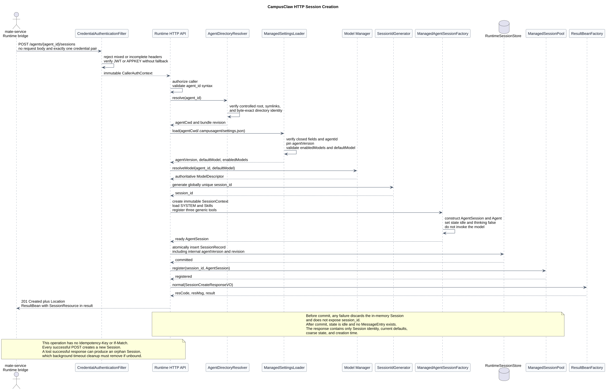
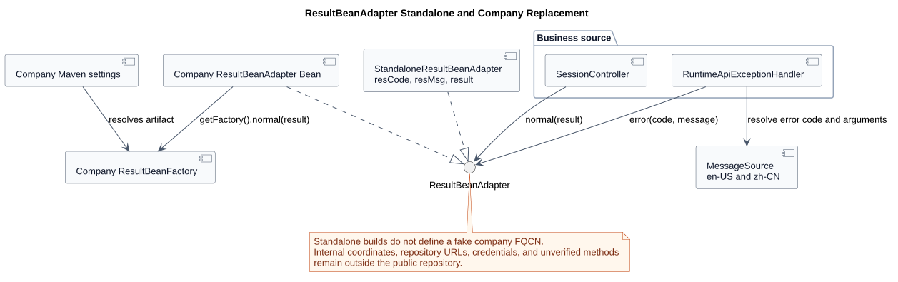
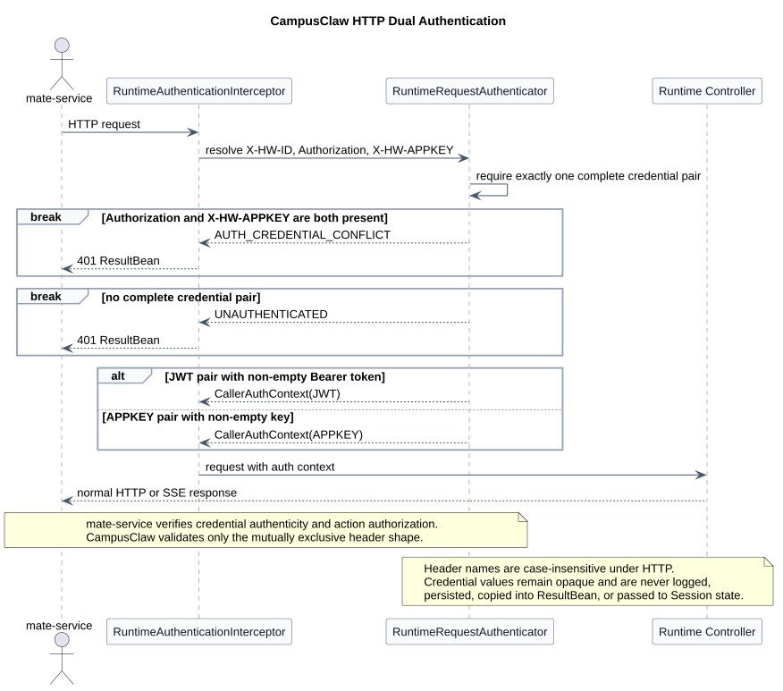

# CampusAgent Runtime HTTP API 设计

| 属性 | 值 |
|---|---|
| 文档版本 | 1.7.0 |
| 状态 | 目标设计，尚未实施 |
| OpenAPI | [`chat-http-v1.openapi.yaml`](chat-http-v1.openapi.yaml)，1.7.0 |
| WebSocket 语义基线 | [`chat-ws-v2.asyncapi.yaml`](chat-ws-v2.asyncapi.yaml)，2.12.0 |
| pi-mono-java 源码基线 | `dff835743fc7f3c93e1154c3eb51028749867ca8` |
| 更新日期 | 2026-08-15 |

## 1. 结论

HTTP 版不是把全部命令收进一个 `/chat` 接口，也不是让调用方继续提交
WebSocket 的 `method + params` Frame。它是一组以 Session、Run、History、Event
和 Model 为资源边界的内部 API，共 13 个 operation。

调用方仍是 `mate-service` Runtime bridge 或明确获授权的内部服务端 SDK。
浏览器不直连 Runtime；公共 `chat_id` 仍由 mate-service 映射为内部
`session_id`。附件正文继续由 Attachment Service 承载，Runtime HTTP API
只接受 `attachment_ids`。

## 2. 接口分组

基础路径为 `/campusclaw-service/v1`。网关 Host 可按部署环境配置，
不属于业务路径的版本契约。

### 2.1 Session 生命周期

| Method | Path | 语义 |
|---|---|---|
| `POST` | `/agents/{agent_id}/sessions` | 根据 Agent 创建 Session，由 CampusClaw 分配 `session_id` |
| `GET` | `/sessions/{session_id}` | 读取 Session、当前模型及 active-run 快照 |
| `DELETE` | `/sessions/{session_id}` | 幂等请求删除 Session；停止新请求并异步清理 |

HTTP 没有 `connect(mode=resume)`。每个请求独立认证和定位 Session；网络恢复只需
重新读取 Session、Run 或 History。`POST /agents/{agent_id}/sessions`
不包含 Request Body，不接受调用方指定的 `session_id` 或
`model_id`。`agent_id` 是创建后不可变的 Agent 绑定；
`session_id` 由 CampusClaw 生成，`model_id` 由 Agent 目录的
`defaultModel` 决定。创建后的模型切换必须显式调用
`PUT /sessions/{session_id}/model`；删除后的 `session_id`
永久禁止复用。

该接口支持两套公司凭据，OpenAPI 使用“两个可选安全要求、
每个要求内两个 Header 必须同时满足”表达。JWT 是文档、
Swagger 示例和新客户端的默认选择；APPKEY 是明确公开的兼容契约，
不得只藏在实现分支中。

| 认证模式 | 必填 Header | 定位 | 约束 |
|---|---|---|---|
| JWT | `X-HW-ID` + `Authorization: Bearer <JWT>` | 首选/默认 | 公司 JWT 验证器负责 claim、签名、issuer 和 audience |
| APPKEY | `X-HW-ID` + `X-HW-APPKEY` | 兼容 | 公司 APPKEY/私钥体系验证器负责具体校验算法 |

两组凭据二选一。同时携带 `Authorization` 和 `X-HW-APPKEY`
视为身份语义冲突，返回 HTTP `401` 和
`AUTH_CREDENTIAL_CONFLICT`；任一组合缺失、格式错误或校验失败统一
返回 `401 UNAUTHENTICATED`。选中一种模式且验证失败后禁止
再尝试另一种模式，避免认证降级和身份混淆。
`traceparent` 不属于本 HTTP API 契约。

创建成功前，Runtime 必须完成以下初始化：

1. 通过统一认证适配层验证且仅生成一个不可变
   `CallerAuthContext`，再验证 PATH 中 `agent_id` 的资源 ID 格式；
2. 在受控根目录中解析 Agent 目录，拒绝路径或符号链接越界；
3. 读取 `.campusagent/settings.json`，验证 `settings.agentId`
   与 PATH 值按 ASCII 字节完全一致，并固定 `agentVersion`；
4. 验证 `enabledModels` 非空、无重复且包含 `defaultModel`；
5. 调用 `resolveModel(agent_id, defaultModel)` 获得有效模型 descriptor；
6. 在所有外部配置校验通过后生成全局唯一、删除后不复用的
   `session_id`；
7. 组装不可变 SessionContext，加载 `SYSTEM.md` 和 Skills，注册
   `read/get_tool_info/call_tool`，并创建独立 `AgentSession + Agent`；
8. 原子保存包含 `agent_version` 和 bundle revision 的内部
   SessionRecord，并将已就绪 Session 注册到 SessionPool；
9. 使用 `ResultBeanFactory.getFactory().normal(sessionResponseVO)` 包装
   SessionResource，返回 `201 Created`、`Location` 和 ResultBean。

初始化只组装运行对象，不调用大模型、不消耗 token，不创建
Message 或 RunRecord；因此创建响应中 `state=idle` 且
`active_run=null`。`thinking=hidden` 来自 Runtime 的 Session 默认值，
不写入 Managed `settings.json`。任一步在 SessionRecord 提交前失败都不
暴露 `session_id`，并丢弃未持久化的内存 Session。

`settings.json` 是发布快照，Model Manager 仍是模型绑定、启用状态和
调用的最终权威。目录缺少有效默认模型时返回 HTTP `422`，
响应体 `resCode=AGENT_MODEL_NOT_CONFIGURED`；Model Manager 暂时不可用时
返回 HTTP `503`，响应体 `resCode=MANAGER_UNAVAILABLE`。

创建响应的 `result` 和后续 `GET /sessions/{session_id}` 的业务资源
共用 SessionResource。第一个接口的完整成功响应为：

```json
{
  "resCode": "0",
  "resMsg": "success",
  "result": {
    "session_id": "01ARZ3NDEKTSV4RRFFQ69G5FAV",
    "agent_id": "agent_011CZkYqphY8vELVzwCUpqiQ",
    "model_id": "model_011CZq2GkV8aD4NwP7sLmXfR",
    "state": "idle",
    "thinking": "hidden",
    "active_run": null,
    "created_at": "2026-08-15T11:30:00Z"
  }
}
```

`agent_version` 和内部 record revision 只在 CampusClaw 持久化，不进入
SessionResource。创建操作不要求 `Idempotency-Key` 或 `If-Match`；
每次成功 `POST` 都创建新 Session。如果持久化已成功但响应在网络中
丢失，无条件重试会再创建一个 Session；未被 mate-service 绑定的
孤立 Session 由后台超时清理。其他副作用接口的幂等或并发规则属于
各自 operation，不由创建 Session 接口继承。



[PlantUML 源码：`http_session_creation`](diagram.puml#L996)

### 2.2 消息与 Run

| Method | Path | 语义 |
|---|---|---|
| `POST` | `/sessions/{session_id}/runs` | 提交用户文本/附件并创建异步 Run |
| `GET` | `/sessions/{session_id}/runs` | 分页列出 Run |
| `GET` | `/sessions/{session_id}/runs/{run_id}` | 读取 active 快照或权威终态 |
| `POST` | `/sessions/{session_id}/runs/{run_id}/steers` | 向 active Run 追加文本指导 |
| `POST` | `/sessions/{session_id}/runs/{run_id}/abort` | 幂等请求终止 Run |

`POST /runs` 原子持久化用户 Message、分配 `run_id` 并占用 active-run；成功返回
`202 Accepted`、`Location`、`run_id` 和 `user_message_id`。响应表示已接受，不表示
模型执行完成。接受 Run 时服务端把 `session.current_model_id`
原子固化到 `RunRecord.model_id`；同一 Run 的所有模型调用都使用该值，
后续 Session 模型切换不影响已开始 Run。`POST /runs`、Steer、Abort 和 Session 删除都必须携带
`Idempotency-Key`；相同键和相同规范化负载返回原结果，相同键不同负载返回
`409 IDEMPOTENCY_CONFLICT`。

### 2.3 事件与历史

| Method | Path | 语义 |
|---|---|---|
| `GET` | `/sessions/{session_id}/runs/{run_id}/events` | 读取 Run 的有序事件；支持 SSE 和 JSON 分页 |
| `GET` | `/sessions/{session_id}/history` | 按 `history_seq` 分页读取权威 Message/RunRecord |

事件接口按 `Accept` 提供两种同义视图：

- `text/event-stream`：实时消费；SSE `id` 等于 `run_seq`，断线后使用
  `Last-Event-ID` 恢复；
- `application/json`：使用 `after_run_seq` 分页补拉、批处理或对账。

HTTP 版不保留连接级 `seq`。`run_seq` 成为一个 Run 内唯一的权威事件游标；
为支持跨请求补拉，Runtime 必须持久化有界 Run Event Journal。这是相对现有
WebSocket 设计的架构改造。终态 Message 和 RunRecord 仍写入权威 History，
客户端不能仅依赖事件缓存恢复长期历史。

### 2.4 模型与 Session 配置

| Method | Path | 语义 |
|---|---|---|
| `GET` | `/sessions/{session_id}/models` | 列出当前 Agent 和调用身份可用模型 |
| `PUT` | `/sessions/{session_id}/model` | 切换 Session 当前模型 |
| `PUT` | `/sessions/{session_id}/thinking` | 修改默认 thinking 披露级别 |

模型列表使用 Session scope，而不是公开 `/agents/{agent_id}/models`，避免调用方
绕过 Session 绑定查询其他 Agent。Model/Thinking 变更只允许在没有 active Run
时执行，并要求 `If-Match` 携带最近一次 Session `ETag`；并发版本不一致返回
`412 PRECONDITION_FAILED`。

## 3. WebSocket 到 HTTP 的语义映射

| WebSocket v2 | HTTP v1 |
|---|---|
| `connect(mode=create)` | `POST /agents/{agent_id}/sessions`；CampusClaw 生成 `session_id` |
| `connect(mode=resume)` | 无对应命令；重新 `GET` Session/Run/History |
| `chat.send` | `POST /sessions/{session_id}/runs` |
| `chat.steer` | `POST .../runs/{run_id}/steers` |
| `chat.abort` | `POST .../runs/{run_id}/abort` |
| `chat.history` | `GET /sessions/{session_id}/history` |
| `session.get` | `GET /sessions/{session_id}` |
| `models.list` | `GET /sessions/{session_id}/models` |
| `model.set` | `PUT /sessions/{session_id}/model` |
| `thinking.set` | `PUT /sessions/{session_id}/thinking` |
| EventFrame | SSE 或 JSON Run Event Journal |
| RequestFrame `id` | HTTP 请求关联由网关/框架处理，不参与业务幂等 |
| connection generation/close code | 删除；改用 HTTP 状态、ETag 和幂等键 |

## 4. 状态、并发与恢复

- 每个 Session 同一时刻只允许一个 active Run；冲突返回 `409 RUN_ACTIVE`。
- Run 接受后不依赖发起 HTTP 连接存活；连接关闭不等于 Abort。
- `GET Run` 返回 running 快照或 `done/aborted/error/interrupted` 终态。
- Pod 重启且原 Run 无法继续时，Message 和 RunRecord 对账为 `interrupted`，
  错误码为 `RUN_INTERRUPTED`。
- SSE 断线优先以 `Last-Event-ID` 继续；Event Journal 已过保留水位时返回
  `410 EVENT_CURSOR_EXPIRED`，客户端改用 Run 快照和 History 恢复。
- Session 读取响应返回 `ETag`；配置写入使用 `If-Match`，Run 副作用写入使用
  `Idempotency-Key`，两类机制职责不混用。

## 5. ResultBean、HTTP 状态与国际化

公司内部普通 JSON 接口的成功响应使用
`resCode/resMsg/result` 三字段 ResultBean，异常响应只包含
`resCode/resMsg`，不使用 RFC 9457 `application/problem+json`。这是相对原 HTTP
草案的公司集成约束。本版先冻结第一个创建 Session 接口；
其余 operation 的业务语义仍按后续逐个评审，但普通 JSON 响应
最终也必须遵守同一包装。SSE 事件流和 HTTP `204` 无响应体
不使用 ResultBean。

| 字段 | 成功 | 异常 | 调用方规则 |
|---|---|---|---|
| `resCode` | 固定字符串 `0` | 稳定大写 snake_case 错误码 | 只根据此字段分支，不解析 `resMsg` |
| `resMsg` | 固定 `success` | 按 Locale 解析的人类可读文本 | 只用于展示和日志 |
| `result` | SessionResource | 不出现 | 仅成功响应读取 |

ResultBean 只包装响应体，不把所有异常降级为 HTTP `200`。
HTTP status 仍表达传输和粗粒度失败类别，`resCode` 表达稳定业务
语义。例如：

```json
{
  "resCode": "AGENT_MODEL_NOT_CONFIGURED",
  "resMsg": "该 Agent 未配置有效的默认模型。"
}
```

第一个接口冻结的错误码、HTTP status 和中英文消息如下。
错误码枚举名、MessageSource key 和 `resCode` 必须完全一致：

| HTTP | `resCode` | `zh_CN` | `en_US` |
|---|---|---|---|
| `400` | `INVALID_AGENT_ID` | `agent_id 格式不正确。` | `The agent_id format is invalid.` |
| `401` | `UNAUTHENTICATED` | `调用方身份认证失败。` | `Caller authentication failed.` |
| `401` | `AUTH_CREDENTIAL_CONFLICT` | `请求不能同时携带 JWT 和 APPKEY 凭据。` | `JWT and APPKEY credentials must not be supplied together.` |
| `403` | `FORBIDDEN` | `当前调用方无权为该 Agent 创建 Session。` | `The caller is not allowed to create a Session for this Agent.` |
| `404` | `AGENT_NOT_FOUND` | `指定的 Agent 不存在。` | `The specified Agent does not exist.` |
| `422` | `AGENT_NOT_AVAILABLE` | `指定的 Agent 当前不可用。` | `The specified Agent is currently unavailable.` |
| `422` | `AGENT_MODEL_NOT_CONFIGURED` | `该 Agent 未配置有效的默认模型。` | `The Agent has no valid default model configured.` |
| `500` | `SESSION_INITIALIZATION_FAILED` | `Session 初始化失败。` | `Session initialization failed.` |
| `503` | `MANAGER_UNAVAILABLE` | `Model Manager 暂时不可用，请稍后重试。` | `Model Manager is temporarily unavailable. Try again later.` |

Locale 从 `Accept-Language` 解析，第一版只支持 `zh-CN` 和
`en-US`；缺失、不支持或资源 key 缺失时回退 `en-US`，禁止使用
JVM 系统 Locale。响应返回 `Content-Language`，其值为实际使用的
`en-US` 或 `zh-CN`。Service 异常只携带错误码和有界参数；
`@RestControllerAdvice` 负责 Locale 解析、消息格式化、HTTP status
和 ResultBean 异常响应。

异常响应不得包含凭据、内部 Header、私有 claim、Prompt、原始 thinking、
OBS 地址、Bucket、预签名 URL 或内部堆栈。`503` 的重试建议通过
标准 `Retry-After` Header 传递，不向 ResultBean 增加私有字段。

## 6. Java 开发体验与内部制品替换

### 6.1 代码边界

Controller 接收和返回 VO，Service 返回未包装的 Response VO；
ResultBean 不进入 Service、Session Factory、Runtime Store 或 Manager Adapter。
创建 Session 的 Controller 目标代码形状为：

```java
SessionCreateResponseVO result = sessionService.createSession(agentId);
return ResponseEntity.created(location)
        .body(ResultBeanFactory.getFactory().normal(result));
```

这是 target-only 代码形状。当前 pi-mono-java 基线没有该 HTTP
Controller，本地与设计仓库也没有公司内部 `ResultBeanFactory`
的 Maven 坐标、完整包名或方法签名证据。因此不在设计中伪造
内部 groupId/artifactId/version 或异常 Factory 方法；落地前必须以
公司内部制品的实际 API 作为新的源码基线。

### 6.2 双制品互斥模式

为了同时满足公司外可构建和公司内直接拉取，使用两个 Maven
profile 为同一个编译契约提供互斥实现：

| profile | ResultBean 来源 | 使用场景 |
|---|---|---|
| `standalone` | `campusclaw-result-bean-compat` 清室兼容制品 | 默认激活；GitHub、本地和无内网 CI |
| `company` | 公司内部真实 ResultBean 制品 | 由公司 Maven `settings.xml` 的 `activeProfiles` 自动激活 |

`campusclaw-result-bean-compat` 只重新实现已批准公开的最小 API
形状和 JSON 契约，不复制、反编译或发布公司内部源码。在获得
合规批准和真实包名后，兼容制品提供与内部制品完全相同的
FQCN、公共泛型签名和 Jackson 字段，因此 Controller 源码在两种
profile 下保持同一行 `ResultBeanFactory.getFactory().normal(result)`。

两个制品绝不能同时进入 compile/runtime classpath，否则会出现重复
FQCN 和不可预期的 class loading。Maven Enforcer 必须在 `validate`
阶段验证恰好一个 provider；公司内部仓库 URL、server ID 和凭据
只位于公司管理的 `settings.xml`，不写入 Git 中的 POM。公司环境通过
`activeProfiles` 激活 `company` 后，Maven 直接从内部仓库解析真实制品；
业务代码不改 import、不改 Factory 调用。



[PlantUML 源码：`http_result_bean_compatibility`](diagram.puml#L1080)

### 6.3 错误与国际化实现

Java 使用 `RuntimeApiErrorCode` 枚举保存稳定错误码与 HTTP status，
`RuntimeApiException` 只保存 error code 和消息参数。
`RuntimeApiExceptionHandler` 使用 Spring `MessageSource` 和已固定的
Locale 规则解析 `resMsg`，再调用公司制品实际支持的异常包装
API。由于目前只已知成功调用形状 `normal(...)`，设计不猜测
内部 Factory 的异常方法名；获得内部 jar 后再固定该适配。

资源文件至少包含 `messages_en_US.properties` 和
`messages_zh_CN.properties`。两份资源必须具有完全相同的 key 集合。
启动测试和 CI 对枚举、`en_US`、`zh_CN` 执行集合等值校验；
契约测试分别在 `standalone` 和 `company` profile 下断言：

1. `normal(result)` 的 JSON 精确为 `resCode/resMsg/result`；
2. null、空集合、时间和嵌套 VO 的 Jackson 行为一致；
3. 中英文 Locale、回退语言和 `Content-Language` 一致；
4. 九个错误码的 HTTP status、`resCode`、`resMsg` 一致，
   且响应均不包含 `result` 字段；
5. 公司 profile 的依赖树不包含兼容制品，standalone profile
   的依赖树不包含内部制品。

如果公司合规规则不允许兼容制品使用内部 FQCN，必须改用
CampusClaw 自有 Facade + 内部 Adapter；这时可保持相同 JSON 和开发
体验，但不能同时承诺业务源码 import 与内部类完全相同。

## 7. 安全与附件边界

- `CredentialHeaderResolver` 只解析 `X-HW-ID`、`Authorization` 和
  `X-HW-APPKEY`，并先拒绝缺失、不完整或混合凭据；Controller 不写
  JWT/APPKEY 两套分支。
- `JwtCredentialVerifier` 和 `AppKeyCredentialVerifier` 是公司认证库的
  窄 Adapter，成功后都返回同一个不可变 `CallerAuthContext`；后续
  Agent/Session 授权不知道凭据模式。
- JWT 是文档和新客户端首选，不是服务端默认降级链。一旦选中模式，
  校验失败必须终止。
- 凭据只存在于认证边界，不记日志、不写 ResultBean、不进入
  Service/Session/Prompt/History；`session_id` 不是凭据。
- Runtime 对每个请求重新校验 Session、Agent、Model 和动作权限。
- HTTP 契约不接收 `traceparent`。部署平台如需调用链遥测，由网关和
  框架在契约外处理，不把它传入业务对象。
- `agent_id`、`model_id` 和 `attachment_id` 均大小写敏感且不透明。
- `POST /runs` 只接受文本、附件 ID 和 thinking；禁止 URL、MIME、文件名、
  Base64、OBS Object Key、tenant/user 字段。
- Runtime 仍通过 Attachment Service 的内部 resolve/content API 获取可信元数据
  和有界字节流，不直连 OBS。



[PlantUML 源码：`http_dual_authentication`](diagram.puml#L1148)

## 8. 源码证据与差异分类

规范来源为仓库相对路径
`pi-mono-java-manager-driven-multi-agent-runtime/chat-ws-v2.asyncapi.yaml`。本轮 HTTP
认证设计额外核对 pi-mono-java 基线
`dff835743fc7f3c93e1154c3eb51028749867ca8`。

| 分类 | 证据或决策 |
|---|---|
| 观察到的行为 | `modules/coding-agent-cli/src/main/java/com/campusclaw/codingagent/mode/server/ServerMode.java` 基线 285-307：当前使用 WebSocket Upgrade，其余请求交给 RouterFunctions Adapter |
| 观察到的行为 | `modules/coding-agent-cli/src/main/java/com/campusclaw/codingagent/mode/server/ChatWebSocketHandler.java` 基线 115-227、422-459：v1 命令、断线生命周期和累计消息更新 |
| 观察到的行为 | `modules/ai/src/main/java/com/campusclaw/ai/stream/AssistantMessageEvent.java` 基线 44-164：结构化 provider 流事件 |
| 观察到的行为 | `modules/coding-agent-cli/src/main/java/com/campusclaw/codingagent/mode/server/ServerMode.java` 基线 237-307、340-344：当前 HTTP 路由未安装入站认证 Adapter，CORS 仅放行 Authorization Header |
| 观察到的行为 | `modules/agent-core/src/main/java/com/campusclaw/agent/subagent/a2a/A2aAgentBackend.java` 基线 40-62、226-238：出站 A2A 请求已使用 `X-HW-ID + X-HW-APPKEY`，但它不是入站验证实现 |
| 产品约束 | Session/Run/Message、附件引用、单 active Run、Manager 权威保持不变 |
| 产品约束 | 普通 JSON 成功响应使用 `resCode/resMsg/result`，异常响应只使用 `resCode/resMsg`；错误码和国际化 key 一致，真实 HTTP status 仍保留 |
| 产品约束 | 用户提供的公司集成基线定义 JWT 与 APPKEY 两组入站 Header；JWT 作为默认文档路径 |
| 安全加固 | 双凭据二选一、拒绝混合凭据、校验失败不降级、逐请求认证、Session-scoped 模型查询、附件只传 ID、ResultBean 错误脱敏 |
| 架构改造 | 一组 HTTP 资源接口、统一 `CallerAuthContext` 的双认证 Adapter、CampusClaw 生成 Session ID、编译生成的 Managed `settings.json`、目录默认模型初始化、ResultBeanFactory 双制品互斥替换、ETag 并发控制、SSE/JSON Event Journal、异步 Session 删除 |

公司内部 ResultBean 制品信息以及 JWT/APPKEY 入站凭据组合来自
用户提供的集成约束。当前工作区不含对应入站认证库或
ResultBean 制品元数据。ResultBean 坐标/FQCN/方法，以及 JWT 和
APPKEY 的 claim、签名、issuer、audience 与校验算法均必须在落地前
依据真实内部制品补齐。除这些待校准适配点外，
本文全部 HTTP 行为仍为 target-only design，不得表述为现有
pi-mono-java 实现。

## 9. 版本历史

| 版本 | 日期 | 变更 |
|---|---|---|
| 1.7.0 | 2026-08-15 | 第一个 Session 创建接口的异常包装收敛为仅 `resCode/resMsg`，明确禁止序列化 `result`；同步 OpenAPI Schema、中英文错误示例和契约测试 |
| 1.6.0 | 2026-08-15 | HTTP 契约删除 traceparent；增加首选 `X-HW-ID + Authorization` JWT 与兼容 `X-HW-ID + X-HW-APPKEY` 两组明示安全要求；固定混合凭据拒绝、验证失败不降级、统一 CallerAuthContext 适配层及 `AUTH_CREDENTIAL_CONFLICT` 中英文错误 |
| 1.5.0 | 2026-08-15 | 第一个创建 Session 接口改为 `resCode/resMsg/result` ResultBean，保留真实 HTTP status；固定八个错误码及中英文消息、Accept-Language/Content-Language 规则；增加 standalone 兼容制品与 company 内部制品的 Maven profile 互斥替换设计 |
| 1.4.0 | 2026-08-15 | 将创建 Session 改为无请求体的 `POST /agents/{agent_id}/sessions`，由 CampusClaw 生成 `session_id` 并从 Managed settings 解析默认模型；固定目录验证、模型校验、SessionContext/AgentSession 组装、持久化和失败清理顺序；创建和查询共用不含内部版本的 SessionResource，创建不使用 `Idempotency-Key` 或 `If-Match` |
| 1.3.0 | 2026-08-15 | Session 创建请求收敛为只必填 `agent_id`；从 `.campusagent/settings.json` 读取 `agentVersion/defaultModel/enabledModels`，经 Model Manager 校验后初始化并返回有效模型；明确 Run 原子固化 Session 当前模型 |
| 1.2.0 | 2026-08-14 | 将 Runtime HTTP API 的统一基础路径调整为 `/campusclaw-service/v1`；明确 Session 同一性由 `session_id` 与不可变 `agent_id` 绑定确定，可切换的 `model_id` 不参与绑定冲突判断 |
| 1.1.0 | 2026-08-06 | 将 HTTP 版重构为 Session、Run、事件/历史、模型配置四组共 13 个 operation；删除 connect/resume 与连接级状态，增加 SSE/JSON Event Journal、ETag 和 Session 删除语义 |
| 1.0.0 | 2026-08-05 | 初版 HTTP 映射草稿 |
