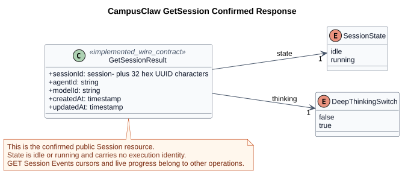
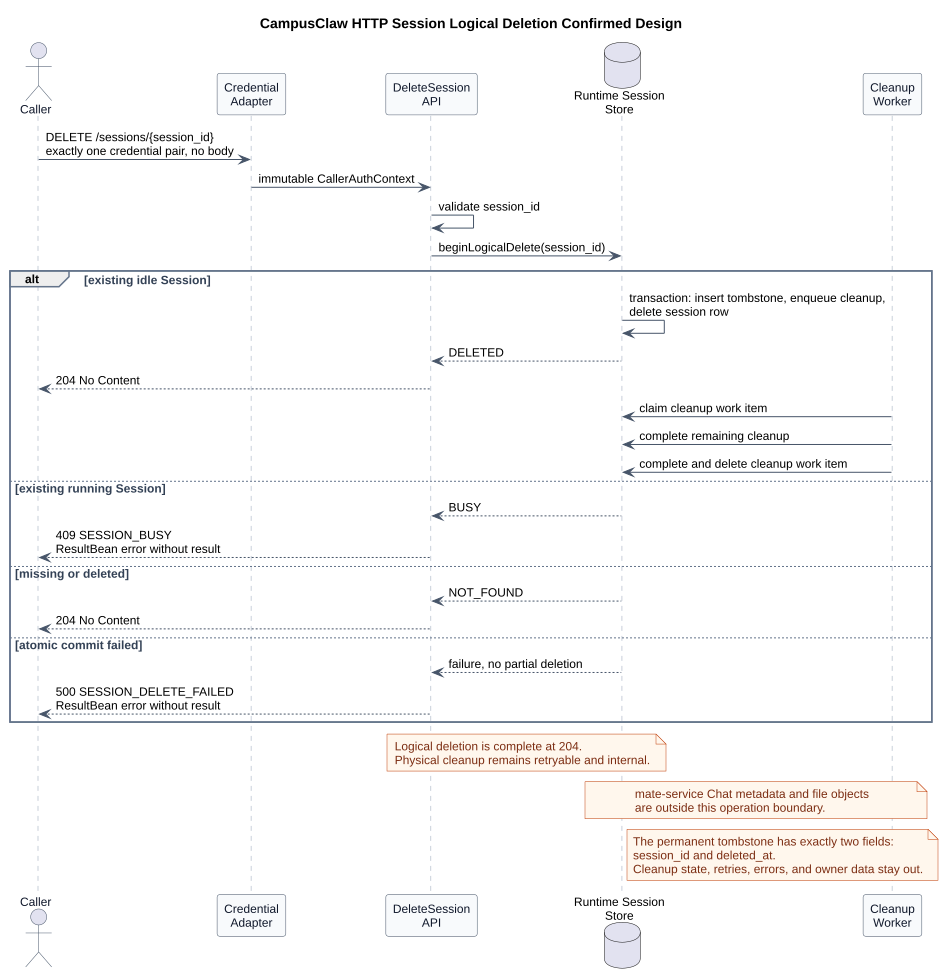
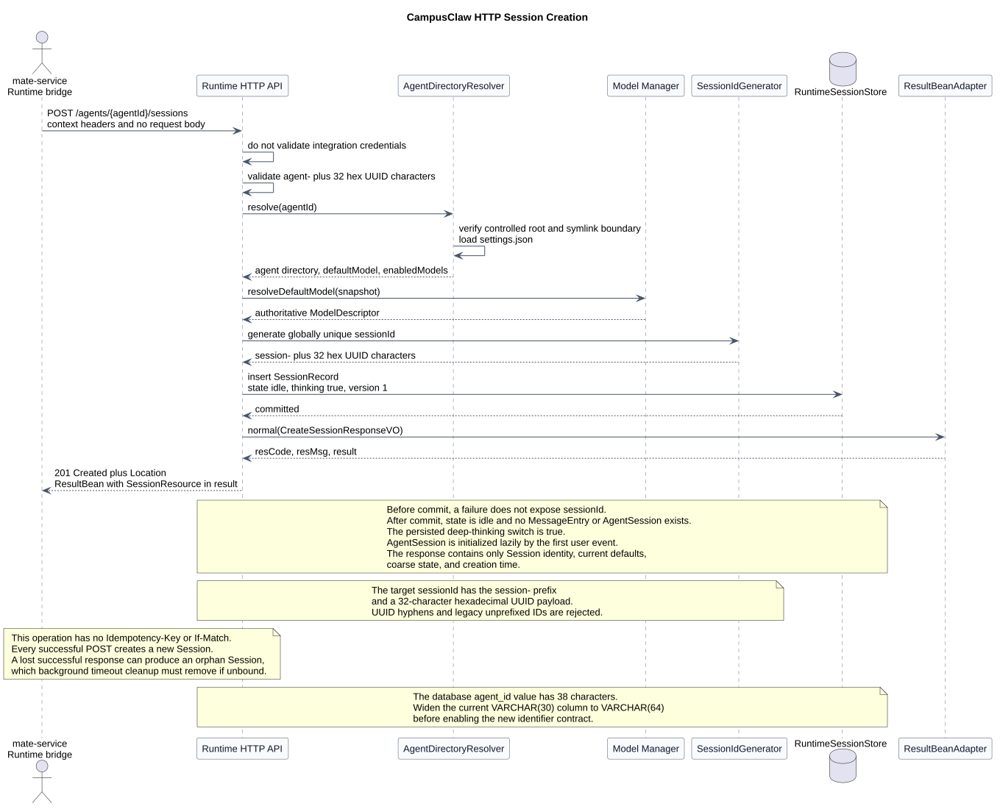
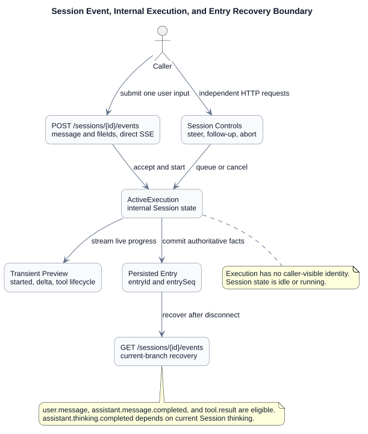
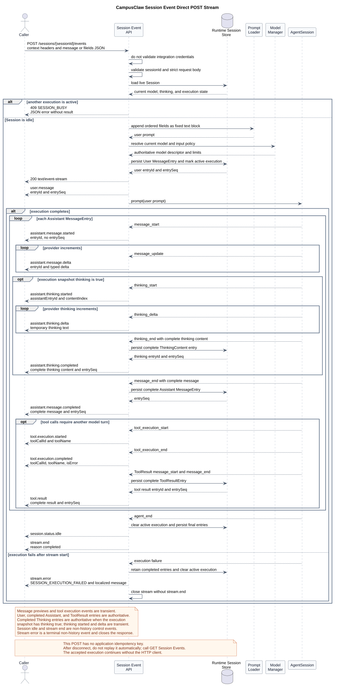
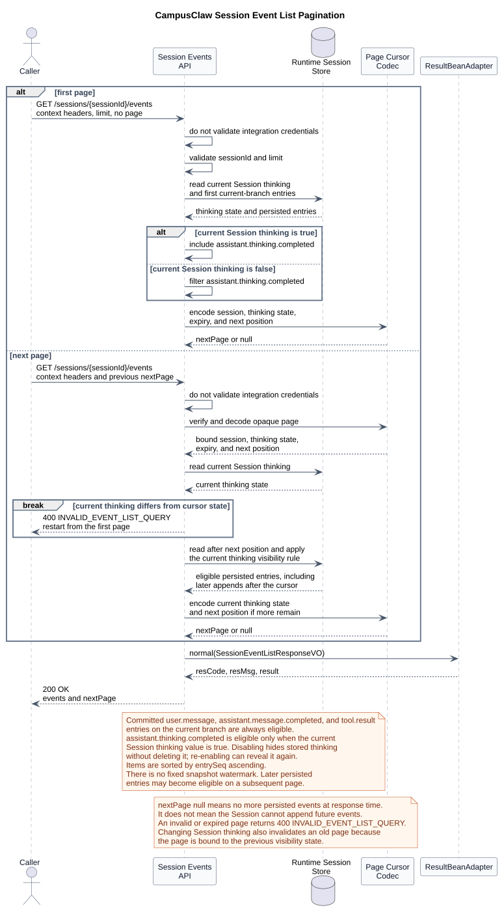
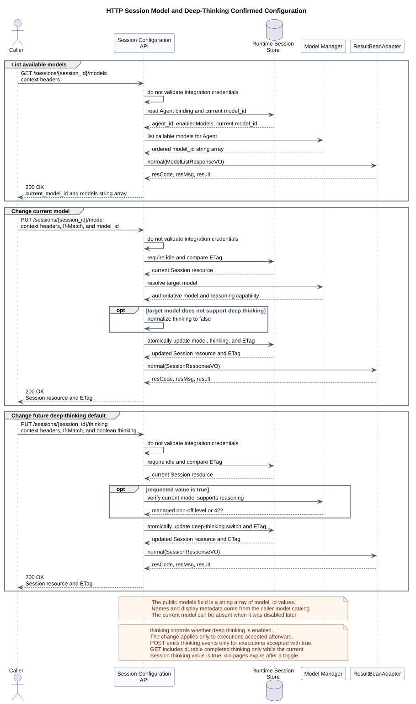
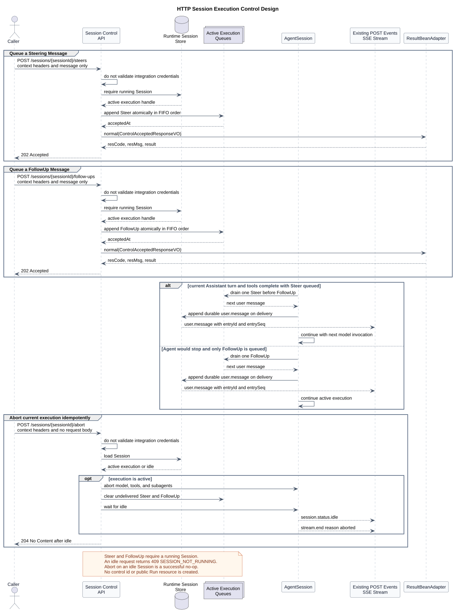
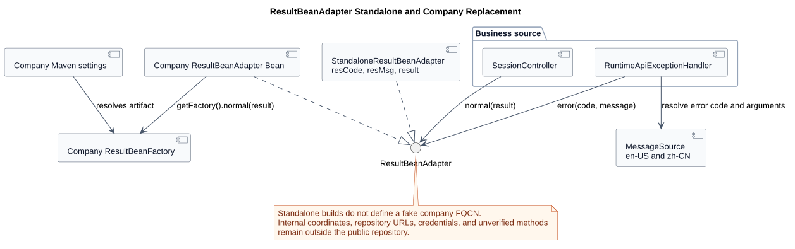
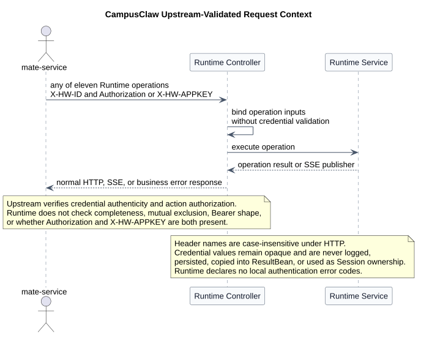

# CampusAgent Runtime HTTP API 设计

| 属性 | 值 |
|---|---|
| 文档版本 | 1.38.0 |
| 状态 | 十一个接口已在 HTTP 1.37 实现分支落地；公共字段统一为 lowerCamelCase 的 1.38 目标契约待实现 |
| 接口评审状态 | 十一个 operation 均已确认 |
| 精确契约源 | [`contract/common.json`](contract/common.json) 与 [`contract/operations/`](contract/operations/) |
| 人类评审契约 | [`chat-http-v1-review.html`](chat-http-v1-review.html)，由精确契约源生成 |
| 对外机器契约 | 不维护；结构化 JSON 只作为 HTML 生成源，不替代已废弃 OpenAPI |
| 端到端传输结论 | 浏览器/UI → mate-service、mate-service → CampusClaw 均为 HTTP；执行响应使用请求范围内 SSE |
| 设计仓分析基线 | `b902de281d9ab0ddfdcfec2ff8616279e5c421a1` |
| pi-mono 源码基线 | `086c32e74530564922d011ade23ff582c9d63116` |
| pi-mono-java 设计分析基线 | `195746614096312d4e93afb029d387837db78e0b` |
| pi-mono-java 实现基线 | `1f801dbb82bdda30478e3354e685e3153b179a0c` |
| pi-mono-java 字段命名核对基线 | `304eda06ff603fc9b6bbcaad0c296cc151a7defb`（`codex/runtime-http-contract-v137`） |
| Anthropic TypeScript SDK 源码基线 | `64a1e8e285bbcc4cef2b15ebcadccd8e5f6987ff` |
| Anthropic Managed Agents 文档核对 | 2026-08-17；`managed-agents-2026-04-01` beta |
| 更新日期 | 2026-08-21 |

## 1. 结论

当前已实现资源模型以 Session、Entry、Event 和 Model 为边界；一次用户输入触发的
执行不是调用方可见的一等 Run 资源。
调用方通过 Session Event 提交输入，通过同一 POST 的 SSE 观察实时过程，并通过
同一路径的 GET 分页读取持久化 Entry。

调用方仍是 `mate-service` Runtime bridge 或明确获授权的内部服务端 SDK。
浏览器不直连 Runtime；公共 `chat_id` 仍由 mate-service 映射为内部
`sessionId`。Runtime HTTP API 只接受 `fileIds`，当前实现不解析或下载文件内容，
而是把 ID 按固定 `[File IDs]` 提示块附加到用户消息。

端到端传输已经统一为两跳 HTTP+SSE：浏览器先调用 mate-service 公共 HTTP，
mate-service 再调用本文定义的 CampusClaw 内部 HTTP。公共边界独立认证；CampusClaw
全部 operation 携带调用上下文 Header，但 Runtime 不执行凭据认证，并在内部事件进入公共边界前完成安全投影。
mate-service 不得把内部 SSE 字节透明转发给浏览器。公共 mate-service 的路径、VO、
错误码和事件投影尚未逐项评审；本文不能被当作浏览器直连契约。

## 2. 接口分组

基础路径为 `/campusclaw-service/v1`。网关 Host 可按部署环境配置，
不属于业务路径的版本契约。
精确字段、认证、请求、响应和错误由
[`contract/common.json`](contract/common.json) 与十一份
[`contract/operations/*.json`](contract/operations/) 唯一维护；
[`chat-http-v1-review.html`](chat-http-v1-review.html) 是生成后供人评审的主界面，
本文只保留跨接口语义、源码证据、目标差异和设计理由。生成页与源 model 的字节级
一致性由校验脚本保证，禁止手工修改 HTML。
过渡期 OpenAPI 1.7.1 因长期滞后且仍包含已经被替代的旧 Run 资源，已经由用户
明确批准废弃并从仓库删除。当前不发布 OpenAPI 等标准机器契约；仓库内 JSON 只是
HTML 的规范化生成源。实现和后续评审依据生成后的 HTML、对应 JSON model 与本文
设计理由。若未来需要重新提供标准机器契约，必须从当前 JSON 源生成并建立同步门禁，
不得从 Git 历史恢复旧 YAML 后继续修改。

CampusClaw 当前目标契约的命名边界为：

| 位置 | 命名规则 |
|---|---|
| Path、Query、JSON 请求、普通 JSON 响应、SSE `data` | 字段统一使用 lowerCamelCase，例如 `sessionId`、`fileIds`、`entrySeq`、`nextPage` |
| HTTP Header | 保持标准或公司既有原名，例如 `X-HW-ID`、`Authorization`、`X-HW-APPKEY`、`If-Match`、`Accept-Language`、`Content-Language` |
| 字段值 | 事件类型值、错误码、`tool_call` 等枚举值和类型化 ID 值保持不变 |
| 内部实现与源码证据 | SQL 列名、既有源码符号和外部参考契约保留其原生拼写，并明确标注为非当前 wire field |

新契约不接收 snake_case 字段别名；否则同一语义会出现双写、未知字段处理和签名输入不一致。

内部十一项 operation 全部携带调用上下文 Header：

| Operation | Header 示例 | Runtime 处理 | Runtime 错误 |
|---|---|---|---|
| 全部十一项 operation | `X-HW-ID + Authorization`；兼容 `X-HW-ID + X-HW-APPKEY` | Controller 接收调用上下文；不检查组合完整性、共存、格式或真实性 | 不声明 `UNAUTHENTICATED` / `AUTH_CREDENTIAL_CONFLICT` |

JWT 是默认调用示例，APPKEY 是兼容示例；两类 Header 同时出现不会被 Runtime 拒绝。
当前 Java 的全路径认证拦截器与此目标契约不同：目标实现移除前置拦截，也不把相同
校验搬入 Controller；调用上下文检查由上游完成。

### 2.1 Session 生命周期

| 接口简称 | operationKey | Method | Path | 语义 |
|---|---|---|---|---|
| 创建会话 | `createSession` | `POST` | `/agents/{agentId}/sessions` | 根据 Agent 创建 Session，由 CampusClaw 分配 `sessionId` |
| 查询会话 | `getSession` | `GET` | `/sessions/{sessionId}` | 读取 Session 当前配置和 `idle/running` 粗粒度状态 |
| 删除会话 | `deleteSession` | `DELETE` | `/sessions/{sessionId}` | 逻辑删除 Session，使其对 API 立即不可见，并异步清理 Runtime 数据 |

HTTP 没有 `connect(mode=resume)`。每个请求独立定位 Session并携带上游调用上下文；
Runtime 不重复认证。网络恢复只需
重新读取 Session 或持久化 Session Events。`POST /agents/{agentId}/sessions`
不包含 Request Body，不接受调用方指定的 `sessionId` 或
`modelId`。`agentId` 是创建后不可变的 Agent 绑定；
`sessionId` 由 CampusClaw 生成，`modelId` 由 Agent 目录的
`defaultModel` 决定。创建后的模型切换必须显式调用
`PUT /sessions/{sessionId}/model`；删除后的 `sessionId`
永久禁止复用。

`agentId` 与 mate-service/Java 中的 `agentId` 是同一个逻辑标识；Agent、Tool、
Skill、Session 的精确正则只在 [`contract/common.json`](contract/common.json) 定义。类型前缀为小写，
前缀与 UUID 之间只有一个 `-`，32 位十六进制 UUID 载荷不保留
内部连字符。调用方和 Runtime 均不得构造下划线前缀的旧 ID 别名。
`sessionId` 固定为 `session-` 加去掉连字符的 32 位十六进制 UUID；本次不改变
`modelId` 或 `fileId` 的现有格式。创建 Session 与其他 operation 一样携带调用上下文
Header，但 Runtime 不校验其组合或格式。

创建成功前，Runtime 必须完成以下初始化：

1. Controller 接收上游调用上下文 Header，不执行凭据组合、互斥、格式或真实性检查；
   Service 按共享契约中的 Agent ID 正则验证 PATH 中的 `agentId`；
2. 在受控根目录中解析 `agent/{agentId}/.campusclaw/`，拒绝路径或符号链接越界；
3. 读取 `agent/{agentId}/.campusclaw/settings.json` 的 `defaultModel` 与 `enabledModels`；
4. 验证 `enabledModels` 非空、无重复且包含 `defaultModel`；
5. 调用 `resolveModel(agentId, defaultModel)` 获得有效模型 descriptor；
6. 在所有外部配置校验通过后生成全局唯一、删除后不复用且匹配
   `^session-[0-9a-fA-F]{32}$` 的 `sessionId`；
7. 保存 Session；首次执行时加载 `SYSTEM.md` 和 Skills，只注册 `read` 工具，
   并创建独立 `AgentSession + Agent`；
8. 由 `ResultBeanAdapter` 包装 SessionResource，返回 `201 Created`、
   `Location` 和 ResultBean。公司工程以 Bean 替换适配器后，在适配器内部调用
   真实 `ResultBeanFactory.getFactory().normal(sessionResponseVO)`。

初始化只组装运行对象，不调用大模型、不消耗 token，也不创建 MessageEntry；
因此创建响应中 `state=idle`。目标契约固定以 `thinking=true` 启用后续
用户消息的深度思考，且不把该默认值写入 Managed `settings.json`。
任一步在 SessionRecord 提交前失败都不
暴露 `sessionId`，并丢弃未持久化的内存 Session。

HTTP V1 对同一目录中的文件契约仍固定为 `settings.json`、`SYSTEM.md` 和
`skills/`。本次只将目录位置统一为 `.campusclaw`，不将 CLI 物化文件
`setting.json` 和 `systemPrompt.md` 当作 HTTP 同义文件。如果部署同时使用两个入口，
Manager 必须确保 HTTP 所需文件完整，不得让 HTTP 读取 CLI 物化过程中的半成品。

`settings.json` 是受控 Agent 目录配置，Model Manager 仍是模型绑定、启用状态和
调用的最终权威。目录缺少有效默认模型时返回 HTTP `422`，
响应体 `resCode=AGENT_MODEL_NOT_CONFIGURED`；Model Manager 暂时不可用时
返回 HTTP `503`，响应体 `resCode=MANAGER_UNAVAILABLE`。

已确认的第一个接口使用 `SessionCreateResponseVO`，其字段不因后续
GetSession 评审而隐式扩张。完整参数、成功响应与错误示例只维护在
[`01-create-session.json`](contract/operations/01-create-session.json)，并由
HTML 主契约展示。

`agent_version` 和内部 record revision 只在 CampusClaw 持久化，不进入
创建响应。创建操作不要求 `Idempotency-Key` 或 `If-Match`；
每次成功 `POST` 都创建新 Session。如果持久化已成功但响应在网络中
丢失，无条件重试会再创建一个 Session；未被 mate-service 绑定的
孤立 Session 由后台超时清理。其他副作用接口的幂等或并发规则属于
各自 operation，不由创建 Session 接口继承。

#### 2.1.1 第二个已确认接口：读取 Session

```http
GET /campusclaw-service/v1/sessions/{sessionId}
X-HW-ID: <CALLER_ID>
Authorization: Bearer <JWT>
```

该接口按 `sessionId` 读取已经存在的 Session 当前资源，不创建或恢复
Session，不调用模型、不消耗 token，也不为了查询而实时调用 Model Manager。
它是 Session 控制面的只读入口，用于确认资源存在及访问权、读取当前默认配置和
`idle/running` 粗粒度状态。Session 当前是否正在处理用户事件只由 `state` 表达，
不返回独立执行资源或执行详情。

| 字段 | 类型 | 当前契约 |
|---|---|---|
| `sessionId` | string | `session-` 加去掉连字符的 32 位十六进制 UUID |
| `agentId` | string | 创建后不可变的 Agent 绑定 |
| `modelId` | string | Session 当前默认模型；允许后续切换 |
| `state` | `idle \| running` | 只回答 Session 当前是否存在 active execution |
| `thinking` | boolean | 是否对后续用户消息启用深度思考；同时控制 GET Events 是否返回已持久化的 thinking completed |
| `createdAt` | RFC 3339 timestamp | Session 创建时间 |
| `updatedAt` | RFC 3339 timestamp | Session 资源最后更新时间 |

精确字段表和响应示例由
[`02-get-session.json`](contract/operations/02-get-session.json) 维护；本文只记录
字段的资源边界和设计原因。



[PlantUML 源码：`http_get_session_response`](diagrams/session-lifecycle/diagram.puml#L92)

pi 的 `thinkingLevel` 表示多级推理强度，可取
`off | minimal | low | medium | high | xhigh | max`。CampusClaw 将该能力收窄为
boolean：`false` 映射为 `off`；`true` 使用当前模型和 Agent 配置的受管非 `off`
推理强度，不把具体等级开放给调用方。该开关还控制事件可见性：POST Events 按接受
用户事件时的快照决定是否生成 thinking 生命周期事件；GET Events 按查询时 Session
当前值决定是否返回已持久化的 `assistant.thinking.completed`。

GetSession 当前不返回 `name`、`historySeq`、完整 `transcript`、
`queuedSteer`、`phase`、`attached` 或 `locked`。用户可见会话名称属于
mate-service 的 Chat 元数据；完成的 MessageEntry 由 GET Session Events API
分页返回；active Message、open content、工具和执行阶段通过发起请求的 SSE
实时观察；`attached` 是 pi 的连接相对状态，`locked` 是 pi live Runtime 的
进程内互斥状态，两者都不是可恢复的 Session 持久属性，因此不进入本接口。

| 读取需求 | 负责接口 |
|---|---|
| Session 当前默认 `modelId/thinking` 和 `idle/running` | `GET /sessions/{sessionId}` |
| 已提交 MessageEntry、`entrySeq` 和分页 page | `GET /sessions/{sessionId}/events` |
| 当前请求的实时消息与工具进度 | `POST /sessions/{sessionId}/events` 的 SSE 响应 |

读取成功返回 `ETag` 和 `Cache-Control: no-store`。已确认仅将 `ETag` 用于
后续 Model/Thinking 配置写入的 `If-Match` 并发控制，不给本 GET 增加
`If-None-Match/304` 分支。不存在和已删除的 Session 统一返回
`404 SESSION_NOT_FOUND`，避免泄露历史状态。

本小节和生成的 HTML 评审页中的第二个接口已经用户确认。

#### 2.1.2 第三个已确认接口：删除 Session

```http
DELETE /campusclaw-service/v1/sessions/{sessionId}
X-HW-ID: <CALLER_ID>
Authorization: Bearer <JWT>
```

该接口不只是把 Session 从当前 Pod 的内存池中移除，而是结束
CampusClaw 对该 Runtime Session 的管理。已确认且已实现语义是：存在 active
execution 时返回 `409 SESSION_BUSY`，不会隐式 abort；调用方先显式调用 Abort，
再重试删除。idle 时服务端原子写入 tombstone 和可重试清理任务，然后返回
`204 No Content`。
从持久化成功开始，GetSession、提交用户事件和配置写入都不再能访问
该 Session；后台 Worker 完成物理清理，但不向调用方暴露删除任务
状态。因此 `204` 表示“逻辑删除已完成”，不表示所有存储介质上的
字节已经擦除。

| 契约点 | 已确认契约 | 设计原因 |
|---|---|---|
| Request Body | 无 | 删除目标由 URI 唯一确定 |
| 成功响应 | `204 No Content`，无 ResultBean | HTTP `204` 不允许业务响应体 |
| active execution | 返回 `409 SESSION_BUSY` | 删除不隐式改变执行；避免清理与模型、工具副作用竞态 |
| 不存在或已删除 | 统一返回 `204` | 保证网络重试幂等，不暴露 tombstone 状态 |
| 幂等与并发 Header | 不要求 `Idempotency-Key` 或 `If-Match` | URI 和持久化 tombstone 已提供幂等语义；删除不是配置修改 |
| Runtime 清理范围 | 持久化 Entry、内部执行状态和内存运行对象 | 避免已删除 Session 继续占用 Runtime 资源 |
| 最小保留 | tombstone 严格只包含数据库列 `session_id` 和 `deleted_at` | 禁止 Session ID 复用，并支持删除重试去重 |
| 不属于本接口 | mate-service Chat 名称/业务元数据、文件对象 | 它们不属于 Runtime Session 删除事务 |

逻辑删除与清理任务必须在同一持久化事务中提交。如果该事务失败，
返回 `500 SESSION_DELETE_FAILED`，Session 不得停留在部分删除状态。事务
提交后的内存释放或物理清理失败由持久化任务重试；已删除
Session 对公共 API 仍然不可见。

tombstone 字段集合已对齐：若落地为 `t_session_tombstone`，则该表永久记录
严格只有数据库列 `session_id` 和 `deleted_at`，不增加 `purged_at`、`cleanup_state`、
`owner_scope` 或 Session 业务快照。内部重试次数、租约、错误和清理进度属于
短期 `t_session_cleanup_task`，清理完成后删除任务记录。由于 tombstone 不保留
owner 信息。删除操作仍携带调用上下文 Header，但 Runtime 不执行认证；
对不存在或已删除资源的重复删除只依赖 URI 和持久化 tombstone 的幂等语义。

语法无效的 `sessionId` 返回
`400 INVALID_SESSION_ID`；运行中的 Session 返回 `409 SESSION_BUSY`。
异常响应只有 `resCode/resMsg`，不包含 `result`。



[PlantUML 源码：`http_delete_session`](diagrams/session-lifecycle/diagram.puml#L167)

本小节和生成的 HTML 评审页中的第三个接口已经用户确认。



[PlantUML 源码：`http_session_creation`](diagrams/session-lifecycle/diagram.puml#L1)

### 2.2 消息与 Session Event

后续评审已经替代 1.15.0 的显式 Run 结论：一次 `user.message` 会触发一轮执行，
但该轮执行只存在于 Runtime 内部，不作为调用方可查询、控制或持久化的公共
`Run` 资源。Session 与 Entry 才是公共恢复边界。

| 接口简称 | operationKey | Method | Path | 语义 |
|---|---|---|---|---|
| 提交用户消息 | `submitUserMessage` | `POST` | `/sessions/{sessionId}/events` | 提交 `user.message`，并在同一响应中以 SSE 返回本次执行事件 |
| 查询会话事件 | `listSessionEvents` | `GET` | `/sessions/{sessionId}/events` | 使用 `page/nextPage` 分页读取权威持久化 Entry |

公共契约不再包含 `runId`、GetRun、Run Events、Run Abort 或 Run Steer。
中止和运行中追加指导已经分别确认为 Session 范围的 Abort、Steer 与 FollowUp
operation，不创建公共执行资源，也不复用 POST Events 的请求体。
CreateSession 和 GetSession 已同步删除旧模型遗留的公共执行指针。

#### 2.2.1 已确认架构决策：执行不是公共 Run 资源

pi 与 pi-mono-java 都能在没有公共 `runId` 的情况下重建会话历史：持久化单元是
MessageEntry，执行轮次只是 Agent 内部的一次 active execution。pi 的
`AgentEvent` 明确区分 Agent、Turn、Message 和 Tool execution 生命周期；
`message_start/update/end` 围绕同一条消息，工具调用后还可能产生下一条 Assistant
消息。pi-mono-java 的现有 `ChatHandler` 也已经通过一个 POST 直接返回 SSE，
但当前实现将断连解释为 abort，这一点不直接继承为目标契约。

Anthropic Managed Agents 提供了相同方向的参考：普通 Session 交互通过
`user.message` 事件驱动，不创建 Session Run；临时增量预览与最终持久化事件分离。
CampusClaw 借鉴其资源边界、持久化语义和事件顺序，不复制其事件或字段名称。

| 对比项 | CampusClaw 当前选择 | Anthropic 参考 |
|---|---|---|
| 提交用户输入 | `POST /sessions/{id}/events`，同一响应直接返回 SSE | `POST /sessions/{id}/events` 接受事件，另行订阅 Session Event Stream |
| 轮次标识 | 无公共 `runId` | 无普通 Session Run ID |
| 权威历史 | Session Entry Tree 与 `entrySeq` | Session 持久化事件与事件 ID |
| 实时预览 | `assistant.message.started/delta` | 临时 start/delta preview |
| 最终消息 | `assistant.message.completed` | 权威完整 Agent message |
| 断线恢复 | 从第一页查询持久化 Events 并去重，不重放 POST | 按 Session 事件流与历史恢复 |
| 设计差异 | 请求范围内直接流式返回，保留产品自己的命名 | 发送与订阅是两个 HTTP 请求 |



[PlantUML 源码：`http_execution_resource_model`](diagrams/execution-control/diagram.puml#L118)

#### 2.2.2 第四个已确认接口：提交用户事件并直接流式返回

```http
POST /campusclaw-service/v1/sessions/{sessionId}/events
X-HW-ID: <CALLER_ID>
Authorization: Bearer <JWT>
Content-Type: application/json
```

本接口已确认的请求形状为：

```json
{
  "message": "请分析这些订单文件，并列出异常项。",
  "fileIds": [
    "file_01JY8X2E3R4T5Y6U7I8O9P0A1S"
  ]
}
```

| 字段 | 当前契约 | 具体作用 |
|---|---|---|
| `message` | 可选；提供时包含至少一个非空白字符，最多 262144 个字符 | 用户文本；校验可判断空白，持久化保留原始值 |
| `fileIds` | 可选；最多 32 个，元素唯一、大小写敏感并保留顺序 | 按固定 `[File IDs]` 提示块追加给模型，不解析文件正文 |

URI 和 operation 已经唯一确定“提交 `user.message`”，请求体中的 `type` 不增加分派
信息，因此作为冗余字段删除，并按未知字段拒绝。`message` 和 `fileIds` 至少有一项
有效值。请求不接收 `type`、`modelId`、`thinking`、
业务 metadata、instructions、tool choice、timeout、priority、URL、MIME、文件名、
Base64、provider 参数、`clientRequestId` 或 `Idempotency-Key`。服务端接受时读取
Session 当前 `modelId/thinking`，作为本次 active execution 的内部快照；该快照
不因此产生公共 RunRecord。

成功使用 `200 OK` 和 `Content-Type: text/event-stream`，不使用 ResultBean。
浏览器原生 `EventSource` 不能发送 POST，调用方必须使用支持流式响应的 HTTP 客户端，
例如 `fetch` 的 `ReadableStream`。在响应头尚未提交前发生的请求校验、
容量占用或用户 Entry 持久化错误，使用真实 HTTP status 和只含 `resCode/resMsg` 的
JSON；响应开始后发生的错误只能以流内错误事件表达。

成功流的完整事件顺序已经确认。`user.message` 先确认用户 Entry 已持久化；每条
Assistant MessageEntry 使用三阶段；需要调用工具时先返回工具执行生命周期，再返回
权威 `tool.result` Entry；最终 Assistant 消息结束后依次返回
`session.status.idle` 和 `stream.end`。

| SSE event | 含义 | 持久化 | 客户端处理 |
|---|---|---|---|
| `user.message` | 确认本次请求的 User MessageEntry 已持久化 | 是 | 记录 `entryId/entrySeq`，作为本次执行的输入事实 |
| `assistant.message.started` | 声明一条 Assistant MessageEntry 开始生成，并分配关联 `entryId` | 否 | 建立消息占位和后续 delta 的关联边界 |
| `assistant.thinking.started` | 执行快照 `thinking=true` 时声明 thinking block 开始 | 否 | 按 `assistantEntryId/contentIndex` 建立实时 thinking 占位 |
| `assistant.thinking.delta` | 执行快照 `thinking=true` 时推送 thinking 文本增量 | 否 | 顺序拼接，仅用于实时展示 |
| `assistant.thinking.completed` | 返回并持久化完整 thinking block | 是 | 记录独立 `entryId/entrySeq`；GET 在当前 Session `thinking=true` 时恢复 |
| `assistant.message.delta` | 推送这条消息的临时增量 | 否 | 按顺序拼接，仅用于实时展示 |
| `assistant.message.completed` | 返回已经封闭和持久化的完整 Assistant MessageEntry | 是 | 使用完整消息替换本地拼接预览，并记录 `entrySeq` |
| `tool.execution.started` | `toolCallId` 对应的工具开始执行 | 否 | 展示实时执行状态；参数以此前 Assistant tool-call 内容为准 |
| `tool.execution.completed` | 工具执行生命周期结束 | 否 | 结束实时执行状态；`isError` 仅说明执行结果类别 |
| `tool.result` | 返回已持久化的完整 ToolResultEntry | 是 | 以 `toolCallId` 关联工具调用，并记录 `entryId/entrySeq` 与权威结果 |
| `session.status.idle` | 本次 active execution 已清理，Session 回到 idle | 否 | 更新粗粒度 Session 状态 |
| `stream.end` | 本次 POST 的成功事件流正常结束 | 否 | 停止读取流；不是可分页读取的持久化 Entry |

当前 Java 公共 Runtime Event 尚无 thinking 类型，投影层也会过滤底层
`thinking_start/thinking_delta/thinking_end`。目标设计按接受用户事件时捕获的执行快照
决定：`thinking=true` 时投影 `assistant.thinking.started/delta/completed`，并将 completed
作为独立持久化 Entry；`thinking=false` 时三类事件均不产生。Assistant 完整消息仍只
包含 text/tool_call 等内容，不重复内嵌 thinking block。

`completed` 只表示一条 Assistant MessageEntry 完成，不表示整个用户事件已经处理
结束。若其 `finishReason=tool_call`，Runtime 可以继续执行工具并产生新的 Assistant
MessageEntry。一次请求因此可能包含多组三阶段事件。

```text
id: 17
event: user.message
data: {"entryId":"entry_100","entrySeq":17}

event: assistant.message.started
data: {"entryId":"entry_101","role":"assistant"}

event: assistant.thinking.started
data: {"assistantEntryId":"entry_101","contentIndex":0}

event: assistant.thinking.delta
data: {"assistantEntryId":"entry_101","contentIndex":0,"delta":{"type":"thinking","text":"我需要先定位异常订单。"}}

id: 18
event: assistant.thinking.completed
data: {"entryId":"entry_thinking_101","entrySeq":18,"assistantEntryId":"entry_101","contentIndex":0,"content":{"type":"thinking","text":"我需要先定位异常订单。"}}

event: assistant.message.delta
data: {"entryId":"entry_101","delta":{"type":"text","text":"我先查询异常订单。"}}

id: 19
event: assistant.message.completed
data: {"entryId":"entry_101","entrySeq":19,"message":{"role":"assistant","content":[{"type":"text","text":"我先查询异常订单。"},{"type":"tool_call","toolCallId":"call_201","name":"query_abnormal_orders","arguments":{"scope":"uploaded_files"}}]},"finishReason":"tool_call"}

event: tool.execution.started
data: {"toolCallId":"call_201","toolName":"query_abnormal_orders"}

event: tool.execution.completed
data: {"toolCallId":"call_201","toolName":"query_abnormal_orders","isError":false}

id: 20
event: tool.result
data: {"entryId":"entry_102","entrySeq":20,"toolCallId":"call_201","toolName":"query_abnormal_orders","content":[{"type":"text","text":"发现 3 条异常订单。"}],"isError":false}

event: assistant.message.started
data: {"entryId":"entry_103","role":"assistant"}

event: assistant.message.delta
data: {"entryId":"entry_103","delta":{"type":"text","text":"发现 3 条异常订单。"}}

id: 21
event: assistant.message.completed
data: {"entryId":"entry_103","entrySeq":21,"message":{"role":"assistant","content":[{"type":"text","text":"发现 3 条异常订单。"}]},"finishReason":"stop"}

event: session.status.idle
data: {"status":"idle"}

event: stream.end
data: {"reason":"completed"}
```

若 SSE 响应已经开始后执行失败，服务端先清理 active execution，再发送一个
`stream.error`，随后直接关闭当前流；失败流不再发送 `stream.end`。`data` 仍是
单行 JSON，使用稳定 `resCode` 和按 `Accept-Language` 解析的 `resMsg`：

```text
event: stream.error
data: {"resCode":"SESSION_EXECUTION_FAILED","resMsg":"Session 执行失败。"}
```

流内错误不会伪造成 `assistant.message.completed`，也不会自动持久化一条错误
Assistant MessageEntry。失败前已经完成持久化的 User、Thinking、Assistant 或 ToolResult
Entry 仍可从 GET Session Events 读取；尚未持久化的 preview 不可恢复。

Message 与 Thinking 的 `started/delta` 没有独立持久化序号，不能作为断线恢复来源；
Thinking completed 使用独立 `entryId/entrySeq`，并通过 `assistantEntryId` 关联所属
Assistant 消息。`tool.execution.started/completed` 同样只是实时生命周期；
`tool.result` 才是权威 ToolResultEntry。公共契约不暴露 pi 内部的
`tool_execution_update`，避免把工具私有的 partial result 结构固化为跨工具协议。
SSE `data` 固定为单行 JSON，每个 frame 以一个空行结束。只有
`user.message`、`assistant.thinking.completed`、`assistant.message.completed` 和
`tool.result` 使用 `id: entrySeq`；
`session.status.idle` 必须在 active execution 已清理且本轮权威 Entry 已持久化后发送，
随后 `stream.end` 关闭正常成功流。

本接口不接收 `Idempotency-Key`。网络断开不取消已经接受的 active execution，
客户端也不得自动重放这个 POST，因为重放会持久化另一条 User MessageEntry。
恢复时从 GET Session Events 第一页重新分页：已经持久化的 User、Thinking、Assistant
和 ToolResult Entry 是权威事实，调用方按 `entryId/entrySeq` 与本地完整事件去重，
未持久化的 delta 不补拉。该行为是相对 pi-mono-java 当前
`ChatHandler.wireSink()`“客户端取消即 abort”的架构改造。



[PlantUML 源码：`http_session_event_stream`](diagrams/session-events/diagram.puml#L1)

第四接口已经确认：冻结路径、由 operation 固定的 `user.message` 语义、
`message + fileIds` 请求体、同一 POST
直接 SSE、无公共 `runId`、无 `Idempotency-Key`、成功事件顺序与持久化语义，
以及流建立后使用 `stream.error` 再关闭连接的失败语义。

### 2.3 持久化事件与恢复

| 接口简称 | operationKey | Method | Path | 语义 |
|---|---|---|---|---|
| 查询会话事件 | `listSessionEvents` | `GET` | `/sessions/{sessionId}/events` | 使用 `page/nextPage` 分页读取当前分支的权威持久化 Entry |

GET Session Events 始终返回 `user.message`、`assistant.message.completed` 和
`tool.result`；查询时 Session 当前 `thinking=true` 时额外返回持久化的
`assistant.thinking.completed`，`thinking=false` 时过滤该类型。started/delta 均不返回。
断线后客户端重新分页读取完整持久化事件，不尝试按 SSE delta 游标重建原 HTTP 流。是否增加独立的 Session
事件订阅接口，只有在出现多观察者、独立重连或需要观察超出原请求生命周期的执行时
才重新评估；当前接口不新增该端点。

#### 2.3.1 第五个接口：分页读取 Session Events（已确认）

```http
GET /campusclaw-service/v1/sessions/{sessionId}/events?limit=3
X-HW-ID: <CALLER_ID>
Authorization: Bearer <JWT>
```

本接口服务两个直接用途：首次加载一个长 Session 的持久化对话，以及
`POST /events` 断线后重新读取权威记录。用户已经选择与 Anthropic List Events
相同方向的资源和分页边界：GET 与 POST 共用 `/events` 路径，分页只使用
`page/nextPage`，不接受 `afterEntrySeq`，也不建立固定快照水位。已确认投影
Session 当前分支中的三类常规 Entry，并根据当前 `Session.thinking` 决定是否增加
`assistant.thinking.completed`。pi 的 `model_change`、`thinking_level_change`、`compaction`、
`branch_summary`、`custom`、`label` 和 `session_info` 仍可用于 Runtime 内部重建，
但不自动成为调用方可见的对话协议。

已经确定使用开放的不透明 page 分页：

| 参数 | 已确认设计 | 作用 |
|---|---|---|
| `limit` | 可选，默认 `100`，范围 `1..200` | 限制本页最多返回的持久化事件数量 |
| `page` | 后续页可选，不透明字符串 | 使用上一响应的 `nextPage` 继续读取；第一页不传 |

`page` 绑定 Session、签发时的 `thinking` 状态、当前分支事件范围和下一读取位置，
不包含历史上界。Session `thinking` 改变后，旧 page 返回
`400 INVALID_EVENT_LIST_QUERY`，调用方必须从第一页重读，避免同一分页链的可见事件
集合变化。
不透明是 HTTP 契约边界，不要求数据库存储相同字符串，也不等同于游标内容必须在技术上
无法解码。客户端只能原样回传，不得解析、修改、构造或依赖内部字段；服务端内部可以
按 `entrySeq` 做 Keyset Pagination，并使用带完整性保护的 token 或随机查询键签发 page。
持久化 Entry 始终按 `entrySeq` 从小到大排列；执行期间追加的新 Entry 可以进入
后续页面。因此分页不是一次冻结的历史快照，如果事件持续追加，调用方可能继续获得
新的 `nextPage`。无效、损坏、过期或属于其他 Session 的 page 统一返回
`400 INVALID_EVENT_LIST_QUERY`。

已确认的成功响应为：

```json
{
  "resCode": "0",
  "resMsg": "success",
  "result": {
    "events": [
      {
        "type": "user.message",
        "entryId": "entry_100",
        "entrySeq": 17,
        "message": "请分析这些订单文件，并列出异常项。",
        "fileIds": ["file_01JY8X2E3R4T5Y6U7I8O9P0A1S"],
        "createdAt": "2026-08-17T10:00:00Z"
      },
      {
        "type": "assistant.thinking.completed",
        "entryId": "entry_thinking_101",
        "entrySeq": 18,
        "assistantEntryId": "entry_101",
        "contentIndex": 0,
        "content": {
          "type": "thinking",
          "text": "我需要先定位异常订单。"
        },
        "createdAt": "2026-08-17T10:00:01Z"
      },
      {
        "type": "assistant.message.completed",
        "entryId": "entry_101",
        "entrySeq": 19,
        "message": {
          "role": "assistant",
          "content": [
            {"type": "text", "text": "我先查询异常订单。"},
            {
              "type": "tool_call",
              "toolCallId": "call_201",
              "name": "query_abnormal_orders",
              "arguments": {"scope": "uploaded_files"}
            }
          ]
        },
        "finishReason": "tool_call",
        "createdAt": "2026-08-17T10:00:02Z"
      }
    ],
    "nextPage": "page_q7K2mN9vR4xT8cL5"
  }
}
```

上例明确对应当前 `Session.thinking=true` 和 `limit=3`。调用方下一次请求原样传入
`page=page_q7K2mN9vR4xT8cL5`，下一页从 `entrySeq=20` 的 `tool.result` 继续。
如果调用方先切换了 Session thinking，旧 page 失效，必须从第一页重读。

第五接口只返回第四接口 SSE 中可恢复的持久化事件，映射如下：

| 第四接口 SSE `event` | 是否持久化 | 第五接口 `events[].type` |
|---|---|---|
| `user.message` | 是 | `user.message` |
| `assistant.message.started` / `assistant.message.delta` | 否，实时预览 | 不返回 |
| `assistant.thinking.started` / `assistant.thinking.delta` | 否，实时预览 | 不返回 |
| `assistant.thinking.completed` | 是 | 当前 Session `thinking=true` 时返回；`false` 时过滤 |
| `assistant.message.completed` | 是 | `assistant.message.completed` |
| `tool.execution.started` / `tool.execution.completed` | 否，执行进度 | 不返回 |
| `tool.result` | 是 | `tool.result` |
| `session.status.idle` / `stream.end` / `stream.error` | 否，流控制 | 不返回 |

对可见的持久化事件，GET 对象的 `type` 等于 SSE `event` 名称；其余字段与同一 Entry 的
SSE `data` 对齐。第四接口因此在持久化 `user.message`、
`assistant.thinking.completed`、`assistant.message.completed` 和 `tool.result` 中统一返回 `entryId`、`entrySeq`、
完整业务数据与 `createdAt`。SSE 的 `id` 仍等于 `entrySeq`，便于流内定位。

`events` 始终按 `entrySeq` 从小到大排列；`nextPage=null` 只表示响应时刻没有更多
已持久化事件，不表示 Session 后续不会追加事件。Session 正在执行时允许读取，调用方
只会看到已经完成持久化的 Entry，不会看到内存中的 preview。由于 POST SSE 不返回
List Events 的 page，断线恢复必须从第一页重新分页，并按 `entryId/entrySeq` 去重；
这是严格采用 page-only 分页后已经接受的效率取舍。事件范围已确认只包含当前分支；
公共类型包含三类始终可见的持久化对话 Entry，以及受当前 Session `thinking` 控制的
持久化 thinking completed；不返回废弃分支、内部控制 Entry 或临时事件。

pi-mono 的 `SessionManager` 将所有 Entry 以 `id/parentId` 组织为 append-only tree，
`getBranch()` 返回当前 leaf 到 root 的有序路径，`getEntries()` 返回完整 Entry 集合。
pi-mono-java 的旧 `SessionManager` 同样写入 `id/parentId`，但恢复实现主要线性提取
Message。`entrySeq` 和 HTTP page 分页不是 pi 原生接口；它们已在实现提交
`8691e880` 的 `MyBatisRuntimeSessionRepository` 中落地。选择“当前分支”仍是
CampusClaw 产品投影，不应表述为 pi 已有分页接口。Anthropic 的
`GET /v1/sessions/{sessionId}/events` 同样返回不透明 `nextPage`，没有公开固定
快照水位；CampusClaw 借鉴这一分页边界，但仍以自己的 Entry 类型和 ResultBean 返回。



[PlantUML 源码：`http_session_event_list`](diagrams/session-events/diagram.puml#L144)

### 2.4 模型与 Session 配置

| 接口简称 | operationKey | Method | Path | 语义 |
|---|---|---|---|---|
| 查询可用模型 | `listSessionModels` | `GET` | `/sessions/{sessionId}/models` | 列出 Agent 目录 allowlist 与 Runtime 当前可用模型交集中的 `modelId` |
| 切换会话模型 | `changeSessionModel` | `PUT` | `/sessions/{sessionId}/model` | 切换 Session 当前模型 |
| 设置深度思考 | `changeSessionThinking` | `PUT` | `/sessions/{sessionId}/thinking` | 开启或关闭 Session 深度思考 |

这三个 operation 已确认。模型列表使用 Session scope，而不是公开
`/agents/{agentId}/models`，避免调用方绕过 Session 绑定查询其他 Agent。两个 PUT
只允许在 Session `idle` 时执行，并要求 `If-Match` 携带最近一次 Session `ETag`：
缺失返回 `428 IF_MATCH_REQUIRED`，版本不一致返回
`412 SESSION_VERSION_MISMATCH`。相同值仍完成权限和可用性校验，随后按无变化成功
返回，`updatedAt` 和 `ETag` 保持不变。
这三项配置 operation 与其他接口一样携带 `X-HW-ID + Authorization` 或 APPKEY
兼容 Header；Runtime 不校验组合、共存、格式或真实性，也不返回本地认证 `401`。

#### 2.4.1 GET Session Models

`GET /sessions/{sessionId}/models` 实时读取 Model Manager，而不是返回创建 Session
时的固定快照。结果是 Agent `enabledModels` 与 Runtime 当前可用模型的交集，保持
Agent 配置中的稳定顺序，不分页。`models` 可以为空；Session 保存的
`currentModelId` 若在创建后被管理员停用，也允许暂时不在 `models` 中。

精确响应示例由
[`06-list-session-models.json`](contract/operations/06-list-session-models.json) 维护。

`models` 的类型是 `string[]`，数组元素直接是 `modelId`。只有当候选项需要增加
独立属性时才有理由改为对象数组；当前没有扩展字段，因此不保留无意义的对象层。
模型名称、供应商和能力等展示信息不属于当前 Session Runtime 接口，由 mate-service
自己的模型目录或 Model Manager 元数据接口解析。Model Manager 的 `baseUrl`、
凭据是否存在、价格、上下文窗口、最大输出 token、Headers 和供应商请求配置都不
进入契约。Model Manager 不可用复用第一个接口已经冻结的
`503 MANAGER_UNAVAILABLE`。

#### 2.4.2 PUT Session Model

`PUT /sessions/{sessionId}/model` 的请求只包含 `modelId`；精确请求和响应示例由
[`07-change-session-model.json`](contract/operations/07-change-session-model.json) 维护。

Runtime 必须实时确认目标模型仍属于上述可选集合；不存在、未绑定或调用方无权使用
统一返回 `422 MODEL_NOT_AVAILABLE`，不泄露模型目录。成功后只改变后续
`user.message` 使用的 Session 默认模型，不影响已完成历史，也不生成公共对话
Event。响应复用完整 SessionResource，使调用方一次刷新 `modelId`、
`updatedAt` 和新 `ETag`：

若切换前 `thinking=true`，但目标模型不支持深度思考，Runtime 在同一原子配置变更
中将 `thinking` 归一为 `false`，而不是留下不可执行的 Session 配置。目标模型支持
深度思考时保持原值。

#### 2.4.3 PUT Session Thinking

`PUT /sessions/{sessionId}/thinking` 开启或关闭后续用户消息的深度思考，请求只包含
`thinking`；精确请求和响应示例由
[`08-change-session-thinking.json`](contract/operations/08-change-session-thinking.json) 维护。

`false` 映射为 pi 的 `off`；`true` 由 Runtime 映射到当前模型和 Agent 配置的受管
非 `off` 推理强度。调用方不选择 `minimal/low/medium/high/xhigh/max` 等具体等级。
当前模型不支持深度思考时，请求 `true` 返回 `422 THINKING_NOT_SUPPORTED`；请求
`false` 始终允许。变更只作用于之后接受的 `user.message` 是否生成 thinking 事件，
不会改变已开始执行的快照；同时立即改变后续 GET Events 对已持久化
`assistant.thinking.completed` 的可见性。关闭时只过滤、不删除已存记录；再次开启会
重新显示当前分支中已有的 thinking completed。成功响应复用完整 SessionResource 和新 `ETag`。

两个 PUT 都不接收 `Idempotency-Key`。Session 正在执行时返回
`409 SESSION_BUSY`，不会排队配置变更；成功写入必须将 Session 配置、内部配置记录
和资源版本原子提交。普通成功响应由 `ResultBeanAdapter.normal(...)` 包装；
公司替换 Bean 内部调用 `ResultBeanFactory.getFactory().normal(...)`。所有异常仍只包含
`resCode/resMsg`。



[PlantUML 源码：`http_session_model_configuration`](diagrams/session-configuration/diagram.puml#L1)

### 2.5 Session 执行控制（已确认）

| 接口简称 | operationKey | Method | Path | 语义 |
|---|---|---|---|---|
| 追加引导消息 | `appendSteer` | `POST` | `/sessions/{sessionId}/steers` | 向当前 active execution 优先追加 Steering Message |
| 追加后续消息 | `appendFollowUp` | `POST` | `/sessions/{sessionId}/follow-ups` | 在当前执行原本将结束时追加 FollowUp Message |
| 中止会话执行 | `abortSession` | `POST` | `/sessions/{sessionId}/abort` | 中止当前 active execution 并清空未投递控制消息 |

三个 operation 已经确认。它们使用 Session scope，而不是
`/runs/{runId}`：CampusClaw 已确认不公开 Run，并且一个 Session 同时至多只有一个
active execution，因此 `sessionId` 已能无歧义确定控制目标。Steer 和 FollowUp
采用复数资源路径表示向队列追加一条消息；Abort 不创建可查询资源，因此使用
幂等动作路径 `/abort`。

Steer、FollowUp 与 Abort 都携带 JWT 默认或 APPKEY 兼容调用上下文 Header；Runtime
不执行凭据检查。

#### 2.5.1 POST Session Steer

Steer 只在 `Session.state=running` 时接受。它不会立即打断正在进行的模型响应或工具
调用，而是在当前 Assistant Turn 及其工具调用结束后、下一次模型调用前注入。首版
固定 `one-at-a-time`：同类消息保持 FIFO，每个下一轮最多投递一条；只要 Steer 队列
非空，就不会先投递 FollowUp。

请求只包含文本：

```json
{
  "message": "先只分析异常订单，不要导出报告。"
}
```

`message` 必须包含非空白字符，最大 262144 个字符。首版不接受 `fileIds`、
`modelId`、`thinking`、metadata、队列模式或 `Idempotency-Key`。成功返回
`202 Accepted` 和最窄 ResultBean：

```json
{
  "resCode": "0",
  "resMsg": "success",
  "result": {
    "sessionId": "session-550e8400e29b41d4a716446655440003",
    "acceptedAt": "2026-08-17T15:10:00Z"
  }
}
```

`202` 只表示消息已进入当前 active execution 的运行队列，不创建公共
`steerId`/`followUpId`，也不预分配或返回 `entryId/entrySeq`。消息实际投递
并持久化时才成为当前分支中的 `user.message`，沿发起执行的既有 SSE
流发送，并由 GET Session Events 查询。调用方通过该 Session 的原 SSE 顺序观察
投递结果，本版不建立控制请求到最终 Entry 的独立公开关联资源。

#### 2.5.2 POST Session FollowUp

FollowUp 使用相同的文本约束和 `202` 响应形状，但投递时机不同：它只在当前执行已
没有工具调用和 Steering Message、原本将自然结束时投递，然后在同一 active
execution 中继续下一轮。多个 FollowUp 保持 FIFO 并按 `one-at-a-time` 投递。
Session 已经 idle 时不把 FollowUp 静默转换成新交互，而是返回
`409 SESSION_NOT_RUNNING`；调用方应改用 `POST /sessions/{sessionId}/events`。

#### 2.5.3 POST Session Abort

Abort 无请求体，不接收原因、`runId`、`If-Match` 或 `Idempotency-Key`。Runtime
中止当前模型请求、工具执行和子 Agent，清空尚未投递的 Steer/FollowUp，并等待
Session 收敛为 `idle` 后返回 `204 No Content`。若请求到达时 Session 已经 idle，
同样返回 `204`，避免执行自然结束与 Abort 请求之间的竞态迫使调用方处理伪错误。
该操作携带调用上下文 Header，但不声明 Runtime 本地 `401` 认证错误。

原 `POST /events` SSE 在中止后发送：

```text
event: session.status.idle
data: {"status":"idle"}

event: stream.end
data: {"reason":"aborted"}
```

尚未投递的控制消息不会成为公共 `user.message`；已经投递的消息仍保留在历史中。
Abort 不删除 Session 或已完成 Entry，也不新增公共 `aborted` 历史事件类型。

三个控制接口不复用 `POST /events`，因为后者已经冻结为提交初始
`user.message` 并直接返回 SSE。若让同一 HTTP operation 根据 `type` 在 SSE、
ResultBean 和 `204` 之间切换，会使调用方式、重试和响应契约不稳定。



[PlantUML 源码：`http_session_execution_controls`](diagrams/execution-control/diagram.puml#L1)

## 3. 两跳 HTTP+SSE 边界

| 边界 | 普通操作 | 实时执行 | 标识范围 | 当前评审状态 |
|---|---|---|---|---|
| 浏览器/UI → mate-service | 独立 HTTP 请求与响应 | 提交消息的 HTTP 响应在本次执行期间输出 SSE | 公共 `chat_id` | 只确认传输形态；路径、VO、错误和 Event Schema 待逐项评审 |
| mate-service → CampusClaw | 本文十一个 HTTP operation | `POST /sessions/{sessionId}/events` 直接输出 SSE | 内部 `sessionId` | 十一个 operation 均已确认 |

两跳不是同一条物理连接，也不是一份字节透明协议。mate-service 需要终止公共认证、
解析内部事件、移除 Runtime 私有字段、映射安全错误并重新编码公共 SSE。内部
`sessionId`、凭据、Provider 配置和工具私有数据不得越过公共边界。

全部内部调用都携带调用上下文 Header；`Accept-Language`、`If-Match` 等各 operation
已声明的普通 Header 保持各自语义。CampusClaw 不校验凭据组合、共存、格式或真实性。

每次初始用户消息、Steer、FollowUp 或 Abort 都是新的 HTTP 请求。只有初始
`POST /events` 返回本次 active execution 的 SSE；Steer 和 FollowUp 成功后进入
该执行的队列，后续产物继续出现在仍打开的执行流中。正常 `stream.end`、流内错误
或网络中断都会结束当前响应，后续用户消息再建立新的请求。

## 4. 状态、并发与恢复

Session Event 的并发、连接和恢复规则当前为：

- 每个 Session 同一时刻只允许一个 active execution。第二个并发初始
  `user.message` 返回 `409 SESSION_BUSY`；已确认的 Steer/FollowUp 是仅在 running
  状态下追加到该 active execution 的显式例外，不创建第二个 execution。
- 用户 MessageEntry 持久化并开始执行后，不依赖发起 HTTP 连接继续存活；连接关闭
  不等于 interrupt。
- 直接流式 POST 不使用浏览器 `EventSource` 自动重连，也不接受
  `Last-Event-ID` 来重放副作用请求。
- 客户端断线后从 GET `/events` 第一页重新读取，并按 `entryId/entrySeq` 去重；只恢复
  持久化 Entry，不恢复 started/delta 等实时预览。
- 本接口不使用 `Idempotency-Key`。响应结果不确定时禁止无条件重试，避免重复
  User MessageEntry。
- `Session.state` 只表达 `idle/running` 粗粒度状态。模型请求、工具执行或消息生成
  阶段通过实时事件表达，不新增公共 Run phase。
- Steer/FollowUp 队列分别保持 FIFO，固定 `one-at-a-time`，且 Steer 优先；
  Abort 清空两类尚未投递消息。控制请求断线不会撤销已经成功接受的队列追加或中止。
- `entrySeq` 只由持久化 Entry 分配；临时事件不消耗序号。GetSession 不返回
  事件水位，第五个接口也不接受 `entrySeq` 作为分页参数；它只使用不透明 page。
- Pod 重启时如何终止或恢复 active execution、是否持久化 partial Assistant Entry，
  不属于已确认的十一个 HTTP operation 契约，留待执行恢复实现设计。

## 5. ResultBean、HTTP 状态与国际化

公司内部普通 JSON 接口的成功响应使用
`resCode/resMsg/result` 三字段 ResultBean，异常响应只包含
`resCode/resMsg`，不使用 RFC 9457 `application/problem+json`。这是相对原 HTTP
草案的公司集成约束。本版十一个 operation 均已确认。所有普通 JSON 响应都
遵守同一包装，SSE 事件流和 HTTP
`204` 无响应体不使用 ResultBean。

| 字段 | 成功 | 异常 | 调用方规则 |
|---|---|---|---|
| `resCode` | 固定字符串 `0` | 稳定大写 snake_case 错误码 | 只根据此字段分支，不解析 `resMsg` |
| `resMsg` | 固定 `success` | 按 Locale 解析的人类可读文本 | 只用于展示和日志 |
| `result` | operation 对应 Response VO | 不出现 | 仅成功响应读取 |

ResultBean 只包装响应体，不把所有异常降级为 HTTP `200`。
HTTP status 仍表达传输和粗粒度失败类别，`resCode` 表达稳定业务
语义。例如：

```json
{
  "resCode": "AGENT_MODEL_NOT_CONFIGURED",
  "resMsg": "该 Agent 未配置有效的默认模型。"
}
```

第一个接口冻结的错误码、HTTP status 和中英文消息如下。
错误码枚举名、MessageSource key 和 `resCode` 必须完全一致：

| HTTP | `resCode` | `zh_CN` | `en_US` |
|---|---|---|---|
| `400` | `INVALID_AGENT_ID` | `agentId 格式不正确。` | `The agentId format is invalid.` |
| `404` | `AGENT_NOT_FOUND` | `指定的 Agent 不存在。` | `The specified Agent does not exist.` |
| `422` | `AGENT_NOT_AVAILABLE` | `指定的 Agent 当前不可用。` | `The specified Agent is currently unavailable.` |
| `422` | `AGENT_MODEL_NOT_CONFIGURED` | `该 Agent 未配置有效的默认模型。` | `The Agent has no valid default model configured.` |
| `500` | `SESSION_INITIALIZATION_FAILED` | `Session 初始化失败。` | `Session initialization failed.` |
| `503` | `MANAGER_UNAVAILABLE` | `Model Manager 暂时不可用，请稍后重试。` | `Model Manager is temporarily unavailable. Try again later.` |

第二个 GetSession 接口已确认使用 `INVALID_SESSION_ID` 和 `SESSION_NOT_FOUND`；
仍保持异常体只有
`resCode/resMsg`。这些 operation-specific 错误已随第二个接口确认而冻结。

第三个 DeleteSession 接口已确认：成功返回无响应体的 `204`；失败使用
`INVALID_SESSION_ID`、`SESSION_BUSY` 和 `SESSION_DELETE_FAILED`。
不存在、删除中或已删除按已确认语义统一返回 `204`，因此不新增
`SESSION_NOT_FOUND`。以下错误码和消息已经冻结：

| HTTP | `resCode` | `zh_CN` | `en_US` |
|---|---|---|---|
| `400` | `INVALID_SESSION_ID` | `sessionId 格式不正确。` | `The sessionId format is invalid.` |
| `409` | `SESSION_BUSY` | `该 Session 正在处理另一条用户消息。` | `The Session is processing another user message.` |
| `500` | `SESSION_DELETE_FAILED` | `Session 删除失败。` | `Session deletion failed.` |

第四个 Session Event 接口的成功响应是 `200 text/event-stream`，不使用
ResultBean。流建立前的失败仍使用真实 HTTP status 和只包含
`resCode/resMsg` 的 JSON；流建立后的失败通过流内错误事件表达，不能再改变
HTTP status。以下错误码和消息已经随第四个接口确认冻结：

| HTTP | `resCode` | `zh_CN` | `en_US` |
|---|---|---|---|
| `400` | `INVALID_SESSION_ID` | `sessionId 格式不正确。` | `The sessionId format is invalid.` |
| `400` | `INVALID_EVENT_REQUEST` | `用户事件请求内容不符合约束。` | `The user event request does not satisfy the required constraints.` |
| `404` | `SESSION_NOT_FOUND` | `指定的 Session 不存在。` | `The specified Session does not exist.` |
| `409` | `SESSION_BUSY` | `该 Session 正在处理另一条用户消息。` | `The Session is processing another user message.` |
| `500` | `EVENT_ACCEPTANCE_FAILED` | `用户事件接收失败。` | `User event acceptance failed.` |
| SSE | `SESSION_EXECUTION_FAILED` | `Session 执行失败。` | `Session execution failed.` |

第五个 GET Session Events 接口已确认使用 `INVALID_SESSION_ID`、
`INVALID_EVENT_LIST_QUERY`、`SESSION_NOT_FOUND` 和 `EVENT_LIST_FAILED`。
这些事件查询错误已随第五接口确认而冻结。

三个 Session 配置接口复用 Session 标识和不存在错误，并新增以下
operation-specific 错误。`MODEL_NOT_AVAILABLE` 有意合并不存在、未绑定和无权使用，
避免模型目录枚举：

| HTTP | `resCode` | 适用 operation | 语义 |
|---|---|---|---|
| `400` | `INVALID_MODEL_REQUEST` | PUT Model | 请求体缺失、格式错误或含未知字段 |
| `400` | `INVALID_THINKING_REQUEST` | PUT Thinking | 请求体缺失、`thinking` 不是 boolean 或含未知字段 |
| `409` | `SESSION_BUSY` | 两个 PUT | active execution 存在，配置变更不排队 |
| `412` | `SESSION_VERSION_MISMATCH` | 两个 PUT | `If-Match` 与当前 ETag 不一致 |
| `422` | `MODEL_NOT_AVAILABLE` | PUT Model | 目标模型不在实时可选集合中 |
| `422` | `THINKING_NOT_SUPPORTED` | PUT Thinking | 请求开启深度思考，但当前模型不支持 |
| `428` | `IF_MATCH_REQUIRED` | 两个 PUT | 缺少必填 `If-Match` |
| `500` | `SESSION_MODEL_UPDATE_FAILED` | PUT Model | 模型配置和资源版本未能原子更新 |
| `500` | `SESSION_THINKING_UPDATE_FAILED` | PUT Thinking | 深度思考配置和资源版本未能原子更新 |
| `503` | `MANAGER_UNAVAILABLE` | GET Models、PUT Model | Model Manager 暂时不可用；复用第一个接口错误码 |

三个已确认执行控制接口复用 Session 标识和不存在错误，并新增：

| HTTP | `resCode` | 适用 operation | 语义 |
|---|---|---|---|
| `400` | `INVALID_STEER_REQUEST` | POST Steer | `message` 缺失、空白、过长或存在未知字段 |
| `400` | `INVALID_FOLLOW_UP_REQUEST` | POST FollowUp | `message` 缺失、空白、过长或存在未知字段 |
| `409` | `SESSION_NOT_RUNNING` | POST Steer、FollowUp | Session 已经 idle，没有可追加消息的 active execution |
| `503` | `SESSION_EXECUTION_UNAVAILABLE` | POST Steer、FollowUp、Abort | Session 为 running，但请求未命中持有 active execution 的 Runtime 实例；返回 `Retry-After: 3` |
| `500` | `STEER_ACCEPTANCE_FAILED` | POST Steer | 状态检查和 Steer 入队未能原子完成 |
| `500` | `FOLLOW_UP_ACCEPTANCE_FAILED` | POST FollowUp | 状态检查和 FollowUp 入队未能原子完成 |
| `500` | `SESSION_ABORT_FAILED` | POST Abort | 取消、清空队列或 idle 收敛失败 |

Abort 在 Session 已经 idle 时仍返回 `204`，不使用 `SESSION_NOT_RUNNING`。Steer 和
FollowUp 的响应结果不确定时不得无条件重试，否则可能重复入队。已确认契约不提供
业务幂等标识或 `Idempotency-Key`；调用方需要把不确定结果作为业务对账异常处理。

Locale 从 `Accept-Language` 解析，第一版只支持 `zh-CN` 和
`en-US`；缺失、不支持或资源 key 缺失时回退 `en-US`，禁止使用
JVM 系统 Locale。响应返回 `Content-Language`，其值为实际使用的
`en-US` 或 `zh-CN`。Service 异常只携带错误码和有界参数；
`@RestControllerAdvice` 负责 Locale 解析、消息格式化、HTTP status
和 ResultBean 异常响应。

异常响应不得包含凭据、内部 Header、私有 claim、Prompt、原始 thinking、
OBS 地址、Bucket、预签名 URL 或内部堆栈。`503` 的重试建议通过
标准 `Retry-After` Header 传递，不向 ResultBean 增加私有字段。

## 6. Java 开发体验与内部制品替换

### 6.1 代码边界

Controller 接收和返回 VO，Service 返回未包装的 Response VO；
ResultBean 不进入 Service、Runtime Store 或 Manager Adapter。
实现基线中的 Controller 代码形状为：

```java
var view = sessionService.create(agentId);
return ResponseEntity.created(location)
        .body(resultBeanAdapter.normal(view.resource()));
```

这是实现提交 `8691e880` 的已观察代码形状。`ResultBeanAdapter` 是稳定的
Controller 边界，独立仓由 `StandaloneResultBeanAdapter` 生成已确认 JSON；
公司工程提供替换 Bean，在 Bean 内调用真实
`ResultBeanFactory.getFactory().normal(result)`。当前没有公司制品 Maven 坐标、
完整包名或方法签名证据，因此不在设计中伪造依赖。

### 6.2 公司 Bean 替换模式

为了同时满足公司外可构建和公司内直接拉取，使用 Spring Bean 替换，而不是
在开源仓伪造与公司类同名的 FQCN：

| 环境 | ResultBean 来源 | 使用场景 |
|---|---|---|
| 独立仓 | `StandaloneResultBeanAdapter` | GitHub、本地和无内网 CI |
| 公司工程 | 公司自定义 `ResultBeanAdapter` Bean | Maven 从内部仓库解析真实制品，适配器内部使用公司 Factory |

公司内部仓库 URL、server ID 和凭据只位于公司管理的 `settings.xml`，不写入
Git。Controller 和 Service 不需要知道公司类的 FQCN；替换发生在依赖注入边界，
因而不存在两个同名兼容制品同时进入 classpath 的风险。



[PlantUML 源码：`http_result_bean_compatibility`](diagrams/http-contract/diagram.puml#L1)

### 6.3 错误与国际化实现

Java 使用 `RuntimeErrorCode` 枚举保存稳定错误码，
`RuntimeApiException` 只保存 error code 和消息参数。
`RuntimeApiExceptionHandler` 使用 Spring `MessageSource` 和已固定的
Locale 规则解析 `resMsg`，再调用公司制品实际支持的异常包装
API。由于目前只已知成功调用形状 `normal(...)`，设计不猜测
内部 Factory 的异常方法名；获得内部 jar 后再固定该适配。

资源文件包含默认英文 `messages.properties` 和
中文 `messages_zh_CN.properties`。两份资源必须具有完全相同的 key 集合。
启动测试和 CI 对枚举、`en_US`、`zh_CN` 执行集合等值校验；
契约测试分别在 `standalone` 和 `company` profile 下断言：

1. `normal(result)` 的 JSON 精确为 `resCode/resMsg/result`；
2. null、空集合、时间和嵌套 VO 的 Jackson 行为一致；
3. 中英文 Locale、回退语言和 `Content-Language` 一致；
4. 全部已定义错误码的 HTTP status、`resCode`、`resMsg` 一致，
   且响应均不包含 `result` 字段；
5. 公司 profile 的依赖树不包含兼容制品，standalone profile
   的依赖树不包含内部制品。

如果公司合规规则不允许兼容制品使用内部 FQCN，必须改用
CampusClaw 自有 Facade + 内部 Adapter；这时可保持相同 JSON 和开发
体验，但不能同时承诺业务源码 import 与内部类完全相同。

## 7. 安全与附件边界

- 全部十一项 operation 均携带共享调用上下文 Header 示例：首选
  `X-HW-ID + Authorization`，兼容 `X-HW-ID + X-HW-APPKEY`。
- 目标实现移除进入 Controller 前的认证拦截，也不在 Controller 内调用
  `RuntimeRequestAuthenticator`。Runtime 不检查 Header 是否齐全、是否同时存在、Bearer
  形状或凭据真实性，不声明 `UNAUTHENTICATED` / `AUTH_CREDENTIAL_CONFLICT`。
- JWT/APPKEY 真实性与动作授权由上游完成。两种凭据 Header 可以同时透传；Runtime 不据此
  分支、拒绝、降级或建立 Session owner。
- Header 值不记日志、不写 ResultBean、不进入 Session、Prompt 或 Event；`sessionId` 不是凭据。
- Runtime 仍对每个请求校验适用的 Session、Agent、Model、ETag 和业务状态；这些是资源与
  业务契约检查，不是凭据认证。
- `agentId`、`sessionId`、`modelId` 和 `fileId` 均大小写敏感且不透明。
- Agent、Tool、Skill 和 Session 标识必须匹配 [`contract/common.json`](contract/common.json)
  中各自唯一的类型化资源 ID 正则；不接受无前缀、
  错误类型前缀、带内部连字符的 UUID 或下划线旧格式。
- `POST /sessions/{sessionId}/events` 的 operation 已固定 `user.message` 语义，请求体只接受文本和文件 ID，
  不接受单次 `thinking` 覆盖，
  并禁止 URL、MIME、文件名、Base64、OBS Object Key、tenant/user 字段。
- 该 POST 不接收 `Idempotency-Key`，网络结果不确定时调用方必须先读取
  Session 和持久化 Events，禁止把无条件重试描述为安全行为。
- Runtime 不调用文件服务或 OBS；它只把有序 `fileIds` 编码成固定
  `[File IDs]` 文本块并加入本次用户提示。
- AI Provider 的 thinking 只在执行快照 `thinking=true` 时投影为 started/delta/completed，
  其中 completed 持久化。GET Events 根据查询时 Session 当前 thinking 值决定是否返回；
  关闭仅隐藏，不删除已存记录，切换状态会使旧 page 失效。



[PlantUML 源码：`http_dual_authentication`](diagrams/http-contract/diagram.puml#L61)

## 8. 源码证据与差异分类

本设计以 pi-mono 和 pi-mono-java 源码行为为实现证据；共享 JSON 契约、生成的 HTML
评审页与本文是当前 Runtime HTTP 规范来源。已删除的 WebSocket、AsyncAPI
和 OpenAPI 只能作为 Git 历史，不能作为实现输入。本轮 HTTP 认证、事件和 Session
配置设计核对 pi-mono-java 当前实现基线
`1f801dbb82bdda30478e3354e685e3153b179a0c`。本轮资源模型比较还核对了
Anthropic Managed Agents 官方文档在 2026-08-17 公开的
`managed-agents-2026-04-01` beta 契约。

| 分类 | 证据或决策 |
|---|---|
| 观察到的行为 | `modules/coding-agent-cli/src/main/java/com/campusclaw/codingagent/mode/server/ServerMode.java` 基线 285-307：当前使用 WebSocket Upgrade，其余请求交给 RouterFunctions Adapter |
| 观察到的行为 | `modules/coding-agent-cli/src/main/java/com/campusclaw/codingagent/mode/server/ChatWebSocketHandler.java` 基线 115-227、422-459：v1 命令、断线生命周期和累计消息更新 |
| 观察到的行为 | `modules/ai/src/main/java/com/campusclaw/ai/stream/AssistantMessageEvent.java` 基线 44-164：结构化 provider 流事件 |
| 观察到的行为 | `modules/coding-agent-cli/src/main/java/com/campusclaw/codingagent/mode/server/ServerMode.java` 基线 237-307、340-344：当前 HTTP 路由未安装入站认证 Adapter，CORS 仅放行 Authorization Header |
| 观察到的行为 | `modules/agent-core/src/main/java/com/campusclaw/agent/subagent/a2a/A2aAgentBackend.java` 基线 40-62、226-238：出站 A2A 请求已使用 `X-HW-ID + X-HW-APPKEY`，但它不是入站验证实现 |
| 观察到的行为 | pi-mono `packages/protocol/src/schemas.ts` 基线 38-45、241-258：协议 `SessionSnapshot` 顶层包含 `phase`、`thinkingLevel`、完整 `transcript`、连接相对 `attached` 和 live Runtime `locked` |
| 观察到的行为 | pi-mono `packages/protocol/src/schemas.ts` 基线 26-35：`ThinkingLevel` 取 `off/minimal/low/medium/high/xhigh/max`，表达推理强度 |
| 观察到的行为 | pi-mono `packages/coding-agent/src/core/agent-session.ts` 基线 1586-1600、1684-1730：`setModel` 校验模型凭据、持久化模型变更并按新模型能力收敛 `thinkingLevel`；`setThinkingLevel` 将请求推理强度限制到模型支持范围并持久化变更 |
| 观察到的行为 | pi-mono `packages/ai/src/types.ts` 基线 793-809 与 `packages/ai/src/models.ts` 基线 900-910：Model descriptor 包含 provider、reasoning、input、cost、contextWindow、maxTokens 等内部能力；支持的推理强度由 `off/minimal/low/medium/high/xhigh/max` 与模型映射共同决定 |
| 观察到的行为 | pi-mono-java `modules/coding-agent-cli/src/main/java/com/campusclaw/codingagent/mode/server/ChatWebSocketHandler.java` 基线 289-363：现有 WebSocket 命令支持 set model、list models 和 set thinking level；模型列表还暴露 contextWindow、maxTokens、cost 和 hasCredentials，thinking level 取 Java `ThinkingLevel` 推理强度 |
| 观察到的行为 | pi-mono-java `modules/ai/src/main/java/com/campusclaw/ai/types/Model.java` 基线 34-47 与 `ThinkingLevel.java` 基线 16-42：Java Model 同样包含 baseUrl、cost、headers、apiKey 等不适合公共 HTTP 的内部字段；Java 推理强度当前为 `off/minimal/low/medium/high/xhigh` |
| 观察到的行为 | Anthropic TypeScript SDK `src/resources/beta/sessions/sessions.ts` 基线 638-710：Managed Agents 的 Session 是控制面资源，包含 Agent 快照、环境/资源、预算/用量、标题/元数据和状态，但不内嵌 transcript 或 active Run 恢复快照 |
| 观察到的行为 | Anthropic [Session event stream](https://platform.claude.com/docs/en/managed-agents/events-and-streaming)：Managed Agents 的交互是事件驱动；`user.message` 启动或继续工作，事件在更早事件之后排队时 `processed_at=null`，中止通过 `user.interrupt` 表达 |
| 观察到的行为 | Anthropic [Send Events API](https://platform.claude.com/docs/en/api/cli/beta/sessions/events/send)：`POST /v1/sessions/{session_id}/events` 返回服务端已接收的事件及其 `event_id`，普通 Session 交互没有独立的 Session Run ID |
| 观察到的行为 | Anthropic [Start a session](https://platform.claude.com/docs/en/managed-agents/sessions) 与 [Session operations](https://platform.claude.com/docs/en/managed-agents/session-operations)：Session 维护跨多次交互的历史，事件驱动 `idle/running/rescheduling/terminated` 状态；`initial_events` 可让新 Session 直接进入 running |
| 观察到的行为 | Anthropic [Scheduled deployments](https://platform.claude.com/docs/en/managed-agents/scheduled-deployments)：Deployment Run 是 Deployment 触发的追加记录，只跟踪 Session 创建成功或失败；成功后通过 `session_id` 转到 Session Event Stream，不跟踪 Session 执行生命周期 |
| 观察到的行为 | pi-mono `packages/coding-agent/src/core/agent-session.ts` 基线 789-805：`AgentSession.dispose()` 中止重试、压缩、分支、bash 和 Agent 运行，断开扩展并释放内存资源；它未定义 HTTP 逻辑删除或持久化 tombstone |
| 观察到的行为 | pi-mono `packages/coding-agent/src/modes/interactive/components/session-selector.ts` 基线 598-630：交互模式删除直接将 Session JSONL 移入回收站，失败时回退为 unlink；这是本地文件行为，不是服务端删除事务 |
| 观察到的行为 | pi-mono-java `modules/coding-agent-cli/src/main/java/com/campusclaw/codingagent/mode/server/SessionPool.java` 基线 143-157、204-274：`remove()` 只从内存 Map 移除并关闭 `SessionManager`；JSONL 可在后续创建时恢复，闲置淘汰也只释放内存对象 |
| 观察到的行为 | pi-mono-java `modules/coding-agent-cli/src/main/java/com/campusclaw/codingagent/mode/server/ChatWebSocketHandler.java` 基线 168-210 与 `modules/agent-core/src/main/java/com/campusclaw/agent/AgentSession.java` 基线 165-177：断连或 abort 能停止流和子 Agent，但当前没有 DeleteSession HTTP 操作 |
| 观察到的行为 | pi-mono `packages/coding-agent/src/core/agent-session.ts` 基线 609-680、1063-1074、1116-1273：`prompt` 构造文本和可选 inline image 的 UserMessage，等待 Agent 执行，并在 `message_end` 将消息追加到 SessionManager；没有独立 HTTP Run 资源、`run_id` 或持久化幂等结果 |
| 观察到的行为 | pi-mono `packages/agent/src/types.ts` 基线 430-443 与 `packages/agent/src/agent-loop.ts` 基线 767-795：`AgentEvent` 将 `message_start/update/end` 和 `tool_execution_start/update/end` 分层；工具执行结束后再生成并发送 ToolResult Message |
| 观察到的行为 | pi-mono `packages/coding-agent/src/core/agent-session.ts` 基线 781-806：Tool execution start/update/end 继续传给扩展层；公共 HTTP 契约有意只映射 started/completed，并以持久化 `tool.result` 承载权威结果 |
| 观察到的行为 | pi-mono `packages/coding-agent/src/core/agent-session.ts` 的 `PromptOptions` 基线 2629-2649：单次 prompt 可带 images；`expandPromptTemplates`、`streamingBehavior`、`source` 和 preflight callback 是 CLI/RPC Runtime 控制，不是通用业务消息字段；`model_id/thinking` 不在该参数中 |
| 观察到的行为 | pi-mono `packages/coding-agent/src/core/agent-session.ts` 基线 1336-1404、1516-1556：`steer` 在当前 Assistant Turn 和工具调用后、下一次模型调用前入队；`followUp` 在 Agent 原本将停止时入队；`clearQueue` 清空两类队列，`abort` 取消运行并等待 idle |
| 观察到的行为 | pi-mono `packages/agent/src/agent.ts` 基线 275-319、350-390、456-492：Steer/FollowUp 使用独立队列，默认 `one-at-a-time`；Steer 在 FollowUp 之前 drain；`abort` 取消当前进程内 active run |
| 观察到的行为 | pi-mono `packages/coding-agent/src/modes/rpc/rpc-mode.ts` 基线 418-430：RPC 已分别暴露 `steer`、`follow_up` 和 `abort` 命令，但没有 CampusClaw HTTP、ResultBean 或 Session scope 契约 |
| 观察到的行为 | pi-mono-java `modules/coding-agent-cli/src/main/java/com/campusclaw/codingagent/mode/server/ChatWebSocketHandler.java` 基线 199-210、275-288 与 `modules/coding-agent-cli/src/main/java/com/campusclaw/codingagent/session/AgentSession.java` 基线 165-177、240-251：WebSocket 已有 text-only `steer` 和 `abort`，Steer 当前立即写 JSONL UserMessage，Abort 级联取消子 Agent；尚无 FollowUp 命令或三个 HTTP operation |
| 观察到的行为 | pi-mono `packages/agent/src/agent.ts` 基线 347-358、486-535：`activeRun` 是进程内执行对象，同一 Agent 已有 activeRun 时拒绝新 prompt，finally 清理；它不是持久化、可查询的 RunRecord |
| 观察到的行为 | pi-mono-java `modules/coding-agent-cli/src/main/java/com/campusclaw/codingagent/mode/server/ChatHandler.java` 基线 140-160：现有 HTTP POST 直接将消息、工具开始/结束和 done 映射为 SSE；现有名称与负载较窄，目标契约重命名并补充分离的持久化 ToolResultEntry |
| 观察到的行为 | pi-mono-java `modules/coding-agent-cli/src/main/java/com/campusclaw/codingagent/mode/server/ChatWebSocketHandler.java` 基线 252-273 与 `modules/coding-agent-cli/src/main/java/com/campusclaw/codingagent/session/AgentSession.java` 基线 153-177：WebSocket prompt 只接受非空文本，先追加 JSONL UserMessage 再调用 prompt，并以 `isStreaming` 拒绝并发；没有附件 ID、Run ID 或幂等存储 |
| 已实现行为 | pi-mono-java 实现提交 `8691e880` 的 `CampusClawApplication` 和 `CampusClawCliLauncher`：默认启动 Spring Boot MVC，显式 `cli` 子命令启动非 Web CLI 上下文 |
| 已实现行为 | 同提交的 `RuntimeSessionController`、`RuntimeEventController`、`RuntimeSessionConfigurationController` 和 `RuntimeSessionControlController`：11 个已确认 HTTP+SSE operation 均已落地 |
| 已实现行为 | 同提交的 `MyBatisRuntimeSessionRepository` 与 `session_schema.sql`：Session、当前分支 Entry、严格 `entry_seq`、tombstone 和清理任务已在 openGauss 实现 |
| 已实现行为 | pi-mono-java `1f801dbb` 的 `RuntimeRequestAuthenticator`：只校验双凭据 Header 形状；真实性和授权由上游 mate-service 完成，凭据 ID 不作为 Session owner |
| 已实现行为 | pi-mono-java 实现提交 `972f98ca`：`FileAgentDirectoryResolver` 直接返回 `agent/{agent_id}/.campusclaw/` 真实运行根目录；`RuntimeEventService`、`RuntimeEventQueryService`、`RuntimeExecutionCoordinator` 分别承担事件提交、历史查询和执行协调 |
| 当前实现差异 | pi-mono-java `1f801dbb` 的 `RuntimeApiConstants` 16-18 行仍定义旧 Agent 格式和通用 `SESSION_ID_PATTERN`；`RandomSessionIdGenerator.nextId` 20-27 行仍生成无前缀的 26 位 Crockford Base32；`RuntimeSessionService.newSession` 仍调用 `setThinking(false)` |
| 当前实现差异 | 同基线 `modules/coding-agent-cli/src/main/resources/db/gaussdb/install/session_schema.sql` 的 `t_sessions.agent_id` 仍为 `VARCHAR(30)`，无法存储 38 字符的新 Agent ID；实现前必须迁移为至少 38 字符，本设计推荐与元数据存储统一为 `VARCHAR(64)` |
| 当前实现差异 | 同基线 `RuntimeWebMvcConfiguration.addInterceptors` 27-30 行在进入 Controller 前把认证拦截器应用到 `/campusclaw-service/v1/**` 全路径；目标契约移除该前置检查，且全部 Controller 都不调用认证组件。十一项操作只接收共享调用上下文 Header，不做组合、共存、格式或真实性检查，属于认证边界架构变更 |
| 当前实现差异 | 同基线 `UserEventRequestVO` 28-52 行仍声明、校验并解析 `type=user.message`；目标请求体删除该冗余字段，属于产品契约精简 |
| 当前实现差异 | 字段命名核对基线 `304eda06`：`RuntimeSessionController`、`RuntimeEventController`、`RuntimeSessionConfigurationController` 和 `RuntimeSessionControlController` 的映射仍使用 `{agent_id}` / `{session_id}`；`CreateSessionResponseVO`、`GetSessionResponseVO`、`AvailableModelsResponseVO`、`EventPageResponseVO`、`ControlMessageAcceptedResponseVO`、`ChangeModelRequestVO`、`UserEventRequestVO` 以及 `RuntimeEntryCodec` / `RuntimeEventProjector` 仍显式读写 snake_case。1.38 lowerCamelCase 是相对该实现的架构变更 |
| 观察到的行为 | 同基线 `modules/ai/.../AssistantMessageEvent.java` 29-56、92-117 行定义内部 `thinking_start/thinking_delta/thinking_end`；`RuntimeEventType` 13-23 行没有公开 thinking 类型，`RuntimeEventProjector.projectMessageUpdate` 128-140 行只投影文本 delta |
| 观察到的行为 | 同基线 `RuntimeEntryCodec` 35-39、211-223 行明确并实际过滤 `ThinkingContent`；当前 Runtime SSE 与 GET Events 均不披露原始思考内容 |
| 架构改造 | 同提交将错误码、HTTP 状态、国际化 key 与 `Retry-After` 收口到 `RuntimeErrorCode`；running Session 未命中本机 active execution 时显式返回 `503 SESSION_EXECUTION_UNAVAILABLE`，不把进程归属问题误报为通用 500 |
| 架构变更 | 浏览器/UI 到 mate-service、mate-service 到 CampusClaw 两跳目标传输统一为 HTTP+SSE；删除连接首帧、Frame RPC、连接 generation、close code 和 AsyncAPI 目标契约 |
| 架构变更 | mate-service 终止公共 HTTP/SSE 并以服务身份调用内部 HTTP/SSE；两跳分别鉴权和投影，内部流不得字节透明转发 |
| 待评审目标设计 | mate-service 公共 HTTP 的路径、请求/响应 VO、错误码和 SSE Event Schema 尚未确认；本设计只确认传输形态和责任边界 |
| 观察到的行为 | pi-mono-java `modules/agent-core/src/main/java/com/campusclaw/agent/Agent.java` 基线 183-194、218-268：`startExecution` 通过 executionLock 保证单次 current execution，并在虚拟线程执行结束时清理；没有共享数据库 active-run 唯一约束或执行任务 |
| 观察到的行为 | pi-mono `packages/coding-agent/src/core/session-manager.ts` 基线 46-156、1057-1149、1260-1303：Session Entry 使用 `id/parentId` 组成 append-only tree，`getBranch()` 返回当前 leaf 路径，`getEntries()` 返回全部 Entry；Entry 类型还包含模型、thinking、compaction、branch summary 和扩展状态 |
| 观察到的行为 | pi-mono-java `modules/coding-agent-cli/src/main/java/com/campusclaw/codingagent/session/SessionEntry.java` 基线 18-38 与 `SessionManager.java` 基线 188-296：JSONL Entry 保留 `id/parentId/type/message`，当前恢复主要线性提取 Message；没有 HTTP 分页、`entry_seq` 或不透明 page |
| 观察到的行为 | Anthropic [List Events API](https://platform.claude.com/docs/en/api/beta/sessions/events/list)：`GET /v1/sessions/{session_id}/events` 通过不透明 `page/next_page` 分页，并按 `processed_at` 排序；公开响应没有固定快照水位 |
| 产品约束 | Session/Message、文件引用和 Manager 权威保持不变；执行轮次不是调用方可见的公共 Run，权威恢复单元是 Session Entry |
| 产品约束 | 普通 JSON 成功响应使用 `resCode/resMsg/result`，异常响应只使用 `resCode/resMsg`；错误码和国际化 key 一致，真实 HTTP status 仍保留 |
| 产品约束 | 用户提供的公司集成基线定义 JWT 与 APPKEY 两组入站 Header；JWT 作为默认文档路径；全部十一项操作携带共享调用上下文 Header，Runtime 不执行本地凭据认证 |
| 产品约束 | DeleteSession 永久 tombstone 严格只包含 `session_id`、`deleted_at`；清理状态、重试信息、owner 和业务快照不进入 tombstone |
| 产品约束 | Session `thinking` 是是否启用深度思考的 boolean；`false` 映射为 pi 的 `off`，`true` 使用模型和 Agent 的受管非 `off` 推理强度，不公开具体等级 |
| 产品约束 | Path、Query、JSON 与 SSE data 字段只使用 lowerCamelCase；HTTP Header 保留原名；事件类型值、错误码、枚举值和类型化 ID 值不改变，也不接受 snake_case 字段别名 |
| 产品约束 | Agent、Tool、Skill、Session ID 分别使用 `agent-`、`tool-`、`skill-`、`session-` 加去连字符的 32 位十六进制 UUID；字段命名变化不得引入不同的 ID 值或旧格式别名 |
| 产品约束 | Create Runtime Session 成功时必须返回并持久化 `thinking=true` |
| 安全边界 | 全部操作透传共享调用上下文 Header，但 Runtime 不判断凭据是否完整、互斥、Bearer 合法或真实，不声明本地认证错误；真实性与动作授权明确由上游完成 |
| 安全加固 | Session 模型列表通过 `string[]` 只暴露 `modelId` 值，不返回名称、供应商、能力、base URL、凭据状态、价格、token 上限或供应商请求配置；thinking 内容只按显式开关进入受控事件投影 |
| 架构改造 | CampusClaw 生成类型化 Session ID、直接 Agent 目录解析、ResultBeanAdapter 替换点、ETag 并发控制、请求范围内 POST SSE、断线后执行继续、按 thinking 状态投影与查询 thinking completed、持久化 tombstone 和可重试清理任务驱动的异步 Session 物理删除 |
| 已实现行为 | GET Session Models 以 `string[]` 实时返回 Agent allowlist 与当前可用模型交集中的 `modelId` 值，不分页；目标字段 `currentModelId` 允许因管理面后续停用而不在 `models` 中 |
| 已实现行为 | PUT Model 和 PUT Thinking 只允许 idle Session 并要求强 `If-Match`；成功返回完整 SessionResource 和 ETag，相同值验证后按无变化成功返回；模型、深度思考设置和资源版本原子更新 |
| 已实现行为 | 深度思考开关只作用于之后接受的用户事件；当前模型不支持时开启返回 `422`，模型切换到不支持深度思考的目标模型时原子归一为 `false` |
| 已实现行为 | Steer 和 FollowUp 使用 Session scope 的独立 POST；只在 running 时按 `one-at-a-time` 入队，Steer 优先；实际投递时统一成为既有 `user.message`，不新增公共控制 Entry 类型 |
| 已实现行为 | Abort 使用 Session scope 的幂等 POST，无请求体；级联取消模型、工具和子 Agent，清空未投递控制消息，等待 idle 后返回 `204`；idle 时也是 `204` |
| 产品约束 | 首版 Steer/FollowUp 仅接受文本，不开放 pi 的 inline images、扩展命令、Prompt Template 展开或队列模式配置；不复用已经冻结为直接 SSE 的 POST Events operation |
| 架构改造 | pi-mono-java 需要新增 FollowUp 能力，并将当前 Steer“入队前直接持久化 UserMessage”调整为实际投递时才产生公共 `user.message`，避免工具结果与排队消息的历史顺序错位 |
| 已确认架构 | `POST /sessions/{sessionId}/events` 提交 `user.message` 并直接返回 SSE；不创建公共 `runId`；成功流按 User、Assistant 与可选 thinking 生命周期、工具执行、ToolResult、最终 Assistant、Session idle、stream end 排序；`user.message`、`assistant.thinking.completed`（仅 thinking=true 执行）、`assistant.message.completed`、`tool.result` 与 `entrySeq` 是权威历史 |
| 设计原因 | pi 本身依靠 MessageEntry 重建对话，不依赖公共 Run；mate-service 当前只需要提交消息、观察实时输出和读取持久化 Session Events，无需承担额外 Run 生命周期 |
| 已确认设计 | Assistant Message 使用 `assistant.message.started/delta/completed` 三阶段；前两者是不可恢复预览，completed 是完整持久化 Entry。该语义借鉴 Anthropic 的 preview/final 分层，但名称采用 CampusClaw 领域语言 |
| 已确认设计 | CreateSession 和 GetSession 删除旧公共 Run 模型遗留的 `activeRun` 字段；Session 粗粒度执行状态只由 `state=idle/running` 表达 |
| 已确认设计 | Session Event 的 operation 已固定 `user.message` 语义，请求体只使用 `message + fileIds`，删除冗余 `type`，不接受业务 metadata 或 `Idempotency-Key`；这是目标产品约束，不是 pi 已有 HTTP 契约 |
| 已确认设计 | GET 与 POST 共用 `/sessions/{sessionId}/events`；GET 只使用 `limit + page/nextPage` 开放分页，不接受 `afterEntrySeq`，不公开固定快照水位；page 是客户端只能原样回传且不得解析、修改或构造的服务端游标，数据库内部可继续使用 `entry_seq` Keyset Pagination；这是借鉴 Anthropic 的目标架构选择 |
| 跨接口一致性 | 第五接口复用第四接口四类持久化事件的名称和字段：`user.message`、`assistant.thinking.completed`、`assistant.message.completed`、`tool.result`；thinking started/delta、消息 preview、工具执行状态和流控制事件不进入分页历史 |
| 已确认设计 | GET Session Events 始终投影当前分支中的 `user.message`、`assistant.message.completed` 和 `tool.result`；仅在查询时 Session 当前 `thinking=true` 时增加 `assistant.thinking.completed`。page 绑定 thinking 状态，状态变化后旧 page 失效；不公开废弃分支、完整 Entry 树或内部控制 Entry |

公司内部 ResultBean 制品信息以及 JWT/APPKEY 入站凭据组合来自用户提供的
集成约束。当前工作区不含对应内部制品元数据，因此实现通过
`ResultBeanAdapter` 保留替换点，并把凭据真实性和动作授权明确放在上游
mate-service。除公共 mate-service API 仍待逐项评审外，本文描述的 CampusClaw
11 个 HTTP operation 已在 pi-mono-java 提交 `8691e880` 中实现，并由提交
`972f98ca` 完成运行根目录、事件职责和多实例错误边界整改。字段命名核对基线
`304eda06` 已实现 HTTP 1.37 的类型化 ID、`thinking=true`、全接口调用上下文 Header 且无
Runtime 本地认证、请求体删除 `type` 和 thinking 事件可见性；本版 1.38 的 lowerCamelCase
wire fields 尚未在该 Java 分支实现，不得把本轮命名调整表述为已实现行为。

## 9. 版本历史

| 版本 | 日期 | 变更 |
|---|---|---|
| 1.38.0 | 2026-08-21 | 将 Path、Query、JSON 请求、普通 JSON 响应和 SSE data 字段统一为 lowerCamelCase；保留 `X-HW-ID`、`Authorization`、`X-HW-APPKEY`、`If-Match` 等 HTTP Header 原名，以及事件类型值、错误码、枚举值和类型化 ID 值；新增契约校验门禁并记录 `304eda06` 的 snake_case 实现差异 |
| 1.37.0 | 2026-08-20 | 将 Session ID 固定为 `session-` 加去连字符的 32 位十六进制 UUID；全部十一项操作携带共享调用上下文 Header，但 Runtime 不在 Controller 前或 Controller 内检查组合、共存、格式、真实性，也不声明本地认证错误；提交消息请求删除冗余 `type`；执行快照 `thinking=true` 时开放 thinking started/delta/completed 并持久化 completed，GET Events 按 Session 当前 thinking 状态过滤，状态切换使旧 page 失效 |
| 1.36.0 | 2026-08-20 | 不改变十一项已确认接口语义；建立共享契约与 operation JSON 单一编辑源，HTML 改为严格生成物并共享一份 CSS/JavaScript/聚合 model；PlantUML 按九个主题拆分以隔离 SVG 和源码行锚点；校验增加 fast/full 两级与生成字节比对 |
| 1.35.0 | 2026-08-20 | 按用户决定将 Agent、Tool、Skill ID 固定为类型前缀加去连字符的 32 位十六进制 UUID；Create Runtime Session 成功时初始化 `thinking=true`；记录当前 Java 旧正则、`thinking=false` 和 `agent_id VARCHAR(30)` 实现差异 |
| 1.34.0 | 2026-08-19 | 对齐实现提交 `972f98ca`：记录 `.campusclaw` 真实运行根目录、事件提交/查询/执行协调职责拆分；Steer、FollowUp、Abort 在 running Session 未命中本机 active execution 时新增 `503 SESSION_EXECUTION_UNAVAILABLE` 和 `Retry-After: 3` |
| 1.33.0 | 2026-08-19 | 按用户确认在主 API 评审页的每个接口卡片中同时展示中文接口简称和可见的 `operationKey` 英文简称；保持机器标识与设计表、测试清单一致 |
| 1.32.0 | 2026-08-19 | 按用户确认在主 API 评审页和设计文档中为 11 个 operation 增加统一中文接口简称；补充稳定的 `operationKey` 对照，并将提交用户消息接口统一命名为 `submitUserMessage` |
| 1.31.0 | 2026-08-19 | 按用户确认将 HTTP V1 受控 Agent 目录改为 `agent/{agent_id}/.campusclaw/`；保留 `settings.json` / `SYSTEM.md` / `skills/` 文件契约，明确不隐式兼容 CLI 的异名文件 |
| 1.30.0 | 2026-08-18 | 对齐实现提交 `8691e880`：状态改为已实现；删除 active execution 返回 409 而非隐式 abort；`file_ids` 改为固定提示块；鉴权明确为形状校验；ResultBean 改为可替换 Adapter；移除服务内 owner/403 契约 |
| 1.29.0 | 2026-08-18 | 全仓清理后补齐 GetSession 对 attached/locked 的完整边界；把 Steer/FollowUp/Abort 从旧“待评审”描述改为十一项已确认契约；明确控制消息不提供业务幂等键；同步 HTML 版本并清除主图中的 RunRecord、History 和 run_id 残留 |
| 1.28.0 | 2026-08-18 | 用户明确批准废弃并删除过渡期 OpenAPI 1.7.1；当前契约权威收敛为 HTML 主维护文档与本文，不再维护第三份机器投影；未来如需机器契约必须从已确认内容重新生成并建立同步门禁，禁止恢复旧 YAML 继续修改 |
| 1.27.0 | 2026-08-18 | 用户确认浏览器/UI 到 mate-service、mate-service 到 CampusClaw 两跳均统一为 HTTP+SSE；新增两跳独立认证和安全事件投影边界，删除旧 WebSocket 语义映射及 AsyncAPI 规范依赖；公共 mate-service 路径、VO、错误和 Event Schema 明确留待后续逐接口评审；过渡期 OpenAPI 内联旧外部 Schema 以保持可解析，但仍是滞后且非权威的 1.7.1 投影 |
| 1.26.0 | 2026-08-17 | 用户确认 POST Steers、POST FollowUps 和 POST Abort 三个 Session 执行控制接口；保持 1.25.0 的 Session scope、原 POST Events SSE 观察、Steer/FollowUp `202` 和 Abort `204` 设计不变；明确 `202` 只返回 `session_id/accepted_at`，不新增控制 ID 或预分配 `entry_id`；十一个 HTTP operation 至此全部确认；OpenAPI 未更新 |
| 1.25.0 | 2026-08-17 | 按用户要求新增三个待确认 Session 执行控制接口：POST Steers、POST FollowUps 和 POST Abort；保持无公共 Run 的 Session scope，区分 Steer“下一次模型调用前”与 FollowUp“原本将结束时”的投递时机，固定 FIFO/one-at-a-time/Steer 优先；控制消息实际投递后复用 `user.message`，Abort 清空未投递队列并等待 idle 后幂等返回 `204`；新增 pi/pi-mono-java 证据、错误码和 PlantUML；OpenAPI 未更新 |
| 1.24.0 | 2026-08-17 | 用户确认剩余三个 Session 配置接口：冻结 GET Session Models 的 `current_model_id + models:string[]`、PUT Session Model 的 idle/If-Match/能力归一规则，以及 PUT Session Thinking 的 boolean 深度思考语义和错误码；至此当前八个 HTTP operation 均已确认；OpenAPI 未更新 |
| 1.23.1 | 2026-08-17 | 按用户修正将 GET Session Models 的 `models` 从仅含 `model_id` 的对象数组进一步收窄为 `string[]`；候选项当前没有独立扩展字段，不保留无意义的对象层；OpenAPI 未更新 |
| 1.23.0 | 2026-08-17 | 按用户意见收窄后三个 Session 配置接口：GET Models 的候选模型只展示 `model_id`；将 Session `thinking` 从 `hidden\|full` 内容披露级别改为是否启用深度思考的 boolean，并同步 CreateSession、GetSession、Event execution snapshot 和两个配置 PUT；`false` 映射为 pi `off`，`true` 使用受管非 `off` 强度且不表示披露原始思考过程；当前模型不支持时开启返回 `422 THINKING_NOT_SUPPORTED`，模型切换到不支持深度思考的目标时自动归一为 `false`；OpenAPI 未更新 |
| 1.22.0 | 2026-08-17 | 一次展示剩余三个 Session 配置接口的待确认目标设计：GET Models 返回实时可选集合及安全最小模型 descriptor；PUT Model 与 PUT Thinking 仅允许 idle、强制 If-Match、成功复用完整 SessionResource 和 ETag；明确 `thinking=hidden|full` 延续已确认的内容披露语义而非 pi 推理强度，full 受披露策略约束且不追溯历史；新增源码证据和 PlantUML，OpenAPI 未更新 |
| 1.21.0 | 2026-08-17 | 用户确认第五个 GET Session Events 接口的最后两项：只返回当前分支，只公开 `user.message`、`assistant.message.completed`、`tool.result` 三类持久化对话 Entry；第五接口整体标记为已确认。澄清 page 的不透明性属于 HTTP 契约，客户端只能原样回传且不得解析、修改或构造，数据库内部仍可按 `entry_seq` 做 Keyset Pagination；OpenAPI 未更新 |
| 1.20.0 | 2026-08-17 | 修正第五接口 cursor 和跨接口事件示例：删除可被 Base64 解码为 `created_at` 的伪不透明 page，改用客户端不可解释的示例 token，并明确示例为 `limit=3`、下一页从 `entry_seq=20` 继续；第五接口持久化类型从 `assistant.message` 对齐为第四接口的 `assistant.message.completed`，建立三类持久化事件的同名同字段映射，临时 SSE 事件仍不进入历史；OpenAPI 未更新 |
| 1.19.0 | 2026-08-17 | 用户选择 Anthropic 风格的第五接口资源和分页边界：GET 与 POST 共用 `/sessions/{session_id}/events`，删除 `/history`、`after_entry_seq`、固定 `snapshot_entry_seq`、`next_cursor` 和 410 cursor 错误；GET 使用开放式 `limit + page/next_page`，断线后从第一页重新读取并按 `entry_id/entry_seq` 去重；事件范围仍在评审，OpenAPI 未更新 |
| 1.18.0 | 2026-08-17 | 用户确认调整后的前四个接口：CreateSession/GetSession 删除 `active_run`，只由 Session `state` 表达粗粒度执行状态；Session Event 冻结 `INVALID_EVENT_REQUEST`、`SESSION_BUSY`、`EVENT_ACCEPTANCE_FAILED` 及流建立后 `stream.error/SESSION_EXECUTION_FAILED` 再关闭连接的失败语义；启动第五个 Session History 评审，提出当前分支、三类公共 Entry、`after_entry_seq + limit` 首页和固定快照 cursor 后续页；OpenAPI 未更新 |
| 1.17.0 | 2026-08-17 | 恢复并冻结第四接口此前已确认的完整成功事件序列：`user.message`、Assistant Message 三阶段、`tool.execution.started/completed`、持久化 `tool.result`、下一条 Assistant Message、`session.status.idle` 和 `stream.end`；区分实时工具生命周期与权威 ToolResultEntry，不公开内部 `tool_execution_update`；流内异常与完整错误码继续评审；更新 pi-mono-java 源码基线，OpenAPI 未更新 |
| 1.16.0 | 2026-08-17 | 后续评审替代 1.15.0 显式 Run 结论：第四接口改为 `POST /sessions/{session_id}/events`，提交 `type=user.message` 与 `message + file_ids`，同一 POST 以 SSE 直接返回且不创建公共 `run_id`；确认 `assistant.message.started/delta/completed` 分别表示消息边界、临时增量和权威持久化 Entry；断线后执行继续并通过 History 恢复，禁止重放 POST；第一、二接口的 `active_run` 因资源依赖冲突标记待回看；OpenAPI 未更新 |
| 1.15.0 | 2026-08-17 | 用户确认第四个 CreateRun 接口：冻结扁平 `message + attachment_ids`、Session 当前 `model_id/thinking` 快照、无业务 metadata、`202` 最窄 ResultBean、单 active Run 和中英文错误；按用户修正删除 `Idempotency-Key` Header、重放结果、冲突错误码及本地幂等存储，明确网络结果不确定时先查 Session/History；OpenAPI 未更新 |
| 1.14.0 | 2026-08-17 | 用户选择候选 A，确认每轮执行是调用方可见的显式 Run 资源；恢复 GetSession `active_run`、GetRun、Run Events、Abort 和 Steer 的既定边界；第四接口进入输入评审，依据 pi `PromptOptions` 区分文本/附件业务输入与模板展开、运行中队列、来源和 callback 等内部控制，提出扁平字段或 `content[]`、Session 配置快照或单 Run 覆盖、是否接受 metadata 三项决策；OpenAPI 未更新 |
| 1.13.0 | 2026-08-17 | 将第四个接口退回架构前置评审：先确认“每轮执行是否成为调用方可见的一等 Run 资源”，再评审字段；增加显式 Run 与 Anthropic 风格 Session Events 的身份、状态、事件、中止、并发、恢复和审计对比，明确选择 Events 会重开已确认 GetSession `active_run`；原 CreateRun 字段契约降级为候选 A 条件式预览；核对 Anthropic `managed-agents-2026-04-01` 官方契约并新增资源模型 PlantUML，OpenAPI 未更新 |
| 1.12.0 | 2026-08-17 | 用户确认第三个 DeleteSession 接口，冻结 `204` 逻辑删除、active Run 自动 abort、重复删除统一 `204`、Runtime 数据清理和仅含 `session_id/deleted_at` 的永久 tombstone；启动第四个 CreateRun 评审，提出持久化异步接受边界、必填幂等键、文本/附件输入、单 active Run、最窄 `202` ResultBean 与错误国际化；增加 pi/pi-mono-java prompt/并发/HTTP SSE 源码证据和 PlantUML，OpenAPI 未更新 |
| 1.11.1 | 2026-08-17 | 对齐第三个接口的永久 tombstone 字段：严格只保留 `session_id`、`deleted_at`；清理状态、重试信息和 owner 不进入 tombstone，由短期清理任务承载；第三个接口整体仍在评审中，OpenAPI 未更新 |
| 1.11.0 | 2026-08-17 | 启动第三个 `DELETE /sessions/{session_id}` operation 评审；提案在持久化逻辑删除和清理任务后返回 `204`、active Run 自动 abort、重复删除统一 `204`、清理 Runtime 数据并仅保留最小 tombstone；增加 pi/pi-mono-java 删除与释放行为证据，前两个已确认接口不变，OpenAPI 未更新 |
| 1.10.1 | 2026-08-17 | 用户确认第二个 `GET /sessions/{session_id}` operation；冻结 `active_run={run_id,state}`、ETag 仅用于配置写并发控制、不存在与已删除统一返回 `404 SESSION_NOT_FOUND`，并将双接口 HTML 更新为均已确认；OpenAPI 未更新 |
| 1.10.0 | 2026-08-16 | 收窄 GetSession：删除 `history_seq` 和 active Run 的 phase/model/thinking，只保留 Session 当前配置、`idle/running` 与 `run_id/state` 指针；明确 History、GetRun、Run Event 的职责边界；主维护 HTML 同时展示已确认的第一个接口与评审中的第二个接口，OpenAPI 未更新 |
| 1.9.0 | 2026-08-16 | 将主维护 HTML 切换为第二个 GetSession 接口评审；增加 `history_seq` 水位、Session state 与 active Run phase 分工、thinking 可见性与 pi 推理强度的语义隔离，以及 transcript/name/attached/locked 的边界；第二个接口仍未确认，OpenAPI 未更新 |
| 1.8.0 | 2026-08-15 | 增加仓库内可直接打开的 HTML 接口评审文档并固定为人类评审主维护契约；OpenAPI YAML 暂作过渡期机器投影，不在本轮废弃 |
| 1.7.1 | 2026-08-15 | 用户明确确认第一个 `POST /agents/{agent_id}/sessions` operation；固定该 operation 的已确认评审状态，其余 12 个 operation 仍待逐个对齐 |
| 1.7.0 | 2026-08-15 | 第一个 Session 创建接口的异常包装收敛为仅 `resCode/resMsg`，明确禁止序列化 `result`；同步 OpenAPI Schema、中英文错误示例和契约测试 |
| 1.6.0 | 2026-08-15 | HTTP 契约删除 traceparent；增加首选 `X-HW-ID + Authorization` JWT 与兼容 `X-HW-ID + X-HW-APPKEY` 两组明示安全要求；固定混合凭据拒绝、验证失败不降级、统一 CallerAuthContext 适配层及 `AUTH_CREDENTIAL_CONFLICT` 中英文错误 |
| 1.5.0 | 2026-08-15 | 第一个创建 Session 接口改为 `resCode/resMsg/result` ResultBean，保留真实 HTTP status；固定八个错误码及中英文消息、Accept-Language/Content-Language 规则；增加 standalone 兼容制品与 company 内部制品的 Maven profile 互斥替换设计 |
| 1.4.0 | 2026-08-15 | 将创建 Session 改为无请求体的 `POST /agents/{agent_id}/sessions`，由 CampusClaw 生成 `session_id` 并从 Managed settings 解析默认模型；固定目录验证、模型校验、SessionContext/AgentSession 组装、持久化和失败清理顺序；创建和查询共用不含内部版本的 SessionResource，创建不使用 `Idempotency-Key` 或 `If-Match` |
| 1.3.0 | 2026-08-15 | Session 创建请求收敛为只必填 `agent_id`；当时从旧受控 Agent 目录读取 `agentVersion/defaultModel/enabledModels`，经 Model Manager 校验后初始化并返回有效模型；明确 Run 原子固化 Session 当前模型 |
| 1.2.0 | 2026-08-14 | 将 Runtime HTTP API 的统一基础路径调整为 `/campusclaw-service/v1`；明确 Session 同一性由 `session_id` 与不可变 `agent_id` 绑定确定，可切换的 `model_id` 不参与绑定冲突判断 |
| 1.1.0 | 2026-08-06 | 将 HTTP 版重构为 Session、Run、事件/历史、模型配置四组共 13 个 operation；删除 connect/resume 与连接级状态，增加 SSE/JSON Event Journal、ETag 和 Session 删除语义 |
| 1.0.0 | 2026-08-05 | 初版 HTTP 映射草稿 |
