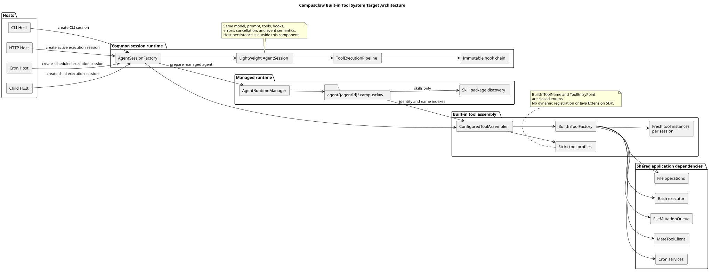
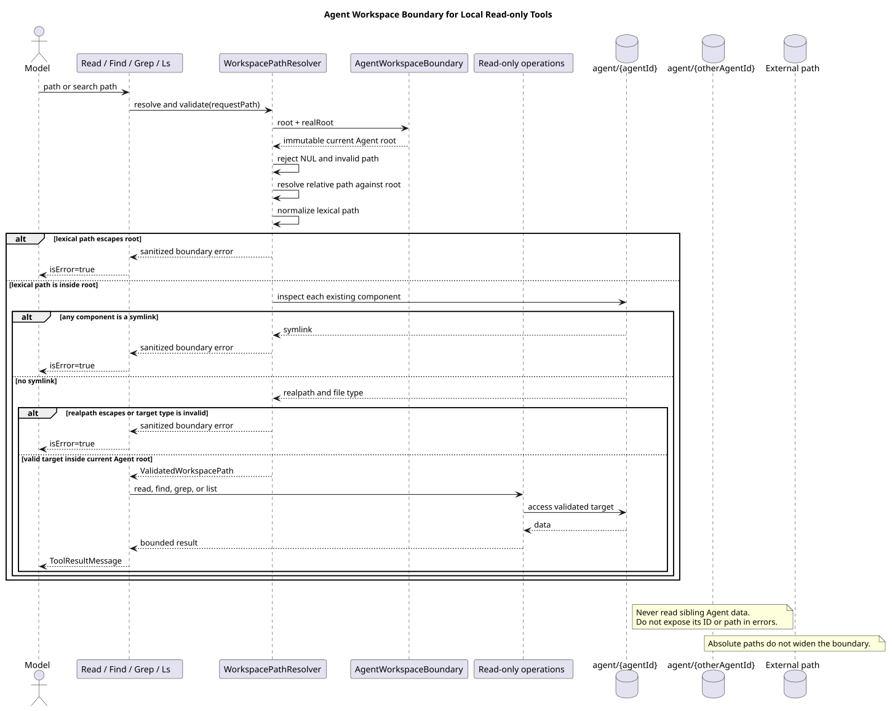
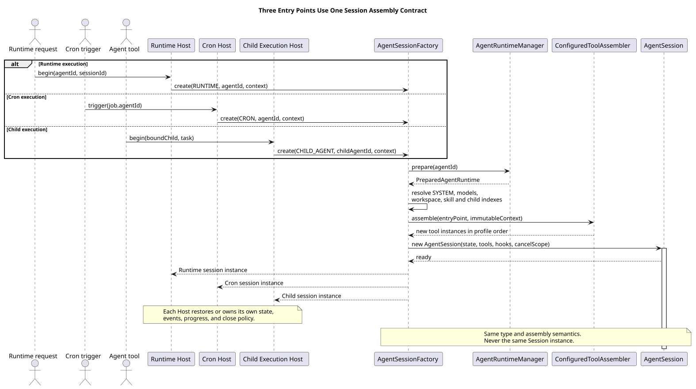
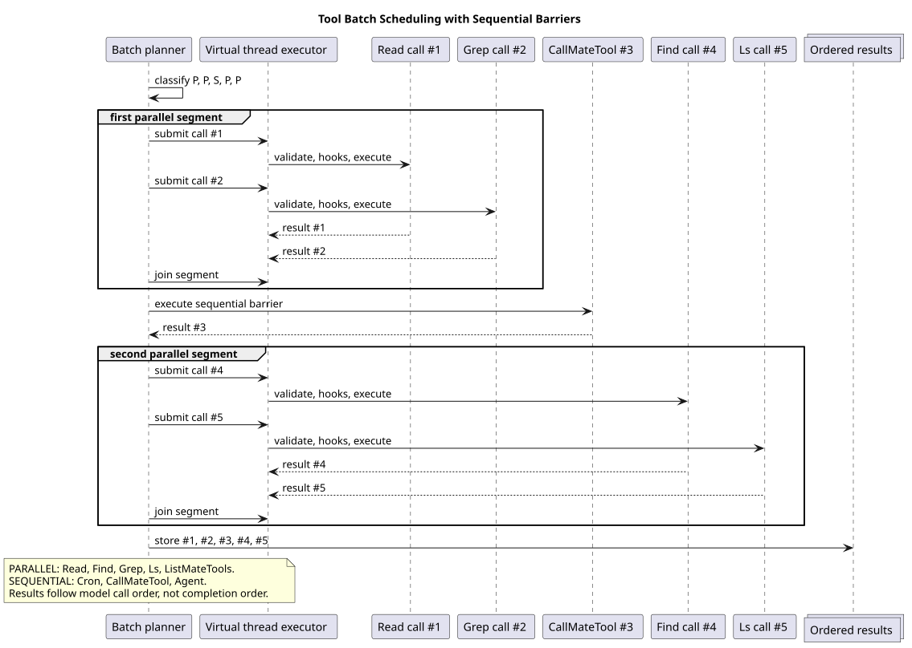
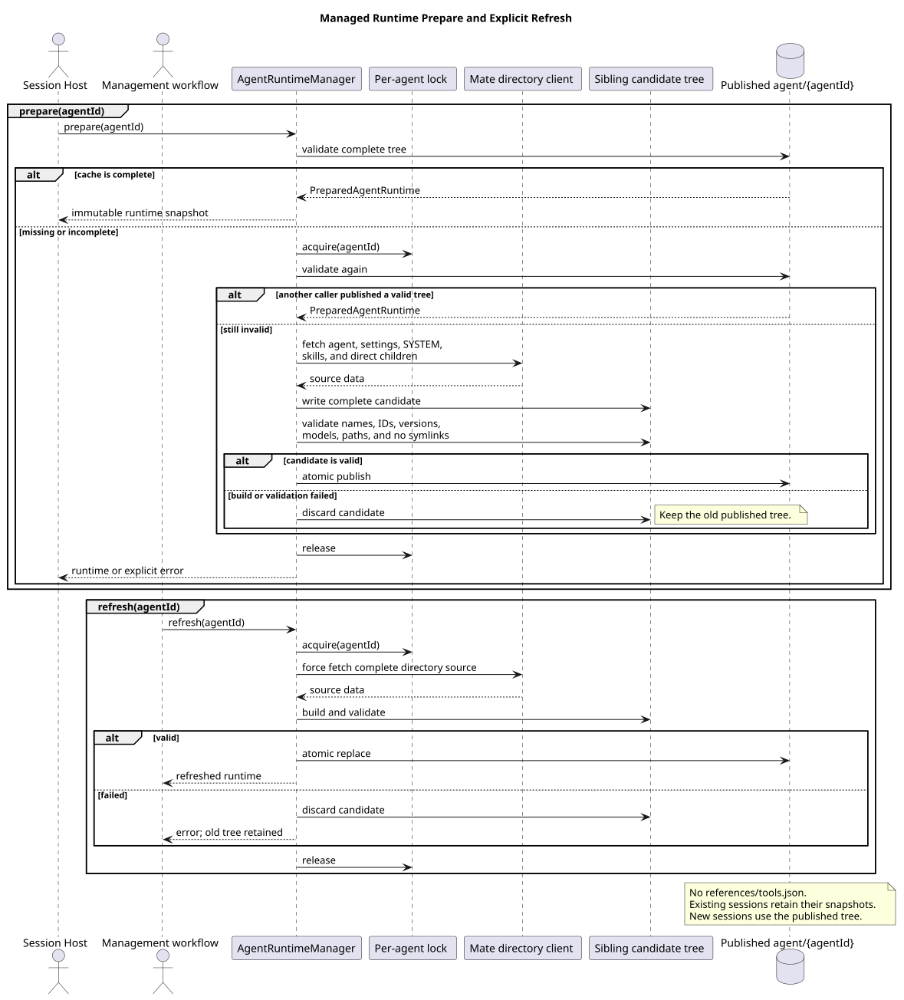
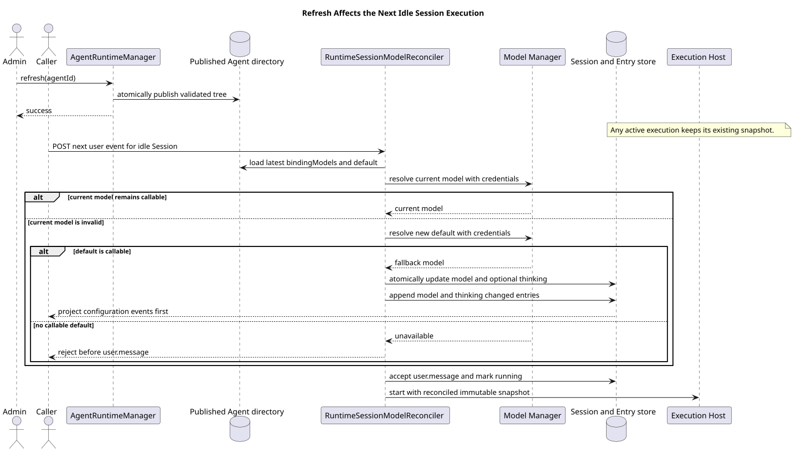
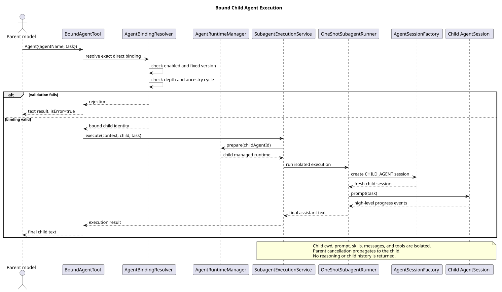
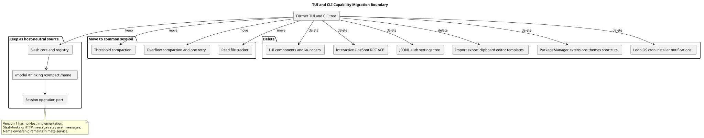
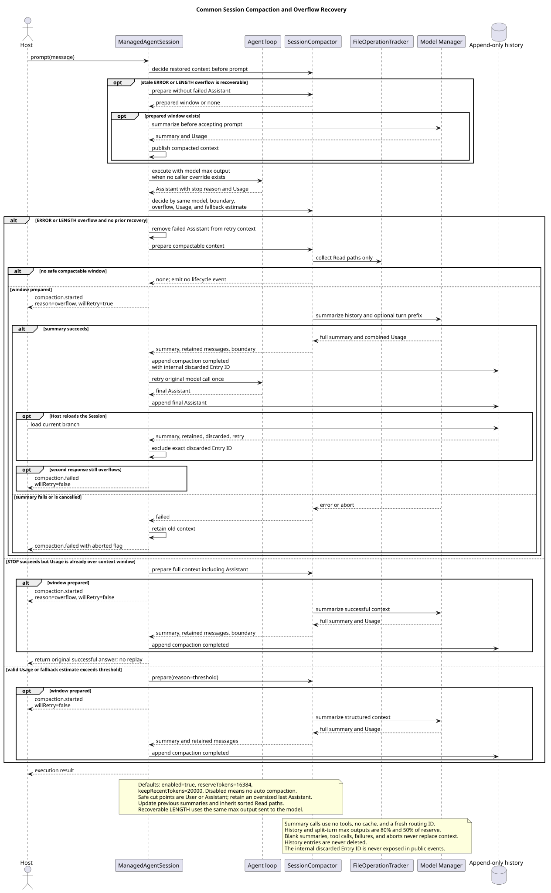

# CampusClaw 工具系统设计

| 属性 | 值 |
|---|---|
| 文档版本 | 2.1.0 |
| 状态 | 目标设计，待实现 |
| 更新日期 | 2026-08-24 |
| 设计仓分析基线 | `3fde5735cd27433c3e3e5e03a5ce39b297ad3b00` |
| CampusClaw PR 167 基线 | `f60cc3e78bb8b700527ac082c7c8e10524ede095` |
| CampusClaw merge base | `d649866a6cae967ace18ceaeb9597edd47e5721e` |
| pi-mono 对照基线 | `5cd93f688aaab89dbb6dfa4aca535f21796ae185` |
| OpenCode 对照基线 | `849c2598abc7d2b40261e74b5826bc74ffc78308` |
| 精确工具契约 | [8 个活动内置工具契约](built-in-tool-contracts.md) |

## 1. 设计结论

CampusClaw 作为 TOB Runtime 服务，不再提供 CLI 产品模式。目标工具系统是关闭、严格
配置且按 Session 装配的内置工具集合，不提供动态工具注册、Java Extension 工具或 Skill
声明的本地工具。模型只看到以下 8 个区分大小写的 PascalCase 名称：

```text
Read
Find
Grep
Ls
Cron
ListMateTools
CallMateTool
Agent
```

Runtime、Cron 和 Child Agent 使用同一个轻量 `AgentSession` 类型和同一条
`AgentSessionFactory` 装配链，但每次执行得到不同实例。三个入口一致的是模型约束、
SYSTEM 解析、工具装配、hook、错误、事件与取消语义；消息持久化、active execution、
Cron Job 生命周期、Child 进度桥和 Host 关闭策略不进入公共 Session。

所有本地文件工具只能访问当前受管 Agent 的整个 `agent/{agentId}` 目录，包括其中的
`.campusclaw` 子树；它们不能通过相对路径、绝对路径、符号链接或真实路径访问其他 Agent。
`Bash`、`Edit`、`Write` 的旧实现可以保留为未装配代码，但不属于公共工具枚举、配置、
工厂或模型能力。`Loop` 完全删除。



[PlantUML 源码：`tool_system_architecture`](diagram.puml#L1)

## 2. 范围与权威边界

### 2.1 本设计是工具系统唯一主设计

本专题负责：

- 8 个活动内置工具的名称、Schema、输出、可用条件和并发模式；
- Runtime、Cron、Child Agent 三入口的配置与 Session 装配；
- 受管 Agent 工作区边界、目录 prepare/refresh 和 Skill/Child 名称索引；
- Mate 工具发现、Session 名称到 ID 缓存和远端调用；
- Child Agent Execution、Cron 工具边界与实现迁移。
- TUI/CLI 删除边界、公共 Session 压缩和宿主无关 Slash Command 源码边界。

Runtime HTTP 的资源、ResultBean、SSE、Entry 和数据库契约仍由
[Manager 驱动的多 Agent Runtime 设计](../pi-mono-java-manager-driven-multi-agent-runtime/README.md)
维护。两份文档交叉时，工具名、工具配置、受管目录和 Session 工具装配以本设计为准。

### 2.2 明确不在本专题范围

- CLI、TUI、JSONL、one-shot、RPC、ACP 和 OS 调度安装产品入口；
- Slash Command 的 Host 注册、HTTP 路由和普通消息解析；
- 自定义工具、动态注册、公共 Extension SDK 和 Skill 本地工具激活；
- `Bash` 沙箱、`Edit`/`Write` 工作区写入模型和旧工具名兼容；
- 跨节点 Child 调度、常驻 Child worker、Runtime 租约和分布式取消；
- 版本驱动、TTL、watcher 或 Mate 推送触发的目录自动刷新；
- Cron 持久化、集群调度、misfire、租约和保留策略的具体技术方案；
- 旧 Cron payload、旧 Extension manifest 或旧工具执行器兼容。

Cron 的数据库与集群调度属于 Cron Host 的独立专题。本设计只冻结模型工具契约、Agent
隔离和触发时的 Session 装配；当前 JSON/JSONL、进程内 scheduler、`--cron-tick` 和
launchd/crontab 仅作为遗留源码观察，不是 TOB 目标实现。

## 3. 源码观察与对照证据

### 3.1 CampusClaw（pi-mono-java）观察证据

以下事实来自本页记录的 CampusClaw commit，不代表目标状态：

| 观察事实 | 源码路径与符号 |
|---|---|
| `AgentTool` 尚无逐工具执行模式；Pipeline 由调用方为整批传入一个 mode | `modules/agent-core/src/main/java/com/campusclaw/agent/tool/AgentTool.java`，`AgentTool`；`ToolExecutionPipeline.java`，`executeAll` |
| 大型 CLI `AgentSession` 聚合 ToolCatalog、Skill 激活、reload 和 delegation after-hook | `modules/coding-agent-cli/src/main/java/com/campusclaw/codingagent/session/AgentSession.java`，`initialize`、`configureRuntimeTools`、`handleAfterToolCall` |
| 工具由 Spring、Extension 和会话本地工厂进入目录 | `modules/coding-agent-cli/src/main/java/com/campusclaw/codingagent/tool/catalog/DefaultToolCatalog.java`、`SpringAgentToolSource.java`、`ExtensionToolSource.java` |
| HTTP Runtime 使用独立 Agent 目录解析和 Session engine 组装 | `modules/coding-agent-cli/src/main/java/com/campusclaw/codingagent/runtimeapi/agent/FileAgentDirectoryResolver.java`、`modules/coding-agent-cli/src/main/java/com/campusclaw/codingagent/runtimeapi/runtime/RuntimeSessionEngineRegistry.java` |
| Manager 缓存优先但仍原地写旧文件名及 `references/tools.json` | `modules/coding-agent-cli/src/main/java/com/campusclaw/codingagent/runtime/AgentRuntimeManager.java`，`prepare`、`materialize` |
| 当前本地模型工具包含小写 `read/glob/grep/ls`、写工具、`EditDiff`、`loop` 和控制工具 | `modules/coding-agent-cli/src/main/java/com/campusclaw/codingagent/tool/**`、`loop/LoopTool.java` |
| 当前 Mate 工具以 `listMateTool/callMateTool` 暴露，List 刷新会话 name-to-ID 缓存，Call 强制先 List | `tool/mate/ListMateTool.java`、`CallMateTool.java`、`MateToolSessionCache.java` |
| 当前缓存每次刷新先清空平面 Map，最近一次 Agent/Skill List 会覆盖此前来源 | `modules/coding-agent-cli/src/main/java/com/campusclaw/codingagent/tool/mate/MateToolSessionCache.java`，`refresh` |
| 当前执行端点按 `toolId` 调用并要求完整 Mate 凭据 | `modules/coding-agent-cli/src/main/java/com/campusclaw/codingagent/common/client/HttpMateToolClient.java`，`invokeTool` |
| 当前 Child 同时存在 `spawn_agent` 与 `invoke_agent` 两条路径，后者通过 Session after-hook 执行 | `subagent/tool/SpawnAgentTool.java`、`tool/delegation/InvokeAgentTool.java`、`session/AgentSession.java` |
| 当前 Cron payload 接受 model、system prompt 和 allowed tools，并依赖本地存储与 OS/进程调度 | `modules/cron/src/main/java/com/campusclaw/cron/tool/CronTool.java`、`model/CronPayload.java`、`engine/CronEngine.java` |
| 当前 `ReadTool` 自行使用 cwd 做路径边界，`BashExecutor` 只设置子进程 cwd | `tool/read/ReadTool.java`、`util/PathUtils.java`、`tool/bash/BashExecutor.java` |
| PR 167 按 TUI/CLI 包树删除了同时承载入口无关压缩和 Slash Command 的源码 | PR 167 `f60cc3e` 相对 merge base 的 `modules/coding-agent-cli/.../session`、`command`、`modes` 删除差异 |

### 3.2 pi 与 OpenCode 对照

pi 内置的 `read`、`grep`、`find` 和 `ls` 是本地只读工具语义的对照。pi 的 Subagent
是 Extension 示例，支持独立上下文、进度和取消，但其用户/项目 Agent、独立进程、
cwd/model/tool override、parallel/chain 参数不成为 CampusClaw 契约。源码证据：
`packages/coding-agent/src/core/tools/read.ts`、`grep.ts`、`find.ts`、`ls.ts`，以及
[pi Subagent 示例](https://github.com/badlogic/pi-mono/blob/main/packages/coding-agent/examples/extensions/subagent/index.ts)。

OpenCode `TaskTool` 仅用于对照父子消息隔离、进度和取消，不继承它的权限、Session
持久化或工具注册模型。源码证据：
[OpenCode Task](https://github.com/anomalyco/opencode/blob/dev/packages/opencode/src/tool/task.ts)。

### 3.3 目标差异分类

| 分类 | 目标差异 | 设计原因 |
|---|---|---|
| 产品约束 | 只暴露 8 个活动 PascalCase 工具 | 冻结可测试的 TOB 能力面，禁用写入和命令执行 |
| 产品约束 | 删除 CLI/TUI 产品入口、Loop、旧名和兼容 payload | 产品没有交互终端生命周期，不承担首版兼容 |
| 架构改造 | 三入口共用轻量 Session 与工厂 | 防止模型、hook、工具、错误和取消语义漂移 |
| 架构改造 | 压缩与 Read 文件追踪迁入公共 Session | 入口删除不能让 Runtime、Cron、Child 丢失上下文治理 |
| 架构改造 | 保留未注册的 Slash 核心和四个处理器 | 命令语义可复用，但首版不增加 Host 或 HTTP 入口 |
| 架构改造 | 删除 ToolCatalog、动态注册和 Java Extension 工具 | 启动期严格 profile 是唯一模型工具来源 |
| 架构改造 | 逐工具并发模式与串行 barrier | 只读工具并行且有副作用工具不跨越顺序边界 |
| 安全加固 | Schema 在 hook 前校验且拒绝未知字段 | hook 与执行器只处理已验证结构 |
| 安全加固 | 每个 Session 固化 Agent 工作区边界 | 阻止本地工具读取兄弟 Agent 或外部路径 |
| 安全加固 | Find/Grep 不在调用期下载二进制且不回退到 shell | TOB Runtime 的可执行依赖必须在部署和启动期受控 |
| 安全加固 | 受管树在同级临时目录完整校验后发布 | Session 不读取半成品，refresh 失败保留旧树 |
| 架构改造 | Mate 名称到 ID 缓存按 Session 和来源维护 | 模型直接按名称调用，同时适配现有 ID 执行接口 |
| 产品约束 | Call 缓存 miss 自动刷新，不强制模型先 List | 缓存是实现细节，不成为模型调用顺序 |
| 产品约束 | Child 只按直接绑定名称调用，首版深度 1 | 避免全局枚举、循环和无边界递归 |

## 4. 关闭的公共接口与配置

### 4.1 名称与入口枚举

```java
public enum BuiltInToolName {
    READ("Read"),
    FIND("Find"),
    GREP("Grep"),
    LS("Ls"),
    CRON("Cron"),
    LIST_MATE_TOOLS("ListMateTools"),
    CALL_MATE_TOOL("CallMateTool"),
    AGENT("Agent");
}

public enum ToolEntryPoint {
    RUNTIME,
    CRON,
    CHILD_AGENT
}
```

`BuiltInToolName` 是配置、工厂和模型名的唯一映射。不得通过 `Enum.valueOf` 暴露 Java
常量名，也不得做大小写归一化。`Bash`、`Edit`、`Write`、`Glob`、`ListDirectory`、
`Loop` 以及所有旧小写名都是未知配置值，必须阻止启动。

### 4.2 工具配置

```yaml
campusclaw:
  tools:
    runtime:
      - Read
      - Find
      - Grep
      - Ls
      - Cron
      - ListMateTools
      - CallMateTool
      - Agent
    cron:
      - Read
      - Find
      - Grep
      - Ls
      - ListMateTools
      - CallMateTool
      - Agent
    child-agent:
      - Read
      - Find
      - Grep
      - Ls
      - ListMateTools
      - CallMateTool
```

三个键遵循相同严格规则：

1. 键缺失时使用上例缺省值；
2. 显式 `[]` 表示该入口不向模型暴露工具；
3. 非空数组完全替换缺省值，不做 merge；
4. 未知、重复、旧名或大小写错误阻止应用启动；
5. 配置只在启动期绑定和验证，目录 `refresh` 不重新读取配置；
6. Agent 文件、Cron payload、Child 文件和模型输入不能扩大或缩小 profile；
7. profile 决定模型可见能力，执行上下文仍在调用时校验。

`Cron` 只在 Runtime profile 中出现，防止 Cron execution 管理或递归创建 Job。首版最大
Child 深度为 1，因此 Child profile 不暴露必然不可执行的 `Agent`。

### 4.3 工具装配接口

```java
public interface ConfiguredToolAssembler {
    List<AgentTool> assemble(ToolEntryPoint entryPoint, ToolAssemblyContext context);
}

public interface BuiltInToolFactory {
    AgentTool create(BuiltInToolName name, ToolAssemblyContext context);
}
```

`ToolAssemblyContext` 是不可变值对象，至少固化入口、`AgentWorkspaceBoundary`、受管 Agent
身份、Skill/Child 名称索引、Execution 深度与 ancestry、模型快照、取消域、Mate 调用
上下文，以及可选 Cron 上下文。只读 operations、Mate client、Cron service 和
`SubagentExecutionService` 等应用协作者可以共享，但每个 `AgentTool` 实例必须按 Session
新建。任何工具不得把 agentId、工作区、凭据或绑定写入 Spring 单例。

## 5. Agent 工作区边界



[PlantUML 源码：`read_agent_workspace_isolation`](diagram.puml#L471)

```java
public record AgentWorkspaceBoundary(String agentId, Path root, Path realRoot) {}
```

`root` 与 `realRoot` 只能由 `AgentSessionFactory` 从已验证的
`PreparedAgentRuntime.agentRoot()` 构造，范围是整个 `agent/{agentId}`。模型参数、Agent
配置和 Host 请求都不能覆盖它。

共享 `WorkspacePathResolver` 固定执行：

1. 拒绝空路径、NUL 和无效 Path；
2. 相对路径基于 root 解析，绝对路径不改变边界；
3. 字法归一化后必须仍在 root 下；
4. 遍历已存在路径分量并拒绝任何符号链接；
5. 最终真实路径必须仍在 realRoot 下；
6. Read 只接受可读普通文件，Find/Grep/Ls 只遍历边界内普通文件和目录；
7. 错误统一为脱敏文本和 `isError=true`，不回显其他 Agent ID 或物理路径。

`Read`、`Find`、`Grep`、`Ls` 必须共用该边界。Child Session 必须从 Child 自己的
`PreparedAgentRuntime.agentRoot()` 构造新边界，不继承父边界或父已验证 Path。

## 6. 公共轻量 AgentSession



[PlantUML 源码：`agent_session_assembly`](diagram.puml#L106)

`AgentSessionFactory.create` 固定执行：

1. 调用 `AgentRuntimeManager.prepare(agentId)`；
2. 构造 Agent 工作区边界并解析 SYSTEM、Skill、Child 名称索引；
3. 用 `bindingModels`、Model Manager 可用性和凭据求可用模型；
4. 构造不可变 `ToolAssemblyContext`；
5. 按入口 profile 顺序创建全新的工具实例；
6. 复制有序不可变 before/after hook 链；
7. 创建新的 `AgentSession`、`AgentState`、消息队列和取消域；
8. 返回给 Host，由 Host 恢复消息、订阅事件并负责关闭。

首版生产 hook 链为空，但接口保留。Schema 校验发生在 before hook 之前；单次调用内按
固定列表顺序执行。并行工具调用可以同时进入同一 handler，因此 handler 必须线程安全。

| Host | 创建时机 | Host 持有 | 关闭时机 |
|---|---|---|---|
| Runtime | 接受一次 active execution 时 | 数据库 Session/Entry、SSE、Steer/FollowUp/Abort、active execution 注册 | execution 结束或取消后 |
| Cron | Job 触发时 | Job/Run、调度上下文和当前 Agent ID | 本次 Cron execution 结束 |
| Child | `Agent` 通过绑定校验后 | `SubagentExecutionContext`、进度投影和父取消桥 | 本次 Child execution 结束 |

父与 Child 使用不同的 `AgentSession` 实例，但共享同一个 Session 类型、Factory 和执行
语义。执行位置属于 Host/运行时调度实现，不属于 `Agent` 工具契约。

## 7. Pipeline、hook 与批量调度

```java
default ToolExecutionMode executionMode() {
    return ToolExecutionMode.SEQUENTIAL;
}
```

`Read`、`Find`、`Grep`、`Ls`、`ListMateTools` 为 `PARALLEL`；`Cron`、
`CallMateTool`、`Agent` 为 `SEQUENTIAL`。



[PlantUML 源码：`tool_batch_scheduling`](diagram.puml#L420)

Batch planner 保持模型调用原始顺序，把连续 `PARALLEL` 调用组成并行段并等待整段完成；
每个 `SEQUENTIAL` 调用是 barrier。结果按原始调用顺序回填，而不是按完成时间排序。

每次调用固定经过：

```text
resolve configured tool
  -> validate JSON Schema
  -> ordered before hooks
  -> emit execution start
  -> execute tool
  -> ordered after hooks
  -> emit execution end
  -> project ToolResultMessage
```

Schema、可用性、hook 和工具异常都转换为文本结果及 `isError=true`，不因单个工具失败
终止完整 Agent loop。取消终止当前 execution，并由 Session/Host 投影统一终态。

## 8. 统一受管目录与刷新

```text
agent/{agentId}/.campusclaw/
├── agent.json
├── settings.json
├── SYSTEM.md
├── agents/{agentName}.json
└── skills/{skillName}/
    ├── skill.json
    ├── SKILL.md
    ├── references/
    └── templates/
```

`agent.json` 只保存当前 Agent 身份；`settings.json` 保存 `defaultModel` 和
`bindingModels`；`agents/{agentName}.json` 保存一个直接 Child 的身份、描述、enabled 和
固定版本；`skill.json` 保存 `schemaVersion=1`、ID、名称和版本。名称必须与路径逐字符
一致，所属索引内唯一。扫描结果形成不可变的 `skillName -> skillId` 和
`agentName -> BoundAgent` 索引。

目录不生成或读取 `references/tools.json`。Skill references 只保存真实资料；模型通过
`Read` 按需读取 `SKILL.md`、references 和 templates。删除 `activate_skill`；读取 Skill
不会改变模型工具列表，需要远端能力时调用 `ListMateTools({skillName})`。



[PlantUML 源码：`managed_runtime_refresh`](diagram.puml#L162)

`prepare(agentId)` 先完整验证缓存；命中时不访问 Mate。缺失或不完整时取得 per-agent
锁，再次检查后访问 Mate，在同级临时目录写入完整树，校验名称、ID、版本、模型和路径，
最后原子发布。失败删除候选树并保留旧目录。

`refresh(agentId)` 只由受管管理流程显式调用，强制拉取并构建候选树；成功后原子替换，
失败保留旧树。活动 execution 继续使用自身不可变 runtime 快照。空闲数据库 Session 在
下一次接受用户 Entry 前读取刷新后的目录：当前模型仍在新 `bindingModels` 且具备凭据时
保留；失效时切换到具备凭据的新 default，并原子持久化模型及必要的 thinking 变更事件，
事件先于 `user.message` 投影。没有可用 default 时拒绝本次执行且不接受用户 Entry。
工具配置不参与 refresh。首版不提供 TTL、后台刷新、版本比较或 Child 版本不匹配时的隐式自愈。



[PlantUML 源码：`refresh_next_execution`](diagram.puml#L648)

## 9. Mate 工具发现、缓存与执行

### 9.1 `ListMateTools`


[PlantUML 源码：`list_mate_tools_sequence`](diagram.puml#L235)

模型输入只有可选 `skillName`。无参数时查询当前 Agent；有名称时通过本地 Skill 索引解析
ID。模型不能提交 agentId、skillId 或 toolId。

`MateToolClient` 发现接口拆为：

```java
List<MateToolMeta> listAgentTools(String agentId);
List<MateToolMeta> listSkillTools(String skillId);
ToolResult callTool(String toolId, Map<String, Object> args, MateInvocationContext context);
```

List 先取得有序 binding tool IDs，再批量查询元数据，以 ID 关联并恢复绑定顺序。模型
输出只含 `scope` 和每项 `name`、`description`、`inputSchema`，不含任何资源 ID、
permission、outputSchema、并发属性或 Mate 原始信封。每次 List 都实时访问 Mate；空列表
是成功结果。成功查询同时原子刷新 Session 缓存中对应来源的名称到 ID 映射，不清除其他
来源。

### 9.2 `CallMateTool`


[PlantUML 源码：`call_mate_tool_sequence`](diagram.puml#L289)

模型只提交 `{tool,args?}`，不提交 Skill、Agent、scope 或 toolId。Call 先按 toolName 查询
Session `MateToolResolutionCache`；命中后使用内部 ID 调用 Mate。未命中时通过 Session 级
single-flight 刷新当前 Agent 的完整有效集合：当前 Agent 直接工具加所有直接 Skill
工具。完整查询、合并和唯一性校验成功后才原子替换缓存，然后再次解析名称。

同名映射到相同 ID 时去重，同名映射到不同 ID 时作为配置冲突失败。刷新失败保留旧缓存，
本次未命中调用返回 `isError=true`。只允许自动重试名称发现；一旦向执行端点提交请求，
网络中断、超时和 Mate 错误都不得自动重放。Mate 对当前 Agent 身份、凭据、实时绑定和
权限做最终校验。

## 10. Child Agent Execution



[PlantUML 源码：`subagent_execution_sequence`](diagram.puml#L362)

模型只使用：

```json
{
  "agentName": "researcher",
  "task": "Collect source evidence for the tool pipeline."
}
```

`agentName` 只能来自当前父 Agent 的 `agents/{agentName}.json`。执行前按顺序校验精确
直接绑定、自绑定、enabled、固定版本、最大深度、ancestry 循环、Child 目录完整性和
模型可用性。版本不匹配是明确错误，不触发隐式 refresh。

| 组件 | 职责 |
|---|---|
| `BoundAgentTool` | 实现模型工具 `Agent`，完成参数、进度和结果投影 |
| `BoundAgentResolver` | 按名称解析直接绑定并校验身份、版本、深度和 ancestry |
| `SubagentExecutionContext` | 固化父子 ID、深度、ancestry、父模型、thinking、取消和进度 sink |
| `SubagentExecutionService` | 准备 Child runtime，通过公共 Factory 创建并执行 Child Session |
| `AgentSessionFactory` | 使用 `CHILD_AGENT` profile 创建独立 Child Session 实例 |

Child 消息从空集合开始，工作区指向自己的 `agent/{childAgentId}`，SYSTEM、Skill 和工具
来自 Child runtime。Child 有可用 default model 时优先，否则继承父 execution 的 model
和 thinking；最终模型必须位于 Child `bindingModels` 且当前具备凭据。

首版最大深度固定为 1，Child profile 因而不暴露 `Agent`。仍保留 ancestry 和自绑定检查，
不能只依赖深度。父侧只接收目标、工具开始/结束和完成等高层进度，不接收 reasoning、
Child 消息历史或完整事件流。父取消必须传播；成功结果只返回最后一条非空 Assistant
文本。Child 内部可以执行多个 LLM/tool turn。

## 11. Cron 与模型策略

`Cron` 保留 `create/list/delete/trigger/status/runs`，删除 `model`、`system_prompt` 和
`tools`。Job 自动保存当前受管 `agentId + prompt` 及调度元数据，所有管理动作按当前
Agent 过滤。触发时重新 `prepare(agentId)`，使用该 Agent 当时的 SYSTEM、Skills、
default model 和 `cron` profile，不使用创建时的模型或工具快照。

模型可用集合统一为：

```text
usableModels = settings.bindingModels
               intersect Model Manager available models
               intersect models with usable credentials
```

- Runtime 创建或修改 Session 只能选择 `usableModels`；
- Cron 每次触发选择 Agent 当时可用的 default；
- Child 优先自身 default，否则继承父 model/thinking，并再次校验 Child 白名单；
- 无可用模型时本次 Session/Execution 创建失败，不回退到未绑定模型。

## 12. 实现迁移

### 12.1 公共 Session 与 Host

| 当前责任 | 目标归属 |
|---|---|
| Agent loop、消息队列、tool pipeline、hook、取消 | 公共轻量 `AgentSession` |
| 模型、SYSTEM、工具和 hook 统一构造 | `AgentSessionFactory` |
| 工具筛选和实例创建 | `ConfiguredToolAssembler` + `BuiltInToolFactory` |
| HTTP 数据库恢复、SSE 和 active execution | Runtime Host |
| Cron Job/Run 与调度入口 | Cron Host |
| Child 绑定、进度与父取消 | `SubagentExecutionService` |
| 阈值压缩、溢出压缩和一次重试 | 公共 `ManagedAgentSession` + `SessionCompactor` |
| Read 文件追踪 | 公共压缩核心 `FileOperationTracker` |

产品不再支持 CLI/TUI，但首轮实现不移动 `modules/coding-agent-cli` Maven 模块或
`campusclaw-coding-agent` artifact。删除 launcher/config、交互/one-shot/RPC/ACP、
JSONL/TUI、`--cron-tick` 和 OS scheduler 安装路径；模块继续承载 Runtime Spring Boot、
公共 Session 和未注册的 Slash Command 核心。

### 12.2 TUI 能力 keep/move/delete



[PlantUML 源码：`tui_capability_migration`](diagram.puml#L537)

| 原责任 | 处理 | 目标边界 |
|---|---|---|
| Slash core、Registry、`/model`、`/thinking`、`/compact`、`/name` | Keep + 解耦 | 使用宿主无关 Session/Output 端口；保留单元测试 |
| 阈值压缩、上下文溢出压缩、一次重试 | Move | 公共 `ManagedAgentSession` |
| `FileOperationTracker` | Move | 压缩核心，首版只追踪 `Read` |
| TUI 组件、CLI launcher、Interactive/OneShot/RPC/ACP | Delete | CampusClaw 不再提供这些产品入口 |
| 本机 Auth、旧 SettingsManager、JSONL、tree/navigation | Delete | 由受管目录、数据库 Session 和各 Host 替代 |
| import/export/copy/share、剪贴板、外部编辑器、Prompt Template | Delete | 终端交互专属 |
| PackageManager、本地 Skill 安装/链接/导入、Extension、主题、快捷键 | Delete | Skill 只来自受管目录 |
| Loop、OS Cron installer、`--cron-tick`、TUI Cron 通知 | Delete | Loop 不活动；Cron 由 Runtime Host 管理 |

首版任何 Host 都不注册 Slash Command，不增加 Slash、Compact、Fork、Tree、Import 或 Export
HTTP 接口，也不拦截 `POST /events` 中以 `/` 开头的普通消息。`/name` 的未来 Session 端口
必须由 Host 调用 mate-service，不能改变 Chat 名称的服务归属。

### 12.3 公共 Session 压缩



[PlantUML 源码：`managed_session_compaction`](diagram.puml#L590)

默认配置为 `enabled=true`、`reserveTokens=16384`、`keepRecentTokens=20000`。执行正常结束后
超过阈值则压缩；模型返回上下文溢出时，丢弃该错误 Assistant，压缩成功后最多重试一次。
摘要失败不替换旧上下文，历史 Entry 不删除。成功结果保存完整摘要、保留边界、压缩前后
Token 和本次 Usage，并供恢复模型上下文时使用。

### 12.4 删除、禁用与替换

| 删除或停止使用 | 目标处理 |
|---|---|
| `Bash`、`Edit`、`Write` AgentTool 装配 | 旧相关代码可保留，但不进入公共枚举、配置或工厂 |
| `LoopTool`、`LoopManager` 和所有 Loop Host 接线 | 完全删除 |
| `ToolCatalog`、`DefaultToolCatalog`、`ToolSelection` | 启动期严格 profile 和关闭工厂 |
| Java Extension 工具、manifest tools/commands、PackageManager | 完全删除；Skill 只扫描受管目录 |
| `activate_skill` | `Read(SKILL.md)` + `ListMateTools` |
| `EditDiff` | 无；写工具首版硬禁用 |
| `spawn_agent`、`invoke_agent` 和 Session delegation after-hook | `Agent` + `SubagentExecutionService` |
| ACP/HTTP/A2A SubAgent backend、registry、approval placeholder | 不进入首版 Child Agent Execution |
| `references/tools.json` | Skill 身份索引 + Mate 实时发现和 Session 解析缓存 |
| `FileAgentDirectoryResolver` 独立文件契约 | `AgentRuntimeManager.prepare` |
| HTTP 硬编码 Read | `runtime` profile |
| Cron model/system_prompt/tools payload | 触发时按当前受管 Agent 解析 |

实现只修改 `modules/*` 主源码；`mate-campusclaw/` 通过
`scripts/sync-mate-campusclaw.sh` 生成，不双份手工维护。

## 13. 实现验收

### 13.1 配置、Pipeline 与 Session

- 三入口缺省、显式空数组和完全替换语义正确；
- 8 个活动名之外的旧名、禁用名、重复名和大小写错误阻止启动；
- Child 缺省无 `Agent`，Cron 缺省无 `Cron`；
- 同一入口连续创建两个 Session，工具实例不同且应用协作者可安全共享；
- Schema 在 before hook 前校验，hook 顺序固定；
- `P,P,S,P,P` 形成两个并行段和一个 barrier，结果保持原始顺序；
- Schema、hook、工具异常成为文本结果和 `isError=true`。

### 13.2 目录与本地工具

- 完整缓存命中不访问 Mate，冷目录通过同级候选树原子发布；
- refresh 失败保留旧树，活动 Session 继续使用自身 runtime 快照；
- refresh 后空闲 Session 下一次执行懒校准模型；无可用 default 时不接受用户 Entry；
- 名称/路径不一致、Skill/Child 重名、固定版本缺失和符号链接使目录无效；
- 任何目录都不生成或读取 `references/tools.json`；
- Read、Find、Grep、Ls 只能访问本 Agent 根，Child 只能访问 Child 根；
- 跨 Agent 绝对路径、`..`、符号链接、realpath 越界和非普通文件被脱敏拒绝。

### 13.3 Mate、Child 与 Cron

- ListMateTools 每次实时查询，输出只含稳定公开字段并恢复绑定顺序；
- 不同来源刷新互不覆盖，Session 间缓存隔离；
- Call cache miss 只触发一次完整刷新，重名冲突失败，实际执行不自动重放；
- Agent 校验直接绑定、固定版本、深度、循环、父取消和模型白名单；
- 父与 Child Session 实例隔离但使用相同 Factory/执行语义；
- Cron Job 按 Agent 隔离，触发时使用当前配置，不接受旧 payload 字段。
- Slash 核心和四个处理器可用测试端口独立执行，但没有 Spring 自动注册或 HTTP 解析；
- 阈值/溢出压缩、一次重试、失败回滚、完整摘要恢复和 Read 文件追踪通过测试。

## 14. 文档治理与实现顺序

1. 冻结 8 个名称、三入口配置和精确 Schema；
2. 实现工作区边界、只读工具和受管树链接校验；
3. 完成逐工具 batch planner、严格 Schema 和 hook 顺序；
4. 实现工厂、不可变上下文和公共 Session；
5. 迁移 Runtime Host 并删除 CLI 产品入口；
6. 统一目录 prepare/refresh、Skill/Child 索引和模型解析；
7. 实现 Mate 发现、Session 缓存和 miss 自动刷新；
8. 迁移 Child Execution 与 Cron 工具；
9. 删除动态目录、Extension、Loop、旧 delegation 和兼容入口；
10. 同步生成镜像并完成全量回归。

本设计为 target-only，不能因为文档完成就把目标能力标为已实现。每个实现 PR 都应列出
实际落地目标与仍存在的源码差异。

## 15. 版本历史

| 版本 | 日期 | 变更 |
|---|---|---|
| 2.1.0 | 2026-08-24 | 修订 PR 167 的 TUI 删除边界：保留未注册 Slash 核心及四个处理器，压缩与 Read 追踪迁入公共 Session；明确 Usage/领域事件和 refresh 后下一次执行懒解析。 |
| 2.0.0 | 2026-08-23 | 收敛为 Runtime/Cron/Child 三入口与 8 个活动工具；删除 CLI/Loop、硬禁用 Bash/Edit/Write、将 Glob/ListDirectory 对齐为 Find/Ls；补充 Mate Session 缓存与 miss 自动刷新，并将 Child 统一为公共 AgentSessionFactory 创建的独立 Execution。 |
| 1.1.0 | 2026-08-22 | 将本地文件边界固定为整个 `agent/{agentId}`，补充跨 Agent、符号链接、非普通文件和 Child 根隔离。 |
| 1.0.0 | 2026-08-22 | 初版 12 工具、四入口、CLI/Loop 和受管目录目标设计，现已由 2.0.0 取代。 |
