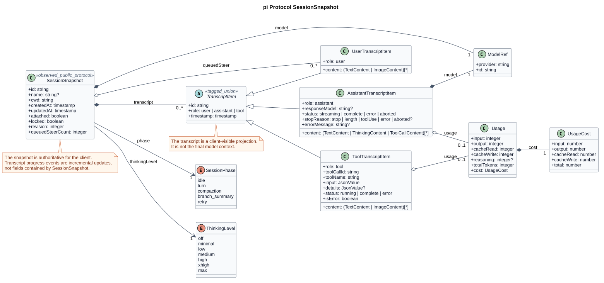

# pi 协议层 SessionSnapshot 源码模型

## 文档信息

| 项目 | 内容 |
|---|---|
| 文档版本 | 2.0.0 |
| 状态 | pi-mono 已观察源码事实 |
| 主题 | `packages/protocol` 对外 `SessionSnapshot` 及其直接类型 |
| pi-mono 源码基线 | `086c32e74530564922d011ade23ff582c9d63116` |
| 更新日期 | 2026-08-16 |

## 1. 范围

本文只展示 pi-mono 对外协议层 `SessionSnapshotSchema` 的实际结构。
不混入以下对象：

- Agent Harness 内部同名 `SessionSnapshot`、lane 或 durable recovery state；
- pi-mono-java `AgentStateSnapshot`；
- CampusClaw Session 聚合、Runtime Checkpoint 或 HTTP Response VO；
- 我们的 GetSession 目标设计。

上述内容需要分析时必须使用独立主题和独立图，不再放入本图。

## 2. 源码证据

| 仓库相对路径 | 符号 | 基线行 |
|---|---|---:|
| `packages/protocol/src/schemas.ts` | `SessionPhaseSchema`、`ThinkingLevelSchema`、`ModelRefSchema` | 26-51 |
| `packages/protocol/src/schemas.ts` | Content 和 `UsageSchema` | 78-118 |
| `packages/protocol/src/schemas.ts` | `UserTranscriptItemSchema`、`AssistantTranscriptItemSchema`、`ToolTranscriptItemSchema` | 120-199 |
| `packages/protocol/src/schemas.ts` | `SessionSnapshotSchema` | 241-258 |
| `packages/server/src/sessions.ts` | `normalizedSnapshot()`、`forConnection()`、`broadcastSnapshot()` | 276-304 |

## 3. 类图



[PlantUML 源码：`pi_protocol_session_snapshot`](session-snapshot/diagram.puml#L1)

类图仅保留 `SessionSnapshot` 根对象及它直接使用的模型、枚举、Transcript
联合类型和 Usage。Content 只在字段类型中标明可用联合，避免把图扩展成
整个 pi Runtime 架构图。

## 4. SessionSnapshot 顶层字段

| 字段 | 类型 | 必填 | 源码语义 |
|---|---|---:|---|
| `id` | string | 是 | Session ID，非空字符串 |
| `name` | string | 否 | 可选 Session 名称 |
| `cwd` | string | 是 | Session 工作目录，非空 |
| `createdAt` | non-negative integer | 是 | 创建时间戳 |
| `updatedAt` | non-negative integer | 是 | 更新时间戳 |
| `phase` | `SessionPhase` | 是 | Session 当前运行阶段 |
| `model` | `ModelRef` | 是 | `{provider, id}` 模型引用 |
| `thinkingLevel` | `ThinkingLevel` | 是 | 当前 thinking 级别 |
| `attached` | boolean | 是 | 相对当前连接是否已 attach |
| `locked` | boolean | 是 | Server 是否持有该 live Session Runtime |
| `revision` | non-negative integer | 是 | 快照修订号 |
| `transcript` | `TranscriptItem[]` | 是 | 客户端可见的完整 Transcript 投影 |
| `queuedSteer` | `UserTranscriptItem[]` | 是 | 已接受但尚未消费的 steer |
| `queuedSteerCount` | non-negative integer | 是 | 待消费 steer 数量 |

`SessionPhase` 的实际枚举为：

```text
idle | turn | compaction | branch_summary | retry
```

`ThinkingLevel` 的实际枚举为：

```text
off | minimal | low | medium | high | xhigh | max
```

## 5. TranscriptItem 联合类型

### 5.1 UserTranscriptItem

| 字段 | 语义 |
|---|---|
| `id` | Transcript item ID |
| `role` | 固定为 `user` |
| `content` | `TextContent` 或 `ImageContent` 数组 |
| `timestamp` | 非负时间戳 |

### 5.2 AssistantTranscriptItem

共享字段为 `id/role/content/model/responseModel?/usage?/timestamp`，其中
`role=assistant`，`content` 可包含 `TextContent`、`ThinkingContent` 和
`ToolCallContent`。

| `status` | 附加约束 |
|---|---|
| `streaming` | 无 `stopReason` |
| `complete` | `stopReason=stop \| length \| toolUse` |
| `error` | `stopReason=error`，可有 `errorMessage` |
| `aborted` | `stopReason=aborted`，可有 `errorMessage` |

### 5.3 ToolTranscriptItem

共享字段为
`id/role/toolCallId/toolName/input/content/details?/usage?/timestamp`，其中
`role=tool`，`content` 可包含 `TextContent` 或 `ImageContent`。

| `status` | `isError` |
|---|---:|
| `running` | `false` |
| `complete` | `false` |
| `error` | `true` |

## 6. 快照语义

- pi 注释明确快照是权威状态，`TranscriptProgress` 是从一个快照版本推进的
  归一化增量活动，但 `TranscriptProgress` 不是 `SessionSnapshot` 字段。
- `transcript` 可同时表达 streaming assistant 和 running tool，因此客户端可直接
  用快照替换本地可见状态。
- `transcript` 是显示投影，不等于下一次模型调用使用的最终 context。
- `attached` 由 Server 按当前连接重写；它不是所有客户端共享的 Session 固有值。
- `locked` 由 Server 的 live Session 包装层设为 `true`。

## 7. 版本历史

| 版本 | 日期 | 变更 |
|---|---|---|
| 2.0.0 | 2026-08-16 | 根据用户反馈收紧范围；删除 Harness 内部状态、pi-mono-java 和 CampusClaw 目标设计，类图只展示 pi 协议层 SessionSnapshot 及直接类型 |
| 1.1.0 | 2026-08-15 | 增加跨实现比较与目标模型图，后续已按主题边界拆分 |
| 1.0.0 | 2026-08-15 | 建立 SessionSnapshot 初始分析 |
