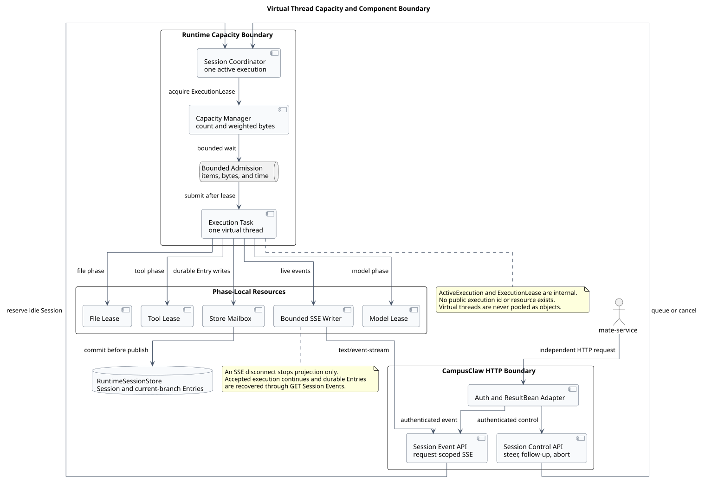
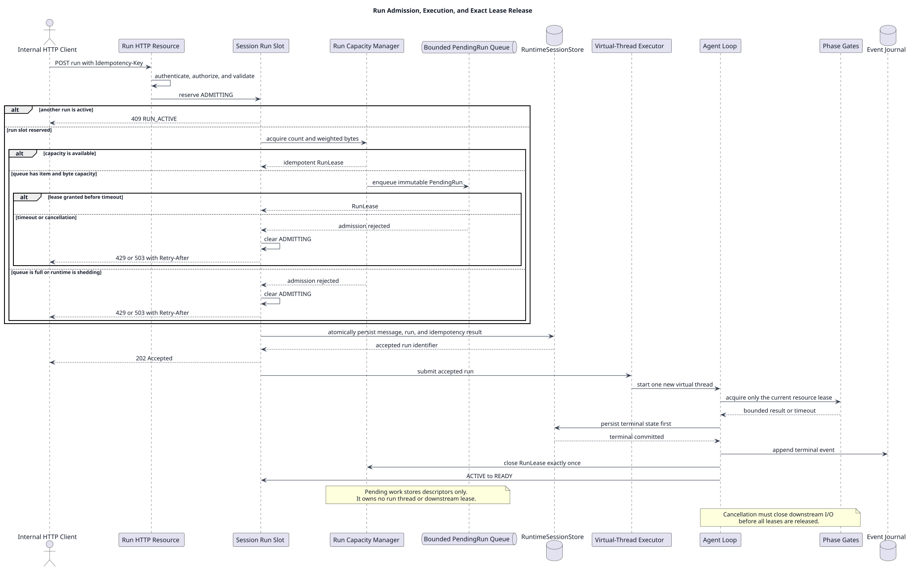
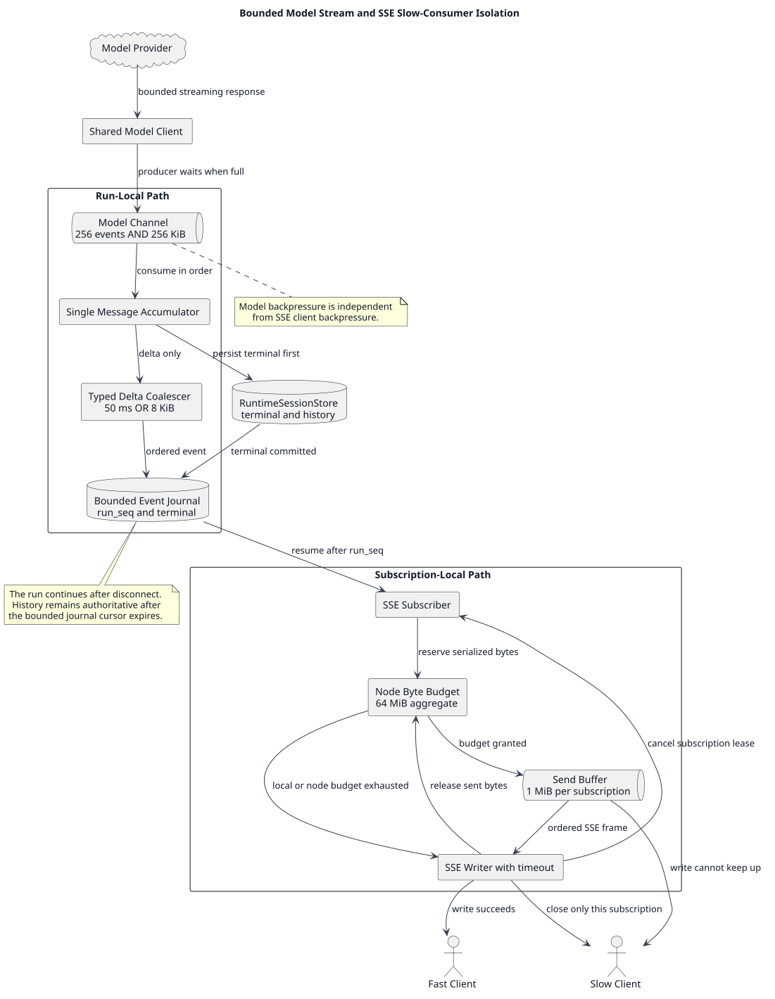

# CampusClaw 虚拟线程并发管理设计

| 属性 | 值 |
|---|---|
| 文档版本 | 1.0.0 |
| 状态 | 统一主文档；目标设计，尚未实施；容量参数待逐项评审和压测 |
| 更新日期 | 2026-08-15 |
| 当前产品目标 | HTTP+SSE 传输下支持约定容量范围内 100 个 active Agent Run |
| Java 基线 | Java 21，Virtual Threads / JEP 444 |
| `pi-mono-java` 源码基线 | `dff835743fc7f3c93e1154c3eb51028749867ca8` |
| 设计仓库分析基线 | `2b8947fdafdafc6539c0f683025086b0847fe288` |
| 关联设计 | [Runtime HTTP API](../pi-mono-java-manager-driven-multi-agent-runtime/chat-http-v1-design.md)、[AgentRuntimeTemplate](../agent-runtime-template/README.md) |

> [!IMPORTANT]
> 本文是 CampusClaw 虚拟线程执行模型、并发准入、资源隔离和 DFX 的唯一主文档。
> 第 3 节明确标记的内容是当前源码事实；HTTP+SSE Runtime、Lease、容量门禁、
> Event Journal、100 Run Profile 和验收标准均为 **target-only design**。未经实现和
> 压测，不得表述为当前系统已经具备 100 并发生产能力。

## 1. 合并结论

用户将原三份文档都理解为“虚拟线程并发管理”，这个理解在主题层面没有问题；
三者确实共享“一任务一虚拟线程、`Semaphore`/Lease 限制业务容量、有界等待、
只池化昂贵业务资源”这一内核。原来的差异主要是文档层级和容量场景不同：

| 原文档 | 原来回答的问题 | 可复用内容 | 合并处理 |
|---|---|---|---|
| Java 21 虚拟线程池需求解读 | 为什么不能预创建、复用和回收虚拟线程 | Java 21 原则、线程与资源池的概念边界 | 作为本文第 5、9 节的技术决策依据 |
| HTTP+SSE 虚拟线程 DFX | 当前 100 active Run 目标怎样落地 | HTTP/Run/SSE 生命周期、候选容量、DFX 清单 | 作为本文当前产品主线 |
| 两节点高并发治理 | 两台 4C/8G、1000 active Run 怎样治理 | count+bytes、Session single-flight、下游隔离、动态降级、压测 | 吸收通用机制；旧 WebSocket 专属行为和 1000 Run 参数不进入当前 Profile |

原三份文档在 Git 中的历史入口如下，合并后不再作为当前规范维护：

| 历史主题 | 最后独立版本 commit |
|---|---|
| Java 21 虚拟线程池评估 | `5aaa325d4f3f77bd2eaa1eabb90ff66b682875af` |
| HTTP+SSE 虚拟线程 DFX | `ceefbf16f6759a357eb043846fe6868a14ef31d1` |
| 两节点高并发治理 | `7c63ff80551de1b87b35b3edcc3e75dcc03223d8` |

合并后的维护边界是：

- 本文负责虚拟线程任务模型、Run 准入、下游并发、内存与流式背压、资源复用、
  运行 DFX 和容量验收；
- [Runtime HTTP API](../pi-mono-java-manager-driven-multi-agent-runtime/chat-http-v1-design.md)
  负责 HTTP operation、认证、ResultBean、幂等、ETag、SSE/JSON 契约；
- [AgentRuntimeTemplate](../agent-runtime-template/README.md) 负责不可变模板的构建、
  缓存键和版本一致性；
- 具体节点数、硬件和并发值通过 Capacity Profile 管理，不再为每个并发量级复制
  一份架构文档。

## 2. 核心决策

### 2.1 一句话方案

> 每个已接受的 Agent Run 使用一个新的 Java 21 虚拟线程独立执行；并行 Tool、
> Provider Reader 和 SubAgent 等子任务按需创建新的虚拟线程；通过容量管理器、
> 幂等 Lease、有界等待、超时、取消和 count+bytes 预算限制业务工作及下游资源；
> 仅复用经验证昂贵且能安全清理状态的客户端、连接、不可变模板或 Worker，永不
> 复用虚拟线程本身。

### 2.2 为什么基于虚拟线程

Agent Run 的大部分时间通常在等待模型流、Tool、附件或 Store I/O，生命周期长、
阻塞点多，而且需要独立的超时、取消和错误栈。虚拟线程允许继续使用清晰的同步
代码表达“一任务一调用栈”，避免用少量平台线程承载大量阻塞 Run。

虚拟线程只降低阻塞等待的线程成本，不解决以下问题：

- CPU 核数、堆和 Direct Memory 上限；
- Model、Tool、Store、Attachment 的授权并发和连接数；
- 慢 SSE 消费者和事件缓冲；
- 多租户公平、幂等、恢复、取消和优雅停机；
- `synchronized`、native/FFM 或第三方 SDK 引起的 pinning。

因此系统不配置“最大虚拟线程数”作为正常业务门禁。业务上限是 active Run、
内存、SSE 订阅和各下游 Lease 的组合；虚拟线程数量只用于诊断异常放大。

### 2.3 当前范围与非目标

当前设计范围：

- Java 21；
- CampusClaw 内部 HTTP 资源 API + SSE/JSON Run Event；
- 当前候选目标为约定范围内 100 个 active Agent Run；
- 每个 Session 同时最多一个 active Run；
- Run 被接受后独立于发起 HTTP 请求和 SSE 订阅继续执行。

当前非目标：

- 不设计可借用、归还、预热或空闲回收的虚拟线程池；
- 不继承旧“两节点 4C/8G、1000 Run”参数；它是另一个容量场景；
- 不承诺跨 Pod 透明续跑；Pod 重启后无法继续的 Run 对账为 `interrupted`；
- 不在本文重复 13 个 HTTP operation 的请求、响应和错误 Schema；
- 不为未压测的 Sandbox、浏览器或 MCP Worker 预先设计资源池。

## 3. 源码基线与已观察行为

### 3.1 核心执行路径

以下均来自 `pi-mono-java@dff835743fc7f3c93e1154c3eb51028749867ca8`，
是源码事实，不是目标推测：

| 观察项 | 仓库相对路径与符号/行号 | 已观察行为 | 并发影响 |
|---|---|---|---|
| Agent Run | [`Agent.java:60-61`](https://github.com/superheromeZzh/pi-mono-java/blob/dff835743fc7f3c93e1154c3eb51028749867ca8/modules/agent-core/src/main/java/com/campusclaw/agent/Agent.java#L60-L61)、[`Agent.java:218-253`](https://github.com/superheromeZzh/pi-mono-java/blob/dff835743fc7f3c93e1154c3eb51028749867ca8/modules/agent-core/src/main/java/com/campusclaw/agent/Agent.java#L218-L253)，`VIRTUAL_THREAD_EXECUTOR`、`startExecution` | 同一 `Agent` 用 `executionLock` 拒绝第二个并发 Run；每次 Run 启动新虚拟线程 | 已符合一任务一虚拟线程，但没有节点或部署级 Run 准入 |
| 模型消费 | [`AgentLoop.java:207-272`](https://github.com/superheromeZzh/pi-mono-java/blob/dff835743fc7f3c93e1154c3eb51028749867ca8/modules/agent-core/src/main/java/com/campusclaw/agent/loop/AgentLoop.java#L207-L272)，`invokeModel`、`consumeStream` | Run 线程通过 `toIterable()` 阻塞消费流，必要时调用 `result().block()` | I/O 等待适合虚拟线程；取消、读取空闲和流背压仍需治理 |
| Tool 并行 | [`ToolExecutionPipeline.java:160-179`](https://github.com/superheromeZzh/pi-mono-java/blob/dff835743fc7f3c93e1154c3eb51028749867ca8/modules/agent-core/src/main/java/com/campusclaw/agent/tool/ToolExecutionPipeline.java#L160-L179)，`executeInParallel` | `newVirtualThreadPerTaskExecutor()` 为每个 Tool Call 创建任务并等待所有 Future | 线程模型正确；缺少 global/per-run Tool fan-out 上限 |
| Provider Reader | [`OpenAIResponsesProvider.java:113-175`](https://github.com/superheromeZzh/pi-mono-java/blob/dff835743fc7f3c93e1154c3eb51028749867ca8/modules/ai/src/main/java/com/campusclaw/ai/provider/openai/OpenAIResponsesProvider.java#L113-L175)，`doStream`、`executeStream`、`buildClient` | 每个模型流再启动虚拟线程，并为每次调用创建和关闭 `OpenAIClient` | 需要 Model Gate、取消闭环和共享客户端；客户端不能绑定到虚拟线程 |
| 模型事件通道 | [`EventStream.java:14-27,54-88`](https://github.com/superheromeZzh/pi-mono-java/blob/dff835743fc7f3c93e1154c3eb51028749867ca8/modules/ai/src/main/java/com/campusclaw/ai/stream/EventStream.java#L14-L27)，`EventStream` | unicast sink 使用无界缓冲 | 生产快于消费时可无界保留事件 |
| Delta 对象 | [`AssistantMessageEvent.java:77-112`](https://github.com/superheromeZzh/pi-mono-java/blob/dff835743fc7f3c93e1154c3eb51028749867ca8/modules/ai/src/main/java/com/campusclaw/ai/stream/AssistantMessageEvent.java#L77-L112)、[`OpenAIResponsesProvider.java:316-350`](https://github.com/superheromeZzh/pi-mono-java/blob/dff835743fc7f3c93e1154c3eb51028749867ca8/modules/ai/src/main/java/com/campusclaw/ai/provider/openai/OpenAIResponsesProvider.java#L316-L350) | Text/Thinking delta 同时携带增量和累计 `partial` Message | 长输出会放大复制、对象分配和序列化 CPU |
| Session 创建 | [`SessionPool.java:125-245`](https://github.com/superheromeZzh/pi-mono-java/blob/dff835743fc7f3c93e1154c3eb51028749867ca8/modules/coding-agent-cli/src/main/java/com/campusclaw/codingagent/mode/server/SessionPool.java#L125-L245)，`getOrCreate`、`createSessionWithPersistence` | 进程内 map 无 single-flight 和总量上限，初始化同步执行 | 不能直接作为生产 HTTP Session 生命周期实现 |
| Session 持久化 | [`SessionManager.java:277-398`](https://github.com/superheromeZzh/pi-mono-java/blob/dff835743fc7f3c93e1154c3eb51028749867ca8/modules/coding-agent-cli/src/main/java/com/campusclaw/codingagent/session/SessionManager.java#L277-L398)，`appendMessage`、`appendRaw` | 本地 JSONL 每次 append 都 flush | 不能提供多 Pod 权威状态或有界 Store 写入 |

在该基线的生产代码中未发现 `Semaphore`、`RunLease` 或
`AgentRuntimeCapacityManager`。因此当前源码已经采用虚拟线程，但尚未实现本文
所定义的部署级容量治理。

### 3.2 虚拟线程使用点清单

当前生产代码中的虚拟线程不只用于 Agent Run。下表用于确定治理责任，不表示所有
路径都会在 Managed HTTP Runtime 中同时启用：

| 任务族 | 源码位置 | 目标治理责任 |
|---|---|---|
| Agent Run | [`Agent.java:60-61,218-253`](https://github.com/superheromeZzh/pi-mono-java/blob/dff835743fc7f3c93e1154c3eb51028749867ca8/modules/agent-core/src/main/java/com/campusclaw/agent/Agent.java#L60-L61) | Run Lease、deadline、Session 单 active Run |
| 并行 Tool | [`ToolExecutionPipeline.java:160-179`](https://github.com/superheromeZzh/pi-mono-java/blob/dff835743fc7f3c93e1154c3eb51028749867ca8/modules/agent-core/src/main/java/com/campusclaw/agent/tool/ToolExecutionPipeline.java#L160-L179) | per-run + global Tool Lease |
| Model Provider Reader | [`AnthropicProvider.java:129`](https://github.com/superheromeZzh/pi-mono-java/blob/dff835743fc7f3c93e1154c3eb51028749867ca8/modules/ai/src/main/java/com/campusclaw/ai/provider/anthropic/AnthropicProvider.java#L129)、[`MistralProvider.java:84`](https://github.com/superheromeZzh/pi-mono-java/blob/dff835743fc7f3c93e1154c3eb51028749867ca8/modules/ai/src/main/java/com/campusclaw/ai/provider/mistral/MistralProvider.java#L84)、[`OpenAICompletionsProvider.java:129`](https://github.com/superheromeZzh/pi-mono-java/blob/dff835743fc7f3c93e1154c3eb51028749867ca8/modules/ai/src/main/java/com/campusclaw/ai/provider/openai/OpenAICompletionsProvider.java#L129)、[`OpenAIResponsesProvider.java:123`](https://github.com/superheromeZzh/pi-mono-java/blob/dff835743fc7f3c93e1154c3eb51028749867ca8/modules/ai/src/main/java/com/campusclaw/ai/provider/openai/OpenAIResponsesProvider.java#L123) | Provider/model 分区 Lease、读取超时、真实 I/O 取消 |
| A2A/HTTP SubAgent | [`A2aAgentBackend.java:137`](https://github.com/superheromeZzh/pi-mono-java/blob/dff835743fc7f3c93e1154c3eb51028749867ca8/modules/agent-core/src/main/java/com/campusclaw/agent/subagent/a2a/A2aAgentBackend.java#L137)、[`HttpAgentBackend.java:114`](https://github.com/superheromeZzh/pi-mono-java/blob/dff835743fc7f3c93e1154c3eb51028749867ca8/modules/agent-core/src/main/java/com/campusclaw/agent/subagent/http/HttpAgentBackend.java#L114) | parent/run 子任务预算、远端并发、取消传播 |
| ACP Transport/Process | [`AcpTransport.java:140,169`](https://github.com/superheromeZzh/pi-mono-java/blob/dff835743fc7f3c93e1154c3eb51028749867ca8/modules/agent-core/src/main/java/com/campusclaw/agent/subagent/acp/AcpTransport.java#L140)、[`ProcessAcpBackend.java:241,314`](https://github.com/superheromeZzh/pi-mono-java/blob/dff835743fc7f3c93e1154c3eb51028749867ca8/modules/agent-core/src/main/java/com/campusclaw/agent/subagent/acp/backend/ProcessAcpBackend.java#L241) | Session/进程预算、reader/closer 生命周期、stderr 有界保留 |
| Bash 输出 drainer | [`BashExecutor.java:73,75`](https://github.com/superheromeZzh/pi-mono-java/blob/dff835743fc7f3c93e1154c3eb51028749867ca8/modules/coding-agent-cli/src/main/java/com/campusclaw/codingagent/tool/bash/BashExecutor.java#L73) | Tool Lease、进程 deadline、输出字节上限 |
| TUI 输入 | [`JLineTerminal.java:181`](https://github.com/superheromeZzh/pi-mono-java/blob/dff835743fc7f3c93e1154c3eb51028749867ca8/modules/tui/src/main/java/com/campusclaw/tui/terminal/JLineTerminal.java#L181) | 仅 CLI 生命周期；不计入 HTTP Runtime Profile |

这份清单说明“100 active Run”绝不等于“最多 100 个虚拟线程”。一个 Run 可能同时
拥有 Run、Provider、Tool 或 SubAgent 虚拟线程；应限制任务和资源所有权，而不是
把这些线程压进一个固定虚拟线程池。

### 3.3 差异分类

| 分类 | 内容 | 设计理由 |
|---|---|---|
| 观察到的源码行为 | Run、Provider Reader、并行 Tool、部分 SubAgent 已创建虚拟线程；事件缓冲、Session 和 Store 缺少生产级边界 | 固定源码基线事实 |
| 产品约束 | HTTP+SSE；100 按 active Run 计量；一 Session 一 active Run；断开 SSE 不 Abort | 固定业务容量和生命周期语义 |
| 架构改造 | Capacity Manager、Lease、有界队列、count+bytes、共享 Store、Event Journal、共享客户端 | 虚拟线程不能代替容量、背压和恢复 |
| 安全加固 | 租户配额、不可变 RunContext、错误脱敏、低基数指标、凭据不进 ThreadLocal | 防止资源抢占和跨 Session/租户泄漏 |
| 运维约束 | JFR、指标、动态 shedding、优雅停机、故障注入、分级压测 | 容量承诺必须由运行证据证明 |

## 4. 目标架构



[PlantUML 源码：`virtual_thread_capacity_overview`](diagram.puml#L12)

核心边界为：

```text
virtual thread = execution and isolation
lease          = capacity ownership
bounded queue  = overload waiting
event journal  = ordered short-term recovery
history store  = authoritative long-term state
```

必须持续满足三个不变量：

```text
no RunLease -> no accepted Run -> no Run virtual thread

HTTP request lifetime != Run lifetime != SSE subscription lifetime

acquired leases - released leases = active owners
```

## 5. 虚拟线程使用规则

### 5.1 任务到线程的映射

| 任务 | 线程策略 | 创建前提 | 生命周期结束条件 |
|---|---|---|---|
| HTTP 请求校验与准入 | 由 Web 容器管理；不得阻塞 Reactor event-loop | 连接和请求已通过基础保护 | 响应返回或请求取消 |
| `PendingRun` 等待 | 默认保存描述符和 `CompletionStage`，不创建 Run 虚拟线程 | item+bytes 队列都有容量 | 获得 Lease、超时或取消 |
| Agent Run | 一个 accepted Run 对应一个新虚拟线程 | Session slot + Run count/memory Lease + accepted 持久化 | done/aborted/error/interrupted，并完成清理 |
| Provider Reader | 每个在途模型流可使用一个新虚拟线程 | Model Lease 已获得 | 流终止、超时或取消且 response body 已关闭 |
| 并行 Tool Call | 每个 Tool Call 一个新虚拟线程 | per-run 和 global Tool Lease 已获得 | 结果、错误、超时或取消 |
| SubAgent/ACP/A2A | 每个独立阻塞子任务一个新虚拟线程 | parent deadline、子任务和远端 Lease 已获得 | 子任务 terminal 并完成级联取消 |
| SSE Writer | 可由框架异步写出，或每订阅一个阻塞式虚拟线程 | SSE Subscription Lease 和 byte budget | 断开、写超时、游标过期或 Run terminal |
| 定时清理/对账 | 少量 `ScheduledExecutorService` 平台线程 | 进程启动 | 进程关闭 |
| 经证明的持续 CPU 重任务 | 与 CPU 核数匹配的平台线程 Executor + 有界队列 | JFR/压测已证明需要隔离 | 任务或 deadline 结束 |

SSE Writer 即使使用虚拟线程，也只拥有订阅 Lease，不拥有 Run Lease；关闭它只能
取消该订阅。HTTP Controller 若运行在 Reactor/Netty event-loop 上，禁止直接
`Semaphore.tryAcquire(timeout)` 阻塞；必须使用异步有界 admission。若未来明确
切换到每请求虚拟线程的阻塞式 Web 栈，可以在同一语义下使用有界
`tryAcquire`，但不能省略 queue item/bytes 和取消治理。

### 5.2 永不池化虚拟线程

Java 21 的正确模型是把每个并发任务表示成一个新的虚拟线程。
`Executors.newVirtualThreadPerTaskExecutor()` 是任务提交和生命周期管理接口，
不是复用虚拟线程的固定池。

因此禁止：

- 预创建“空闲虚拟线程库存”；
- 借用、归还或复用已完成的虚拟线程；
- 用固定数量虚拟线程消费共享无界任务队列；
- 用虚拟线程 `ThreadLocal` 缓存客户端、连接、凭据或其他昂贵对象；
- 通过调整 `jdk.virtualThreadScheduler.parallelism/maxPoolSize` 代替业务限流。

如产品名称必须保留 `AgentRuntimePool`，其定义只能是“业务资源与容量许可管理器”，
不能表示虚拟线程对象池。实现命名优先使用 `AgentRuntimeCapacityManager`。

## 6. 容量治理

### 6.1 当前候选 `http-sse-100-v1` Profile

以下数值是首轮评审和压测初值，不是生产默认值。节点数、硬件、单节点故障目标和
上游授权尚未确认前，不能将其转为容量承诺。

| 资源 | 候选初值 | 等待/缓冲 | 保护目标 |
|---|---:|---|---|
| active Agent Run | 100 | 无直接线程队列 | 核心业务并发上限 |
| Run retained memory | 512 MiB，4 MiB/unit | 与 Run Lease 联合申请 | 防止长上下文绕过 count 上限 |
| Run admission | 20 项、32 MiB | 最多 5 秒 | 防止突发请求无界等待 |
| resident Session | 150 | 空闲回收待评审 | 覆盖 active、waiting 和空闲余量 |
| Session 冷初始化 | 2 active | 16 waiting | 防止模板、Prompt 和 Store 冷加载风暴 |
| SSE Subscription | 120 | 单订阅 1 MiB | 容纳 active Run 和少量重连重叠 |
| 节点 SSE 待发送总量 | 64 MiB | 满时关闭最慢订阅 | 防止连接数乘以单连接上限耗尽内存 |
| 在途模型流 | `min(100, 授权配额)` | Provider deadline | 外部配额优先于本地目标 |
| 在途 Tool Call | 64 global、4/run | Tool deadline | 限制 fan-out 和单 Run 独占 |
| 在途 Store 写 | 16 | 有界 mailbox | 保护连接池和 terminal 提交 |
| 在途附件正文读取 | 16～32 | 读取 deadline | 保护内存、带宽和 Attachment Service |
| 单 Run 模型通道 | 256 事件且 256 KiB | 停滞超时待评审 | Provider/Agent Loop 背压 |
| Delta 合并 | 50 ms 或 8 KiB | 先到者触发 | 每 Run 目标约不超过 20 Frame/s |

“100”必须在 VTC-01 中确定为单进程、单节点还是集群总量：

- 若为集群总量，需要全局调度配额或节点静态分片；
- 若为单节点上限，每个节点独立保护，集群容量是已验收节点容量之和；
- 若要求单节点故障后仍维持 100，健康节点必须独立通过 100 的容量验收，稳态
  不能把两个节点都运行到 100；
- 任何方式都以节点本地 Gate 为最终安全边界，调度器快照只能提供建议。

### 6.2 Run 准入和执行



[PlantUML 源码：`run_admission_and_execution`](diagram.puml#L94)

准入顺序：

1. 验证身份、权限、Session、消息、附件、大小和 `Idempotency-Key`；无效请求不排队。
2. Session 原子进入 `ADMITTING`；第二个 Run 返回 `409 RUN_ACTIVE`。
3. 原子申请 Run count 和 weighted-memory；不能持有其中一个等待另一个。
4. 容量不足时只创建不可变 `PendingRun` 描述符，同时受 item、bytes、time 限制。
5. 获得 `RunLease` 后，原子持久化 User Message、RunRecord、active-run 和幂等结果。
6. 持久化成功后返回 `202 Accepted`，再向 Executor 提交 Run；提交失败必须对账为
   明确终态，不能留下永久 running。
7. Run 在新虚拟线程执行；Model、Tool、Store、Attachment 只在实际阶段取得局部 Lease。
8. terminal 先写权威 Store，再写 Event Journal/SSE；最后关闭所有 Lease 并恢复 Session。

### 6.3 `Semaphore` 与 Lease 的边界

`Semaphore` 是实现 permit 的候选原语，不直接暴露给业务调用方。目标接口形态：

```java
interface AgentRuntimeCapacityManager {
    CompletionStage<RunLease> acquireAsync(RunEstimate estimate, Duration maxWait);
}

interface RunLease extends AutoCloseable {
    String leaseId();

    int memoryUnits();

    @Override
    void close(); // 幂等关闭
}
```

实现必须满足：

- 只有成功获得 permit 的 owner 才能创建 Lease；
- `close()` 重复调用不增加可用 permit；
- waiter 超时或取消不能释放其他 owner 的 permit；
- count 与 weighted bytes 在同一临界区联合分配或整体回滚；
- `finally` 是唯一的正常释放出口，Abort、超时、异常和停机复用同一清理流程；
- 持续对账 `acquired - released = active`，不一致时告警并停止扩大准入；
- `RunLease`、`ModelLease`、`ToolLease`、`StoreLease`、`SubscriptionLease` 分开计量。

公平 `Semaphore` 只能改善同一队列中的顺序，不能解决租户公平。多租户使用
global -> tenant -> user -> session 的分层配额或公平调度队列；不能让一个租户先
占满全局排队槽位。

### 6.4 资源获取顺序与死锁

- Session slot 只表达同 Session 的 Run 状态，不持有下游连接；
- Run count+memory 联合准入，不能部分占用；
- Model Lease 只覆盖当前模型调用，模型流结束立即释放，不带入 Tool 阶段；
- Tool 固定先取得 per-run 预算，再取得 node-global 预算，所有路径顺序一致；
- Store/Attachment 在真正访问前获取，操作完成立即释放；
- 已有数据库连接池构成最终并发边界时，Store Gate 保护写入任务和 mailbox，不能
  机械配置同尺寸的多层队列；
- terminal Store 使用保留控制容量，不能被普通 snapshot 或 delta backlog 饿死。

## 7. 超时、取消与生命周期

### 7.1 分层超时

| 层次 | 计时起点 | 超时动作 |
|---|---|---|
| Admission | 合法请求进入 PendingRun | accepted 前移除并明确拒绝 |
| Model connect | 获得 Model Lease 并开始连接 | 关闭请求，释放 Lease，Run error |
| First token | 模型请求成功发出 | 关闭模型流，Run error |
| Model read idle | 收到最近模型事件 | 关闭停滞流，Run error |
| Tool | Tool Call 开始 | 关闭 Tool I/O，产生有界 Tool 终态 |
| Store | 写任务进入 mailbox | 失败或过载，不能永久占住 Run Lease |
| SSE write | Frame 交给订阅 writer | 关闭该订阅，Run 继续 |
| Run deadline | Run 进入 running | 级联取消、持久化终态、释放所有 Lease |
| Shutdown | 节点进入 DRAINING | deadline 后将未完成 Run 对账为 interrupted |

只调用 `Future.cancel(true)` 不构成取消完成证据。每个 Provider、Tool、Attachment
和 Store Adapter 必须验证中断或 cancellation token 能关闭真实 socket、response
body、进程或流，并最终释放连接和 Lease。

### 7.2 HTTP、Run 与 SSE 解耦

- `POST /runs` 断开：accepted 前可取消等待；accepted 后不自动 Abort；
- SSE 断开：只释放订阅和 byte Lease；
- 显式 Abort：使用独立幂等 HTTP operation，级联到模型、Tool 和 SubAgent；
- Run terminal：先持久化，再投影到 Event Journal 和 SSE；
- Pod 重启：无法继续的 active Run 对账为 `interrupted`；
- Event Journal 游标过期：返回 `410 EVENT_CURSOR_EXPIRED`，客户端读取 Run 快照和 History。

## 8. 有界流、内存与 SSE 背压



[PlantUML 源码：`bounded_sse_and_downstream`](diagram.puml#L172)

目标流式路径：

1. Provider Adapter 只产生 typed delta，不在每个 delta 中复制累计 Message。
2. Run 内使用一个 `AssistantMessageAccumulator`，仅在 snapshot 或 terminal 时物化完整对象。
3. 模型通道同时限制事件数和估算字节数；任一上限先达到即背压 Provider Reader。
4. 连续同类 delta 在 50 ms 或 8 KiB 合并；Tool、Message 和 terminal 边界不合并。
5. Event Journal 使用 `run_seq` 保持顺序和短期续传；长期权威状态属于 History Store。
6. 单订阅和节点聚合发送字节都受预算控制；满时关闭最慢订阅，Run 继续。
7. lifecycle/terminal 使用保留控制容量，普通 delta 不能使 terminal 永久无法发布。

Run count 必须与内存权重同时使用。候选估算：

```text
estimated_retained_bytes =
    serialized_context_bytes
  + expected_output_budget_bytes
  + accumulator_budget_bytes
  + fixed_run_overhead_bytes

memory_units = max(1, ceil(estimated_retained_bytes / 4 MiB))
```

估算值不是精确 JVM 对象大小。压测应比较估算、terminal retained bytes、
allocation rate 和 after-GC heap；误差长期超过 25% 时修正模型或降低并发，不能
依靠 GC 兜底。

## 9. 业务资源复用与池化

### 9.1 可以考虑复用

- 按 endpoint、服务身份和稳定配置复用的 Model/Tool HTTP 客户端及连接池；
- 数据库连接池；
- 不可变 Runtime Template；
- 经压测证明昂贵、能健康检查并能彻底清理状态的 MCP 连接、Sandbox 或浏览器 Worker。

### 9.2 默认不得复用

- 虚拟线程；
- 有状态 `Agent`、`AgentSession`、RunContext、transcript、partial output 和取消状态；
- 含租户、用户或请求凭据的对象；
- 不能证明状态清理和跨租户隔离的 MCP/Worker。

### 9.3 建池门槛

同时满足以下条件才允许预热、按需扩容和空闲回收：

1. 真实压测证明创建或初始化成本足够高；
2. 任务结束后能可靠清理请求状态；
3. 跨请求/租户复用满足认证和隔离；
4. 有 min/max、借用超时、健康检查、失败退避、失效驱逐、最大生命周期和泄漏检测；
5. shutdown 能关闭连接和维护任务；
6. 池化收益大于生命周期复杂度。

## 10. 生产 DFX

### 10.1 上下文与安全隔离

每个 Run 使用显式、不可变的 `AgentRunContext`，至少携带 Session、Run、Agent、
调用身份、模型策略、trace correlation、deadline 和 cancellation token。不得用
进程级可变变量表达“当前 Run”，也不得用虚拟线程 `ThreadLocal` 缓存客户端、
数据库连接、MCP Session 或凭据。

日志、指标、SSE、Store 和错误响应不得包含凭据、Prompt、原始 thinking、内部
Header、未脱敏下游正文或其他 Session 的容量信息。指标 label 禁止使用
session_id、run_id、用户、Prompt 和完整 Tool 参数。

### 10.2 Pinning 与 CPU 隔离

- 使用 JFR `jdk.VirtualThreadPinned` 定位高频长时 pinning；
- 不在长时间/高频 `synchronized` 区域内执行网络、文件、数据库或 Tool 阻塞；
- native/FFM 和第三方 SDK 阻塞单独验证；
- JSON、Prompt 构建、压缩和附件解析仍受 CPU 核数限制；
- 只有 JFR/压测证明为持续 CPU 重任务时，才放入有界平台线程 Executor；
- 不通过提高载体线程并行度掩盖 CPU、锁竞争或 pinning。

### 10.3 可观测性与 Lease 对账

| 指标组 | 最低指标 |
|---|---|
| Run | active、waiting、accepted、rejected、done、aborted、error、interrupted |
| Admission | queue items/bytes、等待时延、超时、拒绝原因 |
| Lease | acquired、released、active、double-close、suspected-leak |
| 虚拟线程 | live/start 趋势、start failure、JFR pinned event |
| Model/Tool | inflight、TTFT/耗时、超时、取消、429/503 |
| Store | inflight、mailbox backlog、事务耗时、terminal 失败 |
| SSE | subscription、buffer bytes、重连、慢消费者关闭、cursor expired |
| JVM/OS | process CPU、heap after GC、direct memory、allocation、GC pause、file descriptor |

### 10.4 动态过载与优雅停机

节点状态至少包括：

| 状态 | 新请求行为 | 已接受 Run |
|---|---|---|
| `OPEN` | 正常接受和有界排队 | 正常执行 |
| `PRESSURE` | 缩短等待、加强 delta 合并、停止非关键预热 | 继续执行 |
| `SHEDDING` | 拒绝新 Run | 继续执行并保 terminal 容量 |
| `DRAINING` | 停止新 Session/Run，取消未 accepted PendingRun | 在 deadline 内完成，否则 interrupted |

触发依据包括 after-GC heap、direct memory、SSE buffer、CPU+queue、Provider
429/503、Store backlog 和 Lease 对账异常。进入与退出使用不同阈值和连续窗口，
避免状态抖动。

停机顺序：进入 `DRAINING` -> 停止新准入 -> 取消 PendingRun -> 保持查询/SSE
一段有界时间 -> 取消超时 Run -> terminal 对账 -> 关闭 Journal/客户端/Executor
-> 核对 Lease、buffer、mailbox 回零。

### 10.5 集中配置

```properties
runtime.capacity.profile=http-sse-100-v1
runtime.capacity.runs.concurrent=100
runtime.capacity.runs.max-bytes=536870912
runtime.capacity.runs.memory-unit-bytes=4194304
runtime.capacity.runs.queue-items=20
runtime.capacity.runs.queue-bytes=33554432
runtime.capacity.runs.wait-timeout=5s
runtime.capacity.sessions.max=150
runtime.capacity.session-init.concurrent=2
runtime.capacity.session-init.queue-items=16
runtime.capacity.sse-subscriptions.concurrent=120
runtime.capacity.model-streams.concurrent=100
runtime.capacity.tools.concurrent=64
runtime.capacity.tools.per-run=4
runtime.capacity.store-writes.concurrent=16
runtime.stream.model-buffer.max-events=256
runtime.stream.model-buffer.max-bytes=262144
runtime.stream.sse-buffer.max-bytes=1048576
runtime.stream.node-buffer.max-bytes=67108864
runtime.stream.coalesce.max-delay=50ms
runtime.stream.coalesce.max-bytes=8192
```

启动时校验配置不变量；非法配置拒绝启动，不能静默修正为另一种容量承诺。配置
提高必须关联压测报告、下游配额和回滚方案。

## 11. 逐项评审登记表

合并后将原 18 个 DFX 项收敛为 12 个可关闭决策，避免同一问题分散在多个章节。

| ID | 评审项 | 候选决策 | 关闭证据 | 状态 |
|---|---|---|---|---|
| VTC-01 | 容量口径与部署范围 | 100 表示约定范围内 active Run，不等于线程/连接/Session | 节点、硬件、故障目标、工作负载、下游配额 | 待评审 |
| VTC-02 | 任务与虚拟线程映射 | Run/Provider/Tool/SubAgent 一任务一新虚拟线程，不池化 | 代码走查、线程命名、取消测试 | 待评审 |
| VTC-03 | Run Lease 与联合准入 | count+bytes 原子准入；Lease 幂等关闭 | acquire/release 对账、double-close、异常注入 | 待评审 |
| VTC-04 | 有界等待与多租户公平 | item+bytes+time；global/tenant/user/session 分层 | 突发、饥饿、取消和队列耗尽测试 | 待评审 |
| VTC-05 | 分层超时与取消闭环 | 关闭真实下游 I/O 后释放 Lease | Provider/Tool/Store/进程取消证据 | 待评审 |
| VTC-06 | HTTP/Run/SSE 生命周期与恢复 | 三者解耦；accepted/terminal 原子；SSE 可续传 | 断线、幂等、重启、游标过期测试 | 待评审 |
| VTC-07 | 流式背压与内存预算 | 双上限模型通道、单 accumulator、慢订阅隔离 | retained/allocation、慢 SSE、长输出测试 | 待评审 |
| VTC-08 | 下游隔离与业务资源池 | 独立 Model/Tool/Store/Attachment Gate；有证据才池化 | 配额、创建成本、隔离、健康和泄漏证据 | 待评审 |
| VTC-09 | 上下文和安全隔离 | 不可变 RunContext；凭据不进 ThreadLocal/事件/指标 | 跨租户污染、错误脱敏、低基数审查 | 待评审 |
| VTC-10 | Pinning、CPU 与 JVM | JFR 检测；持续 CPU 重任务使用有界平台线程 | JFR、CPU、heap/direct、GC 报告 | 待评审 |
| VTC-11 | 可观测性、降级与停机 | Lease 对账；四态 Health Gate；有界 draining | 看板、告警、故障注入、SIGTERM 测试 | 待评审 |
| VTC-12 | 配置、测试与容量验收 | 集中 Profile；100/120/soak/真实依赖分级验收 | 配置校验、压测和费用/授权确认 | 待评审 |

推荐顺序：VTC-01 -> VTC-02 -> VTC-03/04 -> VTC-05/06/07 ->
VTC-08/09/10 -> VTC-11/12。下一项从 **VTC-01：100 并发的容量口径与部署范围**
开始；未关闭 VTC-01 前，不冻结任何生产 permit 数值。

## 12. 测试与验收

### 12.1 最低测试矩阵

| 场景 | 负载或故障 | 必须证明 |
|---|---|---|
| 稳态 | 100 active Run，30 分钟 | terminal 完整，permit/buffer 不超限 |
| 突发 | 120+ Run | 100 active、最多 20 waiting，其余有界拒绝 |
| Soak | 持续补充至 100 active，2 小时 | 无 Lease、连接、Session、buffer 泄漏 |
| 慢 SSE | 10% 客户端停止读取 | 只关闭慢订阅，Run 和其他订阅继续 |
| 重连 | 反复使用 `Last-Event-ID` | `run_seq` 无静默缺口或重复应用 |
| Provider | 快流、慢流、429、503、半流断开 | Gate、背压、取消和 terminal 正确 |
| Tool/SubAgent | fan-out、超时、副作用错误 | global/per-run 上限和级联取消正确 |
| Store | 慢提交、连接耗尽、事务失败 | accepted/terminal 原子，Lease 最终释放 |
| 进程 | SIGTERM、kill -9、重启 | draining 或 interrupted 收敛，无永久 running |
| Pinning/CPU | 全链路 JFR 和 CPU 突发 | 无高频长时 pinning，event-loop 不阻塞 |

### 12.2 全局通过门槛

- active/waiting/count/bytes/downstream permits 从不超过配置，结束后全部回零；
- 每个请求最终为 accepted、明确拒绝或稳定错误，每个 accepted Run 都有 terminal；
- 无 OOM、无跨 Session/租户数据、无重复副作用、无永久 running；
- 慢 SSE 只影响本订阅，terminal 可经重连或 History 读取；
- CPU、after-GC heap、direct memory、GC pause、allocation 满足目标硬件阈值；
- 无高频长时 `jdk.VirtualThreadPinned`；
- Provider、Tool、Store、Attachment 的授权容量不低于本地 Profile，或本地 Profile
  已按最小下游容量收缩；
- Stub 只能证明 agent-service 自身；真实 Provider 测试必须先确认费用和并发授权。

## 13. VTC-01 所需外部输入

1. 100 active Run 是单进程、单节点、双节点还是整个部署总量；
2. 节点数量、每节点 vCPU/内存、JVM heap/direct-memory 和 sidecar 占用；
3. 单节点故障后允许降容，还是另一节点必须继续承载 100；
4. P50/P95/P99 输入 token、输出 token、Run 时长、Tool/SubAgent fan-out、附件比例；
5. Model Manager/Provider 的并发流、QPS、token、连接和账号配额；
6. Tool Manager、RuntimeSessionStore、Attachment Service 的容量与超时契约；
7. 网关/Proxy 的 SSE 连接、空闲超时、缓冲和 `Last-Event-ID` 透传能力；
8. admission wait、TTFT、Run deadline、过载率和可用性目标。

## 14. 来源

### 14.1 官方资料

- Oracle Java SE 21，[Virtual Threads](https://docs.oracle.com/en/java/javase/21/core/virtual-threads.html)
- Oracle Java SE 21 API，[Executors.newVirtualThreadPerTaskExecutor](https://docs.oracle.com/en/java/javase/21/docs/api/java.base/java/util/concurrent/Executors.html#newVirtualThreadPerTaskExecutor())
- OpenJDK，[JEP 444: Virtual Threads](https://openjdk.org/jeps/444)

### 14.2 应用源码

源码基线：`pi-mono-java@dff835743fc7f3c93e1154c3eb51028749867ca8`。

- `modules/agent-core/src/main/java/com/campusclaw/agent/Agent.java`
- `modules/agent-core/src/main/java/com/campusclaw/agent/loop/AgentLoop.java`
- `modules/agent-core/src/main/java/com/campusclaw/agent/tool/ToolExecutionPipeline.java`
- `modules/agent-core/src/main/java/com/campusclaw/agent/subagent/`
- `modules/ai/src/main/java/com/campusclaw/ai/provider/`
- `modules/ai/src/main/java/com/campusclaw/ai/stream/EventStream.java`
- `modules/ai/src/main/java/com/campusclaw/ai/stream/AssistantMessageEvent.java`
- `modules/coding-agent-cli/src/main/java/com/campusclaw/codingagent/mode/server/SessionPool.java`
- `modules/coding-agent-cli/src/main/java/com/campusclaw/codingagent/session/SessionManager.java`
- `modules/coding-agent-cli/src/main/java/com/campusclaw/codingagent/tool/bash/BashExecutor.java`
- `modules/tui/src/main/java/com/campusclaw/tui/terminal/JLineTerminal.java`

## 15. 版本历史

| 版本 | 日期 | 变更 |
|---|---|---|
| 1.0.0 | 2026-08-15 | 合并 Java 21 虚拟线程池评估、HTTP+SSE DFX 和两节点高并发治理；建立唯一主文档，刷新源码基线为 `dff8357`，收敛为 100 active Run 候选 Profile 和 12 项 VTC 评审；旧 WebSocket/1000 Run 参数不再作为当前基线 |
