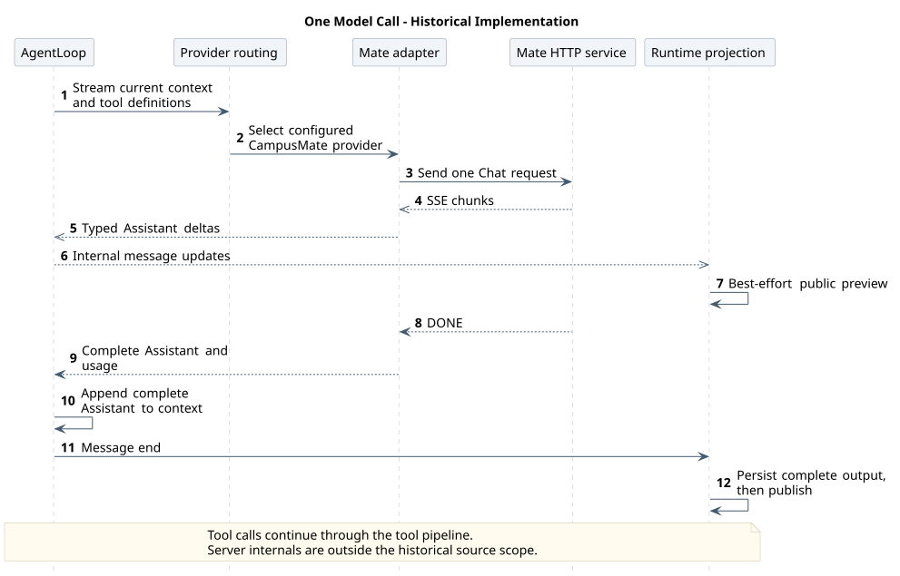
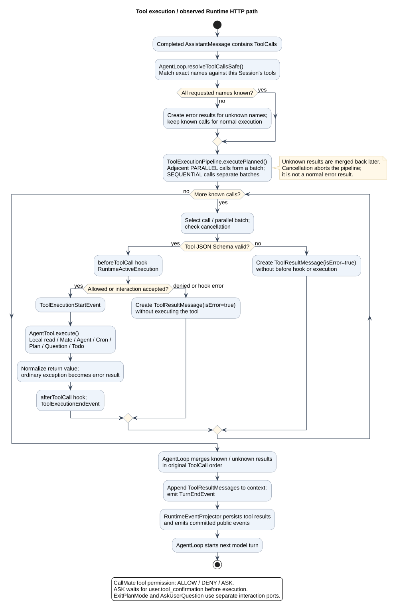
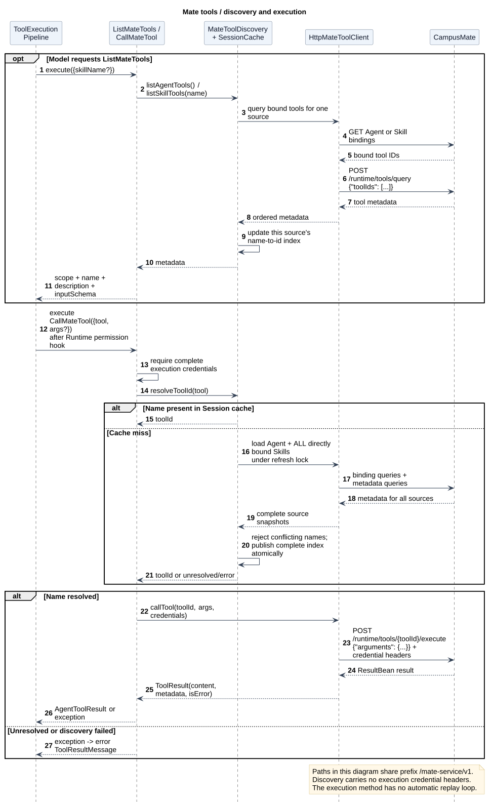
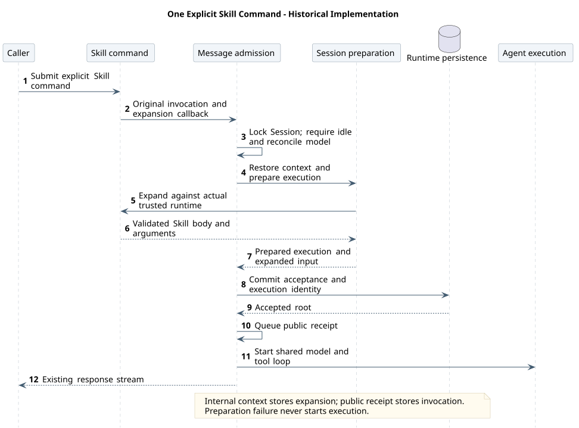
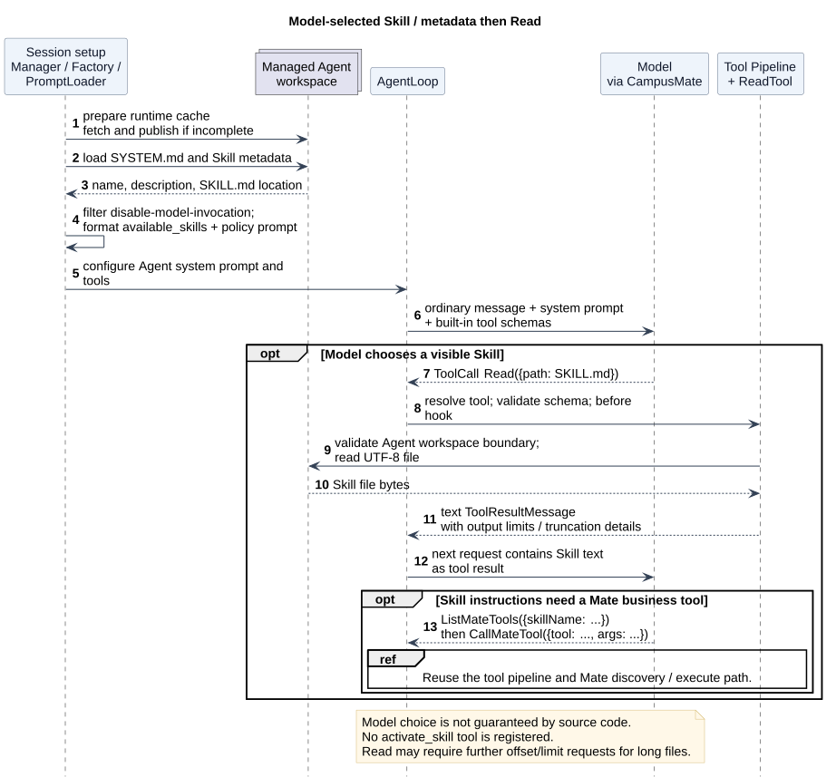

# CampusClaw 模型、工具与 Skill 调用链路

版本：1.1.0 · 核对日期：2026-09-19

## 1. 阅读范围与结论

本文记录 **`campusclaw` 当前源码的实际调用链**，不是新目标设计，也不是线上运行验证报告。

| 项目 | 本次范围 |
|---|---|
| 实现仓 | `/Users/z/pi-mono-java` |
| 源码目录 | `campusclaw/`，不以同仓其他模块的同名类替代 |
| 源码基线 | 本地 `main`：`fb842b1ac6cb4818f6b146f79dd184a5cd88bf12`；源码工作树无已跟踪修改，仅有无关未跟踪 `.m2/` |
| 主入口 | Runtime HTTP 的普通消息与 Skill 命令 |
| 模型适配 | 当前默认 `settings.json → MateRuntimeModelManager → CampusMateProvider` 路径；旧全局模型注册表已删除 |
| 边界 | 追踪到发往 CampusMate 的 HTTP 请求；未据此推断 CampusMate 服务端内部实现 |
| 图的性质 | 当前实现时序图、活动图，不是目标类图；组合参与者明确列出所含组件 |

源码表中的路径统一相对于 `campusclaw/src/main/java/com/huawei/hicampus/claw/`，点击可定位本机完整源码路径。基线是本次读取的本地快照，不宣称为上游最新提交。本材料不调整模块设计或 Agent 基线对比结论。

三种“调用”不是三个独立执行引擎：

| 对象 | 谁触发 | 实际完成什么 | 结果去向 |
|---|---|---|---|
| 模型 | `AgentLoop` | 将系统提示词、消息历史、已装配工具 Schema 交给 Provider | 得到完整 `AssistantMessage`，其中可能有 `ToolCall` |
| 工具 | `AgentLoop` 处理模型返回的 `ToolCall` | 匹配工具、校验参数、执行前交互/权限、调用具体 `AgentTool` | `ToolResultMessage` 加回上下文，进入下一轮模型调用 |
| Skill | 用户显式命令，或模型选择 `Read` | 将技能文件中的指令引入当前对话 | 继续使用同一个模型/工具循环；没有独立 Skill 执行器 |

建议按“公共入口 → 模型时序 → 工具流水线 → Skill 两种入口”阅读。图中的 Provider 增量、Agent 事件、公共 SSE 和数据库 Entry 是不同层次，不能当作同一个消息对象或一串同步方法调用。

## 2. 公共入口：一次消息如何启动 Agent

以下是普通 `user.message` 的主路径；Skill 命令在输入准备阶段接入同一条链。

| 顺序 | 源码入口 | 职责与传递内容 |
|---|---|---|
| 1 | [RuntimeEventController.submit](/Users/z/pi-mono-java/campusclaw/src/main/java/com/huawei/hicampus/claw/codingagent/runtimeapi/web/RuntimeEventController.java) → [RuntimeEventService.submit](/Users/z/pi-mono-java/campusclaw/src/main/java/com/huawei/hicampus/claw/codingagent/runtimeapi/event/RuntimeEventService.java) | 接收 `POST /campusclaw-service/v1/sessions/{sessionId}/events`；读取本次凭据与语言，按事件类型分发；`user.message` 交给消息服务 |
| 2 | [RuntimeMessageEventService.submit / prepare](/Users/z/pi-mono-java/campusclaw/src/main/java/com/huawei/hicampus/claw/codingagent/runtimeapi/event/RuntimeMessageEventService.java) | 在 Session 操作锁内检查当前 Session 空闲；准备输入、历史和实际执行对象 |
| 3 | [RuntimeSessionModelReconciler.reconcile](/Users/z/pi-mono-java/campusclaw/src/main/java/com/huawei/hicampus/claw/codingagent/runtimeapi/session/RuntimeSessionModelReconciler.java) | 根据当前 Agent 绑定配置核对所选模型；旧模型不可用时尝试当前默认模型，而非直接使用请求随意指定的模型 |
| 4 | [RuntimeExecutionContextFactory.create](/Users/z/pi-mono-java/campusclaw/src/main/java/com/huawei/hicampus/claw/codingagent/runtimeapi/event/RuntimeExecutionContextFactory.java) + [RuntimeContextHistoryService.restoreHistory](/Users/z/pi-mono-java/campusclaw/src/main/java/com/huawei/hicampus/claw/codingagent/runtimeapi/event/RuntimeContextHistoryService.java) | 从当前分支 Entry 恢复上下文；构造 `UserMessage`、事件流、`RuntimeActiveExecution`，向引擎注册表注册 |
| 5 | [RuntimeSessionEngineRegistry.register / createSession](/Users/z/pi-mono-java/campusclaw/src/main/java/com/huawei/hicampus/claw/codingagent/runtimeapi/runtime/RuntimeSessionEngineRegistry.java) → [AgentSessionFactory.create](/Users/z/pi-mono-java/campusclaw/src/main/java/com/huawei/hicampus/claw/codingagent/session/AgentSessionFactory.java) | 准备 Agent 运行目录；从 `settings.json` 快照解析模型；为本次执行新建 Session、工具和 Mate 缓存；按入口与模式装配提示词、Hook、工具及历史 |
| 6 | [RuntimeMessageEventService.accept / startAccepted](/Users/z/pi-mono-java/campusclaw/src/main/java/com/huawei/hicampus/claw/codingagent/runtimeapi/event/RuntimeMessageEventService.java) → [RuntimeExecutionPersistenceService.acceptMessage](/Users/z/pi-mono-java/campusclaw/src/main/java/com/huawei/hicampus/claw/codingagent/runtimeapi/persistence/RuntimeExecutionPersistenceService.java) | 在事务中接纳用户消息、记录执行身份及公开事件；将已提交的用户回执入队后才启动执行 |
| 7 | [RuntimeExecutionCoordinator.start](/Users/z/pi-mono-java/campusclaw/src/main/java/com/huawei/hicampus/claw/codingagent/runtimeapi/event/RuntimeExecutionCoordinator.java) → [ManagedAgentSession.prompt](/Users/z/pi-mono-java/campusclaw/src/main/java/com/huawei/hicampus/claw/codingagent/session/ManagedAgentSession.java) → [Agent.prompt / startExecution](/Users/z/pi-mono-java/campusclaw/src/main/java/com/huawei/hicampus/claw/agent/Agent.java) | 安装事件投影和交互 Hook、订阅事件、管理超时；随后在虚拟线程上运行 `AgentLoop` |

几个边界：

- 引擎注册表主要持有活跃执行，不应理解为所有数据库 Session 永久驻留在内存。工具对象和 Mate 发现缓存跟随这次创建的执行 Session，不是跨全部对话共享的缓存。
- `ManagedAgentSession` 还负责调用前后自动压缩，以及上下文超限时的一次压缩恢复尝试；下文模型图聚焦正常模型/工具循环，不展开压缩算法。
- `fileIds` 经 [RuntimeEntryCodec.toUserMessage / toAgentPrompt](/Users/z/pi-mono-java/campusclaw/src/main/java/com/huawei/hicampus/claw/codingagent/runtimeapi/event/RuntimeEntryCodec.java) 变为提示词中的文件引用；不能把这一步描述为已经下载附件或构造图片消息。
- HTTP SSE 连接关闭会 detach 观察者；这不同于显式中断根执行。超时、中断和正常终止由执行协调层处理。

## 3. 模型调用链

本图保留 fb842b1 的历史实现范围，只讲一次正常模型调用。Mate adapter 对应 CampusMateProvider、请求 Mapper 和 SSE Parser；Runtime projection 仍独立，临时预览与持久化完整消息不能合并。Provider fallback、ThinkingEnd、工具后的下一次请求及错误终态由下文源码表承接，不把该历史路径升级为当前默认状态。



[原尺寸 SVG](model_call.svg) · [PlantUML 源码](diagram.puml#L1)

### 3.1 请求如何构造与发出

1. [AgentLoop.invokeModel](/Users/z/pi-mono-java/campusclaw/src/main/java/com/huawei/hicampus/claw/agent/loop/AgentLoop.java) 将可选消息变换、消息转换后的历史，与系统提示词和工具定义组成 `Context`。工具定义来自**当前 Session 实际装配的** `AgentTool`，不是目录下存在的全部工具类。
2. [AgentLoopConfig.effectiveStreamFunction](/Users/z/pi-mono-java/campusclaw/src/main/java/com/huawei/hicampus/claw/agent/loop/AgentLoopConfig.java) 默认采用 `CampusClawAiService.streamSimple`；[CampusClawAiService.streamSimple](/Users/z/pi-mono-java/campusclaw/src/main/java/com/huawei/hicampus/claw/ai/CampusClawAiService.java) 对 CampusMate 模型先按 Provider 路由到 `AiProviderRegistry`，普通 API 模型再按 `ApiProviderRegistry` 查找。当前 Runtime 默认模型由 [MateRuntimeModelManager](/Users/z/pi-mono-java/campusclaw/src/main/java/com/huawei/hicampus/claw/codingagent/runtimeapi/model/MateRuntimeModelManager.java) 根据 Agent 目录快照的 `enabledModelIds` 构造，标识为 `CAMPUSMATE`。
3. [MateChatRequestMapper.map](/Users/z/pi-mono-java/campusclaw/src/main/java/com/huawei/hicampus/claw/ai/provider/mate/MateChatRequestMapper.java) 构建 `model`、`messages`、`tools`、`stream=true` 和 `stream_options.include_usage=true`。消息覆盖 system/user/assistant/tool；Assistant 的 tool calls 和工具结果会一起进入后续请求。该适配器当前处理文本输入，不能据通用消息类型推断其已支持图片输入。
4. [CampusMateProvider.streamSimple / subscribe / eventFlux](/Users/z/pi-mono-java/campusclaw/src/main/java/com/huawei/hicampus/claw/ai/provider/mate/CampusMateProvider.java) 使用 WebClient 向配置的模型端点发送 POST，默认端点路径为 `/mate-service/v1/LLM/chat`。这是模型推理请求，不是下文业务工具的 `/runtime/tools/{toolId}/execute`。

### 3.2 流怎样回到对话与页面

| 阶段 | 源码与行为 |
|---|---|
| 上游流解析 | [MateChatSseParser.accept](/Users/z/pi-mono-java/campusclaw/src/main/java/com/huawei/hicampus/claw/ai/provider/mate/MateChatSseParser.java) 解析 SSE，将 text、reasoning、tool-call 参数片段累积为类型化事件；`[DONE]` 时完成正文、推理和工具参数解析，生成完整 Assistant 消息 |
| 内核消费 | `AgentLoop.consumeStream` 接收 `AssistantMessageEventStream`，发出 `MessageStart / MessageUpdate`；完成后先将 Assistant 消息放入上下文，再发 `MessageEnd` |
| 实时预览 | [RuntimeEventProjector.projectMessageUpdate](/Users/z/pi-mono-java/campusclaw/src/main/java/com/huawei/hicampus/claw/codingagent/runtimeapi/event/RuntimeEventProjector.java) 将文字、思考增量投影为公共 preview，不把每个 token 作为恢复用 Entry |
| 权威记录 | `RuntimeEventProjector.persistAssistant` 保存完整 Assistant、usage 和公共完成事件，提交后输出事件 |
| 完整思考片段 | 开启 thinking 时，`ThinkingEndEvent` 还会经 `persistThinking` 单独记录完整思考片段；这与临时 thinking delta 不同 |
| 后续轮次 | Assistant 带 ToolCall 且响应未 ERROR/ABORTED 时执行工具；将工具结果加入上下文后再次请求模型。无工具时结束本轮或处理内核队列；不要据内核队列能力推断公共 API 已开放全部 steer/follow-up 语义 |

没有 `[DONE]` 就关闭的上游流、非法工具参数 JSON、上游错误会进入 Provider/Parser 的错误路径，不应作为完整成功响应。页面所见 delta、最终 Assistant Entry 与一次根执行结束，是三个不同时间点。

## 4. 工具调用链

### 4.1 通用工具执行流水线



[原尺寸 SVG](tool_execution.svg) · [PlantUML 源码](diagram.puml#L52)

核心代码：[AgentLoop.runToolPhase / resolveToolCallsSafe](/Users/z/pi-mono-java/campusclaw/src/main/java/com/huawei/hicampus/claw/agent/loop/AgentLoop.java)、[ToolExecutionPipeline.executeAll / executePlanned / execute](/Users/z/pi-mono-java/campusclaw/src/main/java/com/huawei/hicampus/claw/agent/tool/ToolExecutionPipeline.java)。

- **按名称解析。** 找不到工具时构造对应错误结果；同一轮其他已知工具仍可进入执行，再按模型原始 ToolCall 顺序合并结果。
- **先校验，再执行前 Hook。** 使用工具自身 JSON Schema 校验参数。校验失败、执行前 Hook 拒绝或抛出普通错误，均产生错误结果，不调用该工具。
- **并发由装配的工具模式决定。** 连续的 `PARALLEL` 调用形成一批，通过虚拟线程执行；`SEQUENTIAL` 工具构成串行边界。结果收集顺序保持原始调用顺序，不等于完成先后顺序。
- **执行过程有内核事件。** `ToolExecutionStart`、可选 `ToolExecutionUpdate`、`ToolExecutionEnd` 表达工具生命周期；after Hook 可调整返回结果。普通执行异常转换为 `isError=true`，取消和线程中断则走取消路径。
- **工具输出还要回到模型。** `AgentLoop` 将 `ToolResultMessage` 加入上下文并发出 `TurnEnd`；Runtime 投影层保存工具结果及公共事件，再由循环发起下一次模型请求。工具返回不等于整次用户请求已经结束。

### 4.2 当前默认装配哪些工具

装配入口是 [DefaultConfiguredToolAssembler.assemble](/Users/z/pi-mono-java/campusclaw/src/main/java/com/huawei/hicampus/claw/codingagent/tool/builtin/DefaultConfiguredToolAssembler.java) → [DefaultBuiltInToolFactory.create](/Users/z/pi-mono-java/campusclaw/src/main/java/com/huawei/hicampus/claw/codingagent/tool/builtin/DefaultBuiltInToolFactory.java)；名单与执行模式分别以 [BuiltInToolProperties](/Users/z/pi-mono-java/campusclaw/src/main/java/com/huawei/hicampus/claw/codingagent/tool/builtin/BuiltInToolProperties.java) 和 [BuiltInToolName](/Users/z/pi-mono-java/campusclaw/src/main/java/com/huawei/hicampus/claw/codingagent/tool/builtin/BuiltInToolName.java) 为准。

| 工具 | 模式 | 主要作用 | 默认入口 |
|---|---|---|---|
| `Read`、`Find`、`Grep`、`Ls` | PARALLEL | 受管 Agent 工作区中的文件读取、查找和列表 | Runtime / Cron / Subagent |
| `ListMateTools` | PARALLEL | 发现 Agent 或某个直接绑定 Skill 的 Mate 工具元数据 | Runtime / Cron / Subagent |
| `CallMateTool` | SEQUENTIAL | 将业务工具名称解析成 ID 并发出执行请求 | Runtime / Cron / Subagent |
| `Agent` | SEQUENTIAL | 委派已绑定 Subagent，Subagent 再运行自己的模型/工具循环 | Runtime / Cron |
| `Cron` | SEQUENTIAL | 管理定时任务；任务触发时使用 Cron 入口创建执行 Session | Runtime |
| `ExitPlanMode`、`AskUserQuestion` | SEQUENTIAL | 计划审批、向用户提问及等待交互结果 | Runtime |
| `TodoUpdate` | SEQUENTIAL | 更新执行中的 Todo 状态 | Runtime |

这是配置默认值，部署可替换各入口工具列表。当前允许枚举和工厂没有 `Bash`、`Write`、`Edit`；这些名称及对应源码路径已不在当前 `campusclaw` 工具树中，不能把它们列为当前可调用工具。也没有单独注册每个 Skill 为 `AgentTool`。

### 4.3 HTTP Runtime 的权限与等待交互

| 分支 | 当前行为 |
|---|---|
| 普通内置工具 | [RuntimeToolPermissionPolicy.decide](/Users/z/pi-mono-java/campusclaw/src/main/java/com/huawei/hicampus/claw/codingagent/runtimeapi/runtime/RuntimeToolPermissionPolicy.java) 对非 `CallMateTool` 返回 ALLOW；这不取消各工具自身的路径等校验 |
| `CallMateTool` | 使用 Agent 及其直接绑定 Skills 的可信 `bindingTools` 建立工具名权限；缺失、未知权限或冲突按 DENY 处理。发现接口返回的 schema/描述不等于执行授权 |
| ALLOW / DENY | [RuntimeActiveExecution.beforeToolCall](/Users/z/pi-mono-java/campusclaw/src/main/java/com/huawei/hicampus/claw/codingagent/runtimeapi/runtime/RuntimeActiveExecution.java) 放行或拒绝；拒绝发生在真正业务工具执行前 |
| ASK | [RuntimeEventProjector.beforeToolCall / beginConfirmation](/Users/z/pi-mono-java/campusclaw/src/main/java/com/huawei/hicampus/claw/codingagent/runtimeapi/event/RuntimeEventProjector.java) 发出待确认工具事件并等待。当前结果段可结束，但根执行仍处于等待状态；后续 `user.tool_confirmation` 经控制链恢复同一执行，不重新提交原始用户消息 |
| 计划审批 / 提问 | `ExitPlanMode`、`AskUserQuestion` 使用各自交互端口；不能统称为普通工具审批 |

`agent.tool_call` 表示工具调用记录，**不保证业务工具已经执行成功**；普通已完成 ToolCall 可在执行前被记录，执行结果看 `agent.tool_result`。上表是 HTTP Runtime 的接线，不将相同审批行为未经核对推广到 Cron/Subagent。

### 4.4 Mate 业务工具：发现与执行是两件事

本图仅表达 fb842b1 历史 CallMateTool 调用，保留当时 Runtime 权限 hook 先于业务发现的顺序；不可当作当前 CallTool 前置校验目标。ListMateTools 是单独可选发现调用，不是每次执行的必经步骤；缓存未命中时在刷新锁内加载 Agent 与全部直接 Skill，完整索引校验后原子发布，未知或冲突名称不执行。HTTP Client 的报文和凭据规则仍见下文。



[原尺寸 SVG](mate_tool_call.svg) · [PlantUML 源码](diagram.puml#L118)

| 动作 | 当前客户端请求（公共前缀 `/mate-service/v1`） | 作用 |
|---|---|---|
| Agent 工具绑定 | `GET /agents/{agentId}` | 读取 Agent 的 `bindingTools[].toolId` |
| Skill 工具绑定 | `GET /skill/query/{skillId}` | 读取直接绑定 Skill 的 `bindingTools[].id` |
| 元数据批量查询 | `POST /runtime/tools/query`，请求体 `{"toolIds":[...]}` | 获取 name、description、inputSchema 等；客户端按绑定顺序恢复结果 |
| 真正执行业务工具 | `POST /runtime/tools/{toolId}/execute`，请求体 `{"arguments":{...}}` | 返回工具结果；本次执行携带调用方凭据 |

实现细节：

- [ListMateToolsTool.execute](/Users/z/pi-mono-java/campusclaw/src/main/java/com/huawei/hicampus/claw/codingagent/tool/mate/ListMateToolsTool.java) 不带 `skillName` 时发现 Agent 工具；带名称时精确匹配当前 Agent 直接绑定的 Skill。每次清单请求实时查询该来源，再更新其索引；给模型返回作用域及工具 name、description、inputSchema，不暴露执行凭据。
- [CallMateTool.execute](/Users/z/pi-mono-java/campusclaw/src/main/java/com/huawei/hicampus/claw/codingagent/tool/mate/CallMateTool.java) 接受 `tool` 与可选 `args`。没有“必须先 List”这一执行前置条件：[MateToolDiscovery.resolveToolId](/Users/z/pi-mono-java/campusclaw/src/main/java/com/huawei/hicampus/claw/codingagent/tool/mate/MateToolDiscovery.java) 命中缓存直接取 ID，未命中则加载 Agent 和全部直接绑定 Skills 的工具元数据。
- [MateToolSessionCache.resolveOrRefresh](/Users/z/pi-mono-java/campusclaw/src/main/java/com/huawei/hicampus/claw/codingagent/tool/mate/MateToolSessionCache.java) 串行协调刷新；完整加载成功才发布新索引。不同 ID 的同名工具冲突会失败，不能任意选择一个执行。
- [HttpMateToolClient.invokeTool](/Users/z/pi-mono-java/campusclaw/src/main/java/com/huawei/hicampus/claw/codingagent/common/client/HttpMateToolClient.java) 将名称解析后的 ID 放入执行 URL，`args` 作为 `arguments` 转交。通用流水线校验的是 `CallMateTool` 外层参数 Schema；不能把它说成已校验业务工具的全部 inputSchema。
- 工具执行使用 [RuntimeRequestContext.mateCredentials](/Users/z/pi-mono-java/campusclaw/src/main/java/com/huawei/hicampus/claw/codingagent/runtimeapi/web/RuntimeRequestContext.java) 取得的本次凭据快照，并在执行请求上按已提供值设置 `X-HW-ID`、`X-HW-APPKEY`、`Authorization`、`access-token` 对应头；缺失值不在 Claw 侧补齐或拒绝，最终授权交给 Mate。绑定与元数据查询不加这组执行凭据头。这里只记录头名称，不记录任何凭据值。
- 工具调用展示名使用 [RuntimeToolCallSnapshotResolver](/Users/z/pi-mono-java/campusclaw/src/main/java/com/huawei/hicampus/claw/codingagent/runtimeapi/runtime/RuntimeToolCallSnapshotResolver.java) 从本次 Agent/Skill 绑定元数据解析并固定；名称、ID 或展示名冲突时不猜测展示名，执行仍按工具名解析和权限规则处理。
- 模型 Provider 当前使用 `ProviderAuth.none()`；不能把业务工具的凭据透传链套用到模型请求。客户端 `invokeTool` 方法没有自动重放循环；本文不据此承诺整条网络基础设施提供 exactly-once。

## 5. Skill 调用链：显式命令与模型读取

### 5.1 两种入口共享什么

[AgentRuntimeManager.prepare / writeSkills / loadSkill](/Users/z/pi-mono-java/campusclaw/src/main/java/com/huawei/hicampus/claw/codingagent/runtime/AgentRuntimeManager.java) 准备受管 Agent 的运行目录：完整本地缓存可复用，否则获取 Agent 与直接绑定 Skill，写入暂存目录后发布。

运行时技能位置为 `agent/{agentId}/.campusclaw/skills/{skillName}/`，包括 `SKILL.md`、`skill.json` 及可选 `references/`、`templates/`。[PreparedAgentRuntime](/Users/z/pi-mono-java/campusclaw/src/main/java/com/huawei/hicampus/claw/codingagent/runtime/PreparedAgentRuntime.java) 持有 Skill 内容及名称到 ID 的映射。这里是运行时目录结构，不是实现仓源码目录。

Skill 是指令和资源载体，不是 Java 方法注册机制；绑定工具也不会在加载 Skill 时被自动执行。

### 5.2 用户显式执行 Skill 命令

本图保留 fb842b1 历史显式 Skill 命令的准备回调与接纳顺序。Session preparation 汇总上下文工厂、引擎注册表和公共 Session 工厂，Agent execution 汇总执行协调与 Session/Loop；两者为不同职责阶段。内部 Entry 保存展开文本，公共回执保存原命令，复用普通执行与 SSE，无独立 Skill 引擎。



[原尺寸 SVG](skill_command.svg) · [PlantUML 源码](diagram.puml#L173)

入口是 `POST /campusclaw-service/v1/sessions/{sessionId}/command`，例如：

```json
{
  "name": "skill:example",
  "arguments": "分析本次告警",
  "fileIds": []
}
```

`example` 是占位名称，必须替换为当前 Agent 实际绑定的 Skill。HTTP `name` 使用 `skill:` 前缀，**不带开头斜线**；公开展示文字才是 `/skill:example 分析本次告警`。

| 阶段 | 源码与当前行为 |
|---|---|
| 命令识别 | [CommandRequestDeserializer](/Users/z/pi-mono-java/campusclaw/src/main/java/com/huawei/hicampus/claw/codingagent/runtimeapi/web/json/CommandRequestDeserializer.java) 将 `skill:` 名称解析为 `SkillCommandRequestVO`；[RuntimeCommandController.executeSkill](/Users/z/pi-mono-java/campusclaw/src/main/java/com/huawei/hicampus/claw/codingagent/runtimeapi/web/RuntimeCommandController.java) 分派至 Skill 服务 |
| 请求准备 | [SkillCommandExecutionService.execute / publicInvocation](/Users/z/pi-mono-java/campusclaw/src/main/java/com/huawei/hicampus/claw/codingagent/runtimeapi/service/command/skill/SkillCommandExecutionService.java) 规范化参数和附件，构建公开调用文字；以延迟展开回调进入 `submitPreparedMessage` |
| 实际快照校验 | `AgentSessionFactory.create` 获取真实 `PreparedAgentRuntime` 后同步调用 `runtimeValidator`，再由 [SkillCommandAdmission.requireBoundSkill](/Users/z/pi-mono-java/campusclaw/src/main/java/com/huawei/hicampus/claw/codingagent/runtimeapi/service/command/skill/SkillCommandAdmission.java) 检查 Agent 身份、启用状态和直接 Skill 绑定 |
| 内容展开 | `SkillCommandExecutionService.expand` 使用 Skill 保存的文件内容；有 arguments 时追加两个换行和 arguments，并校验总长度。不是模板参数替换，也不是启动 Skill 脚本 |
| 接纳并启动 | 校验和 Session 准备成功后，才调用普通消息接纳事务；回执入队后启动 `ManagedAgentSession.prompt`，复用前述模型与工具链 |
| 记录区别 | 内部用户 Entry 保存展开后的 Skill 内容，供模型及后续上下文恢复；公开 `user.message` 保存可读的 `/skill:... arguments`，两者不能混为一份原文 |

此路径中的 Skill 内容保留读取的 `SKILL.md` 原文，不能假设已统一剥离 frontmatter。向普通 `/events` 发送一段文本 `/skill:example`，不会自动经过上述 command 分派器。

### 5.3 模型自主选择 Skill：摘要 → Read → 后续执行

本图选择模型决定读取 Skill 的历史成功场景；可见性过滤、目录缓存准备和长文件分页保留在正文。Read pipeline 汇总原工具 Pipeline 与 ReadTool，不因此将文件系统误当作权限决策者。后续业务工具沿历史 ListMateTools/CallMateTool 路径；该历史图不替代现行 Skill/CallTool 目标。



[原尺寸 SVG](skill_model_read.svg) · [PlantUML 源码](diagram.puml#L224)

1. [RuntimeAgentPromptLoader.load / loadSkills](/Users/z/pi-mono-java/campusclaw/src/main/java/com/huawei/hicampus/claw/codingagent/runtimeapi/agent/RuntimeAgentPromptLoader.java) 读取 `SYSTEM.md` 并扫描技能元数据；过滤 `disable-model-invocation` 的 Skill。
2. [SkillPromptFormatter.format](/Users/z/pi-mono-java/campusclaw/src/main/java/com/huawei/hicampus/claw/codingagent/skill/SkillPromptFormatter.java) 将 name、description、location 放入 `<available_skills>`，提示模型在任务匹配时用 `Read` 读取对应文件。初始提示词不是直接拼入所有 Skill 全文。
3. 模型若决定使用某个技能，返回普通 `Read` ToolCall。应用没有确定性的“自动技能路由器”，也没有 `activate_skill` 工具。
4. [ReadTool.execute](/Users/z/pi-mono-java/campusclaw/src/main/java/com/huawei/hicampus/claw/codingagent/tool/read/ReadTool.java) 经 [WorkspacePathResolver.resolveFile](/Users/z/pi-mono-java/campusclaw/src/main/java/com/huawei/hicampus/claw/codingagent/tool/workspace/WorkspacePathResolver.java) 检查受管 Agent 工作区路径，读取 UTF-8 文本，形成 ToolResult。文件边界、符号链接检查与输出限制仍然生效。
5. 下一次模型请求才在工具结果中看到 Skill 内容；模型根据指令决定回答、继续 Read 引用资源，或调用 `ListMateTools(skillName)`、`CallMateTool`。后两步是可选行为，不是加载技能后自动触发。

`Read` 默认输出上限为 2,000 行、50 KiB，长 Skill 可能需要后续 offset/limit 读取；“发出一次 Read”不能保证整份长文件都进入模型上下文。

两种入口的差别：

| 对比点 | 显式 Skill 命令 | 模型自主读取 |
|---|---|---|
| 选择者 | 用户明确给定 Skill 名称 | 模型依据摘要和当前任务选择 |
| 全文进入上下文的方式 | 接纳消息前，将 Skill 内容展开为用户消息 | 普通 Read 工具返回内容 |
| 是否需要先让模型输出 Read | 不需要 | 此路径需要 |
| `disable-model-invocation` | 当前命令准入不以该字段过滤，仍检查有效直接绑定 | 从模型可见技能摘要中排除；不等同于文件访问权限控制 |
| 后续模型/工具循环 | 复用普通 AgentLoop | 复用普通 AgentLoop |

## 6. 把三条链放到同一个场景中

以“使用已绑定技能分析告警，并按需要查询业务数据”为例，下面是**根据源码组合的执行示例，不是已运行测试记录**：

1. 用户执行 `name="skill:example"`，Skill 服务从本次实际准备的运行快照中找到 Skill，展开文件内容与“分析告警”的参数。
2. Runtime 接纳展开后的用户 Entry，公开展示 `/skill:example 分析告警`，启动 Agent。
3. AgentLoop 将 Skill 指令、历史、系统提示词和工具 Schema 发给 CampusMate 模型。
4. 模型若不了解可用业务工具，可以请求 `ListMateTools({"skillName":"example"})`；返回元数据作为工具结果，进入下一次模型请求。
5. 模型返回 `CallMateTool({"tool":"实际工具名称","args":{...}})`；工具流水线先校验外层参数，再按 Runtime 权限决定放行、拒绝或等待确认。
6. 放行后，名称解析成 toolId，HTTP 客户端携带本次凭据请求业务工具；结果写入上下文和权威记录。
7. AgentLoop 再次调用模型生成回答，完整 Assistant 落库；执行协调器完成根执行。页面预览、工具结果和最终状态各有自己的事件时点。

若用户只是发送普通自然语言请求，则第 1 步可以替换为“模型先从 available_skills 选择，再经 Read 获取技能正文”；后面的模型与工具循环相同。

## 7. 按现象快速定位

| 想查的问题 | 优先查看 |
|---|---|
| 为什么模型没有看到某个工具？ | `AgentSessionFactory.create`、`BuiltInToolProperties.toolsFor`、`DefaultBuiltInToolFactory.create`、`AgentLoop.invokeModel` |
| 模型请求到底发送了哪些字段？ | `MateChatRequestMapper.map`、`CampusMateProvider.eventFlux` |
| 流式文字正常但最终消息失败？ | `MateChatSseParser.accept / finish`、`AgentLoop.consumeStream`、`RuntimeEventProjector.persistAssistant` |
| 工具名称存在却没有执行？ | `ToolExecutionPipeline.validate / applyBeforeHook`、`RuntimeToolPermissionPolicy.decide`、`RuntimeActiveExecution.beforeToolCall` |
| List 找到工具，Call 仍失败？ | 权限快照与发现索引分别核对；再看 `MateToolSessionCache`、`CallMateTool.execute`、`HttpMateToolClient.invokeTool` |
| Skill 命令显示正确，模型实际收到什么？ | `SkillCommandExecutionService.expand`、`RuntimeExecutionContextFactory.createPreparedMessage`、`RuntimeMessageEventService.accept` |
| Skill 没有自动使用，或只读了一部分？ | `RuntimeAgentPromptLoader.loadSkills`、`SkillPromptFormatter.format`、模型是否返回 Read、`ReadTool` 输出截断信息 |

## 8. 证据与验证边界

本文全部实现结论限定在上述 commit 的 `campusclaw` 源码。图内保留仓库相对源码路径、关键符号和基线注释；正文链接定位本机源码。旧模块路径清单用于导航，本材料进一步区分“源码存在”和“当前被装配执行”。本次更新特别核对了模型全局目录删除、写入类工具删除、可选凭据透传和 Mate 工具展示名快照。

本次不修改 Java、配置、API 契约或数据库结构，不新增依赖，不将静态调用链当作吞吐量、容量或端到端可用性证明；不读取或更新学习笔记。

材料验证包括 PlantUML 生成、SVG XML、ASCII 图源、图片/源码链接及行锚点、生成同步、图形视觉检查和 Git 空白检查。未运行 Java 单元测试或端到端模型/工具请求；未核验 CampusMate 服务端的业务工具内部执行及深层参数校验。
